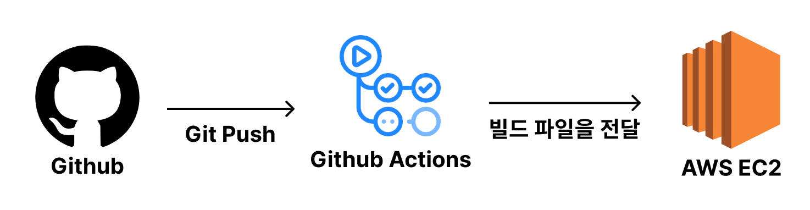

### ✅ 전체적인 흐름

### ✅ 방법1과 차이점

- 프로젝트 빌드를 Github Actions에서 하고 AWS EC2에 전달한다. 

### ✅ 장점

- 빌드 작업을 Github Actions에서 하기 때문에 운영하고 있는 서버의 성능에 영향을 거의 주지 않는다. 
- CI/CD 툴로 Github Actions만 사용하기 때문에 인프라 구조가 복잡하지 않고 간단하다. 

### ✅ 단점

- 무중단 배포를 구현하거나 여러 EC2 인스턴스에 배포를 해야 하는 상황이라면, 직접 Github Actions에 스크립트를 작성해서 구현해야 한다. 직접 구현을 해보면 알겠지만 생각보다 꽤 복잡하다. 

### ✅ 이 방법은 언제 주로 쓰는 지

- 현업에서 초기 서비스를 구축할 때 이 방법을 많이 활용한다. 
- 처음 서비스를 구현할 때는 대규모 서비스에 적합한 구조로 구현하지 않는다. 즉, 오버 엔지니어링을 하지 않는다. 확장의 필요성이 있다고 느끼는 시점에 인프라를 고도화하기 시작한다. 왜냐하면 복잡한 인프라 구조를 갖추고 관리하는 건 생각보다 **여러 측면**에서 신경쓸 게 많아지기 때문이다. 
- 인프라 구조를 변경할 때 시간이 많이 들어감
    - 에러가 발생했을 때 트러블 슈팅의 어려움
    - 팀원이 인프라 구조를 이해하기 어려워 함
    - 기능을 추가하거나 수정할 때 더 많은 시간이 들어감
    - 금전적인 비용이 더 많이 발생

