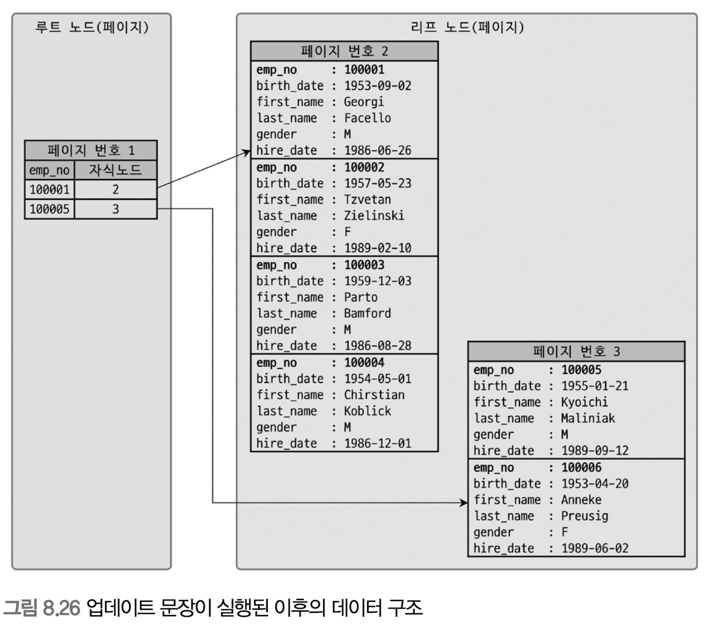

MySQL 클러스터링 인덱스는 InnoDB 스토리지 엔진에서만 지원하며, 다른 스토리지 엔진에서는 지원되지 않는다. MySQL 서버에서 클러스터링은 테이블의 레코드를 프라이머리 키를 기준으로 묶어서 저장하는 형태로 구현된다.

---

# 8.8.1 클러스터링 인덱스

클러스터링 인덱스는 테이블의 프라이머리 키에 대해서만 적용되는 내용이다. 즉, 프라이머리 키 값이 비슷한 레코드끼리 묶어서 저장하는 것을 클러스터링 인덱스라고 표현한다.

프라이머리 키 값에 의해 레코드의 저장 위치가 결정된다.

프라이머리 키 값으로 클러스터링된 테이블은 프라이머리 키 값 자체에 의존도가 상당히 크기 때문에 신중하게 프라이머리 키를 결정해야 한다.

클러스터링 인덱스는 프라이머리 키 값에 의해 저장 위치가 결정되므로 테이블의 레코드 저장 방식이라고 볼 수 있다. 클러스터링 테이블은 프라이머리 키 기반의 검색이 매우 빠르며 대신, 레코드의 저장 변경이 상대적으로 느리다. 


클러스터링 테이블의 구조 자체는 일반 B-Tree와 비슷하다.

하지만 **세컨더리 인덱스를 위한 B-Tree 리프 노드와는 다르게 클러스터링 인덱스의 리프 노드에는 레코드의 모든 칼람이 같이 저장**돼 있음을 알 수 있다.

즉, 클러스터링 테이블은 그 자체가 하나의 거대한 인덱스 구조로 관리되는 것이다.

그림 8.25 클러스터링 테이블에서 다음 쿼리와 같이 프라이머리 키 변경 문장이 실행되면 어떤 변화가 일어날까?

```sql
UPDATE tb_test SET emp_no=100002 WHERE emp_no=100007;
```



그림 8.25에서 emp_no = 100007 레코드는 3번 페이지에 저장돼 있음을 확인할 수 있었다.

하지만 그림 8.26에서는 emp_no 가 100002로 변경되면서 2번 페이지로 이동한 것을 알 수 있다.

**실제로 프라이머리 키의 값이 변경되는 경우는 거의 없을 것이다.**

### InnoDB 프라이머리 키 선택 방식

1. 프라이머리 키 존재 → 프라이머리 키를 클러스터링 키로 선택
1. NOT NULL, UNIQUE 인덱스중에서 첫 번째 인덱스를 클러스터링 키로 선택
1. 자동으로 유니크한 값을 가지도록 증가되는 칼럼을 내부적으로 추가한 후, 클러스터링 키로 선택

3번의 경우 InnoDB 스토리지 엔진이 내부적으로 레코드 일련번호를 칼럼을 생성하는데, **이렇게 추가된 프라이머리 키 칼럼은 사용자에게 노출되지 않으며, 쿼리 문장에 명시적으로 사용할 수 없다.**

InnoDB 테이블에서 클러스터링 인덱스는 테이블당 단 하나만 가질 수 있는 엄청난 혜택이므로 가능하다면 꼭 프라이머리 키를 명시적으로 생성하자.

---

# 8.8.2 세컨더리 인덱스에 미치는 영향

MyISAM, MEMORY 테이블 같이 클러스터링되지 않은 테이블은 처음 INSERT될 때 처음 저장된 공간에서 절대 이동하지 않는다. 데이터 레코드가 저장된 주소는 내부적인 레코드 아이디(ROWID) 역할을 한다.

그리고 프라이머리 키나 세컨더리 인덱스의 각 키는 그 주소(ROWID)를 이용해 실제 데이터 레코드를 찾아온다.

그래서 MyISAM, MEMORY 테이블에서는 세컨더리 인덱스와 프라이머리 키는 구조적 차이가 없다.

InnoDB 세컨더리 인덱스가 실제 레코드가 저장된 주소를 가지고 있다면 어떻게 될까?

클러스터링 키 값이 변경될 때마다 데이터 레코드의 주소가 변경되고 그때마다 해당 테이블의 모든 인덱스에 저장된 주솟값을 변경해야 할 것이다.

이런 오버헤드를 제거하기 위해서 **InnoDB 테이블의 모든 세컨더리 인덱스는 해당 레코드가 저장된 주소가 아닌 프라이머리 키 값을 저장**하도록 구현돼 있다. 

### MyISAM VS InnoDB 

```sql
CREATE TABLE employees (
		emp_no INT NOT NULL,
		first_name VARCHAR(20) NOT NULL,
		PRIMARY KEY(emp_no),
	  INDEX ix_firstname (first_name)
);
```

employees 테이블에서 first_name 칼럼으로 검색한 경우 MyISAM 테이블과 InnoDB 테이블 탐색 차이점을 비교하자.

**MyISAM** 

- ix_firstname 인덱스를 검색해서 레코드의 주소를 확인한 후, 레코드의 주소를 이용해 최종 레코드를 가져옴

**InnoDB** 

- ix_firstname 인덱스를 검색해 레코드의 프라이머리 키 값을 확인한 후, 프라이머리 키 인덱스를 검색해서 최종 레코드를 가져옴

---

# 8.8.3 클러스터링 인덱스의 장점과 단점

### 장점 

- 프라이머리 키(클러스터링 키)로 검색할 때 처리 성능이 매우 빠름(특히, 프라이머리 키 기반 범위 검색하는 경우 매우 빠름)
- 테이블의 모든 세컨더리 인덱스가 프라이머리 키를 가지고 있기 때문에 인덱스만으로 처리될 수 있는 경우가 많음(커버링 인덱스)

### 단점 

- 테이블의 모든 세컨더리 인덱스가 클러스터링 키를 갖기 때문에 클러스터링 키 값의 크기가 클 경우 전체적으로 인덱스의 크기가 커짐
- 세컨더리 인덱스를 통해 검색할 때 프라이머리 키로 다시 한번 검색해야 하므로 처리 성능이 느림
- INSERT 할 때 프라이머리 키에 의해 레코드의 저장 위치가 결정되기 때문에 성능이 느림
- 프라이머리 키를 변경할 때 레코드를 DELETE, INSERT 작업이 필요하기 때문에 처리 성능이 느림

대부분의 장점은 빠른 읽기이며, 단점은 느린 쓰기(INSERT, UPDATE, DELETE)이다.

일반적으로 웹 서비스 같은 환경은 쓰기와 읽기 비율이 2:8 또는 1:9이기 때문에 조금 느린 쓰기를 감수하고 읽기를 빠르게 유지하는 것은 매우 중요하다.

---

# 8.8.4 클러스터링 테이블 사용 시 주의사항

## 8.8.4.1 클러스터링 인덱스 키의 크기

클러스터링 테이블의 경우 모든 세컨더리 인덱스가 프라이머리 키(클러스터링 키) 값을 포함한다.

그래서 프라이머리 키의 크기가 커지면 세컨더리 인덱스도 자동으로 크기가 커진다.

일반적으로 테이블에 세컨더리 인덱스가 4~5개 정도 생성된다는 것을 고려하면 세컨더리 인덱스 크기는 급격히 증가한다. 

**프라이머리 키 크기 10바이트 VS 50바이트 (세컨더리 인덱스 5개)**

| 프라이머리 키 크기  | 레코드당 증가하는 인덱스 크기  | 100만건 레코드 저장 시 증가하는 인덱스 크기  |
| --- | --- | --- |
| 10바이트 | 10바이트 * 5 = 50바이트 | 50바이트 * 1,000,000 = 47MB |
| 50바이트 | 50바이트 * 5 = 250바이트 | 250바이트 * 1,000,000 = 238MB |

레코드 한 건만 생각하면 50바이트는 큰 차이가 없지만 레코드 건수가 100만 건만 돼도 인덱스의 크기가 190(238 - 47)MB나 증가했다. 1,000만 건이 되면 1.9GB가 증가한다.

---

## 8.8.4.2 프라이머리 키는 AUTO_INCREMENT 보다는 업무적인 칼럼으로 

프라이머리 키로 검색하는 경우(특히 범위로 많은 레코드를 검색하는 경우)매우 빠르게 처리될 수 있다.

또한 프라이머리 키는 대부분 검색에서 빈번하게 사용되는 것이 일반적이다.

그러므로 그 칼럼의 크기가 크더라도 업무적으로 해당 레코드를 대표할 수 있다면 그 칼럼을 프라이머리 키로 설정하는 것이 좋다.

---

## 8.8.4.3 프라이머리 키는 반드시 명시할 것

프라이머리 키는 꼭 생성하자. InnoDB 테이블에서 프라이머리 키를 정의하지 않으면 내부적으로 자동으로 일련번호 칼럼을 추가한다(UNIQUE + NOT NULL 인덱스가 하나도 없다면). 이렇게 자동으로 추가된 칼럼은 사용자가 전혀 접근할 수가 없다. 즉, 프라이머리 키를 정의하지 않은 경우랑 AUTO_INCREMENT 칼럼을 생성하고 프라이머리 키로 설정하는 것이 결국 똑같다. 그렇다면 당연히 사용자가 사용할 수 있는 값을 프라이머리 키로 설정하는 것이 좋다.

또한 ROW 기반 복제나 InnoDB Cluster에서는 모든 테이블이 프라이머리 키를 가져야만 정상적인 복제 기능을 보장하기도 하므로 꼭 갱성하자.

---

## 8.8.4.4 AUTO_INCREMENT 칼럼을 인조 식별자로 사용할 경우

여러 개의 칼럼이 복합으로 프라이머리 키가 만들어지는 경우 프라이머리 키의 크기가 길어질 때가 가끔 있다.

하지만 프라이머리 키의 크기가 길어도 세컨더리 인덱스가 필요치 않다면 그대로 사용하는 것이 좋다.

하지만 세컨더리 인덱스도 필요하고 프라이머리 키의 크기도 길다면 AUTO_INCREMENT 칼럼을 추가하고,

이를 프라이머리 키로 설정하면 된다. 이런 인위적으로 추가된 프라이머리 키를 **인조 식별자(Surrogate Key)**라고 한다.

---

