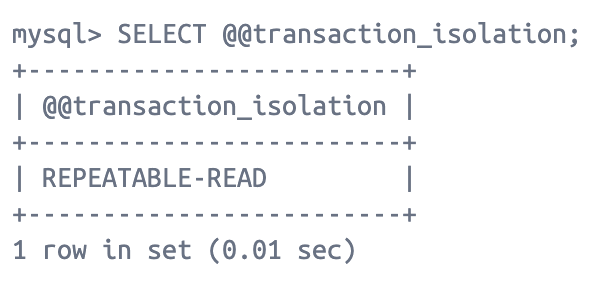
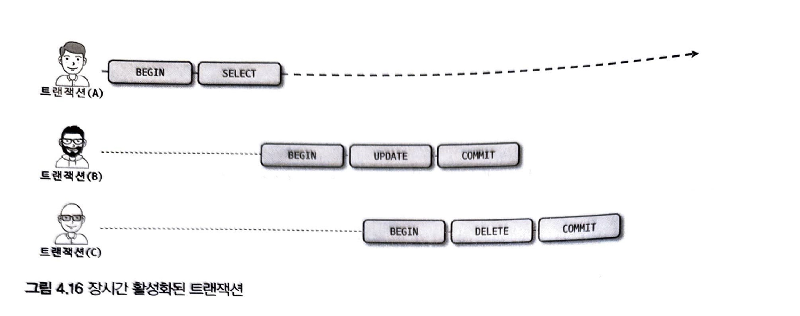
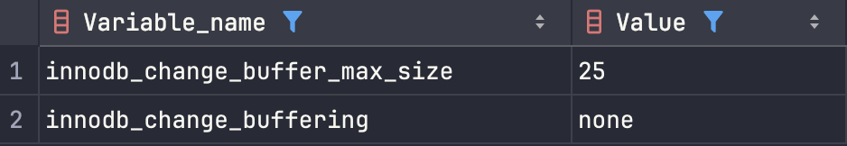

MySQL의 InnoDB는 스토리지 엔진 중 유일하게 레코드 기반의 잠금을 제공하며, 높은 동시성 처리가 가능하고 성능이 뛰어나다. 


---

# 4.2.1 프라이머리 키에 의한 클러스터링

InnoDB의 모든 테이블은 기본적으로 프라이머리 키를 기준으로 클러스터링되어 저장된다.

즉, 프라이머리 키 값의 순서대로 디스크에 저장된다. 

모든 세컨더리 인덱스는 레코드의 주소 대신 프라이머리 키 값을 논리적인 주소로 사용한다.

결과적으로 프라이머리 키는 다른 보조 인덱스에 비해 비중이 높게(쿼리 실행 계획)설정된다.

InnoDB와 다르게 MyISAM 스토리지 엔진은 클러스터링 키를 지원하지 않는다.

그래서 프라이머리 키와 세컨더리 인덱스는 구조적으로 아무런 차이가 없다.

MyISAM 테이블의 모든 인덱스는 물리적인 레코드의 주소 값(ROWID)을 가진다.

---

# 4.2.2 외래 키 지원

InnoDB 스토리지 엔진 레벨에서 지원하는 기능이다. 다른 스토리지 엔진은 지원하지 않는다.

InnoDB에서 외래 키는 부모 테이블과 자식 테이블 모두 해당 칼럼에 인덱스 생성이 필요하고, 

**변경 시에는 부모 테이블이나 자식 테이블에 데이터 존재 여부를 확인하기 때문에 잠금이 여러 테이블로 전파되고,** 

**그로 인해 데드락이 많이 발생한다.**

→ 이런 이유로 서비스용 데이터베이스에서는 외래 키를 생성하지 않는 경우도 많다. 

수동으로 데이터를 적재하거나 스키마 변경 등의 관리 작업이 실패할 수 있다.

부모 테이블과 자식 테이블의 관계를 명확히 파악해서 순서대로 작업한다면 문제없이 실행할 수 없지만,

관계가 복잡한 경우에는 간단하지 않다.  

**외래 키 체크 작업을 일시적으로 멈추는 방법**

```sql
SET foreign_key_checks=OFF;

SET SESSION foreign_key_checks=OFF;

SET GLOBAL foreign_key_checks=OFF;
```

**→ foreign_key_checks 시스템 변수를 일시적으로 비활성화** 

**SESSION**이나 **GLOBAL**키워드를 생략하면 기본적으로 **SESSION**으로 적용된다.

레코드 적재, 삭제 작업은 부가적인 체크가 필요 없기 때문에 훨씬 빠르게 처리할 수 있다.

또한 비활성화되면 ON DELETE CASCADE, ON UPDATE CASCADE 옵션도 무시하게 된다.

외래 키 체크를 일시적으로 해제했다고 해서 부모와 자식 테이블 간의 관계가 깨진 상태로 유지해도 된다는 것을 의미하지 않는다. 항상 일관성을 다시 맞추고 외래 키 체크 기능을 활성화하자!

---

# 4.2.3 MVCC(Multi Version Concurrency Control)

멀티 버전이란 하나의 레코드에 여러 개의 버전이 동시에 관리된다는 의미이다.

**MVCC의 가장 큰 목적은 잠금을 사용하지 않는 일관된 읽기 제공이다.**

InnoDB는 **언두 로그(Undo log)**를 이용해 이 기능을 구현한다.

### MVCC 예제 

격리 수준: READ_COMMITTED

**트랜잭션 격리 레벨 조회** 

```sql
SELECT @@transaction_isolation;
```



해당 결과가 **READ_COMMITTED** 레벨이면 다음 작업은 필요 없다.

```sql
SET SESSION TRANSACTION ISOLATION LEVEL READ COMMITTED; // 현재 세션

SET GLOBAL TRANSACTION ISOLATION LEVEL READ COMMITTED;  // 전체
```

**member 테이블 생성** 

```sql
CREATE TABLE member (
     m_id INT NOT NULL,
     m_name VARCHAR(20) NOT NULL,
     m_area VARCHAR(100) NOT NULL,
     PRIMARY KEY (m_id),
     INDEX ix_area (m_area)
 );
```

**데이터 삽입** 

```sql
 INSERT INTO member values(12, '홍길동', '서울');
```


```sql
UPDATE member SET m_area='경기' WHERE m_area='서울';
```


UPDATE 문장이 실행되면 **커밋 실행 여부와 관계없이 InnoDB 버퍼 풀은 새로운 값인 ‘경기’로 업데이트**된다.

디스크의 데이터 파일은  InnoDB Write 백그라운드 스레드에 의해 업데이트돼 있을 수도 있고 아닐 수도 있다.

InnoDB가 ACID를 보장하기 때문에 버퍼 풀과 데이터 파일은 동일한 상태라고 가정해도 무방하다. 

아직 COMMIT이나 ROLLBACK 되지 않은 상태에서 다른 사용자가 조회를 한다면 어디에 있는 데이터를 조회할까? →  **MySQL 격리 수준(Isolation Level)에 따라 다르다.**

```sql
SELECT * FROM MEMBER WHERE m_id = 12;
```

**READ_UNCOMMITED**

→ InnoDB 버퍼 풀이 가지는 가지고 있는 현재 변경된 데이터를 읽어서 반환한다.

**READ_COMMITED 또는 그 이상의 격리 수준**

→ 이전 내용을 보관하고 있는 언두 영역의 데이터를 반환한다.

이 과정을 **DBMS에서 MVCC**라고 표현한다.

즉, 하나의 레코드에 대해 2개의 버전이 유지되고, 상황에 따라서 다른 데이터가 보여지는 구조이다.

만약 트랜잭션이 길어지면 언두에서 관리하는 예전 데이터가 삭제되지 못하고, 언두 영역의 저장되는 공간이 많이 늘어는 상황이 발생할 수 있다.

**UPDATE & COMMIT**

InnoDB는 지금의 상태를 영구적인 데이터로 만들어 버린다.

커밋이 된다고 언두 영역의 백업 데이터가 바로 삭제되는 것은 아니다.

이 언두 영역을 필요(참조)로 하는 트랜잭션이 더는 없을 때 삭제된다.

**UPDATE & ROLLBACK**

언두 영역에 있는 백업된 데이터를 InnoDB 버퍼 풀로 복구하고, 언두 영역의 내용을 삭제한다.

**트랜잭션 ID와 함께 정리** 

```
READ_COMMITED
m_id = 12 m_name = "홍길동" m_area = "서울"
----------------------------------------------------------------------------------------

트랜잭션 A 시작 [TxID 100]
동작: UPDATE "서울" -> "경기"    
결과: InnoDB 버퍼풀: "경기" / 언두 로그:[TxID 100, "서울"]

트랜잭셤 B 시작 [TxID 101] 스냅샷: TxID 100 uncommitted 
동작: SELECT                  
결과
- 버퍼풀의 데이터가 트랜잭션 Id 100번의 데이터인데 해당 데이터는 uncommitted
- 언두 로그로 가서 "서울" READ

트랜잭션 A COMMIT
아직 언두 로그 삭제 불가능 아직 트랜잭션 B 참조중 

트랜잭션 B 종료 
언두 로그 삭제 참조되는 트랜잭션 없음
```

---

# 4.2.4 잠금 없는 일관된 읽기(Non-Locking Consistent Read)

InnoDB 스토리지 엔진은 MVCC 기술을 이용해서 잠금을 걸지 않고 읽기 작업을 수행한다.

격리 수준이 SERIALIZABLE이 아닌 모든 격리 수준에서의 순수한 읽기 작업은 다른 트랜잭션의 변경 작업과 관계없이 항상 잠금을 대기하지 않고 바로 실행된다. 이를 잠금 없는 일관된 읽기라고 표현하며, 

격리 수준에 따라서 언두 로그 또는 버퍼 풀의 데이터를 읽는다.


**순수 SELECT**는 락 무시하고 항상 읽을 수 있다.

**S-lock(SELECT FOR SHARE)** 끼리는 **공존 가능**.

- ex: 재고 감소 전에 재고 확인하고 업데이트

**X-lock(SELECT FOR UPDATE)** 가 있으면, 어떤 락도 새로 못 건다.

- ex: 은행 계좌 송출금 같이 바로 업데이트 

**트랜잭션을 빨리 완료하자**

```
일관된 읽기를 위해서 언두 로그를 삭제하지 못하고 계속 유지해야 하기 때문에 트랜잭션을 너무 오래 유지하면
MySQL 서버가 느려지거나 문제가 발생할 수 있다.

트랜잭션을 시작했으면 가능한 빠르게 롤백 또는 커밋하자.
```

---

# 4.2.5 자동 데드락 감지

InnoDB 스토리지 엔진은 내부적으로 잠금이 교착 상태에 빠지지 않았는지 체크하기 위해서 **잠금 대기 목록을 그래프 형태로 추적**한다.

InnoDB 스토리지 엔진은 **데드락 감지 스레드****를 가지고 있어서 주기적으로 잠금 대기 그래프를 확인하고 교착 상태에 빠진 트랜잭션들을 찾아서 그중 하나를 강제 종료**한다.

**강제 종료 대상은 언두 로그 레코드를 더 적게 가진 트랜잭션이 대상이 된다.**

롤백을 해도 언두 처리할 내용이 적기 때문이다. → MySQL 서버 부하도 덜하다.

**innodb_table_locks 시스템 변수**

```
MySQL 엔진에서 관리되는 테이블 잠금(LOCK TABLES)은 볼 수가 없어서 
데드락 감지가 불확실하다.

innodb_table_locks 시스템 변수를 활성화하면
InnoDB 스토리지 엔진의 내부 레코드 잠금뿐만 아니라 테이블 레벨의 잠금도 감지할 수 있다.  
```

**innodb_deadlock_detect, innodb_lock_wait_timeout 시스템 변수**

```sql
일반적인 서비스에서 데드락 감지 스레드의 작업은 크게 부담되지 않는다.
하지만 동시 처리 스레드가 많아지고 잠금의 개수가 많아지면 데드락 감지 스레드가 느려진다.
데드락 감지 스레드가 느려지면 다른 서비스 쿼리를 처리하는 스레드는 작업을 진행하지 못하고 
서비스에 악영향을 미치게 된다.

innodb_deadlock_detect를 off 설정하면 데드락 감지 스레드는 더는 동작하지 않는다.
데드락 감지를 하지 않으면 교착상태에 빠진 트랜잭션들은 무한정 대기하게 된다.

innodb_lock_wait_timeout 시스템 변수를 활성화하면 이런 데드락 상황에서 일정 시간이 지나면
자동으로 요청이 실패하고 에러 메시지를 반환하게 된다.

데드락 감지 스레드가 부담되어 innodb_deadlock_detect를 off로 설정해서 비활성화 하는 경우라면
innodb_lock_wait_timeout을 기본값인 50초보다 훨씬 낮은 시간으로 변경해서 사용하자
```

**google** 

```sql
구글에서 프라이머리 키 기반의 조회 및 변경이 아주 높은 빈도로 실행되는 서비스가 많았는데
이런 서비스는 매우 많은 트랜잭션을 동시에 실행하기 때문에 데드락 감지 스레드가 상당히 성능을 저하시킨다는 
것을 알아냈다.

만약 PK 또는 세컨더리 인덱스를 기반으로 매우 높은 동시성 처리를 요구하는 서비스가 있다면
innodb_deadlock_detect를 비활성화해서 성능 비교를 해보자.
```

---

# 4.2.6 자동화된 장애 복구

InnoDB 스토리지 엔진은 매우 견고해서 데이터 파일이 손상되거나 MySQL 서버가 시작되지 못하는 경우는 거의 발생하지 않는다. 

MySQL 서버와 무관하게 디스크나 서버 하드웨어 이슈로 InnoDB 스토리지 엔진이 자동으로 복구를 하지 못 하는 경우가 발생할 수 있다. 

InnoDB 데이터 파일은 기본적으로 MySQL 서버가 시작될 때 상상 자동 복구를 수행한다. 

이 단계에서 자동으로 복구될 수 없는 손상이 있다면 복구를 멈추고 MySQL 서버는 종료돼 버린다.

이때는 설정 파일에 **innodb_force_recovery 시스템 변수**를 설정해서 MySQL 서버를 시작해야 한다.

- InnoDB 로그 파일 손상 → 6으로 설정
- InnoDB 테이블의 데이터 파일이 손상 → 1로 설정 
- 어떤 문제인지 알 수 없다면 innodb_force_recovery 시스템 변수를 1부터 ~ 6까지 변경하면서 재시작해 본다. 값이 커질수록 데이터 손실 가능성이 커지고 복구 가능성은 작아진다.
- innodb_force_recovery가 0이 아닌 복구 모드에서는 SELECT 이외의 INSERT, UPDATE, DELETE 쿼리는 수행할 수 없다.
- MySQL 서버가 가동되고 InnoDB 테이블이 인식된다면 mysqldump를 이용해 데이터를 백업하고 그 데이터로 MySQL 서버의 DB와 테이블을 다시 생성하는 것이 좋다.

각 모드의 정리는 책 106,107을 참고하자 

---

# 4.2.7 InnoDB 버퍼 풀

InnoDB 스토리지 엔진의 가장 핵심적인 부분, 디스크의 데이터 파일과 인덱스 정보를 메모리에 캐시해 두는 공간이다. 쓰기 작업을 지연시켜 일괄 작업으로 처리할 수 있게 해주는 버퍼 역할도 한다. 

일반적인 애플리케이션에서는 INSERT, UPDAET, DELETE처럼 데이터를 변경하는 쿼리는 이곳저곳에 위치한 레코드를 변경하기 때문에 랜덤한 디스크 I/O를 발생시킨다.

하지만 버퍼 풀이 이러한 변경된 데이터를 모아서 처리하면 랜덤한 디스크 작업의 횟수를 줄일 수 있고, 클라이언트에게 빠른 응답을 제공한다.

**쓰기 작업 지연의 효과** 

애플리케이션에서 INSERT, UPDATE, DELETE처럼 데이터를 변경하는 쿼리는 데이터 파일의 이곳저곳에 위치한 레코드를 변경하기 때문에 랜덤한 디스크 작업을 발생시킨다. 

하지만 버퍼 풀이 이러한 변경된 데이터를 모아서 처리하면 랜덤한 디스크 작업의 횟수를 줄일 수 있다. 

→ 디스크 작업은 오래 걸리는 작업 (메모리에 비해 엄청 느리다)

→ 디스크에 저장된 레코드들은 배열처럼 물리적으로 연속된 공간에 저장되지 않을 수 있다. (랜덤성)

→ 모아서 처리하면 동일 블록 내의 데이터 변경 가능성이 늘어난다. → 작업 횟수가 내려간다.

---

## 4.2.7.1 버퍼 풀의 크기 설정

InnoDB 버퍼 풀의 메모리는 운영체제와 각 클라이언트 스레드가 사용할 메모리도 충분히 고려해서 설정해야 한다. 

**레코드 버퍼** 

레코드 버퍼는 각 클라이언트 세션에서 테이블의 레코드를 읽고 쓸 때 버퍼로 사용하는 공간을 말하는데, 

커넥션이 많고 사용하는 테이블도 많다면 레코드 버퍼 용도로 사용되는 메모리 공간이 꽤 많이 필요해질 수도 있다.

이 레코드 버퍼 공간은 별도로 설정할 수 없다.

### 메모리 크기에 따른 버퍼 풀 크기 설정

**InnoDB 버퍼 풀 크기 동적 조절** 

MySQL 5.7 버전부터 InnoDB 버퍼 풀 크기를 동적으로 조절할 수 있다.

크기를 적절히 작은 값으로 설정해서 조금씩 상황을 봐 가면서 증가시키는 방법이 최적이다.

**운영체제의 전체 메모리 공간이 8GB 미만**

- 50% InnoDB 버퍼 풀로 설정
- 나머지는 MySQL 서버, 운영체제, 다른 응용 프로그램이 사용할 수 있도록 확보

**운영체제의 전체 메모리 공간이 8GB 이상**

- 50%로 InnoDB 버퍼 풀로 설정하고 조금씩 올려가면서 최적점을 찾는다.

**운영체제 메모리 50GB 이상** 

- 20GB ~ 35GB를 InnoDB 버퍼 풀로 할당 

**주의점** 

```
InnoDB 버퍼 풀은 **innodb_buffer_pool_size** 시스템 변수를 통해 크기를 설정할 수 있다.
버퍼 풀의 크기 변경은 크리티컬한 변경이므로 가능하면 MySQL 서버가 한가한 시점을 골라서 진행한다.

또한 InnoDB 버퍼 풀의 크기를 늘리는 작업은 시스템 영향도가 크지 않지만
버퍼 풀의 크기를 줄이는 작업은 매우 크므로 가능하면 줄이는 작업은 하지 않도록 하자.

InnoDB 버퍼 풀은 내부적으로 128MB 청크 단위로 쪼개진다.
이는 버퍼 풀의 크기를 줄이거나 늘리는 단위로 사용된다. 
```

### 버퍼 풀 인스턴스

InnoDB 버퍼 풀은 전통적으로 버퍼 풀 전체를 관리하는 잠금(세마포어)로 인해 내부 잠금 경합을 많이 유발해왔다. 이런 경합을 줄이기 위해 버퍼 풀을 여러 개로 쪼개어 관리할 수 있게 개선됐다.

**innodb_buffer_pool_instance**  시스템 변수를 이용해 버퍼 풀을 여러 개로 분리해서 관리할 수 있는데,

각 버퍼풀을 버퍼 풀 인스턴스라고 표현한다.

기본적으로 버퍼 풀 인스턴스는 8개로 초기화된다. 하지만 전체 버퍼 풀을 위한 메모리 크기가 1GB 미만이면 버퍼 풀 인스턴스는 1개만 생성된다. 버퍼 풀 인스턴스 당 5GB 정도가 되게 인스턴스 개수를 설정하는 것이 좋다.

---

## 4.2.7.2 버퍼 풀의 구조

InnoDB 스토리지 엔진은 버퍼 풀의 메모리 공간을 페이지 크기(**innodb_page_size 시스템 변수**)의 조각으로 쪼개어 관리한다. 또한 버퍼 풀의 조각을 관리하기 위해 **LRU 리스트, Flush 리스트, Free 리스트**라는 3개의 자료 구조를 관리한다. 

| **리스트 이름** | **관리 대상** | **주요 용도** |
| --- | --- | --- |
| LRU 리스트 | 최근 사용 순서대로 정렬된 모든 페이지 | 교체 대상 선정, 캐시 효율성 유지 |
| Flush 리스트 | 디스크에 동기화되지 않은(Dirty) 페이지 | 데이터 동기화(Flush) 대상 관리 |
| Free 리스트 | 비어 있거나 재사용 가능한 페이지 | 새 페이지 할당 시 사용 |

Free 리스트는 InnoDB 버퍼 풀에서 사용자의 쿼리가 새롭게 디스크의 데이터 페이지를 읽어와야 하는 경우에 사용된다. 즉, 아직 사용자 데이터로 채워지지 않은 비어있는 페이지 목록이다.

클린 페이지가 LRU 리스트에서 제거되거나, 더티 페이지가 디스크에 동기화된 후에 Free 리스트로 이동한다.


해당 그림은 InnoDB 스토리지 엔진의 버퍼 풀 LRU 리스트이다.

정확히는 **LRU(Least Recently Used) + MRU(Most Recently Used) 리스트가 결합된 형태**이다. 

Old Sublist = LRU, New Sublist = MRU

LRU 리스트를 관리하는 목적은 데이퍼 페이지를 효율적으로 InnoDB 버퍼풀의 메모리에 유지해서 **디스크 읽기를 최소화(메모리 캐시 히트)하는 것**이다.

InnoDB의 버퍼 풀 설계는 **참조 지역성** 개념에 강하게 의존한다. 

- **시간 지역성 (Temporal Locality)**
최근에 참조된 페이지는 곧 다시 참조될 가능성이 높다

 → LRU 리스트(헤더)에 넣어준다.
- **공간 지역성 (Spatial Locality)**
현재 참조 중인 페이지 근처의 데이터도 곧 접근될 가능성이 있다 → 페이지 단위 로딩

**왜 순수 LRU가 아닌가?**

```
순수한 LRU는 새로 읽어온 페이지가 리스트의 가장 앞에 추가되어 가장 최근에 사용된 것으로 간주한다.

하지만 InnoDB에서는 새로 읽어온 페이지는 "진짜로 다시 사용될지" 확신이 없기 때문에 바로 
MRU 앞에 두지 않고, Old Sublist 중간 정도에 넣는다. 

이것은 "순간적인 대용량 스캔(I/O burst)"으로 인한 캐시 오염을 방지하기 위한 전략이다.

즉, 단순히 파일을 한 번 읽었다고 해서 그것이 정말로 "자주 쓰일 페이지"는 아니라고 보는 것이다.
```

### InnoDB 스토리지 엔진에서 데이터를 찾는 과정

1. 필요한 레코드가 저장된 데이터 페이지가 버퍼 풀에 있는지 검사 
1. InnoDB 어댑티브 해시 인덱스를 이용해 페이지 검사
  1. 해당 테이블의 인덱스(B-Tree)를 이용해 버퍼 풀에서 페이지를 검사
  1. 버퍼 풀에 이미 데이터 페이지가 있었다면 페이지의 포인트를 MRU 방향으로 승급
1. 1번에서 없었다면, 디스크에서 필요한 데이터 페이지를 버퍼 풀에 적재하고(Free 리스트에서 할당 받는다.), 적재된 페이지에 대한 포인터를 LRU 헤더 부분에 추가 
1. 버퍼 풀의 LRU 헤더 부분에 적재된 데이터 페이지가 실제로 읽히면 MRU 헤더 부분으로 승급 
(대량 읽기의 경우 데이터 페이지가 버퍼 풀로 적재는 되지만 실제 쿼리에서 사용되지는 않을 수도 있으며, 이런 경우는 MRU 방향으로 승급하지 않는다)
1. 버퍼 풀에 상주하는 데이터 페이지는 사용자 쿼리가 얼마나 최근에 접근했었는지에 따라 나이**(Age)**가 부여되며, 버퍼 풀에 상주하는 동안 쿼리에서 오랫동안 사용되지 않으면 페이지에 나이가 오래되고**(Aging)** 결국 버퍼 풀에서 제거된다**(Eviction)**. 만약 사용되면 나이가 초기화되어 다시 젊어지고 MRU 헤더 부분으로 옮겨진다.
1. 필요한 데이터가 자주 접근됐다면 해당 페이지의 인덱스 키를 어댑티브 해시 인덱스에 추가한다.

LRU는 단순하지 않고, **적재된 페이지가 실제로 사용되는지를 기준으로 승격/제거 + 어댑티브 해시 인덱스를 사용**

**디스크에서 읽어온 데이터 페이지를 적재하는 과정**

| 단계 | 설명 |
| --- | --- |
| 1. Free 리스트에서 하나의 `buf_block_t`를 꺼냄 | (버퍼 풀에서 아직 안 쓰인 슬롯) |
| 2. 디스크에서 페이지를 읽어옴 | 해당 페이지 내용을 `buf_block_t`가 가진 16KB 메모리에 복사 |
| 3. LRU 리스트의 Old Sublist 헤더에 등록 | 이제부터는 "사용 중"인 페이지로 전환됨 |
| 4. Free 리스트에서는 제거됨 | (더 이상 빈 슬롯이 아니므로) |

**buf_block_t**

- 해당 페이지의 주소
- 어떤 테이블 / 어떤 파일인지
- 페이지가 더티인지 아닌지
- 최근 사용 시점
- LRU 위치 정보 (이전/다음 노드)

이런 메타정보를 담은 “페이지 객체” 

### **플러시 리스트**

디스크로 동기화되지 않은 데이터를 가진 데이터 페이지(더티 페이지)의 변경 시점 기준의 페이지 목록을 관리

디스크에서 읽은 상태 그대로 전혀 변경이 없다면 플러시 리스트에 관리되지 않지만, 일단 한 번 데이터 변경이 가해진 데이터 페이지는 플러시 리스트로 관리되고 특정 시점이 되면 디스크로 기록돼야 한다.

데이터가 변경되면 InnoDB는 변경 내용을 리두 로그에 기록하고 버퍼 풀의 데이터 페이지에도 변경 내용을 반영한다. 그래서 리두 로그의 각 엔트리는 특정 데이터 페이지와 연결된다.

리두 로그가 디스크로 기록됐다고 해서 데이터 페이지가 디스크로 기록됐다는 것을 항상 보장하지는 않는다.

또는 반대의 경우도 발생할 수 있다. 

InnoDB 스토리지 엔진은 체크포인트를 발생시켜 디스크의 리두 로그와 데이터 페이지의 상태를 동기화하게 된다.

체크 포인트는 MySQL 서버가 시작될 때 InnoDB 스토리지 엔진이 리두 로그의 어느 부분부터 복구를 실행해야 할지 판단하는 기준점 역할을 한다. 

---

## 4.2.7.3 버퍼 풀과 리두 로그

InnoDB 버퍼 풀은 서버의 메모리가 허용하는 만큼 설정하면 할수록 데이터 캐시 히트율이 높아져서 쿼리의 성능이 빨라진다. 하지만 이미 모든 디스크의 파일이 버퍼 풀에 적재될 정도의 버퍼 풀 공간이라면 더는 버퍼 풀 크기를 늘려도 성능에 도움이 되지 않는다.

**DBMS 성능 향샹 측면에서 InnoDB 버퍼 풀은 두 가지 용도이다. 앞에서 말한 데이터 캐시 기능 + 쓰기 버퍼링** 

InnoDB 버퍼 풀의 쓰기 버퍼링 기능을 향상시키려면 InnoDB 버퍼 풀과 리두 로그와의 관계를 먼저 이해해야 한다.


InnoDB 버퍼 풀은 디스크에서 읽은 상태로 전혀 변경되지 않은 **Clean Page**와 함께 INSERT, UPDATE, DELETE 명령으로 변경된 데이터를 가진 **Dirty Page**도 가지고 있다.

Dirty Page는 언젠가는 디스크로 기록돼야 한다. 영원히 버퍼 풀에 머무를 수 없다.

리두 로그의 공간은 한정적이기 때문에 InnoDB는 스토리지 엔진은 전체 리두 로그 파일에서 재사용 가능한 공간과 재사용 불가능한 공간으로 구분해서 관리하는데, 재사용 불가능한 공간을 **활성 리두 로그(Active Redo Log)**라고 한다. 그림 4.14의 화살표를 가진 엔트리들이 활성 리두 공간이다.

리두 로그 파일의 공간은 계속 순환하면서 재사용 되지만, 로그 포지션은 기록될 때마다 고유 번호인 **LSN(Log Sequence Number)**가 증가한다.

더티 페이지는 디스크와 데이터 상태가 다르기 때문에 언젠가 동기화가 필요하다. 

버퍼 풀의 더티 페이지는 특정 리두 로그 공간과 1:1로 관계를 가지면서 체크포인트 이벤트가 발생하면 체크포인트의 LSN 보다 작은 리두 로그 엔트리와 관련된 더티 페이지는 모두 디스크로 동기화 시킨다.

**이처럼 메모리에서만 변경 작업이 일어나다가, 체크 포인트 이벤트 발생 시점에 한번에 디스크로 반영되므로 쓰기 버퍼링이라고 한다.**

가장 마지막 체크포인트의 LSN과 마지막 리두 로그 엔트리의 LSN 차이를 **체크포인트 에이지(Checkpoint Age)**라고 한다. 즉 체크포인트 에이지는 활성 리두 로그 공간의 크기를 말한다.

### 버퍼 풀과 리두 로그 간단한 예제

1. InnoDB 버퍼 풀: 100GB / 리두 로그 파일 크기: 100MB
1. InnoDB 버퍼 풀: 100MB / 리두 로그 파일 크기: 100GB

1번의 경우 리두 로그 파일의 크기가 100MB밖에 안 되기 때문에 체크 포인트 에이지도 최대 100MB만 허용된다.

평균 리두 로그 엔트리가 4KB였다면 (100MB/4KB) 정도의 더티 페이지만 버퍼 풀(플러시 리스트)에 보관할 수 있게 된다. 즉, 하나의 데이터 페이지가 16KB 면 400MB 수준밖에 안 되는 것이다.

이 경우는 버퍼 풀의 크기는 매우 크지만 실제 쓰기 버퍼링을 위한 효과는 거의 못 보는 상황이다.

2번의 경우 대략 400GB 정도의 더티 페이지를 가질 수 있다. 하지만 버퍼 풀의 크기가 100MB이기 때문에 허용 가능한 더티 페이지는 100MB 크기 보다도 적다.

리두 로그는 변경분만 가지고 버퍼 풀은 데이터 페이지를 통째로 가지기 때문에 데이터 변경이 발생해도 리두 로그는 훨씬 작은 공간만 있으면 된다.

또한 버퍼 풀의 크기가 크더라도 리두 로그 파일의 크기가 너무 크면 갑작스러운 대규모 디스크 I/O 작업으로 MySQL 서버 전체에 큰 부하가 발생할 수 있다. 

그러니 적당한 크기로 설정하고 필요하면 늘려가면서 최적값을 선택하는 것이 좋다.

---

## 4.2.7.4 버퍼 풀 플러시(Buffer Pool Flush)

MySQL 8.0 버전으로 업그레이드 되면서 대부분의 서비스에서 예전과 같은 디스크 쓰기 폭증 현상은 발생하지 않는다. 

InnoDB 스토리지 엔진의 더티 페이지의 디스크 쓰기 동기화 관련된 시스템 설정을 살펴보겠지만 특별히 성능 문제가 발생하지 않는 상태라면 굳이 이 시스템 변수들을 조정할 필요는 없다. 

InnoDB 스토리지 엔진은 버퍼 풀 더티 페이지들의 디스크 동기화를 위해 2개의 플러시 기능으로 백그라운드 작업을 한다.

- **플러시 리스트(Flush List) 플러시** 
- **LRU 리스트 (LRU List) 플러시**

---

## 4.2.7.4.1 플러시 리스트 플러시

InnoDB 스토리지 엔진은 리두 로그 공간의 재활용을 위해 주기적(체크 포인트) 오래된 리두 로그 엔트리가 사용하는 공간을 비워야 한다.

이때 오래된 리두 로그 공간이 비워지려면 버퍼 풀의 더티 페이지가 먼저 디스크로 동기화돼야 한다.

이를 위해 InnoDB 스토리지 엔진은 주기적으로 플러시 리스트 함수를 호출해서 플러시 리스트에서 오래전에 변경된 데이터를 순서대로 디스크에 동기화 작업을 수행한다.

이때 얼마나 많은 더티 페이지를 어느 주기로 디스크에 기록하느냐에 따라 사용자의 쿼리 처리가 부드럽게 처리된다. 

이를 위해 InnoDB 스토리지 엔진은 다음과 같은 시스템 변수를 제공한다.

- **innodb_page_cleaners**
- **innodb_max_dirty_pages_pct_lwm**
- **innodb_max_dirty_pages_pct**
- **innodb_io_capacity**
- **innodb_io_capacity_max**
- **innodb_flush_neighbors**
- **innodb_adaptive_flushing**
- **inndob_dapative_flushing_lwm**

### innodb_page_cleaners

더티 페이지를 디스크로 동기화하는 스레드를 **클리너 스레드(Cleaner Thread)**라고 하는데,

해당 시스템 변수를 통해 개수를 조정할 수 있다.

InnoDB 스토리지 엔진은 여러 개의 InnoDB 버퍼 풀 인스턴스를 동시에 사용할 수 있다.

```
innodb_page_cleaners > 버퍼 풀 인스턴스 개수 
-> 자동으로 클리너 스레드 개수를 버퍼 풀 인스턴스 개수(innodb_buffer_pool_instance)로 맞춘다.

innodb_page_cleaners < 버퍼 풀 인스턴스 개수 
-> 1개의 클리너 스레드가 여러 개의 버퍼 풀 인스턴스를 처리한다. 

추천 
innodb_page_cleaners = innodb_buffer_pool_instance
```

### innodb_max_dirty_pages_pct

기본적으로 InnoDB 스토리지 엔진은 전체 버퍼 풀이 가진 페이지의 90%까지 더티 페이지를 가질 수 있다.

때로는 이 값이 너무 높을 수도 있다. 이런 경우에는 해당 시스템 변수를 통해서 비율을 조정할 수 있다.

일반적으로 InnoDB 버퍼 풀은 더티 페이지를 많이 가지고 있을수록 디스크 쓰기 작업을 버퍼링함으로써 디스크 쓰기를 줄이는 효과를 극대화 할 수 있다. 

그래서 해당 시스템 변수는 기본값을 유지하는 것이 좋다.

### **innodb_max_dirty_pages_pct_lwm**

InnoDB 버퍼 풀에 더티 페이지가 많을수록 **디스크 쓰기 폭팔(Disk IO Burst) 현상**이 발생할 가능성이 높아진다.

InnoDB 스토리지 엔진은 `innodb_io_capacity` 시스템 변수에 설정된 값을 기준으로 더티 페이지 쓰기를 진행한다. 하지만 디스크로 기록되는 더티 페이지 개수보다 더 많은 더티 페이지가 발생하고 

이후 비율이 `innodb_max_dirty_pages_pct`를 초과하면, **긴급 플러시(Emergency Flush)**가 실행된다.

즉, 디스크 쓰기 폭팔이 발생한다. 그래서 InnoDB 스토리지 엔진은 해당 시스템 변수를 통해 일정 수준 이상의 더티 페이지가 발생하면 조금씩 디스크로 더티 페이지를 기록하게 한다.

기본값은 10% 수준인데 쓰기 버퍼링 효과를 더 보고 싶으면 조금 더 높은 값으로 조정해도 괜찮다.

### innodb_io_capacity & innodb_io_capacity_max 

두 시스템 변수는 데이터베이스 서버에서 어느 정도의 디스크 읽기 쓰기가 가능한지를 설정하는 값이다. 

innodb_io_capcity는 일반적인 상황에서 디스크가 적절히 처리할 수 있는지를 설정

innodb_io_capcity_max는 디스크가 최대의 성능을 발휘할 때 어느 정도의 디스크 읽고 쓰기가 가능한지를 설정

### innodb_adaptive_flushing 

MySQL 서버가 많다면 서버의 트래픽을 봐 가면서 `innodb_io_capacity`, `innodb_io_capacity_max` 설정은 번거러운 일이다.

그래서 InnoDB 스토리지 엔진은 **어댑티브 플러시(Adaptive flush) 기능을 제공한다.**

해당 시스템 변수를 통해 활성화/비활성화가 가능하고 기본값은 활성화다.

활성화하면 `innodb_io_capacity`, `innodb_io_capacity_max` 설정은 무시되고 새로운 알고리즘을 사용한다.

어댑티브 플러시 알고리즘은 리두 로그의 증가 속도를 분석해서 적절한 수준의 더티 페이지가 버퍼 풀에 유지될 수 있도록 디스크 쓰기를 진행한다.

`innodb_adaptive_flushing_lwm` **시스템 변수**는 기본값이 10%인데 전체 리두 공간에서 활성 리두 공간이 10% 미만이면 어댑티브 플러시가 동작하지 않다가 10%를 넘어서면 어댑티브 플러시 알고리즘이 작동하게 된다.

### innodb_flush_neighbors 

해당 시스템 변수는 더티 페이지를 디스크에 기록할 때 디스크에서 근접한 페이지 중에서 더티 페이지가 있다면 함께 묶어서 디스크로 기록하게 해주는 기능을 활성화할지를 결정한다.

예전에 사용하던 HDD의 경우 디스크 읽고 쓰기 비용은 매우 고비용의 작업이고, 그래서 디스크 I/O 작업의 횟수를 줄이려는 많은 노력을 했고 이 시스템 변수는 그 노력의 결과이다.

데이터 저장을 HDD로 한다면 해당 시스템 변수를 1 또는 2로 설정해서 활성화하는 것이 좋다.

하지만 요즘은 SSD를 사용하기 때문에 기본값인 비활성 모드로 유지하는 것이 좋다.

SSD는 페이지 위치와 상관없이 동일한 속도로 읽고 쓸 수 있기 때문에 인접 페이지를 묶어서 flush 하는 것은 성능상 의미가 없다. 오히려 불필요한 작업을 야기할 수 있다. 

```
나는 SSD와 HDD의 디스크 종류와 관계없이, 인접 페이지를 묶어서 flush 하면 디스크 I/O 횟수가 
줄어들어 성능상 이득이 있지 않을까? 라는 의문이 들었다.
그러나 실제로는 SSD에서는 그 이득이 없거나, 오히려 손해가 될 수 있다. 

1. 
수 많은 페이지에서 인접한 페이지를 검색 -> CPU 비용 발생
즉, SSD에서는 묶는 비용이 더 커진다.

2. 
SSD는 데이터를 직접 디스크에 쓰기 전에 내부 쓰기 버퍼에 임시 저장한 뒤,
컨트롤러가 병합/정렬 작업을 알아서 처리한다. OS나 MySQL level에서 묶는다고 해서
SSD가 이를 병합해서 효율적으로 처리해준다는 보장은 없다.

3. 
SSD는 다수의 쓰기 작업을 병렬로 처리하는 데 최적화되어 있다.
하지만 flush_neighbors를 통해 묶어서 처리하려 하면,
병렬성이 줄어들어 오히려 쓰기 처리량이 떨어질 수 있다. 
```

---

## 4.2.7.4.2 LRU 리스트 플러시 

InnoDB 스토리지 엔진은 LRU 리스트에서 사용 빈도가 낮은 데이터 페이지들을 제거해서 새로운 페이지들을 읽어올 공간을 만드는데, 이를 위해 LRU 리스트 플러시가 사용된다.

InnoDB 스토리지 엔진은 LRU 리스트 끝부분부터 시작해서 최대 `innodb_lru_scan_depth`만큼 페이지들을 스캔한다.

이때 클린 페이지는 바로 Free 리스트로 페이지를 옮기고, 더티 페이지는 디스크에 동기화하게 한다.

InnoDB 스토리지 엔진은 버퍼 풀 인스턴스 별로 최대 `innodb_lru_scan_depth` 만큼 스캔하기 때문에

실질적으로 LRU 리스트 스캔은 (`innodb_buffer_pool_instances` * `innodb_lru_scan_depth`) 수만큼 수행한다.

---

## **LRU 리스트 플러시 vs Flush 리스트 플러시 시점 비교**

| **구분** | **플러시(Flush) 발생 시점 및 목적** | **동작 방식 요약** |
| --- | --- | --- |
| **LRU 리스트** | - Free 리스트(비어 있는 페이지)의 공간이 부족할 때<br>- 버퍼 풀에서 공간 확보가 필요할 때<br>- 주로 Aging Eviction 상황 | - LRU 리스트의 Old 영역(가장 오래 사용되지 않은 페이지)부터 innodb_lru_scan_depth만큼 스캔<br>- 더티 페이지는 디스크에 동기화(Flush), 클린 페이지는 바로 Free 리스트로 이동 |
| **Flush 리스트** | - 더티 페이지(Dirty Page) 관리 공간이 부족할 때<br>- 리두 로그(Redo Log) 파일 공간이 부족할 때(체크포인트 발생)<br>- 주기적(마스터 스레드 등) | - Flush 리스트에서 변경된 시점이 오래된 더티 페이지부터 순차적으로 디스크에 동기화<br>- 리두 로그 공간 재활용 및 데이터 일관성 확보를 위해 체크포인트 시점에 강제 플러시 |

---

## 4.2.7.5 버퍼 풀 상태 백업 및 복구

**워밍업(Warming Up)**

쿼리 요청이 빈번한 서버를 셧다운 했다가 다시 시작하면 초기에 성능이 평상시보다 1/10도 안 되는 경우가 대부분이다. 이는 버퍼 풀에 사용할 데이터가 없기 때문이다. 

버퍼 풀에 데이터가 적재돼 있으면 디스크로부터 데이터를 읽지 않고 쿼리를 처리될 수 있고 이 상태를 워밍업이라고 표현한다.

**MySQL 5.5 버전 이하** 

점검을 위해 서버를 셧다운 했다가 다시 시작하는 경우 강제 워밍업을 위해 주요 테이블과 인덱스에 대해 

풀 스캔을 한 번씩 실행하고 서비스를 오픈했다.

**MySQL 5.6 버전 이후**

버퍼 풀 덤프 및 적재 기능이 도입됐다. 

MySQL 서버를 재시작해야 하는 경우 셧다운하기 전에 `innodb_buffer_pool_dumb_now`시스템 변수를 이용해 현재 InnoDB 버퍼 풀 상태를 백업할 수 있다.

그리고 다시 시작하면 `innodb_buffer_pool_load_new` 시스템 변수를 이용해 버퍼 풀의 상태를 다시 복구할 수 있다.

```sql
SET GLOBAL innodb_buffer_pool_dumb_now=ON;

SET GLOBAL innodb_buffer_pool_load_now=ON;
```

 

**InnoDB 버퍼 풀 백업 파일** 

InnoDB 버퍼 풀 백업은 데이터 디렉터리에 `ib_buffer_pool` 파일에 생성된다.

해당 파일은 InnoDB 버퍼 풀의 LRU 리스트에서 적재된 데이터의 페이지 메타 정보만 가져와서 저장하기 때문에

용량이 아무리 커도 몇십 MB 이하이다.

버퍼 풀 상태를 복구할 때 `ib_buffer_pool` 를 참고해서 실제 존재하는 데이터 페이지면 InnoDB 버퍼 풀로 적재하고 존재하지 않으면 그냥 무시한다.

즉, 실제로 존재하지 않는 데이터 페이지 정보가 파일에 명시돼 있다고 해서 서버가 종료되거나 하지는 않는다.

**InnoDB 버퍼 풀 백업 및 복구** 

메타 정보만 저장하기 때문에 백업 속도는 매우 빠르다.

하지만 복구는 버퍼 풀 크기에 따라서 상당한 시간이 걸릴 수도 있다.

InnoDB 스토리지 엔진은 버퍼 풀을 다시 복구하는 과정이 어느 정도 진행됐는지 확인할 수 있는 값을 제공한다.

```sql
SHOW STATUS LIKE 'InnoDB_buffer_pool_dump_status'
```

버퍼 풀 적재 작업에 너무 시간이 오래 걸려서 중간에 멈추고자 한다면 `innodb_buffer_pool_load_abort` 시스템 변수를 이용하면 된다.

```sql
SET GLOBAL innodb_buffer_pool_load_abort=ON:
```

보통 복구를 끝내고 서비스 시작을 하는게 좋지만 급하게 서비스를 재개해야 한다면 버퍼 풀 복구를 멈출것을 권장한다.

**InnoDB 버퍼 풀 백업 및 복구 자동화** 

InnoDB 스토리지 엔진은 MySQL 서버가 셧다운 되기 직전에 버퍼 풀의 백업을 실행하고, 다시 서버가 시작하면 

자동으로 백업된 버퍼 풀의 상태를 복구할 수 있는 기능을 제공한다.

`innodb_buffer_pool_dump_at_shutdown` , `innodb_buffer_pool_load_at_startup` 설정을 MySQL 서버 설정 파일에 넣어두면 자동화된다.

---

## 4.2.7.6 버퍼 풀의 적재 내용 확인

MySQL 8.0 버전부터  `information_schema` 데이터베이스에 `innodb_cached_indexes` 테이블이 존재한다. 테이블의 인덱스별로 데이터 페이지가 얼마나 버퍼 풀에 적재돼 있는지 확인할 수 있다. 

**자세한 쿼리는 책 페이지 119, 120 확인** 

---

# 4.2.8 Double Write Buffer 

### **파셜 페이지(Partial-page), 톤 페이지(Torn-page) 현상**

더티 페이지를 디스크 파일로 플러시 할 때 일부만 기록되는 현상

하드웨어의 오작동이나 시스템의 비정상 종료 등으로 발생할 수 있다. 

### **InnoDB 스토리지 엔진 Double-Write 기법** 

파셜 페이지 문제를 막기 위한 기법


InnoDB에서 ‘A’ ~ ‘E’ 까지의 더티 페이지를 디스크로 플러시한다고 가정

먼저 ‘A’ ~ ‘E’ 까지의 더티 페이지를 묶어서 시스템 테이블스페이스의 DoubleWrite 버퍼에 기록한다.

그리고 InnoDB 스토리지 엔진은 각 더티 페이지를 파일의 적당한 위치에 하나씩 랜덤으로 쓰기를 실행한다.

Double Write 공간은 더티 페이지가 정상적으로 기록되면 더이상 필요가 없어진다.

페이지 기록 도중에 운영체제가 비정상적으로 종료됐다고 가정해보자. 

그러면 InnoDB 스토리지 엔진은 재시작될 때 Double Wirte Buffer 내용을 데이터 파일의 페이지들과 모두 비교해서 다른 내용을 담고 있는 페이지가 존재하면 Double Write Buffer 내용을 데이터 파일의 페이지로 복사한다.

Double Write 기능은 `innodb_doublewrite` 시스템 변수로 제어할 수 있다.

Double Write 버퍼는 데이터의 안정성을 위해 사용된다.

HDD는 한번의 추가 쓰기가 별로 부담이 되지 않지만 SSD는 한번의 추가 쓰기가 부담된다.

이는 SSD의 더티 페이지 수정 방식 때문이다. 

하지만 데이터의 무결성이 중요한 서비스라면 Double Write 활성화를 고려하는 것이 좋다.

만약 데이터베이스 서버의 성능을 위해 InnoDB 리두 로그 동기화 설정(`innodb_flush_log_at_trx_commit`) 시스템 변수를 1이 아닌 값으로 설정했다면 Double Write 또한 비활성화하는 것이 좋다. 

`innodb_flush_log_at_trx_commit`

- `1`: **매 트랜잭션 커밋 시, 로그를 디스크에 동기화**하여 안정성 보장
- `0`: **트랜잭션 커밋 시, 로그를 디스크에 동기화하지 않고, OS 캐시만 사용**(성능 향상, 데이터 손실 위험 있음)
- `2`: **트랜잭션 커밋 시, 로그를 주기적으로 디스크에 동기화** (성능 향상, 어느 정도 안정성 보장)

즉, 데이터 무결성에 있어서 리두 로그의 동기화가 Double Write 보다 우선이다.

---

## 데이터 수정 동작 정리

### **데이터 수정(INSERT/UPDATE/DELETE) 동작 흐름**

- 사용자가 데이터를 변경하면, 해당 데이터 페이지는 버퍼 풀(Buffer Pool, 메모리)에 적재되고, 이 페이지는 **더티 페이지(Dirty Page)** 상태가 된다.
- 더티 페이지란, 메모리 내의 데이터가 디스크의 데이터와 달라진 상태를 의미한다.

### **리두 로그(Redo Log) 버퍼링**

- 데이터 변경이 발생하면, 변경 내용은 리두 로그 버퍼(Redo Log Buffer, 메모리)에 먼저 기록된다.
- 리두 로그 버퍼에 저장된 로그는 주기적으로, 또는 트랜잭션 커밋 시 리두 로그 파일(Redo Log File, 디스크)로 플러시된다.
- 리두 로그 파일은 고정 크기의 순환 버퍼 방식으로 디스크에 저장되며, 장애 발생 시 데이터 복구에 사용된다.

### **더티 페이지의 디스크 동기화(Flush)**

- 더티 페이지는 일정 시점(체크포인트, LRU/Flush 리스트 조건 등)에 **디스크의 데이터 파일**로 동기화된다.
- 이때, **Double Write Buffer**라는 중간 버퍼(디스크 상의 연속된 공간)에 먼저 기록한 뒤, 실제 데이터 파일에 저장함으로써 파셜 페이지(부분 기록) 문제를 방지한다.

### **체크포인트(Checkpoint)와 리두 로그 파일 공간**

- 리두 로그 파일(디스크)의 공간이 부족해지면, 체크포인트가 발생하여 **체크포인트 LSN**보다 이전의 더티 페이지를 디스크에 동기화하고, 해당 로그 공간을 재사용할 수 있게 만든다.
- 체크포인트는 데이터 무결성과 장애 복구를 위한 핵심 메커니즘이다.

### **핵심 요약**

- 데이터 변경 시, 메모리(버퍼 풀, 리두 로그 버퍼)에서 먼저 처리되고
- 리두 로그 파일(디스크)에 장애 복구용으로 기록한 뒤
- 더티 페이지는 Double Write Buffer를 거쳐 안전하게 데이터 파일(디스크)로 동기화됨.
- 리두 로그 파일 공간이 부족하면 체크포인트가 발생해 더티 페이지를 디스크에 기록하고 로그 공간을 재활용

---

# 4.2.9 언두 로그

InnoDB 스토리지 엔진은 트랜잭션과 격리 수준 보장을 위해서 DML로 변경되기 이전 버전의 데이터를 별도로 백업한다. 이렇게 백업된 데이터를 **언두 로그(Undo Log)**라고 한다.

**트랜잭션 보장**

- 트랜잭션이 롤백되면 트랜잭션 도중 변경된 데이터를 변경 전 데이터로 복구해야 하는데, 이때 언두 로그에 백업해둔 이전 버전의 데이터를 이용해 복구한다.

**격리 수준 보장** 

- 특정 커넥션에서 데이터를 변경하는 도중에 다른 커넥션에서 데이터를 조회하면 격리 수준에 맞게 변경중인 레코드를 읽지 않고 언두 로그에 백업해둔 데이터를 읽어서 반환하기도 한다.

---

## 4.2.9.1 언두 로그 모니터링

다음과 같은 업데이트 문장을 실행했다고 해보자.

```sql
UPDATE MEMBER SET name='홍길동' WHERE member_id=1;
```

위 문장이 실행되면 트랜잭션을 커밋하지 않아도 실제 데이터 (데이터/인덱스 버퍼) 내용은 ‘홍길동’으로 변경된다. 변경되기 전의 값이 ‘벽계수’였다면, 언두 영역에는 ‘벽계수’라는 값이 백업되는 것이다.

이 상태에서 커밋하면 현재 상태가 그대로 유지되고, 롤백하면 언두 영역의 데이터를 다시 버퍼 풀로 복구한다.

언두 로그의 데이터는 크게 두 가지 용도로 사용되는데, 첫 번째 용도가 바로 위에서 언급한 트랜잭션의 롤백 대비용이다.

두 번째 용도는 트랜잭션의 격리 수준을 유지하면서 높은 동시성을 제공하는 데 있다.

트랜잭션의 격리 수준이라는 개념이 있는데, 이는 동시에 여러 트랜잭션이 데이터를 변경하거나 조회할 때 한 트랜잭션의 작업 내용이 다른 트랜잭션에 어떻게 보일지를 결정하는 기준이다.

### 언두 로그 공간 문제 

**대용량의 데이터를 처리하는 트랜잭션** 

예를 들어, 1억 건의 레코드가 저장된 100GB 크기의 테이블을 DELETE로 삭제한다고 가정해보자. 

1억 건의 레코드가 테이블에서 삭제되고 언두 로그로 복사돼야 한다.

즉, 테이블 크기만큼 언두 로그의 공간 사용량이 늘어나 결국 언두 로그 공간이 100GB가 되는 것이다.

**트랜잭션이 오랜시간 실행될 때**



트랜잭션이 완료됐다고 해서 해당 트랜잭션이 생성한 언두 로그를 즉시 삭제할 수 있는 것은 아니다.

그림 4.16을 보면 B트랜잭션과 C트랜잭션은 완료됐지만 가장 먼저 시작된 트랜잭션 A는 완료되지 않은 상태이다.

트랜잭션 B와 트랜잭션 C는 UPDATE, DELETE 작업을 했기 때문에 언두 로그에 백업했다.

먼저 시작된 트랜잭션 A가 아직 활성 상태이기 때문에 B와 C 트랜잭션의 완료 여부와 상관없이 언두 로그에서 삭제되지 않는다. 즉, 디스크의 언두 로그 저장 공간은 계속 증가한다.

또한 빈번하게 변경된 레코드를 조회하는 쿼리가 실행되면 InnoDB 스토리지 엔진은 언두 로그의 이력을 필요한 만큼 스캔해야만 필요한 레코드를 찾을 수 있기 때문에 쿼리의 성능이 전반적으로 떨어지게 된다.

| 구분 | 설명 |
| --- | --- |
|  메모리 우선 | 처음에는 **버퍼 풀의 언두 세그먼트**(undo segment)에 메모리에 저장됨 |
| 디스크 백업 | **커밋 시점**에 **redo log**와 함께 **언두 로그도 디스크로 기록**됨 |
| Purge 조건 | **모든 트랜잭션이 해당 언두 로그를 참조하지 않을 때만 삭제 가능** |
| Evict 가능성 | **버퍼 풀이 가득 차거나 오랫동안 참조되지 않으면 evict**되어 디스크에서 읽어야 함 |
| 성능 트레이드오프 | 자주 변경되는 레코드를 과거 트랜잭션이 참조하면 **디스크 I/O가 증가해 성능 저하** 발생 |

이는 버퍼 풀에 메모리가 제한적이여서 다른 트랜잭션에서 참조된다고 하더라도 무한정 언두 로그를 들고 있을 수 없기 때문

**READ COMMITTED 이상 MVCC 관점**

1. **트랜잭션 A 시작**
→ 현재 시점의 트랜잭션 ID `trx_id_A`를 기준으로 **가시성 판단**이 시작됨.
1. **트랜잭션 B 시작 + UPDATE** `id = 1`
→ 변경 전 레코드는 **언두 로그에 저장 (버퍼 풀 메모리 내)**

→ 실제 데이터는 버퍼 풀에서 변경됨 (하지만 아직 커밋 전)
1. **트랜잭션 B 커밋**
→ 변경된 레코드와 함께 리두 로그 + 언두 로그가 디스크에 동기화(flush)됨

→ **InnoDB는 언두 로그도 redo log에 의해 복구 가능해야 하기 때문**

→ 단, **트랜잭션 A가 살아 있으므로 언두 로그는 삭제되지 않음**
1. **트랜잭션 A SELECT** `id = 1` **실행**
→ `trx_id_B`가 **A보다 나중에 커밋된 트랜잭션**

→ 따라서 A는 **B의 변경 사항을 보면 안 됨 → 언두 로그 참조 필요**

→ 언두 로그가 **버퍼 풀에 있으면 메모리 참조**,

없으면(evict 상태) **디스크에서 언두 로그를 읽어 복원한 후 참조**

언두 로그는 메모리에서 더이상 참조하는 트랜잭션이 없거나, 메모리가 부족하면 자연스럽게 evict 

또한 커밋하면서 디스크에 저장된 언두 로그는 참조되는 트랜잭션이 없다면 백그라운드 쓰레드(Purge Thread)에 의해서 주기적으로 삭제된다.

**언두 로그 모니터링** 

서비스 중인 MySQL 서버에서 활성 상태의 트랜잭션이 장시간 유지되는 것은 성능상 좋지 않다.

그래서 MySQL 서버의 언두 로그를 얼마나 증가했는지 항상 모니터링하는 것이 좋다.

**모든 버전에서 사용 가능한 명령어** 

```sql
SHOW ENGINE INNODB STATUS

# 결과
------------
TRANSACTIONS
------------
Trx id counter 2576
Purge done for trx's n:o < 2571 undo n:o < 0 state: running but idle
**History list length 0**
...
```

**MySQL 8.0 버전에서 사용 가능한 명령어** 

```sql
SELECT count 
FROM information_schema.innodb_metrics
WHERE SUBSYSTEM='transaction' AND NAME='trx_rseg_history_len';
```

레코드 데이터를 업데이트 하고 커밋하거나 롤백하면 History list length / count가 증가한다.

아마 버퍼 풀의 메모리에 언두 로그 수를 검색하는 게 아닌 디스크에 일시적으로 저장된 언두 로그 수를 카운트 하는것 같다.

**주의** 

MySQL 서버에서 INSERT 문장으로 인한 언두 로그와 UPDATE(DELETE) 언두 로그는 별도로 관리된다.

INSERT 문장으로 인한 언두 로그는 MVCC를 위해서는 사용되지 않고 오직 롤백이나 데이터 복구만을 위해서 사용되기 때문이다.

예제에서 보인 언두 로그의 건수에는 UPDATE, DELETE 문장으로 인한 언두 로그 개수만 표시된다.

---

## 4.2.9.2 언두 테이블스페이스 관리

언두 로그가 저장되는 공간을 **언두 테이블스페이스(Undo Tablespace)**라고 한다.

**언두 테이블스페이스 MySQL 버전별 차이**

```
5.6 이전 버전 
언두 로그가 모두 시스템 테이블스페이스(ibdata.idb)에 저장
문제점: 서버가 초기화될 때 생성되기 때문에 확장의 한계가 존재

5.6 버전
innodb_undo_tablespaces 시스템 변수 도입
innodb_undo_tablespaces > 2
-> 시스템 테이블스페이스가 아닌 별도의 언두 로그 파일을 사용

5.6 이후 버전에서도 innodb_undo_tablespaces = 0 설정 시 
언두로그가 테이블스페이스에 저장

8.0 이후
innodb_undo_tablespaces 시스템 변수 Deprecated
언두로그는 항상 시스템 테이블스페이스 외부의 별도 로그파일로 기록되도록 개선 
```

**언두 테이블스페이스 구조** 


하나의 언두 테이블 스페이스가 1개 이상 128개 이하의 롤백 세그멘트를 가진다.

롤백 세그멘트는 InnoDB 페이지의 크기를 16바이트로 나눈 값의 개수만큼 언두 슬롯을 가진다.

하나의 트랜잭션이 필요로 하는 언두 슬롯의 개수는 쿼리 특성에 따라 최대 4개까지 사용하지만 일반적으로는 2개의 언두 슬롯을 사용한다고 가정한다.

최대 동시 트랜잭션 수 = (InnoDB 언두 스페이스 개수) * (언두 테이블 스페이스가 1개 이상 128개 이하의 롤백 세그멘트) * (InnoDB 페이지 크기 / 16 = 하나의 롤백 세그멘트가 가지는 언두 슬롯) / 2(하나의 트랜잭션이 필요한 언두 슬롯)

기본 설정 기준 최대 동시 트랜잭션 수 = (`innodb_undo_tablespaces = 2`) * (128) * (1024) / 2 

- 1024 * 128 = 131072 정도의 트랜잭션이 동시에 처리 가능하다.

더 자세한 내용은 책 127, 128 참고 

---

# 4.2.10 체인지 버퍼 

RDBMS에서 레코드가 변경될 때 데이터 파일을 변경하는 작업뿐 아니라 테이블에 포함된 인덱스를 업데이트하는 작업도 필요하다. 인덱스를 변경하는 작업은 랜덤하게 디스크를 읽는 작업이 필요하므로 테이블에 인덱스가 많다면 이 작업은 상당히 많은 자원을 소모하게 된다.

InnoDB는 변경해야 할 인덱스 페이지가 버퍼 풀에 존재하면 업데이트를 바로 수행하지만 그렇지 않다면 디스크로부터 읽어와서 업데이트해야 한다면 이를 즉시 실행하지 않고 **임시 메모리(체인지 버퍼)**에 저장해 두고 사용자에게 결과를 반환하는 형태로 성능을 향상시킨다. 

사용자에게 결과를 전달하기 전에 반드시 중복 여부를 체크해야 하는 유니크 인덱스는 체인지 버퍼를 사용할 수 없다. 체인지 버퍼에 임시로 저장된 인덱스 페이지는 이후 백그라운드 스레드인 체인지 버퍼 **머지 스레드(Merge Thread)**에 의해 처리된다.

| **정리**  |
| --- |
| 데이터 페이지는 변경 시 더티 페이지가 되어 플러시 리스트에 올라간다 |
| 인덱스 변경은 리소스가 크므로 체인지 버퍼를 통해 지연 처리할 수 있다 |
| 버퍼 풀에 있다면 바로 수정, 없다면 체인지 버퍼 사용 |
| 유니크 인덱스는 중복 확인이 필요하므로 체인지 버퍼 사용 불가 |
| PK는 자주 접근되므로 대부분 버퍼 풀에 있어 성능 문제가 덜하다 |
| 보조 유니크 인덱스는 버퍼 풀에 없으면 디스크를 읽어야 하므로 느려진다 |

| 조건 | 처리 방식 | 체인지 버퍼 사용 여부 | 사용자 응답 속도 |
| --- | --- | --- | --- |
| 버퍼 풀에 있음 | 메모리에서 직접 수정 | ❌ 사용 안 함 | 빠름 ✅ |
| 버퍼 풀에 없음 + 보조 인덱스 | 체인지 버퍼에 저장 | ✅ 사용함 | 빠름 ✅ |
| 버퍼 풀에 없음 + 유니크 인덱스 | 디스크에서 읽어 수정 | ❌ 사용 불가 | 느림 ❌ |

`innodb_change_buffering` 시스템 변수를 통해 작업의 종류별로 체인지 버퍼를 활성화할 수 있다.

체인지 버퍼가 비효율적일 때는 체인지 버퍼를 사용하지 않게 설정할 수 있다.

`innodb_change_buffering` 시스템 변수에 설정할 수 있는 값

- all: 모든 인덱스 관련 작업(inserts + deletes + purges)
- none: 버퍼링 안함
- inserts: 인덱스에 새로운 작업을 추가하는 작업만 버퍼링
- deletes: 인덱스에서 기존 아이템을 삭제하는 작업(삭제됐다는 마킹 작업)만 버퍼링
- MVCC: 모든 트랜잭션이 참조하지 않아서 언두 로그가 삭제될 때 물리적으로 삭제(purges)
- changes: 인덱스에 추가하고 삭제하는 작업만(inserts + deletes)버퍼링
- purges: 인덱스 아이템을 영구적으로 삭제하는 작업만 버퍼링(백그라운드 작업)

**체인지 버퍼 플러시 시점 4가지** 

1. 해당 인덱스 페이지가 버퍼 풀로 로딩될 때 체인지 버퍼의 인덱스 페이지 변경 내용을 먼저 병합
1. 백그라운드 스레드를 통한 주기적 병합 
1. 해당 인덱스 페이지가 플러시될 때 먼저 체인지 버퍼 플러시
1. MySQL 종료 직전

인덱스 페이지 VS 데이터 페이지

```
id(PK) name(index) age area 4개의 컬럼이 존재하는 테이블(member) 가정

레코드: 1 '배제우' 28 '대한민국'

UPDATE member SET name = '배제우2' WHERE name = '배제우';

데이터 페이지(클러스티드 인덱스) 1 배제우 28 대한민국 -> 더티 페이지 즉, 버퍼 풀 플러시 리스트에 보관
인덱스 페이지(name 인덱스) LRU에 보관  

언두 로그에 저장
리두 로그에 저장

커밋하면 언두 로그, 리두 로그 모두 디스크에 동기화

인덱스 페이지는 체인지 버퍼에 임시 저장으로 버퍼링 (버퍼 풀에 없었다고 가정)

플러시 리스트에 있는 데이터 페이지는 리두 로그 특정 체크 포인트(어댑티브 알고리즘)에 의해 디스크로 플러시 
추후에 인덱스 페이지는 LRU 리스트에서 Old 리스트로 이동하고 evict 대상이될 때 
체인지 버퍼에 있는 인덱스 페이지 디스크로 플러시
```

**UPDATE 버퍼링** 

```
InnoDB는 클러스터드 인덱스(primary key 기반 데이터 저장)을 기반
보조 인덱스(secondary index)의 값을 변경하는 경우,

해당 보조 인덱스의 기존 값을 삭제하고, 새 값을 삽입하는 형태로 동작.

예시로, 보조 인덱스 컬럼이 name이고
이 값을 "Tom"에서 "Jerry"로 바꾸면

-- 내부적으로는
DELETE name='Tom' (보조 인덱스에서 삭제 마킹)
INSERT name='Jerry' (보조 인덱스에 새로 삽입)
```

체인지 버퍼는 기본적으로 InnoDB 버퍼 풀로 설정된 메모리 공간의 25% 까지 사용할 수 있게 설정 

필요하면 50% 까지도 가능하다. 

INSERT, UPDATE, DELETE 등이 너무 빈번하게 실행되어 체인지 버퍼가 더 많은 버퍼 풀을 사용할 수 있게 하고자 한다면 `innodb_change_buffer_max_size` 시스템 변수로 비율을 설정하면 된다.

**체인지 버퍼가 사용 중인 메모리 크기 확인** 

```sql
SELECT EVENT_NAME, CURRENT_NUMBER_OF_BYTES_USED
FROM performance_schema.memory_summary_global_by_event_name
WHERE EVENT_NAME='memory/innodb/ibuf0ibuf';


# 결과 
144 
```

 **체인지 버퍼 관련 오퍼레이션 처리 횟수**

```sql

SHOW ENGINE INNODB STATUS


# 결과 
-------------------------------------
INSERT BUFFER AND ADAPTIVE HASH INDEX
-------------------------------------
Ibuf: size 1, free list len 0, seg size 2, 0 merges
merged operations:
 insert 0, delete mark 0, delete 0
discarded operations:
 insert 0, delete mark 0, delete 0
```

**변수 확인** 

```sql
SHOW GLOBAL VARIABLES LIKE 'innodb_change_buffer%';
```



**default: none** 

---

# 4.2.11 리두 로그 및 로그 버퍼

**리두 로그(Redo Log)**는 ACID 중에서 Durable에 해당하는 영속성과 연관돼 있다.

리두 로그는 하드웨어나 소프트웨어 등 여러 가지 문제점으로 인해 MySQL 서버가 비정상적으로 종료됐을 때

데이터 파일에 기록되지 못한 데이터를 잃지 않게 해주는 안정장치다.

서버는 데이터 변경 내용을 로그로 먼저 기록한다.

데이터의 파일 쓰기는 디스크의 랜덤 엑세스가 필요하다. 

→ 변경된 데이터 기록은 큰 비용이 필요

→ 변경 내용은 리두 로그에 기록하고 추후 디스크 flush (버퍼링, 쓰기 지연)

→ 장애 발생 시 리두 로그를 사용해 커밋된 트랜잭션만 복구 가능

데이터 베이스 서버는 ACID도 중요하지만 성능 또한 중요하기 때문에 데이터 파일은 InnoDB 버퍼 풀로 버퍼링 리두 로그는 로그 버퍼로 버퍼링한다.

MySQL 서버가 비정상 종료되는 경우 InnoDB 스토리지 엔진은 두 가지 종류의 일관되지 않은 데이터를 가진다.

1. 커밋됐지만 데이터 파일에 기록되지 않은 데이터
1. 롤백됐지만 데이터 파일에 이미 기록된 데이터

**디스크 flush 시점과 로그 flush 시점** 

```
디스크 flush 시점은 다양하다. 
- InnoDB 버퍼풀 메모리 부족으로 디스크 flush (커밋/롤백 이전)
- 로그 버퍼 메모리 부족으로 디스크 flush (커밋/롤백 이전)
- 커밋/롤백  이후 

언두 로그 / 리두 로그 디스크 flush 시점 
- 언제나 커밋/롤백 발생 시 디스크로 동기화
- 언두 로그는 만약 참조되는 트랜잭션이 없다면 롤백 시점에 디스크로 동기화 X

InnoDB의 설계는 커밋 = 반드시 데이터 페이지 디스크 반영이 아니라, 커밋 = 로그 디스크 반영
참고로 인덱스 페이지는 체인지 버퍼를 통한 다른 생명주기를 가진다.

Q: 커밋됐지만 데이터 파일에 기록되지 않은 데이터?
A: 리두 로그는 디스크로 동기화 했지만 데이터 파일(디스크)에 동기화 되지 않은 케이스

Q: 백됐지만 데이터 파일에 이미 기록된 데이터
A: 롤백 이전에 이미 디스크 flush가 발생했고 이후 롤백으로 버퍼 풀에서는 되돌렸지만
디스크를 이전 상태로 바꾸지 않은 케이스
```

1번의 경우 리두 로그에 저장된 데이터를 데이터 파일에 복사하면 끝이다.

2번의 경우 변경되기 전 데이터를 가진 리두 로그의 내용을 가져와 데이터 파일에 복사하면 된다.

2번의 경우에도 리두 로그는 필요하다. 

→ 그 변경이 커밋됐는지, 롤백됐는지, 아니면 트랜잭션의 실행 중간 상태였는지를 확인하기 위해서 필요하다.

**`innodb_flush_log_at_trx_commit`**

데이터베이스 서버에서 **리두 로그는 트랜잭션이 커밋되면 즉시 디스크로 기록되도록 시스템 변수를 설정하는 것을 권장**한다. 서버가 비정상적으로 종료됐을 때 직전까지의 트랜잭션 커밋 내용이 리두 로그에 기록될 수 있고, 그 리두 로그를 이용해 장애 직전 시점까지의 복구가 가능하다.

```
**✅ 기록(write)**
리두 로그 내용을 운영체제의 파일 시스템 캐시(메모리)에 저장
즉, write() 시스템 콜로 디스크로 가는 준비만 하는 상태
디스크로 바로 가지 않음 (OS의 페이지 캐시에 있음)

**✅ 동기화(sync, fsync)**
운영체제의 파일 시스템 캐시에 있는 내용을 실제 디스크에 물리적으로 기록
즉, fsync() 호출을 통해 디스크에 보장된 상태로 저장

**innodb_flush_log_at_trx_commit = 0**
1초에 한 번씩 리두 로그를 디스크로 기록, 동기화 
서버가 비정상 종료되면 최대 1초 동안 커밋된 트랜잭션의 데이터가 사라질 수 있다. 

**innodb_flush_log_at_trx_commit = 1**
매번 트랜잭션이 커밋될 때마다 디스크로 기록, 동기화 
서버가 비정상 종료되더라도 커밋된 내용은 복구가 가능하다.

**innodb_flush_log_at_trx_commit = 2** 
매번 트랜잭션이 커밋될 때마다 디스크로 기록하지만 동기화는 1초에 한번만 한다.
일단 트랜잭션이 커밋되면 운영체제의 메모리 버퍼로 기록되는 것이 보장된다. 
MySQL 서버가 비정상 종료됐더라도 운영체제가 살아있으면 데이터는 사라지지 않는다.
하지만 서버와 운영체제 모두 비정상적으로 종료되면 최근 1초 동안의 트랜잭션 데이터는 사라질 수 있다.
```

**추가 디테일** 

```
**innodb_flush_log_at_trx_commit = 0, 2** 인 경우 
- 항상 1초마다 동기화를 하지는 않는다. 스키마 변경을 위한 DDL이 발생하면 1초보다 간격이 적을 수 있다.
- 디스크 동기화 시간 간격을 **innodb_flush_log_at_timeout** 시스템 변수로 변경이 가능하다.
```


**InnoDB 스토리지 엔진의 리두 로그 파일들의 전체 크기는 InnoDB 스토리지 엔진의 버퍼 풀의 효율성을 결정**하기 때문에 신중히 결정해야 한다.

```
데이터 변경 -> 리두 로그 버퍼(메모리)에 리두 로그를 기록한다.

데이터 커밋 -> 리두 로그 버퍼에 있는 리두 로그를 리두 로그 파일(디스크)에 저장한다.

실제 데이터 페이지에 대한 디스크 flush 시점은 다양하다
- 버퍼 풀 메모리 부족(OldList)
- 리두 로그 파일 부족(체크 포인트 에이징) 자세한 내용은 버퍼 풀 크기와 리두 로그 관계를 다시 보자

리두 로그에 해당하는 데이터 페이지가 디스크로 동기화되면 리두 로그 파일의 리두 로그 또한 삭제된다.
```

리두 로그 파일 크기 = `innodb_log_file_size` (파일 크기) * `innodb_log_files_in_group` (파일 개수)

리두 로그 파일의 전체 크기가 InnoDB 버퍼 풀 크기에 맞게 적절히 선택돼야 InnoDB 스토리지 엔진이 적절히 변경된 내용을 버퍼 풀에 모았다가 한 번에 모아서 디스크에 기록할 수 있다.

사용량(변경 작업)이 매우 많은 DBMS 서버의 경우 리두 로그를 메모리로 임시 저장하는 작업이 큰 문제가 되는데

이때 로그 버퍼를 통해서 버퍼링하고 로그 버퍼의 크기의 기본값은 16MB 이지만, BLOB TEXT 같이 큰 데이터를 자주 변경하는 경우에는 더 크게 설정하는 것이 좋다.  

---

## 4.2.11.1 리두 로그 아카이빙

MySQL 8.0 버전부터 InnoDB 스토리지 엔진의 리두 로그를 아카이빙할 수 있는 기능이 추가됐다.

```
리두 로그 아카이빙?

커밋된 트랜잭션을 복구 가능하게 하기 위해 리두 로그를 삭제하지 않고 별도로 백업/보관하는 작업.

주요 목적
- 장애 복구 시 지정 시점까지 데이터 복구
- 백업 이후부터 현재까지의 변경 사항을 리두 로그로 재적용
```

더 자세한 내용은 책 페이지 133~135 확인 

---

## 4.2.11.2 리두 로그 활성화 및 비활성화

MySQL 8.0 버전부터 리두 로그를 수동으로 비활성화 할 수 있다.

대용량 파일을 한번에 적재하는 경우 리두 로그를 비활성화 해서 적재 시간을 단축시킬 수 있다. 

적재가 끝나면 항상 다시 활성화하는 것을 잊지 말자

더 자세한 내용은 책 페이지 135~136 확인

---

# 4.2.12 어댑티브 해시 인덱스

어댑티브 해시 인덱스는 B-Tree 검색 시간을 줄여주기 위해 도입된 기능이다.

InnoDB 스토리지 엔진은 자주 읽히는 데이터 페이지의 키 값을 이용해 해시 인덱스를 만들고, 필요할 때마다 어댑티브 해시 인덱스를 검색해서 레코드가 저장된 데이터 페이지를 즉시 찾아갈 수 있다.

B-Tree를 루트 노드부터 리프 노드까지 찾아가는 비용이 없어지고 그만큼 CPU가 적은 일을 하지만, 쿼리의 성능은 빨라진다. 즉, 컴퓨터는 동시에 더 많은 쿼리를 처리할 수 있다.

사용자는 `innodb_dapative_hash_index` 시스템 변수를 이용해서 어댑티브 해시 인덱스 기능을 활성화 또는 비활성화 할 수 있다. 

```sql
SHOW VARIABLES LIKE 'innodb_adaptive_hash_index';

# 결과 
OFF
```

해시 인덱스는 인덱스 키 값과 해당 인덱스 키 값이 저장된 데이터 페이지의 주소 쌍으로 관리된다.

인덱스 키 값은 B-Tree 인덱스의 고유 번호와 B-Tree 인덱스의 실제 키 값 조합으로 생성된다.

데이터 페이지의 주소는 InnoDB 버퍼 풀에 로딩된 페이지의 주소를 의미한다.

**즉, 버퍼 풀에서 해당 페이지가 사라지면 어댑티브 해시 인덱스에서도 해당 페이지의 정보가 사라진다**.

어댑티브 해시 인덱스 자세한 내용은 페이지 137~141 확인

---

# 4.12.13 InnoDB와 MyISAM, MEMORY 스토리지 엔진 비교

MySQL 8.0 이후 버전부터는 모든 MySQL 서버 기능이 InnoDB 스토리지 엔진을 기반으로 한다.

MyISAM, MEMORY 스토리지 엔진은 추후 버전에서 사라질 가능성이 높다.

---

