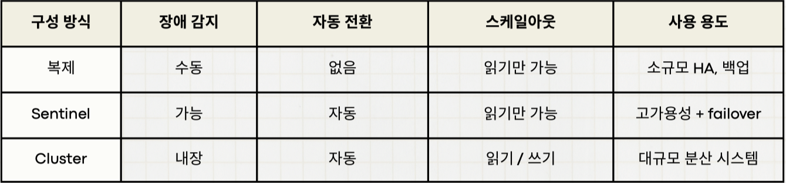
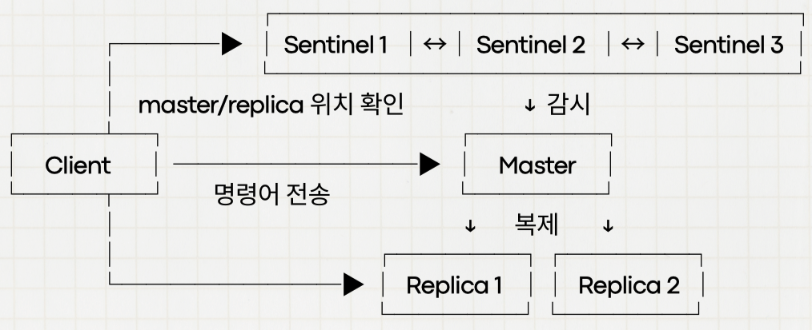
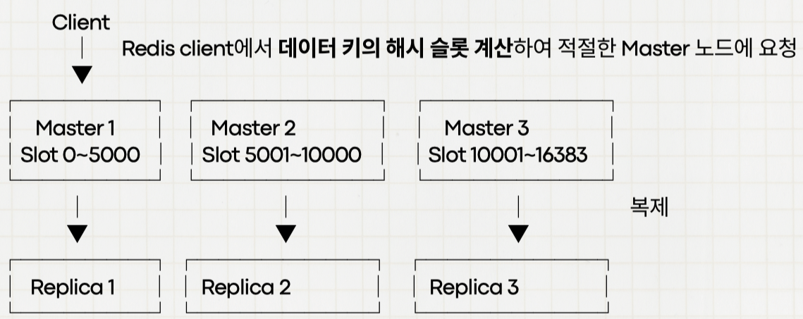

# Redis에서의 복제와 고가용성 개요

### 단일 인스턴스의 한계

Redis는 기본적으로 단일 프로세스 기반의 인메모리 데이터베이스

이 구조는 빠르지만 단일 장애지점(SPOF)이 존재

- **메모리 기반 특성:** 장애 시 데이터 손실 가능
- **서버 자체 장애:** Redis 프로세스 크래시, OS 문제 등
- **네트워크 단절:** 클라이언트와 연결 불가 상황
- **운영 환경:** 단일 인스턴스만으로는 안정성 확보 어려움

### 복제의 도입 목적

복제는 Redis가 고가용성과 확장성을 갖추기 위해 가장 먼저 적용할 수 있는 기본 전략

- **고가용성 확보:** 장애 시 Replica를 통해 빠른 복구 가능
- **읽기 분산:** Replica를 통해 read 처리 분산 가능
- **백업/테스트 분리:** Replica를 활용한 비파괴 테스트 및 데이터 스냅샷
- **지역 복제:** 멀티 리전 환경에서의 데이터 복제 구성 가능

### Redis 고가용성 구성 전략

- **단순 복제:** Master → Replica 구성을 통한 기본 복제
- **Sentinel 구성:** 장애 감지 및 자동 failover 수행
- **Redis Cluster:** 파티셔닝 + 복제 + 자동 장애 전환 포함된 고급 구성
- **Hybrid 구성:** 복제 + Sentinel 또는 Cluster 병행 사용

### 구성 전략별 비교

Redis 고가용성 구성 방식들 비교



Replication + Sentinel이 현실적인 기본값

Cluster는 쓰기 확장성과 자동 파티셔닝이 필요한 경우에만 선택

---

# Master-Slave 복제

### 복제의 기본 개념

Redis는 단방향 **Master → Replica 복제**를 통해 **읽기 부하 분산과 장애 대비**를 지원

- **복제 방향:** Master → Replica (쓰기 → 읽기 복제)
- **쓰기/읽기 분리:** Master는 쓰기 전용, Replica는 기본 읽기 전용
- **복제 목적:** 장애 복구, 읽기 부하 분산
- **구조 특성:** 단순하고 빠르지만 실시간 일관성 보장 불가

### 복제의 작동 원리

Redis 복제는 **full sync**와 **명령어 스트리밍**으로 구성

- **최초 연결 시:** Replica가 Master로부터 RDB 스냅샷을 수신 (full sync)
- **이후 실시간 복제:** Redis 프로토콜 기반 명령어 스트리밍
- **명령어 버퍼링:** RDB 전송 중에도 명령어는 별도 버퍼에 저장
- **중단 복구:** PSYNC 또는 PSYNC2 통해 부분 복제 가능

### 일관성 모델 

| 일관성 모델 | 설명 | 장점 | 단점 | 사용 예시 |
| --- | --- | --- | --- | --- |
| **Strong Consistency** | 모든 노드가 항상 동일한 최신 데이터 보장 | • 데이터 정확성 완벽<br>• 예측 가능한 동작 | • 성능 저하<br>• 가용성 감소 | 은행 잔액, 재고 관리 |
| **Eventual Consistency** | 일시적 불일치 허용, <br>시간이 지나면 일치 | • 높은 성능<br>• 높은 가용성 | • 일시적 데이터 불일치<br>• 복잡한 충돌 해결 | SNS 좋아요, 댓글 수 |
| **Weak Consistency** | 일관성 보장 없음 | • 최고 성능<br>• 최고 가용성 | • 데이터 불일치 가능<br>• 예측 불가능 | 실시간 게임, 로그 수집 |

### 비동기 복제와 데이터 일관성

Redis 복제는 성능을 우선해 기본적으로 비동기 방식으로 동작

- **비동기 구조:** Master는 Replica 반응을 기다리지 않는다
- **Replica 지연 가능성:** 최신 데이터 반영 시점에 차이 발생
- **일관성 모델:** **eventual consistency**
- **보완 기능:** WAIT 명령어로 지정 수 Replica 반영까지 대기 가능

### 복제의 한계와 장애 복구

**복제 구조만으로는 자동 장애 복구가 불가능**하며, 보완 도구가 필요

```
# 1. Replica를 Master로 승격
redis-cli -p 6380
> REPLICAOF NO ONE

# 2. 애플리케이션 설정 변경
spring.redis.host=replica-server  # 코드 수정 + 재배포

# 3. 기존 Master 복구 후 새로운 Replica로 설정
redis-cli -p 6379
> REPLICAOF replica-server 6380
```

- **장애 시 동작:** Replica는 연결 유지하지만 승격은 수동 수행
- **자동 전환 없음:** replicaof no one 등 수동 명령 필요
- **구조적 한계:** 복제는 데이터 전달 경로일 뿐, failover 로직 없음
- **보완 도구:** **Sentinel 또는 Redis Cluster 필요**

### 애플리케이션 개발자의 관점

- Replica는 실시간 일관성을 보장하지 않음
- 읽기 확장은 가능하지만 쓰기 확장은 불가능
- Master 장애 시 자동 전환은 없음 → Sentinel 필요
- 중요 쓰기 이후 확인 필요 시 WAIT 명령 사용 고려

```
# 2개 replica에 복제 완료까지 최대 1000ms 대기
WAIT 2 1000

# 사용 예시
SET user:1000:balance 500
WAIT 1 5000  # 최소 1개 replica 반영까지 5초 대기
```

---

# Redis Sentinel

### Sentinel의 역할과 개념

Sentinel은 Redis **고가용성을 위한 외부 감시자 프로세스**로, 

기존 Master-Replica 구조에 추가로 구성되는 별도 노드

- **역할: 장애 감지, 자동 전환, 구성 재조정**
- **구성 위치:** Redis 인스턴스 외부에 독립 배치
- **감시 대상:** Redis Master, Replica
- **실행 방식:** Redis 프로토콜 기반의 독립 프로세스



### 장애 감지와 자동 전환 방식

Sentinel은 **네트워크 기반 상태 감시와 합의 기반 트리거를 통해 장애를 판단하고 전환 수행**

- **감시 대상:** Master + 모든 Replica
- **감지 기준:** 일정 시간 동안 응답 없음, 연결 실패
- **failover 조건:** 복수 Sentinel 합의(quorum) 필요
- **전환 흐름:** 최신 상태 Replica → Master 승격, 나머지 재지정

### 클라이언트와 Sentinel 연동 구조

Sentinel은 단순 감시 도구가 아니라, 클라이언트 측의 Master 탐색 기능도 제공한다.

- Sentinel은 Redis 프로토콜 기반 API 제공 
- 클라이언트는 Sentinel에게 현재 Master 주소를 질의
- 장애 발생 시점마다 새로운 Master를 자동 인식 가능
- 대표 명령어: SENTINEL get-master-addr-by-name <group>

### Sentinel 구성 시 고려사항

- 최소 3개 이상 구성 권장 → quorum(의사 결정에 필요한 최소 투표 수)안정 확보
```
# Sentinel 2개일 때 문제
Sentinel A: "Master 죽었어!" 
Sentinel B: 네트워크 끊어져서 응답 없음
→ 혼자서는 failover 못함 (과반수 동의 필요)

# Sentinel 3개일 때
Sentinel A: "Master 죽었어!"
Sentinel B: "맞아, 죽었어!" 
Sentinel C: 네트워크 끊어짐
→ 2/3 과반수로 failover 진행 가능
```
- Sentinel은 Redis와 노드 분리 배치 → 장애 전파 방지
```
# 나쁜 예: 같은 서버에 배치
Server A: Redis Master + Sentinel A
Server B: Redis Replica + Sentinel B
→ Server A 죽으면 Master와 Sentinel 동시 사망

# 좋은 예: 분리 배치  
Server A: Redis Master
Server B: Redis Replica  
Server C: Sentinel A
Server D: Sentinel B
Server E: Sentinel C
→ Redis 서버 죽어도 Sentinel은 살아있음
```
- split-brain 방지 → 각 Sentinel의 네트워크 가시성 중요
```
# 네트워크 분할 상황
그룹 1: Master + Sentinel A,B (여전히 Master라고 생각)
  |
 --- 네트워크 단절 ---
  |  
그룹 2: Replica + Sentinel C (새 Master로 승격)

→ 두 개의 Master 존재! 데이터 충돌!
```
- 원래 Master 복구 시 동기화 순서 주의 → 쓰기 유실 감지 필요
```
# 위험한 상황
1. 원래 Master 죽음
2. Replica가 새 Master로 승격
3. 새 Master에 데이터 쌓임: [A, B, C, D, E]
4. 원래 Master 복구: 여전히 [A, B, C]만 가지고 있음
5. 잘못 연결하면 새 데이터 [D, E] 유실!

# 올바른 복구
1. 원래 Master를 Replica로 강등
2. 새 Master로부터 전체 데이터 동기화
3. 최신 데이터 [A, B, C, D, E] 완전히 받은 후 서비스 투입
```

---

# Redis Cluster 

### Redis Cluster의 개념과 등장 배경

Redis Cluster는 **수평 확장(쓰기 포함)과 내장형 고가용성(failover)**을 동시에 해결하기 위해 도입된 Redis 분산 구조

- **수평 확장 지원:** 데이터를 노드 간 **분산(sharding)**하여 저장
- **내장 고가용성:** 각 **노드마다 Replica**를 설정해 장애 발생 시 자동 전환
- **중앙 관리 없음:** 분산 노드 간 직접 통신으로 클러스터 상태 유지
- **데이터 모델 특성:** 키 공간을 **16384개의 hash slot**으로 나눠 분배



### Cluster 구조와 구성 요소

데이터를 여러 노드에 분산 저장, 각 노드마다 자체적으로 장애 대응이 가능한 구조

- **키 분산 단위:** 전체 키 공간(16384 slots)을 노드 단위로 분할
- **Master 노드:** 각 slot 범위를 담당하며 읽기/쓰기를 처리
- **Replica 노드:** 각 Master 복제본, 장애 시 자동 승격 가능
- **노드 통신:** Redis Cluster 프로토콜 기반 ping/gossip 주기적 송수신
- **구성 예시:** 최소 3 Master + 3 Replica = 6개 노드 이상 권장

### 키 분산 원리와 Hash Slot 구조

키 공간 전체를 16384개의 해시 슬롯(hash slots)으로 분할, 해시 슬롯을 Master 노드들에 균등 분배

- 키 → CRC16 해시 → 0 ~ 16383 슬롯 번호 계산
- 각 Master 노드는 슬롯 범위를 담당 (예: 05460, 546110922, …)
- 클라이언트는 슬롯 번호 기반으로 요청 대상 노드 결정
- **슬롯 이동 가능:** 운영 중에도 slot reassignment 가능 (resharding)

### 클러스터의 장애 처리와 자동 복구

각 Master 노드에 대한 Replica를 두고, 장애 발생 시 클러스터 내부에서 자동으로 복구 절차 수행

- **Master 장애 감지:** 노드 간 ping/pong 실패, **타 노드의 판단 quorum**
- **자동 승격:** 해당 Master의 Replica 중 우선순위가 높은 노드가 자동 승격
- **클라이언트 리다이렉션:** 기존 연결 노드는 무응답, 재요청 시 -MOVED 반환
- **상태 반영:** 다른 노드들이 새로운 Master 정보를 gossip을 통해 공유

```
# T0: 정상 상태
Master A (0-5460) + Replica A1
Master B (5461-10922) + Replica B1  
Master C (10923-16383) + Replica C1

# T1: Master B 장애
Master A ✓ + Replica A1
Master B ✗ + Replica B1
Master C ✓ + Replica C1

# T2: 장애 감지 (quorum)
A,C가 "B 죽었다" 합의

# T3: 자동 승격
Replica B1 → 새 Master B

# T4: Gossip 전파
모든 노드가 "B1이 새 Master" 정보 공유

# T5: 클라이언트 적응
기존 B로 가던 요청들이 자동으로 B1로 리다이렉션
```

