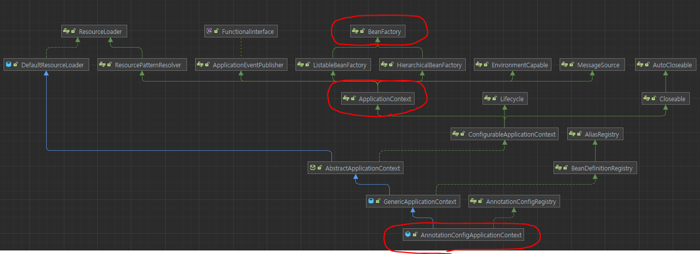
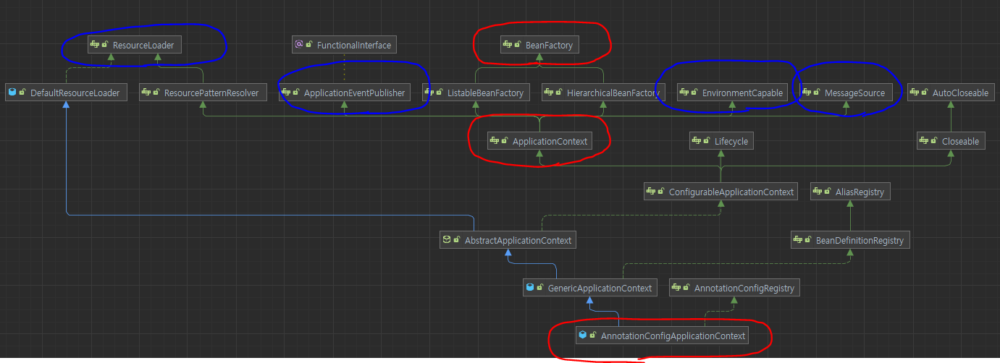
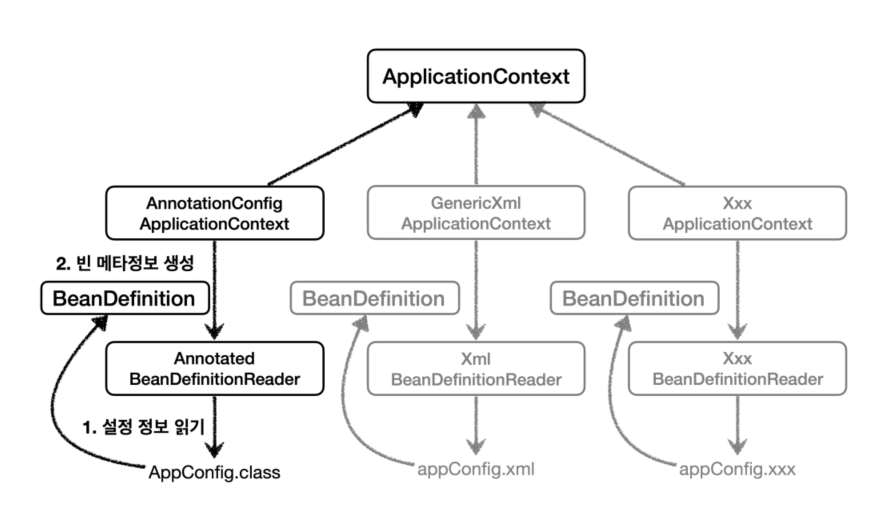

# ***객체 지향의 특징*** 

  - *추상화*
  - *캡슐화* 
  - *상속* 
  - *다형성* 

## ***스프링의 추상화 예시*** 

### *JDBC*

***JDBC(Java Database Connectivity) 등장 배경*** 

  - *오라클, MySQL, SQL Server 등 각 DBMS마다 제공하는 드라이버 엔진과 API가 다르다.*
  - *서로 다른 API 때문에 데이터베이스를 변경할 때 코드 전체를 수정해야 하는 문제가 발생* 
  - *각 데이터베이스마다 다른 코드 작성을 해야 했기 때문에 코드 중복이 많았다.* 

***JDBC의 추상화*** 

  - *JDBC는 데이터베이스와 상호작용하는* ***표준 인터페이스****를 제공하고, 이를 통해 애플리케이션 코드가 특정 DBMS에 의존하지 않도록 추상화*
  - *추상화 인터페이스:* *`Connection`**,* *`Statement`**,* *`ResultSet`**,* *`PreparedStatement`*

### *스프링 AOP*

*스프링은* ***AspectOrientedProgramming****을 지원하는데 런타임 환경에서의 프록시 패턴을 활용* 

*개발자가 직접 프록시 패턴을 적용하려면 직접 클래스를 작성해야 하지만 이는 너무 불편하다.* 

*이 불편함을 없애기 위해서 동적 프록시 기술을 사용하고 스프링에서 사용하는 동적 프록시 기술은* 

*JdkDynamicProxy(자바 제공), CGLIB 기술을 사용한다.* 

*하지만 인터페이스 기반은 JDK 동적 프록시 클래스 상속 기반은 CGLIB를 사용하는데* 

*각각 부가 기능을 추가할 때 사용하는 클래스가 다르다. MethodInvocation / MethodInterceptor*

*스프링은 이를* ***advice 인터페이스****를 제공으로 개발자는 해당 인터페이스를 구현만 하기만 하면* 

*ProxyFactory는 내부에서 알아서 MethodInvocation or  MethodInterceptor 사용한다.* 

[https://20240228.tistory.com/429](https://20240228.tistory.com/429)

## ***스프링의 캡슐화 예시*** 

***AOP를 통한 부가 기능을 캡슐화*** 

  - *필수 비즈니스 로직만 노출* 
- *메소드 호출 ↔ 반환 시간*
    - *보안: 메소드 호출 인가  @PreAuthorize*
    - *트랜잭션 관리: @Transactional*

***스프링 빈, DI를 통한 controller ↔ service ↔ repository layer 간 구현을 캡슐화*** 

## ***스프링의 다형성 활용 예시***

 

***인터페이스를 구현한 객체 인스턴스를 실행 시점에 유연하게 변경할 수 있다.*** 

  - *프록시 객체* 
  - *함수형 인터페이스 → 람다* 
  - *스프링 컨테이너* ***ApplicationContext***
- *애노테이션 기반*
    - *XML 기반*

# *SOLID*

*클린코드로 유명한 로버트 마틴이 좋은 객체 지향 설계의 5가지 원칙을 정리*

*SRP: 단일 책임 원칙(single responsibility principle)*

*OCP 개방-폐쇄 원칙(Open/closed principle)*

*LSP 리스코프 치환 원칙(Liskov substitution principle)*

*ISP 인터페이스 분리 원칙(Interface segregation principle)*

*DIP 의존관계 역전 원칙(Dependency inversion principle)*

*객체 지향의 핵심은 다형성인데 다형성만으로는 쉽게 SOLID를 지킬 수 없다.* 

  - *스프링은 스프링 컨테이너를 통한 DI로 OCP, DIP 한계를 해결한다.* 

# ***트레이드 오프*** 

*인터페이스를 도입하면 추상화 비용이 발생한다.* 

  - *인터페이스가 없는 단일 클래스 보다 구조 파악이 힘들다. - 구조 파악 비용* 
  - *인터페이스 - 구현체 설계에 대한 비용* 
  - *작성에 대한 비용* 

*정답은 없다. (내 주관적인 의견) -* ***토론 포인트*** 

  - *확장 가능성이 많고 구체 프로덕트가 많다면 나는 인터페이스를 사용하여 추상화하겠다.* 
- *인터페이스 기반이면 다양한 GOF 디자인 패턴이 활용 가능해진다.*
    - *인터페이스를 통해 추상화 도입을 하고 반복적인 코드 반복을 줄이고 클래스의 역할 의도 전달을 추상 클래스를 통해 가능하다.* ***ex) 데코레이터 패턴의 추상 클래스 추가 버전***
  - *현재 시점에서 확장 가능성이 없는 프로덕트라면 일단 인터페이스 없이 구현하고 추후에 리팩토링하자*

# ***스프링 빈 조회*** 

***빈 이름 직접 부여하기*** 

```java
@Bean(name = "customBeanName")
```

  - *빈 이름은 항상 다른 이름을 부여하자* 
  - *직접 부여하지 않으면 메소드 이름을 사용한다.* 

***스프링 컨테이너에 등록된 모든 빈 조회***

```java
class BeanDefinitionTest {
    AnnotationConfigApplicationContext ac = new AnnotationConfigApplicationContext(AppConfig.class);
   
    @Test
    @DisplayName("빈 설정 메타정보 확인")
    void findApplicationBean() {
        String[] beanDefinitionNames = ac.getBeanDefinitionNames();
        for (String beanDefinitionName : beanDefinitionNames) {
            BeanDefinition beanDefinition = ac.getBeanDefinition(beanDefinitionName);
            if (beanDefinition.getRole() == BeanDefinition.ROLE_APPLICATION) {
                System.out.println("beanDefinitionName" + beanDefinitionName +
                        " beanDefinition = " + beanDefinition);
            }
        }
    }
}
```

  - *`ac.getBeanDefinitionNames()`* *: 스프링에 등록된 모든 빈 이름을 조회*
  - *`ac.getBean()`* *: 빈 이름으로 빈 객체(인스턴스)를 조회*
  - *`ac.getRole()`* *: 스프링 빈 역할 조회하기* 
- *`ROLE_APPLICATION`**: 사용자가 정의한 빈* 
    - *`ROLE_INFRASTRUCTURE`* *: 스프링이 내부에서 사용하는 빈*

***스프링 빈 조회***

  - *`ac.getBean(String name, Class<T> requiredType)`*
  - *`ac.getBean(Class<T> requiredType)`*
  - *조회 대상 스프링 빈이 없으면 예외 발생*
- *`NoSuchBeanDefinitionException`*

***스프링 빈 조회 - 동일한 타입이 둘 이상***

  - *타입으로 조회시 같은 타입의 스프링 빈이 둘 이상이면 오류가 발생*
- *`NoUniqueBeanDefinitionException`*
    - *빈 이름을 지정하자*
  - *`ac.getBeansOfType()`* *: 해당 타입의 모든 빈을 조회*
- *return:* ***Map<key: String name | value: Class<T>>***

***스프링 빈 조회 - 상속 관계***

  - *부모 타입으로 조회하면, 자식 타입도 함께 조회*

# *스프링 컨테이너 구조* 



***BeanFactory***

  - *스프링 컨테이너의 최상위 인터페이스*
  - *스프링 빈을 관리하고 조회하는 역할을 담당*
  - *`getBean()`**을 제공*

***ApplicationContext***

  - *빈을 관리하고 검색하는 기능을 BeanFactory가 제공해주는데, 그러면 둘의 차이가 뭘까?*
  - *애플리케이션을 개발할 때는 빈을 관리하고 조회하는 기능은 물론이고, 수 많은 부가기능이 필요*



  - *메시지소스를 활용한 국제화 기능* 
  - *환경변수*
- *로컬, 개발, 운영등을 구분해서 처리*
  - *애플리케이션 이벤트*
- *이벤트를 발행하고 구독하는 모델을 편리하게 지원*
  - *편리한 리소스 조회*
- *파일, 클래스패스, 외부 등에서 리소스를 편리하게 조회*

***ApplicationContext 구현체***

  - *AnnotationConfigApplicationContext*
- *애노테이션 기반 자바 코드 설정 사용*
  - *GenericXmlApplicationContext*
- *xml 설정 파일*

*스프링 컨테이너는 다양한 형식의 설정을 사용할 수 있게 유연하게 설계* 

***스프링 빈 설정 메타 정보 - BeanDefinition***

  - *다양한 설정 형식을 BeanDefinition 이라는 추상화를 통해 한다.* 
- *XML →  BeanDefinition*
    - *자바 코드 →  BeanDefinition*
    - *스프링 컨테이너 → BeanDefinition (의존)*



***BeanDefinition 정보***

  - *`BeanClassName`**: 생성할 빈의 클래스 명*
- *@Bean으로 등록되는 빈 → 존재 X / @Component → 존재 O*
  - *`factoryBeanName`**: 팩토리 역할의 빈을 사용할 경우 이름*
- *AppConfig*
  - *`factoryMethodName`**: 빈을 생성할 팩토리 메서드 지정*
- *@Bean 메소드 이름*
  - *`Scope`**: default: singleton*
  - *`lazyInit`**: 스프링 컨테이너를 생성할 때 빈을 생성하는 것이 아니라, 실제 빈을 사용할 때 까지 최대한 생성을 지연 처리 하는지 여부*
- *default: null → 즉시 초기화*
  - *`InitMethodName`**: 빈을 생성하고, 의존관계를 적용한 뒤에 호출되는 초기화 메서드 명*
- ***@PostCustruct***
  - *`DestroyMethodName`**: 빈의 생명주기가 끝나서 제거하기 직전에 호출되는 메서드 명*
- ***@PreDestory***
  - *`Constructor arguments, Properties`**: 의존관계 주입에서 사용한다. (자바 설정 처럼 팩토리 역할의 빈을 사용하면 없음)*

# *싱글톤* 

[https://20240228.tistory.com/341](https://20240228.tistory.com/341)

***싱글톤 방식의 주의점***

  - *여러 클라이언트가 하나의 같은 객체 인스턴스를 공유하기 때문에 싱글톤 객체는 상태를 유지(stateful) 하게 설계하면 안된다*
  - *만약 stateful하게 설계하여 race condition이 발생한다면 멀티 스레딩 환경에서 concurrency problem 발생 →  데이터 정합성 문제가 발생한다.* 
  - *결론은 stateless하게 설계해야 한다* 

# ***@Configuration과 바이트코드 조작의 마법***

*@Configuration이 붙은 클래스는 CGLIB 기술을 사용해서 클래스를 상속해서 컨테이너에 개발자가 작성한 객체가 아닌 다른 객체(프록시)를 넣는다.* 

***CGLIB 기술이란?***

*javac 컴파일러가 컴파일하여 .java → .class 변환(컴파일 시점) 이후 jvm 클래스 로딩 시점에 동적으로 바이트 코드를 조작하여 클래스를 생성하거나 확장하는 방식으로 동작한다. 이를 로드 타임* ***위빙(Weaving)****이라고 부른다.* 

*즉, 클래스가 JVM에 의해 로드될 때 바이트 코드를 조작하여 @Bean으로 정의된 빈이 이미 스프링 컨테이너에 있으면 해당 객체를 반환하여 생성 로직 호출을 하지 않는다.* 

*이런 메커니즘을 통해 싱글톤을 지킨다.*

# ***@ComponentScan***

  - *@Component가 붙은 클래스를 자동으로 스프링 컨테이너에 스프링 빈으로 등록한다.* 
  - ***@SpringBootApplication***
- *애플리케이션의 시작 지점* 
    - *내부에 @ComponentScan 포함*
  - *빈 이름 전략* 
- *빈 이름 기본 전략: MemberServiceImpl → memberServiceImpl*
    - *빈 이름 직접 지정: @Component("memberService2")*
  - *탐색할 패키지의 시작 위치 지정* 
```java
@ComponentScan(basePackages = {"hello.core", "hello.service"})
```

    - *모든 자바 클래스를 다 컴포넌트 스캔하면 시간이 오래 걸린다.*
    - *`basePackages`* *: 탐색할 패키지의 시작 위치를 지정한다. 이 패키지를 포함해서 하위 패키지를 모두 탐색한다.*
    - *default(생략): @ComponentScan 이 붙은 설정 정보 클래스의 패키지가 시작 위치가 된다.*
  - *스캔 대상* 
- *includeFilters : 컴포넌트 스캔 대상을 추가로 지정*
    - *excludeFilters : 컴포넌트 스캔에서 제외할 대상을 지정*

# ***@Autowired***

  - *의존이 필요한 객체를 자동 주입 받도록 설정하는 애노테이션이다.* 
  - *클래스에 생성자가 1개면 생략이 가능하다.*
  - *보통 @RequiredArgsConstructor를 사용*  
  - *조회 전략* 
- *조회 기본 전략:* *`getBean(Class<T> type)`*

# ***중복 등록과 충돌 (이름 충돌)***

***자동 빈 등록 vs 자동 빈 등록***

*→* *`ConflictingBeanDefinitionException`* 

***수동 빈 등록 vs 자동 빈 등록***

```java
@Component
public class MemoryMemberRepository implements MemberRepository {}

@Configuration
public class AutoAppConfig {
	 @Bean(name = "memoryMemberRepository")
	 public MemberRepository memberRepository() {
			 return new MemoryMemberRepository();
	 }
}
```

*→ 수동 빈 등록이 우선권을 가진다*

*수동 빈 등록시 남는 로그*

```java
Overriding bean definition for bean 'memoryMemberRepository' with a different 
definition: replacing
```

***최근 스프링 부트 수동 빈 등록 vs 자동 빈 등록*** 

*→ 오류 발생* 

```java
Consider renaming one of the beans or enabling overriding by setting 
spring.main.allow-bean-definition-overriding=true
```

# ***다양한 의존관계 주입 방법***

  - *생성자 주입*
  - *수정자 주입 - setter*
  - *필드 주입*
- *DI 프레임워크가 없으면 테스트 불가능* 
    - *설정이 목적인 @Configuration 같은 곳에서만 사용*
  - *일반 메소드 주입* 

*→ 생성자 주입을 사용하자 (불변성: 초기화 시점 1번 호출)*

# ***옵션 처리***

*언제 사용?: 주입할 스프링 빈이 없어도 동작해야 할 때* 

***@Autowired***

  - *required 옵션은 default: true*
  - *자동 주입 대상이 없으면 오류가 발생한다.* 

***옵션 처리하는 방법***

  - *@Autowired(required=false)*
  - *@Nullable*
  - *Optional<T>*
- *자동 주입할 대상이 없으면 Optional.empty()*

# ***생성자 주입을 선택해라!***

  - *대부분의 의존관계 주입은 한번 일어나면 애플리케이션 종료시점까지 의존관계를 변경할 일이 없다.*
  - *의존관계는 애플리케이션 종료 전까지 변하면 안된다. → 불변성* 
  - *수정자 주입을 사용하면, setXxx 메서드를 public으로 열어두어야 한다.*
- *의존관계 뿐만 아니라 항상 setter 사용을 지양하자 또는 private 접근 제어자로 외부 접근을 제어하자* 
    - [*https://20240228.tistory.com/390*](https://20240228.tistory.com/390)
  - *프레임워크에 의존하지 않고, 순수한 자바 언어의 특징을 잘 살리는 방법*


***final 키워드*** 

  - *생성자 주입을 사용하면 필드에 final 키워드를 사용할 수 있다.* 
- *오직 생성자 주입만 final 키워드를 사용할 수 있다.*
  - *그래서 생성자에서 혹시라도 값이 설정되지 않는 오류를 컴파일 시점에 막아준다.*
- *제일 좋은 오류는 컴파일 시점 오류*
  - *`@RequiredArgsConstructor`* *사용하지 않을 이유가 없다.*
-  *`final`* *필드나* *`@NonNull`**이 붙은 필드에 대해 자동으로 생성자를 생성*

***롬복 설정 - build.gradle***

```groovy
configurations {
	 compileOnly {
	 extendsFrom annotationProcessor
	 }
}
dependencies {
	 compileOnly 'org.projectlombok:lombok'
	 annotationProcessor 'org.projectlombok:lombok'
	 testCompileOnly 'org.projectlombok:lombok'
	 testAnnotationProcessor 'org.projectlombok:lombok'
}
```

# ***조회 빈이 2개 이상 - 문제***

*→ DI 상황 같은 타입(Class<T>) 2개 이상 존재 →* *`NoUniqueBeanDefinitionException`* 

*그렇다고 인터페이스가 아닌 하위 타입(구체 타입)을 지정하는 것은 DIP 즉, 추상화에 의존하라는 SOLID 원칙을 위배하고 유연성이 떨어진다.* 

# ***@Autowired 필드 명, @Qualifier, @Primary***

*조회 빈이 2개 이상일 때 생기는 문제를 해결해 보자* 

## ***@Autowired 필드 명 매칭***

*@Autowired는 먼저 타입 매칭을 시도하고, 이때 여러 같은 타입의 빈이 있으면 필드 이름, 파라미터 이름으로 빈 이름을 추가로 매칭한다.* 

```java
@Autowired
private DiscountPolicy discountPolicy

@Autowired
private DiscountPolicy rateDiscountPolicy
```

## ***@Qualifier 사용***

*주의: 빈 이름을 변경하지 않는다. 단지 구분하는 역할을 한다.* 

***@Qualifier 적용***

```java
@Component
@Qualifier("mainDiscountPolicy")
public class RateDiscountPolicy implements DiscountPolicy {}

@Component
@Qualifier("fixDiscountPolicy")
public class FixDiscountPolicy implements DiscountPolicy {}
```

***생성자 자동 주입 예시***

```java
@Autowired
public OrderServiceImpl(MemberRepository memberRepository, 
							@Qualifier("mainDiscountPolicy") DiscountPolicy discountPolicy) {
		 this.memberRepository = memberRepository;
		 this.discountPolicy = discountPolicy;
}
```

***만약 @Qualifier를 못찾으면 어떻게 동작할까?***

  1. *@Qualifier 로 주입할 때 @Qualifier("mainDiscountPolicy") 를 못찾으면 어떻게 될까?*
  1. *mainDiscountPolicy라는 이름의 스프링 빈을 추가로 찾는다*
  1. *→* *`NoSuchBeanDefinitionException`* *예외 발생*

***내가 생각하는 @Qualifier의 문제점과 해결법***

*@Qualifier의 value는 개발자가 직접 문자열 값을 입력하는 방식이어서 안정성 측면에 문제가 있다.* 

*ex) @Qualifier(”main”) → @Qualifier(”mai”)* 

*이런 오류는 컴파일 타임에 잡지 못하는 오류이다.* 

*이런 문제점은 abstract 클래스를 활용하여 상수로 정의하여 해결하면 문자열을 직접 입력하는 것보다 안전하다고 생각한다.* 

```java
abstract public class Policy {
    private Policy(){}
    public static final String RATE_DISCOUNT = "rate_discount";
    public static final String FIX_DISCOUNT = "fix_discount";
}

@Component
@Qualifier(Policy.FIX_DISCOUNT)
public class FixDiscountPolicy implements DiscountPolicy{}
```

## ***@Primary 사용***

*@Primary 는 우선순위를 정하는 방법이다.* 

*@Autowired 시에 여러 빈이 매칭되면 @Primary가 우선권을 가진다.*

```java
@Component
@Primary
public class RateDiscountPolicy implements DiscountPolicy {}

@Component
public class FixDiscountPolicy implements DiscountPolicy {}
```

***사용코드***

```java
@Autowired
public OrderServiceImpl(MemberRepository memberRepository, DiscountPolicy discountPolicy) {
		 this.memberRepository = memberRepository;
		 this.discountPolicy = discountPolicy;
}
```

## ***@Qualifier vs @Primary 우선 순위***

*@Primary는 기본값 처럼 동작하는 것이고, @Qualifier는 매우 상세하게 동작*

*스프링은 항상 자동보다는 수동이, 넓은 범위보다 좁은 범위의 선택권이 우선 순위가 높다.*

*→ @Qualifier > @Primary*

# ***애노테이션 직접 만들기***

*강사님은 @Qualifier 타입 체크의 문제점을 애노테이션을 만들어서 해결하는 방법으로 제시하셨다.*

*애노테이션 방식은 필요한 애노테이션이 n개 라면 애노테이션 클래스 또한 n개가 필요하다.* 

*반면에 추상 클래스 하나면 여러 상수를 정의할 수 있기 때문에 해당 방식이 유지 보수, 확장성 측면에서 더 좋다고 생각한다. (다른 사람들 의견이 궁금)*

# ***조회한 빈이 모두 필요할 때, List, Map***

  - *의도적으로 정말 해당 타입의 스프링 빈이 다 필요한 경우가 존재* 
  - *스프링을 사용하면 전략 패턴을 매우 간단하게 구현*
- [*https://20240228.tistory.com/425*](https://20240228.tistory.com/425)
  - *해당하는 타입의 스프링 빈이 없으면, 빈 컬렉션이나 Map을 주입*

# *컴포넌트 스캔 VS @Configuration 수동 등록* 

  - *Controller, Service, Repository → 컴포넌트 스캔 활용* 
  - *부가 서비스 (aop) → 수동 등록*

# ***빈 생명주기 콜백?***

*애플리케이션 시작 시점과 종료 시점에 필요한 객체의 초기화/종료 작업이 있다.* 

*→ 데이터베이스 커넥션 풀(히카리 풀), 요청 스레드 풀, 네트워크 소켓 …*

*→ 스프링은 어떻게 초기화 작업과 종료 작업을 할까?*

***스프링 빈의 라이프 사이클*** 

*객체 생성 → 의존관계 주입(DI)*

*개발자가 어떻게 의존관계 주입이 모두 완료된 시점을 알 수 있을까?*

*→ 스프링은 스프링 빈에게 콜백 메소드를 통해서 초기화 시점과 스프링 컨테이너가 종료되기 직전에 소멸 콜백을 준다.* 

***스프링 빈의 이벤트 라이프 사이클***

*스프링 컨테이너 생성 → 스프링 빈 생성 → 의존관계 주입 → 초기화 콜백 → 사용 → 소멸전 콜백 → 스프링 종료* 

*초기화 콜백: 빈이 생성되고, 빈의 의존관계 주입이 완료된 후 호출*

*소멸전 콜백: 빈이 소멸되기 직전에 호출*

## ***스프링 AOP 초기화를 포함한 전체 라이프 사이클*** 

***스프링 컨테이너 생성 → 스프링 빈 생성 → 의존관계 주입 → PostProceesor before 메소드 →*** 

***초기화 콜백 →  PostProceesor after 메소드 → 사용 → 소멸전 콜백 → 스프링 종료*** 

***테스트 코드*** 

```java
@Slf4j
public class TimeAdvice implements MethodInterceptor {
    @Override
    public Object invoke(MethodInvocation invocation) throws Throwable {
        log.info("start={}", System.currentTimeMillis());
        Object result = invocation.proceed();
        log.info("end={}", System.currentTimeMillis());
        return result;
    }
}

@Component
@Slf4j
public class MyPostProcessor implements BeanPostProcessor {
    @Override
    public Object postProcessBeforeInitialization(Object bean, String beanName) throws BeansException {
        if(beanName.equals("example")){
            log.info("[START POST PROCESSOR]");
            ProxyFactory proxyFactory = new ProxyFactory(new Example());
            DefaultPointcutAdvisor advisor = new DefaultPointcutAdvisor(new TimeAdvice());
            advisor.setPointcut(Pointcut.TRUE);
            proxyFactory.addAdvisor(advisor);
            log.info("[END POST PROCESSOR]");
            return proxyFactory.getProxy();
        }
        return bean;
    }
}

@Component
@Slf4j
public class Example {
    public void call(){
        log.info("call");
    }
    @PostConstruct
    public void init(){
        log.info("init");
    }
    @PreDestroy
    public void destroy(){
        log.info("destroy");
    }
}

@Aspect
@Slf4j
@Component
public class TimeAspect {
    @Around("execution(* hello.core.aop.Example..*(..))")
    public Object time(ProceedingJoinPoint joinPoint) throws Throwable{
        log.info("start={}", System.currentTimeMillis());
        Object result = joinPoint.proceed();
        log.info("end={}", System.currentTimeMillis());
        return result;
    }
}
```

  - ***스프링 AOP 사용 →  MyPostProcessor @Component 주석 처리*** 
  - ***custom AOP 사용 → TimeAspect @Component 주석 처리*** 

***테스트 결과 및 결론*** 

```plain text
*직접 포스트 프로세서를 구현하고 ProxyFactory 사용해서 대체하니까
포스트 프로세서의 어떤 메소드를 구현하냐고 프록시를 적용하냐에 따라서 콜백 메소드에 AOP 적용이 달라진다
초기화 콜백 이전에 AOP를 적용하면 초기화 콜백에도 부가 로그가 찍히고
초기화 콜백 이후에 AOP를 적용하면 초기화 콜백에는 부가 로직이 안 찍히는걸 확인
커스텀 말고 @Aspect를 통해서 적용하니까 콜백 메소드에 부가 로그가 안 찍히는걸로 봐서는 
스프링 AOP는 postProcessAfterInitialization 메소드를 구현한다.*
```

***스프링은 크게 3가지 방법으로 빈 생명주기 콜백을 지원한다.***

  - *인터페이스(InitializingBean, DisposableBean)*
  - *설정 정보에 초기화 메서드, 종료 메서드 지정*
  - *@PostConstruct, @PreDestroy 애노테이션 지원*

# ***인터페이스 InitializingBean, DisposableBean***

  - *`InitializingBean`**은* *`afterPropertiesSet()`* *메서드로 초기화를 지원*
  - *`DisposableBean`**은* *`destroy()`* *메서드로 소멸을 지원*

***InitializingBean(초기화), DisposableBean(소멸) 인터페이스 단점***

  - *이 인터페이스는 스프링 전용 인터페이스다. 해당 코드가 스프링 전용 인터페이스에 의존한다.*
  - *초기화, 소멸 메서드의 이름을 변경할 수 없다*
  - *내가 코드를 고칠 수 없는 외부 라이브러리에 적용할 수 없다.*
  - *현재는 거의 사용하지 않는다.* 

# ***빈 등록 초기화, 소멸 메서드 지정- @Bean***

```java
@Configuration
static class LifeCycleConfig {
		@Bean(initMethod = "init", destroyMethod = "close")
		public NetworkClient networkClient() {
				NetworkClient networkClient = new NetworkClient();
				networkClient.setUrl("http://hello-spring.dev");
				return networkClient;
		}
}
```

  - *`@Bean(initMethod = "init", destroyMethod = "close")`* 
  - *메소드 이름의 자유*
  - *스프링 빈이 스프링 코드에 의존하지 않는다.* 
  - *코드가 아니라 설정 정보를 사용하기 때문에 코드를 고칠 수 없는 외부 라이브러리에도 초기화, 종료 메소드를 적용할 수 있다.*
  - *종료 메소드* 
- *`destroyMethod`* *close , shutdown라는 이름의 메소드를 자동으로 호출*
    - *즉, 특별한 지정이 없고 close, shutdown 메소드가 존재하면 소멸 메소드로 동작한다.*

# ***애노테이션 @PostConstruct, @PreDestroy***

  - *최신 스프링에서 가장 권장하는 방법*
  - *JSR-250(자바 표준) → 스프링이 아닌 다른 컨테이너에서도 동작*
  - *외부 라이브러리에는 적용하지 못한다* 
- *외부 라이브러리를 초기화, 종료 해야 하면 @Bean의 기능을 사용*

# ***다양한 스코프*** 

***스프링의 다양한 스코프*** 

  - ***싱글톤: 스프링 컨테이너의 시작과 종료*** 
  - ***프로토타입:*** *스프링 컨테이너는 프로토타입 빈의 생성과 의존관계 주입까지만 관여하고 더는 관리하지 않는다.* 
  - ***웹 관련 스코프***
- *request: 웹 요청이 들어오고 나갈때 까지 유지되는 스코프*
    - *session: 웹 세션이 생성되고 종료될 때 까지 유지되는 스코프*
    - *application: 웹의 서블릿 컨텍스트와 같은 범위로 유지되는 스코프*

***빈 스코프 지정*** 

```java
@Scope("prototype") 
@Component
public class HelloBean {}

@Scope("prototype")
@Bean
PrototypeBean HelloBean() {
		 return new HelloBean();
}
```

# ***프로토타입 스코프***

***싱글톤 스코프의 빈****을 조회하면 스프링 컨테이너는 항상 같은 인스턴스의 스프링 빈을 반환*

***프로토타입 스코프 빈****을* *스프링 컨테이너에 조회하면 스프링 컨테이너는 항상 새로운 인스턴스를 생성해서 반환* 

  - *스프링 컨테이너는 (생성, 의존관계 주입, 초기화) 까지만 처리* 
- *→ @PreDestroy 같은 종료 메서드가 호출 X*
    - *→ 프로토타입 빈은 클라이언트가 관리해야 한다. (종료 메소드 호출)*

# *프로토타입 스코프 - 싱글톤 빈과 함께 사용시 Provider로 문제 해결*

*싱글톤 빈이 프로토타입 빈을 DI 받아서 사용하면 해당 프로토타입 빈은 계속 재생성되지 않는다.* 

*즉, 싱글톤 빈이 가지는 프로토타입 빈은 싱글톤 빈의 생명주기와 동일하다.* 

*이는* ***Provider****를 통해서 해결이 가능하다.* 

### ***가장 간단한 방법 스프링 컨테이너에 요청 (DL 방식)***

```java
static class ClientBean { 
		@Autowired
		private ApplicationContext ac;
		
		public int logic() {
				PrototypeBean prototypeBean = ac.getBean(PrototypeBean.class);
				prototypeBean.addCount();
				int count = prototypeBean.getCount();
				return count;
		}
}
```

*의존관계를 외부에서 주입(DI) 받는게 아니라 이렇게 직접 필요한 의존관계를 찾는 것을* ***Dependency Lookup(DL)*** *의존관계 조회(탐색) 이라한다*

*→ 스프링 컨테이너에 종속적이다 → 단위 테스트가 어렵다 → 다른 방법 없을까..?*

### ***ObjectFactory, ObjectProvider***

*지정된 빈을 컨테이너에서 대신 찾아주는 DL 서비스를 제공하는 것이 바로* *`ObjectProvider`* *이다.* 

*과거에는* *`ObjectFactory`* *를 사용 했지만 현재는 편의 기능이 더 많은* *`ObjectProvider`* *사용* 

```java
@Autowired
private ObjectProvider<PrototypeBean> prototypeBeanProvider;

public int logic() {
		PrototypeBean prototypeBean = prototypeBeanProvider.getObject();
		prototypeBean.addCount();
		int count = prototypeBean.getCount();
		return count;
}
```

  - ***ObjectProvider<T>***
  - *getObject() → 호출하면 내부에서 스프링 컨테이너를 통해서 해당 빈을 찾아서 반환 (DL)*
  - *스프링이 제공하는 기능을 사용하지만, 기능이 단순하므로 단위테스트를 만들거나 mock 코드를 만들기는 훨씬 쉬워진다.*

### ***JSR-330 Provider***

***build.gradle 설정*** 

```java
// 스프링부트 3.0 미만
javax.inject:javax.inject:1

// 스프링부트 3.0 이상
jakarta.inject:jakarta.inject-api:2.0.1
```

***스프링 부트 3.0***

```java
@Autowired
private Provider<PrototypeBean> provider;
public int logic() {
		 PrototypeBean prototypeBean = provider.get();
		 prototypeBean.addCount();
		 int count = prototypeBean.getCount();
		 return count;
}
```

  - `jakarta.inject.Provider`

*정리*

  - *get() 메소드 하나로 기능이 매우 단순*
  - *별도의 라이브러리가 필요*
  - *자바 표준이므로 스프링이 아닌 다른 컨테이너에서도 사용할 수 있다*

# ***웹 스코프***

  - *웹 스코프는 웹 환경에서만 동작*
  - *웹 스코프는 프로토타입과 다르게 스프링이 해당 스코프의 종료시점까지 관리*
-  *따라서 종료 메서드가 호출 -* *`@PreDestroy`*

***웹 스코프 종류***

  - *request: HTTP 요청 하나가 들어오고 나갈 때 까지 유지되는 스코프, 각각의 HTTP 요청마다 별도의 빈 인스턴스가 생성되고, 관리*
  - *session: HTTP Session과 동일한 생명주기를 가지는 스코프*
  - *application: 서블릿 컨텍스트( ServletContext )와 동일한 생명주기를 가지는 스코프*
  - *websocket: 웹 소켓과 동일한 생명주기를 가지는 스코프*

***build.gradle 추가***

```java
implementation 'org.springframework.boot:spring-boot-starter-web'
```

  - *web 라이브러리 추가* 
  - *스프링 부트는 웹 라이브러리가 없으면* *`AnnotationConfigApplicationContext`**을 기반으로 애플리케이션을 구동*
  - *웹 라이브러리가 있으면* *`AnnotationConfigServletWebServerApplicationContext`**를 기반으로 애플리케이션을 구동*

***request 스코프 지정*** 

```java
@Component
@Scope(value = "request")
public class MyLogger {}
```

