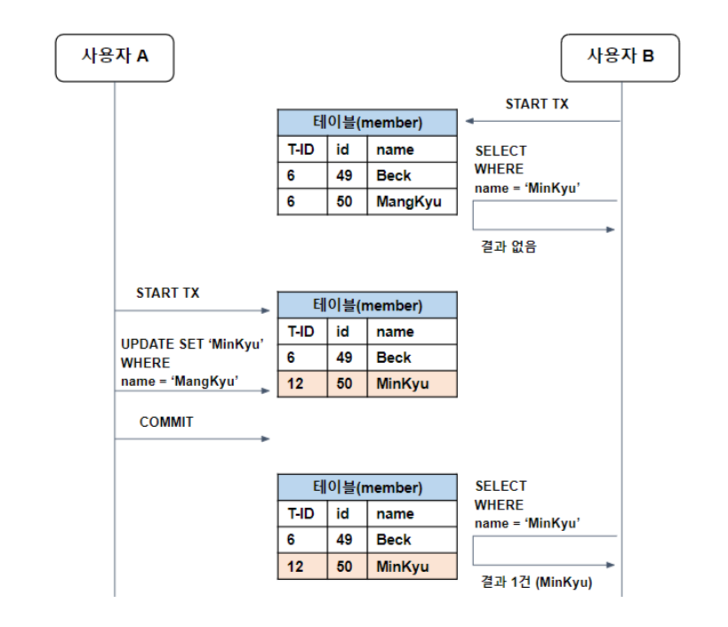
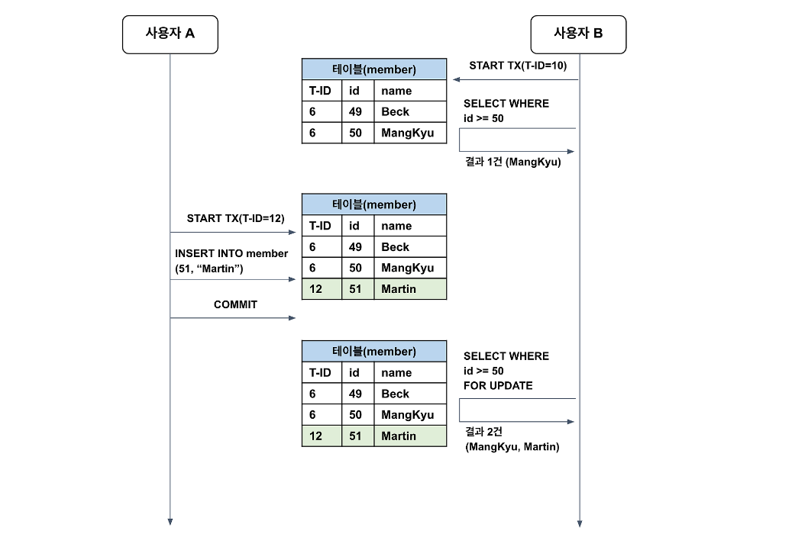

# *5.4 MySQL 격리 수준*

| **격리 수준** | **DIRTY READ** | **NON-REPEATABLE READ** | **PHANTOM READ** |
| --- | --- | --- | --- |
| **READ UNCOMMITTED** | 발생 | 발생 | 발생 |
| **READ COMMITTED** | 발생하지 않음 | 발생 | 발생 |
| **REPEATABLE READ** | 발생하지 않음 | 발생하지 않음 | 발생하지 않음 *(InnoDB에서 방지됨)* |
| **SERIALIZABLE** | 발생하지 않음 | 발생하지 않음 | 발생하지 않음 |

### ***문제 정의***

1. ***DIRTY READ****:*
- *커밋되지 않은 데이터를 다른 트랜잭션에서 읽는 현상.*
1. ***NON-REPEATABLE READ****:*
- *같은 트랜잭션 내에서 동일한 쿼리를 실행했을 때 결과가 달라지는 현상. (다른 트랜잭션에서 데이터를 수정/삭제 + 커밋)*
1. ***PHANTOM READ****:*
- *같은 트랜잭션 내에서 범위 쿼리를 실행했을 때 결과 집합의 레코드 수가 달라지는 현상. (다른 트랜잭션에서 데이터를 삽입)*

---

### *격리 레벨*

- ***READ UNCOMMITTED****: 가장 낮은 격리 수준으로, 데이터 무결성을 보장하지 않음.*
- ***READ COMMITTED****: 커밋된 데이터만 읽을 수 있어 Dirty Read는 방지하지만, Non-Repeatable Read와 Phantom Read는 방지하지 못함.*
- ***REPEATABLE READ****: InnoDB에서는 Gap Lock을 통해 Phantom Read까지 방지하여* ***ANSI 표준보다 강력****한 격리 수준을 제공함. (예외는 있음)*
- ***SERIALIZABLE****: 가장 높은 격리 수준으로, 모든 트랜잭션을 순차적으로 실행하는 것처럼 동작하며, 모든 문제를 방지.* ***동시성 저하*** *가능성이 높음.*

# *5.4.1* ***READ UNCOMMITTED***

*READ UNCOMMITTED는 커밋하지 않은 데이터 조차도 접근할 수 있는 격리 수준이다. 
READ UNCOMMITTED에서는 다른 트랜잭션의 작업이 커밋 또는 롤백되지 않아도 즉시 보이게 된다.*

*모든 데이터를 Buffer Pool 메모리에서 읽는다.* 

*사용하지 말자..*

# *5.4.2* ***READ COMMITTED***

*Phantom Read + Non-Repeatable Read(반복 읽기 불가능) 문제까지 발생*

***Non-Repeatable Read***

*READ COMMITTED 수준에서는 애초에 커밋된 데이터만 읽을 수 있기 때문에 트랜잭션 내에서 실행되는 SELECT와 트랜잭션 밖에서 실행되는 SELECT의 차이가 별로 없다.*

# *5.4.3* ***REPEATABLE READ (MySQL default)***

- *잠금 없는 읽기 → MVCC언두 로그(append only)에서 자신의 트랜잭션 번호 보다 낮은 데이터만 읽음* 
- *잠금 있는 읽기 → 버퍼 풀(메모리)에서 읽음*

| **특징** | **SELECT ... FOR UPDATE** | **SELECT ... FOR SHARE** |
| --- | --- | --- |
| **락 유형** | 넥스트 키 락 (레코드 락 + 갭 락) | 레코드 락만 적용 |
| **락 범위** | 조회된 레코드 및 해당 레코드 주변 갭 | 조회된 레코드만 |
| **동시성** | 다른 트랜잭션의 읽기/수정 모두 차단 | 다른 트랜잭션의 읽기 허용, 수정 차단 |
| **팬텀 리드 방지** | 가능 | 불가능 |
| **사용 목적** | 데이터 수정 작업을 준비하기 위해 사용 | 데이터 읽기 무결성을 보장하기 위해 사용 |

***REPEATABLE READ에서 유일한 PHANTOM READ(팬텀 리드)케이스***

 

***같은 트랜잭션 내에서의 SELECT VS 각각의 트랜잭션(또는 트랜잭션 없이) SELECT*** 

*같은 트랜잭션 내에서의 SELECT는 동일한 읽기를 보장하지만*

*동일한 트랜잭션이 아니거나 각각의 트랜잭션 또는 명시적 트랜잭션 시작 없이 SELECT 하면* 

*READ COMMITED LEVEL 처럼 동작한다.* 

# *5.4.4 SERIALIZABLE*

*SERIALIZABLE은 가장 엄격한 격리 수준으로, 이름 그대로 트랜잭션을 순차적으로 진행시킨다. SERIALIZABLE에서 여러 트랜잭션이 동일한 레코드에 동시 접근할 수 없으므로, 어떠한 데이터 부정합 문제도 발생하지 않는다.* 

*하지만 트랜잭션이 순차적으로 처리되어야 하므로 동시 처리 성능이 매우 떨어진다.*
*MySQL에서 SELECT FOR SHARE/UPDATE는 대상 레코드에 각각 읽기/쓰기 잠금을 거는 것이다*. 

*하지만 SERIALIZABLE 격리 수준에서는 순수한 SELECT 작업에서도 대상 레코드에 넥스트 키 락을 읽기 잠금(공유락, Shared Lock)으로 건다.* 

*따라서 한 트랜잭션에서 넥스트 키 락이 걸린 레코드를 다른 트랜잭션에서는 절대 추가/수정/삭제할 수 없다. SERIALIZABLE은 가장 안전하지만 가장 성능이 떨어지므로, 극단적으로 안전한 작업이 필요한 경우가 아니라면 사용해서는 안된다.*
