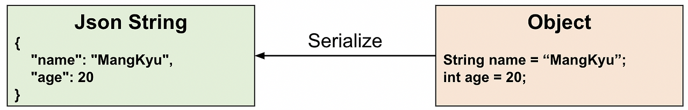

# ObjectMapper를 이용한 직렬화(Serialize)

ObjectMapper는 리플랙션을 활용해서 객체로부터 Json 형태의 문자열을 만들어내는데, 이것을 직렬화(Serialize)라고 한다. → @ResponseBody, @RestController, ResponseEntity 등등…



Spring에서는 기본적으로 jackson 모듈의 ObjectMapper라는 클래스가 직렬화를 처리한다.

그 과정에서 ObjectMapper의 writeValueAsString() 메서드가 사용된다.

객체로부터 Json 문자열을 만들기 위해서는 필드 값을 알아야 한다.

하지만 ObjectMapper의 기본 설정으로는 public 필드 또는 public 형태의 getter(getXX 메서드)만 접근이 가능하다. 물론 추가 설정을 통해 가시성을 높여줄 수 있지만, getter가 없는 경우는 거의 없으므로 기본 설정으로 사용해도 충분하다. 그러므로 ObjectMapper를 이용하는 경우, 직렬화를 위해 기본적으로 getter를 만들어두는 것이 좋다.

```java
@Test
@DisplayName("record 직렬화 테스트")
void test1() throws Exception {
		String json = objectMapper.writeValueAsString(
									new RecordUser("Trump Donald", 77));
		log.info("result: {}", json);
}

@Test
@DisplayName("getter 없는 class 직렬화 테스트")
void test2() throws Exception {
		assertThatThrownBy(() -> objectMapper.writeValueAsString(
				new ClassUser("Trump Donald", 77)))
			.isInstanceOf(InvalidDefinitionException.class);
}

@Test
@DisplayName("getter 있는 class 직렬화 테스트")
void test3() throws Exception {
		String json = objectMapper.writeValueAsString(
				new ClassUser2("Trump Donald", 77));
		log.info("result: {}", json);
}

record RecordUser(String name, int age) {

}

class ClassUser {
		private String name;
		private int age;
	
		public ClassUser(String name, int age) {
			this.name = name;
			this.age = age;
		}
}

@Getter
class ClassUser2 {
		private String name;
		private int age;
	
		public ClassUser2(String name, int age) {
			this.name = name;
			this.age = age;
		}
}
```

**최신 정리**

Jackson의 필드 탐색/직렬화는 단순히 get으로 시작되는 getter만 아니라, public 메서드(파라미터 없는)도 기본적으로 포함한다.

최근 버전의 Spring Boot/Jackson은 기본적으로 Java record 타입을 지원하는 Jackson 모듈(jackson-datatype-jdk8, jackson-datatype-parameter-names 등)을 자동 등록하여 별도의 커스터마이징 없이도 record와 함께 동작한다.

### ObjectMapper를 이용한 직렬화 주의 사항

ObjectMapper 직렬화 동작 방식 때문에 때론 의도치 않은 json 메세지를 만들어 내기도 한다.

아래 메서드를 보면 getXX로 시작하는 getNameAge() 메서드가 존재한다.

```java
@Getter
class ClassUser2 {
		private String name;
		private int age;
	
		public ClassUser2(String name, int age) {
				this.name = name;
				this.age = age;
		}
	
		public String getNameAge() {
				return name + " " + age;
		}
}

// {"name":"Trump Donald","age":77,"nameAge":"Trump Donald 77"}
```

getNameAge() 역시 getter 메서드 규칙을 따르기 때문에 nameAge라는 json 문자열이 만들어진다.

꼭 이러한 동작 방식을 인지하자

---

# ObjectMapper를 이용한 역직렬화(Deserialize)

ObjectMapper는 리플랙션을 활용해서 Json 문자열로부터 객체를 만들어내는데, 이것을 역직렬화(Deserialize)라고 한다. → @RequestBody


역직렬화는 기본적으로 다음과 같은 과정을 거쳐서 처리된다.

1. 기본 생성자로 객체를 생성
1. 필드값을 찾아서 값을 바인딩

가장 먼저 객체를 생성하는데, 기본 생성자가 없으면 에러를 발생시킨다.

기본 생성자로 객체를 생성한 후에는 필드값을 찾아야하는데, 기본적으로 public 필드 또는 public getter/setter로 찾을 수 있다. 만약 처리에 실패하면 마찬가지로 InvalidDefinitionException이 발생한다.

결론적으로, Spring Boot 최신 버전(3.x 이상)과 Jackson 조합에서는 record 타입처럼 "모든 필드를 받는 생성자"가 있으면 기본 생성자 없이도 역직렬화가 지원된다.

별도의 커스텀 설정 없이도 동작하며, 이는 스프링 부트가 jackson 관련 모듈을 자동 등록해주기 때문이다.

---

# 정리 

더 자세한 내용은 참고 자료를 보자

---

# 참고 자료 

[https://mangkyu.tistory.com/223](https://mangkyu.tistory.com/223)

