## **✅**  연속 메모리 할당

**프로세스에 연속적인 메모리 공간을 할당** 

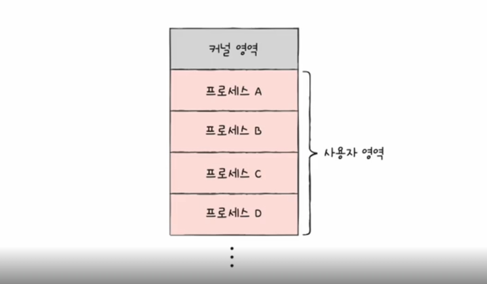

## **✅  스와핑**

현재 사용되지 않는 프로세스들을 보조기억장치의 **일부 영역으로 쫓아내고(스왑 아웃)** 그렇게 생긴 빈 공간에 **새 프로세스 적재(스왑 인)** 

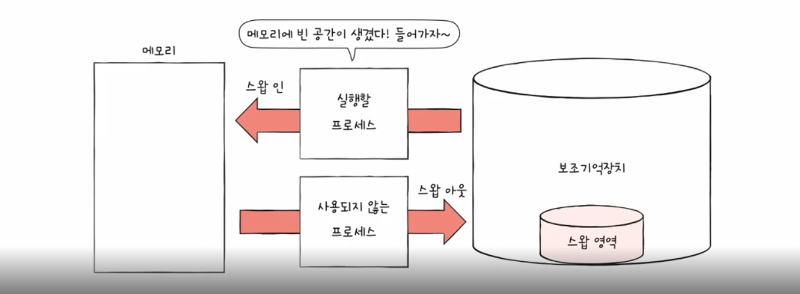

**스와핑 장점 → 프로세스들이 요구하는 메모리 공간 크기 > 실제 메모리 크기** 

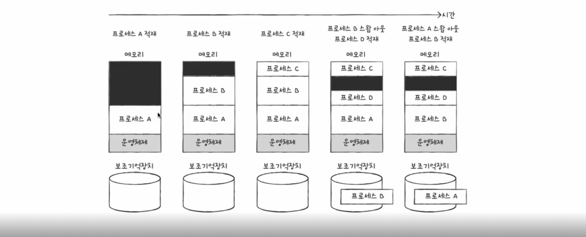

실제 물리 메모리 공간 크기 보다 많은 공간을 차지하는 프로세스들을 스왑(Swap)기법을 통해 스왑 인, 스왑 아웃을 반복하면서 동작시킬 수 있다. 

## **✅  연속 메모리 할당** 

  - 프로세스는 메모리의 빈 공간에 할당되어야 한다. 이때 빈 공간이 여러 개 있다면? 
  - 최초 적합, 최적 적합, 최악 적합 

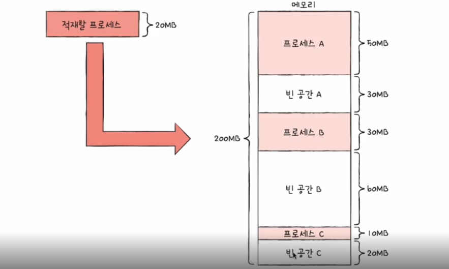

### 최초 적합(first-fit)

  - 운영체제가 메모리 내의 빈 공간을 순서대로 검색하다 적재할 수 있는 공간을 발견하면 그 공간에 프로세스를 배치하는 방식 
  - 특징: 검색 최소화, 빠른 할당 
  - 빈 공간 A 

### 최적 적합(best-fit)

  - 운영체제가 빈 공간을 모두 검색해본 뒤, 적재 가능한 가장 작은 공간에 할당 
  - 빈 공간 C

### 최악 적합(worst-fit)

  - 운영체제가 빈 공간을 모두 검색해본 뒤, 적재 가능한 가장 큰 공간에 할당 
  - 빈 공간 B

## **✅**  외부 단편화

  - 프로세스를 연속적으로 메모리에 할당하는 방식은 메모리를 효율적으로 사용하는 방법이 아니다.
  - **외부 단편화(external fragmentation)**이라는 문제가 발생하기 때문이다. 

### 외부 단편화 이해 

  - 사용자 영역이 200MB
  - A: 50MB B: 30MB C: 100MB D: 20MB

프로세스 A,B,C,D 순서대로 메모리를 연속적으로 할당 

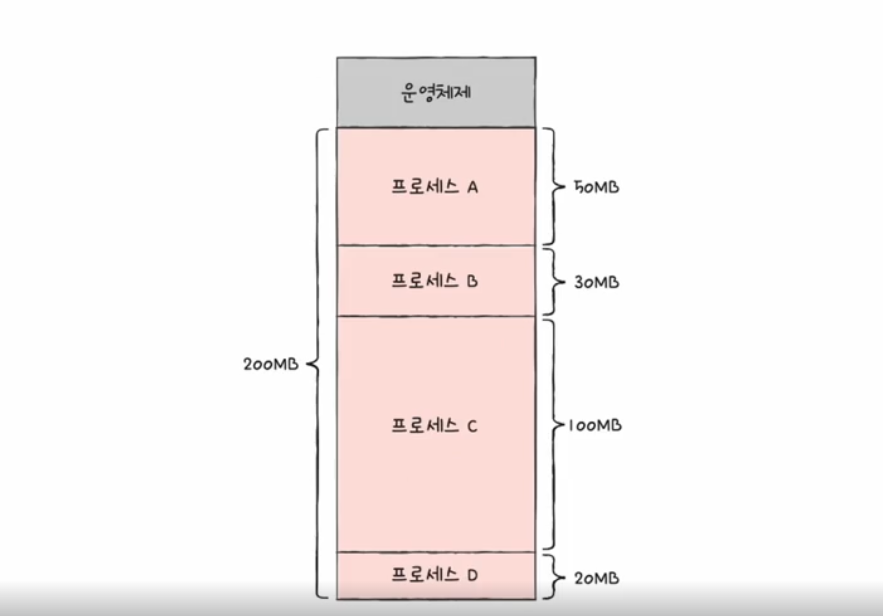

프로세스 B,D 실행 끝 

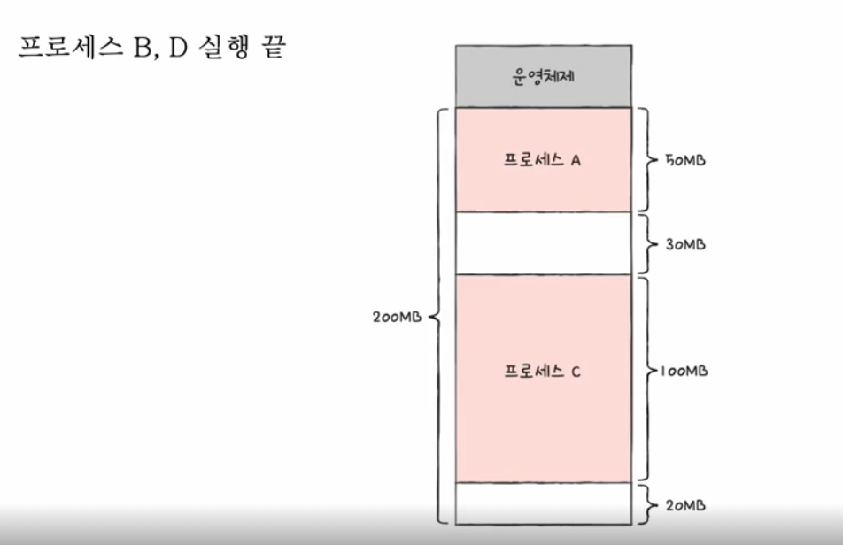

Q: 남은 공간의 총량? A: 50MB

Q: 50MB 프로세스를 메모리에 할당 가능? A: NO

### 외부 단편화?

  - **프로세스들이 실행되고 종료되길 반복하며 메모리 사이 사이에 빈 공간 발생** 
  - **프로세스를 할당하기 어려울 만큼 작은 메모리 공간들로 인해 메모리가 낭비되는 현상을 외부 단편화라고 한다.** 

### **외부 단편화 해결1 - 메모리 압축 (compaction)**

  - 여기저기 흩어져 있는 빈 공간들을 하나로 모으는 방식
  - 프로세스를 적당히 재배치시켜 흩어져 있는 작은 빈 공간들을 하나의 큰 빈 공간으로 만드는 방법 

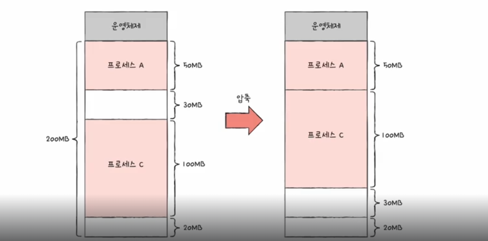

압축 방식은 작은 빈 공간들을 하나로 모으는 동안 시스템은 하던 일을 중지해야 하고, 메모리에 있는 내용을 옮기는 작업은 많은 오버헤드를 야기하며, 어떤 프로세스를 어떻게 움직여야 오버헤드를 최소화하며 압축할 수 있는지에 대한 명확한 방법을 결정하기 어렵다. 

그래서 현재는 외부 단편화를 없앨 수 있는 가상 메모리 기법, 그 중에서도 페이징 기법을 많이 사용한다. 

### **외부 단편화 해결2 - 가상 메모리 기법, 페이징**

## **✅** 연속 메모리 할당의 두 가지 문제점

  - 외부 단편화 
  - 물리 메모리보다 큰 프로세스 실행 불가 

## **✅ 가상 메모리 기법**

  - 실행하고자 하는 프로그램을 일부만 메모리에 적재하여 실제 물리 메모리 크기보다 더 큰 프로세스를 실행할 수 있게 하는 기술 
  - 페이징, 세그멘테이션 

## **✅ 페이징**

  - 외부 단편화가 발생했던 근본적인 문제는? 
  - 각기 다른 크기의 프로세가 메모리에 연속적으로 할당되었기 때문이다. 
  - 프로세스를 일정 크기로 자르고, 이를 메모리에 불연속적으로 할당할 수 있으면 어떨까?

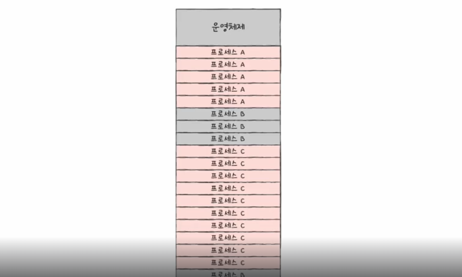

### 페이징(paging)

  - 프로세스의 논리 주소 공간을 **페이지(page)**라는 일정 단위로 자르고, 
  - 메모리의 물리 공간을 **프레임(frame)**이라는 페이지와 동일한 단위로 자른 뒤 
  - 페이지를 프레임에 할당하는 가상 메모리 관리 기법 

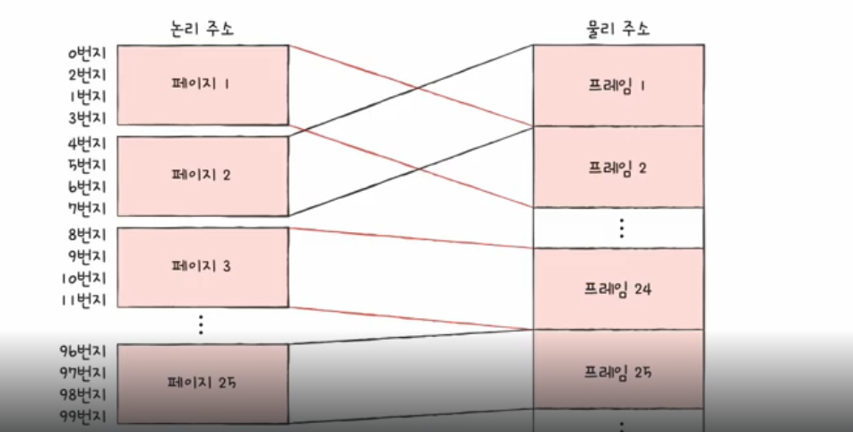

### 페이징에서의 스와핑 

  - 프로세스 단위의 스왑 인, 스왑 아웃이 아닌 페이지 단위의 **스왑 인(페이지 인), 스왑 아웃(페이지 아웃)**
  - 메모리에 적재될 필요가 없는 페이지들을 보조기억장치로 스왑 아웃(페이지 아웃)
  - 실행에 필요한 페이지들을 메모리로 스왑 인(페이지 인)

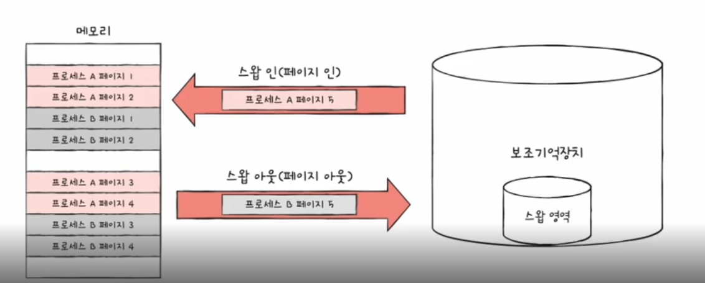

  - 프로세스를 실행하기 위해 모든 페이지가 적재될 필요 없다
  - 달리 말해 물리 메모리보다 큰 프로세스도 실행될 수 있다 

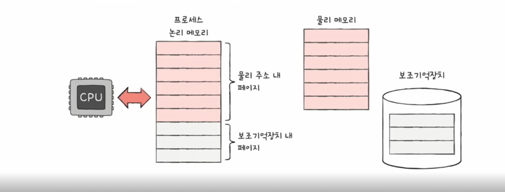

### CPU 입장에서 페이징 

  - 프로세스를 이루는 페이지가 어느 프레임에 적재되어 있는지 CPU가 일일이 알기란 어렵다 
  - 프로세스가 메모리에 불연속적으로 배치되어 있다면 CPU 입장에서 이를 순차적으로 실행할 수가 없다. 
  - CPU 입장에서는 다음에 실행할 명령어 위치를 찾기가 어려워졌다. 

## **✅**  페이지 테이블 

  - 물리 주소에 불연속적으로 배치되더라도
  - 논리 주소에는 연속적으로 배치되도록 하는 방법 
  - 페이지 번호와 프레임 번호를 짝지어 주는 일종의 이정표 

**프로세스마다 페이지 테이블이 존재** 

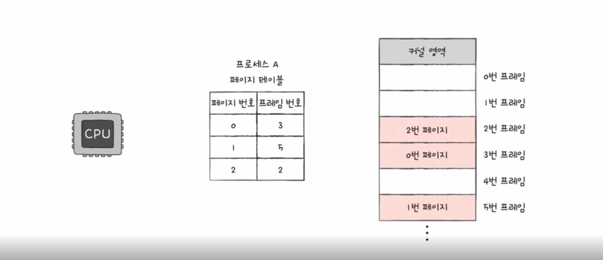

  - 물리적으로는 분산되어 저장되어 있더라도 CPU 입장에서 바라본 논리 주소는 연속적으로 보인다 
  - CPU는 그저 논리 주소를 순차적으로 실행하면 될 뿐

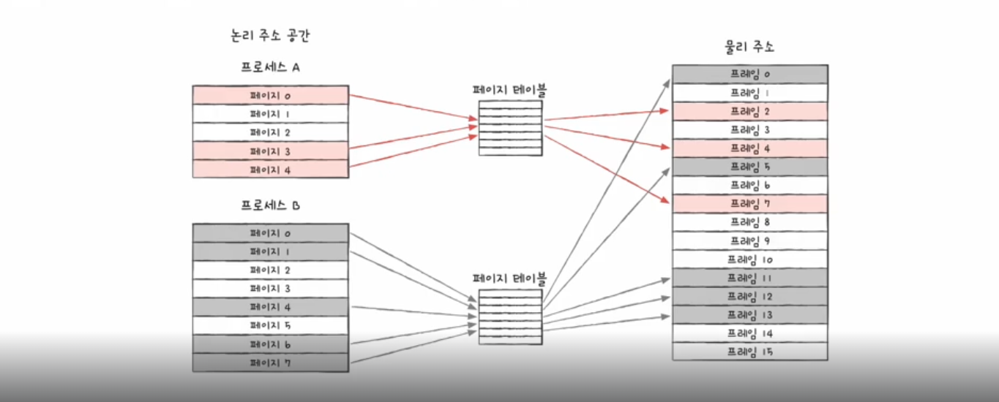

## **✅**  내부 단편화

  - 페이지 크기가 10KB, 프로세스 크기 108KB
  - 2KB: 내부 단편화 
  - 하나의 페이지 크기보다 작은 크기로 발생 

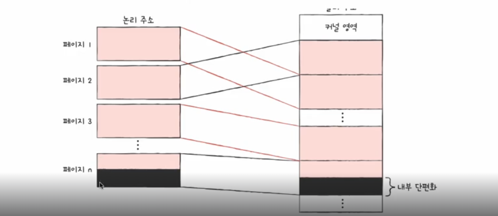

**하지만 내부 단편화의 크기는 외부 단편화와 비교했을 때 매우 작다.** 

## **✅** PTBR (Page Table Base Register)

  - 프로세스마다 페이지 테이블이 존재 
  - 각 페이지 테이블은 CPU 내의 **프로세스 테이블 베이스 레지스터(PTBR)**가 가리킨다.
  - 이런 각 프로세스들의 페이지 테이블 정보들은 각 프로세스의 PCB에 기록된다. 

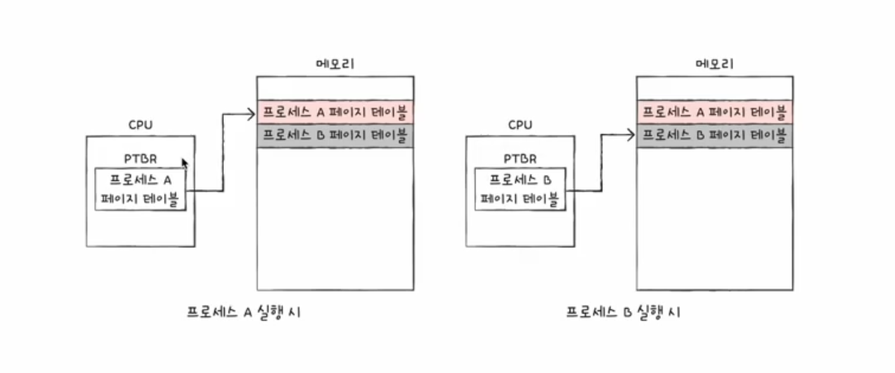

  - 페이지 테이블이 메모리에 있으면? **메모리 접근 시간 두 배로** 
  - 페이지 테이블 참조 1번, 페이지 탐조하기 위해 1번 

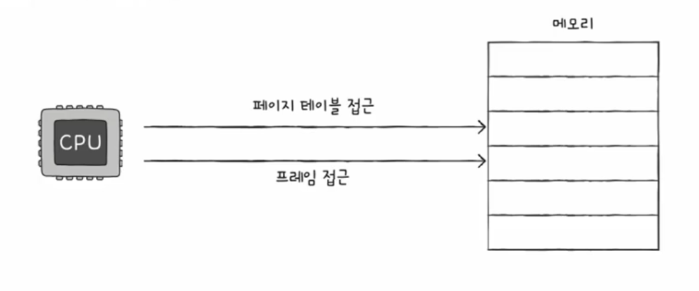

## **✅  TLB (Translation Lookaside Buffer)**

  - TLB: CPU 곁에 페이지 테이블의 캐시 메모리 
- 일반적으로 **MMU(Memory Management Unit)** 내에
  - 페이지 테이블의 일부를 가져와 저장 
- 참조 지역성에 근거해 최근에 사용된 페이지 위주로 가져와 저장

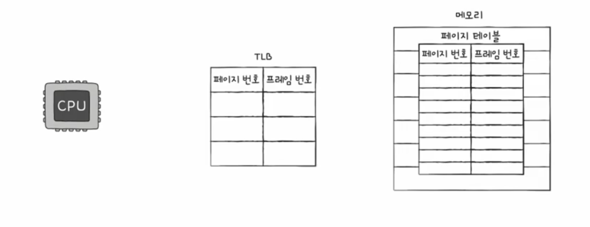

  - CPU가 접근하려는 논리 주소가 TLB에 있다면? TLB 히트 
- 메모리 접근 한 번
  - CPU가 접근하려는 논리 주소가 TLB에 없다면? TLB 미스 
- 메모리 접근 두 번

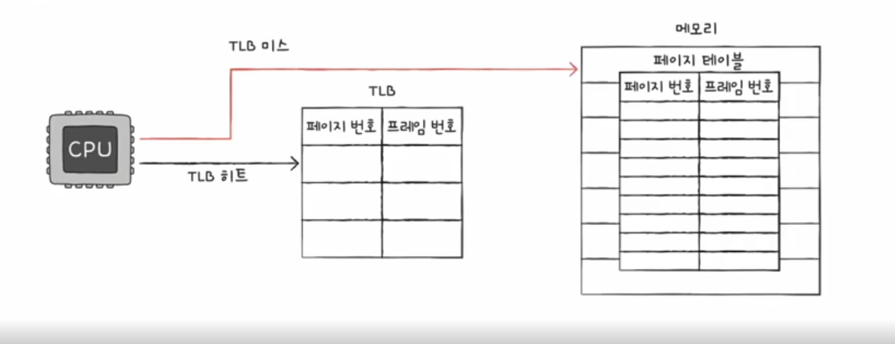

## **✅**  페이징에서의 주소 변환 

  - 특정 주소에 접근하고자 한다면 어떤 정보가 필요할까? 
- 어떤 페이지/프레임에 접근하고 싶은지
    - 접근하려는 주소가 그 페이지 혹은 프레임으로부터 얼마나 떨어져 있는지

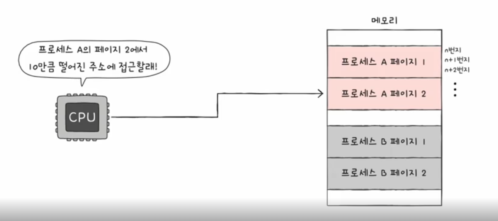

### 페이징 시스템에서의 논리 주소 

  - 페이지 번호(page number)와 변위(offset)


### 페이징에서의 주소 변환 

  - <페이지 번호, 변위>로 이루어진 논리 주소는 
  - 페이지 테이블틀 통해 
  - <프레임 번호, 변위>로 변환된다 
  - 페이징에서 주소 변환은 **MMU (Memory Management Unit)** 가 담당

### 주소 변환 흐름 

  1. **CPU**가 논리 주소(가상 주소)를 생성
ex) `페이지 번호 + 오프셋`
  1. **MMU**가 TLB를 먼저 조회
- Hit: 바로 물리 주소로 변환
    - Miss: 메모리에서 페이지 테이블을 조회
  1. **페이지 테이블**을 통해 해당 페이지 번호가 매핑된 **프레임 번호**를 찾음
  1. **프레임 번호 + 오프셋** → 최종 **물리 주소** 계산

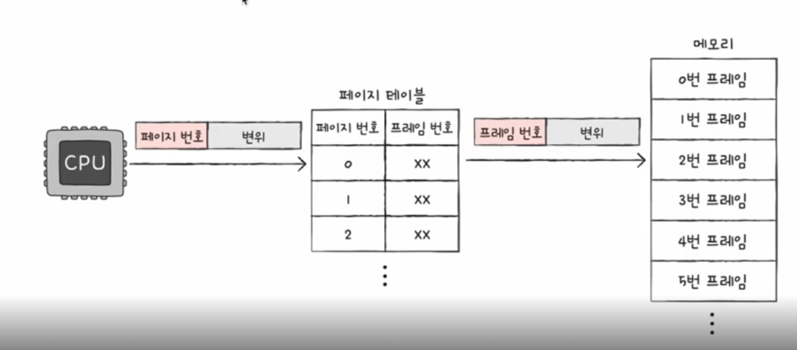

  - 논리주소<페이지 번호, 변위>가 <5, 2>인 곳에 접근?

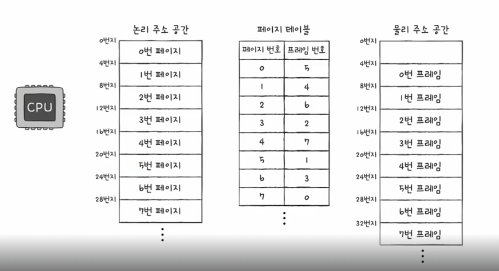

A: 페이지 번호: 5 → 프레임 번호: 1  1번 프레임 엔트리: 8번지 변위: 2 최종 접근 물리 주소: 8 + 2 = 10번지 

## **✅**  페이지 테이블 엔트리

  - 페이지 테이블의 각각의 행: 페이지 테이블 엔트리(PTE)
- 현재까지 설명한 PTE: 페이지 번호, 프레임 번호 
    - 이외에 담기는 정보?

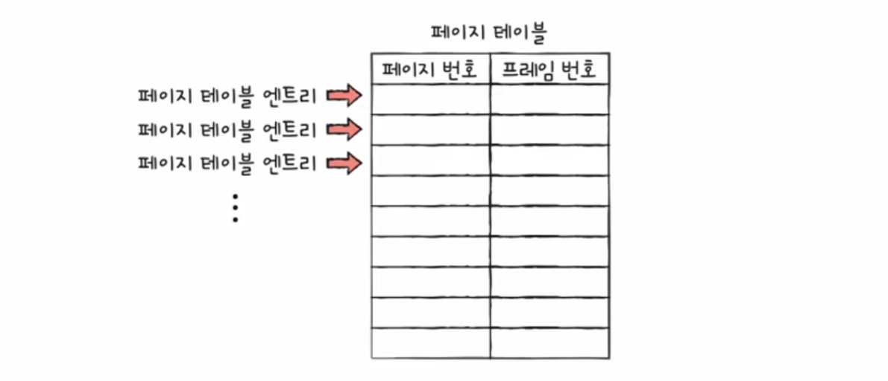

### 유효 비트 

  - 현재 해당 페이지에 접근 가능한지 여부 (valid, invalid) 

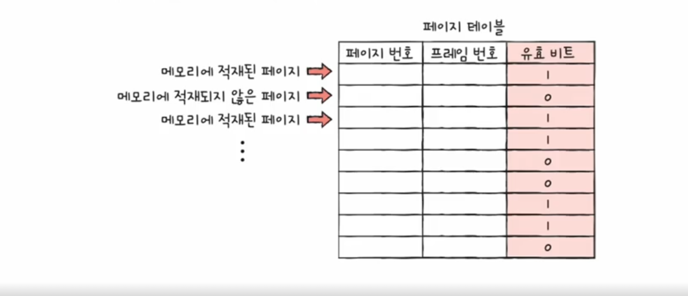

### 유효 비트가 0인 페이지에 접근하려고 하면?

  - **페이지 폴트(page fault)라는 인터럽트 발생** 
1. CPU는 기존의 작업 내역을 백업 
    1. 페이지 폴트 처리 루틴(인터럽트 서비스 루틴) 실행 
    1. 페이지 처리 루틴은 페이지를 메모리로 가져온 뒤(페이지 인/스왑 인) 유효 비트를 1로 변경 
    1. 페이지 폴트로 처리했다면 이제 CPU는 해당 페이지에 접근할 수 있게 된다.

### 보호 비트 

  - 페이지 보호 기능을 위해 존재하는 비트 
  - 페이지에 접근할 권한을 제한하여 페이지를 보호하는 비트 

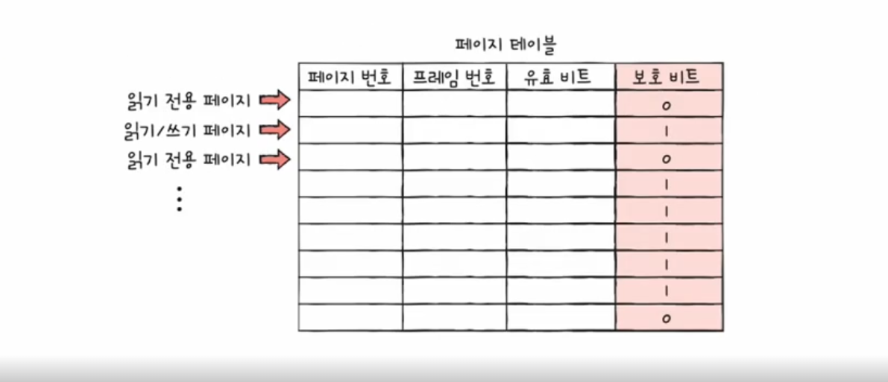

### 참조 비트

  - CPU가 이 페이지에 접근한 적이 있는지 여부 

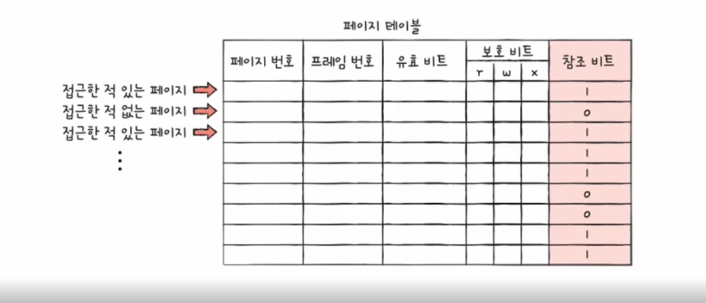

### 수정 비트 (더티 비트 = dirty bit)

  - CPU가 이 페이지에 데이터를 쓴 적이 있는지 여부 

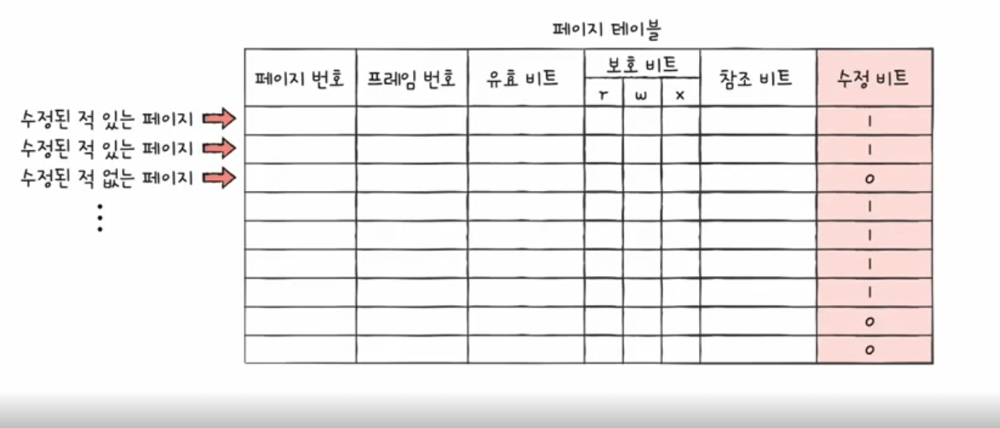

  - 수정 비트의 존재 이유? 
  - 수정된 페이지는 스왑 아웃될 때 보조기억장치에도 쓰기 작업을 거쳐야 한다. 
  - 수정되지 않은 페이지는 스왑 아웃될 때 작업 X (디스크에 있는 내용이 이미 최신본)

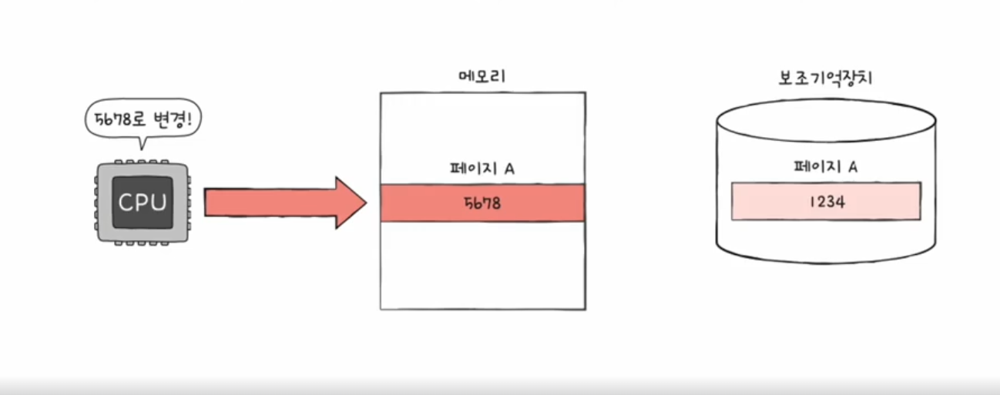

## **✅** 이론적인 fork()

프로세스는 기본적으로 자원을 공유하지 않는다. 

→ 부모 프로세스가 적재된 별도의 공간에 자식 프로세스가 통째로 복제되어 적재 

→ (프로세스 생성 시간 지연, 메모리 낭비) 

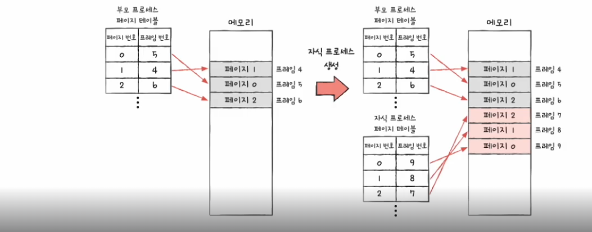

## **✅ 쓰기 시 복사** 

부모 프로세스와 동일한 자식 프로세스가 복제되어 생성되면 자식 프로세스는 부모 프로세스와 동일한 프레임을 가리킴(쓰기 작업이 없다면 이 상태 유지) 

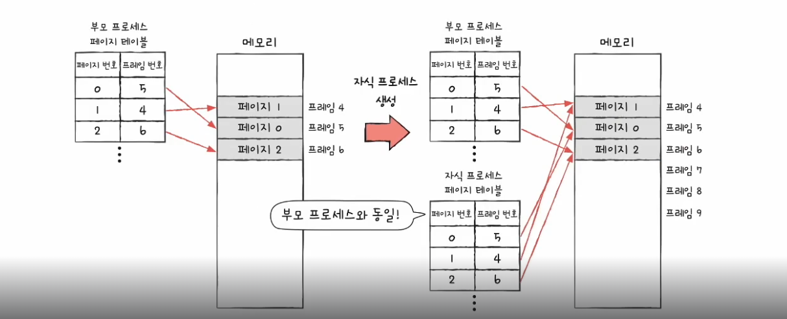

부모 프로세스/자식 프로세스 둘 중 하나가 페이지에 쓰기 작업 수행 시 해당 페이지는 별도의 공간으로 복제 

(프로세스 생성 시간 절약, 메모리 절약) 

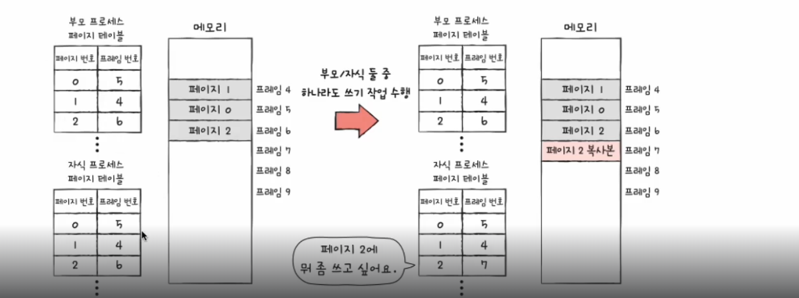

## **✅**  계층적 페이징 

  - 프로세스 테이블의 크기는 생각보다 작지 않다 
  - 프로세스를 이루는 모든 페이지 테이블 엔트리(행)를 메모리(커널 영역)에 두는 것은 큰 낭비 
  - 프로세스를 이루는 모든 페이지 테이블 엔트리를 항상 메모리에 유지하지 않을 방법 

### 페이지 테이블을 페이징하여 여러 단계의 페이지를 두는 방식 

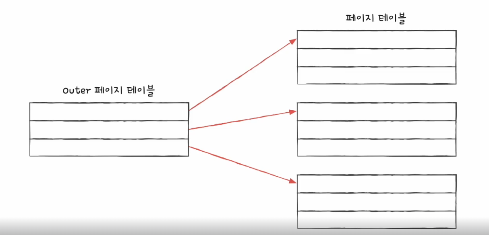

페이지 테이블을 여러 페이지로 쪼개고 이 페이지를 가리키는 페이지 테이블(Outer 페이지 테이블)을 두는 방식 

**모든 페이지 테이블을 항상 메모리에 필요가 없어짐**

  - CPU와 가장 가까이 위치한 페이지 테이블(Outer 페이지 테이블)은 항상 메모리에 유지 

### 계층적 페이징을 이용하는 환경에서의 논리 주소 


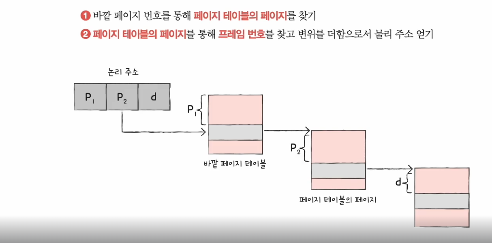

현재 그림은 계층적 페이징은 2단계지만 더 많은 계층이 존재할 수 있다.

하지만 너무 많은 단계가 존재하면 페이지 폴트가 발생했을 때 보조기억장치의 접근 횟수가 많아져 성능에 좋지 않다.

## **✅**  들어가며

  - 물리 메모리보다 큰 프로세스들을 실행할 수 있지만, 그럼에도 물리 메모리의 크기는 한정되어 있다 
  - 기존에 적재된 불필요한 페이지를 선별해 보조기억장치로 내보내고 프로세스들에게 적절한 수의 프레임을 할당해야 한다. 

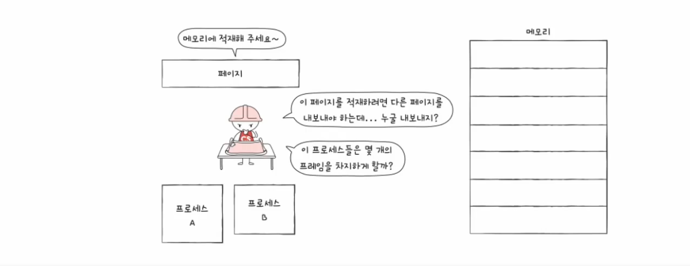

## **✅  요구 페이징** 

  - 처음부터 모든 페이지를 적재하지 않고 필요한 페이지만을 메모리에 적재하는 기법
  - **요구되는 페이지만 적재**하는 기법 
  1. CPU가 특정 페이지에 접근하는 명령어를 실행한다. 
  1. 해당 페이지가 현재 메모리에 있을 경우(유효 비트가 1일 경우) CPU는 페이지가 적재된 프레임에 접근한다. 
  1. 해당 페이지가 현재 메모리에 없을 경우(유효 비트가 0일 경우) 페이지 폴트 발생 
  1. 페이지 폴트 처리 루틴은 해당 페이지를 메모리에 적재하고 유효 비트를 1로 설정한다. 
  1. 다시 1번을 수행한다. (폴트의 특징) 

### 이러한 요구 페이징 시스템이 안정적으로 작동하려면 해결해야 할 문제? 

  - 페이지 교체 
  - 프레임 할당 

## **✅  페이지 교체 알고리즘** 

  - 요구 페이징 기법으로 페이지들을 적재하다보면 언젠가 메모리가 가득 차게 된다. 
  - 당장 실행에 필요한 페이지를 적재하려면 적재된 페이지를 보조기억장치로 내보내야함 
  - 이때, 어떤 페이지를 내보낼까? 
  - 이를 결정하는 알고리즘이 페이지 교체 알고리즘 

### 무엇이 좋은 페이지 교체 알고리즘일까?

  - 페이지 폴트가 적은 알고리즘
- 페이지 폴트가 발생하면 보조기억장치에 접근해야 해서 성능 저하

### 페이지 폴트 횟수는 어떻게 알 수 있을까?

  - 페이지 참조열(page reference string)
- CPU가 참조하는 페이지들 중 연속된 페이지를 생략한 페이지열

```java
#CPU가 참조하는 페이지들 
2 2 2 3 5 5 5 3 3 7

#연속된 페이지 생략 
2 3 5 3 7
```

## **✅  FIFO 페이지 교체 알고리즘** 

  - 가장 단순한 방식 
  - 메모리에 가장 먼저 올라온 페이지부터 내쫓는 방식 → 오래 머물렀다면 나가라~

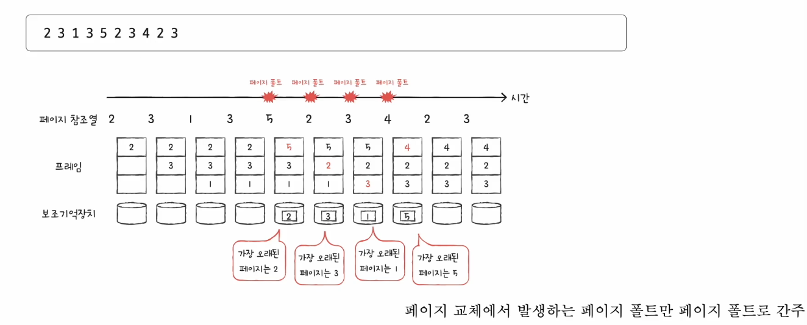

  - 프로그램 실행 내내 사용될 페이지 ← 먼저 적재되었다고 내쫓아선 안된다 

### FIFO 페이지 교체 알고리즘 - 보완책 

  - **2차 기회(second-chance) 페이지 교체 알고리즘** 
  - 참조 비트 1: CPU가 한 번 참조한 적이 있는 페이지 
- 한 번 더 기회를 주기(참조 비트 0으로 초기화 후 적재 시간을 현재 시간으로 설정)
  - 참조 비트 0: CPU가 참조한 적이 없는 페이지 
- Bye
  - FIFO 페이지 교체 알고리즘과 마찬가지로 오래된 순서대로 내쫓는 방식이지만 참조 비트에 따라서 다르게 동작한다. 

## **✅  최적 페이지 교체 알고리즘** 

  - CPU에 의해 참조되는 횟수를 고려 
  - 메모리에 오래 남아야 할 페이지는 **자주 사용될 페이지** 
  - 메모리에 없어도 될 페이지는 **오랫동안 사용되지 않을 페이지** 
  - 앞으로의 사용 빈도가 가장 낮은 페이지를 교체하는 알고리즘 

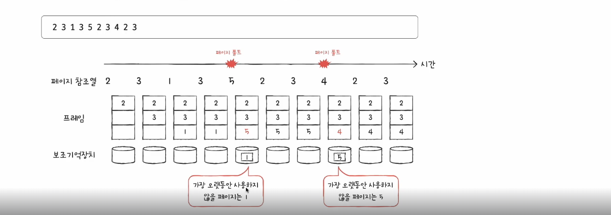

### 최적 페이지 교체 알고리즘 특징 

  - **가장 낮은 페이지 폴트율을 보장**하는 페이지 교체 알고리즘 
  - **하지만 실제 구현이 어렵다** 
  - 앞으로 오랫동안 사용되지 않을 페이지? 어떻게 예측?
  - 다른 페이지 교체 알고리즘 성능을 평가하기 위한 하한선으로 간주 

## **✅  LRU(Least-Recently-Used) 페이지 교체 알고리즘** 

  - 최적 페이지 교체 알고리즘: 가장 오래 사용되지 **않을** 페이지 교체 
  - LRU 페이지 교체 알고리즘: 가장 오래 사용되지 **않은** 페이지 교체 
- 최근에 사용되지 않은 페이지는 앞으로도 사용되지 않지 않을까?

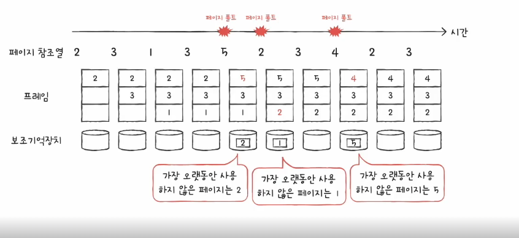

## **✅  기타 페이지 교체 알고리즘** 

  - 이외에도 많은 페이지 교체 알고리즘들이 있다. 

## **✅  스래싱 문제** 

### 페이지 폴트가 자주 발생하는 이유 

  - 비효율적인 페이지 알고리즘을 사용해서
  - **프로세스가 사용할 수 있는 프레임 자체가 적어서** 

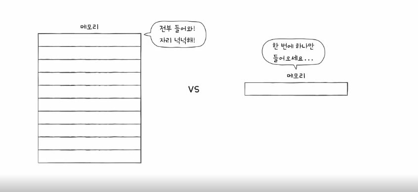

### 스래싱?

  - 프로세스가 실행되는 시간보다 페이지 교체에 더 많은 시간을 소요하여 성능(CPU 이용률)이 저해되는 문제 

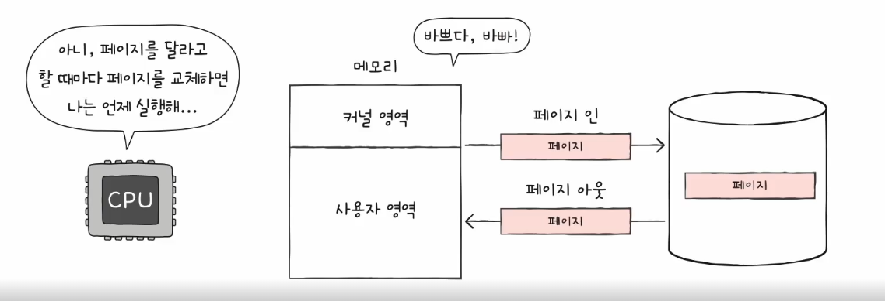

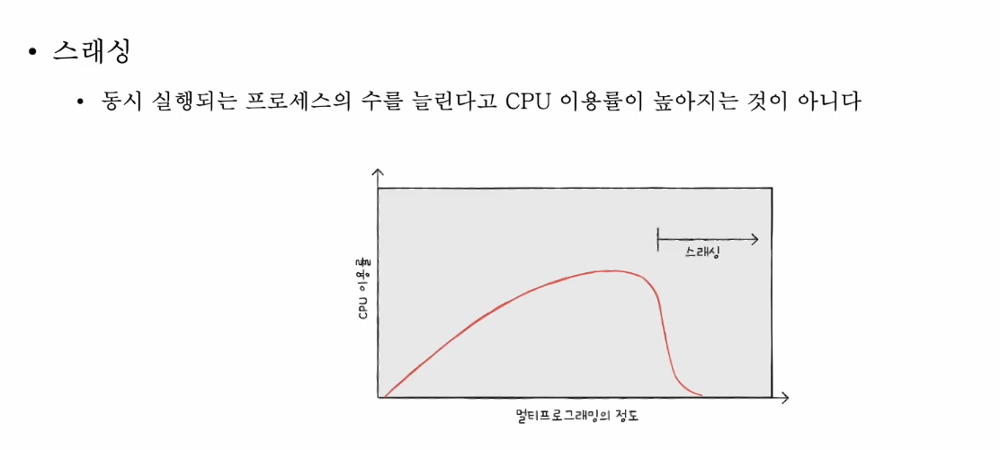

  - 멀티프로그래밍의 정도: 메모리에 동시에 실행되는 프로세스의 수 

**스래싱 원인**

  - 각 프로세스가 필요로 하는 최소한의 프레임 수가 보장되지 않았기 때문 
  - 각 프로세스가 필요로 하는 최소한의 프레임 수를 파악하고 프로세스들에게 적절한 프레임을 할당해주어야 한다 
  - 즉 프로세스를 많이 생성 → CPU 이용률 상승 X(각 프로세스 프레임 수 보장 X)

## **✅  프로세스** 프레임 할당 

### 균등 할당(equal allocation)

  - 가장 단순한 할당 방식 
  - 모든 프로세스들에게 균등하게 프레임을 할당하는 방식 
  - 정적 할당 방식 

### 비례 할당(proportional allocation)

  - 프로세스 크기를 고려 
  - 프로세스 크기에 비례하여 프레임 할당 
  - 정적 할당 방식 
  - 문제점
- 크기가 큰 프로세스인데 막상 실행해보니 많은 프레임을 필요로 하지 않으면? 
    - 크기가 작은 프로세스인데 막상 실행해보니 많은 프레임이 필요로 하면? 
    - 결국 프로세스가 필요로 하는 프레임 수는 **실행해봐야 안다**

### 작업 집합 모델 

  - 프로세스가 실행하는 과정에서 배분할 프레임 결정 (동적 할당 방식)
  - 스래싱이 발생하는 이유는 빈번한 페이지 교체 때문 
  - **CPU가 특정 시간 동안 주로 참조한 페이지 개수만큼만 프레임을 할당하면 된다**  
  - 프로세스가 일정 기간 동안 참조한 페이지 집합을 기억하며 빈번한 페이지 교체를 방지 
- 작업 집합이란 실행 중인 프로세스가 일정 시간 동안 참조한 페이지의 집합

**작업 집합을 구하려면?**

  - 프로세스가 참조한 페이지 
  - 시간 간격 

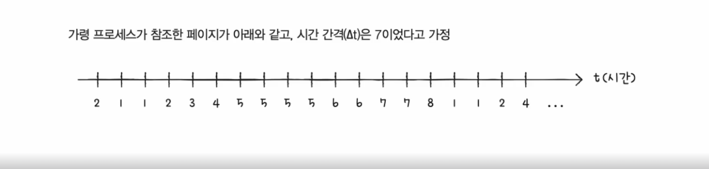

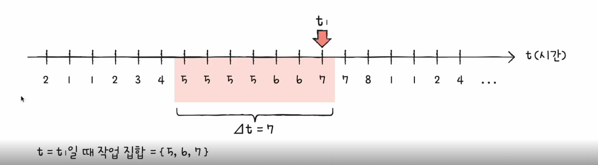

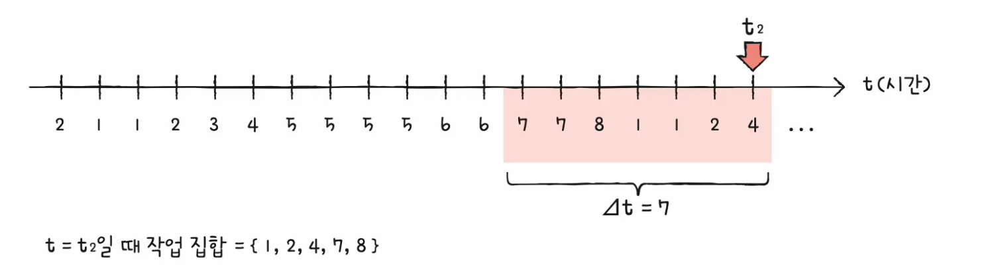

### 페이지 폴트 빈도 

  - 프로세스가 실행하는 과정에서 배분할 프레임 결정 
  - 두 개의 가정에서 생겨난 아이디어 
- 페이지 폴트율이 너무 높으면 그 프로세스는 너무 적은 프레임을 갖고 있다. 
    - 페이지 폴트율이 너무 낮으면 그 프로세스는 너무 많은 프레임을 갖고 있다.

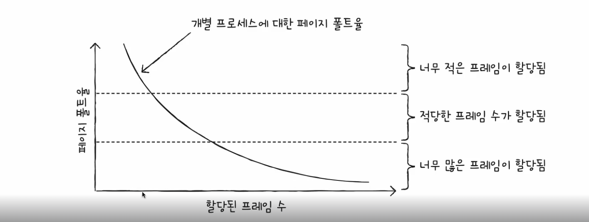

  - 페이지 폴트율에 상한선과 하한선을 정하고, 그 내부 범위 안에서만 프레임을 할당하는 방식

### 🔁 스레드 vs 프로세스 컨텍스트 스위칭: 가상 메모리 관점

### ✅ 스레드 컨텍스트 스위칭의 특징

  - **페이지 테이블 주소 변경 없음**
- 스레드는 같은 프로세스 내에서 실행되므로 **같은 가상 주소 공간을 공유**합니다.
    - 따라서 **CR3 레지스터 (페이지 테이블 베이스 레지스터)** 값이 변하지 않음 → 페이지 테이블 변경 없음.
  - **TLB 유지**
- 페이지 테이블이 그대로이므로 TLB 캐시(TLB: Translation Lookaside Buffer)가 대부분 유효함.
    - → **TLB hit 가능성 높음** → 스위칭 이후 메모리 접근 효율적.
  - **메모리 접근 패널티 낮음**
- 동일한 메모리 맥락이 유지되므로 **페이지 폴트 등의 가능성 낮음**.

### ❌ 프로세스 컨텍스트 스위칭의 특징

  - **페이지 테이블 전환**
- 프로세스 간 컨텍스트 스위칭은 **가상 주소 공간이 완전히 바뀌는 것**을 의미.
    - 이때 **CR3 레지스터의 값도 변경** → **페이지 테이블 전체 변경**.
  - **TLB flush 가능성**
- 페이지 테이블이 바뀌었기 때문에 기존 TLB는 **오염된 상태가 됨**.
    - 대부분 OS는 이를 감지해 **TLB를 flush** 함 → **다시 TLB miss 발생 가능성 높음**.
  - **페이지 폴트 가능성 증가**
- 계층적 페이지 테이블을 사용하므로 새 프로세스의 페이지가 아직 메모리에 없을 수 있음.
    - 이 경우 **디스크 I/O가 발생하는 페이지 폴트**가 발생 가능.

