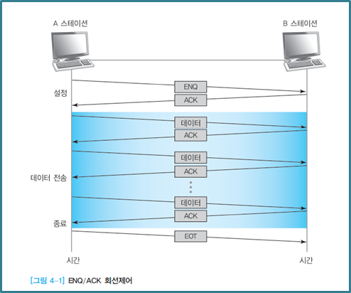
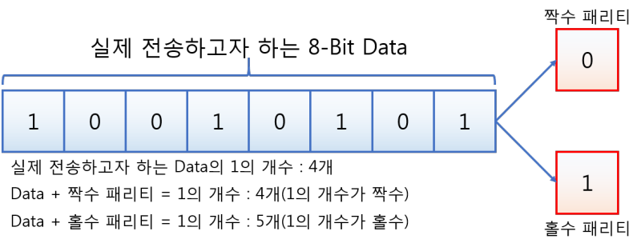
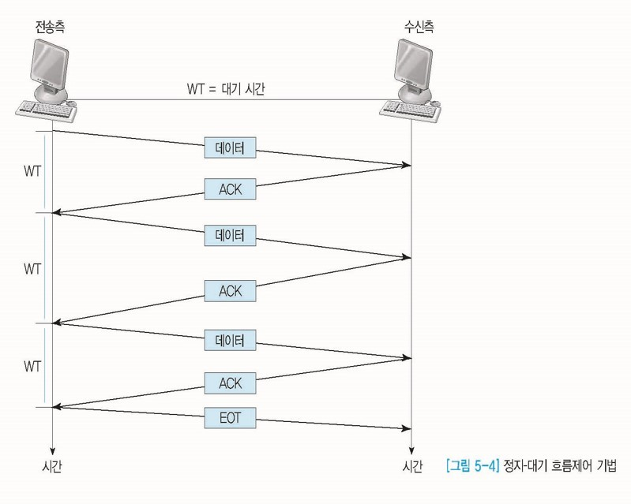

### 개요 

데이터 링크 계층은 네트워크에서 데이터를 관리하고 전달하는 계층으로, 데이터 전송의 신뢰성과 효율성에 중요한 역할을 한다.

데이터 링크 계층은 데이터를 작은 프레임 단위로 분할하고, MAC 주소를 활용하여 장비를 식별한다.

네트워크에서 여러 기기가 동시에 데이터를 전송하려고 하면 신호 출동이 발생한다. 이 상황에서 데이터를 동시에 전송하면 여러 데이터가 충돌하게 되어 제대로 전달되지 않는다.

데이터 링크 계층은 이런 오류를 탐지하고 수정하는 역할을 하며, 데이터의 원활한 흐름과 네트워크 매체에서 충돌 관리도 수행한다.

**데이터 링크 계층에서 오류를 감지하거나 수정하는 방식으로는 회선 제어, 오류 제어, 흐름 제어가 있다.**

---

### 회선 제어(Line Control)

**회선 제어는 오류를 감지하기보다는 회피하는 방법으로 신호 간 충돌 현상이 발생하지 않도록 제어한다.**

**신호의 시작을 의미하는 ENQ(Enquiry)와 끝을 의미하는 EOT(End of Transmisson)를 명시적으로 지정**한다. **수신자는 송신자로부터 신호를 받으면 받았다는 의미의 ACK(Acknowledgment)를 송신자에게 보내서 신호를 정상적으로 수신하였음을 알린다.** 이러면 신호 간 충돌을 피할 수 있다.

---

### 오류 제어(Error Control)

**오류 제어는 송수신 데이터가 외부 간섭, 시간 지연 등에 의해 데이터가 변형되거나 순서가 어긋나는 듯의 통신 장애가 발생하지 않도록 오류를 검출하고 정정하여 통신에 대한 신뢰성을 확보하는 방법이다.**

오류 검사로 사용되는 것 중에 패리티 검사가 있다.

**패리티 검사(parity check)**는 수신자에게 보내는 최종 데이터의 1의 개수를 짝수 개로 보낼지(even parity), 홀수 개로 보낼지(odd parity) 송수신자가 미리 약속하고 여부의 비트(패리티 비트)를 채워 보내는 방법이다. 

전송 데이터: 10010101

- 짝수 패리티: 100101010
- 홀수 패리티: 100101011

**패리티 검사 장점, 단점** 

- 구현이 매우 간단하고, 하드웨어/소프트웨어 모두 쉽게 적용 가능
- 오버헤드가 적다(1개의 비트만 추가)
- 다중 비트 오류(2개 이상 비트가 동시에 바뀌는 경우)는 검출이 불가능할 수 있음
- 오류의 위치를 알 수 없고, 오류 정정은 불가능함

오류 제어에는 패리티 검사 외에도 **CRC(Cyclic Redundancy Check), 검사합(Checksum)** 방식도 있다.

**CRC 방식**은 데이터에 CRC 코드를 추가하여 오류를 감지하는 방법으로, 송신자가 CRC 코드를 생성하고 수신자 측에서도 동일한 계산을 수행하여 일치 여부를 확인한다. 

**체크섬 방식**은 데이터의 각 바이트 값을 더하거나 연산하여 생성되는 값이다.

송신자가 데이터와 관련된 검사합을 계산하고 순사자 측에서도 동일한 계산을 수행하여 체크섬 값이 일치하는지 확인한다. 또한 오류가 발생한 경우 이를 정정하는 방법으로 **해밍 코드(Hamming code)**를 사용한다.

해밍 코드는 데이터에 추가적인 패리티 비트를 포함시켜, 이 패리티 비트들을 데이터 비트와 조합하여 구성한다.

패리티 비트를 분석하여 오류가 발생한 비트를 식별하고, 해당 비트의 값을 수정함으로써 오류를 정정한다.

---

### 흐름 제어(Flow Control)

흐름 제어는 송신자와 수신자의 데이터 처리 속도 차이를 해결하기 위해 수신자 상황에 따라 송신자의 데이터 전송량을 조정하는 방법이다. 

흐름 제어로 사용되는 방법 중 하나가 정지-대기(Stop & Wait)이다. 

송신자가 하나의 데이터를 전송한 후 다음 데이터를 전달하기 전에 응답을 기다리는 방법이다.

---

### 참고 

오류 제어와 흐름제어는 전송 계층에서도 사용된다.

---

