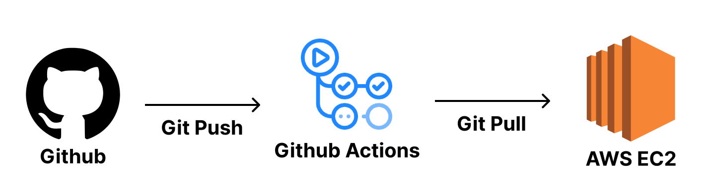

### ✅ 전체적인 흐름



### ✅ 장점

- git pull을 활용해서 변경된 부분의 프로젝트 코드에 대해서만 업데이트 하기 때문에 CI/CD 속도가 빠르다. 
- 대부분의 CI/CD 방식들은 전체 프로젝트를 통째로 갈아끼우는 방식을 사용한다.
- CI/CD 툴로 Github Actions만 사용하기 때문에 인프라 구조가 복잡하지 않고 간단하다. 

### ✅ 단점

- 빌드 작업을 EC2에서 직접 진행하기 때문에 운영하고 있는 서버의 성능에 영향을 미칠 수 있다. 
- 운영 서버에서 빌드를 하면 CPU, 메모리가 많이 소모된다.
- Github 계정 정보가 해당 EC2에 저장되기 때문에 개인 프로젝트 또는 믿을만한 사람들과 같이 진행하는 토이 프로젝트에서만 사용해야 한다. 
```shell
ls -a 
cat .git-credentials
```

  - 이렇게 private repository 통한 프로젝트를 진행하면 매번 깃허브 access token 넣기가 귀찮아서 
ec2 서버에 저장하는데 github 정보 주인이 아닌 다른 ec2에 접속 가능한 팀원이 볼 수 있다. 
  - 간단한 해결 방법은 public repository로 프로젝트를 진행 
  - 토큰 권한을 제한

### ✅ 이 방법은 언제 주로 쓰는 지

- 주로 개인 프로젝트에서 CI/CD를 심플하고 빠르게 적용시키고 싶을 때 적용한다.
