```java
@Slf4j
@RequiredArgsConstructor
public class TestDataInit {

    private final ItemRepository itemRepository;
    
    @EventListener(ApplicationReadyEvent.class)
    public void initData() {
        log.info("test data init");
        itemRepository.save(new Item("itemA", 10000, 10));
        itemRepository.save(new Item("itemB", 20000, 20));
    }
}
```

  - *애플리케이션을 실행할 때 초기 데이터를 저장*
  - ***@EventListener(ApplicationReadyEvent.class)***
*스프링 컨테이너가 완전히 초기화를 다 끝내고, 실행 준비가 되었을 때 발생하는 이벤트*
  - *@PostConstruct를 사용할 경우 AOP 같은 부분이 아직 다 처리되지 않은 시점에
호출될 수 있기 때문에, 간혹 문제가 발생할 수 있다. 
예를 들어서 @Transactional과 관련된 AOP가 적용되지 않은 상태로 호출될 수 있다.*
  - *@EventListener(ApplicationReadyEvent.class)는 AOP를 포함한 스프링 컨테이너가 완전
히 초기화 된 이후에 호출되기 때문에 이런 문제가 발생하지 않는다.*

***빈 후처리기 메소드는 2개가 있는데 스프링 프록시 생성 빈 후처리기는 PostConstruct 호출 이후에 동작하는 메소드를 사용하여 프록시가 적용되기 때문이다.***

- ***AOP 적용 이후 초기 데이터를 저장하는 방법***

```java
@SpringBootApplication(scanBasePackages = "hello.itemservice.web")
public class ItemServiceApplication {
		public static void main(String[] args) {
				SpringApplication.run(ItemServiceApplication.class, args);
		}
	
		@Bean
		@Profile("local")
		public TestDataInit testDataInit(ItemRepository itemRepository) {
			return new TestDataInit(itemRepository);
		}
}		
```

  - ***@Profile("local") : 특정 프로필의 경우에만 해당 스프링 빈을 등록한다***
  - *여기서는 local이라는 이름의 프로필이 사용되는 경우에만 testDataInit이라는 스프링 빈을 등록한다*

***application.properties***

```java
spring.profiles.active=local
```

***프로필?***

*스프링은 로딩 시점에 application.properties/yaml의 spring.profiles.active 속성을 읽어서 프로필로 사용한다.*

*이 프로필은 로컬(나의 PC), 운영 환경, 테스트 실행 등등 다양한 환경에 따라서 다른 설정을 할 때 사용하는 정보이다.*

***데이터베이스 기본 키는 다음 3가지 조건을 모두 만족해야 한다***

  - *null 값은 허용하지 않는다.*
  - *유일해야 한다.*
  - *변해선 안 된다.* 

***테이블의 기본 키를 선택하는 전략은 크게 2가지가 있다.***

  - *자연 키(natural key)* 
- *비즈니스에 의미가 있는 키*
    - *예: 주민등록번호, 이메일, 전화번호*
  - *대리 키(surrogate key)*
- *비즈니스와 관련 없는 임의로 만들어진 키, 대체 키로도 불린다.*
    - *예: 오라클 시퀀스, auto_increment, identity, 키생성 테이블 사용*

***자연 키보다는 대리 키를 권장한다***

  - *자연 키와 대리 키는 일장 일단이 있지만 될 수 있으면 대리 키의 사용을 권장한다.* 
  - *예를 들어 자연 키인 전화번호를 기본 키로 선택한다면 그 번호가 유일할 수는 있지만, 전화번호가 없을 수도 있고 전화번호가 변경될 수도 있다. 따라서 기본 키로 적당하지 않다. 문제는 주민등록번호처럼 그럴듯하게 보이는 값이다. 이 값은 null 이 아니고 유일하며 변하지 않는다는 3가지 조건을 모두 만족하는 것 같다. 하지만 현실과 비즈니스 규칙은 생각보다 쉽게 변한다. 주민등록번호 조차도 여러 가지 이유로 변경될 수 있다.*
- *정부 정책 변경으로 테이블에 주민등록번호 저장 불가능 케이스* 
    - *JPA는 모든 엔티티에 일관된 방식으로 대리 키 사용을 권장*
    - *비즈니스 요구사항은 계속해서 변하는데 테이블은 한 번 정의하면 변경하기 어렵다. 
그런면에서 외부 풍파에 쉽게 흔들리지 않는 대리 키가 일반적으로 좋은 선택이라 생각한다.*

# ***JdbcTemplate 소개와 설정***

*SQL을 직접 사용하는 경우에 스프링이 제공하는 JdbcTemplate은 아주 좋은 선택지다.*

*JdbcTemplate은 JDBC를 매우 편리하게 사용할 수 있게 도와준다.*

***장점***

  - *반복 문제 해결*
- *JdbcTemplate은 템플릿 콜백 패턴을 사용해서, JDBC를 직접 사용할 때 발생하는 대부분의 반복 작업을 대신 처리해준다.*
    - *개발자는 SQL을 작성하고, 전달할 파리미터를 정의하고, 응답 값을 매핑하기만 하면 된다.*
    - *JDBC 반복 작업 해결 부분* 
- *커넥션 획득*
      - *statement를 준비하고 실행*
      - *결과를 반복하도록 루프를 실행*
      - *커넥션 종료, statement , resultset 종료*
      - *트랜잭션 다루기 위한 커넥션 동기화 (트랜잭션 동기화 매니저*
      - *예외 발생시 스프링 예외 변환기 실행*

***단점***

  - *동적 쿼리를 해결하기 어렵다.*

***JdbcTemplate 설정 - build.gradle***

```java
implementation 'org.springframework.boot:spring-boot-starter-jdbc'
runtimeOnly 'com.h2database:h2'
```

  - *org.springframework.boot:spring-boot-starter-jdbc를 추가하면 JdbcTemplate이 들어있는
spring-jdbc가 라이브러리에 포함된다.*

# ***JdbcTemplate 적용1 - 기본***

```java
@Slf4j
public class JdbcTemplateItemRepositoryV1 implements ItemRepository {
    private final JdbcTemplate template;
    
    public JdbcTemplateItemRepositoryV1(DataSource dataSource) {
        this.template = new JdbcTemplate(dataSource);
    }
    
    // 생략 ...
}    
```

  - *JdbcTemplate은 DataSource가 필요하다.*
  - *해당 방법이 아니라 스프링 빈으로 생성하고 주입하는 방식도 가능하다.*

***save()***

```java
@Override
public Item save(Item item) {
    String sql = "insert into item(item_name, price, quantity) values (?,?,?)";

    // 데이터베이스가 identity 전략으로 자동 생성한 primary key를 받기 위해 필요
    KeyHolder keyHolder = new GeneratedKeyHolder();

    template.update(connection -> {
        // 자동 증가 키
        PreparedStatement ps = connection.prepareStatement(sql, new String[]{"id"});
        ps.setString(1, item.getItemName());
        ps.setInt(2, item.getPrice());
        ps.setInt(3, item.getQuantity());
        return ps;
    }, keyHolder);

    long key = keyHolder.getKey().longValue();
    item.setId(key);

    return item;
}
```

  - *template.update() : 데이터를 변경할 때는 update()를 사용하면 된다.*
- *INSERT , UPDATE , DELETE → SQL에 사용한다.*
    - *template.update()의 반환 값은 int 인데, 영향 받은 로우 수를 반환한다.*
  - *데이터를 저장할 때 PK 생성에 identity (auto increment) 방식을 사용하기 때문에, PK인 ID 값을 개발자가 직접 지정하는 것이 아니라 비워두고 저장해야 한다. 그러면 데이터베이스가 PK인 ID를 대신 생성해준다*
  - *KeyHolder와 connection.prepareStatement(sql, new String[]{"id"}) 를 사용해서 id를
지정해주면 INSERT 쿼리 실행 이후에 데이터베이스에서 생성된 ID 값을 조회할 수 있다.*
  - *JdbcTemplate이 제공하는* ***SimpleJdbcInsert****라는 훨씬 편리한 기능이 있다.*

***update()***

```java
@Override
public void update(Long itemId, ItemUpdateDto updateParam) {
    String sql = "update item set item_name=?, price=?, quantity=?, where id=?";
    template.update(sql,
            updateParam.getItemName(),
            updateParam.getPrice(),
            updateParam.getQuantity(),
            itemId);
}
```

  - *와일드 카드(?)에 바인딩할 파리미터 순서대로 전달한다.*

***findById(), RowMapper***

```java
@Override
public Optional<Item> findById(Long id) {
    String sql = "select id, item_name, price, quantity from item where id=?";
    try {
        Item item = template.queryForObject(sql, itemRowMapper(), id);
        return Optional.of(item);
    }
    catch (EmptyResultDataAccessException e){
        return Optional.empty();
    }
}

private RowMapper<Item> itemRowMapper() {
    return ((rs, rowNum) -> {
       Item item = new Item();
       item.setId(rs.getLong("id"));
       item.setItemName(rs.getString("item_name"));
       item.setPrice(rs.getInt("price"));
       item.setQuantity(rs.getInt("quantity"));
       return item;
    });
}
```

  - *데이터 하나를 조회 → queryForObject() 사용* 
- *결과가 없으면 EmptyResultDataAccessException 예외가 발생*
    - *결과가 둘 이상이면 IncorrectResultSizeDataAccessException 예외가 발생*
  - *파라미터: sql, rowmapper, 바인딩 파라미터*

***RowMapper - functionalInterface***

```java
@Nullable
T mapRow(ResultSet rs, int rowNum) throws SQLException;
```

  - *데이터를 조회 결과를 객체로 변환할 때 사용한다.*
  - *JDBC를 직접 사용할 때 ResultSet, ResultSet.next()를 사용하면서 객체를 직접 변환했는데 JdbcTemplate이 내부에서 루프를 돌리면서 RowMapper를 사용하여 객체를 변환하는 방식이다.* 

# ***JdbcTemplate 적용2 - 동적 쿼리 문제***

```java
@Override
public List<Item> findAll(ItemSearchCond cond) {
    String itemName = cond.getItemName();
    Integer maxPrice = cond.getMaxPrice();

    String sql = "select id, item_name, price, quantity from item";

    // 동적쿼리
    if(StringUtils.hasText(itemName) || maxPrice != null){
        sql += " where";
    }

    boolean andFlag = false;
    List<Object> param = new ArrayList<>();
    if(StringUtils.hasText(itemName)){
        sql += " item_name like concat ('%',?,'%')";
        param.add(itemName);
        andFlag = true;
    }

    if(maxPrice != null){
        if(andFlag){
            sql += " and";
        }
        sql += " price <= ?";
        param.add(maxPrice);
    }

    return template.query(sql, itemRowMapper(), param.toArray());
}
```

  - *너무 복잡하다 → MyBatis 사용하면 동적 쿼리를 쉽게 작성할 수 있다.*
  - *template.query()*
- *RowMapper는 데이터베이스의 반환 결과인 ResultSet을 객체로 변환*
    - *결과가 없으면 빈 컬렉션을 반환*

***JdbcTemplate - Query 로그 확인***

```java
logging.level.org.springframework.jdbc=debug
```

# ***JdbcTemplate - 이름 지정 파라미터 1,2***

*JdbcTemplate을 기본으로 사용하면 파라미터를 순서대로 바인딩 한다*

*따라서 순서만 잘 지키면 문제가 될 것은 없다*

*하지만 개발자도 사람이기 때문에 실수를 한다.* 

***이름 지정 바인딩***

*JdbcTemplate은 이런 문제를 보완하기 위해* ***NamedParameterJdbcTemplate****라는 이름을 지정해서 파라미터를 바인딩 하는 기능을 제공한다*

```java
@Slf4j
public class JdbcTemplateItemRepositoryV2 implements ItemRepository {
    
    private final NamedParameterJdbcTemplate template;
    
    public JdbcTemplateItemRepositoryV2(DataSource dataSource) {
        this.template = new NamedParameterJdbcTemplate(dataSource);
    }
}    
```

  - *NamedParameterJdbcTemplate 또한 마찬가지로 DataSource가 필요하다.*

***이름 지정 바인딩에서 자주 사용하는 파라미터의 종류 3가지*** 

  - *Map*
  - *SqlParameterSource*
- *MapSqlParameterSource*
    - *BeanPropertySqlParameterSource*
- *자바빈 프로퍼티 규약을 통해서 자동으로 파라미터 객체를 생성*
      - *getItemName() → itemName*

***save()***

```java
@Override
public Item save(Item item) {
    String sql = "insert into item(item_name, price, quantity) " +
            "values (:itemName, :price , :quantity)";
            
    KeyHolder keyHolder = new GeneratedKeyHolder();

    SqlParameterSource param = new BeanPropertySqlParameterSource(item);
    template.update(sql, param, keyHolder);

    long key = keyHolder.getKey().longValue();
    item.setId(key);
    return item;
}
```

  - *파라미터 바인딩에 BeanPropertySqlParameterSource 사용* 
- *단순히 생성자에 객체를 넘겨주면 끝이다.*
  - *KeyHolder를 넘겨서 자동 생성 키에 대한 값을 받아올 수 있도록 한다.*

***update()***

```java
@Override
public void update(Long itemId, ItemUpdateDto updateParam) {
    String sql = "update item " +
                 "set item_name=:itemName, price=:price, quantity=:quantity " +
                 "where id=:id";

    MapSqlParameterSource param = new MapSqlParameterSource()
            .addValue("itemName", updateParam.getItemName())
            .addValue("price", updateParam.getPrice())
            .addValue("quantity", updateParam.getQuantity())
            .addValue("id", itemId);

    template.update(sql, param);
}
```

  - *파라미터 바인딩에 MapSqlParameterSource 사용*
- *addValue()를 사용해서 바인딩* 
    - *메소드 체이닝을 지원한다*

 

***RowMapper*** 

```java
 private RowMapper<Item> itemRowMapper() {
     return BeanPropertyRowMapper.newInstance(Item.class);
  }
```

  - *BeanPropertyRowMapper static method newInstance 사용* 
  - *BeanPropertyRowMapper는 ResultSet 의 결과를 받아서 자바빈 규약에 맞추어 데이터를 변환한다.*

***findById()***

```java
@Override
public Optional<Item> findById(Long id) {
    String sql = "select id, item_name, price, quantity from item where id= :id";
    try {
        Map<String, Object> param = Map.of("id", id);
        Item item = template.queryForObject(sql, param, itemRowMapper());
        return Optional.of(item);
    }
    catch (EmptyResultDataAccessException e){
        return Optional.empty();
    }
}
```

  - *파라미터 바인딩에 Map사용*
- *여기서는 immutable Map: Map.of 사용*
  - *BeanPropertyRowMapper 사용*

```java
@Override
public List<Item> findAll(ItemSearchCond cond) {
    String itemName = cond.getItemName();
    Integer maxPrice = cond.getMaxPrice();

    String sql = "select id, item_name, price, quantity from item";

    SqlParameterSource param = new BeanPropertySqlParameterSource(cond);
    

    if(StringUtils.hasText(itemName) || maxPrice != null){
        sql += " where";
    }

    boolean andFlag = false;
    if(StringUtils.hasText(itemName)){
        sql += " item_name like concat ('%',:itemName,'%')";
        andFlag = true;
    }

    if(maxPrice != null){
        if(andFlag){
            sql += " and";
        }
        sql += " price <= :maxPrice";
    }

    log.info("sql={}", sql);
    return template.query(sql, param, itemRowMapper());
}
```

  - *파라미터 바인딩에 BeanPropertySqlParameterSource 사용* 
  - *BeanPropertyRowMapper 사용*

***별칭***

*select item_name의 경우 setItem_name()이라는 메서드가 없기 때문에 골치가 아프다*

*이런 경우 개발자가 조회 SQL을 다음과 같이 고치면 된다.
→ select item_name as itemName*

***관례의 불일치***

*자바 객체는 카멜(camelCase) 표기법을 사용한다.*

*반면에 관계형 데이터베이스에서는 주로 언더스코어를 사용하는 snake_case 표기법을 사용한다.* 

*이 부분을 관례로 많이 사용하다 보니 BeanPropertyRowMapper는 언더스코어 표기법을 카멜로 자동 변환해준다.
따라서 select item_name 으로 조회해도 setItemName()에 문제 없이 값이 들어간다.*

*정리하면 snake_case는 자동으로 해결되니 그냥 두면 되고, 컬럼 이름과 객체 이름이 완전히 다른 경우에는 조회 SQL에서 별칭을 사용하면 된다.*

# ***JdbcTemplate - SimpleJdbcInsert***

*JdbcTemplate은 INSERT SQL를 직접 작성하지 않아도 되도록* ***SimpleJdbcInsert****라는 편리한 기능을 제공한다.*

```java
@Slf4j
public class JdbcTemplateItemRepositoryV3 implements ItemRepository {
    
    private final NamedParameterJdbcTemplate template;
    private final SimpleJdbcInsert jdbcInsert;
    
    public JdbcTemplateItemRepositoryV3(DataSource dataSource) {
        this.template = new NamedParameterJdbcTemplate(dataSource);
        this.jdbcInsert = new SimpleJdbcInsert(dataSource)
                .withTableName("item")
                .usingGeneratedKeyColumns("id");
            //  .usingColumns("item_name", "price", "quantity");  생략 가능
    }
```

  - *SimpleJdbcInsert 또한 DataSource가 내부에서 필요하다.*
  - *SimpleJdbcInsert를 스프링 빈으로 생성하고 외부에서 주입하는 방식으로 사용이 가능하지만 
특정 테이블에 대한 쿼리만 가능하기 때문에 외부에서 주입하는 방식이 아닌 생성자에서 테이블 설정을 하는 방식을 많이 사용한다.*
  - *SimpleJdbcInsert는 생성 시점에 데이터베이스 테이블의 메타 데이터를 조회한다. 
따라서 어떤 컬럼이 있는지 확인 할 수 있으므로 usingColumns 생략이 가능하다.*
- *특정 컬럼만 지정해서 저장하고 싶으면 usingColumns를 사용하면 된다.*

***save()***

```java
@Override
public Item save(Item item) {
    SqlParameterSource param = new BeanPropertySqlParameterSource(item);
    long id = jdbcInsert.executeAndReturnKey(param).longValue();
    item.setId(id);
    return item;
}
```

*나머지는 NamedParameterJdbcTemplate를 사용해서 동일하다.*

***@SpringBootTest***

  - *@SpringBootTest는 @SpringBootApplication를 찾아서 설정으로 사용한다.*

***테스트 원칙*** 

  - *테스트는 다른 테스트와 격리해야 한다.*
  - *테스트는 반복해서 실행할 수 있어야 한다.*

# ***테스트 - 데이터베이스 분리***

*로컬에서 사용하는 애플리케이션 서버와 테스트에서 같은 데이터베이스를 사용하고 있으니 테스트에서 문제가 발생한다.*

*이런 문제를 해결하려면 테스트를 다른 환경과 철저하게 분리해야 한다.*

*가장 간단한 방법은 테스트 전용 데이터베이스를 별도로 운영하는 것*

  - *jdbc:h2:tcp://localhost/~/test* 
- *local에서 접근하는 서버 전용 데이터베이스*
  - *jdbc:h2:tcp://localhost/~/testcase* 
- *test 케이스에서 사용하는 전용 데이터베이스*

***main - application.properties***

```java
spring.profiles.active=local
spring.datasource.url=jdbc:h2:tcp://localhost/~/test
spring.datasource.username=sa
```

***test - application.properties***

```java
spring.profiles.active=test
spring.datasource.url=jdbc:h2:tcp://localhost/~/testcase
spring.datasource.username=sa
```

# ***테스트 - 데이터 롤백, 트랜잭션*** 

***트랜잭션과 롤백 전략***

  - *테스트가 끝나고 나서 트랜잭션을 강제로 롤백해버리면 데이터가 깔끔하게 제거된다*
  - *테스트를 하면서 데이터를 이미 저장했는데, 중간에 테스트가 실패해서 롤백을 호출하지 못해도 괜찮다 트랜잭션을 커밋하지 않았기 때문에 데이터베이스에 해당 데이터가 반영되지 않는다.*
  - *트랜잭션을 활용하면 테스트가 끝나고 나서 데이터를 깔끔하게 원래 상태로 되돌릴 수 있다.*

***테스트 격리*** 

```java
트래잭션 시작 
테스트 A
트랜잭션 롤백 

트랜잭션 시작 
테스트 B
트랜잭션 롤백 
```

  - *테스트는 각각의 테스트 실행 전 후로 동작하는 @BeforeEach , @AfterEach라는 편리한 기능을 제공*

***테스트에 직접 트랜잭션 추가***

```java
@SpringBootTest
class ItemRepositoryTest {
		 @Autowired
		 ItemRepository itemRepository;

		 @Autowired
		 PlatformTransactionManager transactionManager;
		 TransactionStatus status;
		 
		 @BeforeEach
		 void beforeEach() {
				 //트랜잭션 시작
				 status = transactionManager.getTransaction(new DefaultTransactionDefinition());
		 }
		 @AfterEach
		 void afterEach() {
				 //트랜잭션 롤백
				 transactionManager.rollback(status);
		 }
		 //...
}
```

  - *스프링 부트는 자동으로 트랜잭션 매니저(PlatformTransactionManager 구현체)를 스프링 빈으로 등록한다.*
  - *@BeforeEach에서는 트랜잭션을 실행*
  - *@AfterEach에서는 트랜잭션을 롤백한다.*
  - *이 방식은 너무 불편한다. → @Transactional 사용하자*

# ***테스트 - @Transactional***

```java
@Transactional
@SpringBootTest
class ItemRepositoryTest {}
```

  - *여러번 반복해서 실행해도 테스트가 성공하는 것을 확인할 수 있다.*

***@Transactional 원리***

  - *스프링이 제공하는 @Transactional 애노테이션은 로직이 성공적으로 수행되면 커밋하도록 동작한다*
  - *그런데* ***@Transactional 애노테이션을 테스트에서 사용하면 아주 특별하게 동작한다.***
  - *@Transactional 이 테스트에 있으면 스프링은 테스트를 트랜잭션 안에서 실행하고, 테스트가 끝나면 트랜잭션을 자동으로 롤백시켜 버린다*

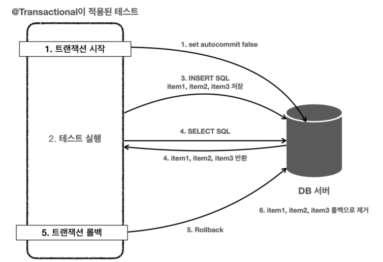

  - *테스트에 @Transactional 애노테이션이 테스트 메서드나 클래스에 있으면 먼저 트랜잭션을 시작*
  - *테스트 로직을 실행한다. 테스트가 끝날 때 까지 모든 로직은 트랜잭션 안에서 수행된다.*
  - *트랜잭션은 기본적으로 전파되기 때문에, 리포지토리에서 사용하는 JdbcTemplate도 같은 트랜잭션을 사용한다.*
- ***트랜잭션 전파 기본 옵션은 기존 트랜잭션에 참여***
  - *테스트 로직 동작, 검증*  
  - *@Transactional이 테스트에 있으면 테스트가 끝날때 트랜잭션을 강제로 롤백*

***테스트 @Transactional 정리***

  - *테스트가 끝난 후 개발자가 직접 데이터를 삭제하지 않아도 되는 편리함을 제공*
  - *테스트 실행 중에 데이터를 등록하고 중간에 테스트가 강제로 종료되어도 걱정이 없다.*
- *트랜잭션을 시작하고 커밋하지 않고 커넥션이 종료되기 때문에 데이터는 자동으로 롤백된다.*
  - *트랜잭션 범위 안에서 테스트를 진행하기 때문에 동시에 다른 테스트가 진행되어도 서로 영향을 주지 않는다.*

***강제로 커밋하기 - @Commit*** 

  - *@Transactional을 테스트에서 사용하면 테스트가 끝나면 바로 롤백되기 때문에 테스트 과정에서 저장한 모든 데이터가 사라진다.*
  - *하지만 데이터베이스에 데이터가 실제로 잘 보관되었는지 최종 결과를 눈으로 확인하고 싶은 케이스가 있다.*
  - *이럴 때는 다음과 같이 @Commit을 클래스 또는 메서드에 붙이면 테스트 종료후 롤백
대신 커밋이 호출된다*

```java
@Commit
@Transactional
@SpringBootTest
class ItemRepositoryTest {}
```

  - 또는 ***@Rollback(value = false)*** *방식을 사용해도 커밋된다.*

# ***테스트 - 임베디드 모드 DB***

*테스트 케이스를 실행하기 위해서 별도의 데이터베이스를 설치하고, 운영하는 것은 상당히 번잡한 작업이다.*

***임베디드 모드??***

*H2 데이터베이스는 자바로 개발되어 있고, JVM안에서 메모리 모드로 동작하는 특별한 기능을 제공한다.*

*애플리케이션을 실행할 때 H2 데이터베이스도 해당 JVM 메모리에 포함해서 함께 실행할 수 있다.*

*DB를 애플리케이션에 내장해서 함께 실행한다고 해서 임베디드 모드(Embedded mode)라 한다.*

*애플리케이션이 종료되면 임베디드 모드로 동작하는 H2 데이터베이스도 함께 종료되고, 데이터도 모두 사라진다.*

### ***임베디드 모드 직접 사용***

```java
@Slf4j
@SpringBootApplication
public class ItemServiceApplication {
		public static void main(String[] args) {
				SpringApplication.run(ItemServiceApplication.class, args);
		}

		@Bean
		@Profile("test")
		public DataSource dataSource(){
			 log.info("메모리 데이터베이스 초기화");
			 DriverManagerDataSource dataSource = new DriverManagerDataSource();
			 dataSource.setDriverClassName("org.h2.Driver");
			 dataSource.setUrl("jdbc:h2:mem:db;DB_CLOSE_DELAY=-1");
			 dataSource.setUsername("sa");
			 dataSource.setPassword("");
			 return dataSource;
		}
}
```

  - *@Profile("test")*
- *프로필이 test 인 경우에만 데이터소스를 스프링 빈으로 등록*
  - *dataSource()*
- *jdbc:h2:mem:db* 
- *데이터소스를 만들때 이렇게만 적으면 임베디드 모드로 동작하는 H2 데이터베이스를 사용할 수 있다.*
    - *DB_CLOSE_DELAY=-1*
- *임베디드 모드에서는 데이터베이스 커넥션 연결이 모두 끊어지면 데이터베이스
도 종료되는데, 그것을 방지하는 설정이다.*

***스프링 부트 - 기본 SQL 스크립트를 사용해서 데이터베이스를 초기화하는 기능***

  - *메모리 DB는 애플리케이션이 종료될 때 함께 사라지기 때문에, 애플리케이션 실행 시점에 데이터베이스 테이블도 새로 만들어주어야 한다.*
  - *직접 DDL을 호출해도 되지만 너무 불편하다.*
  - *스프링 부트는 SQL 스크립트를 실행해서 애플리케이션 로딩 시점에 데이터베이스를 초기화하는 기능을 제공한다.*

***src/test/resources/schema.sql***

```sql
drop table if exists item CASCADE;
create table item
(
	 id bigint generated by default as identity,
	 item_name varchar(10),
	 price integer,
	 quantity integer,
	 primary key (id)
);
```

  - *위치와 파일 이름을 주의하자*

# ***테스트 - 스프링 부트와 임베디드 모드***

*스프링 부트는 데이터베이스에 대한 별다른 설정이 없으면 임베디드 데이터베이스를 사용한다.*

***test - application.properties***

```yaml
spring.profiles.active=test
logging.level.org.springframework.jdbc=debug
```

  - *데이터베이스에 접근하는 설정 정보가 존재하지 않는다.*
  - *이렇게 별다른 정보가 없으면 스프링 부트는 임베디드 모드로 접근하는 데이터소스(DataSource)를 만들어서 제공한다.*
```java
DriverManagerDataSource dataSource = new DriverManagerDataSource();
dataSource.setDriverClassName("org.h2.Driver");
dataSource.setUrl("jdbc:h2:mem:db;DB_CLOSE_DELAY=-1");
dataSource.setUsername("sa");
dataSource.setPassword("");
```

    - *이런 느낌의 데이터소스를 내부에서 만들어서 제공한다.*

***임베디드 모드 데이터베이스 이름***

*로그를 보면 jdbc:h2:mem 뒤에 임의의 데이터베이스 이름이 들어가 있다.*

*→ url=jdbc:h2:mem:d8fb3a29-caf7-4b37-9b6c-b0eed9985454*

*혹시라도 여러 데이터소스가 사용될 때 같은 데이터베이스를 사용하면서 발생하는 충돌을 방지하기 위해 스프링 부트가 임의의 이름을 부여한 것이다.*

*임베디드 데이터베이스 이름을 스프링 부트가 기본으로 제공하는 jdbc:h2:mem:testdb로 고정하고 싶으면 application.properties 에 다음 설정을 추가하면 된다.*

```java
spring.datasource.generate-unique-name=false
```

***스프링 부트 3.0 이상 로깅 변경 사항*** 

*트랜잭션 관련 로그가 보이지 않는다면 설정 추가를 하자* 

***application.properties***

```java
logging.level.org.springframework.test.context.transaction=trace
```

- ***H2 데이터베이스 임베디드 모드 설정 방법***

# ***MyBatis 소개***

*MyBatis는 JdbcTemplate보다 더 많은 기능을 제공하는 SQL Mapper이다.*

*JdbcTemplate이 제공하는 대부분의 기능을 제공한다.* 

*MyBatis의 가장 매력적인 점은 SQL을 XML에 편리하게 작성할 수 있고 또 동적 쿼리를
매우 편리하게 작성할 수 있다는 점이다.*

***설정의 장단점***

*JdbcTemplate은 스프링에 내장된 기능이고, 별도의 설정없이 사용할 수 있다는 장점이 있다.*

*반면에 MyBatis는 약간의 설정이 필요하다.*

# ***MyBatis 설정***

***build.gradle - MyBatis dependency 추가*** 

```groovy
implementation 'org.mybatis.spring.boot:mybatis-spring-boot-starter:3.0.3'
```

  - *스프링 부트가 버전을 관리해주는 공식 라이브러리가 아니기 때문에 뒤에 버전이 붙는다.* 
*스프링 부트가 버전을 관리해주는 경우 버전 정보를 붙이지 않아도 최적의 버전을 자동으로 찾아준다.*
  - *Spring Boot 3.0 이상이면 3.0.3을 사용한다.*

### ***application.properties/yaml 설정*** 

***main - application.properties***

```yaml
spring.profiles.active=local
spring.datasource.url=jdbc:h2:tcp://localhost/~/test
spring.datasource.username=sa

logging.level.org.springframework.jdbc=debug

# MyBatis
mybatis.type-aliases-package=hello.itemservice.domain
mybatis.configuration.map-underscore-to-camel-case=true
logging.level.hello.itemservice.repository.mybatis=trace
```

***test - application.properties***

```yaml
spring.profiles.active=test

logging.level.org.springframework.jdbc=debug

# MyBatis
mybatis.type-aliases-package=hello.itemservice.domain
mybatis.configuration.map-underscore-to-camel-case=true
logging.level.hello.itemservice.repository.mybatis=trace
```

`mybatis.type-aliases-package` 

  - *마이바티스에서 타입 정보를 사용할 때는 패키지 이름을 적어주어야 하는데, 여기에 명시하면 패키지 이름을 생략할 수 있다.*
  - *지정한 패키지와 그 하위 패키지가 자동으로 인식된다.*
  - *여러 위치를 지정하려면* *`,`* *,* *`;`**로 구분하면 된다.*

`mybatis.configuration.map-underscore-to-camel-case` 

  - *JdbcTemplate의 BeanPropertyRowMapper에서 처럼 언더바를 카멜로 자동 변경해주는 기능을 활성화 한다.*
  - *default: false*

`logging.level.hello.itemservice.repository.mybatis=trace` 

  - *MyBatis에서 실행되는 쿼리 로그를 확인할 수 있다.*

# ***MyBatis 적용1 - 기본***

***ItemMapper - Mapper***

```java
package hello.itemservice.repository.mybatis;

@Mapper
public interface ItemMapper {
    void save(Item item);
    
    void update(@Param("id") Long id, @Param("updateParam") ItemUpdateDto updateParam);
    
    Optional<Item> findById(Long id);
    
    List<Item> findAll(ItemSearchCond itemSearch);
}
```

  - *마이바티스 매핑 XML을 호출해주는 매퍼 인터페이스이다.*
  - *@Mapper 애노테이션을 붙여주어야 한다. 그래야 MyBatis에서 인식 가능* 
  - *이 인터페이스의 메서드를 호출하면 다음에 보이는 xml의 해당 SQL을 실행하고 결과를 돌려준다*

*이제 같은 위치에 실행할 SQL이 있는 XML 매핑 파일을 만들어주면 된다.*

*자바 코드가 아니기 때문에 src/main/resources 하위에 만들되, 패키지 위치는 맞추어 주어야 한다.*

***src/main/resources/hello/itemservice/repository/mybatis/ItemMapper.xml***

```xml
<?xml version="1.0" encoding="UTF-8"?>

<!DOCTYPE mapper PUBLIC "-//mybatis.org//DTD Mapper 3.0//EN"
        "http://mybatis.org/dtd/mybatis-3-mapper.dtd">

<mapper namespace="hello.itemservice.repository.mybatis.ItemMapper">

     <insert id="save" useGeneratedKeys="true" keyProperty="id">
         insert into item (item_name, price, quantity)
         values (#{itemName}, #{price}, #{quantity})
     </insert>

     <update id="update">
         update item
         set item_name=#{updateParam.itemName},
             price=#{updateParam.price},
             quantity=#{updateParam.quantity}
         where id = #{id}
     </update>

    <select id="findById" resultType="Item">
         select id, item_name, price, quantity
         from item
         where id = #{id}
    </select>

     <select id="findAll" resultType="Item">
         select id, item_name, price, quantity
         from item
         <where>
             <if test="itemName != null and itemName != ''">
                and item_name like concat('%', #{itemName}, '%')
             </if>
             <if test="maxPrice != null">
                and price &lt;= #{maxPrice}
             </if>
         </where>
     </select>

</mapper>
```

  - *<mapper namespace="hello.itemservice.repository.mybatis.ItemMapper">*
- *앞서 만든 매퍼 인터페이스를 지정*

### ***XML 파일 경로 수정하기***

  - *XML 파일을 원하는 위치에 모아서 두고 싶을 수 있다.*

***application.properties***

```yaml
mybatis.mapper-locations=classpath:mapper/**/*.xml
```

  - *resources/mapper를 포함한 그 하위 폴더에 있는 XML을 XML 매핑 파일로 인식*

### ***MyBatis 로직 분석*** 

***insert - save***

```xml

void save(Item item);

<insert id="save" useGeneratedKeys="true" keyProperty="id">
		 insert into item (item_name, price, quantity)
		 values (#{itemName}, #{price}, #{quantity})
</insert>
```

  - *Insert SQL: <insert> 태그를 사용하면 된다.*
  - *id: 매퍼 인터페이스에 설정한 메소드 이름을 지정하면 된다.*
  - *파라미터는 #{} 문법을 사용하면 된다. 매퍼에서 넘긴 객체의 프로퍼티 이름을 적어주면 된다.* 
- *#{} 문법을 사용하면 PreparedStatement를 사용한다. JDBC의 ?를 치환한다 생각하면 된다.*
  - *useGeneratedKeys는 데이터베이스가 키를 생성해 주는 IDENTITY 전략(Auto_increment)일 때 사용한다. keyProperty는 생성되는 키의 속성 이름을 지정한다. Insert가 끝나면 item 객체의 id 속성에 생성된 값이 입력된다.*

***update - update***

```xml
void update(@Param("id") Long id, @Param("updateParam") ItemUpdateDto updateParam);

<update id="update">
   update item
   set item_name=#{updateParam.itemName},
       price=#{updateParam.price},
       quantity=#{updateParam.quantity}
   where id = #{id}
</update>
```

  - *Update SQL은 <update> 태그를 사용하면 된다.*
  - *파라미터가 Long id, ItemUpdateDto updateParam으로 2개여서 @Param으로 이름을 지정해서 파라미터를 구분해야 한다.*
  - *파라미터가 2개여서 xml 파일에도 #{updateParam.itemName} 이런 식으로 사용한다.*

***select - findById***

```xml
Optional<Item> findById(Long id);

<select id="findById" resultType="Item">
     select id, item_name, price, quantity
     from item
     where id = #{id}
</select>
```

  - *Select SQL은 <select> 태그를 사용하면 된다.*
  - *resultType은 반환 타입을 명시하면 된다. 여기서는 결과를 Item 객체에 매핑한다.*
- *앞서 application.properties에 mybatis.type-aliasespackage=hello.itemservice.domain
속성을 지정한 덕분에 모든 패키지 명을 다 적지는 않아도 된다. 그렇지 않으면 모든 패키지 명을 다 적어야 한다.*
    - *mybatis.configuration.map-underscore-to-camel-case=true 속성을 지정한 덕분에 언더스코어를 카멜 표기법으로 자동으로 처리해준다. (item_name → itemName)*
  - *자바 코드에서 반환 객체가 하나이면 Item , Optional<Item>과 같이 사용하면 되고, 반환 객체가 하나 이상이면 컬렉션을 사용하면 된다. 주로 List를 사용한다.*

***select - findAll***

```xml
List<Item> findAll(ItemSearchCond itemSearch);

<select id="findAll" resultType="Item">
     select id, item_name, price, quantity
     from item
     <where>
         <if test="itemName != null and itemName != ''">
            and item_name like concat('%', #{itemName}, '%')
         </if>
         <if test="maxPrice != null">
            and price &lt;= #{maxPrice}
         </if>
     </where>
 </select>
```

  - *Mybatis는 <where> , <if> 같은 동적 쿼리 문법을 통해 편리한 동적 쿼리를 지원한다.*
  - *<if>는 해당 조건이 만족하면 구문을 추가한다.*
  - *<where>은 적절하게 where 문장을 만들어준다.*
- *<if>가 모두 실패하게 되면 SQL where를 만들지 않는다.*
    - *<if>가 하나라도 성공하면 처음 나타나는 and를 where로 변환해준다.*

***XML 특수문자*** 

*XML에서는 데이터 영역에 < , > 같은 특수 문자를 사용할 수 없다.*

*XML에서 TAG가 시작하거나 종료할 때 < , > 와 같은 특수문자를 사용하기 때문이다.*

```xml
< : &lt;
> : &gt;
& : &amp;
```

***XML CDATA 사용***

```xml

<select id="findAll" resultType="Item"> 
		select id, item_name, price, quantity
	  from item
	 <where>
			 <if test="itemName != null and itemName != ''">
					 and item_name like concat('%',#{itemName},'%')
			 </if>
			 <if test="maxPrice != null">
					 <![CDATA[ and price <= #{maxPrice}]]>
			 </if>
	 </where>
</select> 
```

  - *XML에서 지원하는 CDATA 구문 문법은 구문 안에서 특수문자를 사용할 수 있다.* 
  - *대신 구문 안에서는 XML TAG가 단순 문자로 인식되기 때문에 <if> , <where>등이 적용되지 않는다.*

# ***MyBatis 적용2,3 - 설정과 실행과 분석*** 

```java
@Repository
@RequiredArgsConstructor
public class MyBatisItemRepository implements ItemRepository {

    private final ItemMapper itemMapper;
    
    @Override
    public Item save(Item item) {
        itemMapper.save(item);
        return item;
    }
    @Override
    public void update(Long itemId, ItemUpdateDto updateParam) {
        itemMapper.update(itemId, updateParam);
    }
    @Override
    public Optional<Item> findById(Long id) {
        return itemMapper.findById(id);
    }
    @Override
    public List<Item> findAll(ItemSearchCond cond) {
        return itemMapper.findAll(cond);
    }
}
```

  - *단순히 ItemMapper에 기능을 위임*

***ItemMapper 매퍼 인터페이스의 구현체가 없는데 어떻게 동작한 것일까?***

```java
@Mapper
public interface ItemMapper {
    void save(Item item);
    void update(@Param("id") Long id, @Param("updateParam") ItemUpdateDto updateParam);
    Optional<Item> findById(Long id);
    List<Item> findAll(ItemSearchCond itemSearch);
}
```

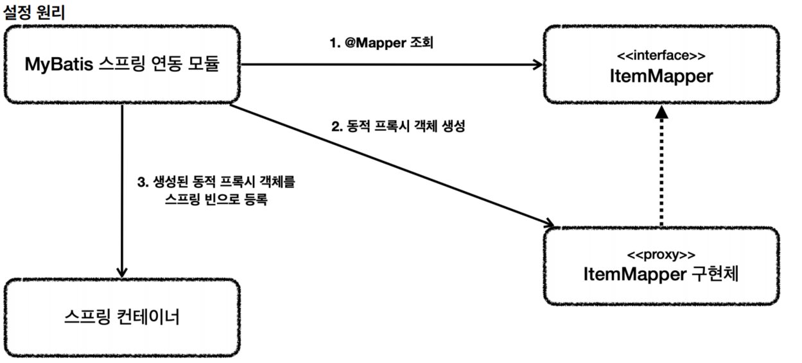

  - *애플리케이션 로딩 시점에 MyBatis 스프링 연동 모듈은 @Mapper가 붙은 인터페이스를 찾는다.* 
  - *인터페이스를 발견하면 동적 프록시 기술을 사용해서 ItemMapper 인터페이스의 구현체를 만든다.*
  - *생성된 구현체를 스프링 빈으로 등록한다.*

***Mapper 구현체*** 

  - *마이바티스 스프링 연동 모듈이 만들어주는 Mapper 구현체 덕분에 인터페이스 만으로 편리하게 XML의 데이터를 찾아서 호출할 수 있다.*
  - *매퍼 구현체는 예외 변환까지 처리해준다. MyBatis에서 발생한 예외를 스프링 예외 추상화인
DataAccessException에 맞게 변환해서 반환해준다.*

***정리*** 

  - *매퍼 구현체 덕분에 마이바티스를 스프링에 편리하게 통합해서 사용할 수 있다.*
  - *매퍼 구현체를 사용하면 스프링 예외 추상화도 함께 적용된다.*
  - *마이바티스 스프링 연동 모듈이 많은 부분을 자동으로 설정해주는데, 데이터베이스 커넥션, 트랜잭션과 관련된 기능도 마이바티스와 함께 연동하고, 동기화해준다.*
  - *자동으로 등록해주는 부분은 MybatisAutoConfiguration 클래스를 참고하자*

# ***JPA 설정***

***build.gradle*** 

```java
implementation 'org.springframework.boot:spring-boot-starter-data-jpa'
```

  - ***spring-boot-starter-data-jpa****,* ***mybatis-spring-boot-starter****는 s****pring-boot-starter-jdbc****도 함께 포함한다. 따라서 제거해도 된다.*
  - ***추가되는 라이브러리*** 
- *jakarta.persistence-api: JPA 인터페이스*
    - *hibernate-core: JPA 구현체인 하이버네이트 라이브러리*
    - *spring-data-jpa: 스프링 데이터 JPA 라이브러리*

 ***spring boot 3.0 미만 - application.properties -main,test***

```yaml
logging.level.org.hibernate.SQL=DEBUG
logging.level.org.hibernate.type.descriptor.sql.BasicBinder=TRACE
```

  - *logging.level.org.hibernate.SQL=DEBUG*
- *하이버네이트가 생성하고 실행하는 SQL을 확인할 수 있다.*
  - *logging.level.org.hibernate.type.descriptor.sql.BasicBinder=TRACE*
- SQL에 바인딩 되는 파라미터를 확인할 수 있다
  - *spring.jpa.show-sql=true*
- *이런 설정도 있다. 이전 설정은 logger를 통해서 출력된다. 이 설정은 System.out 콘솔을 통해서 SQL이 출력된다.*

 ***spring boot 3.0 이상 - application.properties -main,test***

```yaml
logging.level.org.hibernate.SQL=DEBUG
logging.level.org.hibernate.orm.jdbc.bind=TRACE
```

  - *하이버네이트 6버전이 사용되는데, 로그 설정 방식이 달라졌다.*

# ***JPA 적용1 - 개발***

```java
@Data
@Entity
public class Item {
    @Id @GeneratedValue(strategy = GenerationType.IDENTITY)
    private Long id;

    @Column(name = "item_name", length = 10)
    private String itemName;
    private Integer price;
    private Integer quantity;

    public Item() {
    }

    public Item(String itemName, Integer price, Integer quantity) {
        this.itemName = itemName;
        this.price = price;
        this.quantity = quantity;
    }
}
```

  - *@Entity: JPA가 사용하는 객체라는 뜻이다. 이 에노테이션이 있어야 JPA가 인식할 수 있다. 
이렇게 @Entity 가 붙은 객체를 JPA에서는 엔티티라 한다.*
  - *@Column(name = "item_name", length = 10) → VARCHAR 10*

*JPA는 public 또는 protected 기본 생성자가 필수이다.*

```java
public Item() {}
```

  - *아마 프록시 기술을 사용하는 데 상속을 통한 프록시 기술이어서 부모 클래스의 생성자에 접근을 가능하게 해야 동작하기 때문인듯하다.*

```java
@Repository
@Transactional
@RequiredArgsConstructor
public class JpaItemRepository implements ItemRepository {
    
    private final EntityManager em;
    
    @Override
    public Item save(Item item) {
        em.persist(item);
        return item;
    }

    @Override
    public void update(Long itemId, ItemUpdateDto updateParam) {
        Item findItem = em.find(Item.class, itemId);
        findItem.setItemName(updateParam.getItemName());
        findItem.setPrice(updateParam.getPrice());
        findItem.setQuantity(updateParam.getQuantity());
    }

    @Override
    public Optional<Item> findById(Long id) {
        Item item = em.find(Item.class, id);
        return Optional.ofNullable(item);
    }

    @Override
    public List<Item> findAll(ItemSearchCond cond) {
        String jpql = "select i from Item i";

        Integer maxPrice = cond.getMaxPrice();
        String itemName = cond.getItemName();

        if(StringUtils.hasText(itemName) || maxPrice != null){
            jpql += " where";
        }

        boolean andFlag = false;
        if(StringUtils.hasText(itemName)){
            jpql += " i.itemName like concat('%',:itemName,'%')";
            andFlag = true;
        }

        if(maxPrice != null){
            if(andFlag){
                jpql += " and";
            }
            jpql += " i.price <= :maxPrice";
        }

        TypedQuery<Item> query = em.createQuery(jpql, Item.class);
        if(StringUtils.hasText(itemName)){
            query.setParameter("itemName", itemName);
        }
        if(maxPrice != null){
            query.setParameter("maxPrice", maxPrice);
        }

       return query.getResultList();
    }
}
```

  - *EntityManager* 
- *JPA의 모든 동작은 엔티티 매니저를 통해서 이루어진다.*
    - *엔티티 매니저는 내부에 데이터소스를 가지고 있고, 데이터베이스에 접근할 수 있다.*
  - *@Transactional*
- *JPA의 모든 데이터 변경(등록, 수정, 삭제)은 트랜잭션 안에서 이루어져야 한다.*
    - *조회는 트랜잭션이 없어도 가능하다.*
    - *변경의 경우 일반적으로 서비스 계층에서 트랜잭션을 시작하기 때문에 문제가 없다. 
꼭 서비스 계층에 트랜잭션을 걸어주자.*

*스프링 부트는 자동으로 JPA 관련 설정을 자동화 해준다.*

  - *자세한 내용은* ***JpaBaseConfiguration****를 참고*

# ***JPA 적용2 - 리포지토리 분석***

***save() - 저장***

```java
@Override
public Item save(Item item) {
    em.persist(item);
    return item;
}
```

  - *JPA가 만들어서 실행한 SQL을 보면 id 에 값이 빠져있는 것을 확인할 수 있다.* 
  - *PK 키 생성 전략을 IDENTITY로 사용했기 때문에 JPA가 이런 쿼리를 만들어서 실행한 것이다.*
  - *JPA가 INSERT SQL 실행 이후에 생성된 ID 결과를 받아서 넣어준다.*

***update() - 수정 JPA - DirtyChecking***

```java
@Override
public void update(Long itemId, ItemUpdateDto updateParam) {
    Item findItem = em.find(Item.class, itemId);
    findItem.setItemName(updateParam.getItemName());
    findItem.setPrice(updateParam.getPrice());
    findItem.setQuantity(updateParam.getQuantity());
}
```

  - *em.update() 같은 메소드를 전혀 호출하지 않았다.*
  - *JPA는 트랜잭션이 커밋되는 시점에, 변경된 엔티티 객체가 있는지 확인한다.*
  - *특정 엔티티 객체가 변경된 경우에는 UPDATE SQL을 실행한다.*
  - *테스트의 경우 마지막에 트랜잭션이 롤백되기 때문에 JPA는 UPDATE SQL을 실행하지 않는다.*

***findById() - 단건 조회***

```java
@Override
public Optional<Item> findById(Long id) {
    Item item = em.find(Item.class, id);
    return Optional.ofNullable(item);
}
```

  - *JPA에서 엔티티 객체를 PK 기준으로 조회할 때 find()를 사용하고 조회 타입과 PK 값을 주면 된다.*

***findAll - 목록 조회***

```java
public List<Item> findAll(ItemSearchCond cond) {
	 String jpql = "select i from Item i";
	 
	 //동적 쿼리 생략
	 
	 TypedQuery<Item> query = em.createQuery(jpql, Item.class);
	 
	 if(StringUtils.hasText(itemName)){
      query.setParameter("itemName", itemName);
   }
   if(maxPrice != null){
      query.setParameter("maxPrice", maxPrice);
   }
	 
	 return query.getResultList();
}
```

***JPQL***

  - *JPA는* ***JPQL(Java Persistence Query Language)****이라는 객체지향 쿼리 언어를 제공한다.*
  - *주로 여러 데이터를 복잡한 조건으로 조회할 때 사용한다.*
  - *SQL이 테이블을 대상으로 한다면, JPQL은 엔티티 객체를 대상으로 SQL을 실행한다 생각하면 된다.*
  - *엔티티 객체를 대상으로 하기 때문에 from 다음에 Item 엔티티 객체 이름이 들어간다. 
엔티티 객체와 속성의 대소문자는 구분해야 한다.*
  - *결과적으로 JPQL을 실행하면 그 안에 포함된 엔티티 객체의 매핑 정보를 활용해서 SQL을 만들게 된다.*

# ⭐ ***JPA 적용3 - 예외 변환*** 

*JPA의 경우 예외가 발생하면 JPA 예외가 발생하게 된다.*

*EntityManager는 순수한 JPA 기술이고, 스프링과는 관계가 없다. 
따라서 엔티티 매니저는 예외가 발생하면 JPA 관련 예외를 발생시킨다.*

*JPA는 PersistenceException과 그 하위 예외를 발생시킨다.*

  - *추가로 JPA는 IllegalStateException, IllegalArgumentException을 발생시킬 수 있다.*

*그렇다면 JPA 예외를 스프링 예외 추상화(DataAccessException)로 어떻게 변환할 수 있을까?*

*→ @Repository*

***예외 변환 전***

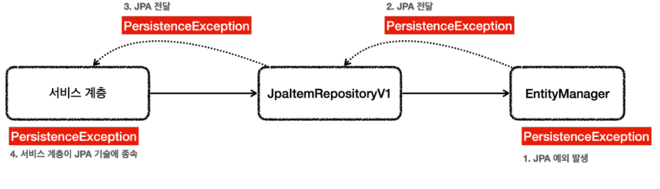

***@Repository의 기능***

  - *@Repository가 붙은 클래스는 컴포넌트 스캔의 대상*
  - *@Repository가 붙은 클래스는 예외 변환 AOP의 적용 대상*
- *스프링과 JPA를 함께 사용하는 경우 스프링은 JPA 예외 변환기
(PersistenceExceptionTranslator)를 등록한다.*
    - *예외 변환 AOP 프록시는 JPA 관련 예외가 발생하면 JPA 예외 변환기를 통해 발생한 예외를 스프링 데이터 접근 예외로 변환한다.*

***예외 변환 후***

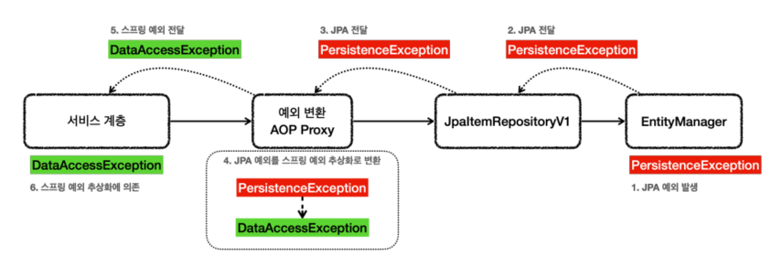

*정리하면 @Repository 애노테이션만 있으면 스프링이 예외 변환 처리하는 AOP를 만들어준다.*

***참고*** 

  - *스프링 부트 @Repository를 AOP 프록시로 만드는 빈 후처리기*
- *PersistenceExceptionTranslationPostProcessor*
    - *여기서 @Repository AOP를 프록시로 만드는 어드바이스가 등록*
  -  *실제 JPA 예외를 변환하는 코드*
- *EntityManagerFactoryUtils.convertJpaAccessExceptionIfPossible()*

- ***@Repository의 비밀***

# ***스프링 트랜잭션 소개***

### ***1. 스프링 트랜잭션 추상화***

*각각의 데이터 접근 기술들은 트랜잭션을 처리하는 방식에 차이가 있다.*

***JDBC 트랜잭션:*** *setAutoCommit(false) → 트랜잭션 시작* 

***JPA 트랜잭션****: begin() → 트랜잭션 시작* 

*스프링은* ***PlatformTransactionManager****라는 인터페이스를 통해 트랜잭션을 추상화*

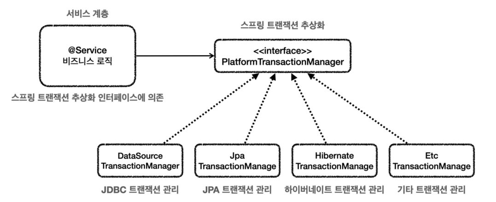

  - *스프링은 트랜잭션을 추상화해서 제공할 뿐만 아니라, 실무에서 사용하는 데이터 접근 기술에 대한 트랜잭션 매니저의 구현체도 제공한다.*
  - *스프링 부트는 어떤 데이터 접근 기술을 사용하는지 자동으로 인식해서(AutoConfiguration) 적절한 트랜잭션 매니저(+ DataSource)를 선택해서 스프링 빈으로 등록한다.*

### ***2. 스프링 트랜잭션 사용 방식***

***선언적 트랜잭션 관리 vs 프로그래밍 방식 트랜잭션 관리***

  - *선언적 트랜잭션 관리* 
- *@Transactional*
    - *이름 그대로 로직에 트랜잭션을 적용하겠다 라고 어딘가에 선언하기만 하면 트랜잭션이 적용되는 방식*
  - *프로그래밍 방식의 트랜잭션 관리*
- *트랜잭션 매니저, 트랜잭션 템플릿 등을 사용해서 직접 트랜잭션 관련 코드를 작성하는 방식*

*프로그래밍 방식의 트랜잭션 관리는 핵심 비즈니스 로직과 트랜잭션이라는 기술 코드가 강하게 결합된다.*  

*반면에 선언적 트랜잭션 관리는 Spring AOP 기술을 사용하기 때문에 비즈니스 로직과 분리되고 훨씬 간편하고 실용적이기 때문에 실무에서는 대부분 선언적 트랜잭션 관리를 사용한다.*

### *3. 선언적 트랜잭션과 AOP*

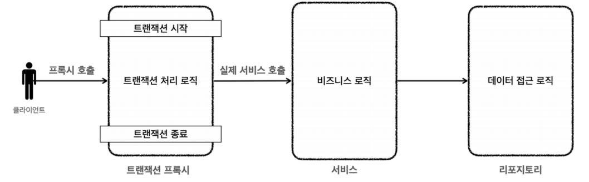

*그림에서는 트랜잭션 프록시라고 표현하지만 정확히는 클라이언트가 프록시를 호출하고 순서에 따라 어드바이스들을 호출한다. 
어드바이스 중에 하나가 트랜잭션 어드바이스이고 순서에 따라 모든 어드바이스 호출이 끝나면 실제 서비스를 호출하게 된다.* 

***프록시 도입 후 전체 과정***

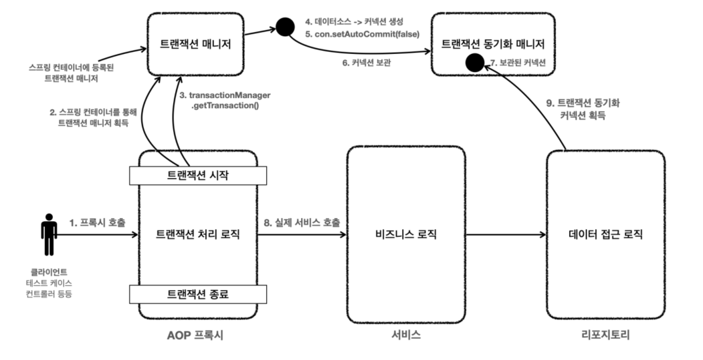

# *프로젝트 설정* 

***build.gradle dependency***

```groovy
dependencies {
			implementation 'org.springframework.boot:spring-boot-starter-data-jpa'
			compileOnly 'org.projectlombok:lombok'
			runtimeOnly 'com.h2database:h2'
			annotationProcessor 'org.projectlombok:lombok'
			testImplementation 'org.springframework.boot:spring-boot-starter-test'
			
			//테스트에서 lombok 사용
			testCompileOnly 'org.projectlombok:lombok'
			testAnnotationProcessor 'org.projectlombok:lombok'
}
```

  - *lombok, spring data jpa, h2 database, boot test*

# ***트랜잭션 적용 확인***

***AopUtils.isAopProxy()***

  - *파라미터로 넘기는 객체 프록시 적용 여부 확인*

***TransactionSynchronizationManager.isActualTransactionActive()***

  - *현재 쓰레드 트랜잭션 적용 여부 확인*

***application.properties***

```groovy
logging.level.org.springframework.transaction.interceptor=TRACE
```

  - *트랜잭션 프록시가 호출하는 트랜잭션의 시작과 종료를 명확하게 로그로 확인할 수 있다.*

# ***트랜잭션 적용 위치***

*스프링에서 우선순위는* ***항상 더 구체적이고 자세한 것이 높은 우선순위를 가진다****.*

*예를 들어서 메소드와 클래스에 애노테이션을 붙일 수 있다면 더 구체적인 메소드가 더 높은 우선순위를 가진다.*

***스프링 @Transactional 두 가지 규칙*** 

  - *우선순위 규칙*
  - *클래스에 적용하면 메소드는 자동 적용*

```java
@Slf4j
@SpringBootTest
public class TxLevelTest {
    @Autowired LevelService levelService;
    @Test
    void orderTest(){
        levelService.write();
        levelService.read();
    }
    @TestConfiguration
    static class TestConfig{
        @Bean
        LevelService levelService(){
            return new LevelService();
        }
    }
    @Slf4j
    @Transactional(readOnly = true)
    static class LevelService{
        @Transactional(readOnly = false)
        public void write(){
            log.info("call write");
            printTxInfo();
        }
        public void read(){
            log.info("call read");
            printTxInfo();
        }
        private void printTxInfo(){
            boolean txActive = TransactionSynchronizationManager.isSynchronizationActive();
            log.info("tx active={}", txActive);
            boolean readOnly = TransactionSynchronizationManager.isCurrentTransactionReadOnly();
            log.info("tx readonly={}", readOnly);
        }
    }
}
```

  - ***TransactionSynchronizationManager.isSynchronizationActive()***
- *트랜잭션 동기화 메커니즘의 활성화 여부를 확인*
  - ***TransactionSynchronizationManager.isCurrentTransactionReadOnly()***
- *현재 활성화된 트랜잭션이 읽기 모드인지 확인*
  - ***TransactionSynchronizationManager.isActualTransactionActive()***
- *현재 쓰레드 물리적 트랜잭션 활성화 여부를 확인*
  -  *@Transactional(readOnly = false)*
- *default: false*

***Test Result***

```java
call write
tx active=true
tx readonly=false

call read
tx active=true
tx readonly=false
```

# ***트랜잭션 AOP 주의 사항 - 프록시 내부 호출1***

***내부 호출 → self invocation***

```java
@Slf4j
@SpringBootTest
public class InternalCallV1Test {

    @Autowired CallService callService;
    @Test
    void printProxy(){
        log.info("callService class={}", callService.getClass());
    }

    @Test
    void internalCall(){
        callService.internal();
    }

    @Test
    void externalCall(){
        callService.external();
    }

    @TestConfiguration
    static class TestConfig{
        @Bean
        CallService callService(){
            return new CallService();
        }
    }
    @Slf4j
    static class CallService{
        public void external(){
            log.info("call external");
            printTxInfo();
            internal();
        }

        @Transactional
        public void internal(){
            log.info("call internal");
            printTxInfo();
        }

        private void printTxInfo(){
           boolean txActive = TransactionSynchronizationManager.isSynchronizationActive();
           log.info("tx active={}", txActive);
           boolean readOnly = TransactionSynchronizationManager.isCurrentTransactionReadOnly();
           log.info("tx readonly={}", readOnly);
       }
    }
}
```

***printProxy() result***

```java
callService class=class spring.transaction.apply.InternalCallV1Test$CallService$$SpringCGLIB$$0

```

  - *CallService is Proxy* 

***internalCall() result***

```java
call internal
tx active=true
tx readonly=false

```

  - *정상적으로 트랜잭션 적용* 

***흐름 정리*** 

***요청:*** *클라이언트 → Proxy: internal() → 트랜잭션 Advice (시작) →  CallService: internal()* 

***응답:*** *CallService: internal() → 트랜잭션 Advice (종료) → Proxy: internal() → 클라이언트*

***externalCall() result***

```java
call external
tx active=false
tx readonly=false
call internal
tx active=false
tx readonly=false
```

  - *external() 내부에서 internal()을 호출했지만 트랜잭션은 적용되지 않았다.*

***흐름 정리*** 

***요청:*** *클라이언트 → Proxy: externalCall() → CallService: externalCall() → CallService: internal()*

***응답:***  *CallService: internal() → CallService: externalCall() → Proxy: externalCall() → 클라이언트* 

***흐름 부가 설명*** 

*externalCall()은 Transaction Advice 호출 대상이 아니다.
그래서 바로 RealSubject인 CallService externalCall()을 호출하고 externalCall() 내부에서 호출하는 internalCall()은 this.internalCall()이다.* 

*그래서 트랜잭션이 적용되지 않고 CallService의 internalCall()을 호출하게 된다.*

***프록시 방식의 AOP 한계***

*@Transactional를 사용하는 트랜잭션 AOP는 프록시를 사용한다*

*프록시를 사용하면 메소드 내부 호출에 프록시를 적용할 수 없다.*

# ***트랜잭션 AOP 주의 사항 - 프록시 내부 호출2***

*메소드 내부 호출 때문에 트랜잭션 프록시가 적용되지 않는 문제를 해결하기 위해 internal() 메서드를 별도의 클래스로 분리하자.*

 *proxy self invocation 문제를 해결하는 여러가지 방법이 있지만* ***실무에서는 별도의 클래스를 분리하는 방식****으로 자주 해결한다.*

```java
@Slf4j
@SpringBootTest
public class InternalCallV2Test {

    @Autowired CallService callService;
    
    @Test
    void printProxy(){
        log.info("callService class={}", callService.getClass());
    }
    @Test
    void externalCallV2(){
        callService.external();
    }

    @TestConfiguration
    static class TestConfig{
        @Bean
        CallService callService(){
            return new CallService(internalService());
        }
        @Bean
        InternalService internalService(){
            return new InternalService();
        }
    }
    
    @Slf4j
    @RequiredArgsConstructor
    static class CallService{
        private final InternalService internalService;
        public void external(){
            log.info("call external");
            printTxInfo();
            internalService.internal();
        }
        private void printTxInfo(){
           boolean txActive = TransactionSynchronizationManager.isSynchronizationActive();
           log.info("tx active={}", txActive);
           boolean readOnly = TransactionSynchronizationManager.isCurrentTransactionReadOnly();
           log.info("tx readonly={}", readOnly);
       }
    }
    
    static class InternalService{
        @Transactional
        public void internal(){
           log.info("call internal");
           printTxInfo();
        }
        private void printTxInfo(){
           boolean txActive = TransactionSynchronizationManager.isSynchronizationActive();
           log.info("tx active={}", txActive);
           boolean readOnly = TransactionSynchronizationManager.isCurrentTransactionReadOnly();
           log.info("tx readonly={}", readOnly);
       }
    }
}
```

***externalCallV2 result***

```java
call external
tx active=false
tx readonly=false

call internal
tx active=true
tx readonly=false
```

  - *이제 internal part는 트랜잭션이 정상적으로 적용된다.*

***흐름 분석, 응답은 생략*** 

  - *클라이언트: CallService external 호출* 
  - *CallService: InternalService.internal 호출*
  - *Proxy(InternalService): internal Transaction Advice 호출* 
  - *Transaction Advice: 트랜잭션 시작, RealSubject(InternalService) internal 호출* 
  - *RealSubject(InternalService): this.printTxInfo() 호출*
  - *RealSubject(InternalService): 트랜잭션 활성화 로그 출력* 

***접근제어자(Access Modifier)에 따른 트랜잭션 적용 여부***

  - *Spring Boot 3.0 미만: public only*
  - *Spring Boot 3.0 이상: public, default, protected*

# *트랜잭션 AOP 주의 사항 - 초기화 시점*

*스프링 초기화 시점에는 트랜잭션 AOP가 적용되지 않을 수 있다.*

***스프링 AOP 초기화를 포함한 전체 라이프 사이클*** 

*스프링 컨테이너 생성 → 스프링 빈 생성 → 의존관계 주입 → PostProceesor before 메소드 →* 

*초기화 콜백 →  PostProceesor after 메소드 → 사용 → 소멸전 콜백 → 스프링 종료* 

*스프링 AOP는 postProcessAfterInitialization 메소드를 구현*

*즉, 초기화 콜백(@PostConstruct) 메소드에서는 @Transactional을 함께 사용하면 트랜잭션이 적용되지 않는다.* 

```java
@SpringBootTest
public class InitTxTest {
    @Autowired Hello hello;
    
    @Test
    void go(){
    }

    @TestConfiguration
    static class InitTxTestConfig{
        @Bean
        public Hello hello(){
            return new Hello();
        }
    }

    @Slf4j
    static class Hello{
        @PostConstruct
        @Transactional
        public void initV1(){
            boolean isActive = TransactionSynchronizationManager.isActualTransactionActive();
            log.info("Hello init @PostConstruct tx active={}", isActive);
        }
        @EventListener(ApplicationReadyEvent.class)
        @Transactional
        public void initV2(){
            boolean isActive = TransactionSynchronizationManager.isActualTransactionActive();
            log.info("Hello init ApplicationReady tx active={}", isActive);
        }
    }
}
```

***@PostConstruct + @Transactional result***

```java
Hello init @PostConstruct tx active=false
```

***@EventListener(ApplicationReadyEvent.class) + @Transactional result***

```java
 Hello init ApplicationReady tx active=true
```

# ***트랜잭션 옵션 소개***

***value, transactionManager***

  - *트랜잭션을 사용하려면 스프링 빈에 등록된 어떤 트랜잭션 매니저를 사용할지 알아야 한다.*
  - *@Transactional도 트랜잭션 어드바이스가 사용할 트랜잭션 매니저를 지정해주어야 한다.*
  - *사용할 트랜잭션 매니저를 지정할 때 value, transactionManager 둘 중 하나에 트랜잭션 매니저의 스프링 빈의 이름을 적어주면 된다.*
  - *값을 생략하면 기본으로 등록된 트랜잭션 매니저를 사용하기 때문에 거의 생략한다.*
- *만약 트랜잭션 매니저가 둘 이상이라면 트랜잭션 매니저의 이름을 지정해서 구분하면 된다.*

```java
@Configuration
public class TransactionConfig {
    @Bean(name = "jpaTxManager")
    public PlatformTransactionManager jpaTransactionManager(EntityManagerFactory emf) {
        return new JpaTransactionManager(emf);
    }
    @Bean(name = "jdbcTxManager")
    public PlatformTransactionManager jdbcTransactionManager(DataSource dataSource) {
        return new DataSourceTransactionManager(dataSource);
    }
}

public class TxService {
		 @Transactional("jpaTxManager")
		 public void member() {...}
		 
		 @Transactional(value = "jdbcTxManager")
		 public void order() {...}
}
```

  - *애노테이션 속성이 value 하나인 경우 생략하고 값을 바로 넣을 수 있다.*

***rollbackFor***

  - ***예외 발생시 스프링 트랜잭션의 기본 정책*** 
- *Unchecked Exception(RuntimeException, Error): RollBack*
    - *Checked Exception(Exception): Commit*
  - ***rollbackFor: 기본 정책에 추가로 어떤 예외가 발생했을 때 롤백할 지 지정할 수 있다.***
```java
@Transactional(rollbackFor = Exception.class)
```

    - *해당 케이스 같은 경우 예외가 발생하면 무조건 RollBack*
  - ***rollbackForClassName***
- *예외 이름을 문자로 넣는다.*
  - ***noRollbackFor***
- ***rollbackFor 반대 개념***

***propagation***

  - *트랜잭션 전파에 대한 옵션*

***isolation***

  - *트랜잭션 격리 수준을 지정할 수 있다.*
  - *기본 값은 데이터베이스에서 설정한 트랜잭션 격리 수준을 사용하는 DEFAULT*
  - *직접 격리 수준을 지정하는 경우는 드물다.*
- *DEFAULT : 데이터베이스에서 설정한 격리 수준을 따른다.*
- *MySQL → REPEATABLE_READ DEFAULT*
    - *READ_UNCOMMITTED* 
    - *READ_COMMITTED* 
    - *REPEATABLE_READ* 
    - *SERIALIZABLE*

***timeout***

  - *트랜잭션 수행 시간에 대한 타임아웃을 초 단위로 지정한다.*
  - *기본 값은 트랜잭션 시스템의 타임아웃을 사용한다.*
- *데이터베이스 락(네임드 락, 베타 락, 공유 락)획득을 하지 못하여 트랜잭션이 무한정 대기하면 애플리케이션 서버 성능에도 좋지 않고 UX 측면에서도 좋지 않다.*

***readOnly***

  - *트랜잭션은 기본적으로 읽기 쓰기가 모두 가능한 트랜잭션이 생성된다.*
- *default: readOnly = false*
  - *readOnly=true 옵션을 사용하면 읽기 전용 트랜잭션이 생성된다*
  - *readOnly 옵션을 사용하면 읽기에서 다양한 성능 최적화가 발생할 수 있다.*
- ***프레임워크*** 
- *JdbcTemplate은 읽기 전용 트랜잭션 안에서 변경 기능을 실행하면 예외를 던진다*
      - *JPA(하이버네이트)는 읽기 전용 트랜잭션의 경우 커밋 시점에 플러시를 호출하지 않는다. 추가로 변경이 필요 없으니 변경 감지를 위한 스냅샷 객체도 생성하지 않는다.*
    - ***JDBC 드라이버***
- *읽기 전용 트랜잭션에서 변경 쿼리가 발생하면 예외를 던진다.*
      - *읽기, 쓰기(Master, Slave) DB를 구분해서 요청, 읽기 전용인 경우 슬레이브 데이터베이스 커넥션 획득*
    - ***데이터베이스*** 
- *데이터베이스에 따라 읽기 전용 트랜잭션의 경우 읽기만 하면 되므로, 내부에서 성능 최적화가 발생*

# ***예외와 트랜잭션 커밋, 롤백 - 기본***

*트랜잭션 커밋, 롤백에 대해서 테스트로 이해해 보자* 

***트랜잭션 로그 확인 - application.properties***

```yaml
logging.level.org.springframework.transaction.interceptor=TRACE
logging.level.org.springframework.jdbc.datasource.DataSourceTransactionManager=DEBUG

#JPA log
logging.level.org.springframework.orm.jpa.JpaTransactionManager=DEBUG
logging.level.org.hibernate.resource.transaction=DEBUG
```

***Test & Reulst***

```java
@SpringBootTest
public class RollbackTest {
    @Autowired RollbackService service;
    @Test
    void runtimeException(){
        assertThatThrownBy(() -> service.runtimeException())
                .isInstanceOf(RuntimeException.class);
    }
    @Test
    void checkedException(){
        assertThatThrownBy(()-> service.checkedException())
                .isInstanceOf(MyException.class);
    }
    @Test
    void rollbackFor(){
        assertThatThrownBy(()-> service.rollbackFor())
                .isInstanceOf(MyException.class);
    }
    @TestConfiguration
    static class RollbackTestConfig{
        @Bean
        RollbackService rollbackService(){
            return new RollbackService();
        }
    }
    @Slf4j
    static class RollbackService{

        // 런타임 예외 발생: 롤백
        @Transactional
        public void runtimeException(){
            log.info("call runtimeException");
            throw new RuntimeException();
        }

        // 체크 예외 발생: 커밋
        @Transactional
        public void checkedException() throws MyException{
            log.info("call checkedException");
            throw new MyException();
        }

        // 체크 예외 rollbackFor 지정: 롤백
        @Transactional(rollbackFor = MyException.class)
        public void rollbackFor() throws MyException{
            log.info("call rollbackFor");
            throw new MyException();
        }

    }
    static class MyException extends Exception{
    }
}
```

- ***트랜잭션 옵션 isolation, readOnly, timeout .., 트랜잭션 AOP 주의사항***

***application.properties***

```java
logging.level.org.springframework.transaction.interceptor=TRACE
logging.level.org.springframework.jdbc.datasource.DataSourceTransactionManager=DEBUG

#JPA log
logging.level.org.springframework.orm.jpa.JpaTransactionManager=DEBUG
logging.level.org.hibernate.resource.transaction=DEBUG

#JPA SQL
logging.level.org.hibernate.SQL=DEBUG
```

# ***스프링 트랜잭션 전파2 - 트랜잭션 두 번 사용***

***double_commit()***

```java
@Test
void double_commit(){
   log.info("트랜잭션1 시작");
   TransactionStatus tx1 = txManager.getTransaction(new DefaultTransactionDefinition());
   log.info("트랜잭션1 커밋 시작");
   txManager.commit(tx1);
   log.info("트랜잭션1 커밋 완료");

   log.info("트랜잭션2 시작");
   TransactionStatus tx2 = txManager.getTransaction(new DefaultTransactionDefinition());
   log.info("트랜잭션2 커밋 시작");
   txManager.commit(tx2);
   log.info("트랜잭션2 커밋 완료");  
}
```

***double_commit() - result***

```java
트랜잭션1 시작
Creating new transaction with name [null]: PROPAGATION_REQUIRED,ISOLATION_DEFAULT
Acquired Connection [HikariProxyConnection@1064414847 wrapping conn0] for JDBC transaction
Switching JDBC Connection [HikariProxyConnection@1064414847 wrapping conn0] to manual commit
트랜잭션1 커밋 시작
Initiating transaction commit
Committing JDBC transaction on Connection [HikariProxyConnection@1064414847 wrapping conn0]
Releasing JDBC Connection [HikariProxyConnection@1064414847 wrapping conn0] after transaction
트랜잭션1 커밋 완료

트랜잭션2 시작
Creating new transaction with name [null]: PROPAGATION_REQUIRED,ISOLATION_DEFAULT
Acquired Connection [HikariProxyConnection@778350106 wrapping conn0] for JDBC transaction
Switching JDBC Connection [HikariProxyConnection@778350106 wrapping conn0] to manual commit
트랜잭션2 커밋 시작
Initiating transaction commit
Committing JDBC transaction on Connection [HikariProxyConnection@778350106 wrapping conn0]
Releasing JDBC Connection [HikariProxyConnection@778350106 wrapping conn0] after transaction
트랜잭션2 커밋 완료
```

  - *트랜잭션이 각각 수행되면서 사용되는 DB 커넥션도 각각 다르다.*

# ***스프링 트랜잭션 전파3 - 전파 기본***

*트랜잭션을 각각 사용하는 것이 아니라, 이미 트랜잭션이 진행중인데, 여기에 추가로 트랜잭션을 수행하면 어떻게 될까?*

*이런 경우 어떻게 동작할지 결정하는 것을* ***트랜잭션 전파(propagation)****라 한다.*

***외부 트랜잭션이 수행중인데, 내부 트랜잭션이 추가로 수행***


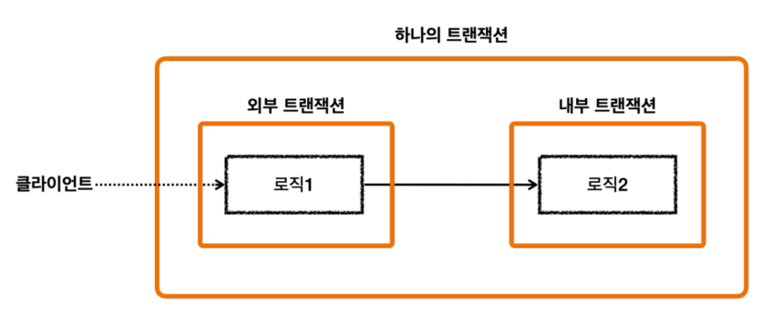

  - *스프링은 이 경우 외부 트랜잭션과 내부 트랜잭션을 묶어서 하나의 트랜잭션을 만들어준다.*
  - *즉, 내부 트랜잭션이 외부 트랜잭션에 참여하는 것이다.* 
  - *이것이 기본 동작이다.*

***물리 트랜잭션, 논리 트랜잭션***

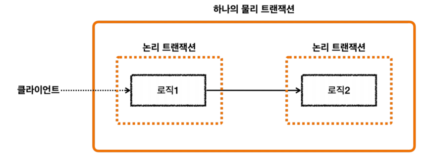

  - *논리 트랜잭션들은 하나의 물리 트랜잭션으로 묶인다.*
  - *물리 트랜잭션이 실제 데이터베이스에 적용되는 실제 트랜잭션을 뜻한다.*
  - *논리 트랜잭션은 트랜잭션 매니저를 통해 트랜잭션을 사용하는 단위이다.*
  - *논리 트랜잭션 개념은 트랜잭션이 진행되는 중에 내부에 추가로 트랜잭션을 사용하는 경우에 나타난다.* 

***원칙*** 

  - *모든 논리 트랜잭션이 커밋되어야 물리 트랜잭션이 커밋된다.*
  - *하나의 논리 트랜잭션이라도 롤백되면 물리 트랜잭션은 롤백된다.*

# ***스프링 트랜잭션 전파4 - 전파 예제***

```java
@Test
void inner_commit(){
    log.info("외부 트랜잭션 시작");
    TransactionStatus outer = txManager.getTransaction(new DefaultTransactionDefinition());
    log.info("outer.isNewTransaction()={}", outer.isNewTransaction());

    log.info("내부 트랜잭션 시작");
    TransactionStatus inner = txManager.getTransaction(new DefaultTransactionDefinition());
    log.info("inner.isNewTransaction()={}", inner.isNewTransaction());

    log.info("내부 트랜잭션 커밋");
    txManager.commit(inner);

    log.info("외부 트랜잭션 커밋");
    txManager.commit(outer);
}
```

  - *외부 트랜잭션은 처음 수행된 트랜잭션이다. 이 경우 신규 트랜잭션(isNewTransaction=true)이 된다.* 
  - *내부 트랜잭션을 시작하는 시점에는 이미 외부 트랜잭션이 진행중인 상태이다. 이 경우 내부 트랜잭션은 외부 트랜잭션에 참여한다(isNewTransaction= false).*
  - *트랜잭션 참여: 외부 트랜잭션과 내부 트랜잭션이 하나의 물리 트랜잭션으로 묶이는 것*

***동작 흐름***

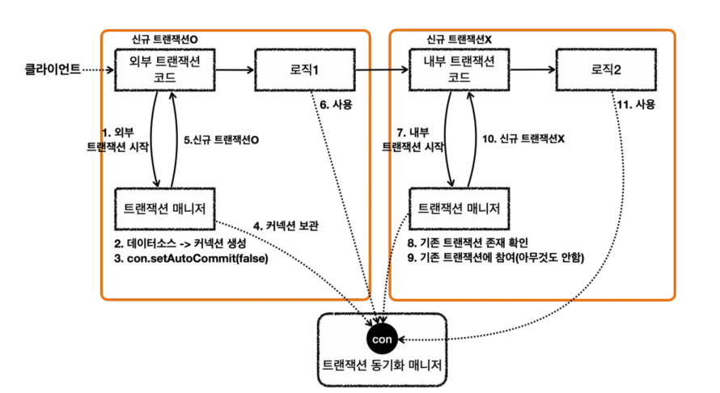

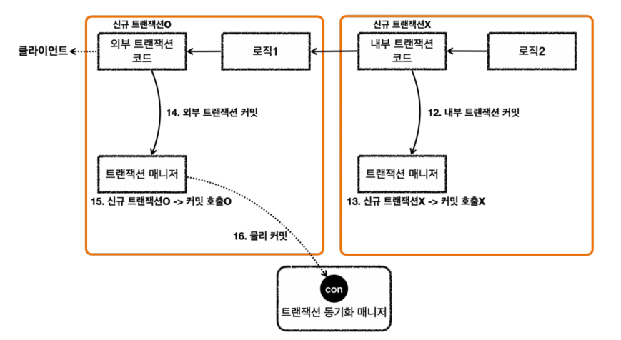

*트랜잭션 매니저에 커밋을 호출한다고해서 항상 실제 커넥션에 물리 커밋이 발생하지 않는다.*

*신규 트랜잭션인 경우에만 실제 커넥션을 사용해서 물리 커밋과 롤백을 수행한다.*

*즉, 신규 트랜잭션이 아니라면 물리 커넥션을 사용하지 않는다.*

*트랜잭션이 내부에서 추가로 사용되면, 트랜잭션 매니저를 통해 논리 트랜잭션을 관리하고, 
모든 논리 트랜잭션이 커밋되면 물리 트랜잭션이 커밋된다고 이해하면 된다.*

# ***스프링 트랜잭션 전파5 - 외부 롤백***

*내부 트랜잭션 커밋, 외부 트랜잭션 롤백되는 상황*

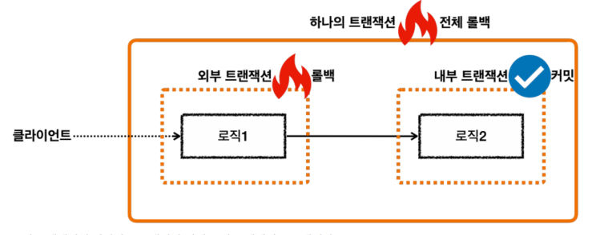

  - *논리 트랜잭션이 하나라도 롤백되면 전체 물리 트랜잭션은 롤백된다.*
  - *내부 트랜잭션이 커밋했어도, 내부 트랜잭션 안에서 저장한 데이터도 모두 함께 롤백된다.*

# ***스프링 트랜잭션 전파6 - 내부 롤백***

***외부 트랜잭션 커밋, 내부 트랜잭션 롤백 case*** 

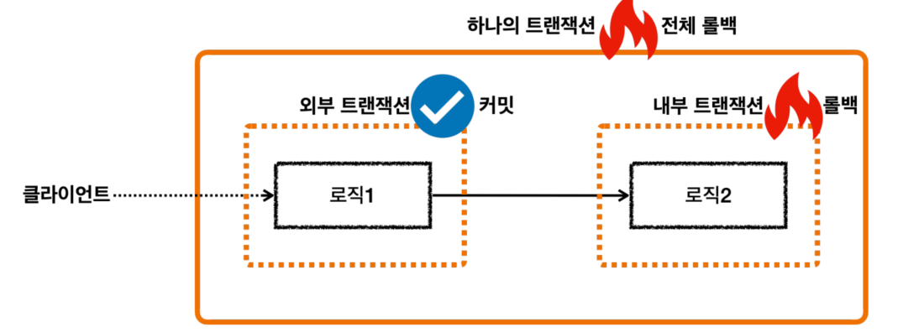

```java
@Test
void inner_rollback(){
    log.info("외부 트랜잭션 시작");
    TransactionStatus outer = txManager.getTransaction(new DefaultTransactionDefinition());

    log.info("내부 트랜잭션 시작");
    TransactionStatus inner = txManager.getTransaction(new DefaultTransactionDefinition());

    log.info("내부 트랜잭션 롤백");
    txManager.rollback(inner); // rollback - only 표시

    log.info("외부 트랜잭션 커밋");
    assertThatThrownBy(()->txManager.commit(outer))
            .isInstanceOf(UnexpectedRollbackException.class);
}
```

***흐름***

*외부 트랜잭션 시작(물리 트랜잭션 시작) → 내부 트랜잭션 시작(논리 트랜잭션, 기존 트랜잭션 참여)*

*→ 내부 트랜잭션 롤백(marking rollback-only) → 외부 트랜잭션 커밋(Global Transaction rollback-only but transactional code commit) → UnexpectedRollbackException(물리 트랜잭션 RollBack)*

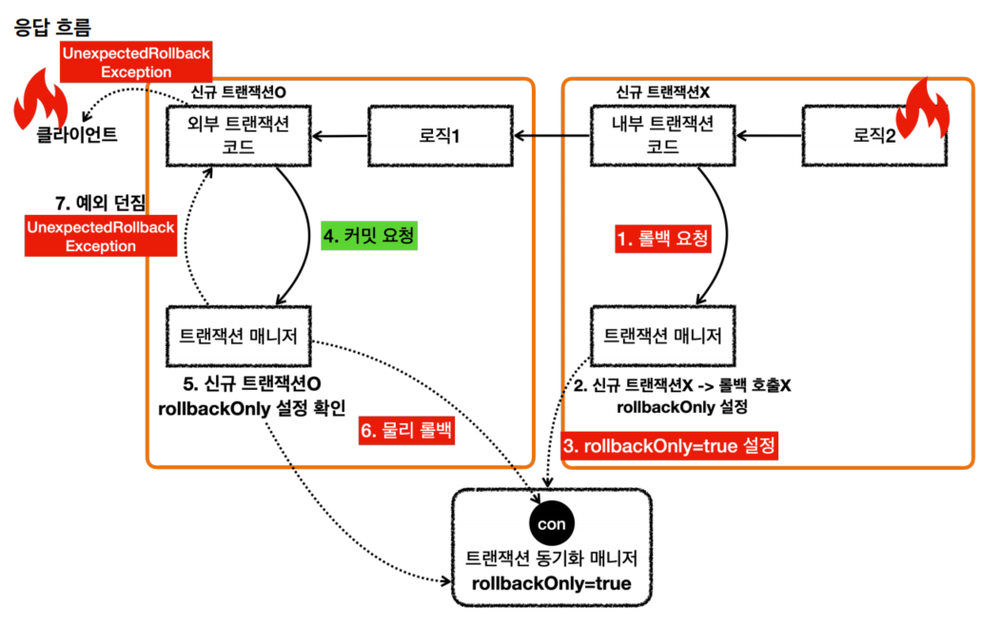

***내부 트랜잭션 응답***

  - *트랜잭션 매니저를 통해 내부 트랜잭션을 롤백한다.*
  - *트랜잭션 매니저는 롤백 시점에 신규 트랜잭션 여부(isNewTransaction)에 따라 다르게 동작한다.
내부 트랜잭션은 기존 트랜잭션에 참여한 트랜잭션 즉, isNewTransaction=false 이다.*
  - *내부 트랜잭션은 물리 트랜잭션을 롤백하지 않는 대신에 트랜잭션 동기화 매니저에게 rollbackOnly=true 표시를 해둔다.*

***외부 트랜잭션 응답***

  - *트랜잭션 매니저를 통해 외부 트랜잭션을 커밋한다.*
  - *외부 트랜잭션은 물리 트랜잭션의 시작 즉, isNewTransaction= true이다.*
  - *DB 커넥션에 실제 커밋을 호출해야 하는데 이때 먼저 트랜잭션 동기화 매니저에 rollbackOnly 표시가 있는지 확인한다.* 
  - *내부 트랜잭션에서 rollbackOnly=true 표시를 했기 때문에 외부 트랜잭션 커밋을 요청했지만 물리 트랜잭션을 커밋하는것이 아니라 롤백한다.*
  - *스프링은 커밋을 호출했지만 롤백이 발생했다는 것을 UnexpectedRollbackException 런타임 예외를 던져서 알려준다.*

***정리***

  - *논리 트랜잭션이 하나라도 롤백되면 물리 트랜잭션은 롤백된다.*
  - *내부 논리 트랜잭션이 롤백되면 롤백 전용 마크를 표시한다.*
  - *외부 트랜잭션을 커밋할 때 롤백 전용 마크를 확인한다.
롤백 전용 마크가 표시되어 있으면 물리 트랜잭션을 롤백하고, UnexpectedRollbackException 예외를 던진다.*

# ***스프링 트랜잭션 전파7 - REQUIRES_NEW***

*외부 트랜잭션과 내부 트랜잭션을 분리해서 각각 별도의 물리 트랜잭션을 사용하는 방법에 대해서 알아보자*

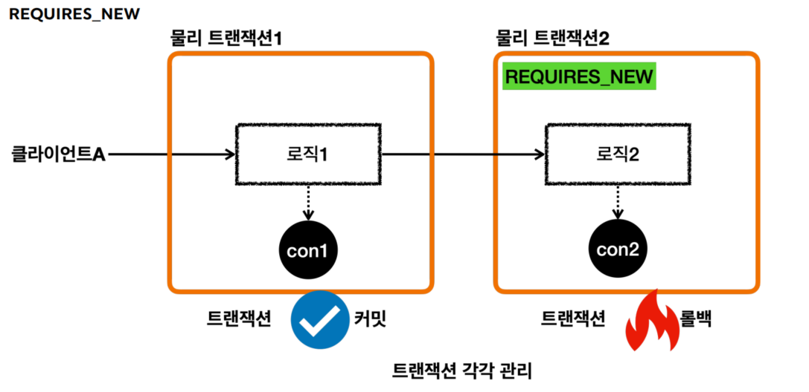

  - *물리 트랜잭션을 분리하려면 내부 트랜잭션을 시작할 때 REQUIRES_NEW 옵션을 사용하면 된다.*
  - *외부 트랜잭션과 내부 트랜잭션이 각각 별도의 물리 트랜잭션을 가진다.*
- *별도의 물리 트랜잭션을 가진다는 뜻은 DB 커넥션을 따로 사용한다는 뜻이다.*

```java
@Test
void inner_rollback_requires_new(){
    log.info("외부 트랜잭션 시작");
    TransactionStatus outer = txManager.getTransaction(new DefaultTransactionDefinition());
    log.info("outer.isNewTransaction()={}", outer.isNewTransaction());

    log.info("내부 트랜잭션 시작");
    DefaultTransactionDefinition definition = new DefaultTransactionDefinition();
    definition.setPropagationBehavior(TransactionDefinition.PROPAGATION_REQUIRES_NEW);
    TransactionStatus inner = txManager.getTransaction(definition);
    log.info("inner.isNewTransaction()={}", inner.isNewTransaction()); // true

    log.info("내부 트랜잭션 롤백");
    txManager.rollback(inner); // 롤백

    log.info("외부 트랜잭션 커밋");
    txManager.commit(outer);  // 커밋
}
```

  - ***definition.setPropagationBehavior(TransactionDefinition.******PROPAGATION_REQUIRES_NEW******)***
- *내부 트랜잭션의 전파 옵션을 REQUIRES_NEW로 설정* 
    - *내부 트랜잭션이 새로운 물리 트랜잭션으로 동작한다*
    - *즉, 하나의 요청 쓰레드가 2개의 서로 다른 커넥션을 가진다.*
    - *내부 트랜잭션을 TransactionStatus: isNewTransaction() 통해서 확인하면 true가 나온다.*
  -  *DefaultTransactionDefinition*
- *생성자로 DefaultTransactionDefinition을 생성하면*  ***PROPAGATION_REQUIRED****이다.*

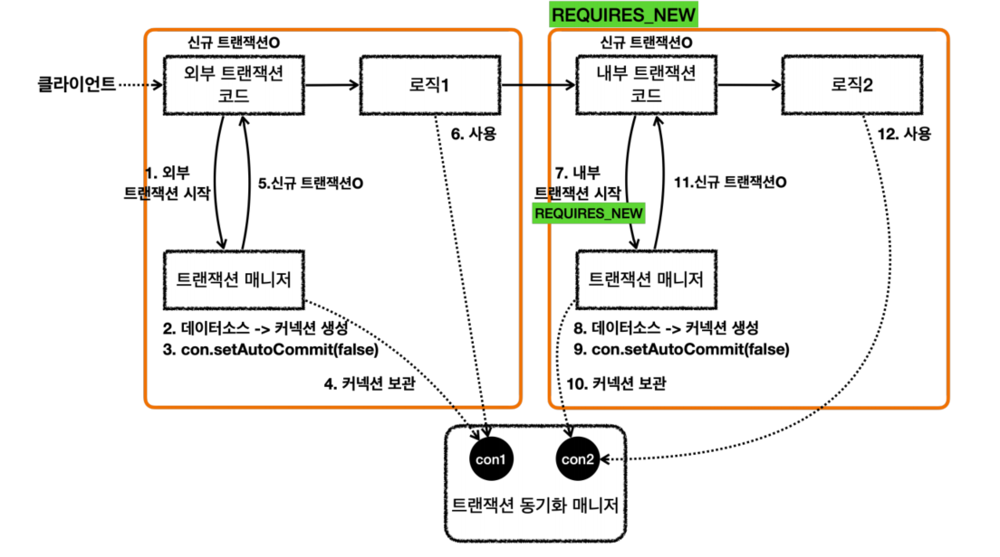

# ***스프링 트랜잭션 전파8 - 다양한 전파 옵션***

*스프링은 다양한 트랜잭션 전파 옵션을 제공, 별도의 설정을 하지 않으면 REQUIRED가 기본이다.*

*실무에서는 REQUIRED 옵션을 대부분 사용하고 아주 가끔 REQUIRES_NEW를 사용한다.*

***REQUIRED***

  - *기존 트랜잭션이 없으면 생성하고, 있으면 참여한다.*
  - *트랜잭션이 필수이다.*
- *없으면 생성*
    - *있으면 참여*

***REQUIRES_NEW***

  - *항상 새로운 트랜잭션을 생성*

***SUPPORT***

  - *트랜잭션을 지원*
- *기존 트랜잭션 없음: 트랜잭션 없이 진행*
    - *기존 트랜잭션 존재: 기존 트랜잭션에 참여*

***NOT_SUPPORT***

  - 트랜잭션을 지원 X
- *기존 트랜잭션 없음: 트랜잭션 없이 진행*
    - *기존 트랜잭션 존재: 기존 트랜잭션 보류*

***MANDATORY***

  - *의무사항, 기존 트랜잭션이 없으면 예외 발생*
- *기존 트랜잭션 없음: IllegalTransactionStateException 예외 발생*
    - *기존 트랜잭션 존재: 기존 트랜잭션 참여*

***NEVER***

  - *트랜잭션을 사용하지 않는다는 의미*
- *기존 트랜잭션 없음: 트랜잭션 없이 진행*
    - *기존 트랜잭션 존재: IllegalTransactionStateException 예외 발생*

***NESTED***

  - *기존 트랜잭션 없음: 새로운 트랜잭션 생성*
  - *기존 트랜잭션 존재: 중첩 트랜잭션 생성*
- *중첩 트랜잭션은 외부 트랜잭션 영향을 받지만, 중첩 트랜잭션은 외부에 영향 X*
    - *중첩 트랜잭션이 롤백 되어도 외부 트랜잭션은 커밋*
    - *외부 트랜잭션이 롤백 되면 트랜잭션도 함께 롤백*
  - *참고*
- *JDBC savepoint 기능을 사용. DB 드라이버에서 해당 기능을 지원하는지 확인이 필요하다.*
    - *JPA 사용 불가*

***트랜잭션 전파와 옵션***

  - *isolation, timeout, readOnly는 트랜잭션 시작만 적용, 트랜잭션 참여에는 적용되지 않는다.*
- *REQUIRED 통한 물리 트랜잭션 시작, REQUIRES_NEW를 통한 트랜잭션 시작*

- ***트랜잭션 전파 옵션, 원리***

