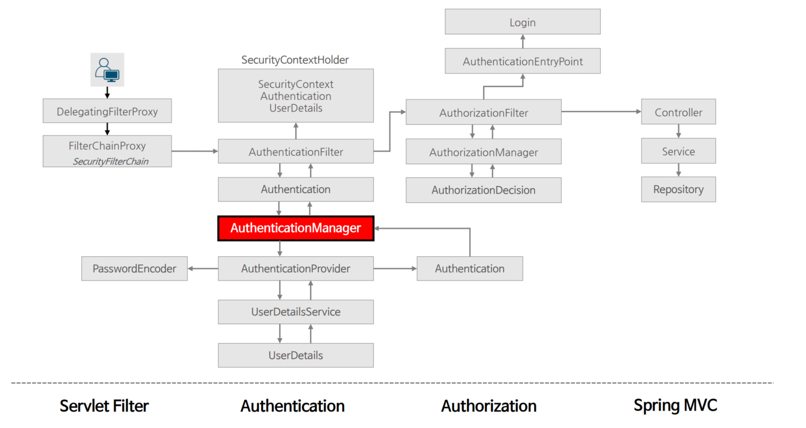
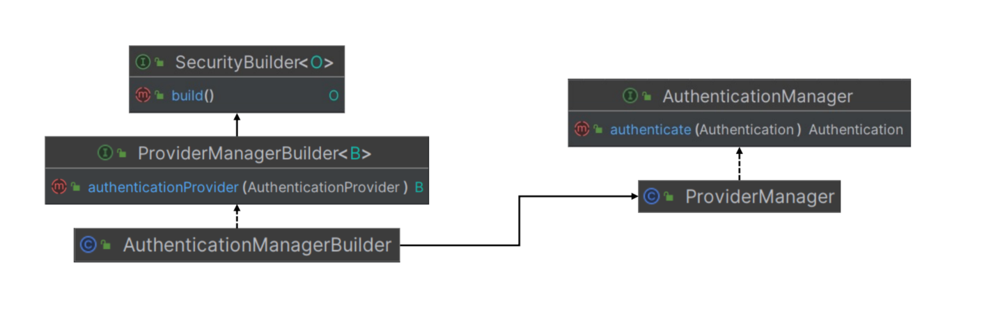
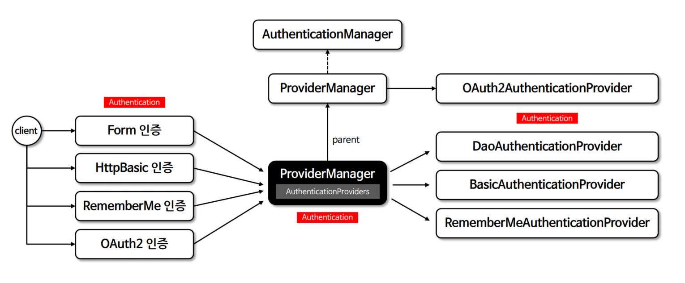
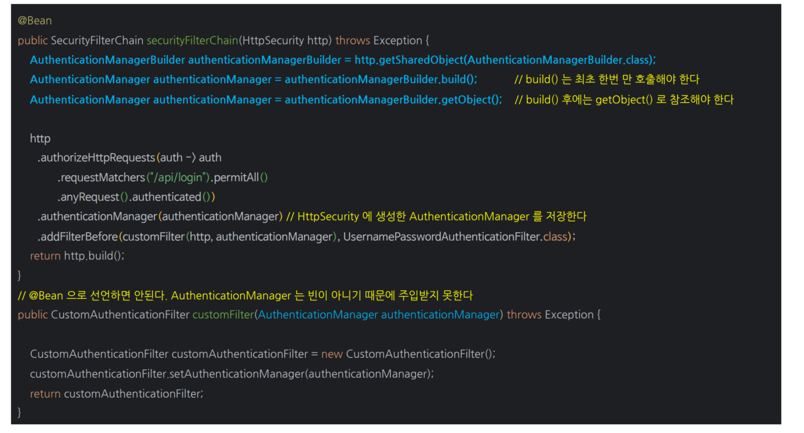
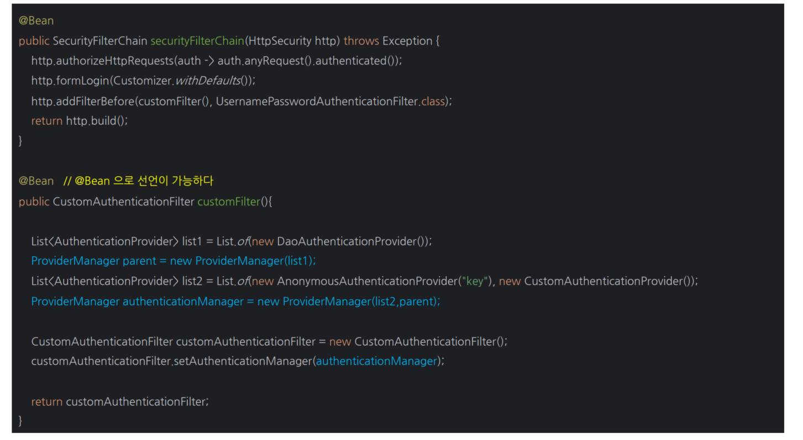
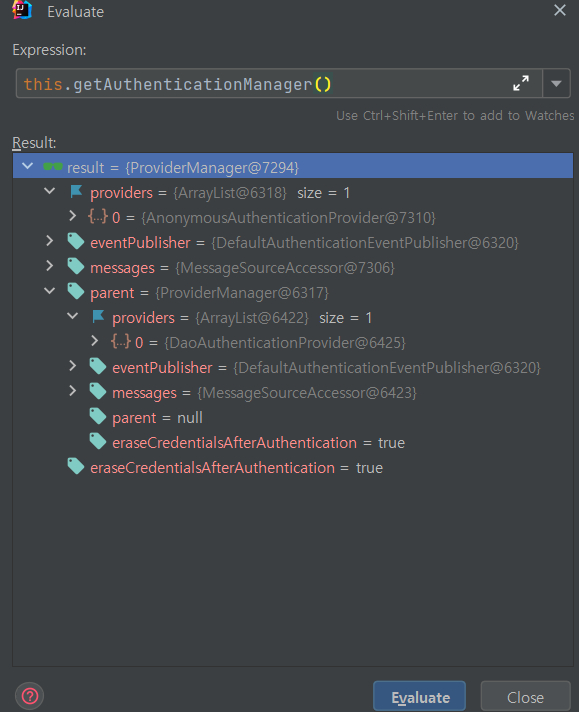
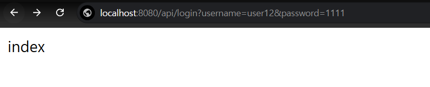

# **시큐리티 인증 / 인가 흐름도**



# **AuthenticationManager**

- 인증 필터로부터 `Authentication` 객체를 전달 받아 인증을 시도하며 인증에 성공할 경우 사용자 정보, 권한 등을 포함한 완전히 채워진 `Authentication` 객체를 인증 필터로 반환한다
- `AuthenticationManager` 는 여러 `AuthenticationProvider` 들을 관리하며 `AuthenticationProvider` 목록을 순차적으로 순회하며 인증 요청을 처리한다 
- `AuthenticationProvider` 목록 중에 인증 처리 요건에 맞는 적절한 `AuthenticationProvider` 를 찾아 인증처리를 위임한다 
- `AuthenticationManagerBuilder` 에 의해 객체가 생성되며 주로 사용하는 구현체로 `ProviderManager` 가 제공된다 

# **AuthenticationManagerBuilder**

- `AuthenticationManager` 객체를 생성하며 `UserDetailsService` 및 `AuthenticationProvider` 를 추가할 수 있다
- `HttpSecurity.getSharedObject(AuthenticationManagerBuilder.class)`를 통해 객체를 참조할 수 있다



**SecurityBuilder**

- HttpSecurity
- WebSecurity
- AuthenticationManagerBuilder

# **AuthenticationManager 흐름도**



- 선택적으로 부모 `AuthenticationManager`를 구현할 수 있으며 이 부모는 모든`AuthenticationProvider`가 인증을 수행할 수 없는 경우에 추가적으로 탐색할 수 있다 
- 일반적으로 `AuthenticationProvider` 로 부터 null 이 아닌 응답을 받을 때 까지 차례대로 시도하며 응답을 받지 못하면 `ProviderNotFoundException`과 함께 인증이 실패한다 

# **AuthenticationManager 사용 방법­ - HttpSecurity 사용**



```java
@EnableWebSecurity
@Configuration
@Slf4j
public class SecurityConfig {
    @Bean
    public SecurityFilterChain securityFilterChain(HttpSecurity http) throws Exception{
        AuthenticationManagerBuilder authenticationManagerBuilder = http.getSharedObject(AuthenticationManagerBuilder.class);
        // build()는 최초 한번만 호출
        AuthenticationManager authenticationManager1 = authenticationManagerBuilder.build();
        // build()이후 getObject()로 참조해야 한다
        AuthenticationManager authenticationManager2 = authenticationManagerBuilder.getObject();

        http
                .authorizeHttpRequests(auth -> auth
                        .requestMatchers("/").permitAll()
                        .anyRequest().authenticated())
                .authenticationManager(authenticationManager1) // HttpSecurity 생성한 AuthenticationManager 저장
                .formLogin(Customizer.withDefaults());
        return  http.build();
    }
    @Bean
    public UserDetailsService userDetailsService(){
        UserDetails user = User.withUsername("user12")
                .password("{noop}1111")
                .roles("USER").build();
        return new InMemoryUserDetailsManager(user);
    }
}
```

# **AuthenticationManager 사용 방법­ - 직접 생성** 



# **실습1**

**CustomAuthenticationFilter** 

```java
public class CustomAuthenticationFilter extends AbstractAuthenticationProcessingFilter {
    public CustomAuthenticationFilter(HttpSecurity http) {
        super(new AntPathRequestMatcher("/api/login", "GET"));
        setSecurityContextRepository(getSecurityContextRepository(http));
    }
    private SecurityContextRepository getSecurityContextRepository(HttpSecurity http) {
        SecurityContextRepository securityContextRepository = http.getSharedObject(SecurityContextRepository.class);
        if (securityContextRepository == null) {
            securityContextRepository = new DelegatingSecurityContextRepository(
                    new RequestAttributeSecurityContextRepository(), new HttpSessionSecurityContextRepository());
        }
        return securityContextRepository;
    }
    @Override
    public Authentication attemptAuthentication(HttpServletRequest request, HttpServletResponse response) throws AuthenticationException, IOException, ServletException {
        String username = request.getParameter("username");
        String password = [REDACTED];
        UsernamePasswordAuthenticationToken token = [REDACTED], password);
        return this.getAuthenticationManager().authenticate(token);
    }
}

```

**SecurityConfig**

```java
@EnableWebSecurity
@Configuration
@Slf4j
public class SecurityConfig {
    @Bean
    public SecurityFilterChain securityFilterChain(HttpSecurity http) throws Exception{
        AuthenticationManagerBuilder authenticationManagerBuilder = http.getSharedObject(AuthenticationManagerBuilder.class);
        AuthenticationManager authenticationManager = authenticationManagerBuilder.build();
        http
                .authorizeHttpRequests(auth -> auth
                        .requestMatchers("/", "/api/login").permitAll()
                        .anyRequest().authenticated())
                .authenticationManager(authenticationManager) // HttpSecurity 생성한 AuthenticationManager 저장
                .addFilterBefore(customFilter(http, authenticationManager), UsernamePasswordAuthenticationFilter.class);
        return  http.build();
    }
    public CustomAuthenticationFilter customFilter(HttpSecurity http, AuthenticationManager authenticationManager){
        CustomAuthenticationFilter customAuthenticationFilter = new CustomAuthenticationFilter(http);
        customAuthenticationFilter.setAuthenticationManager(authenticationManager);
        return customAuthenticationFilter;
    }
    @Bean
    public UserDetailsService userDetailsService(){
        UserDetails user = User.withUsername("user12")
                .password("{noop}1111")
                .roles("USER").build();
        return new InMemoryUserDetailsManager(user);
    }
}
```



현재 디버깅 break point: `CustomAuthenticationFilter`

return this.getAuthenticationManager().authenticate(token);

`AuthenticationManager`에 있는 `ProviderManager`에 provider에 `AnonymousAuthenticationProvider`가 있고 parents ProviderManager에 `DaoAuthenticationProvider`가 존재한다. 

즉, HttpSecurity 초기화 과정에서 2개의 default `AuthenticationProvider` 가 `AuthenticationManager` 가 존재하게 된다. 



`GET /api/login` 하면 `CustomAuthenticationFilter` RequestMatcher 조건에 맞고 

parameter로 올바른 password, username을 쿼리 String 으로 보내면 `DaoAuthenticationProvider`

에서 `UsernamePaswordAuthenticationToken`을 반환한다. 

# **실습2**

**CustomAuthenticationProvider**

```java
public class CustomAuthenticationProvider implements AuthenticationProvider {
    @Override
    public Authentication authenticate(Authentication authentication) throws AuthenticationException {
        String loginId = authentication.getName();
        String password = [REDACTED];

        // 생략된 과정: UserDetailsService 통해서 UserDetails 받고 password 검증을 해야함
        return new UsernamePasswordAuthenticationToken(
                loginId, null, List.of(new SimpleGrantedAuthority("ROLE_USER")));
    }
    @Override
    public boolean supports(Class<?> authentication) {
        return authentication.isAssignableFrom(UsernamePasswordAuthenticationToken.class);
    }
}

```

**SecurityConfig**

```java
@EnableWebSecurity
@Configuration
@Slf4j
public class SecurityConfig2 {
    @Bean
    public SecurityFilterChain securityFilterChain(HttpSecurity http) throws Exception{
        http
                .authorizeHttpRequests(auth -> auth
                        .requestMatchers("/").permitAll()
                        .anyRequest().authenticated())
                .addFilterBefore(customFilter(http), UsernamePasswordAuthenticationFilter.class);

        return  http.build();
    }
    public CustomAuthenticationFilter customFilter(HttpSecurity http){
        CustomAuthenticationFilter customAuthenticationFilter = new CustomAuthenticationFilter(http);

        List<AuthenticationProvider> list1 = List.of(new DaoAuthenticationProvider());
        AuthenticationManager parent = new ProviderManager(list1);

        List<AuthenticationProvider> list2 = List.of(new AnonymousAuthenticationProvider("key"), new CustomAuthenticationProvider());
        AuthenticationManager providerManager = new ProviderManager(list2, parent);
        customAuthenticationFilter.setAuthenticationManager(providerManager);
        return customAuthenticationFilter;
    }
    @Bean
    public UserDetailsService userDetailsService(){
        UserDetails user = User.withUsername("user12")
                .password("{noop}1111")
                .roles("USER").build();
        return new InMemoryUserDetailsManager(user);
    }
}
```

CustomAuthenticaionFilter에 AuthenticationManager를 직접 만들어서 넣었다.

ProviderManager에는 부모 ProviderManager를 넣을 수 있다.

ProviderManager에 있는 AuthenticaionProviders 목록에서 모든 Provider가 정상적인 Authentication 을 반환하지 않으면 부모 ProviderManager에 있는 AuthenticaionProviders 에서 찾는다 

현재 CustomAuthenticationProvider는 어떤 아이디 비밀번호든 UsernamePasswordAuthenticationToken을 반환하고 있어서 무조건 인증에 성공한다

