## **✅**  들어가며

**파일 시스템(file system)**

  - 파일과 디렉터리를 관리하는 운영체제 내의 프로그램 

**파일과 디렉터리** 

  - 보조기억장치의 데이터 덩어리, 파일과 디렉터리 

## **✅  파일** 

  - 보조기억장치에 저장된 관련 정보의 집합 
  - 의미 있고 관련 있는 정보를 모은 논리적 단위 
  - 파일을 이루는 정보 
- 파일을 실행하기 위한 정보 
    - 부가 정보(속성, 메타 데이터)

### **파일의 속성 종류** 

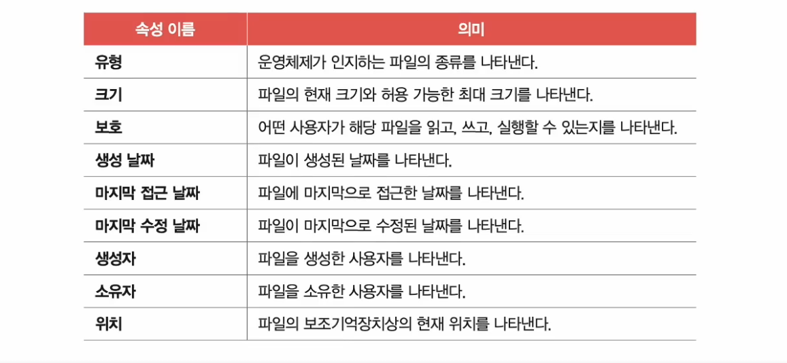

### **유형 = 확장자** 

운영체제가 인식하기 위한 파일의 종류 

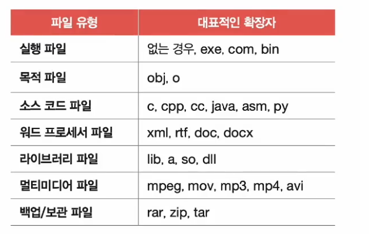

### 파일 연산을 위한 시스템 호출 

  1. 파일 생성
  1. 파일 삭제
  1. 파일 열기 
  1. 파일 닫기
  1. 파일 읽기
  1. 파일 쓰기 

## **✅** 디렉터리 

  - 윈도우에서는 폴더(folder)
  - 여러 계층으로 파일 및 폴더를 관리하는 트리 구조 디렉터리 
  - 최상위 디렉터리(루트 디렉터리, / ), 서브 디렉터리 

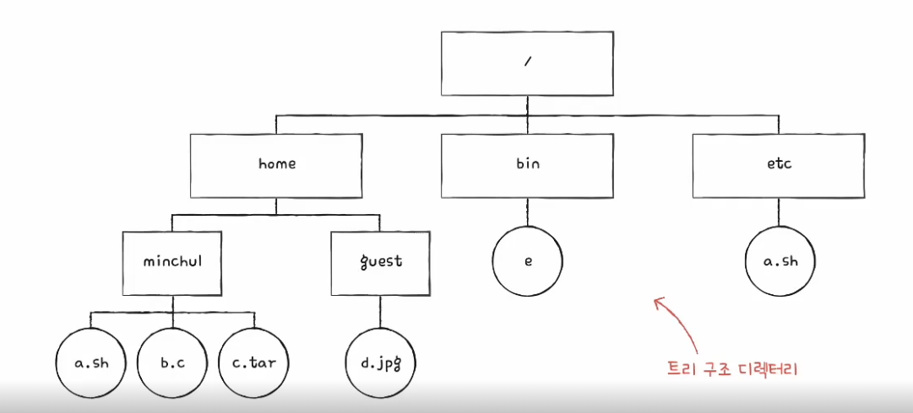

### 경로 

  - 디렉터리를 이용해 파일/디렉터리의 위치, 나아가 이름까지 특정 지을 수 있는 정보 
  - **절대 경로: 루트 디렉터리부터 시작하는 경로** 
- /home/minchul/a.sh
  - **상대 경로: 현재 디렉터리부터 시작하는 경로** 
- 현재 디렉터리 경로: /home
    - guest/d.jpg

### 디렉터리 연산을 위한 시스템 호출 

  1. 디렉터리 생성 
  1. 디렉터리 삭제 
  1. 디렉터리 열기 
  1. 디렉터리 닫기 
  1. 디렉터리 읽기 

### 디렉터리 엔트리 

```
사실 많은 운영체제에서는 디렉터리를 그저 특별한 형태의 파일로 간주한다 
즉, 디렉터리는 그저 포함된 정보가 조금 특별한 파일 
```

  - 파일의 내부에는 파일과 관련된 정보들이 있다면, 디렉터리 내부에는 해당 디렉터리에 담겨 있는 대상과 관련된 정보들이 담겨 있다.
- 이 정보는 보통 테이블(표) 형태로 구성

각 엔트리(행)에 담기는 정보 

  - 디렉터리에 포함된 대상의 이름 
  - 그 대상이 보조기억장치 내에 저장된 위치를 유추할 수 있는 정보 

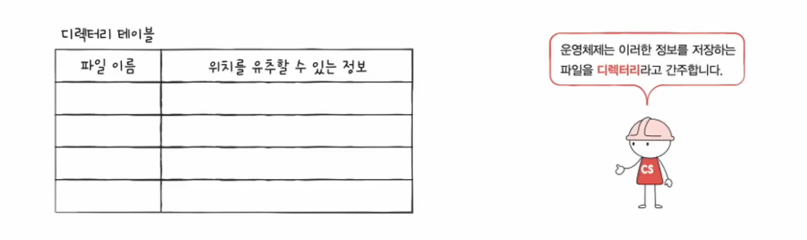

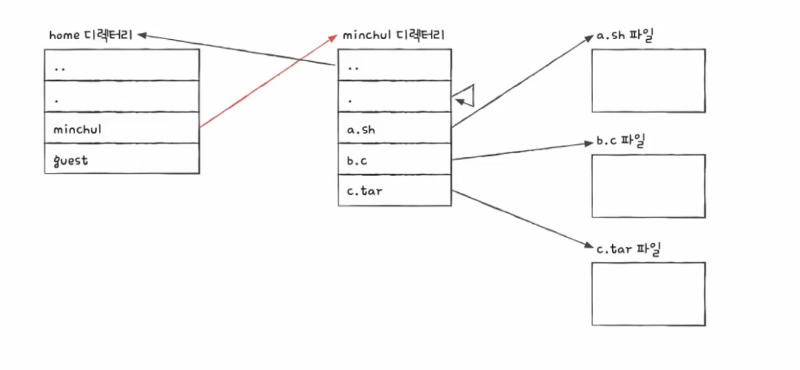

## **✅**  들어가며

  - 파일 시스템이 파일과 디렉터리를 보조기억장치에 할당하고 접근하는 방법
  - 대표적인 파일 시스템의 종류(FAT 파일 시스템, 유닉스 파일 시스템) 학습

## **✅**  파티셔닝과 포매팅 

  - 이제 막 공장에서 생산되어 한 번도 사용된 적 없는 새 하드 디스크 / SSD? 
  - 파티셔닝, 포매팅 하기 전까지는 사용할 수 없다. 

### 파티셔닝 

  - 저장 장치의 논리적인 영역을 구획하는 작업 


### 포매팅 

  - 파일 시스템을 설정 
  - 어떤 방식으로 파일을 관리할지 결정, 새로운 데이터를 쓸 준비하는 작업 

**USB 포매팅 예시** 

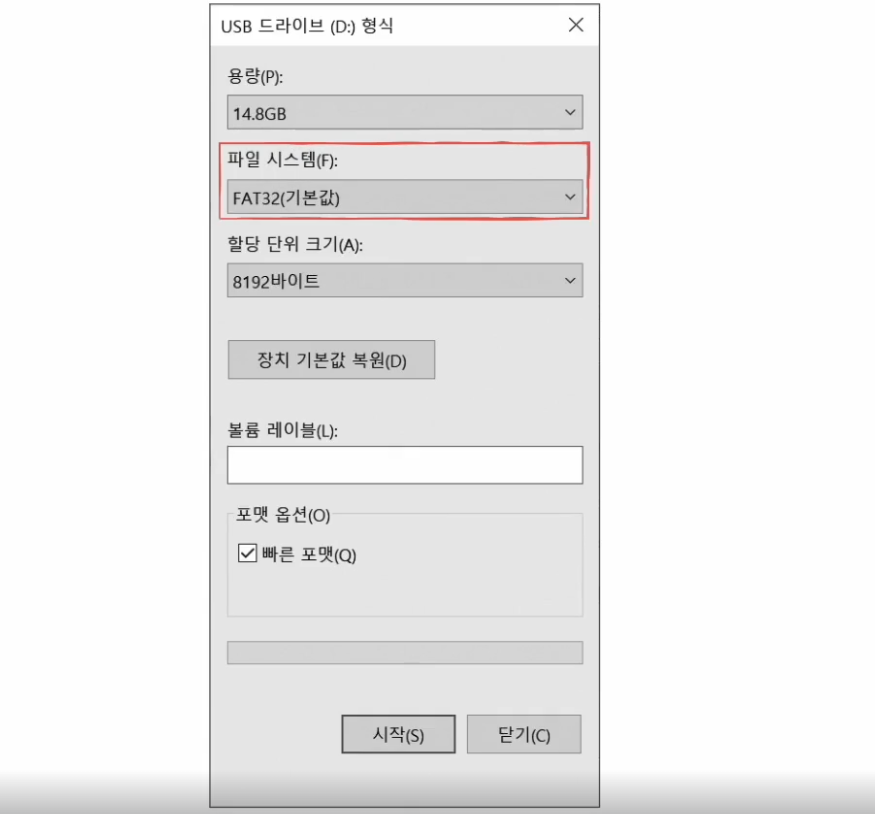

  - 파일 시스템에는 여러 종류가 존재 
  - 파티션마다 다른 파일 시스템을 설정할 수 있다 

### 🔄 정리

| 용어 | 설명 |
| --- | --- |
| **파티션** | 디스크를 논리적으로 나누는 작업 (예: C:, D: 드라이브 나누기) |
| **포맷(포매팅)** | 파티션에 파일 시스템을 설치해서 사용할 수 있게 만드는 작업 |

## **✅** 파일 할당 방법 

  - 포매팅까지 끝난 하드 디스크에 파일을 저장하기 
  - 운영체제는 파일/디렉터리를 블록 단위로 읽고 쓴다 
- 즉, 하나의 파일이 보조기억장치에 저장될 때에는 여러 블록에 걸쳐 저장된다
  - 파일을 보조기억장치에 할당하는 두 가지 방법: 연속 할당, 불연속 할당 

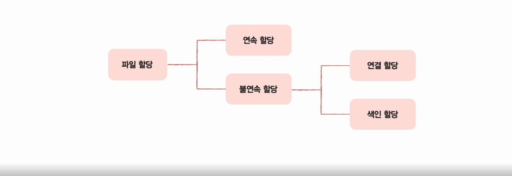

### 연속 할당 

  - 이름 그대로 보조기억장치 내 연속적인 블록에 파일 할당 

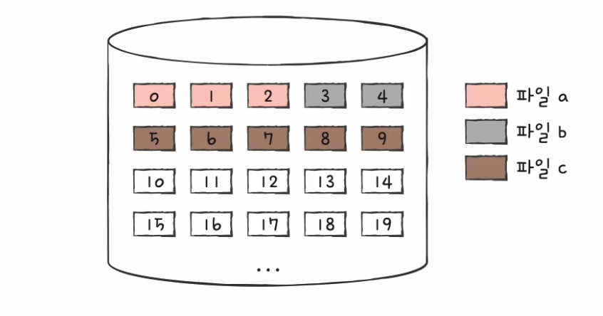

**연속 할당 특징** 

  - 연속된 파일에 접근하기 위해 파일의 첫 번째 블록 주소와 블록 단위의 길이만 알면 된다 
  - 디렉터리 엔트리: 파일 이름 & 첫 번째 블록 주소 & 블록 단위 길이 명시 

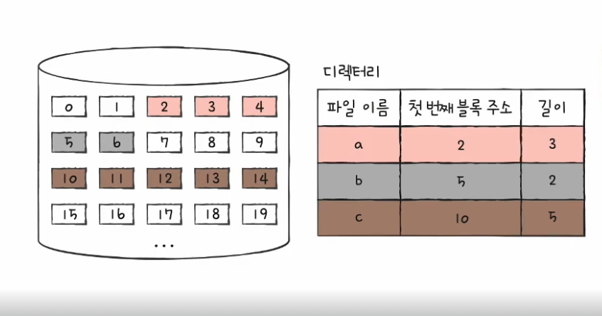

**연속 할당 단점** 

  - 구현이 간단하지만 외부 단편화를 야기할 수 있다. 

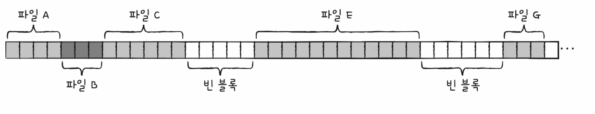

  - 파일 D, F 삭제 → 잔여 블록은 11개지만, 블록 7개 이상 사용하는 파일은 할당 X

### 불연속 할당 - 연결 할당 

  - 각 블록의 일부에 다음 블록의 주소를 저장하여 각 블록이 다음 블록을 가리키는 형태로 할당 
  - 파일을 이루는 데이터 블록을 연결 리스트로 관리 
  - 불연속 할당의 일종: 파일이 여러 블록에 흩어져 저장되어도 무방 

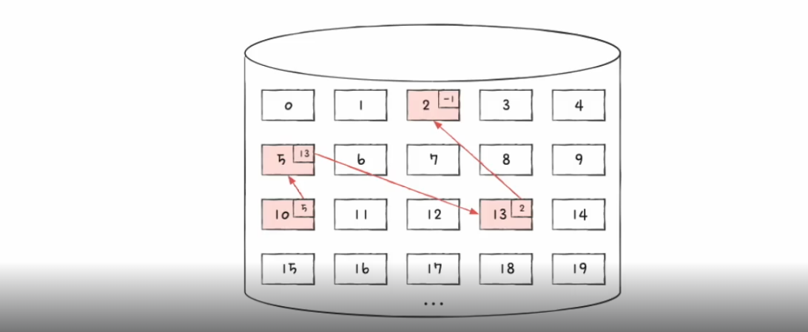

**디렉터리 엔트리: 파일 이름 & 첫번째 블록 주소 & 블록 단위의 길이** 

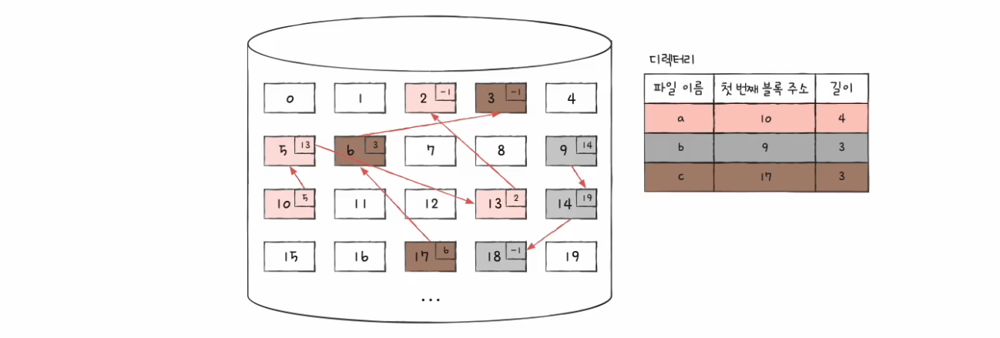

  - 디렉터리 엔트리: 마지막 블록 주소를 기록할 수도 있다. 
  - 파일 a: 10(시작) → 5 → 13 → 2(끝)

**불연속 할당 - 연결 할당 특징** 

  - 연속 할당의 단점: 외부 단편화 문제 해결 
  - **반드시 첫 번째 블록부터 하나씩 읽어들여야 한다** 
- → 파일을 중간부터 읽지 못한다.
  - 오류 발생시 해당 블록 이후 블록은 접근이 어렵다 

### 불연속 할당 - 색인 할당 

  - 파일의 모든 블록 주소를 색인 블록이라는 하나의 블록에 모아 관리하는 방식 
  - 파일 내 임의의 위치에 접근하기 용이 

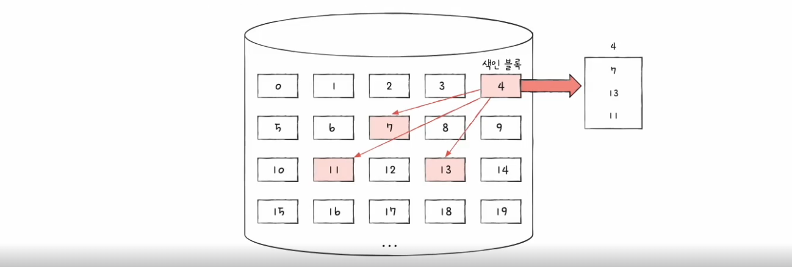

**디렉터리 엔트리: 파일 이름 & 색인 블록 주소** 

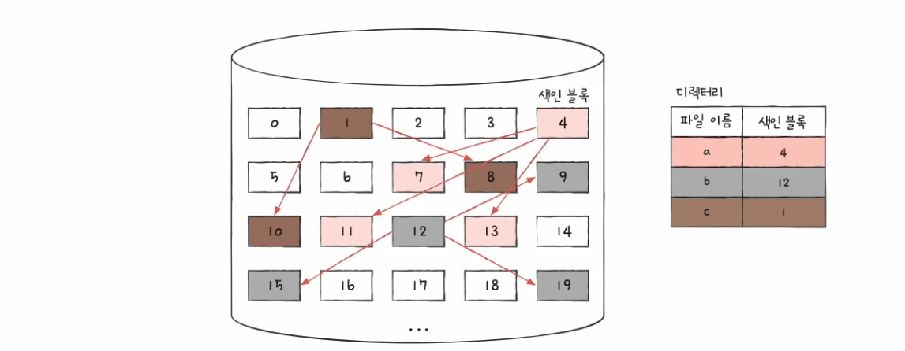

## **✅**  파일 시스템 살펴보기 

### FAT 파일 시스템 

  - 불연속 - 연결 할당 기반 파일 시스템 
  - 연결 할당의 단점을 보완 
  - USB, SD 카드 
  - 각 블록에 포함된 다음 블록 주소를 한데 모아 **테이블(FAT, File Allocation Table)**로 관리 

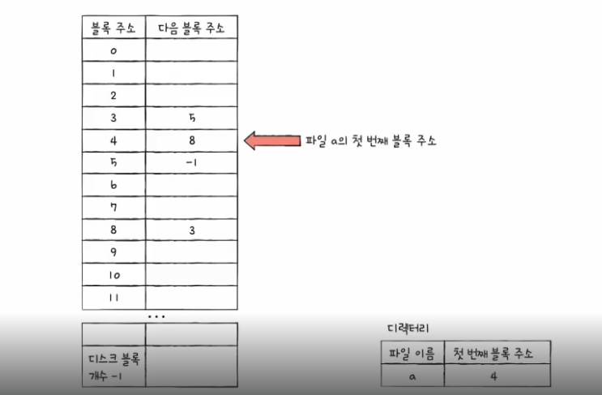

**FAT 파일 시스템의 파티션 도식도** 

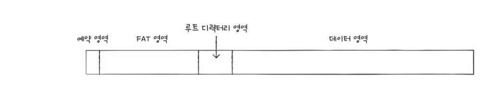

**FAT 파일 시스템 디렉터리 엔트리** 

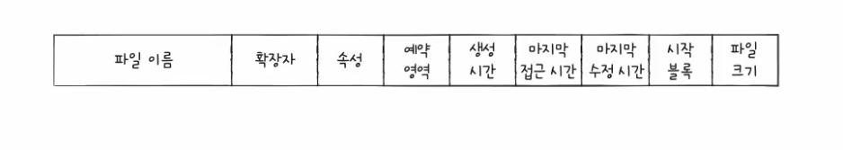

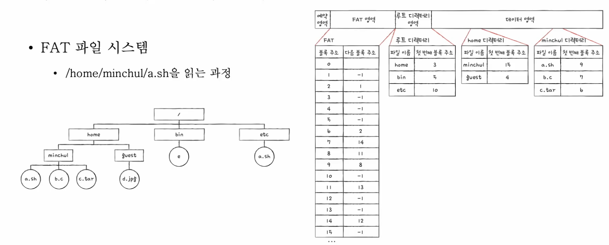

**루트 디렉터리 → home 디렉터리 → minchul 데릭터리 → FAT(9 → 8 → 11 → 13)** 

### 유닉스 파일 시스템 

  - 색인 할당 기반 파일 시스템 
  - 색인 블록 == **i-node**
- 파일의 속성 정보와 15개의 블록 주소 저장 가능

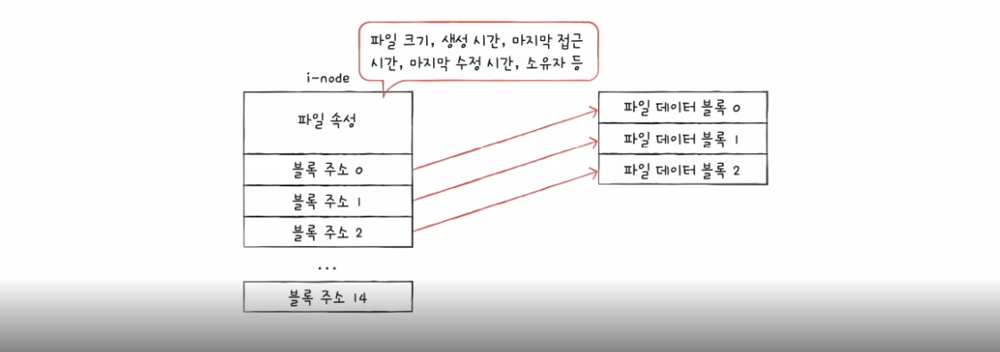

**유닉스 파일 시스템 파티션 모식도** 


**15개 블록 이상을 차지하는 파일은 어떻게 처리?** 

  1. 블록 주소 중 12개에는 직접 블록 주소 저장 
1. 직접 블록: 파일 데이터가 저장된 블록

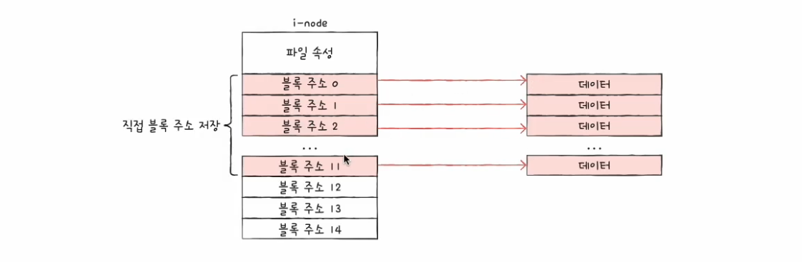

  1. 1번으로 충분하지 않다면 13번째 주소에 단일 간접 블록 주소 저장 
1. 단일 간접 블록: 파일 데이터를 저장한 블록 주소가 저장된 블록

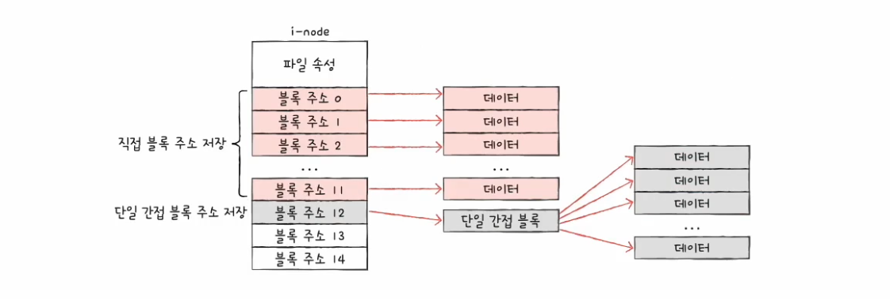

  1. 2번으로 충분하지 않다면 14번째 주소에 이중 간접 블록 주소 저장 
1. 이중 간접 블록: 단일 간접 블록들의 주소를 저장하는 블록

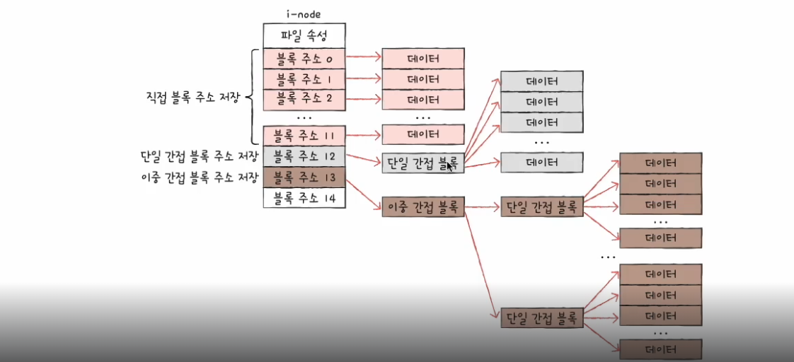

  1. 3번으로 충전하지 않다면 15번째 주소에 삼중 간접 블록 주소 저장 
1. 삼중 간접 블록: 이중 간접 블록들의 주소를 저장하는 블록

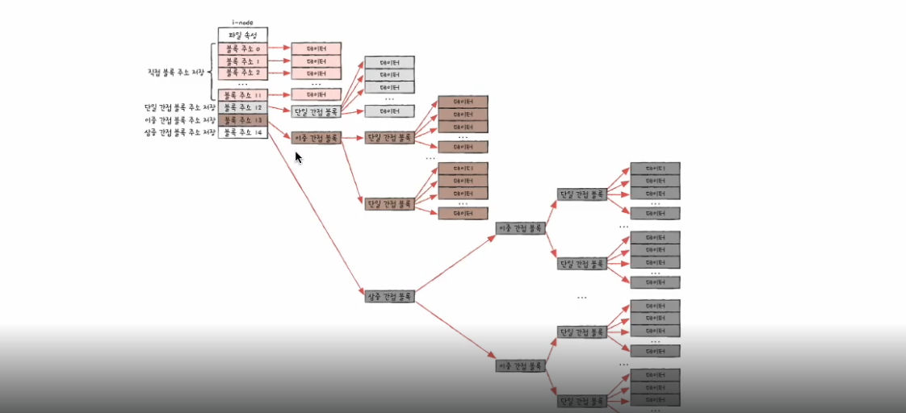

**유닉스 파일 시스템 디렉터리 엔트리** 

  - i-node가 파일 시스템의 핵심 


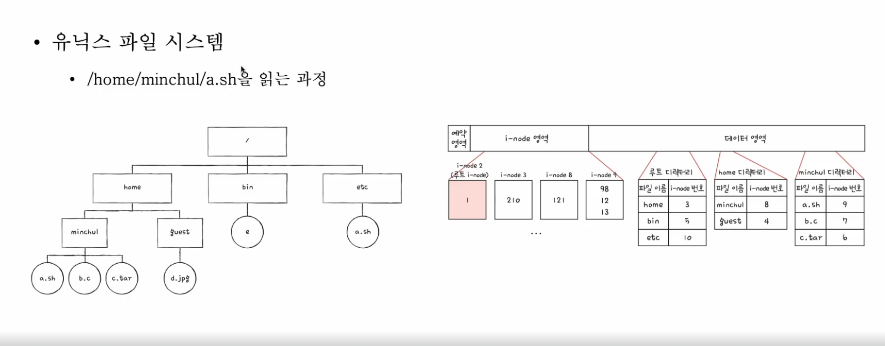

