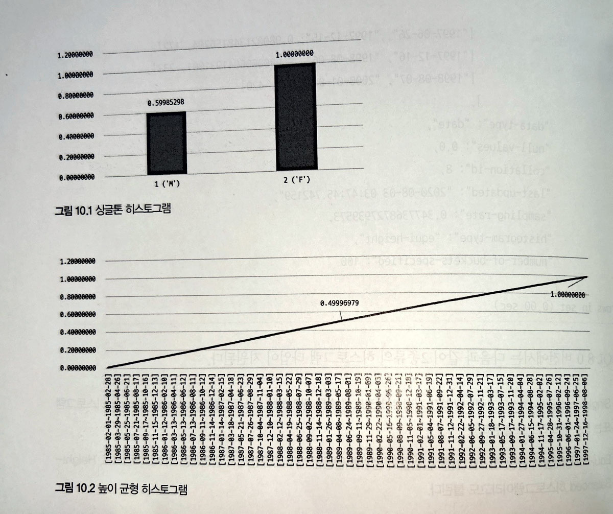
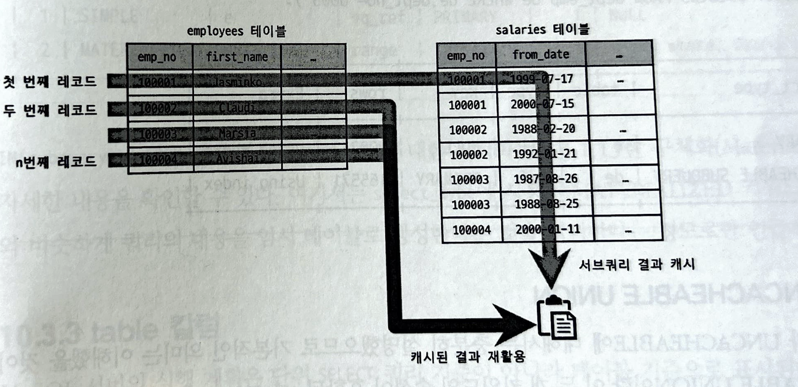
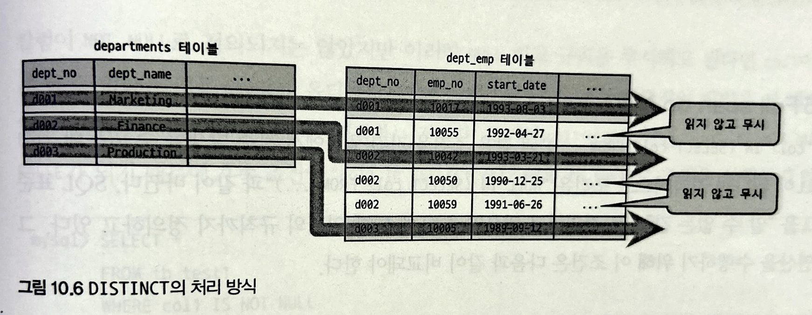
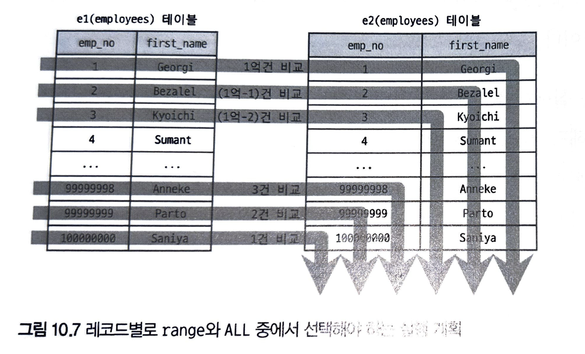
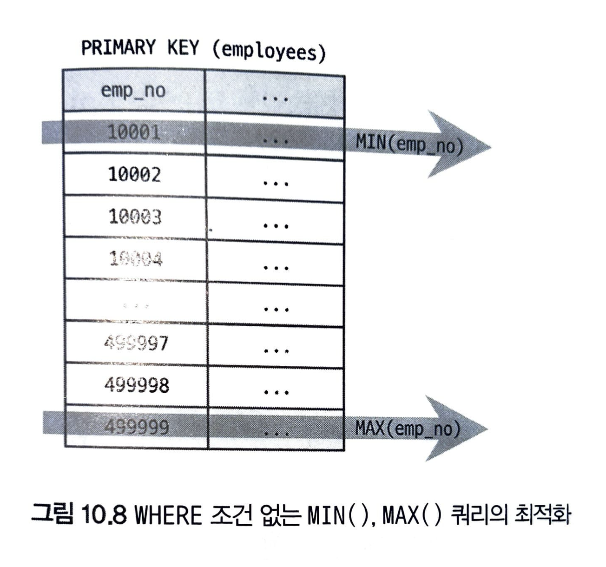
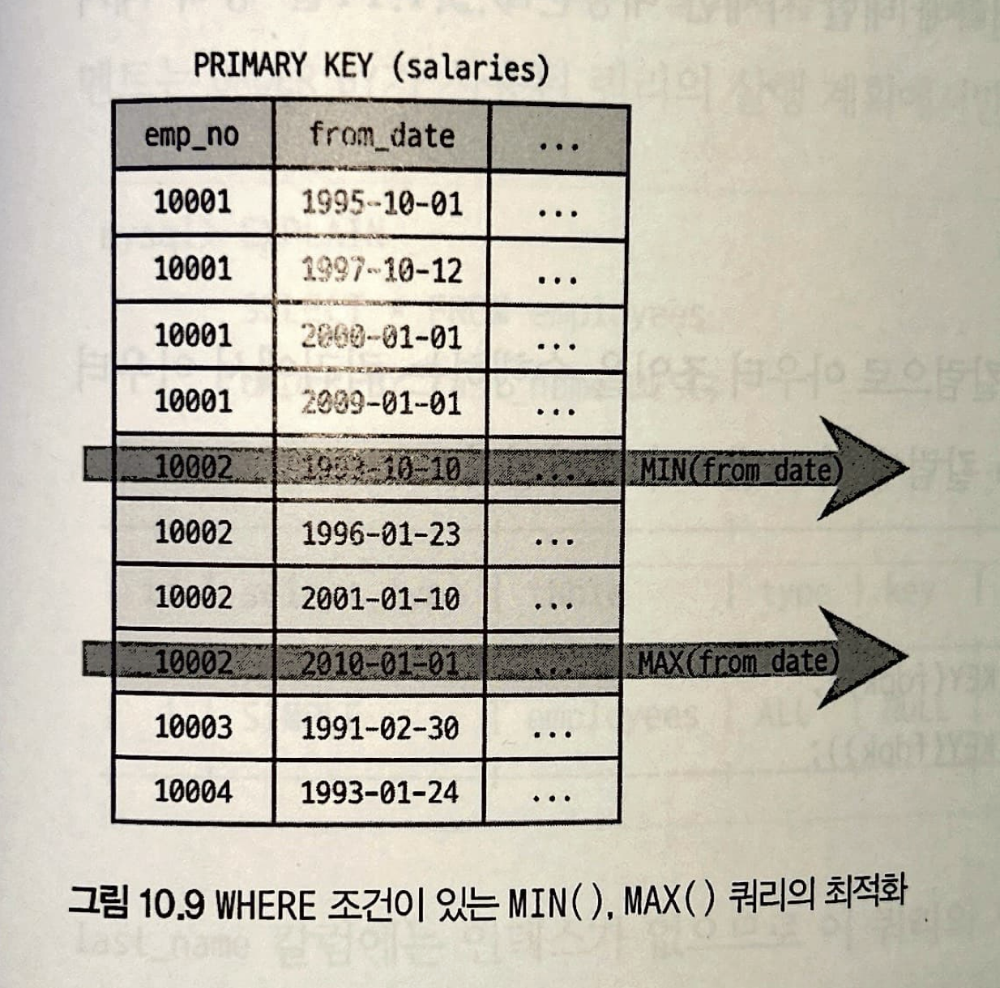
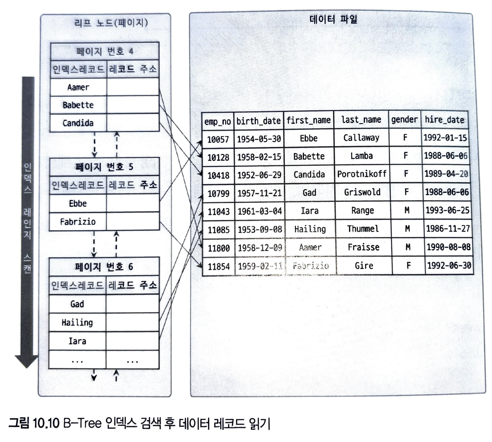

대부분의 DBMS 목적은 많은 데이터를 안전하게 저장 및 관리하고 사용자가 원하는 데이터를 빠르게 조회 할 수 있게 해주는 것이 주목적이다. 이러한 목적을 달성하려면 옵티마이저는 사용자의 쿼리를 최적으로 처리될 수 있게 하는 쿼리의 실행 계획을 수립할 수 있어야 한다.

하지만 옵티마이저는 DBA나 개발자의 개입 없이 항상 좋은 실행 계획을 만들어낼 수 있는 것은 아니다.

DBMS에서는 이런 문제점을 DBA나 개발자가 보완할 수 있도록 옵티마이저가 수립한 실행 계획을 확인할 수 있게 해준다.

---

MySQL 5.7 버전까지는 **테이블과 인덱스에 대한 정보**를 가지고만 실행 계획을 수립했다.

하지만 이는 테이블 칼럼의 값들이 실제 어떻게 분포돼 있는지에 대한 정보가 없기 때문에 실행 계획의 정확도가 떨어지는 경우가 많았다. 그래서 MySQL 8.0 버전부터는 **인덱스되지 않은 칼럼들에 대해서도 데이터 분포도를 수집해서 저장하는 히스토그램(Histogram) 정보**가 도입됐다.

히스토그램이 도입됐다고 해서 기존의 테이블이나 인덱스의 통계 정보가 필요치 않은 것은 아니다.

---

# 10.1.1 테이블 및 인덱스 통계 정보

비용 기반 최적화에서 가장 중요한 것은 통계 정보다.

예를 들어, 1억 건의 레코드가 저장된 테이블의 통계 정보가 갱신되지 않아서 레코드가 10건 미만인 것처럼 돼 있다면 옵티마이저는 레인지 스캔이 아니라 풀 테이블 스캔으로 실행해 버릴 수도 있다.

즉, 부정확한 통계 정보 탓에 0.1초 안에 끝날 쿼리에 1시간 이상이 소요될 수도 있다.

---

## 10.1.1.1 MySQL 서버의 통계 정보

MySQL 5.6 버전부터는 InnoDB 스토리지 엔진을 사용하는 테이블에 대한 통계 정보를 영구적으로 관리할 수 있게 개선됐다. 5.5 버전까지는 테이블의 통계 정보가 메모리에서만 관리되고, SHOW INDEX 명령으로만 테이블의 인덱스 칼럼의 분포도를 볼 수 있었다. 

5.6 버전부터는 각 테이블의 통계 정보를 mysql 데이터베이스의 innodb_index_stats 테이블과 innodb_table_stats 테이블로 관리할 수 있게 개선됐다. 이렇게 통계 정보를 테이블로 관리함으로써 MySQL 서버가 재시작돼도 기존의 통계 정보를 유지할 수 있게 됐다.

```sql
SHOW TABLES LIKE '%_stats';
+-------------------------+
|Tables_in_mysql (%_stats)|
+-------------------------+
|innodb_index_stats       |
|innodb_table_stats       |
+-------------------------+
```

테이블을 생성할 때 **STATS_PERSISTENT** 옵션을 설정할 수 있는데, 이 설정값에 따라 테이블 단위로 영구적인 통계 정보를 보관할지 말지를 결정할 수 있다.

```sql
CREATE TABLE tab_test (fd1 INT, fd2 VARCHAR(20), PRIMARY KEY(fd1))
ENGINE=InnoDB
STATS_PERSISTENT=DEFAULT 
```

  - STATS_PERSISTENT=0: innodb_index stats, innodb_table_stats 테이블에 통계 정보(히스토그램)를 저장하지 않는다. 
  - STATS_PERSISTENT=1: innodb_index stats, innodb_table_stats 테이블에 통계 정보(히스토그램)를 저장한다.
  - STATS_PERSISTENT=DEFAULT: 테이블을 생성할 때 별도로 STATS_PERSISTENT 옵션을 설정하지 않은 것과 동일하며, 테이블의 통계를 영구적으로 관리할지 말지를 `innodb_stats_persistent` 시스템 변수의 값으로 결정한다.

`innodb_stats_persistent` 시스템 설정 변수는 기본적으로 1로 설정돼 있으며, 

별도의 STATS_PERSISTENT 옵션 없이 테이블을 생성하면 영구적인 통계 정보를 사용하면서 mysql 데이터베이스에 innodb_index stats, innodb_table_stats 테이블에 통계 정보를 저장한다.

```sql
SHOW VARIABLES LIKE 'innodb_stats_persistent';

+-----------------------+-----+
|Variable_name          |Value|
+-----------------------+-----+
|innodb_stats_persistent|ON   |
+-----------------------+-----+
```

**예제 쿼리**

```sql
CREATE TABLE tab_persistent (fd1 INT PRIMARY KEY , fd2 INT)
ENGINE=InnoDB STATS_PERSISTENT=1;

CREATE TABLE tab_transient (fd1 INT PRIMARY KEY , fd2 INT)
ENGINE=InnoDB STATS_PERSISTENT=0;

SELECT * FROM mysql.innodb_table_stats 
where table_name IN ('tab_persistent', 'tab_transient');

+-------------+--------------+-------------------+------+--------------------+------------------------+
|database_name|table_name    |last_update        |n_rows|clustered_index_size|sum_of_other_index_sizes|
+-------------+--------------+-------------------+------+--------------------+------------------------+
|employees    |tab_persistent|2025-06-13 14:01:26|0     |1                   |0                       |
+-------------+--------------+-------------------+------+--------------------+------------------------+
```

테이블이 생성된 후 mysql 데이터베이스의 innodb_table_stats 테이블의 통계 정보를 조회해보면 STATS_PERSISTENT=1 로 생성한 tab_persistent 테이블의 통계 정보만 조회되는 것을 확인할 수 있다.

생성된 테이블의 통계 정보 저장 방식은 ALTER TABLE 명령을 통해서 변경이 가능하다.

```sql
ALTER TABLE employees.employees STATS_PERSISTENT=1;

SELECT *
FROM mysql.innodb_index_stats
WHERE database_name='employees' AND
table_name='employees';

+-------------+----------+---------------------+-------------------+------------+----------+-----------+---------------------------------+
|database_name|table_name|index_name           |last_update        |stat_name   |stat_value|sample_size|stat_description                 |
+-------------+----------+---------------------+-------------------+------------+----------+-----------+---------------------------------+
|employees    |employees |PRIMARY              |2025-06-13 14:12:57|n_diff_pfx01|299335    |20         |emp_no                           |
|employees    |employees |PRIMARY              |2025-06-13 14:12:57|n_leaf_pages|886       |null       |Number of leaf pages in the index|
|employees    |employees |PRIMARY              |2025-06-13 14:12:57|size        |929       |null       |Number of pages in the index     |
|employees    |employees |ix_firstname         |2025-06-13 14:12:57|n_diff_pfx01|1231      |20         |first_name                       |
|employees    |employees |ix_firstname         |2025-06-13 14:12:57|n_diff_pfx02|269923    |20         |first_name,emp_no                |
|employees    |employees |ix_firstname         |2025-06-13 14:12:57|n_leaf_pages|496       |null       |Number of leaf pages in the index|
|employees    |employees |ix_firstname         |2025-06-13 14:12:57|size        |609       |null       |Number of pages in the index     |
|employees    |employees |ix_gender_birthdate  |2025-06-13 14:12:57|n_diff_pfx01|1         |3          |gender                           |
|employees    |employees |ix_gender_birthdate  |2025-06-13 14:12:57|n_diff_pfx02|8465      |20         |gender,birth_date                |
|employees    |employees |ix_gender_birthdate  |2025-06-13 14:12:57|n_diff_pfx03|315351    |20         |gender,birth_date,emp_no         |
|employees    |employees |ix_gender_birthdate  |2025-06-13 14:12:57|n_leaf_pages|361       |null       |Number of leaf pages in the index|
|employees    |employees |ix_gender_birthdate  |2025-06-13 14:12:57|size        |417       |null       |Number of pages in the index     |
|employees    |employees |ix_hiredate          |2025-06-13 14:12:57|n_diff_pfx01|5130      |20         |hire_date                        |
|employees    |employees |ix_hiredate          |2025-06-13 14:12:57|n_diff_pfx02|300129    |20         |hire_date,emp_no                 |
|employees    |employees |ix_hiredate          |2025-06-13 14:12:57|n_leaf_pages|294       |null       |Number of leaf pages in the index|
|employees    |employees |ix_hiredate          |2025-06-13 14:12:57|size        |353       |null       |Number of pages in the index     |
|employees    |employees |ix_lastname_firstname|2025-06-13 14:12:57|n_diff_pfx01|1564      |20         |last_name                        |
|employees    |employees |ix_lastname_firstname|2025-06-13 14:12:57|n_diff_pfx02|270112    |20         |last_name,first_name             |
|employees    |employees |ix_lastname_firstname|2025-06-13 14:12:57|n_diff_pfx03|304635    |20         |last_name,first_name,emp_no      |
|employees    |employees |ix_lastname_firstname|2025-06-13 14:12:57|n_leaf_pages|460       |null       |Number of leaf pages in the index|
|employees    |employees |ix_lastname_firstname|2025-06-13 14:12:57|size        |545       |null       |Number of pages in the index     |
+-------------+----------+---------------------+-------------------+------------+----------+-----------+---------------------------------+

SELECT *
FROM mysql.innodb_table_stats
WHERE table_name='employees';

+-------------+----------+-------------------+------+--------------------+------------------------+
|database_name|table_name|last_update        |n_rows|clustered_index_size|sum_of_other_index_sizes|
+-------------+----------+-------------------+------+--------------------+------------------------+
|employees    |employees |2025-06-13 14:12:57|299335|929                 |1924                    |
+-------------+----------+-------------------+------+--------------------+------------------------+
```

**innodb_index_stats**

  - **innodb_index_stats.stat_name=’n_diff_pfx%’:** **인덱스가 가진 유니크한 값의 개수**
  - **innodb_index_stats.stat_name=’n_leaf_pages’:** **인덱스의 리프 노드 페이지 개수**
  - **innodb_index_stats.stat_name=’size’:** **인덱스 트리의 전체 페이지 개수**

**innodb_table_stats**

  - **innodb_table_stats.n_rows:** **테이블의 전체 레코드 건수**
  - **innodb_table_stats.clustered_index_size:** **프라이머리 키의 크기(InnoDB 페이지 개수)**
  - **innodb_table_stats.sum_of_other_index_sizes:** **프라이머리 키를 제외한 인덱스의 크기(InnoDB 페이지 개수)**

MySQL 5.5 버전까지는 테이블의 통계 정보가 메모리에만 저장되며, MySQL 서버가 재시작되면 통계 정보가 초기화됐다. 그래서 MySQL 서버가 시작되면 모든 테이블의 통계 정보는 다시 수집돼야 했다.

그리고 사용자가 관리자가 알지 못하는 순간에 아래와 같은 이벤트가 발생하면 자동으로 통계 정보가 갱신됐다. 

  - 테이블이 새로 오픈되는 경우
  - 테이블의 레코드가 대량으로 변경되는 경우(전체 레코드의 1/16 정도의 DML 실행되는 경우)
  - ANALZE TABLE 명령이 실행되는 경우
  - SHOW TABLE STAUS 명령이나 SHOW INDEX FROM 명령이 실행되는 경우
  - InnoDB 모니터가 활성화되는 경우
  - `innodb_status_on_metadata`  시스템 설정이 ON 상태에서 SHOW TABLE STATUS 명령이 실행되는 경우

이렇게 여러 이벤트로 자주 테이블의 통계 정보가 갱신되면 응용 프로그램의 쿼리를 인덱스 레인지 스캔으로 잘 처리하다가 갑자기 테이블 풀 스캔으로 실행되는 상황이 발생할 수 있다.

그러나 영구적인 통계 정보가 도입되면서 이렇게 의도하지 않은 통계 정보 변경을 막을 수 있게 됐다.

통계 정보를 자동으로 수집할지 여부를 테이블을 생성할 때 **STATS_AUTO_RECALC** 옵션을 이용해 테이블 단위로 조정할 수 있다.

  - **STATS_AUTO_RECALC=1:** 테이블의 통계 정보를 5.5 버전 이전의 방식대로 자동 수집 
  - **STATS_AUTO_RECALC=0:** 테이블의 통계 정보를 ANALYZE TABLE 명령을 실행할 때만 수집 
  - **STATS_AUTO_RECALC=DEFAULT:** 별도로 옵션을 설정하지 않은 경우, 테이블의 통계 정보 수집을 `innodb_status_auto_recalc`  시스템 설정 변수의 값으로 결정

MySQL 8.0 이후의 버전을 사용하고 영구적인 통계 정보를 사용한다면 `innodb_status_auto_recalc` 시스템 설정 변수를 OFF로 설정하자 기본값은 ON이다. 

*요약: 영구적인 통계 정보는 디스크에 저장되는 것이고, 자동 또는 수동(ANALYZE TABLE)으로 갱신할 수 있다. 
자동 갱신을 끄면 ANALYZE TABLE로만 갱신된다.*

MySQL 테이블의 통계 정보를 수집할 때 몇 개의 InnoDB 테이블 블록을 샘플링할지 결정하는 옵션으로 시스템 변수 2개를 제공한다.

`innodb_status_transient_sample_pages` 

  - 시스템 변수의 기본값은 8이며, 이는 자동으로 통계 정보 수집이 실행될 때 8개 페이지만 임의로 샘플링해서 분석하고 그 결과를 통계 정보로 활용함을 의미한다.

`innodb_status_persistent_sample_pages` 

  - 시스템 변수의 기본값은 20이며, ANALYZE TABLE 명령이 실행되면 임의로 20개의 페이지만 샘플링해서 분석하고 그 결과를 영구적인 통계 정보 테이블에 저장하고 활용함을 의미한다.

영구적인 통계 정보를 사용한다면, MySQL 서버 점검이나 사용량이 많지 읺은 시간을 이용해 더 정확한 통계 정보를 수집할 수 있다. 더 많은 시간이 소요되겠지만, 이 통계 정보의 정확성에 의해 쿼리의 성능이 결정되기 때문에 시간을 투자할 충분한 가치가 있는 것이다.

더 정확한 통계 정보를 수집하고자 한다면 `innodb_status_persistent_sample_pages`  시스템 변수에 높은 값을 설정하면 된다. 너무 높이면 수집 시간이 길어지므로 주의해야 한다.

---

# 10.1.2 히스토그램

MySQL 5.7 버전까지의 통계 정보는 단순히 인덱스된 칼럼의 유니크한 값의 개수 정도만 가지고 있었다.

이는 옵티마이저가 최적의 실행 계획을 수립하기에는 많이 부족했다.

그래서 옵티마이저는 이러한 부족함을 메우기 위해 실행 계획을 수립할 때 실제 인덱스의 일부 페이지를 가져와 참조하는 방식을 사용했다.

8.0 버전으로 업그레드되면서 MySQL 서버도 드디어 칼럼의 데이터 분포도를 참조할 수 있는 **히스토그램(Histogram)** 정보를 활용할 수 있게 됐다.

---

## 10.1.2.1 히스토그램 정보 수집 및 삭제 

MySQL 8.0 버전에서 히스토그램 정보는 칼럼 단위로 관리된다. 

이는 **자동으로 수집되지 않고 ANALYZE TABLE … UPDATE HISTOGRAM 명령을 실행해 수동으로 수집 및 관리된다.** 

수집된 히스토그램 정보는 시스템 딕셔너리에 함께 저장되고, MySQL 서버가 시작될 때 딕셔너리의 히스토그램 정보를 information_schema 데이터베이스의 column_statistics 테이블로 로드한다.

```sql
ANALYZE TABLE employees.employees
UPDATE HISTOGRAM ON gender, hire_date;

SELECT *
FROM information_schema.COLUMN_STATISTICS
WHERE SCHEMA_NAME='employees'
AND TABLE_NAME='employees'\G
*************************** 1. row ***************************
SCHEMA_NAME: employees
 TABLE_NAME: employees
COLUMN_NAME: gender
  HISTOGRAM: {"buckets": [
													 [1, 0.5998618770077537], 
													 [2, 1.0]
												  ], 
							"data-type": "enum", 
							"auto-update": false, 
							"null-values": 0.0, 
							"collation-id": 45, 
							"last-updated": "2025-06-14 04:04:44.514730", 
							"sampling-rate": 0.34783905681630983, 
							"histogram-type": "singleton", 
							"number-of-buckets-specified": 100
							}
*************************** 2. row ***************************
SCHEMA_NAME: employees
 TABLE_NAME: employees
COLUMN_NAME: hire_date
  HISTOGRAM: {"buckets": [
												  ["1985-02-01", "1985-03-01", 0.009961597622610315, 29],
												  ["1985-03-02", "1985-03-28", 0.01987087592997583, 27],
												  ["1985-03-29", "1985-04-25", 0.029842937415635103, 28],
												  ["1985-04-26", "1985-05-23", 0.03979407117519646, 28],
												  ... 너무 많아서 생략
													["1997-12-23", "1998-08-22", 0.9914719516150973, 254], 
													["1998-08-24", "2000-01-08", 1.0, 463]
												  ], 
						  "data-type": "date", 
						  "auto-update": false, 
						  "null-values": 0.0, 
						  "collation-id": 8, 
						  "last-updated": "2025-06-14 04:04:44.515819", 
						  "sampling-rate": 0.34783905681630983, 
						  "histogram-type": "equi-height", 
						  "number-of-buckets-specified": 100
						  }
```

MySQL 8.0 버전에서는 2종류의 히스토그램 타입이 지원된다.

  - **Singleton(싱글톤 히스토그램)**: 칼럼값 개별로 레코드 건수를 관리하는 히스토그램, Value-Based 히스토그램 또는 도수 분포라고도 불린다.
  - **Equi-Height(높이 균형 히스토그램)**: 칼럼값의 범위를 균등한 개수로 구분해서 관리하는 히스토그램으로, Height-Balanced 히스토그램이라고도 불린다.

히스토그램은 버킷(Bucket) 단위로 구분되어 레코드 건수나 칼럼값의 범위가 관리된다.

싱글톤 히스토그램은 칼럼이 가지는 값별로 버킷이 할당되며, 높이 균형 히스토그램에서는 개수가 균등한 칼럼값의 범위별로 하나의 버킷이 할당된다.

싱글톤 히스토그램은 각 버킷이 칼럼의 값과 발생 빈도의 비율의 2개 값을 가진다.

반면 높이 균형 히스토그램은 각 버킷의 시작 값과 마지막 값 그리고 발생 빈도율과 각 버킷에 포함된 유니크한 값의 개수 등 4개의 값을 가진다.



그림 10.1을 보면 싱글톤 히스토그램은 ENUM(’M’, ‘F’) 타입인 gender 칼럼이 가질 수 있는 2개의 값에 대해 누적된 레코드 건수의 비율을 가지고 있다.

이처럼 **싱글톤 히스토그램은 주로 유니크한 값이 개수가 상대적으로 적은(히스토그램 버킷 수보다 적은) 경우 사용된다.** 싱글톤 히스토그램에서 gender 칼럼의 값이 ‘M’ 비율은 0.5998 정도이며, ‘F’인 레코드의 비율은 1로 표시된다.

그런데 **히스토그램의 모든 레코드 건수 비율은 누적으로 표시**된다. 그래서 ‘F’인 레코드의 비율은 (1 - 0.5998)이 된다.

그림 10.2를 보면 높이 균형 히스토그램은 칼럼값의 각 범위에 대해 레코드 건수 비율이 누적으로 표시된다.

그래서 히스토그램의 버킷 범위가 뒤로 갈수록 비율이 높아지는 것으로 보이지만, 사실은 범위별로 비슷한 수준에서 hire_date 칼럼의 범위가 선택된 것이다. 그래프의 기울기가 일정한 것을 보면 각 범위가 비슷한 값(레코드 건수)을 가진다는 것을 알 수 있다.

**information_schema.column_statistics 테이블의 HISTOGRAM 칼럼이 가진 나머지 필드들의 의미**

**sampling-rate**

  - 히스토그램 정보를 수집하기 위해서 스캔한 페이지의 비율을 저장한다. 샘플링 비율이 0.35라면 전체 데이터 페이지의 35%를 스캔해서 이 정보가 수집됐다는 것을 의미한다. 샘플링 비율이 높아질수록 더 정확한 히스토그램이 되겠지만, 테이블을 전부 스캔하는 것은 부하가 높으며 시스템의 자원을 많이 소모한다. 그래서 MySQL 서버는 `histogram_generation_max_mem_size` 시스템 변수에 설정된 메모리 크기에 맞게 적절히 샘플링한다. 참고로 `histogram_generation_max_mem_size` 시스템 변수는 20MB로 초기화돼 있다.

**histogram-type**

  - 히스토그램 종류를 저장한다.

**number-of-buckets-specified**

  - 히스토그램을 생성할 때 설정했던 버킷의 개수를 저장한다. 히스토그램을 생성할 때 별도로 버킷의 개수를 지저정하지 않았다면 기본으로 100개의 버킷이 사용된다. 버킷은 최대 1024개를 설정할 수 있지만, 일반적으로 100개의 버킷이면 충분한 것으로 알려져 있다.

### 히스토그램 삭제 

히스토그램 삭제는 딕셔너리의 내용만 삭제하기 때문에 다른 쿼리 처리의 성능은 영향을 주지 않고 즉시 완료된다. 하지만 히스토그램이 사라지면 쿼리의 실행 계획이 달라질 수 있으므로 주의하자.

```sql
ANALYZE TABLE employees.employees
DROP HISTOGRAM ON gender, hire_date;
```

히스토그램을 삭제하지 않고 옵티마이저가 히스토그램을 사용하지 않게 하려면 `optimizer_switch` 시스템 변수의 값을 변경하면 된다.

```sql
SET GLOBAL optimizer_switch='condition_fanout_filter=off';
```

이렇게 글로벌로 변경하면 서버의 모든 쿼리가 히스토그램을 사용하지 않는다. 

또한 `condition_fanout_filter` 옵션에 영향받는 다른 최적화 기능들이 사용되지 않을 수 있으니 주의하자.

또한 SET SESSION으로 특정 커넥션, 힌트 SET_VAR를 통해 특정 쿼리에서만 히스토그램을 사용하지 않게 할 수 있다.

---

## 10.1.2.2 히스토그램의 용도

MySQL 서버에 히스토그램이 도입되기 이전에도 테이블과 인덱스에 대한 통계 정보는 존재했다.

하지만 **기존 MySQL 서버가 가지고 있던 통계 정보는 테이블의 전체 레코드와 인덱스된 칼럼이 가지는 유니크한 값의 개수** 정도였다. 

예를 들어, 테이블의 레코드가 1000건이고 어떤 칼럼의 유니크한 값 개수가 100개였다면 MySQL 서버는 이 칼럼에 대해 다음과 같은 동등 비교 검색을 하면 대략 10개의 레코드가 일치할 것이라고 예측한다.

```sql
SELECT * FROM order WHERE user_id='matt.lee';
```

하지만 실제 데이터는 항상 균등한 분포도를 가지지 않는다. 어떤 사용자는 주문 레코드를 많이 가지고 있고 어떤 사용자들은 주문 정보가 하나도 없을 수도 있다.

그렇지만 MySQL 서버의 기존 통계 정보는 이런 부분을 고려하지 못했다.

히스토그램은 특정 칼럼이 가지는 모든 값에 대한 분포도 정도를 가지지는 않지만 각 범위(버켓)별로 레코드의 건수나 유니크한 값의 개수 정보를 가지기 때문에 훨씬 정확한 예측을 할 수 있다.

**employees 테이블 birth_date 칼럼에 히스토그램 유무에 따라 예측치가 얼마나 달라지는지 살펴보자.**

```sql
EXPLAIN
SELECT *
FROM employees
WHERE first_name='Zita'
AND birth_date BETWEEN '1950-01-01' AND '1960-01-01';

+--+-----------+---------+----------+----+-------------+------------+-------+-----+----+--------+-----------+
|id|select_type|table    |partitions|type|possible_keys|key         |key_len|ref  |rows|filtered|Extra      |
+--+-----------+---------+----------+----+-------------+------------+-------+-----+----+--------+-----------+
|1 |SIMPLE     |employees|null      |ref |ix_firstname |ix_firstname|58     |const|224 |11.11   |Using where|
+--+-----------+---------+----------+----+-------------+------------+-------+-----+----+--------+-----------+
```

실행 계획을 보면 first_name=’Zita’ 조건에 일치하는 레코드가 224건이 있고, 그중에서 대략 11.11%인 24.8명 정도의 birth_date가 1950년대 출생일 것으로 예측했다.

```sql
ANALYZE TABLE employees
UPDATE HISTOGRAM ON first_name, birth_date;

EXPLAIN
SELECT *
FROM employees
WHERE first_name='Zita'
AND birth_date BETWEEN '1950-01-01' AND '1960-01-01';

+--+-----------+---------+----------+----+-------------+------------+-------+-----+----+--------+-----------+
|id|select_type|table    |partitions|type|possible_keys|key         |key_len|ref  |rows|filtered|Extra      |
+--+-----------+---------+----------+----+-------------+------------+-------+-----+----+--------+-----------+
|1 |SIMPLE     |employees|null      |ref |ix_firstname |ix_firstname|58     |const|224 |61.14   |Using where|
+--+-----------+---------+----------+----+-------------+------------+-------+-----+----+--------+-----------+
```

히스토그램 정보를 수집하고 동일한 실행 계획을 실행했다.

히스토그램을 사용한 실행 계획을 보면 대략 61.14% 약 137명이 1950년대 출생일 것으로 예측했다.

```sql
SELECT COUNT(*)
FROM employees
WHERE first_name='Zita'
  AND birth_date BETWEEN '1950-01-01' AND '1960-01-01';
  
+--------+
|COUNT(*)|
+--------+
|143     |
+--------+  
```

실제 데이터를 조회해보면 143명이 1950년대 출생인 것을 알 수 있다. 

즉, 단순 통계 정보만 이용한 경우와 히스토그램을 이용한 경우의 차이가 매우 큰 것을 알 수 있다.

**히스토그램 정보가 없으면 옵티마이저는 데이터가 균등하게 분포돼 있을 것으로 가정한다.**

**하지만 히스토그램이 있으면 특정 범위의 데이터가 많고 적음을 식별할 수 있다.**

이는 쿼리의 성능에 상당한 영향을 미칠 수 있다.

```sql
SELECT /*+ JOIN_ORDER(e, s) */ *
FROM salaries s
JOIN employees e ON e.emp_no=s.emp_no
AND e.birth_date BETWEEN '1950-01-01' AND '1950-02-01'
WHERE s.salary BETWEEN 40000 AND 70000;
Empty set (0.14 sec)

SELECT /*+ JOIN_ORDER(s, e) */ *
FROM salaries s
JOIN employees e ON e.emp_no=s.emp_no
AND e.birth_date BETWEEN '1950-01-01' AND '1950-02-01'
WHERE s.salary BETWEEN 40000 AND 70000;

Empty set (1.01 sec)
```

해당 예제는 2개의 테이블을 똑같은 조건으로 조인하는데 옵티마이저 힌트를 이용해 강제로 조인의 순서를 바꿔 성능을 살펴본 것이다.

첫 번째 쿼리는 employees 테이블을 드라이빙 테이블로 두번째 쿼리는 salaries 테이블을 드라이빙 테이블로 잡는다. 결과는 동일하지만 employees 테이블을 먼저 읽는 경우 조인을 해야 할 건수가 salaries 테이블을 먼저 읽는 경우보다 훨씬 작다. 즉, 히스토그램이 없다면 단순히 전체 레코드 건수나 크기 등의 단순한 정보만으로 조인의 드라이빙 테이블을 결정하게 된다. 

이러한 이유로 쿼리의 성능은 10배 정도 차이를 보이고 있다.

**각 칼럼에 히스토그램 정보가 있으면 어느 테이블을 먼저 읽어야 조인의 횟수를 줄일 수 있을지 옵티마이저가 더 정확히 판단할 수 있다.**

---

## 10.1.2.3 히스토그램과 인덱스 

MySQL 서버에서는 쿼리의 실행 계획을 수립할 때 사용 가능한 인덱스들로부터 조건절에 일치하는 레코드 건수를 대략 파악하고 최종적으로 가장 비용이 적은 계획를 선택한다.

이때 조건절에 일치하는 레코드 건수를 예측하기 위해서 옵티마이저는 **실제 인덱스의 B-Tree를 샘플링해서 살펴본다. 이 작업을 인덱스 다이브(Index Dive)라고 표현**한다.

쿼리의 검색 조건으로 많이 사용되는 칼럼에 대해서는 일반적으로 인덱스를 생성한다.

이렇게 인덱스된 칼럼에 대해 히스토그램 정보를 수집해 두는 것이 좋을지 고민스러울 수 있다.

```sql
+---------+----------+---------------------+------------+-----------+---------+-----------+--------+------+----+----------+-------+-------------+-------+----------+
|Table    |Non_unique|Key_name             |Seq_in_index|Column_name|Collation|Cardinality|Sub_part|Packed|Null|Index_type|Comment|Index_comment|Visible|Expression|
+---------+----------+---------------------+------------+-----------+---------+-----------+--------+------+----+----------+-------+-------------+-------+----------+
|employees|0         |PRIMARY              |1           |emp_no     |A        |299468     |null    |null  |    |BTREE     |       |             |YES    |null      |
|employees|1         |ix_hiredate          |1           |hire_date  |A        |4806       |null    |null  |    |BTREE     |       |             |YES    |null      |
|employees|1         |ix_gender_birthdate  |1           |gender     |A        |1          |null    |null  |    |BTREE     |       |             |YES    |null      |
|employees|1         |ix_gender_birthdate  |2           |birth_date |A        |9223       |null    |null  |    |BTREE     |       |             |YES    |null      |
|employees|1         |ix_firstname         |1           |first_name |A        |1255       |null    |null  |    |BTREE     |       |             |YES    |null      |
|employees|1         |ix_lastname_firstname|1           |last_name  |A        |1633       |null    |null  |    |BTREE     |       |             |YES    |null      |
|employees|1         |ix_lastname_firstname|2           |first_name |A        |278898     |null    |null  |    |BTREE     |       |             |YES    |null      |
+---------+----------+---------------------+------------+-----------+---------+-----------+--------+------+----+----------+-------+-------------+-------+----------+

SELECT *
FROM employees
WHERE first_name='Tonny'
AND birth_date BETWEEN '1954-01-01' AND '1995-01-01';
```

옵티마이저는 테이블 풀 스캔을 할지 first_name 칼럼의 인덱스인 ix_firstname 인덱스를 이용할지 고민할 것이다. first_name 칼럼에 히스토그램이 수집돼 있었다면 MySQL 옵티마이저는 해당 히스토그램을 이용하게 될까?

**MySQL 8.0 서버에서는 인덱스된 칼럼을 검색 조건으로 사용하는 경우 그 칼럼의 히스토그램은 사용하지 않고 실제 인덱스 다이브를 통해 직접 수집한 정보를 활용한다. → 인덱스된 칼럼은 히스토그램 정보 수집 필요 X**

그래서 MySQL 8.0 버전에서는 히스토그램은 주로 인덱스되지 않은 칼럼에 대해 데이터 분포도를 참조하는 용도로 사용된다.

하지만 인덱스 다이브 작업은 어느정도 비용이 필요하며, 실행 계획 수립만으로도 상당한 인덱스 다이브를 실행하고 비용도 그만큼 커진다. 아마 조만간 실제 인덱스 다이브를 실행하기보다는 히스토그램을 활용하는 최적화 기능도 MySQL 서버에 추가되지 않을까 생각된다.

---

# 10.1.3 코스트 모델(Cost Model)

MySQL 서버가 쿼리를 처리하려면 다양한 작업을 필요로 한다.

  - 디스크로부터 데이터 페이지 읽기
  - 메모리(InnoDB 버퍼 풀)로부터 데이터 페이지 읽기
  - 인덱스 키 비교
  - 레코드 평가
  - 메모리 임시 테이블 작업
  - 디스크 임시 테이블 작업

MySQL 서버는 사용자의 쿼리에 대해 다양한 작업이 얼마나 필요한지 예측하고 전체 작업 비용을 계산한 결과를 바탕으로 최적의 실행 계획을 찾는다. 전체 쿼리의 비용을 계산하는데 필요한 **단위 작업들의 비용을 코스트 모델(Cost Model)**이라고 한다. 

MySQL 5.7 이전 버전은 이런 작업들의 비용을 서버 소스 코드에 상수화해서 사용했다. 하지만 이런 작업들의 비용은 사용하는 하드웨어에 따라 달라질 수 있기 때문에 최적의 실행 계획 수립에 있어서 방해 요소였다.

MySQL 5.7 버전부터 각 단위 작업의 비용을 DBMS 관리자가 조정할 수 있게 개선됐다.

MySQL 8.0 서버의 코스트 모델은 mysql 데이터베이스에 저장돼 있는 아래 2개의 테이블 설정값을 사용한다.

  - **server_cost**: 인덱스를 찾고 레코드를 비교하고 임시 테이블 처리에 대한 비용 관리
  - **engine_cost**: 레코드를 가진 데이터 페이지를 가져오는 데 필요한 비용 관리

**server_const, engine_cost 테이블 공통 칼럼**

  - cost_name: 코스트 모델의 각 단위 작업
  - default_value: 각 단위 작업의 비용(기본값, MySQL 서버 소스 코드에 설정된 값)
  - cost_value: DBMS 관리자가 설정한 값(이 값이 NULL이면 default_value 비용 사용)
  - last_updated: 단위 작업의 비용이 변경된 시점
  - comment: 비용에 대한 추가 설명

**engine_const 테이블은 아래의 2개 칼럼을 더 가지고 있다.**

  - engine_name: 스토리지 엔진 종류
  - device_type: 디스크 타입

| **cost_name** | **default_value** | **설명** |
| --- | --- | --- |
| io_block_read_cost | 1.00 | 디스크 데이터 페이지 읽기 |
| memory_block_read_cost | 0.25 | 메모리 데이터 페이지 읽기 |
| disk_temptable_create_cost | 20.00 | 디스크 임시 테이블 생성 |
| disk_temptable_row_cost | 0.50 | 디스크 임시 테이블의 레코드 읽기 |
| key_compare_cost | 0.05 | 인덱스 키 비교 |
| memory_temptable_create_cost | 1.00 | 메모리 임시 테이블 생성 |
| memory_temptable_row_cost | 0.10 | 메모리 임시 테이블의 레코드 읽기 |
| row_evaluate_cost | 0.10 | 레코드 비교(조건에 일치하는지 평가) |

row_evaluate_cost는 스토리지 엔진이 반환한 레코드가 쿼리의 조건에 일치하는지를 평가하는 단위 작업 비용이다. row_evaluate_cost 값이 증가할수록 풀 테이블 스캔 같이 많은 레코드를 처리하는 쿼리의 비용이 높아지고 레인지 스캔과 또한 비용이 늘어난다. (책에서는 반비례하게 설명, 이는 틀린 설명이다.)

key_compare_cost는 키 값의 비교 작업에 필요한 비용을 의미하는데, key_compare_cost 값이 증가할수록 레코드 정렬과 같이 키 값 비교 처리가 많은 경우 쿼리의 비용이 높아진다.

**MySQL 서버에서 각 실행 계획의 계산된 비용 확인 방법**

```sql
EXPLAIN FORMAT=TREE
SELECT *
FROM employees WHERE first_name='Matt' \G
*************************** 1. row ***************************
EXPLAIN: -> Index lookup on employees using ix_firstname (first_name = 'Matt')  
(cost=81.5 rows=233)


EXPLAIN FORMAT=JSON 
SELECT *
FROM employees WHERE first_name='Matt' \G
*************************** 1. row ***************************
EXPLAIN: {
  "query_block": {
    "select_id": 1,
    "cost_info": {
      "query_cost": "81.55"
    },
    "table": {
      "table_name": "employees",
      "access_type": "ref",
      "possible_keys": [
        "ix_firstname"
      ],
      "key": "ix_firstname",
      "used_key_parts": [
        "first_name"
      ],
      "key_length": "58",
      "ref": [
        "const"
      ],
      "rows_examined_per_scan": 233,
      "rows_produced_per_join": 233,
      "filtered": "100.00",
      "cost_info": {
        "read_cost": "58.25",
        "eval_cost": "23.30",
        "prefix_cost": "81.55",
        "data_read_per_join": "30K"
      },
      "used_columns": [
        "emp_no",
        "birth_date",
        "first_name",
        "last_name",
        "gender",
        "hire_date"
      ]
    }
  }
}
```

각 단위 작업의 비용을 이용해 MySQL 서버의 실행 계획에 표시되는 비용을 직접 계산해보고 싶을 수 있지만 

사용자에게 직접 표시되지 않는 정보가 많아 직접 계산하는 것은 상당히 어렵다.

코스트 모델에서 중요한 것은 각 단위 작업에 설정되는 비용 값이 커지면 어떤 실행 계획들이 고비용으로 바뀌고 어떤 실행 계획들이 저비용을 바뀌지는지를 파악하는 것이다.

대표적으로 각 단위 작업의 비용이 변경되면 예상할 수 있는 다음과 같다.

  - key_compare_cost 비용을 높이면 옵티마이저가 가능한 정렬을 수행하지 않는 방향의 실행 계획을 선택할 가능성이 높아진다.
  - row_evaluate_cost 비용을 높이면 풀 스캔을 실행하는 쿼리들의 비용이 높아지고, 옵티마이저는 가능하면 인덱스 레인지 스캔을 사용하는 실행 계획을 선택할 가능성이 높아진다.
  - disk_temptable_create_cost, disk_temptable_row_cost 비용을 높이면 옵티마이저는 디스크에 임시 테이블을 만들지 않는 방향의 실행 계획을 선택할 가능성이 높아진다.
  - memory_temptable_create_cost, memory_temptable_row_cost 비용을 높이면 옵티마이저는 메모리 임시 테이블을 만들지 않는 방향의 실행 계획을 선택할 가능성이 높아진다.
  - io_block_read_cost 비용이 높아지면 옵티마이저는 가능한 InnoDB 버퍼 풀에 데이터 페이지가 많이 적재돼 있는 인덱스를 사용하는 실행 계획을 선택할 가능성이 높아진다.
  - memory_block_read_cost 비용이 높아지면 옵티마이저는 InnoDB 버퍼 풀에 적재된 데이터 페이지가 상대적으로 적다고 하더라도 그 인덱스를 사용할 가능성이 높아진다.

---

MySQL 서버의 실행 계획은 EXPLAIN 명령으로 확인할 수 있다.

---

# 10.2.1 실행 계획 출력 포맷

MySQL 8.0 버전부터는 FORMAT 옵션을 사용해 실행 계획의 표시 방법을 JSON, TREE, 단순 테이블 형태로 선택할 수 있다.

**테이블 포맷 표시**

```sql
EXPLAIN
SELECT *
FROM employees e
JOIN salaries s ON s.emp_no=e.emp_no
WHERE first_name='ABC';

+--+-----------+-----+----------+----+--------------------+------------+-------+------------------+----+--------+-----+
|id|select_type|table|partitions|type|possible_keys       |key         |key_len|ref               |rows|filtered|Extra|
+--+-----------+-----+----------+----+--------------------+------------+-------+------------------+----+--------+-----+
|1 |SIMPLE     |e    |null      |ref |PRIMARY,ix_firstname|ix_firstname|58     |const             |1   |100     |null |
|1 |SIMPLE     |s    |null      |ref |PRIMARY             |PRIMARY     |4      |employees.e.emp_no|9   |100     |null |
+--+-----------+-----+----------+----+--------------------+------------+-------+------------------+----+--------+-----+
```

**트리 포맷 표시(DataGrip 사용 불가능)**

```sql
mysql> EXPLAIN FORMAT=TREE
		   SELECT *
		   FROM employees e
		   JOIN salaries s ON s.emp_no=e.emp_no
		   WHERE first_name='ABC' \G
*************************** 1. row ***************************
EXPLAIN: -> Nested loop inner join  (cost=1.56 rows=9.55)
    -> Index lookup on e using ix_firstname (first_name = 'ABC')  (cost=0.35 rows=1)
    -> Index lookup on s using PRIMARY (emp_no = e.emp_no)  (cost=1.21 rows=9.55)
```

**JSON 포맷 표시**

```sql
mysql> EXPLAIN FORMAT=JSON
		   SELECT *
		   FROM employees e
		   JOIN salaries s ON s.emp_no=e.emp_no
		   WHERE first_name='ABC' \G
*************************** 1. row ***************************
EXPLAIN: {
  "query_block": {
    "select_id": 1,
    "cost_info": {
      "query_cost": "1.56"
    },
    "nested_loop": [
      {
        "table": {
          "table_name": "e",
          "access_type": "ref",
          "possible_keys": [
            "PRIMARY",
            "ix_firstname"
          ],
          "key": "ix_firstname",
          "used_key_parts": [
            "first_name"
          ],
          "key_length": "58",
          "ref": [
            "const"
          ],
          "rows_examined_per_scan": 1,
          "rows_produced_per_join": 1,
          "filtered": "100.00",
          "cost_info": {
            "read_cost": "0.25",
            "eval_cost": "0.10",
            "prefix_cost": "0.35",
            "data_read_per_join": "136"
          },
          "used_columns": [
            "emp_no",
            "birth_date",
            "first_name",
            "last_name",
            "gender",
            "hire_date"
          ]
        }
      },
      {
        "table": {
          "table_name": "s",
          "access_type": "ref",
          "possible_keys": [
            "PRIMARY"
          ],
          "key": "PRIMARY",
          "used_key_parts": [
            "emp_no"
          ],
          "key_length": "4",
          "ref": [
            "employees.e.emp_no"
          ],
          "rows_examined_per_scan": 9,
          "rows_produced_per_join": 9,
          "filtered": "100.00",
          "cost_info": {
            "read_cost": "0.26",
            "eval_cost": "0.96",
            "prefix_cost": "1.56",
            "data_read_per_join": "152"
          },
          "used_columns": [
            "emp_no",
            "salary",
            "from_date",
            "to_date"
          ]
        }
      }
    ]
  }
}
```

---

# 10.2.2 쿼리의 실행 시간 확인

MySQL 8.0.18 버전부터는 쿼리의 실행 계획과 단계별 소요된 시간 정보를 확인할 수 있는 EXPLAIN ANALYZE 기능이 추가됐다.

EXPLAIN ANALYZE 명령은 항상 결과를 TREE 포맷으로 보여주기 떄문에 EXPLAIN 명령에 FORMAT 옵션을 사용할 수 없다.

```sql
EXPLAIN ANALYZE
SELECT e.hire_date, avg(s.salary)
FROM employees e
         JOIN salaries s ON s.emp_no = e.emp_no
    AND s.salary > 50000
    AND s.from_date <= '1990-01-01'
    AND s.to_date > '1990-01-01'
WHERE e.first_name = 'Matt'
GROUP BY e.hire_date;

-> Table scan on <temporary>  (actual time=4.91..4.92 rows=48 loops=1)
    -> Aggregate using temporary table  (actual time=4.91..4.91 rows=48 loops=1)
        -> Nested loop inner join  (cost=364 rows=124) (actual time=0.653..4.83 rows=48 loops=1)
            -> Index lookup on e using ix_firstname (first_name = 'Matt')  (cost=81.5 rows=233) (actual time=0.572..1.84 rows=233 loops=1)
            -> Filter: ((s.salary > 50000) and (s.from_date <= DATE'1990-01-01') and (s.to_date > DATE'1990-01-01'))  (cost=0.258 rows=0.53) (actual time=0.012..0.0126 rows=0.206 loops=233)
                -> Index lookup on s using PRIMARY (emp_no = e.emp_no)  (cost=0.258 rows=9.55) (actual time=0.0106..0.0118 rows=9.53 loops=233)

```

실행 순서는 다음 기준으로 읽는다.

  - 들여쓰기가 같은 레벨에서는 상단에 위치한 라인이 먼저 실행
  - 들여쓰기가 다른 레벨에서는 가장 안쪽에 위치한 라인이 먼저 실행

```
->  A
->  B
    -> C 
      -> D

다음의 실행 순서는?
A -> D -> C -> B
```

**결과** 

```
A -> Table scan on <temporary>  (actual time=8.17..8.17 rows=48 loops=1)
B    -> Aggregate using temporary table  (actual time=8.16..8.16 rows=48 loops=1)
C        -> Nested loop inner join  (cost=364 rows=124) (actual time=0.72..8.01 rows=48 loops=1)
D            -> Index lookup on e using ix_firstname (first_name = 'Matt')  (cost=81.5 rows=233) (actual time=0.507..2.68 rows=233 loops=1)
E            -> Filter: ((s.salary > 50000) and (s.from_date <= DATE'1990-01-01') and (s.to_date > DATE'1990-01-01'))  (cost=0.258 rows=0.53) (actual time=0.0216..0.0224 rows=0.206 loops=233)
F                -> Index lookup on s using PRIMARY (emp_no = e.emp_no)  (cost=0.258 rows=9.55) (actual time=0.02..0.0215 rows=9.53 loops=233)
```

**실행 순서 분석**

```
1. D) Index lookup on e using ix_firstname  
2. F) Index lookup on s using PRIMARY
3. E) Filter
4. C) Nested loop inner join
5. B) Aggregate using temporary table 
6. A) Table scan on <temporary> 
```

```
1. employees 테이블의 ix_firstname 인덱스를 이용해 first_name='Matt' 조건에 
일치하는 레코드를 찾는다.

2. salaries 테이블의 PRIMARY 키를 통해 emp_no가 1번의 결과의 emp_no와 동일한 레코드를 찾는다.

3. ((s.salary > 50000) and (s.from_date <= DATE'1990-01-01') and 
   (s.to_date > DATE'1990-01-01')) 조건에 일치하는 레코드만 필터
   
4. 1번의 결과와 3번의 결과를 조인

5. 임시 테이블에 결과를 저장하면서 GROUP BY 집계
6. 임시 테이블의 결과를 읽어서 결과를 반환   
```

EXPLAIN ANALYZE 명령의 결과에는 소요된 시간(actual time)과 처리된 레코드 건수(rows), 반복 횟수(loops)가 표시된다.

---

아무런 옵션 없이 EXPLAIN 명령을 실행하면 쿼리 문장의 특성에 따라 표 형태로 1줄 이상의 결과가 표시된다.

표의 각 레코드는 쿼리문장에서 사용된 테이블(임시 테이블 포함)의 개수만큼 출력된다.

출력된 실행 계획에서 위쪽에 출력된 결과일수록(id 칼럼이 값이 작을수록) 쿼리의 바깥 부분이거나 먼저 접근한 테이블이고, 아래쪽에 출력된 결과일수록 쿼리의 안쪽 부분 또는 나중에 접근한 테이블에 해당된다.

---

# 10.3.1 id 칼럼

하나의 SELECT 문장은 다시 1개 이상의 하위(SUB) SELECT 문장을 포함할 수 있다.

```sql
SELECT ..
FROM (SELECT .. FROM tb_test) tb1, tb_test2 tb2
WHERE tb1.id=tb2.id;


SELECT .. FROM tb_test;
SELECT .. FROM tb1, tb_test2 tb2 WHERE tb1.id=tb2.id;
```

이런 경우 실행 계획에서 각 SELECT 쿼리별로 id 값이 부여되어 2개의 id 값이 표시된다.

**조인 예제** 

```sql
EXPLAIN
SELECT e.emp_no, e.first_name, s.from_date, s.salary
FROM employees e, salaries s
WHERE e.emp_no=s.emp_no LIMIT 10;

+--+-----------+-----+----------+-----+-------------+------------+-------+------------------+------+--------+-----------+
|id|select_type|table|partitions|type |possible_keys|key         |key_len|ref               |rows  |filtered|Extra      |
+--+-----------+-----+----------+-----+-------------+------------+-------+------------------+------+--------+-----------+
|1 |SIMPLE     |e    |null      |index|PRIMARY      |ix_firstname|58     |null              |299468|100     |Using index|
|1 |SIMPLE     |s    |null      |ref  |PRIMARY      |PRIMARY     |4      |employees.e.emp_no|9     |100     |null       |
+--+-----------+-----+----------+-----+-------------+------------+-------+------------------+------+--------+-----------+
```

테이블을 조인하면 조인하는 테이블의 개수만큼 레코드가 출력되지만 같은 id 값이 부여된다.

SELECT 문장은 하나인데, 여러 개의 테이블이 조인되는 경우에는 id 값이 증가하지 않고 같은 id 값이 부여된다.

```sql
EXPLAIN
SELECT ( 
	(SELECT COUNT(*) FROM employees) + 
	(SELECT COUNT(*) FROM departments) 
) AS total_count;

+--+-----------+-----------+----------+-----+-------------+-----------+-------+----+------+--------+--------------+
|id|select_type|table      |partitions|type |possible_keys|key        |key_len|ref |rows  |filtered|Extra         |
+--+-----------+-----------+----------+-----+-------------+-----------+-------+----+------+--------+--------------+
|1 |PRIMARY    |null       |null      |null |null         |null       |null   |null|null  |null    |No tables used|
|3 |SUBQUERY   |departments|null      |index|null         |ux_deptname|162    |null|9     |100     |Using index   |
|2 |SUBQUERY   |employees  |null      |index|null         |ix_hiredate|3      |null|299468|100     |Using index   |
+--+-----------+-----------+----------+-----+-------------+-----------+-------+----+------+--------+--------------+
```

해당 쿼리는 쿼리 문장이 3개의 단위 SELECT 쿼리로 구성돼 있으므로 실행 계획의 각 레코드가 각기 다른 id 값을 지닌 것을 확인할 수 있다. 또한 **id 칼럼이 테이블의 접근 순서를 의미하지는 않는다는 것을 알 수 있다.**

```sql
EXPLAIN
SELECT * FROM dept_emp de
WHERE de.emp_no = (SELECT e.emp_no
                   FROM employees e
                   WHERE e.first_name='Georgi'
                   AND e.last_name='Facello' LIMIT 1);                   
                   
+--+-----------+-----+----------+----+----------------------------------+---------------------+-------+-----------+----+--------+-----------+
|id|select_type|table|partitions|type|possible_keys                     |key                  |key_len|ref        |rows|filtered|Extra      |
+--+-----------+-----+----------+----+----------------------------------+---------------------+-------+-----------+----+--------+-----------+
|1 |PRIMARY    |de   |null      |ref |ix_empno_fromdate                 |ix_empno_fromdate    |4      |const      |1   |100     |null       |
|2 |SUBQUERY   |e    |null      |ref |ix_firstname,ix_lastname_firstname|ix_lastname_firstname|124    |const,const|2   |100     |Using index|
+--+-----------+-----+----------+----+----------------------------------+---------------------+-------+-----------+----+--------+-----------+     
```

현재 실행 계획을 보면 dept_emp 테이블의 id 값이 1, employees 테이블의 id 값이 2여서

dept_emp 테이블을 먼저 읽는것 처럼 보이지만 실제로는 employees 테이블을 먼저 읽는다.

이런 경우 EXPLAIN FORMAT=TREE 명령으로 확인하면 순서를 더 명확히 알 수 있다.

```sql
EXPLAIN FORMAT=TREE
SELECT * FROM dept_emp de
WHERE de.emp_no = (SELECT e.emp_no
                   FROM employees e
                   WHERE e.first_name='Georgi'
                   AND e.last_name='Facello' LIMIT 1) \G
*************************** 1. row ***************************
EXPLAIN: -> Index lookup on de using ix_empno_fromdate (emp_no = (select #2))  (cost=1.1 rows=1)
```

---

# 10.3.2 select_type 칼럼

각 단위 SELECT 쿼리가 어떤 타입의 쿼리인지 표시되는 칼럼이다.

---

## 10.3.2.1 SIMPLE

UINON이나 서브쿼리를 가지지 않는 단순한 SELECT 쿼리인 경우 해당 쿼리의 select_type은 SIMPLE로 표시된다(쿼리에 조인이 포함된 경우도 마찬가지). 쿼리 문장이 아무리 복잡하더라도 SIMPLE인 단위 쿼리는 하나만 존재한다. 일반적으로 가장 바깥 SELECT 쿼리의 select_type이 SIMPLE로 표시된다.

```sql
EXPLAIN
SELECT *
FROM employees e;

+--+-----------+-----+----------+----+-------------+----+-------+----+------+--------+-----+
|id|select_type|table|partitions|type|possible_keys|key |key_len|ref |rows  |filtered|Extra|
+--+-----------+-----+----------+----+-------------+----+-------+----+------+--------+-----+
|1 |SIMPLE     |e    |null      |ALL |null         |null|null   |null|299468|100     |null |
+--+-----------+-----+----------+----+-------------+----+-------+----+------+--------+-----+

EXPLAIN
SELECT *
FROM employees e, dept_emp de
WHERE e.emp_no=de.emp_no
LIMIT 10;

+--+-----------+-----+----------+------+-----------------+-------+-------+-------------------+------+--------+-----+
|id|select_type|table|partitions|type  |possible_keys    |key    |key_len|ref                |rows  |filtered|Extra|
+--+-----------+-----+----------+------+-----------------+-------+-------+-------------------+------+--------+-----+
|1 |SIMPLE     |de   |null      |ALL   |ix_empno_fromdate|null   |null   |null               |331143|100     |null |
|1 |SIMPLE     |e    |null      |eq_ref|PRIMARY          |PRIMARY|4      |employees.de.emp_no|1     |100     |null |
+--+-----------+-----+----------+------+-----------------+-------+-------+-------------------+------+--------+-----+
```

---

## 10.3.2.2 PRIMARY

UNION이나 서브쿼리를 가지는 SELECT 쿼리의 실행 계획에서 가장 바깥쪽에 있는 단위 쿼리는 select_type이 PRIMARY로 표시된다. PRIMARY 단위인 SELECT 쿼리는 하나만 존재한다.

---

## 10.3.2.3 UNION

```sql
EXPLAIN
SELECT * FROM (
    (SELECT emp_no FROM employees e1 LIMIT 10) UNION ALL
    (SELECT emp_no FROM employees e2 LIMIT 10) UNION ALL
    (SELECT emp_no FROM employees e3 LIMIT 10) ) tb;
    
+--+-----------+----------+----------+-----+-------------+-----------+-------+----+------+--------+-----------+
|id|select_type|table     |partitions|type |possible_keys|key        |key_len|ref |rows  |filtered|Extra      |
+--+-----------+----------+----------+-----+-------------+-----------+-------+----+------+--------+-----------+
|1 |PRIMARY    |<derived2>|null      |ALL  |null         |null       |null   |null|30    |100     |null       |
|2 |DERIVED    |e1        |null      |index|null         |ix_hiredate|3      |null|299468|100     |Using index|
|3 |UNION      |e2        |null      |index|null         |ix_hiredate|3      |null|299468|100     |Using index|
|4 |UNION      |e3        |null      |index|null         |ix_hiredate|3      |null|299468|100     |Using index|
+--+-----------+----------+----------+-----+-------------+-----------+-------+----+------+--------+-----------+
```

UNION으로 결합되는 단위 SELECT 쿼리 가운데 첫 번째를 제외한 두 번째 이후 SELECT 쿼리의 select_type은 UNION으로 표시된다.

첫 번째는 UNION이 아니라 UNION되는 쿼리 결과들을 모아서 저장하는 임시 테이블(DERIVED)이 select_type으로 표시된다.

---

## 10.3.2.4 DEPENDENT UNION

DEPENDENT UNION 또한 UNION select_type과 같이 UNION이나, UNION ALL로 집합을 결합하는 쿼리에서 표시된다. 여기서 DEPENDENT는 UNION, UNION ALL로 결합된 단위 쿼리가 외부 쿼리에 의해 영향을 받는 것을 의미한다.

```sql
EXPLAIN
SELECT *
FROM employees e1 WHERE e1.emp_no IN (
    SELECT e2.emp_no FROM employees e2 WHERE e2.first_name='Matt'
    UNION
    SELECT e3.emp_no FROM employees e3 WHERE e3.last_name='Matt'
    );
    
 +--+------------------+----------+----------+------+------------------------------------------+-------+-------+----+------+--------+---------------+
|id|select_type       |table     |partitions|type  |possible_keys                             |key    |key_len|ref |rows  |filtered|Extra          |
+--+------------------+----------+----------+------+------------------------------------------+-------+-------+----+------+--------+---------------+
|1 |PRIMARY           |e1        |null      |ALL   |null                                      |null   |null   |null|299468|100     |Using where    |
|2 |DEPENDENT SUBQUERY|e2        |null      |eq_ref|PRIMARY,ix_firstname,ix_lastname_firstname|PRIMARY|4      |func|1     |5       |Using where    |
|3 |DEPENDENT UNION   |e3        |null      |eq_ref|PRIMARY,ix_lastname_firstname             |PRIMARY|4      |func|1     |5       |Using where    |
|4 |UNION RESULT      |<union2,3>|null      |ALL   |null                                      |null   |null   |null|null  |null    |Using temporary|
+--+------------------+----------+----------+------+------------------------------------------+-------+-------+----+------+--------+---------------+   
```

해당 쿼리의 실행 계획을 보면 두 개의 SELECT 쿼리가 UNION으로 결합됐으므로 select_type에 UNION이 표시된것을 알 수 있다. 또한 옵티마이저는 IN 내부의 서브쿼리를 먼저 처리하지 않고, 외부의 employees 테이블을 먼저 읽은 다음 서브쿼리를 실행하는데 이때 employees 테이블의 칼럼값이 서브쿼리에 영향을 준다.

이렇게 내부 쿼리가 외부의 값을 참조해서 처리될 때 select_type에 DEPEDENT 키워드가 표시된다.

결국 내부적으로는 UNION에 사용된 쿼리 WHERE 조건에 e2.emp_no=e1.eml_no, e3.emp_no=e1.emp_no 조건이 자동으로 추가되어 실행된다.

---

## 10.3.2.5 UNION RESULT

UNION RESULT는 UNION 결과를 담아두는 테이블을 의미한다.

MySQL 8.0 이전 버전에서는 UNION ALL, UNION(UNION DISTINCT) 쿼리는 모두 결과를 임시 테이블로 생성했는데 MySQL 8.0 버전부터는 UNION ALL의 경우 임시 테이블을 사용하지 않도록 기능이 개선됐다.

하지만 여전히 UNION은 임시 테이블에 결과를 버퍼링한다.

실행 계획상에서 이 임시 테이블을 가리키는 라인의 select_type이 UNION RESULT이다.

```sql
EXPLAIN 
SELECT emp_no
FROM salaries
WHERE salary > 100000
UNION DISTINCT 
SELECT emp_no 
FROM dept_emp 
WHERE from_date > '2001-01-01';

+--+------------+----------+----------+-----+-----------------------------+-----------+-------+----+------+--------+------------------------+
|id|select_type |table     |partitions|type |possible_keys                |key        |key_len|ref |rows  |filtered|Extra                   |
+--+------------+----------+----------+-----+-----------------------------+-----------+-------+----+------+--------+------------------------+
|1 |PRIMARY     |salaries  |null      |range|ix_salary                    |ix_salary  |4      |null|188518|100     |Using where; Using index|
|2 |UNION       |dept_emp  |null      |range|ix_fromdate,ix_empno_fromdate|ix_fromdate|3      |null|5325  |100     |Using where; Using index|
|3 |UNION RESULT|<union1,2>|null      |ALL  |null                         |null       |null   |null|null  |null    |Using temporary         |
+--+------------+----------+----------+-----+-----------------------------+-----------+-------+----+------+--------+------------------------+
```

실행 계획의 마지막 UNION RESULT 라인의 table 칼럼은 <union 1,2>로 표시돼 있는데, 이것은 id 값 1인 단위 쿼리의 조회 결과와 id 값 2인 단위 쿼리의 조회 결과를 UNION 했다는 것을 의미한다.

```sql
EXPLAIN
SELECT emp_no
FROM salaries
WHERE salary > 100000
UNION ALL
SELECT emp_no
FROM dept_emp
WHERE from_date > '2001-01-01';

+--+-----------+--------+----------+-----+-----------------------------+-----------+-------+----+------+--------+------------------------+
|id|select_type|table   |partitions|type |possible_keys                |key        |key_len|ref |rows  |filtered|Extra                   |
+--+-----------+--------+----------+-----+-----------------------------+-----------+-------+----+------+--------+------------------------+
|1 |PRIMARY    |salaries|null      |range|ix_salary                    |ix_salary  |4      |null|188518|100     |Using where; Using index|
|2 |UNION      |dept_emp|null      |range|ix_fromdate,ix_empno_fromdate|ix_fromdate|3      |null|5325  |100     |Using where; Using index|
+--+-----------+--------+----------+-----+-----------------------------+-----------+-------+----+------+--------+------------------------+
```

동일한 쿼리를 UNION DISTINCT → UNION ALL로 변경하면 UNION RESULT 라인이 없어진다.

임시 테이블에 버퍼링하지 않기 때문에 그렇다.

---

## 10.3.2.6 SUBQUERY

일반적으로 서브쿼리라고 하면 여러 가지를 통틀어서 이야기 할 때가 많은데, **select_type의 SUBQUERY는** 

**FROM 절 이외에서 사용되는 서브쿼리만을 의미한다.**

반면, FROM 절에 사용된 서브쿼리는 **DERIVED**(파생 테이블)로 표시된다.

```sql
EXPLAIN
SELECT e.first_name,
       (SELECT COUNT(*)
        FROM dept_emp de, dept_manager dm
        WHERE de.dept_no = dm.dept_no ) AS cnt
FROM employees e WHERE e.emp_no=10001;

+--+-----------+-----+----------+-----+-------------+-------+-------+--------------------+-----+--------+-----------+
|id|select_type|table|partitions|type |possible_keys|key    |key_len|ref                 |rows |filtered|Extra      |
+--+-----------+-----+----------+-----+-------------+-------+-------+--------------------+-----+--------+-----------+
|1 |PRIMARY    |e    |null      |const|PRIMARY      |PRIMARY|4      |const               |1    |100     |null       |
|2 |SUBQUERY   |dm   |null      |index|PRIMARY      |PRIMARY|20     |null                |24   |100     |Using index|
|2 |SUBQUERY   |de   |null      |ref  |PRIMARY      |PRIMARY|16     |employees.dm.dept_no|41392|100     |Using index|
+--+-----------+-----+----------+-----+-------------+-------+-------+--------------------+-----+--------+-----------+
```

---

## 10.3.2.7  DEPENDENT SUBQUERY

서브쿼리가 바깥쪽(Outer) SELECT 쿼리에서 정의된 칼럼을 사용하는 경우, select_type에 DEPENDENT SUBQUERY라고 표시된다.

```sql
EXPLAIN
SELECT e.first_name,
       (SELECT COUNT(*)
        FROM dept_emp de, dept_manager dm
        WHERE de.dept_no=dm.dept_no AND de.emp_no=e.emp_no) AS cnt
FROM employees e
WHERE e.first_name='Matt';

+--+------------------+-----+----------+----+----------------------------------+-----------------+-------+--------------------+----+--------+-----------+
|id|select_type       |table|partitions|type|possible_keys                     |key              |key_len|ref                 |rows|filtered|Extra      |
+--+------------------+-----+----------+----+----------------------------------+-----------------+-------+--------------------+----+--------+-----------+
|1 |PRIMARY           |e    |null      |ref |ix_firstname,ix_lastname_firstname|ix_firstname     |58     |const               |233 |100     |Using index|
|2 |DEPENDENT SUBQUERY|de   |null      |ref |PRIMARY,ix_empno_fromdate         |ix_empno_fromdate|4      |employees.e.emp_no  |1   |100     |Using index|
|2 |DEPENDENT SUBQUERY|dm   |null      |ref |PRIMARY                           |PRIMARY          |16     |employees.de.dept_no|2   |100     |Using index|
+--+------------------+-----+----------+----+----------------------------------+-----------------+-------+--------------------+----+--------+-----------+
```

Inner 서브쿼리 결과가 Outer SELECT 쿼리의 칼럼에 의존적이기 때문에 DEPENDENT 키워드가 붙는다.

또한 DEPENDENT UNION과 같이 DEPENDENT SUBQUERY 또한 외부 쿼리가 먼저 수행한 후 내부 쿼리가 실행돼야 하므로 DEPENDENT 키워드가 없는 일반 서브쿼리보다는 처리 속도가 느릴 때가 많다.

---

## 10.3.2.8 DERIVED 

select_type이 DERIVED인 경우에 메모리 또는 디스크에 생성되는 임시 테이블을 파생 테이블이라고도 한다.

5.6 이전 버전까지는 FROM 절에 서브쿼리가 사용된 경우 항상 임시 테이블을 만들었지만 **5.6 버전부터는 외부 쿼리와 통합하는 형태의 최적화**가 수행되기도 한다.

또한 5.6 이전 버전까지는 임시 테이블은 항상 인덱스가 없었으나 **5.6버전 부터는 옵티마이저 옵션에 따라 쿼리의 특성에 맞게 인덱스를 추가해서 만들 수 있게 최적화**됐다.

```sql
EXPLAIN
SELECT *
FROM (SELECT de.emp_no
      FROM dept_emp de
      GROUP BY de.emp_no ) tb,
employees e
WHERE e.emp_no=tb.emp_no;

+--+-----------+----------+----------+------+-------------------------------------+-----------------+-------+---------+------+--------+-----------+
|id|select_type|table     |partitions|type  |possible_keys                        |key              |key_len|ref      |rows  |filtered|Extra      |
+--+-----------+----------+----------+------+-------------------------------------+-----------------+-------+---------+------+--------+-----------+
|1 |PRIMARY    |<derived2>|null      |ALL   |null                                 |null             |null   |null     |331143|100     |null       |
|1 |PRIMARY    |e         |null      |eq_ref|PRIMARY                              |PRIMARY          |4      |tb.emp_no|1     |100     |null       |
|2 |DERIVED    |de        |null      |index |PRIMARY,ix_fromdate,ix_empno_fromdate|ix_empno_fromdate|7      |null     |331143|100     |Using index|
+--+-----------+----------+----------+------+-------------------------------------+-----------------+-------+---------+------+--------+-----------+
```

### 참고

쿼리를 튜닝하기 위해 실행 계획을 확인할 때 가장 먼저 select_type에 DERIVED인 것이 있는지 확인하자.

서브쿼리를 조인으로 해결할 수 있는 경우라면 서브쿼리보다는 조인을 사용할 것을 권장한다.

개발 시점에 서브쿼리 형태로 작성되는 것은 개발 편의성은 있지만 쿼리 성능은 떨어진다.

쿼리를 서브쿼리 형태로 작성하는 것이 편하다면 반드시 마지막에 조인으로 풀어서 고쳐 쓰는 습관을 들이자.

위의 쿼리는 FROM 절의 서브쿼리를 제거하고 간단히 조인으로 처리할 수 있는 형태이다.

MySQL 서버는 업그레이드되면서 조인 쿼리에 대한 최적화는 많이 성숙된 상태이다.

MySQL 8.0 버전부터는 FROM 절의 서브쿼리에 대한 최적화도 많이 개선되었지만 옵티마이저가 처리할 수 있는 것은 한계가 있으므로 최적화된 쿼리를 작성하는 것은 중요하다.

---

## 10.3.2.9 DEPENDENT DERIVED

MySQL 8.0 버전부터는 **래터럴 조인(LATERAL JOIN)** 기능이 추가되면서 FROM 절의 서브쿼리에서도 외부 칼럼을 참조할 수 있게 됐다.

```sql
EXPLAIN 
SELECT *
FROM employees e LEFT JOIN
LATERAL (
    SELECT *
    FROM salaries s
    WHERE s.emp_no=e.emp_no
    ORDER BY s.from_date DESC LIMIT 2) AS s2
ON s2.emp_no=e.emp_no;

+--+-----------------+----------+----------+----+-------------+-----------+-------+------------------+------+--------+--------------------------+
|id|select_type      |table     |partitions|type|possible_keys|key        |key_len|ref               |rows  |filtered|Extra                     |
+--+-----------------+----------+----------+----+-------------+-----------+-------+------------------+------+--------+--------------------------+
|1 |PRIMARY          |e         |null      |ALL |null         |null       |null   |null              |299468|100     |Rematerialize (<derived2>)|
|1 |PRIMARY          |<derived2>|null      |ref |<auto_key0>  |<auto_key0>|4      |employees.e.emp_no|2     |100     |null                      |
|2 |DEPENDENT DERIVED|s         |null      |ref |PRIMARY      |PRIMARY    |4      |employees.e.emp_no|9     |100     |Using filesort            |
+--+-----------------+----------+----------+----+-------------+-----------+-------+------------------+------+--------+--------------------------+
```

---

## 10.3.2.10 UNCACHEABLE SUBQUERY

조건이 똑같은 서브쿼리가 실행될 때 다시 실행하지 않고 이전의 실행 결과를 그대로 사용할 수 있게 서브쿼리의 결과를 내부적인 캐시 공간에 담아둔다.

여기서 언급하는 서브쿼리 캐시는 쿼리 캐시나 파생 테이블(DERIVED)과는 전혀 무관한 기능이다.



해당 그림은 SUBQUERY가 캐시를 사용하는 방법이다.

  - **SUBQUERY**는 바깥쪽(Outer)의 영향을 받지 않으므로 처음 한 번만 실행해서 그 결과를 캐시하고 필요할 때 캐시된 결과를 사용한다.
  - **DEPENDENT SUBQUERY**는 의존하는 바깥쪽(Outer)쿼리의 칼럼의 값 단위로 캐시해두고 사용한다.

서브쿼리에 포함된 요소에 의해 캐시 자체가 불가능할 수가 있는데, 

그럴 경우 select_type이 **UNCACHEABLE SUBQUERY**로 표시된다. 

  - 사용자 변수가 서브쿼리에 사용된 경우
  - NOT_DETERMINSTIC 속성의 스토어드 루틴이 서브쿼리 내에 사용된 경우
  - UUID(), RAND() 같이 결괏값이 호출할 때마다 달라지는 함수가 서브쿼리에 사용된 경우

```sql
EXPLAIN
SELECT *
FROM employees e WHERE e.emp_no = (
    SELECT @status FROM dept_emp de WHERE de.dept_no='d005');
    
+--+--------------------+-----+----------+----+-------------------------------------+-------+-------+-----+------+--------+-----------+
|id|select_type         |table|partitions|type|possible_keys                        |key    |key_len|ref  |rows  |filtered|Extra      |
+--+--------------------+-----+----------+----+-------------------------------------+-------+-------+-----+------+--------+-----------+
|1 |PRIMARY             |e    |null      |ALL |null                                 |null   |null   |null |299468|100     |Using where|
|2 |UNCACHEABLE SUBQUERY|de   |null      |ref |PRIMARY,ix_fromdate,ix_empno_fromdate|PRIMARY|16     |const|165571|100     |Using index|
+--+--------------------+-----+----------+----+-------------------------------------+-------+-------+-----+------+--------+-----------+
```

해당 쿼리는 사용자 변수(@status)가 사용된 쿼리 예제다.

이 경우 select_type이 **UNCACHEABLE SUBQUERY**

## 10.3.2.11 UNCACHEABLE UNION

UNCACHEABLE UNION이란 두 개 키워드의 속성이 혼합된 select_type을 의미한다.

## 10.3.2.12 MATERIALIZED

주로 FROM 절이나 IN 형태의 쿼리에 사용된 서브쿼리의 최적화를 위해 사용된다.

```sql
EXPLAIN
SELECT *
FROM employees e
WHERE e.emp_no IN (SELECT emp_no
                   FROM salaries
                   WHERE salary
                   BETWEEN 50000 AND 70000);
                   
+--+-----------+--------+----------+----+-----------------+-------+-------+------------------+------+--------+--------------------------+
|id|select_type|table   |partitions|type|possible_keys    |key    |key_len|ref               |rows  |filtered|Extra                     |
+--+-----------+--------+----------+----+-----------------+-------+-------+------------------+------+--------+--------------------------+
|1 |SIMPLE     |e       |null      |ALL |PRIMARY          |null   |null   |null              |299468|100     |null                      |
|1 |SIMPLE     |salaries|null      |ref |PRIMARY,ix_salary|PRIMARY|4      |employees.e.emp_no|9     |50      |Using where; FirstMatch(e)|
+--+-----------+--------+----------+----+-----------------+-------+-------+------------------+------+--------+--------------------------+                   
```

책에서는 서브쿼리 부분이 먼저 처리되어 임시 테이블로 구체화됐다는 것을 MATERIALIZED 키워드로 알 수 있지만 나는 FIRST MATCH 최적화를 사용한다. 아마도 세미 조인 관련 최적화를 off 하고 테스트 해야지 MATERIALIZED 최적화를 볼 수 있을듯하다.

```sql
EXPLAIN
SELECT *
FROM employees e
WHERE e.emp_no IN (SELECT emp_no
                   FROM salaries
                   WHERE salary
                   BETWEEN 50000 AND 50100);
                   
+--+------------+-----------+----------+------+-----------------+---------+-------+------------------+-----+--------+------------------------+
|id|select_type |table      |partitions|type  |possible_keys    |key      |key_len|ref               |rows |filtered|Extra                   |
+--+------------+-----------+----------+------+-----------------+---------+-------+------------------+-----+--------+------------------------+
|1 |SIMPLE      |<subquery2>|null      |ALL   |null             |null     |null   |null              |null |100     |null                    |
|1 |SIMPLE      |e          |null      |eq_ref|PRIMARY          |PRIMARY  |4      |<subquery2>.emp_no|1    |100     |null                    |
|2 |MATERIALIZED|salaries   |null      |range |PRIMARY,ix_salary|ix_salary|4      |null              |11898|100     |Using where; Using index|
+--+------------+-----------+----------+------+-----------------+---------+-------+------------------+-----+--------+------------------------+
```

범위를 아주 작게 줄이니까 즉, 생성되는 파생 테이블이 작으니까 MATERIALIZED 최적화를 사용한다.

---

# 10.3.3 table 칼럼

MySQL 서버의 실행 계획은 단위 SELECT 쿼리 기준이 아니라 테이블 기준으로 표시된다.

```sql
EXPLAIN SELECT NOW();
EXPLAIN SELECT NOW() FROM DUAL;

+--+-----------+-----+----------+----+-------------+----+-------+----+----+--------+--------------+
|id|select_type|table|partitions|type|possible_keys|key |key_len|ref |rows|filtered|Extra         |
+--+-----------+-----+----------+----+-------------+----+-------+----+----+--------+--------------+
|1 |SIMPLE     |null |null      |null|null         |null|null   |null|null|null    |No tables used|
+--+-----------+-----+----------+----+-------------+----+-------+----+----+--------+--------------+
```

첫 번째 쿼리의 경우 FROM 절 자체가 없으며 두 번째 쿼리는 존재하지 않는 테이블 DUAL을 사용했다.

오라클과 다르게 MySQL은 FROM절이 없어도 오류가 발생하지 않으며 두 번째 쿼리는 FROM 절 부분을 없애고 첫 번째 쿼리와 동일하게 변형해서 처리한다.

별도의 테이블을 사용하지 않는 SELECT 쿼리인 경우에는 table 칼럼에 NULL이 표시된다.

```sql
EXPLAIN
SELECT *
FROM (SELECT de.emp_no
      FROM dept_emp de
      GROUP BY de.emp_no ) tb,
employees e
WHERE e.emp_no=tb.emp_no;

+--+-----------+----------+----------+------+-------------------------------------+-----------------+-------+---------+------+--------+-----------+
|id|select_type|table     |partitions|type  |possible_keys                        |key              |key_len|ref      |rows  |filtered|Extra      |
+--+-----------+----------+----------+------+-------------------------------------+-----------------+-------+---------+------+--------+-----------+
|1 |PRIMARY    |<derived2>|null      |ALL   |null                                 |null             |null   |null     |331143|100     |null       |
|1 |PRIMARY    |e         |null      |eq_ref|PRIMARY                              |PRIMARY          |4      |tb.emp_no|1     |100     |null       |
|2 |DERIVED    |de        |null      |index |PRIMARY,ix_fromdate,ix_empno_fromdate|ix_empno_fromdate|7      |null     |331143|100     |Using index|
+--+-----------+----------+----------+------+-------------------------------------+-----------------+-------+---------+------+--------+-----------
```

table 칼럼에 <derived N> 또는 <union M, N> 같이 “<>”로 둘러싸인 이름이 명시되는 경우가 많은데, 이 테이블은 임시 테이블을 의미한다. 또한 “<>”안에 표시되는 숫자는 단위 SELECT 쿼리의 id 값을 지칭한다.

지금까지 실행 계획의 id, select_type, table 칼럼을 살펴봤다. 이 3개의 칼럼은 실행 계획의 각 라인에 명시된 테이블이 어떤 순서로 실행되는지를 판단하는 근거를 표시한다. 이 3개의 칼럼만으로 위의 실행 계획을 분석해 보자. 

  1. 첫 번째 라인의 테이블이 <derived2>라는 것으로 보아 이 라인보다 id 값이 2인 라인이 먼저 실행되고 그 결과가 파생 테이블로 준비돼야 한다는 것을 알 수 있다.
  1. 세 번째 라인(id 값 2)을 보면 select_type이 DERIVED로 표시돼 있다. 즉, 이 라인은 table 칼럼에 표시된 dept_emp 테이블을 읽어서 파생 테이블을 생성하는 것을 알 수 있다.
  1. 첫 번째 라인과 두 번째 라인은 같은 id 값인 1을 가지고 있는 것으로 봐서 2개 테이블이 조인되는 쿼리라는 사실을 알 수 있다. 그런데 <derived2> 테이블이 e 테이블보다 먼저 표시됐기 때문에 <derived2> 테이블이 드라이빙 테이블이 되고, e 테이블이 드리븐 테이블이 된다. 즉, <derived2> 테이블을 먼저 읽어서 e 테이블로 조인을 실행했다는 것을 알 수 있다.

select_type이 MATERIALIZED라는 것을 살펴봤다. 이 실행 계획에서는 <subquery N> 같은 값이 table 칼럼에 표시되는데 이는 서브쿼리 결과를 구체화해서 임시 테이블로 만들었다는 의미이며, 실제로는 <derived N> 같은 방법으로 해석하면 된다.

---

# 10.3.4 partitions 칼럼

**파티션 테이블 생성하기**

```sql
CREATE TABLE employees_2 (
 `emp_no` int NOT NULL,
 `birth_date` date NOT NULL,
 `first_name` varchar(14) NOT NULL,
 `last_name` varchar(16) NOT NULL,
 `gender` enum('M','F') NOT NULL,
 `hire_date` date NOT NULL,
 PRIMARY KEY (emp_no, hire_date)
)
PARTITION BY RANGE COLUMNS(hire_date)
(
PARTITION p1986_1990 VALUES LESS THAN ('1990-01-01'),
PARTITION p1991_1995 VALUES LESS THAN ('1996-01-01'),
PARTITION p1996_2000 VALUES LESS THAN ('2000-01-01'),
PARTITION p2001_2005 VALUES LESS THAN ('2006-01-01')
);

ALTER TABLE employees_2
PARTITION BY RANGE COLUMNS(hire_date)
(
PARTITION p1986_1990 VALUES LESS THAN ('1990-01-01'),
PARTITION p1991_1995 VALUES LESS THAN ('1996-01-01'),
PARTITION p1996_2000 VALUES LESS THAN ('2000-01-01'),
PARTITION p2001_2005 VALUES LESS THAN ('2006-01-01'),
PARTITION p2006_plus VALUES LESS THAN (MAXVALUE)
);

INSERT INTO employees_2 SELECT * FROM employees;
```

**파티션 생성 시 제약 사항**

파티션 키로 사용되는 칼럼(hire_date)은 프라이머리 키를 포함한 모든 유니크 인덱스의 일부여야 함

그래서 프라이머리 키에 emp_no 칼럼과 함께 hire_date 칼럼을 추가해서 테이블을 생성했다.

```sql
EXPLAIN
SELECT *
FROM employees_2
WHERE hire_date BETWEEN '1999-11-15' AND '2000-01-15';

+--+-----------+-----------+---------------------+----+-------------+----+-------+----+-----+--------+-----------+
|id|select_type|table      |partitions           |type|possible_keys|key |key_len|ref |rows |filtered|Extra      |
+--+-----------+-----------+---------------------+----+-------------+----+-------+----+-----+--------+-----------+
|1 |SIMPLE     |employees_2|p1996_2000,p2001_2005|ALL |null         |null|null   |null|22317|11.11   |Using where|
+--+-----------+-----------+---------------------+----+-------------+----+-------+----+-----+--------+-----------+
```

파티션 목록을 살펴보면 해당 쿼리에서 조회하려는 데이터는 p1996_2000, p2001_2005 파티션에 저장돼 있음을 알 수 있다.

옵티마이저는 hire_date 칼럼 조건을 보고, 이 쿼리에서 필요로 하는 파티션을 알아낸 것이다.

이처럼 파티션이 여러 개인 테이블에서 **불필요한 파티션을 빼고 쿼리를 수행하기 위해 접근해야 할 것으로 판단되는 테이블만 골라내는 과정을 파티션 프루닝(Partition prunning)**이라고 한다.

실행 계획을 보면 type 칼럼이 ALL인데, 이는 풀 테이블 스캔을 의미한다.

어떻게 풀 테이블 스캔으로 테이블의 일부만 읽을 수 있는 것일까?

그 이유는 MySQL 포함한 대부분의 RDBMS에서 지원하는 파티션은 물리적으로 개벌 테이블처럼 별도의 저장 공간을 가지기 때문이다.

즉, 이 쿼리의 경우 employees_2 테이블의 모든 파티션이 아닌 p1996_2000 파티션과 p2001_2005 파티션만 풀 스캔을 실행하게 된다.

---

# 10.3.5 type 칼럼

쿼리의 실행 계획에서 type 이후의 칼럼은 MySQL 서버가 각 테이블의 레코드를 어떤 방식으로 읽었는지를 나타낸다. 여기서 방식이라 함은 인덱스를 이용해 레코드를 읽었는지, 아니면 풀 테이블 스캔으로 읽었는지 등을 의미한다. 

실행 계획의 type 칼럼에 표시될 수 있는 값은 다음과 같다.

  - system 
  - const
  - eq_ref
  - ref
  - fulltext
  - ref_or_null
  - unique_subquery
  - index_subquery
  - range
  - index_merge
  - index
  - ALL

**12개의 접근 방법 중에서 ALL을 제외한 나머지는 모두 인덱스를 사용하는 접근 방법이다.**

하나의 단위 SELECT 쿼리는 12개의 접근 방법 중에서 단 하나만 사용할 수 있다.

또한 index_merge를 제외한 나머지 접근 방법은 하나의 인덱스만 사용한다.

위의 표시된 각 접근 방법은 성능이 빠른 순서대로 나열된 것이다. 옵티마이저는 이러한 접근 방법과 비용을 함께 계산해서 최소의 비용이 필요한 접근 방법을 선택해 쿼리를 처리한다.

---

## 10.3.5.1 system

이 접근 방법은 InnoDB 스토리지 엔진을 사용하는 테이블에서는 나타나지 않고, MyISAM이나 MEMORY 테이블에서만 사용되는 접근 방법이다.

레코드가 1건만 존재하는 테이블 또는 한 건도 존재하지 않는 테이블을 참조하는 형태의 접근 방법을 system 이라고 한다.

```sql
CREATE TABLE tb_dual (fd1 int NOT NULL) ENGINE=MyISAM;
INSERT INTO tb_dual VALUES (1);

EXPLAIN
SELECT *
FROM tb_dual;
+--+-----------+-------+----------+------+-------------+----+-------+----+----+--------+-----+
|id|select_type|table  |partitions|type  |possible_keys|key |key_len|ref |rows|filtered|Extra|
+--+-----------+-------+----------+------+-------------+----+-------+----+----+--------+-----+
|1 |SIMPLE     |tb_dual|null      |system|null         |null|null   |null|1   |100     |null |
+--+-----------+-------+----------+------+-------------+----+-------+----+----+--------+-----+
```

```sql
DROP TABLE tb_dual;

CREATE TABLE tb_dual (fd1 int NOT NULL) ENGINE=InnoDB;
INSERT INTO tb_dual VALUES (1);

EXPLAIN
SELECT *
FROM tb_dual;
+--+-----------+-------+----------+----+-------------+----+-------+----+----+--------+-----+
|id|select_type|table  |partitions|type|possible_keys|key |key_len|ref |rows|filtered|Extra|
+--+-----------+-------+----------+----+-------------+----+-------+----+----+--------+-----+
|1 |SIMPLE     |tb_dual|null      |ALL |null         |null|null   |null|1   |100     |null |
+--+-----------+-------+----------+----+-------------+----+-------+----+----+--------+-----+
```

즉, system은 테이블에 레코드가 1건 이하인 경우에만 사용할 수 있는 접근 방법이다, 또한 InnoDB 스토리지 엔진에서는 보이지 않는 접근 방법이므로 실제 애플리케이션에서 사용되는 쿼리에서는 거의 보이지 않는 실행 계획이다.

---

## 10.3.5.2 const

테이블의 레코드 건수와 관계없이 쿼리가 프라이머리 키 또는 유니크 키 칼럼을 이용하는 WHERE 조건절을 가지고 있으며, 반드시 1건을 반환하는 쿼리의 처리 방식을 const라고 한다.

다른 DMBS에서는 이를 유니크 인덱스 스캔(UNIQUE INDEX SCAN)이라고도 표현한다.

```sql
EXPLAIN
SELECT * FROM employees WHERE emp_no=10001;
+--+-----------+---------+----------+-----+-------------+-------+-------+-----+----+--------+-----+
|id|select_type|table    |partitions|type |possible_keys|key    |key_len|ref  |rows|filtered|Extra|
+--+-----------+---------+----------+-----+-------------+-------+-------+-----+----+--------+-----+
|1 |SIMPLE     |employees|null      |const|PRIMARY      |PRIMARY|4      |const|1   |100     |null |
+--+-----------+---------+----------+-----+-------------+-------+-------+-----+----+--------+-----+
```

다중 칼럼으로 구성된 프라이머리 키나 유니크 키 중에서 인덱스의 일부 칼럼만 조건으로 사용할 때는 const 타입의 접근 방법을 사용할 수 없다. 이 경우에는 실제 레코드가 1건만 저장돼 있더라도 MySQl 엔진이 데이터를 읽어보지 않고서는 레코드가 1건이라는 것을 확신할 수 없기 때문이다.

```sql
SHOW INDEXES FROM dept_emp;
+--------+----------+-----------------+------------+-----------+---------+-----------+--------+------+----+----------+-------+-------------+-------+----------+
|Table   |Non_unique|Key_name         |Seq_in_index|Column_name|Collation|Cardinality|Sub_part|Packed|Null|Index_type|Comment|Index_comment|Visible|Expression|
+--------+----------+-----------------+------------+-----------+---------+-----------+--------+------+----+----------+-------+-------------+-------+----------+
|dept_emp|0         |PRIMARY          |1           |dept_no    |A        |8          |null    |null  |    |BTREE     |       |             |YES    |null      |
|dept_emp|0         |PRIMARY          |2           |emp_no     |A        |331143     |null    |null  |    |BTREE     |       |             |YES    |null      |
|dept_emp|1         |ix_fromdate      |1           |from_date  |A        |6908       |null    |null  |    |BTREE     |       |             |YES    |null      |
|dept_emp|1         |ix_empno_fromdate|1           |emp_no     |A        |298489     |null    |null  |    |BTREE     |       |             |YES    |null      |
|dept_emp|1         |ix_empno_fromdate|2           |from_date  |A        |331143     |null    |null  |    |BTREE     |       |             |YES    |null      |
+--------+----------+-----------------+------------+-----------+---------+-----------+--------+------+----+----------+-------+-------------+-------+----------+

EXPLAIN
SELECT * FROM dept_emp WHERE dept_no='d005';
+--+-----------+--------+----------+----+-------------+-------+-------+-----+------+--------+-----+
|id|select_type|table   |partitions|type|possible_keys|key    |key_len|ref  |rows  |filtered|Extra|
+--+-----------+--------+----------+----+-------------+-------+-------+-----+------+--------+-----+
|1 |SIMPLE     |dept_emp|null      |ref |PRIMARY      |PRIMARY|16     |const|165571|100     |null |
+--+-----------+--------+----------+----+-------------+-------+-------+-----+------+--------+-----+
```

실행 계획에서 알 수 있듯이 프라이머리 키의 일부만 조건으로 사용할 때는 type 칼럼에 const가 아닌 ref로 표시된다.

프라이머리 키나 유니크 인덱스의 모든 칼럼을 동등 조건으로 WHERE 절에 명시하면 const 접근 방법을 사용한다.

```sql
EXPLAIN
SELECT * FROM dept_emp WHERE dept_no='d005' AND emp_no=10001;
+--+-----------+--------+----------+-----+-------------------------+-------+-------+-----------+----+--------+-----+
|id|select_type|table   |partitions|type |possible_keys            |key    |key_len|ref        |rows|filtered|Extra|
+--+-----------+--------+----------+-----+-------------------------+-------+-------+-----------+----+--------+-----+
|1 |SIMPLE     |dept_emp|null      |const|PRIMARY,ix_empno_fromdate|PRIMARY|20     |const,const|1   |100     |null |
+--+-----------+--------+----------+-----+-------------------------+-------+-------+-----------+----+--------+-----+
```

### 참고 

```sql
EXPLAIN
SELECT COUNT(*)
FROM employees e1
WHERE e1.first_name=(SELECT first_name FROM employees e2 WHERE emp_no=100001);
+--+-----------+-----+----------+-----+----------------------------------+------------+-------+-----+----+--------+-----------+
|id|select_type|table|partitions|type |possible_keys                     |key         |key_len|ref  |rows|filtered|Extra      |
+--+-----------+-----+----------+-----+----------------------------------+------------+-------+-----+----+--------+-----------+
|1 |PRIMARY    |e1   |null      |ref  |ix_firstname,ix_lastname_firstname|ix_firstname|58     |const|248 |100     |Using index|
|2 |SUBQUERY   |e2   |null      |const|PRIMARY                           |PRIMARY     |4      |const|1   |100     |null       |
+--+-----------+-----+----------+-----+----------------------------------+------------+-------+-----+----+--------+-----------+
```

실행 계획 type 칼럼이 const인 실행 계획은 MySQL 옵티마이저가 쿼리를 최적화하는 단계에서 먼저 수행해서 통째로 상수화한다. 그래서 실행 계획의 type 칼럼이 “상수(const)”로 표시되는 것이다.

```sql
SELECT COUNT(*)
FROM employees e1
WHERE e1.first_name='Jasminko'; -- // 사번이 100001인 사원의 first_name 
```

옵티마이저에 의해 최적화되는 시점에 최적화된 쿼리 예시이다.

---

## 10.3.5.3 eq_ref 

eq_ref 접근 방법은 여러 테이블이 조인되는 쿼리의 실행 계획에서만 표시된다.

조인에서 처음 읽은 테이블의 칼럼값을, 그다음 읽어야 할 테이블의 프라이머리 키나 유니크 키 칼럼의 검색 조건에 사용할 때를 가리켜 eq_ref라고 한다. 두 번째 이후에 읽는 테이블의 type 칼럼에 eq_ref가 표시된다.

또한 두 번째 이후로 읽히는 테이블을 유니크 키로 검색할 때 그 유니크 인덱스는 NOT NULL이어야 한다.

다중 칼럼으로 만들어진 프라이머리 키나 유니크 인덱스라면 모든 칼럼이 비교 조건에 사용돼야만 eq_ref 접근 방법이 사용될 수 있다.

```sql
EXPLAIN
SELECT * FROM dept_emp de, employees e
WHERE e.emp_no=de.emp_no AND de.dept_no='d005';
+--+-----------+-----+----------+------+-------------------------+-------+-------+-------------------+------+--------+-----+
|id|select_type|table|partitions|type  |possible_keys            |key    |key_len|ref                |rows  |filtered|Extra|
+--+-----------+-----+----------+------+-------------------------+-------+-------+-------------------+------+--------+-----+
|1 |SIMPLE     |de   |null      |ref   |PRIMARY,ix_empno_fromdate|PRIMARY|16     |const              |165571|100     |null |
|1 |SIMPLE     |e    |null      |eq_ref|PRIMARY                  |PRIMARY|4      |employees.de.emp_no|1     |100     |null |
+--+-----------+-----+----------+------+-------------------------+-------+-------+-------------------+------+--------+-----+
```

---

## 10.3.5.4 ref 

eq_ref와 다르게 조인의 순서, 프라이머리 키나 유니크 키 등의 제약조건이 없다.

인덱스 종류와 상관없이 동등(Equal) 조건으로 검색할 때 ref 접근 방법이 사용된다.

ref 타입은 반환되는 레코드가 반드시 1건이라는 보장이 없다 → const, eq_ref보다는 빠르지 않다.

하지만 동등 조건으로만 비교되므로 매우 빠른 레코드 조회 방법이다.

```sql
# dept_emp 테이블 PK(dept_no, emp_no)

EXPLAIN
SELECT * FROM dept_emp WHERE dept_no='d005';
+--+-----------+--------+----------+----+-------------+-------+-------+-----+------+--------+-----+
|id|select_type|table   |partitions|type|possible_keys|key    |key_len|ref  |rows  |filtered|Extra|
+--+-----------+--------+----------+----+-------------+-------+-------+-----+------+--------+-----+
|1 |SIMPLE     |dept_emp|null      |ref |PRIMARY      |PRIMARY|16     |const|165571|100     |null |
+--+-----------+--------+----------+----+-------------+-------+-------+-----+------+--------+-----+
```

### const vs eq_ref vs ref 

  - **const:** 조인의 순서와 상관없이 프라이머리 키나 유니크 키의 모든 칼럼에 대해 동등 조건으로 검색하고 반드시 1건의 레코드만 반환
  - **eq_ref:** 조인에서 첫 번째 읽은 테이블의 칼럼값을 이용해 두 번째 테이블을 프라이머리 키나 유니크 키로 동등 조건 검색 이때 두 번째 테이블은 반드시 1건의 레코드만 반환
  - **ref:** 조인의 순서와 인덱스의 종류와 상관없이 동등 조건으로 검색(반드시 1건의 레코드만 반환된다는 보장이 없어도 된다)  

세 가지 모두 좋은 접근 방법으로 인덱스의 분포도가 나쁘지 않다면 성능상 문제를 일으키지 않는 접근 방법이다.

쿼리를 튜닝할 때 이 세 가지 접근 방법에 대해서는 크게 신경 쓰지 않고 넘어가도 무방하다.

---

## 10.3.5.5 fulltext 

fulltext 접근 방법은 MySQL 서버의 전문 검색(Full-text Search) 인덱스를 사용해 레코드를 읽는 접근 방법을 의미한다.

**자세한 내용은 책 페이지 440 ~ 441을 참고하자.**

---

## 10.3.5.6 ref_or_null

이 접근 방법은 ref 접근 방법과 같은데, NULL 비교가 추가된 형태다.

접근 방법의 이름 그대로 **ref 방식 또는 NULL 비교(IS NULL) 접근 방법을 의미**한다. 실제 업무에서 많이 활용되지 않지만, 만약 사용된다면 나쁘지 않은 접근 방법 정도로 기억하자.

```sql
EXPLAIN
SELECT * FROM titles
WHERE to_date='1985-03-01' OR to_date IS NULL;
+--+-----------+------+----------+-----------+-------------+---------+-------+-----+----+--------+------------------------+
|id|select_type|table |partitions|type       |possible_keys|key      |key_len|ref  |rows|filtered|Extra                   |
+--+-----------+------+----------+-----------+-------------+---------+-------+-----+----+--------+------------------------+
|1 |SIMPLE     |titles|null      |ref_or_null|ix_todate    |ix_todate|4      |const|2   |100     |Using where; Using index|
+--+-----------+------+----------+-----------+-------------+---------+-------+-----+----+--------+------------------------+
```

---

## 10.3.5.7 unique_subquery

WHERE 조건절에서 사용될 수 있는 IN(subquery) 형태의 쿼리를 위한 접근 방법이다.

unique_subquery 의미 그대로 서브쿼리에서 중복되지 않은 유니크한 값만 반환할 때 이 접근 방법을 사용한다.

```sql
EXPLAIN
SELECT * FROM departments
WHERE dept_no IN (SELECT dept_no FROM dept_emp WHERE emp_no = 10001);
+--+-----------+-----------+----------+------+-------------------------+-----------------+-------+--------------------------+----+--------+-----------+
|id|select_type|table      |partitions|type  |possible_keys            |key              |key_len|ref                       |rows|filtered|Extra      |
+--+-----------+-----------+----------+------+-------------------------+-----------------+-------+--------------------------+----+--------+-----------+
|1 |SIMPLE     |dept_emp   |null      |ref   |PRIMARY,ix_empno_fromdate|ix_empno_fromdate|4      |const                     |1   |100     |Using index|
|1 |SIMPLE     |departments|null      |eq_ref|PRIMARY                  |PRIMARY          |16     |employees.dept_emp.dept_no|1   |100     |null       |
+--+-----------+-----------+----------+------+-------------------------+-----------------+-------+--------------------------+----+--------+-----------+

SET optimizer_switch='semijoin=off';

EXPLAIN
SELECT * FROM departments
WHERE dept_no IN (SELECT dept_no FROM dept_emp WHERE emp_no = 10001);
+--+-----------+-----------+----------+----+-------------------------------------+-----------------+-------+-----+----+--------+-----------+
|id|select_type|table      |partitions|type|possible_keys                        |key              |key_len|ref  |rows|filtered|Extra      |
+--+-----------+-----------+----------+----+-------------------------------------+-----------------+-------+-----+----+--------+-----------+
|1 |PRIMARY    |departments|null      |ALL |null                                 |null             |null   |null |9   |100     |Using where|
|2 |SUBQUERY   |dept_emp   |null      |ref |PRIMARY,ix_fromdate,ix_empno_fromdate|ix_empno_fromdate|4      |const|1   |100     |Using index|
+--+-----------+-----------+----------+----+-------------------------------------+-----------------+-------+-----+----+--------+-----------+
```

unique_subquery type은 사용되지 않는다 ㅠ

---

## 10.3.5.8 index_subquery

IN 연산자의 특성상 IN(subquery) 또는 IN(상수 나열) 형태의 조건은 괄호 안에 있는 값의 목록에서 중복된 값이 먼저 제거돼야 한다.

unique_subquery 접근 방법은 IN(subquery) 조건의 subquery가 중복된 값을 만들어내지 않는다는 보장이 있으므로 별도의 중복을 제거할 필요가 없지만 IN(subquery)에서 중복된 값을 반환할 수도 있다.

이때 서브쿼리 결과의 중복된 값을 인덱스를 이용해서 제거할 수 있을 때 index_subquery 접근 방법이 사용된다.

  - unique_subquery: IN(subquery) 형태의 조건에서 subquery 반환 값에는 중복이 없으므로 별도의 중복 제거 작업이 필요하지 않다.
  - index_subquery: IN(subquery) 형태의 조건에서 subquery 반환 값에 중복된 값이 있을 수 있지만 인덱스를 이용해 중복된 값을 제거할 수 있음

---

## 10.3.5.9 range

range는 인덱스 레인지 스캔 형태의 접근 방법이다.

range는 인덱스를 하나의 값이 아니라 범위로 검색하는 경우를 의미하는데, 주로 <, >, IS NULL, IN, BETWEEN, LIKE 등의 연산자를 이용해 인덱스를 검색할 때 사용된다.

range 접근 방법은 상당히 빠르며, 모든 쿼리가 이 접근 방법만 사용해도 최적의 성능이 보장된다고 볼 수 있다.

```sql
EXPLAIN
SELECT * FROM employees
WHERE emp_no BETWEEN 10002 AND 10004;
+--+-----------+---------+----------+-----+-------------+-------+-------+----+----+--------+-----------+
|id|select_type|table    |partitions|type |possible_keys|key    |key_len|ref |rows|filtered|Extra      |
+--+-----------+---------+----------+-----+-------------+-------+-------+----+----+--------+-----------+
|1 |SIMPLE     |employees|null      |range|PRIMARY      |PRIMARY|4      |null|3   |100     |Using where|
+--+-----------+---------+----------+-----+-------------+-------+-------+----+----+--------+-----------+
```

| **접근 방식** | **설명** |
| --- | --- |
| const | 프라이머리 키 또는 유니크 키로 1개 값만 동등 조건(=)으로 찾을 때 사용 |
| ref | 동등 조건(=)으로 인덱스를 사용하지만, 여러 개의 row가 반환될 수 있음 (PK/UK가 아닐 때) |
| range | 인덱스를 범위로 검색할 때 사용. 주로 **`<`**, **`>`**, **`<=`**, **`>=`**, **`BETWEEN`**, **`LIKE 'abc%'`**, **`IN`**, **`IS NULL`** 등 연산자 사용 시 적용 |

보통 DBA는 인덱스 레인지 스캔이라고 하면 const, ref, range 세 가지 접근 방법을 모두 묶어서 지칭한다.

---

## 10.3.5.10 index_merge

index_merge 접근 방법은 2개 이상의 인덱스를 이용해 각 검색 결과를 만들어낸 후, 그 결과를 병합해서 처리하는 방식이다. index_merge 접근 방법은 아래와 같은 특징이 있다.

  - 여러 인덱스를 읽어야 하므로 일반적인 range 접근 방법보다 효율성이 떨어진다.
  - 전문 검색 인덱스를 사용하는 쿼리에서는 index_merge가 적용되지 않는다.
  - index_merge 접근 방법으로 처리된 결과는 항상 2개 이상의 집합이 되기 때문에 그 두 집합의 교집합이나 합집합, 또는 중복 제거와 같은 부가적인 작업이 더 필요하다.

```sql
EXPLAIN
SELECT * FROM employees
WHERE (emp_no BETWEEN 10001 AND 11000) OR (first_name='Smith');
+--+-----------+---------+----------+-----------+--------------------+--------------------+-------+----+----+--------+----------------------------------------------+
|id|select_type|table    |partitions|type       |possible_keys       |key                 |key_len|ref |rows|filtered|Extra                                         |
+--+-----------+---------+----------+-----------+--------------------+--------------------+-------+----+----+--------+----------------------------------------------+
|1 |SIMPLE     |employees|null      |index_merge|PRIMARY,ix_firstname|PRIMARY,ix_firstname|4,58   |null|1001|100     |Using union(PRIMARY,ix_firstname); Using where|
+--+-----------+---------+----------+-----------+--------------------+--------------------+-------+----+----+--------+----------------------------------------------+

SHOW INDEX FROM employees;
+---------+----------+---------------------+------------+-----------+---------+-----------+--------+------+----+----------+-------+-------------+-------+----------+
|Table    |Non_unique|Key_name             |Seq_in_index|Column_name|Collation|Cardinality|Sub_part|Packed|Null|Index_type|Comment|Index_comment|Visible|Expression|
+---------+----------+---------------------+------------+-----------+---------+-----------+--------+------+----+----------+-------+-------------+-------+----------+
|employees|0         |PRIMARY              |1           |emp_no     |A        |299468     |null    |null  |    |BTREE     |       |             |YES    |null      |
|employees|1         |ix_hiredate          |1           |hire_date  |A        |4806       |null    |null  |    |BTREE     |       |             |YES    |null      |
|employees|1         |ix_gender_birthdate  |1           |gender     |A        |1          |null    |null  |    |BTREE     |       |             |YES    |null      |
|employees|1         |ix_gender_birthdate  |2           |birth_date |A        |9223       |null    |null  |    |BTREE     |       |             |YES    |null      |
|employees|1         |ix_firstname         |1           |first_name |A        |1255       |null    |null  |    |BTREE     |       |             |YES    |null      |
|employees|1         |ix_lastname_firstname|1           |last_name  |A        |1633       |null    |null  |    |BTREE     |       |             |YES    |null      |
|employees|1         |ix_lastname_firstname|2           |first_name |A        |278898     |null    |null  |    |BTREE     |       |             |YES    |null      |
+---------+----------+---------------------+------------+-----------+---------+-----------+--------+------+----+----------+-------+-------------+-------+----------+
```

쿼리의 WHERE 조건절을 보면 두 개의 조건이 OR 연산자로 연결되어 있다.

그런데 OR로 연결된 두 개 조건이 각각 다른 인덱스를 최적으로 사용할 수 있는 조건이다.

emp_no: range, first_name: ref

그래서 실행 계획은 두 인덱스를 통해 조회한 후 두 결과를 병합하는 형태로 만들어진다.

**index_merge는 주로 OR 조건에서 사용된다.**

---

## 10.3.5.11 index

index 접근 방법은 인덱스를 처음부터 끝까지 읽는 인덱스 풀 스캔을 의미한다.

range 접근 방법과 같이 효율적으로 인덱스의 필요한 부분만 읽는 것을 의미하지 않는다.

index 접근 방법은 테이블을 처음부터 끝까지 읽는 풀 테이블 스캔 방식과 비교했을 때 비교하는 레코드 건수는 같다. 하지만 인덱스는 일반적으로 데이터 파일 전체보다 크기가 작으므로 인덱스 풀 스캔 시 풀 테이블 스캔보다 빠르게 처리되며, 쿼리의 내용에 따라 인덱스의 장점을 이용할 수 있으므로 훨씬 효율적이라 할 수 있다. 

index 접근 방법은 아래 조건 가운데 (1+2) 조건을 충족하거나 (1+3) 조건을 충족하는 쿼리에서 사용되는 읽기 방식이다.

  - range, const, ref 같은 접근 방법으로 인덱스를 사용하지 못하는 경우
  - 인덱스에 포함된 칼럼만으로 처리할 수 있는 쿼리인 경우(커버링 인덱스)
  - 인덱스를 이용해 정렬이나 그루핑 작업이 가능한 경우(즉, 별도의 정렬이나 그루핑 작업을 피할 수 있는 경우)

```sql
EXPLAIN
SELECT dept_name FROM departments ORDER BY dept_name DESC LIMIT 10;
+--+-----------+-----------+----------+-----+-------------+-----------+-------+----+----+--------+--------------------------------+
|id|select_type|table      |partitions|type |possible_keys|key        |key_len|ref |rows|filtered|Extra                           |
+--+-----------+-----------+----------+-----+-------------+-----------+-------+----+----+--------+--------------------------------+
|1 |SIMPLE     |departments|null      |index|null         |ux_deptname|162    |null|9   |100     |Backward index scan; Using index|
+--+-----------+-----------+----------+-----+-------------+-----------+-------+----+----+--------+--------------------------------+
```

 책에서는 SELECT * 사용하여 풀 인덱스 스캔을 한다. 

그래서 위 쿼리처럼 커버링 인덱스로 동작하게 하여 index 접근 방법을 유도했다.

---

## 10.3.5.12 ALL 

풀 테이블 스캔 방식이다. 테이블을 처음부터 끝까지 전부 읽어서 불필요한 레코드를 제거(체크 조건이 존재할 때)하고 반환한다. 지금까지 설명 한 접근 방법으로는 처리할 수 없을 때 가장 마지막에 선택하는 가장 비효율적인 방법이다.

InnoDB에서 풀 테이블 스캔이나 인덱스 풀 스캔과 같은 대량의 **디스크 I/O를 유발하는 작업을 위해 한꺼번에 많은 페이지를 읽어 들이는 기능을 제공**한다. **InnoDB에서는 이 기능을 리드 어헤드(Read Ahead)**라고 하며, 한 번에 여러 페이지를 읽어서 처리할 수 있다.

---

# 10.3.6 possible_keys 칼럼

possible_keys 칼럼에 있는 내용은 옵티마이저가 최적의 실행 계획을 만들기 위해 후보로 선정했던 접근 방법에서 사용되는 인덱스의 목록일 뿐이다. **즉, 말 그대로 “사용될법했던 인덱스의 목록”인 것이다.**

절대 possible_keys 칼럼에 인덱스 이름이 나열됐다고 해서 그 인덱스를 사용한다고 판단하지 않도록 주의하자.

---

# 10.3.7 key 칼럼

possible_keys 칼럼의 인덱스가 사용 후보였던 반면, **key 칼럼에 표시되는 인덱스는 최종 선택된 실행 계획에서 사용되는 인덱스를 의미**한다.

그러므로 **쿼리를 튜닝할 때는 key 칼럼에 의도했던 인덱스가 표시되는지 확인하는 것이 중요하다.**

프라이머리 키 사용: PRIMARY

풀 테이블 스캔: NULL

나머지: 인덱스 생성할 때 부여했던 고유 이름

---

# 10.3.8 key_len 칼럼

실제 업무에서 사용하는 테이블은 단일 칼럼으로만 만들어진 인덱스보다 다중 칼럼으로 만들어진 인덱스가 더 많다. 실행 계획의 key_len 칼럼의 값은 쿼리를 처리하기 위해 인덱스에서 몇 개의 칼럼까지 사용했는지 우리에게 알려준다. 정확하게는 인덱스의 각 레코드에서 몇 바이트까지 사용했는지 알려주는 값이다.

다음 예제는 두 개의 칼럼(dept_no, emp_no)으로 구성된 프라이머리 키를 가지는 dept_emp 테이블을 조회하는 쿼리다. 해당 쿼리는 프라이머리 키 중에서 dept_no만 비교에 사용된다.

```sql
EXPLAIN
SELECT * FROM dept_emp WHERE dept_no='d005';
+--+-----------+--------+----------+----+-------------+-------+-------+-----+------+--------+-----+
|id|select_type|table   |partitions|type|possible_keys|key    |key_len|ref  |rows  |filtered|Extra|
+--+-----------+--------+----------+----+-------------+-------+-------+-----+------+--------+-----+
|1 |SIMPLE     |dept_emp|null      |ref |PRIMARY      |PRIMARY|16     |const|165571|100     |null |
+--+-----------+--------+----------+----+-------------+-------+-------+-----+------+--------+-----+
```

dept_no 칼럼이 타입이 CHAR(4)이기 때문에 프라이머리 키 앞쪽 16바이트만 유효하게 사용했다는 의미이다.

이 테이블의 dept_no 칼럼은 utf8mb4 문자 집합을 사용한다. 실제 utf8mb4 문자 집합은 1바이트에서 4바이트까지 가변적이지만 MySQL 서버는 문자와 관계없이 고정적으로 4바이트로 계산한다.

그래서 위의 실행 계획에서는 16바이트(4 * 4)가 표시된 것이다.

다음 예제는 똑같인 인덱스를 사용하지만 dept_no, emp_no 칼럼 모두 조건을 가진다.

```sql
EXPLAIN
SELECT * FROM dept_emp WHERE dept_no='d005' AND emp_no=10001;
+--+-----------+--------+----------+-----+-------------------------+-------+-------+-----------+----+--------+-----+
|id|select_type|table   |partitions|type |possible_keys            |key    |key_len|ref        |rows|filtered|Extra|
+--+-----------+--------+----------+-----+-------------------------+-------+-------+-----------+----+--------+-----+
|1 |SIMPLE     |dept_emp|null      |const|PRIMARY,ix_empno_fromdate|PRIMARY|20     |const,const|1   |100     |null |
+--+-----------+--------+----------+-----+-------------------------+-------+-------+-----------+----+--------+-----+
```

emp_no 칼럼 타입은 INTEGER 이며, INTEGER 타입은 4바이트를 차지한다.

위의 쿼리 문장은 프라이머리 키의 dept_no, emp_no 모두 사용할 수 있게 적절히 조건이 제공됐다.

그래서 key_len 칼럼이 dept_no 칼럼의 길이와 emp_no 칼럼의 길이의 합인 20으로 표시된 것이다.

때로는 key_len 필드의 값이 데이터 타입의 길이보다 조금 더 길게 표시되는 경우도 발생할 수 있다.

```sql
SHOW INDEX FROM titles;
+------+----------+---------+------------+-----------+---------+-----------+--------+------+----+----------+-------+-------------+-------+----------+
|Table |Non_unique|Key_name |Seq_in_index|Column_name|Collation|Cardinality|Sub_part|Packed|Null|Index_type|Comment|Index_comment|Visible|Expression|
+------+----------+---------+------------+-----------+---------+-----------+--------+------+----+----------+-------+-------------+-------+----------+
|titles|0         |PRIMARY  |1           |emp_no     |A        |299007     |null    |null  |    |BTREE     |       |             |YES    |null      |
|titles|0         |PRIMARY  |2           |from_date  |A        |407108     |null    |null  |    |BTREE     |       |             |YES    |null      |
|titles|0         |PRIMARY  |3           |title      |A        |515080     |null    |null  |    |BTREE     |       |             |YES    |null      |
|titles|1         |ix_todate|1           |to_date    |A        |8098       |null    |null  |YES |BTREE     |       |             |YES    |null      |
+------+----------+---------+------------+-----------+---------+-----------+--------+------+----+----------+-------+-------------+-------+----------+

EXPLAIN
SELECT * FROM titles WHERE to_date<='1985-10-10';
+--+-----------+------+----------+-----+-------------+---------+-------+----+----+--------+------------------------+
|id|select_type|table |partitions|type |possible_keys|key      |key_len|ref |rows|filtered|Extra                   |
+--+-----------+------+----------+-----+-------------+---------+-------+----+----+--------+------------------------+
|1 |SIMPLE     |titles|null      |range|ix_todate    |ix_todate|4      |null|51  |100     |Using where; Using index|
+--+-----------+------+----------+-----+-------------+---------+-------+----+----+--------+------------------------+
```

to_date 칼럼은 DATE 타입을 사용한다. 또한 MySQL에서는 DATE 타입은 3바이트를 사용한다.

그런데 왜 ix_todate 인덱스를 사용했는데 key_len은 4가 나올까?

그 이유는 to_date 칼럼이 DATE 칼럼을 사용하면서 NULLABLE 칼럼으로 정의됐기 때문이다.

**MySQL 에서는 NOT NULL이 아닌 칼럼에서는 칼럼의 값이 NULL인지 아닌지를 저장하기 위해 1바이트를 추가로 더 사용**한다. 그래서 이 예제에서는 4=3+1 바이트가 key_len에 표시된 것이다.

---

# 10.3.9 ref 칼럼

접근 방법이 ref, eq_ref, ref_or_null 이면 어떤 값이 제공됐는지 보여준다.

상숫값을 지정했다면 ref 칼럼의 값은 const로 표시되고, 다른 테이블의 칼럼값이면 그 테이블명과 칼럼명이 표시된다.

다음 예제는 employees 테이블과 dept_emp 테이블이 조인하는데, 조인 조건에 사용된 emp_no 칼럼의 값에 대해 아무런 변환이나 가공을 수행하지 않았다. 그래서 ref 칼럼에 조인 대상 칼럼의 이름이 그대로 표시된다.

```sql
EXPLAIN
SELECT *
FROM employees e, dept_emp de
WHERE e.emp_no=de.emp_no;
+--+-----------+-----+----------+------+-----------------+-------+-------+-------------------+------+--------+-----+
|id|select_type|table|partitions|type  |possible_keys    |key    |key_len|ref                |rows  |filtered|Extra|
+--+-----------+-----+----------+------+-----------------+-------+-------+-------------------+------+--------+-----+
|1 |SIMPLE     |de   |null      |ALL   |ix_empno_fromdate|null   |null   |null               |331143|100     |null |
|1 |SIMPLE     |e    |null      |eq_ref|PRIMARY          |PRIMARY|4      |employees.de.emp_no|1     |100     |null |
+--+-----------+-----+----------+------+-----------------+-------+-------+-------------------+------+--------+-----+
```

다음 예제는 위의 쿼리에서 조인 조건에 대한 간단한 산술 표현식을 넣어 쿼리를 만들었다.

```sql
EXPLAIN
SELECT *
FROM employees e, dept_emp de
WHERE e.emp_no=(de.emp_no-1);
+--+-----------+-----+----------+------+-------------+-------+-------+----+------+--------+-----------+
|id|select_type|table|partitions|type  |possible_keys|key    |key_len|ref |rows  |filtered|Extra      |
+--+-----------+-----+----------+------+-------------+-------+-------+----+------+--------+-----------+
|1 |SIMPLE     |de   |null      |ALL   |null         |null   |null   |null|331143|100     |null       |
|1 |SIMPLE     |e    |null      |eq_ref|PRIMARY      |PRIMARY|4      |func|1     |100     |Using where|
+--+-----------+-----+----------+------+-------------+-------+-------+----+------+--------+-----------+
```

현재 ref 칼럼에 func라고 표시되는데 이는 참조용으로 사용되는 값을 그대로 사용한 것이 아니라 콜레이션 변환이나 값 자체의 연산을 거쳐서 참조됐다는 것을 의미한다.

---

# 10.3.10 rows 칼럼

MySQL 옵티마이저는 가능한 처리 방식을 나열하고, 각 처리 방식의 비용을 비교해 최종적으로 가장 비용이 적은 하나의 실행 계획을 수립한다. 이때 각 처리 방식이 얼마나 많은 레코드를 읽고 비교해야 하는지 예측해서 비용을 산정한다.

MySQL 실행 계획의 rows 칼럼값은 실행 계획의 효율성 판단을 위해 예측했던 레코드 건수를 보여준다.

  - 인덱스가 있는 칼럼은 인덱스 자체의 통계 정보를 바탕으로 인덱스 다이브 기법(샘플링 기반) 사용
  - 인덱스가 없는 칼럼은 히스토그램 정보가 있으면 히스토그램 정보 사용 없으면 테이블 통계 정보를 바탕으로 칼럼의 distinct 개수, 최대 값, 최소 값, 전체 개수 정보만 사용하여 정확도가 떨어진다.

이는 통계 정보를 참조해 MySQL 옵티마이저가 산출해 낸 예상값이라서 정확하지 않다.

또한 rows 칼럼에 표시되는 값은 **반환하는 레코드의 예측치가 아니라 쿼리를 처리하기 위해 얼마나 많은 레코드를 읽고 체크해야 하는지를 의미**한다.

그래서 실행 계획의 row 칼럼에 값과 실제 쿼리 결과 반환된 레코드 건수는 일치하지 않는 경우가  많다.

```sql
EXPLAIN
SELECT * FROM dept_emp WHERE from_date >='1985-01-01';
+--+-----------+--------+----------+----+-------------+----+-------+----+------+--------+-----------+
|id|select_type|table   |partitions|type|possible_keys|key |key_len|ref |rows  |filtered|Extra      |
+--+-----------+--------+----------+----+-------------+----+-------+----+------+--------+-----------+
|1 |SIMPLE     |dept_emp|null      |ALL |ix_fromdate  |null|null   |null|331143|50      |Using where|
+--+-----------+--------+----------+----+-------------+----+-------+----+------+--------+-----------+


SELECT MIN(from_date)
FROM dept_emp;
+--------------+
|MIN(from_date)|
+--------------+
|1985-01-01    |
+--------------+
```

실행 계획을 보면 인덱스를 사용하지 않고 테이블 풀 스캔을 하는데 그 이유는 WHERE 절에 from_date 칼럼의 조건이 들어있지만 옵티마이저가 예측한 rows 칼럼을 보면 읽어야 하는 레코드의 건수가 대략 331143으로 즉, 테이블 전체라고 판단하여 인덱스 풀 스캔을 선택한 것이다.

이제 범위를 더 줄인 실행 계획을 비교해 보자.

```sql
EXPLAIN
SELECT * FROM dept_emp WHERE from_date >='2002-07-01';
+--+-----------+--------+----------+-----+-------------+-----------+-------+----+----+--------+---------------------+
|id|select_type|table   |partitions|type |possible_keys|key        |key_len|ref |rows|filtered|Extra                |
+--+-----------+--------+----------+-----+-------------+-----------+-------+----+----+--------+---------------------+
|1 |SIMPLE     |dept_emp|null      |range|ix_fromdate  |ix_fromdate|3      |null|292 |100     |Using index condition|
+--+-----------+--------+----------+-----+-------------+-----------+-------+----+----+--------+---------------------+
```

실행 계획을 보면 옵티마이저는 대략 292건의 레코드만 읽고 체크해 보면 원하는 결과를 가져올 수 있을 것으로 예측했음을 알 수 있다. 그래서 인덱스 레인지 스캔을 사용한다.

---

# 10.3.11 filtered 칼럼

옵티마이저는 각 테이블에서 일치하는 레코드 개수를 가능하면 정확히 파악해야 좀 더 효율적인 실행 계획을 수립할 수 있다. 실행 계획에서 **rows 칼럼의 값은 인덱스를 사용하는 조건에만 일치하는 레코드 건수를 예측한 것이다.**

하지만 대부분의 쿼리에서 WHERE 절에 사용되는 조건이 모두 인덱스를 사용할 수 있는 것은 아니다.

특히 조인이 사용되는 경우에는 WHERE 절에서 인덱스를 사용할 수 있는 조건도 중요하지만 인덱스를 사용하지 못하는 조건에 일치하는 레코드 건수를 파악하는 것도 매우 중요하다.

다음 예제는 employees 테이블과 salaries 테이블을 조인한다.

```sql

EXPLAIN
SELECT *
FROM  employees e, salaries s
WHERE e.first_name='Matt'
AND e.hire_date BETWEEN '1990-01-01' AND '1991-01-01'
AND s.emp_no=e.emp_no
AND s.from_date BETWEEN '1990-01-01' AND '1991-01-01'
AND s.salary BETWEEN 50000 AND 60000;

+--+-----------+-----+----------+----+--------------------------------+------------+-------+------------------+----+--------+-----------+
|id|select_type|table|partitions|type|possible_keys                   |key         |key_len|ref               |rows|filtered|Extra      |
+--+-----------+-----+----------+----+--------------------------------+------------+-------+------------------+----+--------+-----------+
|1 |SIMPLE     |e    |null      |ref |PRIMARY,ix_hiredate,ix_firstname|ix_firstname|58     |const             |233 |16.7    |Using where|
|1 |SIMPLE     |s    |null      |ref |PRIMARY,ix_salary               |PRIMARY     |4      |employees.e.emp_no|9   |4.77    |Using where|
+--+-----------+-----+----------+----+--------------------------------+------------+-------+------------------+----+--------+-----------+

```

employees 테이블에서 인덱스 조건에만 일치하는 레코드 건수는 대략 233 건이며  이 중에서 16.7%만 인덱스를 사용하지 못하는 “e.hire_date BETWEEN '1990-01-01' AND '1991-01-01'” 조건에 일치한다는 것을 알 수 있다. **filtered 칼럼의 값은 필터링되고 남은 레코드의 비율을 의미한다.**

그래서 employees 테이블에서 salaries 테이블로 조인을 수행하는 레코드 건수는 대략 37(233 * 0.167)건 정도였다는 것을 알 수 있다.

```sql
-> Nested loop inner join  (cost=222 rows=17.7) (actual time=17.5..24.2 rows=1 loops=1)
    -> Filter: (e.hire_date between '1990-01-01' and '1991-01-01')  (cost=145 rows=38.9) (actual time=7.07..17.6 rows=21 loops=1)
        -> Index lookup on e using ix_firstname (first_name = 'Matt')  (cost=145 rows=233) (actual time=7.06..17.5 rows=233 loops=1)
    -> Filter: ((s.from_date between '1990-01-01' and '1991-01-01') and (s.salary between 50000 and 60000))  (cost=1.01 rows=0.455) (actual time=0.31..0.31 rows=0.0476 loops=21)
        -> Index lookup on s using PRIMARY (emp_no = e.emp_no)  (cost=1.01 rows=9.55) (actual time=0.302..0.305 rows=8.9 loops=21)
```

  1. employees 테이블 ix_firstname 레코드 조회
  1. 필터 e.hire_date 칼럼의 조건으로 필터링
  1. employees 테이블 필터링 결과물을 기준으로 salaries 테이블 PK로 레코드 조회
  1. salaries WHERE 절 조건으로 필터링
  1. 2번 나온 결과물 개수만큼 3,4번 반복하여 조인

**테이블의 조인 순서가 반대로 되면 조인 횟수가 얼마나 될지 분석해 보자.**

```sql
EXPLAIN
SELECT /*+ JOIN_ORDER(s, e) */ *
FROM  employees e, salaries s
WHERE e.first_name='Matt'
  AND e.hire_date BETWEEN '1990-01-01' AND '1991-01-01'
  AND s.emp_no=e.emp_no
  AND s.from_date BETWEEN '1990-01-01' AND '1991-01-01'
  AND s.salary BETWEEN 50000 AND 60000;
+--+-----------+-----+----------+------+--------------------------------+-------+-------+------------------+-------+--------+-----------+
|id|select_type|table|partitions|type  |possible_keys                   |key    |key_len|ref               |rows   |filtered|Extra      |
+--+-----------+-----+----------+------+--------------------------------+-------+-------+------------------+-------+--------+-----------+
|1 |SIMPLE     |s    |null      |ALL   |PRIMARY,ix_salary               |null   |null   |null              |2838426|4.77    |Using where|
|1 |SIMPLE     |e    |null      |eq_ref|PRIMARY,ix_hiredate,ix_firstname|PRIMARY|4      |employees.s.emp_no|1      |5       |Using where|
+--+-----------+-----+----------+------+--------------------------------+-------+-------+------------------+-------+--------+-----------+  
```

salaries 테이블을 드라이빙 테이블로 선택했다면 salaries 테이블에서 대략 135건(2838426 * 0.0477)이 조건에 일치해서 employees 테이블로 조인을 수행했을 것이다.

물론 옵티마이저는 레코드 건수뿐만 아니라 다른 요소들도 충분히 감안해서 실행 계획을 수립하겠지만 조인의 횟수를 줄이고 그 과정에서 읽어온 데이터를 저장해둘 메모리 사용량을 낮추기 위해 대상 건수가 적은 테이블을 선행 테이블로 선택할 가능성이 높다.

그래서 filtered 칼럼에 표시되는 값이 얼마나 정확히 예측될 수 있느냐에 따라 조인의 성능이 달라지는 것이다.

즉, 인덱스가 없는 칼럼은 특히 히스토그램 정보가 중요하다. 

---

# 10.3.12 Extra 칼럼

Extra 칼럼은 주로 내부적인 처리 알고리즘에 대해 깊이 있는 내용을 보여주는 경우가 많다.

그래서 MySQL 서버의 버전이 업그레이드되고 최적화 기능이 도입될수록 새로운 내용이 더 추가될 것으로 보인다. 문장의 순서는 성능과는 무관하므로 중요하지 않다.

---

## 10.3.12.1 const row not found

쿼리의 실행 계획에서 const 접근 방법으로 테이블을 읽었지만 실제 해당 테이블에 레코드가 1건도 존재하지 않으면 Extra 칼럼에 이 내용이 표시된다.

```sql
SELECT MAX(emp_no)
FROM employees;
+-----------+
|MAX(emp_no)|
+-----------+
|499999     |
+-----------+

EXPLAIN
SELECT *
FROM employees
WHERE emp_no=499999;
+--+-----------+---------+----------+-----+-------------+-------+-------+-----+----+--------+-----+
|id|select_type|table    |partitions|type |possible_keys|key    |key_len|ref  |rows|filtered|Extra|
+--+-----------+---------+----------+-----+-------------+-------+-------+-----+----+--------+-----+
|1 |SIMPLE     |employees|null      |const|PRIMARY      |PRIMARY|4      |const|1   |100     |null |
+--+-----------+---------+----------+-----+-------------+-------+-------+-----+----+--------+-----+


EXPLAIN
SELECT *
FROM employees
WHERE emp_no=500000;
+--+-----------+-----+----------+----+-------------+----+-------+----+----+--------+------------------------------+
|id|select_type|table|partitions|type|possible_keys|key |key_len|ref |rows|filtered|Extra                         |
+--+-----------+-----+----------+----+-------------+----+-------+----+----+--------+------------------------------+
|1 |SIMPLE     |null |null      |null|null         |null|null   |null|null|null    |no matching row in const table|
+--+-----------+-----+----------+----+-------------+----+-------+----+----+--------+------------------------------+
```

---

## 10.3.12.2 Deleting all rows 

Deleting all rows 문구는 WHERE 조건절이 없는 DELETE 문장의 실행 계획에서 자주 표시된다.

---

## 10.3.12.3 Distinct

```sql
EXPLAIN
SELECT DISTINCT d.dept_no
FROM departments d, dept_emp de WHERE de.dept_no=d.dept_no;
+--+-----------+-----+----------+-----+-------------------+-----------+-------+-------------------+-----+--------+----------------------------+
|id|select_type|table|partitions|type |possible_keys      |key        |key_len|ref                |rows |filtered|Extra                       |
+--+-----------+-----+----------+-----+-------------------+-----------+-------+-------------------+-----+--------+----------------------------+
|1 |SIMPLE     |d    |null      |index|PRIMARY,ux_deptname|ux_deptname|162    |null               |9    |100     |Using index; Using temporary|
|1 |SIMPLE     |de   |null      |ref  |PRIMARY            |PRIMARY    |16     |employees.d.dept_no|41392|100     |Using index; Distinct       |
+--+-----------+-----+----------+-----+-------------------+-----------+-------+-------------------+-----+--------+----------------------------+
```

해당 쿼리에서 조회하려는 값은 dept_no인데, departments 테이블과 dept_emp 테이블에 모두 존재하는 dept_no만 중복 없이 유니크하게 가져오기 위한 쿼리다.



그림 10.6은 실행 계획의 Extra 칼럼에 Distinct가 표시된 경우 어떻게 처리되는지 보여준다.

쿼리의 DISTINCT를 처리하기 위해 조인하지 않아도 되는 항목은 모두 무시하고 꼭 필요한 것만 조인했으며, dept_temp 테이블에서는 꼭 필요한 레코드만 읽었다는 것을 표현하고 있다.

```
-> Table scan on <temporary>  (cost=1673..1676 rows=9) (actual time=16.2..16.2 rows=9 loops=1)
    -> Temporary table with deduplication  (cost=1673..1673 rows=9) (actual time=16.2..16.2 rows=9 loops=1)
        -> Nested loop inner join  (cost=1671 rows=9) (actual time=4.62..16.2 rows=9 loops=1)
            -> Covering index scan on d using ux_deptname  (cost=1.15 rows=9) (actual time=1.44..1.44 rows=9 loops=1)
            -> Limit: 1 row(s)  (cost=645 rows=1) (actual time=1.64..1.64 rows=1 loops=9)
                -> Covering index lookup on de using PRIMARY (dept_no = d.dept_no)  (cost=645 rows=41393) (actual time=1.63..1.63 rows=1 loops=9)

1. departments(9건) 인덱스 스캔
2. 각 부서별로 dept_emp에서 해당 부서 존재 여부만 1건씩 확인
3. 9번 반복
4. 결과를 임시 테이블에 저장하며 중복 제거
5. 임시 테이블에서 결과 반환

사실 2번 과정에서 중복 방지에 대한 실행이 최적화됐다.
하지만 MySQL의 쿼리 실행 엔진은 쿼리의 논리적 정의(SELECT DISTINCT ...)에 따라
항상 중복 제거를 보장해야 하므로 내부적으로 임시 테이블을 만들어 중복 제거 과정을 거친다.
즉, 실행 계획상 이미 중복이 없더라도, 쿼리의 의미를 보장하기 위해 임시 테이블과 중복 제거가 항상 포함되는 것입니다.
이는 데이터가 많거나 조인 조건이 복잡할 때 실제로 중복이 발생할 수 있기 때문이기도 한다.
그래서 Extra Using Temporary 메시지가 나온다. 
```

---

## 10.3.12.4 FirstMatch

세미 조인의 여러 최적화 중에서 FirstMatch 전략이 사용되면 MySQL 옵티마이저는 실행 계획의 Extra 칼럼에 “FirstMatch(table_name)” 메시지를 출력한다.

```sql
EXPLAIN
SELECT *
FROM employees e
WHERE e.first_name='Matt'
AND e.emp_no IN (
    SELECT t.emp_no FROM titles t
    WHERE t.from_date BETWEEN '1995-01-01' AND '1995-01-30');
+--+-----------+-----+----------+----+--------------------+------------+-------+------------------+----+--------+---------------------------------------+
|id|select_type|table|partitions|type|possible_keys       |key         |key_len|ref               |rows|filtered|Extra                                  |
+--+-----------+-----+----------+----+--------------------+------------+-------+------------------+----+--------+---------------------------------------+
|1 |SIMPLE     |e    |null      |ref |PRIMARY,ix_firstname|ix_firstname|58     |const             |233 |100     |null                                   |
|1 |SIMPLE     |t    |null      |ref |PRIMARY             |PRIMARY     |4      |employees.e.emp_no|1   |11.11   |Using where; Using index; FirstMatch(e)|
+--+-----------+-----+----------+----+--------------------+------------+-------+------------------+----+--------+---------------------------------------+
```

FirstMatch 메시지에 함께 표시되는 테이블명은 기준 테이블을 의미하는데, 예제 실행 계획의 경우 employees 테이블을 기준으로 titles 테이블에서 첫 번째로 일치하는 한 건만 검색하는 것을 의미한다.

---

## 10.3.12.5 Full scan on NULL key

이 처리는 “col1 IN (SELECT col2 FROM …)” 같은 조건을 가진 쿼리에서 자주 발생할 수 있다.

col1의 값이 NULL이 된다면 결과적으로 조건은 “NULL IN (SELECT col2 FROM … )”과 같이 바뀐다.

SQL 표준에서는 NULL을 “알 수 없는 값”으로 정의하고 있으며, NULL에 대한 연산의 규칙까지 정의하고 있다.

  - 서브쿼리가 1건이라도 결과 레코드를 가진다면 최종 비교 결과는 NULL
  - 서브쿼리가 1건도 결과 레코드를 가지지 않는다면 최종 비교 결과는 FALSE

```sql
EXPLAIN
SELECT d1.dept_no, NULL IN (SELECT d2.dept_name
                           FROM departments d2)
FROM departments d1;
+--+-----------+-----+----------+--------------+-------------+-----------+-------+----+----+--------+-----------------------------------------------+
|id|select_type|table|partitions|type          |possible_keys|key        |key_len|ref |rows|filtered|Extra                                          |
+--+-----------+-----+----------+--------------+-------------+-----------+-------+----+----+--------+-----------------------------------------------+
|1 |PRIMARY    |d1   |null      |index         |null         |ux_deptname|162    |null|9   |100     |Using index                                    |
|2 |SUBQUERY   |d2   |null      |index_subquery|ux_deptname  |ux_deptname|162    |func|1   |100     |Using where; Using index; Full scan on NULL key|
+--+-----------+-----+----------+--------------+-------------+-----------+-------+----+----+--------+-----------------------------------------------+
```

**더 자세한 내용은 책 페이지 458 ~ 460을 참고하자**

---

## 10.3.12.6 Impossible HAVING

쿼리에 사용된 HAVING 절의 조건을 만족하는 레코드가 없을 때, 실행 계획의 Extra 칼럼에는 “Impossible HAVING” 키워드가 표시된다.

```sql
EXPLAIN
SELECT e.emp_no, COUNT(*) AS cnt
FROM employees e
WHERE e.emp_no=10001
GROUP BY e.emp_no
HAVING e.emp_no IS NULL;
+--+-----------+-----+----------+----+-------------+----+-------+----+----+--------+-----------------+
|id|select_type|table|partitions|type|possible_keys|key |key_len|ref |rows|filtered|Extra            |
+--+-----------+-----+----------+----+-------------+----+-------+----+----+--------+-----------------+
|1 |SIMPLE     |null |null      |null|null         |null|null   |null|null|null    |Impossible HAVING|
+--+-----------+-----+----------+----+-------------+----+-------+----+----+--------+-----------------+
```

HAVING 조건에 e.emp_no IS NULL이 있지만 employees 테이블의 emp_no 칼럼은 프라이머리 키이다.

그래서 무조건 조건을 만족할 가능성이 없으므로 “Impossible HAVING” 메시지가 출력된다.

**쿼리가 제대로 작성되지 못한 경우가 대부분이므로 쿼리의 내용을 다시 점검하는 것이 좋다.**

---

## 10.3.12.7 Impossible WHERE

“Impossible HAVING”과 비슷하며, WHERE 조건이 항상 FALSE가 될 수밖에 없는 경우 

“Impossible WHERE” 메시지가 표시된다.

```sql
EXPLAIN
SELECT * FROM employees WHERE emp_no IS NULL;
+--+-----------+-----+----------+----+-------------+----+-------+----+----+--------+----------------+
|id|select_type|table|partitions|type|possible_keys|key |key_len|ref |rows|filtered|Extra           |
+--+-----------+-----+----------+----+-------------+----+-------+----+----+--------+----------------+
|1 |SIMPLE     |null |null      |null|null         |null|null   |null|null|null    |Impossible WHERE|
+--+-----------+-----+----------+----+-------------+----+-------+----+----+--------+----------------+
```

---

## 10.3.12.8 LooseScan

세미 조인 최적화 중에서 LooseScan 최적화 전략이 사용되면 실행 계획의 Extra 칼럼에는 “LooseScan” 문구가 표시된다.

```sql
EXPLAIN
SELECT /*+ JOIN_ORDER(de, d) */ * FROM departments d
WHERE d.dept_no IN (SELECT de.dept_no FROM dept_emp de);

+--+-----------+-----+----------+------+-------------+-------+-------+--------------------+------+--------+----------------------+
|id|select_type|table|partitions|type  |possible_keys|key    |key_len|ref                 |rows  |filtered|Extra                 |
+--+-----------+-----+----------+------+-------------+-------+-------+--------------------+------+--------+----------------------+
|1 |SIMPLE     |de   |null      |index |PRIMARY      |PRIMARY|20     |null                |331143|0       |Using index; LooseScan|
|1 |SIMPLE     |d    |null      |eq_ref|PRIMARY      |PRIMARY|16     |employees.de.dept_no|1     |100     |null                  |
+--+-----------+-----+----------+------+-------------+-------+-------+--------------------+------+--------+----------------------+
```

JOIN_ORDER 힌트가 없으면 departments 테이블을 드라이빙 테이블로 잡혀 FirstMatch 최적화가 실행된다.

현재 실행 계획을 보면 dept_emp 테이블을 먼저 조회하는데 해당 테이블의 PK는 dept_no, emp_no 이다.

그래서 LooseScan 즉, 루스 인덱스 스캔을 통해서 유니크한 dept_no 칼럼을 가져온다.

그러고 departments 테이블과 조인한다.

---

## 10.3.12.9 No matching min/max row

쿼리의 WHERE 조건절에 만족하는 레코드가 한 건도 없는 경우 일반적으로 “Impossible WHERE” 문장이 Extra 칼럼에 표시된다. MIN(), MAX() 같은 집합 함수가 있는 쿼리의 조건절에 일치하는 레코드가 한 건도 없을 때는 Extra 칼럼에 “No matching min/max row” 메시지가 출력된다.

그리고 MAX(), MIN() 결과로 NULL이 반환된다.

```sql
EXPLAIN
SELECT MIN(dept_no), MAX(dept_no)
FROM dept_emp
WHERE dept_no='';
+--+-----------+-----+----------+----+-------------+----+-------+----+----+--------+-----------------------+
|id|select_type|table|partitions|type|possible_keys|key |key_len|ref |rows|filtered|Extra                  |
+--+-----------+-----+----------+----+-------------+----+-------+----+----+--------+-----------------------+
|1 |SIMPLE     |null |null      |null|null         |null|null   |null|null|null    |No matching min/max row|
+--+-----------+-----+----------+----+-------------+----+-------+----+----+--------+-----------------------+
```

---

## 10.3.12.10 no matching row in const table

조인에 사용된 테이블에서 const 방법으로 접근할 때 일치하는 레코드가 없다면 “no matching row in const table”이라는 메시지를 표시한다.

```sql
EXPLAIN
SELECT *
FROM dept_emp de, (SELECT emp_no FROM employees WHERE emp_no=0) tb1
WHERE tb1.emp_no=de.emp_no AND de.dept_no='d005';
+--+-----------+-----+----------+----+-------------+----+-------+----+----+--------+------------------------------+
|id|select_type|table|partitions|type|possible_keys|key |key_len|ref |rows|filtered|Extra                         |
+--+-----------+-----+----------+----+-------------+----+-------+----+----+--------+------------------------------+
|1 |SIMPLE     |null |null      |null|null         |null|null   |null|null|null    |no matching row in const table|
+--+-----------+-----+----------+----+-------------+----+-------+----+----+--------+------------------------------+
```

---

## 10.3.12.11 No matching rows after partition pruning

“No matching rows after partition pruning” 메시지는 파티션된 테이블에 대한 UPDATE 또는 DELETE 명령의 실행 계획에서 대상 레코드가 없을 때 표시된다.

다음 예제는 hire_date 칼럼으로 파티션된 employees_parted 테이블이다.

```sql
CREATE TABLE employees_parted (
emp_no INT NOT NULL,
birth_date DATE NOT NULL,
first_name VARCHAR(14) NOT NULL,
last_name VARCHAR(16) NOT NULL,
gender ENUM('M','F') NOT NULL,
hire_date DATE NOT NULL,
PRIMARY KEY (`emp_no`,`hire_date`)
) PARTITION BY RANGE  COLUMNS(hire_date)
(
    PARTITION p1986_1990 VALUES LESS THAN ('1990-01-01'),
    PARTITION p1991_1995 VALUES LESS THAN ('1996-01-01'),
    PARTITION p1996_2000 VALUES LESS THAN ('2000-01-01'),
    PARTITION p2001_2005 VALUES LESS THAN ('2006-01-01')
);

INSERT INTO employees_parted SELECT * FROM employees;

SELECT MAX(hire_date) FROM employees_parted;
+--------------+
|MAX(hire_date)|
+--------------+
|2000-01-28    |
+--------------+
```

employees_parted 테이블의 최댓값은 ‘2000-01-28’이다.

hire_date 칼럼의 값이 2020년 보다 큰 경우만 삭제 쿼리에 대해서 실행 계획을 한번 확인해보자.

```sql
EXPLAIN
DELETE
FROM employees_parted
WHERE hire_date >= '2020-01-01';
+--+-----------+-----+----------+----+-------------+----+-------+----+----+--------+----------------------------------------+
|id|select_type|table|partitions|type|possible_keys|key |key_len|ref |rows|filtered|Extra                                   |
+--+-----------+-----+----------+----+-------------+----+-------+----+----+--------+----------------------------------------+
|1 |DELETE     |null |null      |null|null         |null|null   |null|null|null    |No matching rows after partition pruning|
+--+-----------+-----+----------+----+-------------+----+-------+----+----+--------+----------------------------------------+
```

employees_parted 테이블의 hire_date 칼럼의 값이 2006년 1월 1일 이전까지만 파티션이 정의돼 있다.

그래서 2020년 1월 1일보다 큰 값을 삭제하는 DELETE 실행 계획에서 “No matching rows after partition pruning” 메시지를 출력한다. **즉 이 메시지는 단순히 삭제할 레코드가 없음을 의미하는 것이 아니라 대상 파티션이 없다는 것을 의미한다.**

```sql

SELECT MIN(hire_date) FROM employees_parted;
+--------------+
|MIN(hire_date)|
+--------------+
|1990-01-01    |
+--------------+


EXPLAIN
DELETE
FROM employees_parted
WHERE hire_date < '1990-01-01';
+--+-----------+----------------+----------+----+-------------+----+-------+----+------+--------+-----------+
|id|select_type|table           |partitions|type|possible_keys|key |key_len|ref |rows  |filtered|Extra      |
+--+-----------+----------------+----------+----+-------------+----+-------+----+------+--------+-----------+
|1 |DELETE     |employees_parted|p1986_1990|ALL |null         |null|null   |null|164459|100     |Using where|
+--+-----------+----------------+----------+----+-------------+----+-------+----+------+--------+-----------+
```

Extra 칼럼을 보면 “No matching rows after partition pruning” 메시지를 출력하지 않는다.

이번 쿼리는 WHERE 조건에 맞는 레코드가 없을 뿐이지 파티션은 존재하기 때문이다.

---

## 10.3.12.12 No tables used 

**다른 DMBS와 다르게 MySQL 서버는 FROM 절이 없는 쿼리도 허용된다.**

이처럼 FROM 절 자체가 없거나 FROM 절에 상수 테이블을 의미하는 DUAL(칼럼과 레코드를 각각 1개씩만 가지는 가상의 상수 테이블)이 사용될 때는 Extra 칼럼에 “No tables used” 메시지가 표시된다.

```sql
EXPLAIN SELECT 1;
EXPLAIN SELECT 1 FROM dual;

+--+-----------+-----+----------+----+-------------+----+-------+----+----+--------+--------------+
|id|select_type|table|partitions|type|possible_keys|key |key_len|ref |rows|filtered|Extra         |
+--+-----------+-----+----------+----+-------------+----+-------+----+----+--------+--------------+
|1 |SIMPLE     |null |null      |null|null         |null|null   |null|null|null    |No tables used|
+--+-----------+-----+----------+----+-------------+----+-------+----+----+--------+--------------+
```

---

## 10.3.12.13 No exists

프로그램을 개발하다 보면 A 테이블에는 존재하지만 B 테이블에는 없는 값을 조회해야 하는 쿼리가 자주 사용된다. 이럴 때는 주로 **NOT IN(subquery) 형태나 NOT EXISTS 연산자를 주로 사용한다.**

이러한 형태의 **조인을 안티-조인(Anti-JOIN)**이라고 한다.

똑같은 처리를 아우터 조인(LEFT OUTER JOIN)을 이용해서 구현할 수 있다. 

일반적으로 안티-조인으로 처리해야 하지만 **레코드 건수가 많을 때는 아우터 조인을 이용하면 빠른 성능을 낼 수 있다.**

아우터 조인을 이용해 dept_emp 테이블에는 있지만 departments 테이블에는 없는 dept_no를 조회하는 쿼리를 예제로 살펴보자.

```sql
EXPLAIN
SELECT *
FROM dept_emp de LEFT JOIN departments d ON de.dept_no=d.dept_no
WHERE d.dept_no IS NULL;
+--+-----------+-----+----------+----+-------------+----+-------+----+------+--------+------------------------------------------------------+
|id|select_type|table|partitions|type|possible_keys|key |key_len|ref |rows  |filtered|Extra                                                 |
+--+-----------+-----+----------+----+-------------+----+-------+----+------+--------+------------------------------------------------------+
|1 |SIMPLE     |de   |null      |ALL |null         |null|null   |null|331143|100     |null                                                  |
|1 |SIMPLE     |d    |null      |ALL |PRIMARY      |null|null   |null|9     |11.11   |Using where; Not exists; Using join buffer (hash join)|
+--+-----------+-----+----------+----+-------------+----+-------+----+------+--------+------------------------------------------------------+


EXPLAIN
SELECT *
FROM dept_emp de
WHERE de.dept_no NOT IN (SELECT d.dept_no FROM departments d);
+--+------------+-----------+----------+------+-------------------+-------------------+-------+--------------------+------+--------+-----------------------+
|id|select_type |table      |partitions|type  |possible_keys      |key                |key_len|ref                 |rows  |filtered|Extra                  |
+--+------------+-----------+----------+------+-------------------+-------------------+-------+--------------------+------+--------+-----------------------+
|1 |SIMPLE      |de         |null      |ALL   |null               |null               |null   |null                |331143|100     |null                   |
|1 |SIMPLE      |<subquery2>|null      |eq_ref|<auto_distinct_key>|<auto_distinct_key>|17     |employees.de.dept_no|1     |100     |Using where; Not exists|
|2 |MATERIALIZED|d          |null      |index |PRIMARY            |ux_deptname        |162    |null                |9     |100     |Using index            |
+--+------------+-----------+----------+------+-------------------+-------------------+-------+--------------------+------+--------+-----------------------+
```

즉, 안티 - 조인은 일반 조인 INNER JOIN 했을 때 나오지 않는 결과만 가져오는 방법이다.

이렇게 아우터 조인을 이용해 안티-조인을 수행하는 쿼리에서는 Extra 칼럼에 “Not Exists” 메시지가 표시된다.

해당 메시지는 옵티마이저가 dept_emp 옵티마이저가 테이블의 레코드를 이용해 departments 테이블을 조인할 때 departments 테이블의 레코드가 존재하는지 아닌지만 판단한다는 것을 의미한다.

즉, departments 테이블에 조인 조건에 일치하는 레코드가 여러 건이 있다고 하더라도 딱 1건만 조회해해보고 처리를 완료하는 최적화를 의미한다.

---

## 10.3.12.14 Plan isn’t ready yet

MySQL 8.0 버전에서는 다른 커넥션에서 실행 중인 쿼리의 실행 계획을 살펴볼 수 있다.

다음 예제는 employees 테이블을 풀 스캔하는 쿼리가 실행 중인 상태에서 다른 커넥션을 통해 이 쿼리가 정말 풀 스캔을 실행하고 있는지를 한다.

```sql
# Docker Terminal: 커넥션1(Id14)
SELECT * FROM employees WHERE SLEEP(1);

# DataGrip: 커넥션2(Id15)
SHOW PROCESSLIST;
+--+---------------+----------------+---------+-------+----+----------------------+------------------------------------------------------+
|Id|User           |Host            |db       |Command|Time|State                 |Info                                                  |
+--+---------------+----------------+---------+-------+----+----------------------+------------------------------------------------------+
|5 |event_scheduler|localhost       |null     |Daemon |6763|Waiting on empty queue|null                                                  |
|14|root           |172.17.0.1:57782|employees|Query  |0   |init                  |/* ApplicationName=DataGrip 2025.1 */ SHOW PROCESSLIST|
|15|root           |localhost       |employees|Query  |4   |User sleep            |SELECT * FROM employees WHERE SLEEP(1)                |
+--+---------------+----------------+---------+-------+----+----------------------+------------------------------------------------------+
```

### 참고(sleep)

예제에서 사용된 쿼리는 일부러 실행 시간을 더 지연시키기 위해 WHERE 절에 SLEEP() 함수를 사용했다. 그래서 레코드 한 건을 확인하고 1초 동안 쉬었다가 다시 레코드 한 건을 읽는 동작을 반복한다.

```sql
EXPLAIN FOR CONNECTION 15;
+--+-----------+---------+----------+----+-------------+----+-------+----+------+--------+-----------+
|id|select_type|table    |partitions|type|possible_keys|key |key_len|ref |rows  |filtered|Extra      |
+--+-----------+---------+----------+----+-------------+----+-------+----+------+--------+-----------+
|1 |SIMPLE     |employees|null      |ALL |null         |null|null   |null|299467|100     |Using where|
+--+-----------+---------+----------+----+-------------+----+-------+----+------+--------+-----------+
```

커넥션 ID(프로세스 번호)가 15인 커넥션에서 실행하고 있는 쿼리의 실행 계획을 살펴본 결과 정말 풀 테이블 스캔을 실행하고 있다는 것을 알 수 있었다.

EXPLAIN FOR CONNECTION 명령은 옵티마이저가 의도된 인덱스를 사용하지 못해서 풀 스캔을 한다거나 잘못된 실행 계획을 선택한 것이 아닌지 확인할 때 유용하게 사용할 수 있는 방법이다.

이렇게 EXPLAIN FOR CONNECTION 명령을 실행했을 때 Extra 칼럼에 “Plan isn’t ready yet” 메시지가 표시될 때도 있는데, 이 경우는 해당 커넥션에서 아직 쿼리의 실행 계획을 수립하지 못한 상태에서 명령이 실행된 것을 의미한다.

---

## 10.3.12.15 Range checked for each record(index map: N)

```sql
EXPLAIN
SELECT *
FROM employees e1, employees e2
WHERE e2.emp_no >= e1.emp_no;

+--+-----------+-----+----------+----+-------------+----+-------+----+------+--------+----------------------------------------------+
|id|select_type|table|partitions|type|possible_keys|key |key_len|ref |rows  |filtered|Extra                                         |
+--+-----------+-----+----------+----+-------------+----+-------+----+------+--------+----------------------------------------------+
|1 |SIMPLE     |e1   |null      |ALL |PRIMARY      |null|null   |null|299467|100     |null                                          |
|1 |SIMPLE     |e2   |null      |ALL |PRIMARY      |null|null   |null|299467|33.33   |Range checked for each record (index map: 0x1)|
+--+-----------+-----+----------+----+-------------+----+-------+----+------+--------+----------------------------------------------+
```

옵티마이저가 만약 e1 테이블을 먼저 읽는다고 하면 e1을 읽고 e2를 읽을 때 인덱스 레인지 스캔과 인덱스 풀 스캔 중에서 어느 것이 더 효율적일지 판단할 수 없게 된다.

즉, e1 테이블의 레코드를 하나씩 읽을 때 마다 e1.emp_no 값이 계속 바뀌기 때문에 쿼리의 비용 계산을 위한 기준 값이 계속 변하는 것이다.

예를 들어, 사번이 1번부터 1억 번까지 있다고 가정해 보자, 그럼 e1 테이블을 처음부터 끝까지 스캔하면서 e2 테이블에서 e2.emp_no ≥ e1.emp_no 조건을 만족하는 레코드를 찾아야 하는데 문제는, e1.emp_no=1인 경우에는 e2 테이블의 1억 건 전부를 읽어야 한다는 것이다. 하지만 e1.emp_no=1000000000 인 경우에는 e2 테이블을 한 건만 읽으면 된다.

그래서 e1테이블의 emp_no가 작을 때는 e2테이블을 풀 테이블 스캔으로 접근하고, e1 테이블의 emp_no가 큰 값일 때는 e2 테이블을 인덱스 레인지 스캔으로 접근하는 형태를 수행하는 것이 최적의 조인 방법이다.

지금까지 설명한 내용을 줄여서 표현하면 “레코드마다 인덱스 레인지 스캔을 체크한다”라고 할 수 있는데, 이것이 Extra 칼럼에 표시되는 “Range checked for each record”의 의미이다.



**실행 계획의 상세 내용을 더 자세히 살펴보자**

```sql
+--+-----------+-----+----------+----+-------------+----+-------+----+------+--------+----------------------------------------------+
|id|select_type|table|partitions|type|possible_keys|key |key_len|ref |rows  |filtered|Extra                                         |
+--+-----------+-----+----------+----+-------------+----+-------+----+------+--------+----------------------------------------------+
|1 |SIMPLE     |e1   |null      |ALL |PRIMARY      |null|null   |null|299467|100     |null                                          |
|1 |SIMPLE     |e2   |null      |ALL |PRIMARY      |null|null   |null|299467|33.33   |Range checked for each record (index map: 0x1)|
+--+-----------+-----+----------+----+-------------+----+-------+----+------+--------+----------------------------------------------+
```

“(index map: 0x1)”은 사용할지 말지를 판단하는 후보 인덱스의 순번을 나타낸다.

“index map”은 16진수로 표시되는데, 해석을 위해서 우선 이진수로 바꿔야 한다. 

0x1 → 이진수로 바꾸면 1이다. 그래서 이 쿼리는 e2(employees) 테이블의 첫 번째 인덱스를 사용할지 아니면 테이블을 풀 스캔할지를 매 레코드 단위로 결정하면서 처리된다. 여기서 첫 번째 인덱스란 “SHOW CRATE TABLE employees” 명령으로 테이블의 구조를 조회했을 때 제일 먼저 출력되는 인덱스를 의미한다.

**더 자세한 내용은 책 페이지 467~470을 참고하자** 

---

## 10.3.12.16 Recursive

MySQL 8.0 버전부터는 **CTE(Common Table Expression)**를 이용해 재귀 쿼리를 작성할 수 있게 됐다.

```sql
WITH RECURSIVE cte (n) AS (
    SELECT 1
    UNION ALL
    SELECT n + 1 FROM cte WHERE n < 5
)
SELECT * FROM cte;
+-+
|n|
+-+
|1|
|2|
|3|
|4|
|5|
+-+
```

WITH 절에서 실행되는 작업은 다음과 같다.

  1. “n”이라는 칼럼 하나를 가진 cte라는 이름의 내부 임시 테이블을 생성
  1. “n”칼럼의 값이 1부터 5까지 1씩 증가하게 해서 레코드 5건을 만들어서 cte 내부 임시 테이블에 저장

```sql
EXPLAIN
WITH RECURSIVE cte (n) AS (
    SELECT 1
    UNION ALL
    SELECT n + 1 FROM cte WHERE n < 5
)
SELECT * FROM cte;
+--+-----------+----------+----------+----+-------------+----+-------+----+----+--------+----------------------+
|id|select_type|table     |partitions|type|possible_keys|key |key_len|ref |rows|filtered|Extra                 |
+--+-----------+----------+----------+----+-------------+----+-------+----+----+--------+----------------------+
|1 |PRIMARY    |<derived2>|null      |ALL |null         |null|null   |null|3   |100     |null                  |
|2 |DERIVED    |null      |null      |null|null         |null|null   |null|null|null    |No tables used        |
|3 |UNION      |cte       |null      |ALL |null         |null|null   |null|2   |50      |Recursive; Using where|
+--+-----------+----------+----------+----+-------------+----+-------+----+----+--------+----------------------+
```

### 주의 

```sql
EXPLAIN
WITH cte(n) AS (
    SELECT 1
)
SELECT * FROM cte;
+--+-----------+----------+----------+------+-------------+----+-------+----+----+--------+--------------+
|id|select_type|table     |partitions|type  |possible_keys|key |key_len|ref |rows|filtered|Extra         |
+--+-----------+----------+----------+------+-------------+----+-------+----+----+--------+--------------+
|1 |PRIMARY    |<derived2>|null      |system|null         |null|null   |null|1   |100     |null          |
|2 |DERIVED    |null      |null      |null  |null         |null|null   |null|null|null    |No tables used|
+--+-----------+----------+----------+------+-------------+----+-------+----+----+--------+--------------+
```

WITH 구문을 이용한 CTE가 사용됐다고 해서 무조건 Extra 칼럼에 “Recursive” 문구가 표시되는 것은 아니다.

---

## 10.3.12.17 Rematerialize

MySQL 8.0 버전부터는 래터럴 조인(LATERAL JOIN) 기능이 추가됐다.

이 경우 래터럴로 조인되는 테이블은 선행 테이블의 레코드별로 서브쿼리를 실행해서 그 결과를 임시 테이블로 저장한다. 이 과정을 “Rematerializing” 이라고 한다.

```sql
EXPLAIN
SELECT * FROM employees e
LEFT JOIN LATERAL (
            SELECT *
            FROM salaries s
            WHERE e.emp_no=s.emp_no
            ORDER BY s.from_date DESC LIMIT 2) s2 ON s2.emp_no=e.emp_no
WHERE e.first_name='Matt';

+--+-----------------+----------+----------+----+-------------+------------+-------+------------------+----+--------+--------------------------+
|id|select_type      |table     |partitions|type|possible_keys|key         |key_len|ref               |rows|filtered|Extra                     |
+--+-----------------+----------+----------+----+-------------+------------+-------+------------------+----+--------+--------------------------+
|1 |PRIMARY          |e         |null      |ref |ix_firstname |ix_firstname|58     |const             |233 |100     |Rematerialize (<derived2>)|
|1 |PRIMARY          |<derived2>|null      |ref |<auto_key0>  |<auto_key0> |4      |employees.e.emp_no|2   |100     |null                      |
|2 |DEPENDENT DERIVED|s         |null      |ref |PRIMARY      |PRIMARY     |4      |employees.e.emp_no|9   |100     |Using filesort            |
+--+-----------------+----------+----------+----+-------------+------------+-------+------------------+----+--------+--------------------------+
```

employees 테이블의 레코드마다 salaries 테이블에서 emp_no가 일치하는 레코드 중에서 from_date 칼럼의 역순으로 2건만 가져와 임시 테이블 “derived2”로 저장했다.

그리고 employees 테이블과 “derived2” 테이블로 조인한다. 여기서 “derived2” 임시 테이블은 employees 테이블의 레코드마다 새로 내부 임시 테이블이 생성된다. 이렇게 매번 임시 테이블이 새로 생성되는 경우 

Extra 칼럼에는 “Rematerialize” 문구가 표시된다.

```
-> Nested loop left join  (cost=247 rows=466) (actual time=0.753..7.97 rows=461 loops=1)
    -> Invalidate materialized tables (row from e)  (cost=81.5 rows=233) (actual time=0.54..2.74 rows=233 loops=1)
        -> Index lookup on e using ix_firstname (first_name = 'Matt')  (cost=81.5 rows=233) (actual time=0.533..2.71 rows=233 loops=1)
    -> Index lookup on s2 using <auto_key0> (emp_no = e.emp_no)  (cost=2.65..2.91 rows=2) (actual time=0.0215..0.0219 rows=1.98 loops=233)
        -> Materialize (invalidate on row from e)  (cost=2.4..2.4 rows=2) (actual time=0.0211..0.0211 rows=1.98 loops=233)
            -> Limit: 2 row(s)  (cost=1.93 rows=2) (actual time=0.0186..0.0188 rows=1.98 loops=233)
                -> Sort: s.from_date DESC, limit input to 2 row(s) per chunk  (cost=1.93 rows=9.55) (actual time=0.0184..0.0185 rows=1.98 loops=233)
                    -> Index lookup on s using PRIMARY (emp_no = e.emp_no)  (cost=1.93 rows=9.55) (actual time=0.0136..0.0156 rows=9.53 loops=233)


1. employees 테이블에서 ix_firstname 인덱스를 사용해 first_name='Matt'인 사원 233명을 찾는다.

2. 각 사원(e)의 emp_no에 대해, salaries 테이블에서 emp_no가 같은 레코드를 PK 인덱스로 조회한다.
   from_date 내림차순으로 정렬하고, 상위 2건만 추출한다(LIMIT 2).
3. 이 결과(최대 2건)를 임시 테이블(materialize)로 만든다.

4. 이 임시 테이블(s2의 결과)와 employees(e) 레코드를 LEFT JOIN한다.

5. 위 2~4 과정을 employees에서 찾은 233명 각각에 대해 반복한다.
```

## 10.3.12.18 Select tables optimized away

MIN(), MAX(만 SELECT 절에 사용되거나 GROUP BY로 MIN(), MAX()를 조회하는 쿼리가 인덱스를 오름차순 또는 내림차순으로 1건만 읽는 형태의 최적화가 적용되면 “Select tables optimized away”가 표시된다.

```sql
EXPLAIN
SELECT MAX(emp_no), MIN(emp_no)
FROM employees;
+--+-----------+-----+----------+----+-------------+----+-------+----+----+--------+----------------------------+
|id|select_type|table|partitions|type|possible_keys|key |key_len|ref |rows|filtered|Extra                       |
+--+-----------+-----+----------+----+-------------+----+-------+----+----+--------+----------------------------+
|1 |SIMPLE     |null |null      |null|null         |null|null   |null|null|null    |Select tables optimized away|
+--+-----------+-----+----------+----+-------------+----+-------+----+----+--------+----------------------------+
```

employees 테이블에 있는 emp_no 칼럼에 인덱스가 생성돼 있으므로 “Select tables optimized away” 최적화가 가능하다.



```sql
EXPLAIN
SELECT MAX(from_date), MIN(from_date)
FROM salaries
WHERE emp_no=10002;
+--+-----------+-----+----------+----+-------------+----+-------+----+----+--------+----------------------------+
|id|select_type|table|partitions|type|possible_keys|key |key_len|ref |rows|filtered|Extra                       |
+--+-----------+-----+----------+----+-------------+----+-------+----+----+--------+----------------------------+
|1 |SIMPLE     |null |null      |null|null         |null|null   |null|null|null    |Select tables optimized away|
+--+-----------+-----+----------+----+-------------+----+-------+----+----+--------+----------------------------+
```

salaries 테이블은 PK(emp_no, from_date)를 가진다. 즉, 인덱스로 emp_no=10002인 레코드를 검색하고, 검색된 결과 중에서 오름차순 또는 내림차순으로 하나만 조회하면 되기 때문에 이런 최적화가 가능하다.



---

## 10.3.12.19 Start temporary, End temporary

**세미 조인 최적화 중에서 Duplicate Weed-out(중복 제거)** 최적화 전략이 사용되면 옵티마이저는 실행 계획에 

“Start temporary, End temporary” 문구를 표시하게 된다.

```sql
EXPLAIN
SELECT * FROM employees e
WHERE e.emp_no IN (SELECT s.emp_no FROM salaries s WHERE s.salary>150000);
+--+------------+-----------+----------+------+-----------------+---------+-------+------------------+----+--------+------------------------+
|id|select_type |table      |partitions|type  |possible_keys    |key      |key_len|ref               |rows|filtered|Extra                   |
+--+------------+-----------+----------+------+-----------------+---------+-------+------------------+----+--------+------------------------+
|1 |SIMPLE      |<subquery2>|null      |ALL   |null             |null     |null   |null              |null|100     |null                    |
|1 |SIMPLE      |e          |null      |eq_ref|PRIMARY          |PRIMARY  |4      |<subquery2>.emp_no|1   |100     |null                    |
|2 |MATERIALIZED|s          |null      |range |PRIMARY,ix_salary|ix_salary|4      |null              |36  |100     |Using where; Using index|
+--+------------+-----------+----------+------+-----------------+---------+-------+------------------+----+--------+------------------------+
```

책에서는 해당 쿼리에 Duplicate Weed-out 최적화를 사용하지만 나는 Materialized 최적화를 사용한다.

Duplicate Weed-out 최적화는 아래와 같은 방식으로 진행된다.

  1. salaries 테이블의 ix_salary 인덱스를 스캔해서 salary가 150000보다 큰 사원을 검색해 employees 테이블 조인을 실행
  1. 조인된 결과를 임시 테이블에 저장
  1. 임시 테이블에 저장된 결과를 emp_no 기준으로 중복 제거
  1. 중복을 제거하고 남은 레코드를 최종적으로 반환

---

## 10.3.12.20 unique row not found

두 개의 테이블이 각각 유니크(프라이머리 키 포함) 칼럼으로 아우터 조인을 수행하는 쿼리에서 

아우터 테이블에 일치하는 레코드가 존재하지 않을 때 Extra 칼럼에 “unique row not found” 메시지가 표시된다. 

```sql
# 테스트 케이스를 위한 테스트용 테이블 생성
CREATE TABLE tb_test1 (fdpk INT, PRIMARY KEY (fdpk));
CREATE TABLE tb_test2 (fdpk INT, PRIMARY KEY (fdpk));

# 테이스용 레코드 넣기
INSERT INTO tb_test1 VALUES (1), (2);
INSERT INTO tb_test2 VALUES (1);

EXPLAIN
SELECT t1.fdpk
FROM tb_test1 t1
LEFT JOIN tb_test2 t2 ON t1.fdpk=t2.fdpk
WHERE t1.fdpk=2;
+--+-----------+-----+----------+-----+-------------+-------+-------+-----+----+--------+--------------------+
|id|select_type|table|partitions|type |possible_keys|key    |key_len|ref  |rows|filtered|Extra               |
+--+-----------+-----+----------+-----+-------------+-------+-------+-----+----+--------+--------------------+
|1 |SIMPLE     |t1   |null      |const|PRIMARY      |PRIMARY|4      |const|1   |100     |Using index         |
|1 |SIMPLE     |t2   |null      |const|PRIMARY      |PRIMARY|4      |const|0   |0       |unique row not found|
+--+-----------+-----+----------+-----+-------------+-------+-------+-----+----+--------+--------------------+
```

---

## 10.3.12.21 Using filesort

ORDER BY를 처리할 때 인덱스를 이용할 수도 있지만 적절한 인덱스를 사용하지 못할 때는 MySQL 서버가 조회된 레코드를 다시 한번 정렬해야 한다.

정렬 처리가 인덱스를 사용하지 못할 때 Extra 칼럼에 “Using filesort” 메시지가 표시된다.

이는 조회된 레코드를 정렬용 메모리 버퍼에 복사해 퀵 소트 또는 힙 소트 알고리즘을 이용해 정렬을 수행하게 된다는 의미이다. 참고로 메모리 버퍼의 공간이 부족하면 디스크를 사용하게 된다..!

```sql
EXPLAIN
SELECT * FROM  employees
ORDER BY last_name DESC;
+--+-----------+---------+----------+----+-------------+----+-------+----+------+--------+--------------+
|id|select_type|table    |partitions|type|possible_keys|key |key_len|ref |rows  |filtered|Extra         |
+--+-----------+---------+----------+----+-------------+----+-------+----+------+--------+--------------+
|1 |SIMPLE     |employees|null      |ALL |null         |null|null   |null|299468|100     |Using filesort|
+--+-----------+---------+----------+----+-------------+----+-------+----+------+--------+--------------+

SHOW INDEX FROM employees;
+---------+----------+---------------------+------------+-----------+---------+-----------+--------+------+----+----------+-------+-------------+-------+----------+
|Table    |Non_unique|Key_name             |Seq_in_index|Column_name|Collation|Cardinality|Sub_part|Packed|Null|Index_type|Comment|Index_comment|Visible|Expression|
+---------+----------+---------------------+------------+-----------+---------+-----------+--------+------+----+----------+-------+-------------+-------+----------+
|employees|0         |PRIMARY              |1           |emp_no     |A        |299468     |null    |null  |    |BTREE     |       |             |YES    |null      |
|employees|1         |ix_hiredate          |1           |hire_date  |A        |4806       |null    |null  |    |BTREE     |       |             |YES    |null      |
|employees|1         |ix_gender_birthdate  |1           |gender     |A        |1          |null    |null  |    |BTREE     |       |             |YES    |null      |
|employees|1         |ix_gender_birthdate  |2           |birth_date |A        |9223       |null    |null  |    |BTREE     |       |             |YES    |null      |
|employees|1         |ix_firstname         |1           |first_name |A        |1255       |null    |null  |    |BTREE     |       |             |YES    |null      |
|employees|1         |ix_lastname_firstname|1           |last_name  |A        |1633       |null    |null  |    |BTREE     |       |             |YES    |null      |
|employees|1         |ix_lastname_firstname|2           |first_name |A        |278898     |null    |null  |    |BTREE     |       |             |YES    |null      |
+---------+----------+---------------------+------------+-----------+---------+-----------+--------+------+----+----------+-------+-------------+-------+----------+
```

employees 테이블의 인덱스를 보면 (last_name ASC, first_name ASC)가 존재한다.

MySQL 8.0 버전부터 역방향 인덱스 스캔(Descending Index Scan) 지원을 하지만 

현재 인덱스는 복합 칼럼 인덱스이고 SELECT *로 모든 칼럼을 조회하여 옵티마이저가 역방향 인덱스 스캔보다

테이블 풀 스캔이후 filesort를 통해 정렬하는 방식을 선택했다는 것을 알 수 있다.

**참고로 페이지 ↔ 페이지 이동은 Double Linked List를 사용하여 역방향, 순방향 성능 차이가 존재하지 않지만**

**페이지 안의 실제 노드들은 Single Linked List를 사용하여 역방향으로 리프 노드 간의 이동 성능이 떨어진다.** 

또한 “Using filesort”가 출력되는 쿼리는 많은 부하를 일으키므로 가능하다면 쿼리를 튜닝하거나 인덱스를 생성하는 것이 좋다.

---

## 10.3.12.22 Using index(커버링 인덱스)

데이터 파일을 전혀 읽지 않고 인덱스만 읽어서 쿼리를 모두 처리할 수 있을 때 Extra 칼럼에 “Using index”가 표시된다. **인덱스를 이용해 처리하는 쿼리에서 가장 큰 부하를 차지하는 부분은 인덱스 검색에서 일치하는 키 값들의 레코드를 읽기 위해 데이터 파일을 검색하는 작업**이다.



```sql
EXPLAIN
SELECT first_name, birth_date
FROM employees
WHERE first_name BETWEEN 'Babette' AND 'Gad';
+--+-----------+---------+----------+----+-------------+----+-------+----+------+--------+-----------+
|id|select_type|table    |partitions|type|possible_keys|key |key_len|ref |rows  |filtered|Extra      |
+--+-----------+---------+----------+----+-------------+----+-------+----+------+--------+-----------+
|1 |SIMPLE     |employees|null      |ALL |ix_firstname |null|null   |null|299468|31.32   |Using where|
+--+-----------+---------+----------+----+-------------+----+-------+----+------+--------+-----------+
```

employees 테이블에는 ix_frstname(first_name ASC)인덱스 존재한다.

그래서 인덱스 레인지 스캔 접근 방법을 사용하지 않을까? 했지만 옵티마이저는 풀 테이블 스캔을 사용한다. 

filtered 칼럼을 보면 31.32 값이 나온다. 즉 전체 레코드 건수에서 31퍼가 일치했다는 의미인데 옵티마이저는

인덱스 레인지 스캔을 통해서 키 값을 구하고 데이터 파일을 접근하는 비용보다 전체를 읽고 필터링하는 방식이 효율적이라고 판단한 것이다.

보통 세컨더리 인덱스 + 프라이머리 키 인덱스 접근 비용은 프라이머리 키 단독 접근 비용 보다 평균 4~5배 비용이 든다고 알려져 있다. 즉, 31 * (4~5) > 100 비용이 예상되니 옵티마이저가 이런 선택을 한 것이다. 

이제 같은 쿼리 조건이지만 first_name은 제외하여 커버링 인덱스로 동작하는 실행 계획을 살펴보자.

```sql
EXPLAIN
SELECT first_name
FROM employees
WHERE first_name BETWEEN 'Babette' AND 'Gad';
+--+-----------+---------+----------+-----+----------------------------------+------------+-------+----+-----+--------+------------------------+
|id|select_type|table    |partitions|type |possible_keys                     |key         |key_len|ref |rows |filtered|Extra                   |
+--+-----------+---------+----------+-----+----------------------------------+------------+-------+----+-----+--------+------------------------+
|1 |SIMPLE     |employees|null      |range|ix_firstname,ix_lastname_firstname|ix_firstname|58     |null|93802|100     |Using where; Using index|
+--+-----------+---------+----------+-----+----------------------------------+------------+-------+----+-----+--------+------------------------+
```

이제 풀 테이블 스캔이 아닌 인덱스 레인지 스캔을 사용하며 Extra 칼럼에 커버링 인덱스를 의미하는 “Using index”가 나온다. 필요한 칼럼이 모두 인덱스에 있으므로 데이터 파일을 읽어 올 필요가 없다. 

**인덱스 레인지 스캔을 사용하지만 쿼리의 성능이 만족스럽지 못한 경우라면 인덱스에 있는 칼럼만 사용하도록 쿼리를 변경해 큰 성능 향상을 볼 수 있다.**

```sql
EXPLAIN
SELECT first_name, emp_no
FROM employees
WHERE first_name BETWEEN 'Babette' AND 'Gad';
+--+-----------+---------+----------+-----+----------------------------------+------------+-------+----+-----+--------+------------------------+
|id|select_type|table    |partitions|type |possible_keys                     |key         |key_len|ref |rows |filtered|Extra                   |
+--+-----------+---------+----------+-----+----------------------------------+------------+-------+----+-----+--------+------------------------+
|1 |SIMPLE     |employees|null      |range|ix_firstname,ix_lastname_firstname|ix_firstname|58     |null|93802|100     |Using where; Using index|
+--+-----------+---------+----------+-----+----------------------------------+------------+-------+----+-----+--------+------------------------+
```

똑같은 조건을 유지하고 이번에는 프라이머리 키인 emp_no 칼럼을 추가하였다.

emp_no는 인덱스 리프 노드에 포함돼 있어 데이터 파일을 읽지 않아도 된다. 즉, **InnoDB 세컨더리 인덱스에는 데이터 레코드를 찾아가기 위한 주소로 사용하기 위해 프라이머리 키를 저장해두는 것이지만, 추가 칼럼을 하나 더 가지는 인덱스의 효과를 동시에 얻을 수 있다.**

---

## 10.3.12.23 Using index condition(인덱스 컨디션 푸시 다운)

옵티마이저가 인덱스 컨디션 푸시 다운(Index Condition push down) 최적화를 사용하면 다음 예제와 같이 Extra 칼럼에 “Using index condition” 메시지가 표시된다.

```sql
EXPLAIN
SELECT * FROM employees
WHERE last_name='Acton'
AND first_name LIKE '%sal';
+--+-----------+---------+----------+----+---------------------+---------------------+-------+-----+----+--------+---------------------+
|id|select_type|table    |partitions|type|possible_keys        |key                  |key_len|ref  |rows|filtered|Extra                |
+--+-----------+---------+----------+----+---------------------+---------------------+-------+-----+----+--------+---------------------+
|1 |SIMPLE     |employees|null      |ref |ix_lastname_firstname|ix_lastname_firstname|66     |const|189 |11.11   |Using index condition|
+--+-----------+---------+----------+----+---------------------+---------------------+-------+-----+----+--------+---------------------+
```

**인덱스 컨디션 푸시 다운이란?**

first_name LIKE %sal 조건 같은 경우 인덱스에 포함되는 칼럼이지만 스토리지 엔진에서 인덱스 범위 검색 조건으로 사용하지 못한다. 그래서 MySQL 엔진이 해당 조건 자체를 스토리지 엔진에게 보내지 않았다. 

그러므로 항상 세컨더리 인덱스 → 프라이머리 키(데이터 파일)을 조회해서 판단을 했는데

인덱스 컨디션 푸시 다운(ICP) 최적화가 적용되면서 MySQL 엔진이 해당 조건이 인덱스에 포함되면 스토리지 엔진에 그대로 보내도록 하여 데이터 파일을 조회하기 전에 인덱스에서 판단할 수 있도록 개선하였다.

즉, 필터링을 더 일찍, 더 효율적으로 수행하도록 한다.

---

## 10.3.12.24 Using index for group-by 

GROUP BY 처리를 위해 MySQL 서버는 그루핑 기준 칼럼을 이용해 정렬 작업을 수행하고 다시 정렬된 결과를 그루핑하는 형태의 고부하 작업을 필요로 한다.

하지만 GROUP BY 처리가 인덱스를 이용하면 정렬된 인덱스 칼럼을 순서대로 읽으면서 그루핑 작업만 수행한다.

이렇게 GROUP BY 처리에 인덱스를 이용하면 레코드의 정렬이 필요하지 않고 인덱스의 필요한 부분만 읽으면 되기 때문에 상당히 효율적이고 빠르게 처리된다.

GROUP BY 처리가 인덱스를 이용할 때 쿼리의 실행 계획에서는 Extra 칼럼에 “Using index for group-by” 메시지가 표시된다.

---

### 10.3.12.24.1 타이트 인덱스 스캔(인덱스 스캔)을 통한 GROUP BY 처리

```sql
EXPLAIN
SELECT first_name, COUNT(*) AS counter
FROM employees
GROUP BY first_name;
+--+-----------+---------+----------+-----+----------------------------------+------------+-------+----+------+--------+-----------+
|id|select_type|table    |partitions|type |possible_keys                     |key         |key_len|ref |rows  |filtered|Extra      |
+--+-----------+---------+----------+-----+----------------------------------+------------+-------+----+------+--------+-----------+
|1 |SIMPLE     |employees|null      |index|ix_firstname,ix_lastname_firstname|ix_firstname|58     |null|299468|100     |Using index|
+--+-----------+---------+----------+-----+----------------------------------+------------+-------+----+------+--------+-----------+
```

해당 쿼리는 **인덱스를 이용해 GROUP BY를 처리하지만 AVG(), SUM(), COUNT() 처럼 조회하려는 값이 모든 인덱스를 다 읽어야 할 때는 필요한 레코드만 듬성듬성 읽을 수가 없다.**

이러한 쿼리는 단순히 GROUP BY를 위해 인덱스를 사용하긴 하지만, 이를 루스 인덱스 스캔이라고 하지는 않는다. 또한 이러한 쿼리의 실행 계획에는 “Using index for group-by” 메시지가 출력되지 않는다.

실제로 인덱스 풀 스캔을 하고 있다.

---

### 10.3.12.24.2 루스 인덱스 스캔을 통한 GROUP BY 처리

```sql
EXPLAIN
SELECT emp_no, MIN(from_date) AS first_changed_date, MAX(from_date) AS last_changed_date
FROM salaries
GROUP BY emp_no;
+--+-----------+--------+----------+-----+-----------------+-------+-------+----+------+--------+------------------------+
|id|select_type|table   |partitions|type |possible_keys    |key    |key_len|ref |rows  |filtered|Extra                   |
+--+-----------+--------+----------+-----+-----------------+-------+-------+----+------+--------+------------------------+
|1 |SIMPLE     |salaries|null      |range|PRIMARY,ix_salary|PRIMARY|4      |null|297215|100     |Using index for group-by|
+--+-----------+--------+----------+-----+-----------------+-------+-------+----+------+--------+------------------------+

# PK(emp_no, from_date)
```

MIN(), MAX() 같이 조회하는 값이 인덱스의 첫 번째 또는 마지막 레코드만 읽어도 되는 쿼리는 “루스 인덱스 스캔”이 사용될 수 있다. 이때는 인덱스를 듬성듬성하게 필요한 부분만 읽는다.

GROUP BY에서 인덱스를 사용하려면 WHERE 절에서 사용하는 인덱스에 의해서도 GROUP BY 절의 인덱스 사용 여부가 영향을 받는다.

**WHERE 조건절이 없는 경우** 

  - WHERE 절의 조건이 전혀 없는 쿼리는 GROUP BY 절의 칼럼과 SELECT로 가져오는 칼럼이 “루스 인덱스 스캔”을 사용할 수 있는 조건만 갖추면 된다. 그렇지 못한 쿼리는 타이트 인덱스 스캔이나 별도의 정렬 과정을 통해 처리된다.

**WHERE 조건절이 있지만 검색을 위해 인덱스를 사용하지 못하는 경우**

  - GROUP BY 절은 인덱스를 사용할 수 있지만 WHERE 조건절이 인덱스를 사용하지 못할 때는 먼저 GROUP BY를 위해 인덱스를 읽은 후, WHERE 조건의 비교를 위해 데이터 파일을 읽어야만 한다. 그래서 이 경우는 “루스 인덱스 스캔”을 사용하지 못하고 타이트 인덱스 스캔 과정을 통해 GROUP BY가 처리된다.

**WHERE 절의 조건이 있고, 검색을 위해 인덱스를 사용하는 경우**

  - WHERE 절의 조건이 인덱스를 사용할 수 있으면 GROUP BY가 인덱스를 사용할 수 있는 조건이 더 까다로워진다. WHERE 절의 조건과 GROUP BY 처리가 똑같은 인덱스를 공통으로 사용할 수 있을 떄만 루스 인덱스 스캔을 사용할 수 있다. WHERE 조건절이 사용할 수 있는 인덱스와 GROUP BY 절이 사용할 수 있는 인덱스가 서로 다른 경우 일반적으로 옵티마이저는 WHERE 조건절이 인덱스를 사용하도록 실행 계획을 수립하는 경향이 있다.

---

## 10.3.12.25 Using index for skip scan

옵티마이저가 인덱스 스킵 스캔 최적화를 사용하면 Extra 칼럼에 “Using index for skip scan” 메시지를 표시한다.

```sql
EXPLAIN
SELECT gender, birth_date
FROM employees
WHERE birth_date>='1965-02-01';
+--+-----------+---------+----------+-----+-------------------+-------------------+-------+----+----+--------+--------------------------------------+
|id|select_type|table    |partitions|type |possible_keys      |key                |key_len|ref |rows|filtered|Extra                                 |
+--+-----------+---------+----------+-----+-------------------+-------------------+-------+----+----+--------+--------------------------------------+
|1 |SIMPLE     |employees|null      |range|ix_gender_birthdate|ix_gender_birthdate|4      |null|2896|100     |Using where; Using index for skip scan|
+--+-----------+---------+----------+-----+-------------------+-------------------+-------+----+----+--------+--------------------------------------+
```

employees 테이블은 ix_gender_birthdate(gender, birth_date) 인덱스를 가진다.

---

## 10.3.12.26 Using join buffer(Block Nested Loop), Using join buffer(Batched Key Access), Using join buffer(hash join)

일반적으로 빠른 쿼리 실행을 위해 조인되는 칼럼은 인덱스를 생성한다.

실제로 조인에 필요한 인덱스는 조인되는 양쪽 테이블 칼럼 모두에 필요한 것이 아니라 조인에서 뒤에 읽는 즉 드리븐 테입블의 칼럼에만 필요하다.

옵티마이저도 조인되는 두 테이블에 있는 칼럼에서 인덱스를 조사하고, 인덱스가 없는 테이블이 있으면 그 테이블을 드라이빙 테이블로 먼저 읽어서 조인을 실행한다. 드리븐 테이블은 검색 위주로 사용되기 때문에 인덱스가 없으면 성능에 미치는 영향이 매우 크기 때문이다.

  1. 두 테이블 모두 인덱스 존재 → 레코드 건수가 작은 테이블을 드라이빙 테이블
  1. 테이블 하나에만 인덱스 존재 → 인덱스가 없는 테이블을 보통 드라이빙 테이블
  1. 두 테이블 모두 인덱스 존재 X → 버전이 낮은 경우 블록 네스티드 루프 조인 최근 버전은 해시 조인

블록 네스티드 루프 조인이나 해시 조인은 조인 버퍼를 사용한다. 실행 계획의 Extra 칼럼에는 “Using join buffer” 메시지가 표시된다. 

만약 인덱스가 준비돼 있지 않다면 조인 버퍼를 신경 써야한다. 보통 일반적인 웹 서비스용 서버라면 조인 버퍼의 크기는 1MB 정도도 충분하다. 

```sql
EXPLAIN
SELECT *
FROM dept_emp de, employees e
WHERE de.from_date > '2005-01-01' AND e.emp_no < 10904;
+--+-----------+-----+----------+-----+-------------+-----------+-------+----+----+--------+------------------------------------------+
|id|select_type|table|partitions|type |possible_keys|key        |key_len|ref |rows|filtered|Extra                                     |
+--+-----------+-----+----------+-----+-------------+-----------+-------+----+----+--------+------------------------------------------+
|1 |SIMPLE     |de   |null      |range|ix_fromdate  |ix_fromdate|3      |null|1   |100     |Using index condition                     |
|1 |SIMPLE     |e    |null      |range|PRIMARY      |PRIMARY    |4      |null|903 |100     |Using where; Using join buffer (hash join)|
+--+-----------+-----+----------+-----+-------------+-----------+-------+----+----+--------+------------------------------------------+
```

조인 조건이 없는 카테시안 조인을 수행하는 쿼리다. 이런 카테시안 조인을 사용하면 항상 조인 버퍼를 사용한다.

WHERE 조건에 맞는 레코드 건수가 dept_emp가 적기 때문에 해시 테이블로 만들어졌다.

드라이빙 테이블(dept_emp)의 WHERE 조건에 맞는 결과를 조인 버퍼(메모리)에 해시 테이블로 저장한다.

이후 드리븐 테이블 employees 테이블 각 row에 대해 해시 테이블을 매칭시켜 조인한다.

---

## 10.3.12.27 Using MRR

MySQL 엔진은 실행 계획을 수립하고  그 실행 계획에 맞게 스토리지 엔진 API를 호출해서 쿼리를 처리한다.

InnoDB를 포함한 **스토리지 엔진 레벨에서는 쿼리의 전체적인 부분을 알지 못하기 때문에 최적화에 한계가 있다.**

이러한 이유로 아무리 많은 레코드를 읽는 과정이라 하더라도 스토리지 엔진은 MySQL 엔진이 넘겨주는 한 건 한건 읽어서 반환하는 방식으로 밖에 작동하지 못한다는 한계점이 있다.

이런 단점을 보완하기 위해서 **MRR(Multi Range Read) 최적화**를 도입했다.

MySQL엔진은 여러 개의 키 값을 한 번에 스토리지 엔진으로 전달하고, 스토리지 엔진은 넘겨받은 키 값들을 정렬해서 최소한의 페이지 접근만으로 필요한 레코드를 읽을 수 있게 최적화한다.

---

## 10.3.12.28 Using sort_union(…), Using union(…), Using intersect(…)

쿼리가 index_merge 접근 방법으로 실행되는 경우에는 2개 이상의 인덱스가 동시에 사용될 수 있다.

이때 Extra 칼럼에는 두 인덱스로부터 읽은 결과를 어떻게 병합했는지 상세하게 설명하기 위해 다음 3개 중에서 하나의 메시지를 출력한다.

  - Using intersect(…): 각각의 인덱스를 사용할 수 있는 조건이 AND로 연결된 경우 각 처리 결과에서 교집합을 추출하는 작업을 수행
  - Using union(…): 각각의 인덱스를 사용할 수 있는 조건이 OR로 연결된 경우 각 처리 결과에서 합집합을 추출해내는 작업을 수행
  - Using sort_union(…): Using union 같은 작업을 수행하지만 Using union으로 처리될 수 없는 경우(OR로 연결된 상대적으로 대량의 range 조건들) 이 방식으로 처리된다. Using sort_union 과 Using union 차이점은 Using sort_union은 프라이머리 키만 먼저 읽어서 정렬하고 병합한 이후 레코드를 읽어서 반환할 수 있다는 점이다.

---

## 10.3.12.29 Using temporary

MySQL 서버에서 쿼리를 처리하는 동안 중간 결과를 담아 두기 위해 임시 테이블(Temporary table)을 사용한다. 임시 테이블은 메모리 또는 디스크에 생성된다. 쿼리의 실행 계획에 “Using temporary” 메시지가 출력되면 임시 테이블을 사용한 것이다.

```sql
EXPLAIN
SELECT gender, MIN(emp_no) AS MIN
FROM employees e
GROUP BY gender
ORDER BY MIN;
+--+-----------+-----+----------+-----+-------------------+-------------------+-------+----+------+--------+--------------------------------------------+
|id|select_type|table|partitions|type |possible_keys      |key                |key_len|ref |rows  |filtered|Extra                                       |
+--+-----------+-----+----------+-----+-------------------+-------------------+-------+----+------+--------+--------------------------------------------+
|1 |SIMPLE     |e    |null      |index|ix_gender_birthdate|ix_gender_birthdate|4      |null|299468|100     |Using index; Using temporary; Using filesort|
+--+-----------+-----+----------+-----+-------------------+-------------------+-------+----+------+--------+--------------------------------------------+
```

해당 쿼리는 GROUP BY 칼럼과 ORDER BY 칼럼이 다르기 때문에 임시 테이블이 필요한 작업이다.

**더 자세한 내용은 책 페이지 487 ~ 488을 참고하자** 

---

## 10.3.12.30 Using where 

MySQL 서버는 내부적으로 MySQL 엔진과 스토리지 엔진 두 개의 레이어로 나눠 볼 수 있다.

스토리지 엔진은 디스크나 메모리상에서 필요한 레코드를 읽거나 저장하는 역할을 하며, MySQL 엔진은 스토리지 엔진으로부터 받은 레코드를 가공 또는 연산하는 작업을 수행한다.

MySQL 엔진 레이어에서 필터링 작업을 처리한 경우에만 Extra 칼럼에 “Using Where” 코멘트가 표시된다.

**작업 범위 결정 조건은 스토리지 엔진 레벨에서 처리되지만 체크 조건은 MySQL 엔진 레이어에서 처리된다.**

```sql
EXPLAIN
SELECT *
FROM employees
WHERE emp_no BETWEEN 10001 AND 10100 AND gender='F';
+--+-----------+---------+----------+-----+---------------------------+-------+-------+----+----+--------+-----------+
|id|select_type|table    |partitions|type |possible_keys              |key    |key_len|ref |rows|filtered|Extra      |
+--+-----------+---------+----------+-----+---------------------------+-------+-------+----+----+--------+-----------+
|1 |SIMPLE     |employees|null      |range|PRIMARY,ix_gender_birthdate|PRIMARY|4      |null|100 |50      |Using where|
+--+-----------+---------+----------+-----+---------------------------+-------+-------+----+----+--------+-----------+
```

작업 범위 결정 조건: emp_no BETWEEN 10001 AND 10100

체크 조건: gender='F';

처음 emp_no 조건을 만족하는 레코드 건수는 100건이지만, 두 조건을 모두 만족하는 결과는 37건이다.

즉, InnoDB 스토리지 엔진이 100건을 읽어서 전달했지만 MySQL 엔진은 그중에서 63건을 필터링해서 버렸다는 의미이다. 여기서 “Using where”는 63건의 레코드를 버리는 처리를 의미한다.

만약 인덱스가 (emp_no, gender)로 준비돼 있었다면 두 조건 모두 작업 범위의 제한 조건으로 사용되어 필요한 37개의 레코드만 정확히 읽을 수 있다.

---

## 10.3.12.31 Zero limit

때로는 MySQL 서버에서 데이터 값이 아닌 쿼리 결괏값의 메타데이터만 필요한 경우도 있다.

즉, 쿼리의 결과가 몇 개 의 칼럼을 가지고, 각 칼럼의 타입은 무엇인지 등의 정보만 필요한 경우가 있다.

이런 경우에는 쿼리의 마지막에 “LIMIT 0을 사용하면 되는데, 이때 옵티마이저는 사용자의 의도를 알아채고 실제 테이블의 레코드를 전혀 읽지 않고 결괏값의 메타 정보만 반환한다.

```sql
EXPLAIN 
SELECT * FROM employees
LIMIT 0;
+--+-----------+-----+----------+----+-------------+----+-------+----+----+--------+----------+
|id|select_type|table|partitions|type|possible_keys|key |key_len|ref |rows|filtered|Extra     |
+--+-----------+-----+----------+----+-------------+----+-------+----+----+--------+----------+
|1 |SIMPLE     |null |null      |null|null         |null|null   |null|null|null    |Zero limit|
+--+-----------+-----+----------+----+-------------+----+-------+----+----+--------+----------+
```

---

### 나만의 정리

인덱스 O 칼럼 = 히스토그램 정보 수집 X → 인덱스 다이브 사용하기 때문

인덱스 X 칼럼 = 히스토그램 정보 수집 O → where 조건절에서 필터링 하면 얼마나 레코드 건수가 나오는지 미리 판단 가능 → 이는 특히 조인 성능에 많은 영향이 간다. 드라이빙 테이블 결정 때문

배치 처리로 하루에 1번 히스토그램 정보를 수집한다.

---

