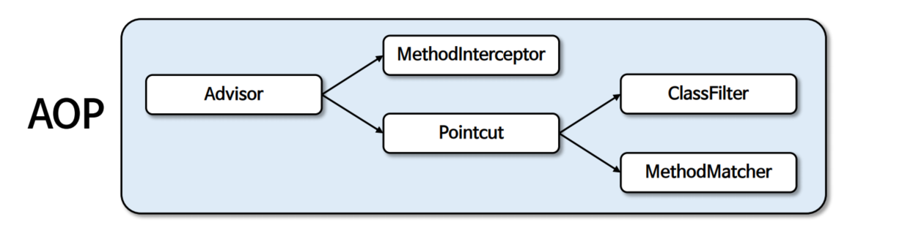
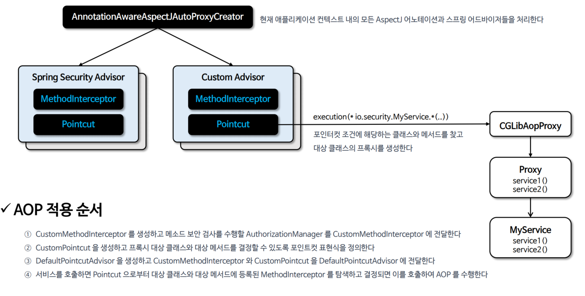
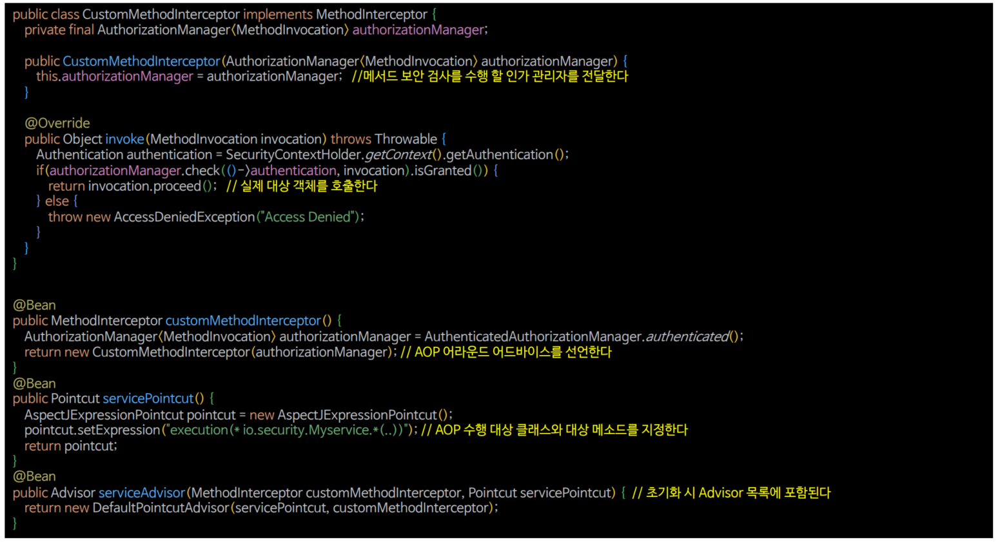

# ***개요***

- *MethodInterceptor, Pointcut, Advisor, AuthorizationManager등을 커스텀하게 생성하여 AOP 메서드 보안을 구현 할 수 있다*

# ***AOP 요소 이해***

***Advisor(Advice + Pointcut)***

- *AOP Advice 와 Advice 적용 가능성을 결정하는 포인트컷을 가진 기본 인터페이스*

***MethodInterceptor(Advice)***

- *대상 객체를 호출하기 전과 후에 추가 작업을 수행하기 위한 인터페이스로서 수행 이후 실제 대상 객체의 조인포인트 호출(메소드 호출)을 위해* *`Joinpoint.proceed()`**를 호출한다*

***Pointcut***

- *AOP 에서 Advice가 적용될 메소드나 클래스를 정의하는 것으로서 어드바이스가 실행되어야 하는 '적용 지점'이나 '조건'을 지정한다*
- *ClassFilter와 MethodMatcher를 사용해서 어떤 클래스 및 어떤 메서드에 Advice를 적용할 것인지 결정한다*



# ***AOP 초기화***



- *AnnotationAwareAspectJAutoProxyCreator → Bean Post Proceesor*

# ***구현 예제***



***CustomMethodInterceptor***

```java
@RequiredArgsConstructor
public class CustomMethodInterceptor implements MethodInterceptor {
    private final AuthorizationManager<MethodInvocation> authorizationManager;
    @Override
    public Object invoke(MethodInvocation invocation) throws Throwable {
        Authentication authentication = SecurityContextHolder.getContext().getAuthentication();
        if(authorizationManager.check(()-> authentication, invocation).isGranted()){
            return invocation.proceed(); // target or 다른 advice 호출
        }
        throw new AccessDeniedException("Access Denied");
    }
}
```

***SecurityConfig***

```java
@EnableWebSecurity
@EnableMethodSecurity(prePostEnabled = false)
@Configuration
public class SecurityConfig {
    @Bean
    public Advice customMethodInterceptor(){
        AuthorizationManager<MethodInvocation> authorizationManager = new AuthenticatedAuthorizationManager<>();
        return new CustomMethodInterceptor(authorizationManager);
    }
    @Bean
    public Pointcut pointcut(){
        AspectJExpressionPointcut pointcut = new AspectJExpressionPointcut();
        pointcut.setExpression("execution(* spring.security.DataService.*(..))");
        return pointcut;
    }
    @Bean
    public Advisor advisor(){
        DefaultPointcutAdvisor advisor = new DefaultPointcutAdvisor();
        advisor.setPointcut(pointcut());
        advisor.setAdvice(customMethodInterceptor());
        return advisor;
    }
    @Bean
    public SecurityFilterChain securityFilterChain(HttpSecurity http) throws Exception{
        http
                .authorizeHttpRequests(authorize -> authorize
                        .anyRequest().permitAll())
                .formLogin(Customizer.withDefaults())
                .csrf(AbstractHttpConfigurer::disable);
        return http.build();
    }
    @Bean
    public UserDetailsService userDetailsService(){
        UserDetails user = User.withUsername("user").password("{noop}1111").roles("USER").build();
        UserDetails db = User.withUsername("db").password("{noop}1111").authorities("ROLE_DB").build();
        UserDetails admin = User.withUsername("admin").password("{noop}1111").roles("ADMIN","SECURE").build();
        return  new InMemoryUserDetailsManager(user, db, admin);
    }
}
```

