# ***Rest 인증 사용자 정의 보안 설정***

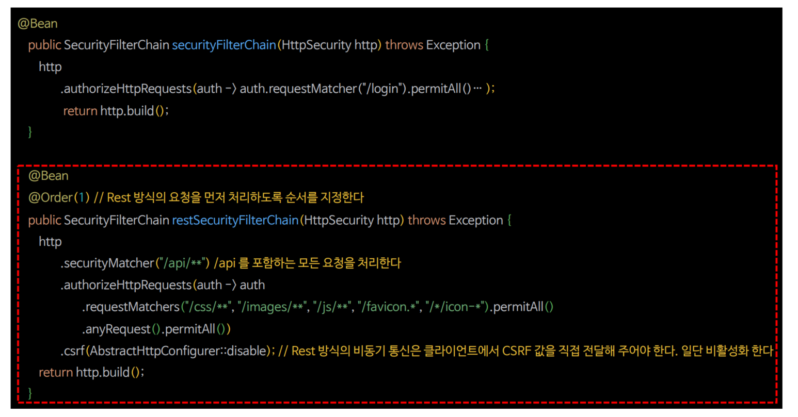

  - *@Order가 안 붙어있는 SecurityFilterChain은 FilterChainProxy 에서의 제일 후순위가 된다.*
  - *Rest 방식의 비동기 통신에서는 클라이언트에서 CSRF 토큰 값을 직접 전달해 주어야 한다. 일단 여기서는 비활성화*

# ***클라이언트 구현***

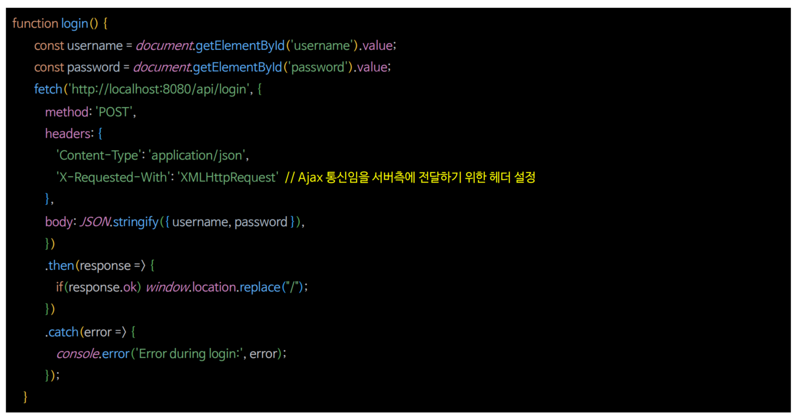

  - *'X-Requested-With': 'XMLHttpRequest'  → Ajax 통신임을 서버측에 전달하기 위한 헤더 설정* 

# ***구현***

***SecurityConfig***

```java
@EnableWebSecurity
@Configuration
@RequiredArgsConstructor
public class SecurityConfig {
    private final AuthenticationProvider authenticationProvider;
    private final AuthenticationDetailsSource authenticationDetailsSource;
    private final AuthenticationSuccessHandler successHandler;
    private final AuthenticationFailureHandler failureHandler;
    @Bean
    @Order(1)
    public SecurityFilterChain restSecurityFilterChain(HttpSecurity http) throws Exception {
        http
                .securityMatcher("/api/**")
                .authorizeHttpRequests(auth -> auth
                        .requestMatchers("/css/**", "/images/**",
                                "/js/**", "/favicon.*", "/*/icon/-*").permitAll()
                        .anyRequest().permitAll())
                .csrf(AbstractHttpConfigurer::disable);

        return http.build();
    }

    @Bean
    @Order(2)
    public SecurityFilterChain securityFilterChain(HttpSecurity http) throws Exception{
        http
                .authorizeHttpRequests(authorize -> authorize
                        .requestMatchers("/css/**", "/images/**",
                                "/js/**", "/favicon.*", "/*/icon/-*").permitAll()
                        .requestMatchers("/", "/signup", "/login*").permitAll()
                        .requestMatchers("/user").hasRole("USER")
                        .requestMatchers("/admin").hasRole("ADMIN")
                        .requestMatchers("/manager").hasRole("MANAGER")
                        .anyRequest().authenticated())
                .authenticationProvider(authenticationProvider)
                .formLogin(form -> form
                        .loginPage("/login")
                        .authenticationDetailsSource(authenticationDetailsSource)
                        .successHandler(successHandler)
                        .failureHandler(failureHandler)
                        .permitAll())
                .exceptionHandling(ex -> ex.accessDeniedHandler(
                        new FormAccessDeniedHandler("/denied")));
        return http.build();
    }
}
```

  - *`/api/...`* *경로는 @Order(1)에 해당하는 SecurityFilterChain이 처리한다.* 
  - *해당 SecurityFilterChain은 이제 비동기 통신을 위한 SecurityFilterChain*

***LoginController***

```java
@Controller
public class LoginController {
    @GetMapping(value="/login")
    public String login(@RequestParam(value = "error", required = false) String error,
                        @RequestParam(value = "exception", required = false) String exception, Model model){
        System.out.println("error = " + error);
        System.out.println("exception = " + exception);
        model.addAttribute("error", error);
        model.addAttribute("exception", exception);
        return "/login/login";
    }
    @GetMapping(value="/api/login")
    public String apiLogin(){
        return "/rest/login";
    }
    // 생략 ...
```

  - *`/api/login`* *에 매핑된 메소드는 비동기 통신으로 로그인을 처리하기 위한 view를 반환한다.*

***RestLoginController***

```java
@RestController
public class RestLoginController {
    @PostMapping("/api/login")
    public String restLogin(){
        return "restLogin";
    }
}
```

  - *비동기 통신으로 로그인을 처리하기 위한 api 이다.* 
  - *아직 비동기 통신을 구현하지 않았다.* 

***/api/login.html 일부***

```java
<script>
    function login() {
        const username = document.getElementById('username').value;
        const password = [REDACTED];

        fetch('http://localhost:8080/api/login', {
            method: 'POST',
            headers: {
                'Content-Type': 'application/json',
                'X-Requested-With': 'XMLHttpRequest'
            },
            body: JSON.stringify({ username, password }),
        })
            .then(response => {
                if(response.ok){
                    window.location.replace("/");
                    console.log(data);
                }
            })
            .catch(error => {
                console.error('Error during login:', error);
            });
    }
</script>


<div class="login-form">
    <h2>Login</h2>
    <div th:if="${param.error}" class="form-group">
        <span th:text="${exception} ?: '잘못된 아이디나 암호입니다'" class="alert alert-danger"></span>
    </div>
    <div class="form-group">
        <label for="username">Username</label>
        <input type="text" class="form-control" id="username" required>
    </div>
    <div class="form-group">
        <label for="password">Password</label>
        <input type="password" class="form-control" id="password" required>
    </div>
    <button onclick="login()" class="btn btn-primary">Login</button>
</div>
```

# ***스프링 시큐리티 필터 설정***

  - *스프링 시큐리티는 HttpSecurity 설정을 통해 애플리케이션의 보안 요구사항에 맞게 필터 체인을 추가 할 수 있도록 제공한다.* 
  - *필터 추가는 addFilterBefore, addFilterAfter, addFilter, addFilterAt 메소드를 사용하여 필터의 순서와 위치를 제어할 수 있다.* 

# ***스프링 시큐리티 필터 추가***

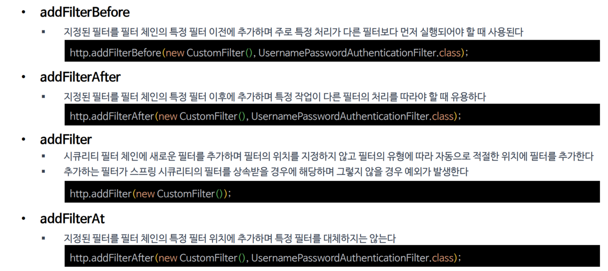

# ***필터 설정***

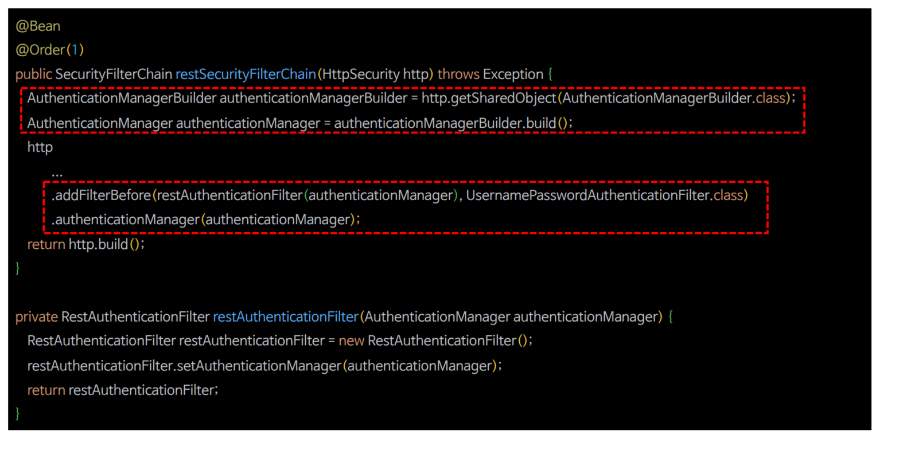

# ***필터 구현***

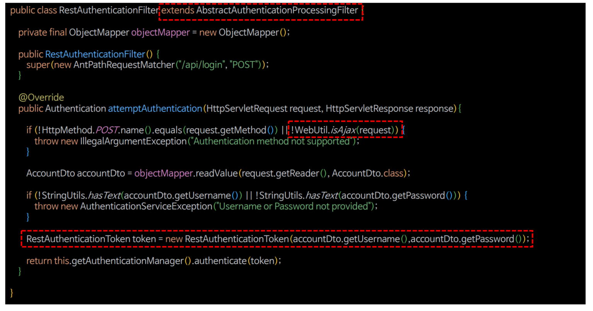

  - *UsernamePasswordAuthenticationFilter 또한 AbstractAuthenticationProcessingFilter를 상속해서 구현한다.*
  - *인증 처리에 필요한 공통 기능이 이미 많이 있다.* 
  - *생성자를 보면 부모 생성자에 new AntPathRequestMatcher(”/api/login”, POST) 넘기고 있는데*
*해당 경로와 해당 HTTP 메소드에만 RestAuthenticationFilter를 동작시키겠다는 의미이다.*

```java
if (!HttpMethod.POST.name().equals(request.getMethod()) || !WebUtil.isAjax(request)) {
		throw new IllegalArgumentException("Authentication method not supported");
}
```

  - *HTTP 메소드가 POST가 아니거나 Ajax 비동기 통신이 아니면 해당 필터를 사용하지 않겠다는 뜻이다. (예외를 던진다.)*
  - *WebUtil.isAjax(request)에서는 요청 헤더에* *`'X-Requested-With': 'XMLHttpRequest'`* *존재하는지 파악한다.* 

# ***구현*** 

***WebUtil***

```java
public class WebUtil {
    private static final String XML_HTTP_REQUEST = "XMLHttpRequest";
    private static final String X_REQUESTED_WITH = "X-Requested-With";
    private static final String CONTENT_TYPE = "Content-type";
    private static final String CONTENT_TYPE_JSON = "application/json";
    public static boolean isAjax(HttpServletRequest request) {
        return XML_HTTP_REQUEST.equals(request.getHeader(X_REQUESTED_WITH));
    }
    public static boolean isContentTypeJson(HttpServletRequest request) {
        return request.getHeader(CONTENT_TYPE).contains(CONTENT_TYPE_JSON);
    }
}
```

  - *Header: X_REQUESTED_WITH Value: XML_HTTP_REQUEST* 
  - *isAjax → request* *`"XMLHttpRequest"`* *헤더 존재 여부와 있으면* *`"X-Requested-With"`*  *value 체크를 한다.*

***RestAuthenticationToken***

```java
public class RestAuthenticationToken extends AbstractAuthenticationToken {
    private final Object principal;
    private final Object credentials;
    public RestAuthenticationToken(Collection<? extends GrantedAuthority> authorities, Object principal, Object credentials) {
        super(authorities);
        this.principal = principal;
        this.credentials = credentials;
        setAuthenticated(true);
    }
    public RestAuthenticationToken(Object principal, Object credentials){
        super(null);
        this.principal = principal;
        this.credentials = credentials;
        setAuthenticated(false);
    }
    @Override
    public Object getCredentials() {
        return this.credentials;
    }
    @Override
    public Object getPrincipal() {
        return this.principal;
    }
}
```

  - *UsernamePasswordAuthenticationToken과 같은 역할이다.* 

***RestAuthenticationFilter*** 

```java
public class RestAuthenticationFilter extends AbstractAuthenticationProcessingFilter {
    private final ObjectMapper objectMapper = new ObjectMapper();
    public RestAuthenticationFilter() {
        super(new AntPathRequestMatcher("/api/login", "POST"));
    }
    @Override
    public Authentication attemptAuthentication(HttpServletRequest request, HttpServletResponse response) throws AuthenticationException, IOException, ServletException {

        if(!HttpMethod.POST.matches(request.getMethod()) || !WebUtil.isAjax(request)){
            throw new IllegalArgumentException("Authentication method not supported");
        }

        AccountDto accountDto = objectMapper.readValue(request.getReader(), AccountDto.class);
        if(!StringUtils.hasText(accountDto.getUsername()) || !StringUtils.hasText(accountDto.getPassword())){
            throw new AuthenticationServiceException("Username or Password is not provided");
        }

        RestAuthenticationToken authenticationToken = [REDACTED] RestAuthenticationToken(accountDto.getUsername(), accountDto.getPassword());
        return getAuthenticationManager().authenticate(authenticationToken);
    }
}
```

***SecurityFilterChain***

```java
@EnableWebSecurity
@Configuration
@RequiredArgsConstructor
public class SecurityConfig {
    private final AuthenticationProvider authenticationProvider;
    private final AuthenticationDetailsSource authenticationDetailsSource;
    private final AuthenticationSuccessHandler successHandler;
    private final AuthenticationFailureHandler failureHandler;
    @Bean
    @Order(1)
    public SecurityFilterChain restSecurityFilterChain(HttpSecurity http) throws Exception {

        AuthenticationManagerBuilder authenticationManagerBuilder =
                http.getSharedObject(AuthenticationManagerBuilder.class);

        AuthenticationManager authenticationManager = authenticationManagerBuilder.build();
        http
                .securityMatcher("/api/**")
                .authorizeHttpRequests(auth -> auth
                        .requestMatchers("/css/**", "/images/**",
                                "/js/**", "/favicon.*", "/*/icon/-*").permitAll()
                        .anyRequest().permitAll())
                .csrf(AbstractHttpConfigurer::disable)
                .addFilterBefore(
                        restAuthenticationFilter(authenticationManager),
                        UsernamePasswordAuthenticationFilter.class)
                .authenticationManager(authenticationManager);

        return http.build();
    }
    private RestAuthenticationFilter restAuthenticationFilter(AuthenticationManager authenticationManager) {
        RestAuthenticationFilter restAuthenticationFilter = new RestAuthenticationFilter();
        restAuthenticationFilter.setAuthenticationManager(authenticationManager);
        return restAuthenticationFilter;
    }
    @Bean
    @Order(2)
    public SecurityFilterChain securityFilterChain(HttpSecurity http) throws Exception{
        http
                .authorizeHttpRequests(authorize -> authorize
                        .requestMatchers("/css/**", "/images/**",
                                "/js/**", "/favicon.*", "/*/icon/-*").permitAll()
                        .requestMatchers("/", "/signup", "/login*").permitAll()
                        .requestMatchers("/user").hasRole("USER")
                        .requestMatchers("/admin").hasRole("ADMIN")
                        .requestMatchers("/manager").hasRole("MANAGER")
                        .anyRequest().authenticated())
                .authenticationProvider(authenticationProvider)
                .formLogin(form -> form
                        .loginPage("/login")
                        .authenticationDetailsSource(authenticationDetailsSource)
                        .successHandler(successHandler)
                        .failureHandler(failureHandler)
                        .permitAll())
                .exceptionHandling(ex -> ex.accessDeniedHandler(
                        new FormAccessDeniedHandler("/denied")));
        return http.build();
    }
}

```

  - *현재 설정에서는 AuthenticationManager가 수행할 수 있는 AuthenticationProvider가 존재하지 않는다.* 
  - *Form 방식 Provider는 UsernamePasswordAuthenticationToken만 지원하고 익명 사용자를 위한 Provider는 AnonymousAuthenticaionToken만 지원한다.* 
  - *즉, RestAuthenticationToken 처리가 가능한 Provider가 존재하지 않는다.*
  - *이번 파트에서는 Filter 구현과 설정에 집중하고 다음 파트에서 Provider를 직접 구현하여 인증 처리를 할 수 있도록 하겠다.*

***중요!***

*`.authenticationManager(authenticationManager);`* *restSecurityFilterChain 메소드를 보면 HttpSecurity에 AuthenticationManger 설정을 해주고 있다.*

*만약 하지 않으면 AuthenticationManager를 중복으로 생성하기 때문에 에러가 발생한다.*

# ***RestAuthenticationProvider 구현***

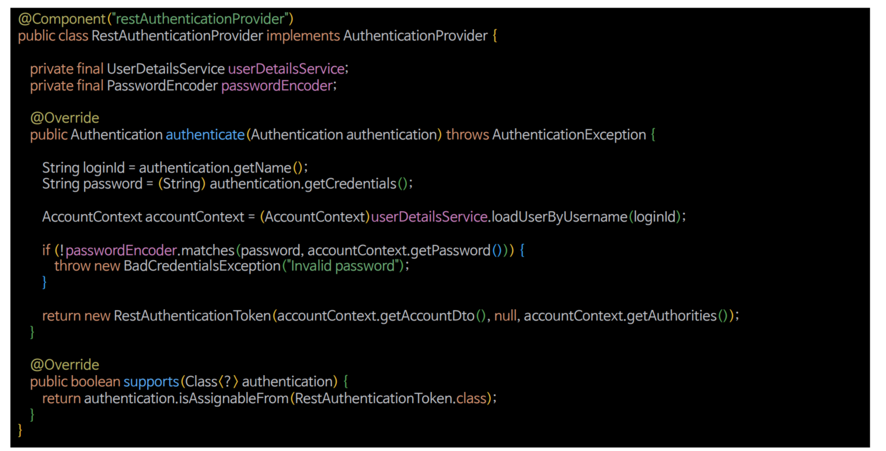

# ***RestAuthenticationProvider 설정***

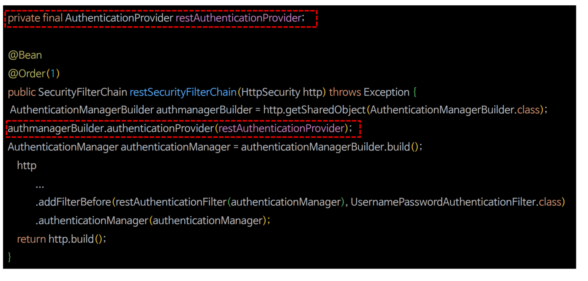

# *구현*

***RestAuthenticationProvider***

```java
@Component("restAuthenticationProvider")
@RequiredArgsConstructor
public class RestAuthenticationProvider implements AuthenticationProvider {
    private final PasswordEncoder passwordEncoder;
    private final UserDetailsService userDetailsService;
    @Override
    public Authentication authenticate(Authentication authentication) throws AuthenticationException {
        String username = authentication.getName();
        String password = [REDACTED] authentication.getCredentials();

        AccountContext accountContext = (AccountContext) userDetailsService.loadUserByUsername(username);

        if(!passwordEncoder.matches(password, accountContext.getPassword())){
            throw new BadCredentialsException("Invalid password");
        }

        return new RestAuthenticationToken(accountContext.getAuthorities(), accountContext.getAccountDto(), null);
    }
    @Override
    public boolean supports(Class<?> authentication) {
        return authentication.isAssignableFrom(RestAuthenticationToken.class);
    }
}
```

***SecurityConfig*** 

```java
@EnableWebSecurity
@Configuration
@RequiredArgsConstructor
public class SecurityConfig {
    private final AuthenticationProvider authenticationProvider;
    private final AuthenticationProvider restAuthenticationProvider;
    private final AuthenticationDetailsSource authenticationDetailsSource;
    private final AuthenticationSuccessHandler successHandler;
    private final AuthenticationFailureHandler failureHandler;
    @Bean
    @Order(1)
    public SecurityFilterChain restSecurityFilterChain(HttpSecurity http) throws Exception {

        AuthenticationManagerBuilder authenticationManagerBuilder =
                http.getSharedObject(AuthenticationManagerBuilder.class);

        authenticationManagerBuilder.authenticationProvider(restAuthenticationProvider);

        AuthenticationManager authenticationManager = authenticationManagerBuilder.build();
        http
                .securityMatcher("/api/**")
                .authorizeHttpRequests(auth -> auth
                        .requestMatchers("/css/**", "/images/**",
                                "/js/**", "/favicon.*", "/*/icon/-*").permitAll()
                        .anyRequest().permitAll())
                .csrf(AbstractHttpConfigurer::disable)
                .addFilterBefore(
                        restAuthenticationFilter(authenticationManager),
                        UsernamePasswordAuthenticationFilter.class)
                .authenticationManager(authenticationManager);

        return http.build();
    }
    private RestAuthenticationFilter restAuthenticationFilter(AuthenticationManager authenticationManager) {
        RestAuthenticationFilter restAuthenticationFilter = new RestAuthenticationFilter();
        restAuthenticationFilter.setAuthenticationManager(authenticationManager);
        return restAuthenticationFilter;
    }
    @Bean
    @Order(2)
    public SecurityFilterChain securityFilterChain(HttpSecurity http) throws Exception{
        http
                .authorizeHttpRequests(authorize -> authorize
                        .requestMatchers("/css/**", "/images/**",
                                "/js/**", "/favicon.*", "/*/icon/-*").permitAll()
                        .requestMatchers("/", "/signup", "/login*").permitAll()
                        .requestMatchers("/user").hasRole("USER")
                        .requestMatchers("/admin").hasRole("ADMIN")
                        .requestMatchers("/manager").hasRole("MANAGER")
                        .anyRequest().authenticated())
                .authenticationProvider(authenticationProvider)
                .formLogin(form -> form
                        .loginPage("/login")
                        .authenticationDetailsSource(authenticationDetailsSource)
                        .successHandler(successHandler)
                        .failureHandler(failureHandler)
                        .permitAll())
                .exceptionHandling(ex -> ex.accessDeniedHandler(
                        new FormAccessDeniedHandler("/denied")));
        return http.build();
    }
}
```

# ***필터 설정***

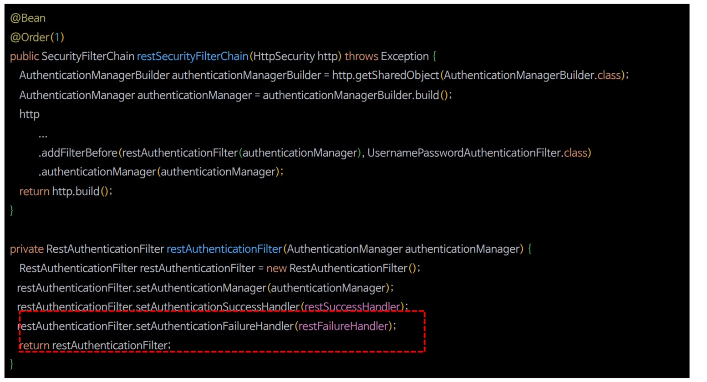

# ***RestAuthenticationSuccessHandler 구현***

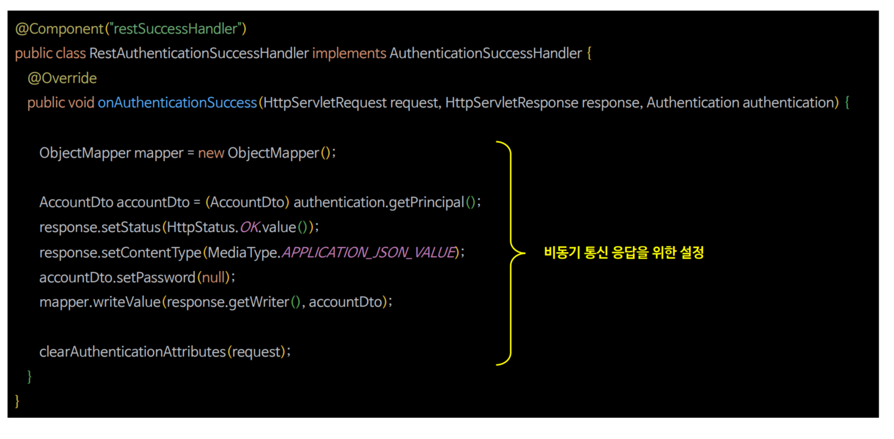

# ***RestAuthenticationFailureHandler 구현***

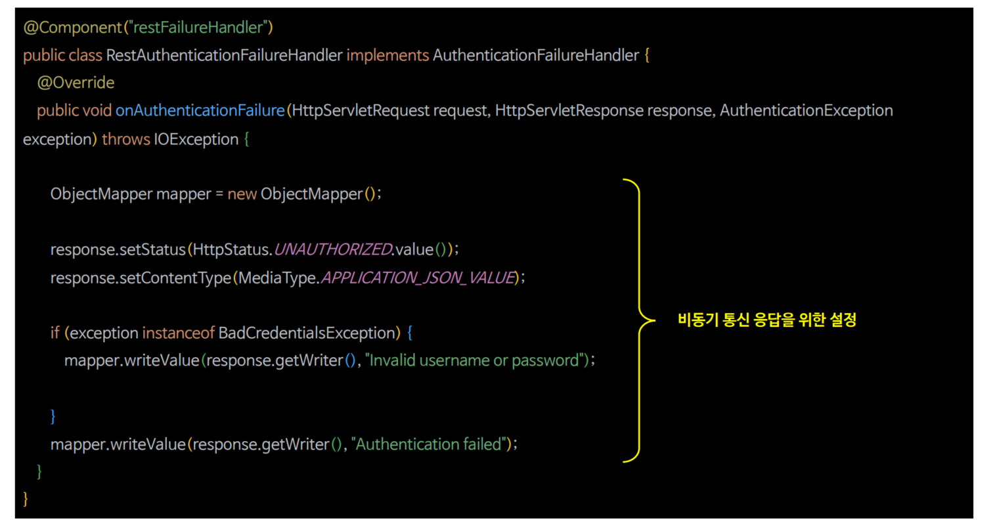

# *구현* 

***RestAuthenticationSuccessHandler***

```java
@Component("restSuccessHandler")
public class RestAuthenticationSuccessHandler implements AuthenticationSuccessHandler {
    @Override
    public void onAuthenticationSuccess(HttpServletRequest request, HttpServletResponse response, Authentication authentication) throws IOException, ServletException {
        ObjectMapper mapper = new ObjectMapper();

        AccountDto principal = (AccountDto) authentication.getPrincipal();
        principal.setPassword(null);

        response.setContentType(MediaType.APPLICATION_JSON_VALUE);
        response.setStatus(HttpStatus.OK.value());

        mapper.writeValue(response.getWriter(),principal);

        clearAuthenticationAttributes(request);
    }
    private void clearAuthenticationAttributes(HttpServletRequest request) {
        HttpSession session = request.getSession(false);
        if(session == null) return;
        session.removeAttribute(WebAttributes.AUTHENTICATION_EXCEPTION);
    }
}
```

***RestAuthenticationFailureHandler*** 

```java
@Component("restAuthenticationFailureHandler")
public class RestAuthenticationFailureHandler implements AuthenticationFailureHandler {
    @Override
    public void onAuthenticationFailure(HttpServletRequest request, HttpServletResponse response, AuthenticationException exception) throws IOException, ServletException {
        ObjectMapper mapper = new ObjectMapper();

        response.setStatus(HttpStatus.UNAUTHORIZED.value()); // 인증 실패 401 / 권한 부족 403
        response.setContentType(MediaType.APPLICATION_JSON_VALUE);

        if(exception instanceof BadCredentialsException){
            mapper.writeValue(response.getWriter(), "Invalid username or password");
            return;
        }

        mapper.writeValue(response.getWriter(), "Authentication failed");
    }
}
```

***SecurityConfig***

```java
@EnableWebSecurity
@Configuration
@RequiredArgsConstructor
public class SecurityConfig {
    private final AuthenticationProvider authenticationProvider;
    private final AuthenticationProvider restAuthenticationProvider;
    private final AuthenticationDetailsSource authenticationDetailsSource;
    private final FormAuthenticationSuccessHandler successHandler;
    private final RestAuthenticationSuccessHandler restSuccessHandler;
    private final FormAuthenticationFailureHandler failureHandler;
    private final RestAuthenticationFailureHandler restFailureHandler;
    @Bean
    @Order(1)
    public SecurityFilterChain restSecurityFilterChain(HttpSecurity http) throws Exception {

        AuthenticationManagerBuilder authenticationManagerBuilder =
                http.getSharedObject(AuthenticationManagerBuilder.class);

        authenticationManagerBuilder.authenticationProvider(restAuthenticationProvider);

        AuthenticationManager authenticationManager = authenticationManagerBuilder.build();
        http
                .securityMatcher("/api/**")
                .authorizeHttpRequests(auth -> auth
                        .requestMatchers("/css/**", "/images/**",
                                "/js/**", "/favicon.*", "/*/icon/-*").permitAll()
                        .anyRequest().permitAll())
                .csrf(AbstractHttpConfigurer::disable)
                .addFilterBefore(
                        restAuthenticationFilter(authenticationManager),
                        UsernamePasswordAuthenticationFilter.class)
                .authenticationManager(authenticationManager);

        return http.build();
    }
    private RestAuthenticationFilter restAuthenticationFilter(AuthenticationManager authenticationManager) {
        RestAuthenticationFilter restAuthenticationFilter = new RestAuthenticationFilter();
        restAuthenticationFilter.setAuthenticationManager(authenticationManager);
        restAuthenticationFilter.setAuthenticationSuccessHandler(restSuccessHandler);
        restAuthenticationFilter.setAuthenticationFailureHandler(restFailureHandler);
        return restAuthenticationFilter;
    }
    @Bean
    @Order(2)
    public SecurityFilterChain securityFilterChain(HttpSecurity http) throws Exception{
        http
                .authorizeHttpRequests(authorize -> authorize
                        .requestMatchers("/css/**", "/images/**",
                                "/js/**", "/favicon.*", "/*/icon/-*").permitAll()
                        .requestMatchers("/", "/signup", "/login*").permitAll()
                        .requestMatchers("/user").hasRole("USER")
                        .requestMatchers("/admin").hasRole("ADMIN")
                        .requestMatchers("/manager").hasRole("MANAGER")
                        .anyRequest().authenticated())
                .authenticationProvider(authenticationProvider)
                .formLogin(form -> form
                        .loginPage("/login")
                        .authenticationDetailsSource(authenticationDetailsSource)
                        .successHandler(successHandler)
                        .failureHandler(failureHandler)
                        .permitAll())
                .exceptionHandling(ex -> ex.accessDeniedHandler(
                        new FormAccessDeniedHandler("/denied")));
        return http.build();
    }
}
```

# *인증 성공 이후 작업*

  1. *인증 객체를 Thread Local에 저장해서 요청 스코프 전체에서 SecurityContextHolder 통해 가져올 수 있게 한다.*
  1. *인증 객체를 세션에 저장(영속화)해서 다음 요청에 대한 인증처리를 하지 않게 해준다.*

# *SecurityContextRepository 설정* 

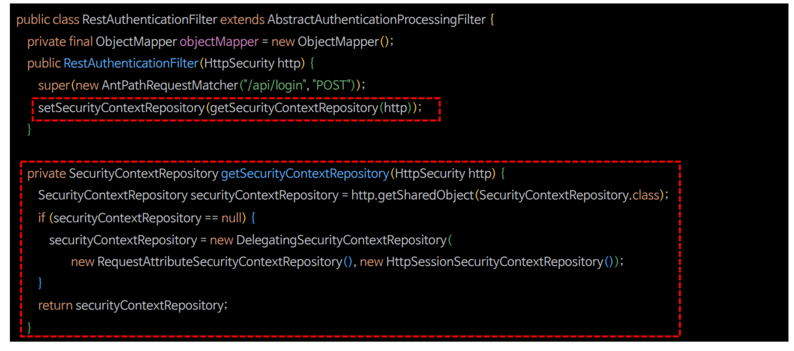

  - *인증 필터에서 인증에 성공한 이후 인증 객체를 세션에 저장할 수 있도록* ***HttpSessionSecurityContextRepository****를 지정 한다*
  - ***AbstractAuthenticationProcessingFilter****를 상속하면* ***RequestAttributesSecurityContextRepository****가 기본으로 설정 된다*

***AbstractAuthenticationProcessingFilter 인증 성공 이후 처리 로직*** 

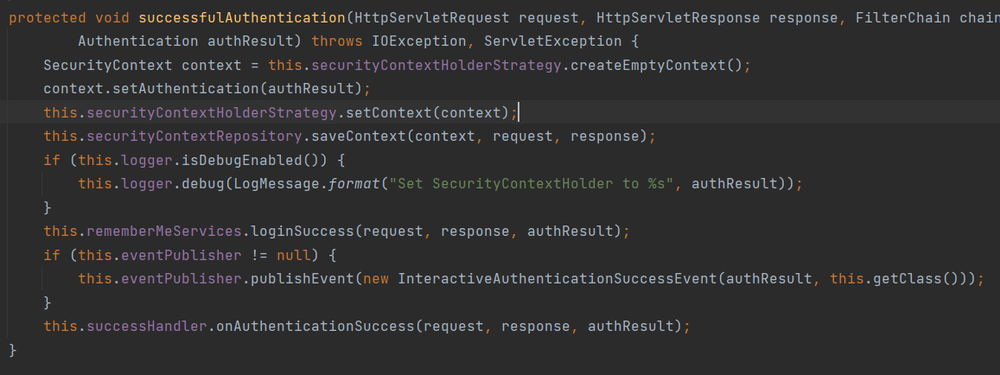

[SecurityContextRepository / SecurityContextHolderFilter](https://app.notion.com/p/26b7d6692ca881459116c46b8082cca7) 

# *구현*

***SecurityConfig***

```java
@EnableWebSecurity
@Configuration
@RequiredArgsConstructor
public class SecurityConfig {
    private final AuthenticationProvider authenticationProvider;
    private final AuthenticationProvider restAuthenticationProvider;
    private final AuthenticationDetailsSource authenticationDetailsSource;
    private final FormAuthenticationSuccessHandler successHandler;
    private final RestAuthenticationSuccessHandler restSuccessHandler;
    private final FormAuthenticationFailureHandler failureHandler;
    private final RestAuthenticationFailureHandler restFailureHandler;
    @Bean
    @Order(1)
    public SecurityFilterChain restSecurityFilterChain(HttpSecurity http) throws Exception {

        AuthenticationManagerBuilder authenticationManagerBuilder =
                http.getSharedObject(AuthenticationManagerBuilder.class);

        authenticationManagerBuilder.authenticationProvider(restAuthenticationProvider);

        AuthenticationManager authenticationManager = authenticationManagerBuilder.build();
        http
                .securityMatcher("/api/**")
                .authorizeHttpRequests(auth -> auth
                        .requestMatchers("/css/**", "/images/**",
                                "/js/**", "/favicon.*", "/*/icon/-*").permitAll()
                        .anyRequest().permitAll())
                .csrf(AbstractHttpConfigurer::disable)
                .addFilterBefore(
                        restAuthenticationFilter(http, authenticationManager),
                        UsernamePasswordAuthenticationFilter.class)
                .authenticationManager(authenticationManager);

        return http.build();
    }
    private RestAuthenticationFilter restAuthenticationFilter(HttpSecurity http, AuthenticationManager authenticationManager) {
        RestAuthenticationFilter restAuthenticationFilter = new RestAuthenticationFilter(http);
        restAuthenticationFilter.setAuthenticationManager(authenticationManager);
        restAuthenticationFilter.setAuthenticationSuccessHandler(restSuccessHandler);
        restAuthenticationFilter.setAuthenticationFailureHandler(restFailureHandler);
        return restAuthenticationFilter;
    }
    @Bean
    @Order(2)
    public SecurityFilterChain securityFilterChain(HttpSecurity http) throws Exception{
        http
                .authorizeHttpRequests(authorize -> authorize
                        .requestMatchers("/css/**", "/images/**",
                                "/js/**", "/favicon.*", "/*/icon/-*").permitAll()
                        .requestMatchers("/", "/signup", "/login*").permitAll()
                        .requestMatchers("/user").hasRole("USER")
                        .requestMatchers("/admin").hasRole("ADMIN")
                        .requestMatchers("/manager").hasRole("MANAGER")
                        .anyRequest().authenticated())
                .authenticationProvider(authenticationProvider)
                .formLogin(form -> form
                        .loginPage("/login")
                        .authenticationDetailsSource(authenticationDetailsSource)
                        .successHandler(successHandler)
                        .failureHandler(failureHandler)
                        .permitAll())
                .exceptionHandling(ex -> ex.accessDeniedHandler(
                        new FormAccessDeniedHandler("/denied")));
        return http.build();
    }
}
```

***RestAuthenticationFilter***

```java
public class RestAuthenticationFilter extends AbstractAuthenticationProcessingFilter {
    private final ObjectMapper objectMapper = new ObjectMapper();
    public RestAuthenticationFilter(HttpSecurity http) {
        super(new AntPathRequestMatcher("/api/login", "POST"));
        setSecurityContextRepository(getSecurityContextRepository(http));
    }
    private SecurityContextRepository getSecurityContextRepository(HttpSecurity http) {
        SecurityContextRepository securityContextRepository = http.getSharedObject(SecurityContextRepository.class);
        if(securityContextRepository == null || securityContextRepository instanceof RequestAttributeSecurityContextRepository){
           return new DelegatingSecurityContextRepository(
                    new RequestAttributeSecurityContextRepository(), new HttpSessionSecurityContextRepository());
        }
        return securityContextRepository;
    }
    @Override
    public Authentication attemptAuthentication(HttpServletRequest request, HttpServletResponse response) throws AuthenticationException, IOException, ServletException {

        if(!HttpMethod.POST.matches(request.getMethod()) || !WebUtil.isAjax(request)){
            throw new IllegalArgumentException("Authentication method not supported");
        }

        AccountDto accountDto = objectMapper.readValue(request.getReader(), AccountDto.class);
        if(!StringUtils.hasText(accountDto.getUsername()) || !StringUtils.hasText(accountDto.getPassword())){
            throw new AuthenticationServiceException("Username or Password is not provided");
        }

        RestAuthenticationToken authenticationToken = [REDACTED] RestAuthenticationToken(accountDto.getUsername(), accountDto.getPassword());
        return getAuthenticationManager().authenticate(authenticationToken);
    }
}
```

# *개요*

  - *AuthenticationEntryPoint: 인증을 받지 않고 접근을 거부 당했을 때 동작 (401)*
*login page 이동*
  - *AccessDeniedHandler: 인증을 받았지만 권한이 부족할 때 (403)
Denied Page 이동*

# *RestAuthenticationEntryPoint / RestAccessDeniedHandler 설정*

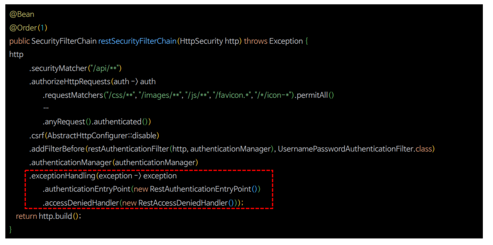

# ***RestAuthenticationEntryPoint 구현***

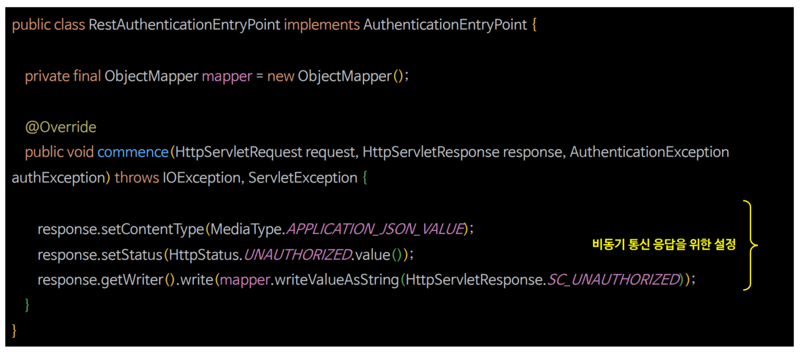

# ***RestAccessDeniedHandler 구현***

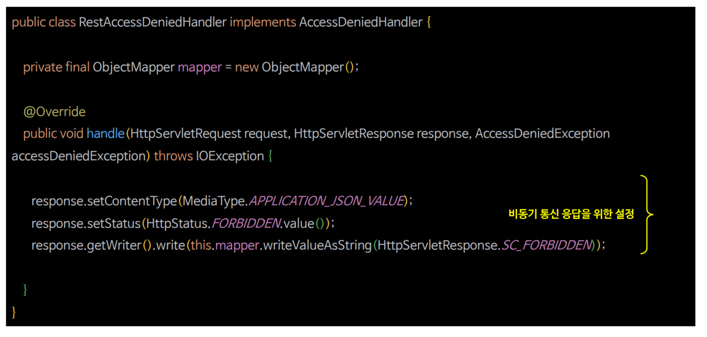

# ***login.html 구현***

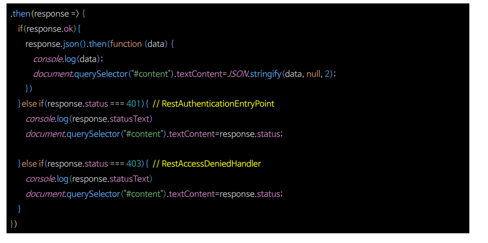

# ***구현***

***RestAuthenticationEntryPoint***

```java
public class RestAuthenticationEntryPoint implements AuthenticationEntryPoint {
    private final ObjectMapper mapper = new ObjectMapper();
    @Override
    public void commence(HttpServletRequest request, HttpServletResponse response, AuthenticationException authException) throws IOException, ServletException {
        response.setStatus(HttpStatus.UNAUTHORIZED.value());
        response.setContentType(MediaType.APPLICATION_JSON_VALUE);
        response.getWriter().write(mapper.writeValueAsString(HttpServletResponse.SC_UNAUTHORIZED));
    }
}
```

***RestAccessDeniedHandler***

```java
public class RestAccessDeniedHandler implements AccessDeniedHandler {
    private final ObjectMapper mapper = new ObjectMapper();
    @Override
    public void handle(HttpServletRequest request, HttpServletResponse response, AccessDeniedException accessDeniedException) throws IOException, ServletException {
        response.setStatus(HttpStatus.FORBIDDEN.value());
        response.setContentType(MediaType.APPLICATION_JSON_VALUE);
        response.getWriter().write(mapper.writeValueAsString(HttpServletResponse.SC_FORBIDDEN));
    }
}
```

***SecurityConfig***

```java
@EnableWebSecurity
@Configuration
@RequiredArgsConstructor
public class SecurityConfig {
    private final AuthenticationProvider authenticationProvider;
    private final AuthenticationProvider restAuthenticationProvider;
    private final AuthenticationDetailsSource authenticationDetailsSource;
    private final FormAuthenticationSuccessHandler successHandler;
    private final RestAuthenticationSuccessHandler restSuccessHandler;
    private final FormAuthenticationFailureHandler failureHandler;
    private final RestAuthenticationFailureHandler restFailureHandler;
    @Bean
    @Order(1)
    public SecurityFilterChain restSecurityFilterChain(HttpSecurity http) throws Exception {

        AuthenticationManagerBuilder authenticationManagerBuilder =
                http.getSharedObject(AuthenticationManagerBuilder.class);

        authenticationManagerBuilder.authenticationProvider(restAuthenticationProvider);

        AuthenticationManager authenticationManager = authenticationManagerBuilder.build();
        http
                .securityMatcher("/api/**")
                .authorizeHttpRequests(auth -> auth
                        .requestMatchers("/css/**", "/images/**",
                                "/js/**", "/favicon.*", "/*/icon/-*").permitAll()
                        .requestMatchers("/api", "/api/login").permitAll()
                        .requestMatchers("/api/user").hasAuthority("ROLE_USER")
                        .requestMatchers("/api/manager").hasAuthority("ROLE_MANAGER")
                        .requestMatchers("/api/admin").hasAuthority("ROLE_ADMIN")
                        .anyRequest().permitAll())
                .csrf(AbstractHttpConfigurer::disable)
                .addFilterBefore(
                        restAuthenticationFilter(http, authenticationManager),
                        UsernamePasswordAuthenticationFilter.class)
                .authenticationManager(authenticationManager)
                .exceptionHandling(exception -> exception
                        .authenticationEntryPoint(new RestAuthenticationEntryPoint())
                        .accessDeniedHandler(new RestAccessDeniedHandler()));

        return http.build();
    }
    private RestAuthenticationFilter restAuthenticationFilter(HttpSecurity http, AuthenticationManager authenticationManager) {
        RestAuthenticationFilter restAuthenticationFilter = new RestAuthenticationFilter(http);
        restAuthenticationFilter.setAuthenticationManager(authenticationManager);
        restAuthenticationFilter.setAuthenticationSuccessHandler(restSuccessHandler);
        restAuthenticationFilter.setAuthenticationFailureHandler(restFailureHandler);
        return restAuthenticationFilter;
    }
    @Bean
    @Order(2)
    public SecurityFilterChain securityFilterChain(HttpSecurity http) throws Exception{
        http
                .authorizeHttpRequests(authorize -> authorize
                        .requestMatchers("/css/**", "/images/**",
                                "/js/**", "/favicon.*", "/*/icon/-*").permitAll()
                        .requestMatchers("/", "/signup", "/login*").permitAll()
                        .requestMatchers("/user").hasRole("USER")
                        .requestMatchers("/admin").hasRole("ADMIN")
                        .requestMatchers("/manager").hasRole("MANAGER")
                        .anyRequest().authenticated())
                .authenticationProvider(authenticationProvider)
                .formLogin(form -> form
                        .loginPage("/login")
                        .authenticationDetailsSource(authenticationDetailsSource)
                        .successHandler(successHandler)
                        .failureHandler(failureHandler)
                        .permitAll())
                .exceptionHandling(ex -> ex.accessDeniedHandler(
                        new FormAccessDeniedHandler("/denied")));
        return http.build();
    }
}

```

  - *exceptionHandling: entryPoint, accessDeniedHandler 추가*

***HomeController - @Controller***

```java
@GetMapping(value = "/api")
public String restDashboard(){
    return "/rest/dashboard";
}
```

  - *view 랜더링*

***/rest/dashboard.html 일부*** 

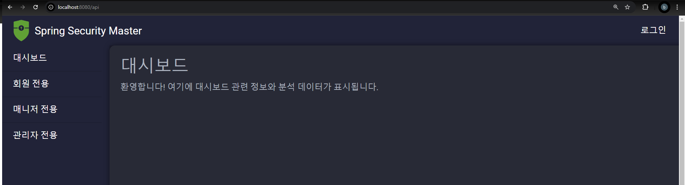

```html
<script>
function restCall(url) {

  fetch(url, {
    method: 'GET',
    headers: {
      'Content-Type': 'application/json',
      'X-Requested-With': 'XMLHttpRequest'
    }
  })
          .then(response => {
            if(response.ok){
              response.json().then(function (data) {
                console.log(data);
                document.querySelector("#content").textContent=JSON.stringify(data, null, 2);
              })
            }else if(response.status === 401){
              console.log(response.statusText)
              document.querySelector("#content").textContent=response.status;
            }else if(response.status === 403){
              console.log(response.statusText)
              document.querySelector("#content").textContent=response.status;
            }
          })
          .catch(error => {
            console.error('Error during login:', error);
          });
}
</script>
<body>
<div th:replace="~{rest/layout/header::header}"></div>
<div class="container-fluid">
  <div class="row">
    <div class="col-md-2 sidebar">
      <div th:replace="~{rest/layout/sidebar::sidebar}"></div>
    </div>
    <div class="col-md-10 content">
      <div>
        <h2>대시보드</h2>
        <p id="content">환영합니다! 여기에 대시보드 관련 정보와 분석 데이터가 표시됩니다.</p>
      </div>
    </div>
  </div>
</div>
<div class="footer" th:replace="~{layout/footer::footer}"></div>
</body>
```

  - *header: 익명 사용자, 인증 사용자에 따라 다르게 로그아웃, 로그인 버튼을 보여준다.*
  - *sidebar: /api/user, /api/manager, /api/admin 경로 버튼 존재*

# ***로그아웃 구현***

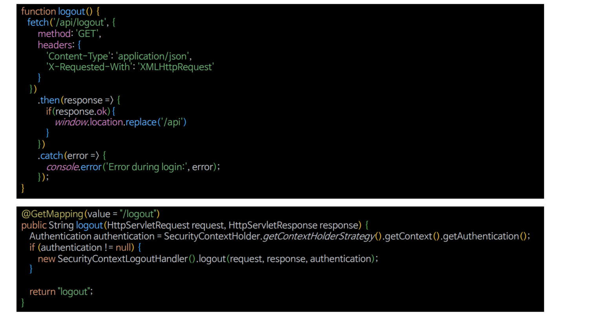

# ***구현***

```java
@GetMapping("/logout")
public String logout(HttpServletRequest request, HttpServletResponse response){
    Authentication authentication = SecurityContextHolder.getContextHolderStrategy().getContext().getAuthentication();
    if(authentication != null){
        new SecurityContextLogoutHandler().logout(request, response, authentication);
    }
    return "logout";
}
```

# ***클라이언트 CSRF 구현***

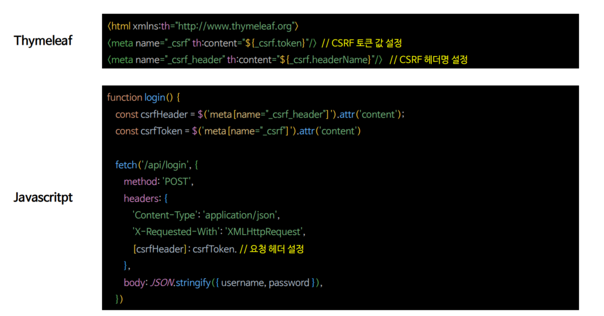

# ***Rest DSLs 설정***

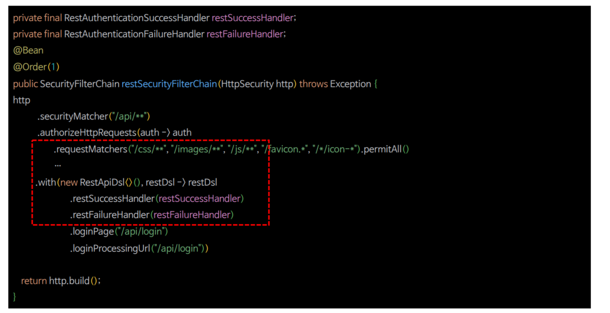

# ***Rest DSLs 구현***

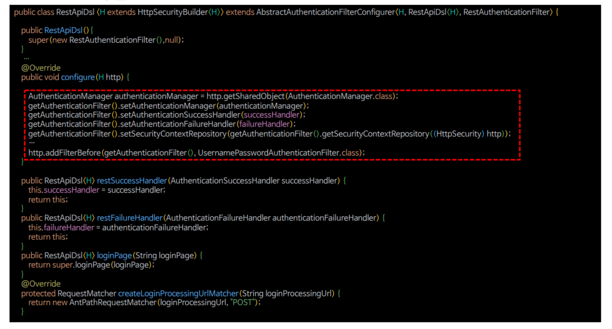

# *구현*

***RestAuthenticationFilter***

```java
public class RestAuthenticationFilter extends AbstractAuthenticationProcessingFilter {
    private final ObjectMapper objectMapper = new ObjectMapper();
    public RestAuthenticationFilter() {
        super(new AntPathRequestMatcher("/api/login", "POST"));
    }
    public SecurityContextRepository getSecurityContextRepository(HttpSecurity http) {
        SecurityContextRepository securityContextRepository = http.getSharedObject(SecurityContextRepository.class);
        if(securityContextRepository == null || securityContextRepository instanceof RequestAttributeSecurityContextRepository){
           return new DelegatingSecurityContextRepository(
                    new RequestAttributeSecurityContextRepository(), new HttpSessionSecurityContextRepository());
        }
        return securityContextRepository;
    }
    @Override
    public Authentication attemptAuthentication(HttpServletRequest request, HttpServletResponse response) throws AuthenticationException, IOException, ServletException {

        if(!HttpMethod.POST.matches(request.getMethod()) || !WebUtil.isAjax(request)){
            throw new IllegalArgumentException("Authentication method not supported");
        }

        AccountDto accountDto = objectMapper.readValue(request.getReader(), AccountDto.class);
        if(!StringUtils.hasText(accountDto.getUsername()) || !StringUtils.hasText(accountDto.getPassword())){
            throw new AuthenticationServiceException("Username or Password is not provided");
        }

        RestAuthenticationToken authenticationToken = [REDACTED] RestAuthenticationToken(accountDto.getUsername(), accountDto.getPassword());
        return getAuthenticationManager().authenticate(authenticationToken);
    }
}
```

***RestApiDsl***

```java
public class RestApiDsl <H extends HttpSecurityBuilder<H>> extends
        AbstractAuthenticationFilterConfigurer<H, RestApiDsl<H>, RestAuthenticationFilter> {
    private AuthenticationSuccessHandler successHandler;
    private AuthenticationFailureHandler failureHandler;
    public RestApiDsl(){
        super(new RestAuthenticationFilter(),null);
    }
    @Override
    public void init(H http) throws Exception {
        super.init(http);
    }
    @Override
    public void configure(H http) {
        AuthenticationManager authenticationManager = http.getSharedObject(AuthenticationManager.class);
        getAuthenticationFilter().setAuthenticationManager(authenticationManager);
        getAuthenticationFilter().setAuthenticationSuccessHandler(successHandler);
        getAuthenticationFilter().setAuthenticationFailureHandler(failureHandler);
        getAuthenticationFilter().setSecurityContextRepository(getAuthenticationFilter().getSecurityContextRepository((HttpSecurity) http));

        SessionAuthenticationStrategy sessionAuthenticationStrategy = http.getSharedObject(SessionAuthenticationStrategy.class);
        if (sessionAuthenticationStrategy != null) {
            getAuthenticationFilter().setSessionAuthenticationStrategy(sessionAuthenticationStrategy);
        }
        
        RememberMeServices rememberMeServices = http.getSharedObject(RememberMeServices.class);
        if (rememberMeServices != null) {
            getAuthenticationFilter().setRememberMeServices(rememberMeServices);
        }
        
        http.setSharedObject(RestAuthenticationFilter.class,getAuthenticationFilter());
        http.addFilterBefore(getAuthenticationFilter(), UsernamePasswordAuthenticationFilter.class);
    }
    public RestApiDsl<H> restSuccessHandler(AuthenticationSuccessHandler successHandler) {
        this.successHandler = successHandler;
        return this;
    }
    public RestApiDsl<H> restFailureHandler(AuthenticationFailureHandler authenticationFailureHandler) {
        this.failureHandler = authenticationFailureHandler;
        return this;
    }
    public RestApiDsl<H> loginPage(String loginPage) {
        return super.loginPage(loginPage);
    }
    public RestApiDsl<H> setSecurityContextRepository(SecurityContextRepository securityContextRepository) {
        return super.securityContextRepository(securityContextRepository);
    }
    @Override
    protected RequestMatcher createLoginProcessingUrlMatcher(String loginProcessingUrl) {
        return new AntPathRequestMatcher(loginProcessingUrl, "POST");
    }
}
```

***SecurityConfig***

```java
@EnableWebSecurity
@Configuration
@RequiredArgsConstructor
public class SecurityConfig {
    private final AuthenticationProvider authenticationProvider;
    private final AuthenticationProvider restAuthenticationProvider;
    private final AuthenticationDetailsSource authenticationDetailsSource;
    private final FormAuthenticationSuccessHandler successHandler;
    private final RestAuthenticationSuccessHandler restSuccessHandler;
    private final FormAuthenticationFailureHandler failureHandler;
    private final RestAuthenticationFailureHandler restFailureHandler;
    @Bean
    @Order(1)
    public SecurityFilterChain restSecurityFilterChain(HttpSecurity http) throws Exception {

        AuthenticationManagerBuilder authenticationManagerBuilder =
                http.getSharedObject(AuthenticationManagerBuilder.class);

        authenticationManagerBuilder.authenticationProvider(restAuthenticationProvider);

        AuthenticationManager authenticationManager = authenticationManagerBuilder.build();
        http
                .securityMatcher("/api/**")
                .authorizeHttpRequests(auth -> auth
                        .requestMatchers("/css/**", "/images/**",
                                "/js/**", "/favicon.*", "/*/icon/-*").permitAll()
                        .requestMatchers("/api", "/api/login").permitAll()
                        .requestMatchers("/api/user").hasAuthority("ROLE_USER")
                        .requestMatchers("/api/manager").hasAuthority("ROLE_MANAGER")
                        .requestMatchers("/api/admin").hasAuthority("ROLE_ADMIN")
                        .anyRequest().permitAll())
                // .csrf(AbstractHttpConfigurer::disable)
                .authenticationManager(authenticationManager)
                .exceptionHandling(exception -> exception
                        .authenticationEntryPoint(new RestAuthenticationEntryPoint())
                        .accessDeniedHandler(new RestAccessDeniedHandler()))
                .with(new RestApiDsl<>(), restDsl -> restDsl
                        .restSuccessHandler(restSuccessHandler)
                        .restFailureHandler(restFailureHandler)
                        .loginPage("/api/login")
                        .loginProcessingUrl("/api/login"));

        return http.build();
    }
    @Bean
    @Order(2)
    public SecurityFilterChain securityFilterChain(HttpSecurity http) throws Exception{
        http
                .authorizeHttpRequests(authorize -> authorize
                        .requestMatchers("/css/**", "/images/**",
                                "/js/**", "/favicon.*", "/*/icon/-*").permitAll()
                        .requestMatchers("/", "/signup", "/login*").permitAll()
                        .requestMatchers("/user").hasRole("USER")
                        .requestMatchers("/admin").hasRole("ADMIN")
                        .requestMatchers("/manager").hasRole("MANAGER")
                        .anyRequest().authenticated())
                .authenticationProvider(authenticationProvider)
                .formLogin(form -> form
                        .loginPage("/login")
                        .authenticationDetailsSource(authenticationDetailsSource)
                        .successHandler(successHandler)
                        .failureHandler(failureHandler)
                        .permitAll())
                .exceptionHandling(ex -> ex.accessDeniedHandler(
                        new FormAccessDeniedHandler("/denied")));
        return http.build();
    }
}
```

### ***SpringSecurity 제공 UsernamePasswordFilter vs CustomFilter 인증 영속성*** 

*UsernameAuthenticationFilter는 Form 로그인을 처리하는 스프링 시큐리티 제공 필터이다.* 

*해당 필터는 초기화 과정에서 인증처리에 성공하면 세션에 인증 객체를 저장하는 인증 영속화 작업 초기화를 자동으로 해준다.*

*하지만 CustomFilter는 Security5 → Security6 버전이 업그레이드되면서 명시적으로 저장해야만 세션에 저장되면서 영속화가 되도록 바뀌었다.*

*즉, Security6 이상 버전을 사용하고 세션 메커니즘을 통해 인증/인가 처리를 하고 CustomFilter를 통해서 인증 처리를 한다면 세션에 인증 객체를 저장하는 작업을 구현해 줘야 한다.*

*물론 해당 작업은 JWT 같은 인증 메커니즘에서는 필요 없다.*

***관련 내용 정리*** 

[SecurityContextRepository / SecurityContextHolderFilter](https://app.notion.com/p/26b7d6692ca881459116c46b8082cca7)

