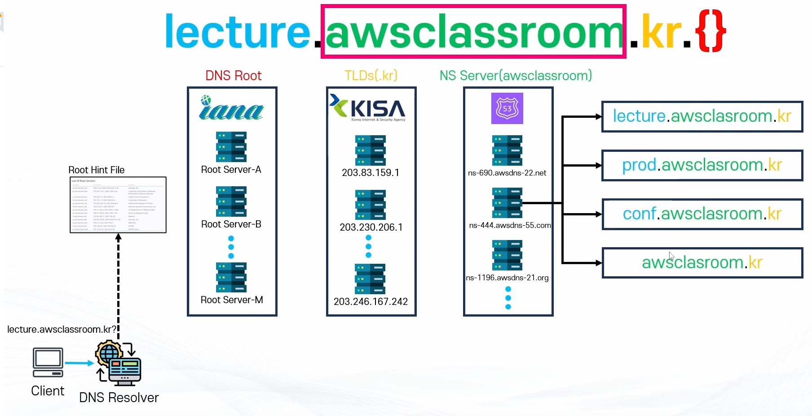

도메인 이름 시스템은 사람이 읽을 수 있는 도메인 이름을(www.amazon.com)을 머신이 읽을 수 있는 IP 주소(192.0.2.44)로 변환한다.

### DNS 주요 개념 

- DNS(Domain Name System): 사람이 읽을 수 있는 문자열과 Internet 프로토콜 기반 정보를 매칭 시켜주는 시스템
- Internet Corporation for Assgined Names and Numbers (ICANN)에서 관리
- 도메인(Domain): 대상의 IP 주소등의 정보와 맵핑되는 사람이 알아볼 수 있는 문자열
- 서브도메인: 도메인 중 스트링 앞에 추가 문자열이 붙은 도메인
- ex: **test.example.com**
  - APEX 도메인: 도메인 중 앞에 추가 문자열이 없는 최상위 도메인
- ex: **example.com**
- 레코드(DNS Record): 도메인이 어떤 방식으로 데이터와 매칭되는지 정의하는 기록
- 다양한 레코드 종류가 있으며 각각 다른 정보와 매칭
  - 예: A 레코드 IPv4 주소, MX 레코드는 메일 서버
- Domain Zone: 도메인의 정보를 담은 레코드의 집합
- Zone File: Domain Zone 정보를 저장한 텍스트 파일
- DNS Query: 주어진 도메인에 해당하는 정보를 요청하는 쿼리
- Name Server: DNS Query를 Zone File을 기반으로 응답할 수 있는 서버
- Authoritative: DNS 정보의 원본을 가지고 있는 가장 최상위 Name Server 
  - None-Authoritative: Authoritative Name Server를 조회하여 정보를 보관하고 있거나 응답하는 서버(캐시)
- DNS Resolver: 사용자와 Name Server 사이에 위치한 서버로 실제 유저의 요청에 따라 IP 주소 등의 정보를 확보하는 서버
- 유저의 클라이언트가 제일 먼저 쿼리를 요청하는 대상이며 보통 ISP가 관리

### DNS의 규모 

- 2024년 기준 약 3억 6천만개의 도메인 존재
- 그리고 거의 모든 HTTP 통신에 매번 활용
- 매우 큰 규모이며 이를 호스팅하기 위한 서버 구조에 큰 고민 필요

### DNS의 구성 

- DNS는 계층 구조
- 즉 최상위 도메인부터 차례대로 계층구조로 구성되어 있음
  - 실제 레코드는 가장 마지막 계층에서 보관 및 관리

### 도메인의 구조

### DNS Root

- DNS 계층 구조의 최상위 레벨
- 즉 DNS Query 수행 시 최초로 조회하는 거점
  - 다음 단계인 TLDs(Top Level Domain)의 Zone File을 가진 NS 서버의 주소 정보 보유
- IANA(Internet Assigned Numbers Authority)에서 조율하는 13개의 주체에서 관리
- A~M까지 각 관리 주체별로 다른 서버 주소
- Root Hints File
- DNS Root의 주소를 담은 파일
  - 각 DNS Resolver에 하드코딩

### Top Level Domains(TLDs)

- DNS 계층 구조의 두 번째 레벨 
- 실질적으로 정보를 가지고 있는 최상위 레벨 
  - 예: .com / .org / .net/ .info 등등
- 종류
- Country Code TLDs: 각 나라에 할당된 두 자리 코드
- 예: .kr / .jp / .uk
  - Sponsored TLDs: 사설 조직이나 기관에 할당된 TLDs
- 예: .edu / .gov / .mil
  - New Generic TLDs: 기타 다양한 TLDs
- 예: .app / .tech / .xyz / .blog
- 관리 주체: TLDs Registry (각 회사/나라 등)
- 예:
- .com / .net → Verisign
    - .kr → Korea Internet & Security Agency (KISA)
- 실제 도메인의 레코드를 관리하는 NS 서버의 주소 정보를 담은 Zone File 보유

### NS 서버 

- 실제 도메인의 레코드를 가지고 있는 서버
- 이 NS 서버의 주소를 TLDs에 등록해두면 클라이언트에서 DNS 쿼리에 따라 이쪽으로 도착
- 해당 도메인 및 서브도메인들이 어떤 프로토콜의 어떤 주소로 맵팽되는지(레코드)에 관한 Zone File 보유

### 도메인 등록 

- 도메인 등록 대행 (Domain Registrar)을 통해 등록 
- 도메인 등록 대행(Domain Registrar): ICANN에게 인증받고 TLDs Registry와 협의하여 도메인 등록의 권한을 가진 주체
  - 예: 가비아, GoDaddy, Cafe24, AWS Route53
- 등록할 때 TLDs Registry에 자신이 원하는 NS 서버 주소를 등록
- 일종의 남은 슬롯에 자신의 NS 서버를 예치하는 개념
  - NS 서버는 자신의 개인 NS 서버를 사용하거나, DNS Hosting Service 업체에서 대여 가능
  - DNS Hosting Service: DNS 기능을 제공하는 주체
- 예: 가비아, AWS Route53 
    - 대부분의 Registrar는 DNS Hosting Service를 같이 제공

