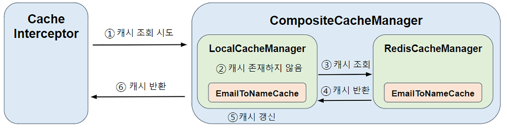

### 요구사항 

스프링의 @Cacheable을 활용하여 로컬 캐시와 분산 캐시를 함께 사용하는 2-Level Cache(2계층 캐시)를 구현하는 것이다. 2계층 캐시란 동일한 캐시 요청에 대해 먼저 로컬 캐시를 조회하고 있으면 반환, 없으면 분산 캐시를 조회하여 그 결과를 반환하는 것이다. 이를 통해 분산 캐시에 대한 트래픽을 보호할 수 있고, 분산 캐시가 장애난 경우에도 로컬 캐시를 통해 서비스에는 문제가 없도록 만들 수 있다.

[https://mangkyu.tistory.com/371](https://mangkyu.tistory.com/371)

