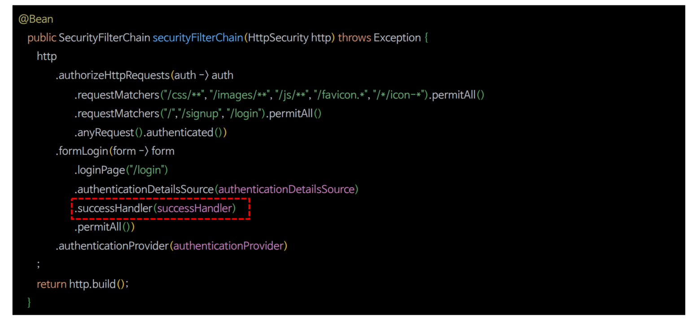
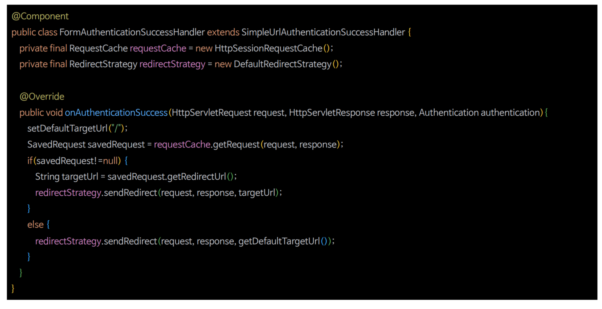

# ***AuthenticationSuccessHandler 설정***



# ***FormAuthenticationSuccessHandler***



# *구현*

***FormAuthenticationSuccessHandler***

```java
@Component
public class FormAuthenticationSuccessHandler extends SimpleUrlAuthenticationSuccessHandler {
    private final RequestCache requestCache = new HttpSessionRequestCache();
    private final RedirectStrategy redirectStrategy = new DefaultRedirectStrategy();
    @Override
    public void onAuthenticationSuccess(HttpServletRequest request, HttpServletResponse response, Authentication authentication) throws IOException, ServletException {
        setDefaultTargetUrl("/");
        SavedRequest savedRequest = requestCache.getRequest(request, response);
        if(savedRequest!=null){
            String redirectUrl = savedRequest.getRedirectUrl();
            redirectStrategy.sendRedirect(request, response, redirectUrl);
            return;
        }
        redirectStrategy.sendRedirect(request, response, getDefaultTargetUrl());
    }
}
```

- *extends SimpleUrlAuthenticationSuccessHandler*
- *인증에 성공하면 동작하는 handler 이다.*
- *HttpSessionRequestCache 클래스를 통해서 이전 요청에 대한 기록(SavedRequest)이 있으면 이전 요청 url로 리다이렉트하고 없으면 defaultTargetUrl로 리다이렉트 한다.* 

***SecurityConfig***

```java
@EnableWebSecurity
@Configuration
@RequiredArgsConstructor
public class SecurityConfig {
    private final AuthenticationProvider authenticationProvider;
    private final AuthenticationDetailsSource authenticationDetailsSource;
    private final AuthenticationSuccessHandler successHandler;
    @Bean
    public SecurityFilterChain securityFilterChain(HttpSecurity http) throws Exception{
        http
                .authorizeHttpRequests(authorize -> authorize
                        .requestMatchers("/css/**", "/images/**",
                                "/js/**", "/favicon.*", "/*/icon/-*").permitAll()
                        .requestMatchers("/", "/signup").permitAll()
                        .anyRequest().authenticated())
                .authenticationProvider(authenticationProvider)
                .formLogin(form -> form
                        .loginPage("/login")
                        .authenticationDetailsSource(authenticationDetailsSource)
                        .successHandler(successHandler)
                        .permitAll());
        return http.build();
    }
}

```

