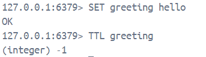
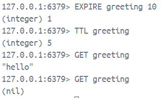
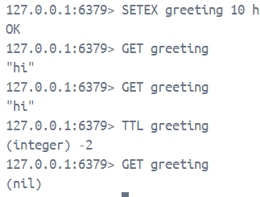
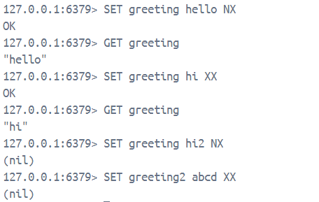
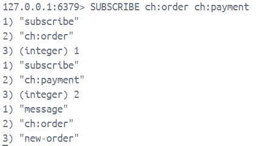
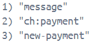
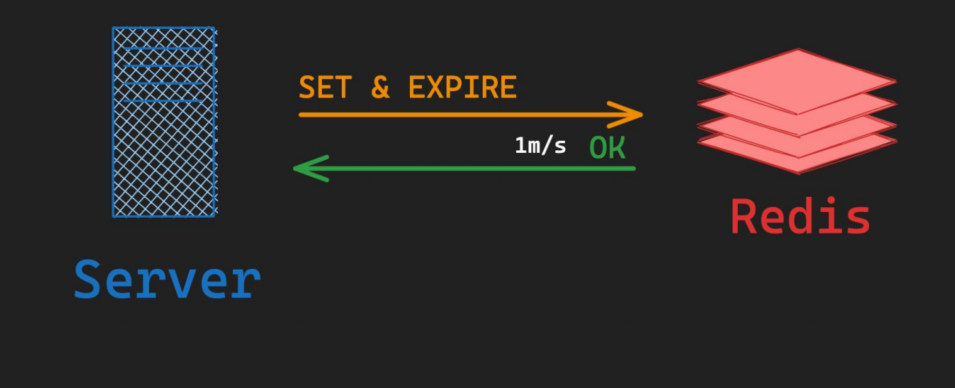

# ***데이터 만료?***

  - ***Expiration:*** *데이터를 특정시간 이후에 만료 시키는 기능*
  - ***TTL(Time To Live):*** *데이터가 유효한 시간(초 단위)*
  - **특징**
- *데이터 조회 요청시에 만료된 데이터는 조회되지 않음*
    - *데이터가 만료되자마자 삭제하지 않고, 만료로 표시했다가 백그라운드에서 주기적으로 삭제*

# ***데이터 만료 명령어***

```shell
SET greeting hello
EXPIRE greeting 10
TTL greeting
GET greeting
SETEX greeting 10 hello
```



  - *TTL 결과가 -1은 데이터 만료 설정이 없다는 뜻* 
- *데이터가 영구적으로 저장*
    - *물론 인 메모리 기반이기 때문에 디스크에 영속화하지 않는 이상 날라간다.*



  - *EXPIRE greeting 10: → 데이터 만료 10초로 설정* 
  - *TTL greeting: → 데이터 만료까지 남은 시간 결과 확인 5초*
  - *5초가 지나고 조회하자 nil 데이터가 없다고 나온다.*



  - *SETEX greeting 10 hi → 만료 시간과 함께 저장*

# ***Redis SET NX/XX?***

  - *NX 해당 Key가 존재하지 않는 경우에만 SET*
  - *XX 해당 Key가 이미 존재하는 경우에만 SET*
  - *Null Reply:  SET이 동작하지 않은 경우 (nil) 응답*

# ***Redis SET NX/XX 실습***

```shell
SET greeting hello NX
SET greeting hello XX
```



  - *SET greeting hello NX → greeting KEY가 존재하지 않아서 성공*
  - *SET greeting hi XX → greeting KEY가 존재해서 성공*
  - *SET greeting hi2 NX → greeting KEY가 존재해서 실패*
  - *SET greeting2 abcd XX → greeting2 KEY가 존재하지 않아서 실패*

# ***Redis Pub/Sub?***

  - *Publisher와 Subscriber가 서로 알지 못해도 통신이 가능하도록 decoupling 된 패턴*
  - *Publisher는 Subscriber에게 직접 메시지를 보내지 않고, Channel에 Publish*
  - *Subscriber는 관심이 있는 Channel을 필요에 따라 Subscribe하며 메시지 수신*
  - *vs. Stream 메시지가 보관되는 Stream과 달리 Pub/Sub은 Subscribe 하지 않을 때 발행된 메시지
수신 불가*

# ***Redis Pub/Sub 실습, 명령어***

***Terminal1 - Subscriber***

```shell
SUBSCRIBE ch:order ch:payment
```

  - *Consumer주문, 결재 채널 구독*

***Terminal2 - Publisher***

```shell
PUBLISH ch:order new-order
```

  - *주문 채널에 new-order 발행*



  - ***Subscriber****는 주문 채널을 구독하고 있어서 new-order 메시지를 받는다.* 

***Terminal2 - Publisher***

```shell
PUBLISH ch:payment new-payment
```



***Terminal2 - Publisher***

```shell
PUBLISH ch:delivery new-delivery
```

  - ***Subscriber****는 배달 채널을 구독하지 않아서 메시지를 받지 못한다.*

# ***Redis Pipelining?***

  - *다수의 commands를 한 번에 요청하여 네트워크 성능을 향상 시키는 기술*
  - *Round-Trip Times 최소화 (Round-Trip count down으로)*
- *Request / Response 모델에서 발생하는 네트워크 지연 시간을 의미*


  - *대부분의 클라이언트 라이브러리에서 지원*

# ***Redis Transaction?***

  - *다수의 명령을 하나의 트랜잭션으로 처리 -> 원자성(Atomicity) 보장*
- *All or Nothing / 모든 작업이 적용되거나 하나도 적용되지 않거나*
  - *중간에 에러가 발생하면 모든 작업 Rollback*
  - *하나의 트랜잭션이 처리되는 동안 다른 클라이언트의 요청이 중간에 끼어들 수 없다*
  - *vs. Pipeline* 
- *Pipeline은 네트워크 퍼포먼스 향상을 위해 여러개의 명령어를 한 번에 요청 즉, 각 명령어는 따로 처리* 
    - *Transcation은 작업의 원자성을 보장하기 위해 다수의 명령을 하나처럼 처리*
    - *Pipeline과 Transaction을 동시에 사용 가능*

# ***Redis Transaction 예제, 명령어***

```shell
$ MULTI
$ INCR foo 
$ DISCARD
$ EXEC
```

  - *MULTI → 트랜잭션 시작* 
  - *DISCARD → 트랜잭션 롤백* 
  - *EXEC → 트랜잭션 커밋* 

***예제 테스트***

```shell
127.0.0.1:6379> MULTI
OK
127.0.0.1:6379(TX)> INCR foo
QUEUED
127.0.0.1:6379(TX)> DISCARD
OK
127.0.0.1:6379> GET foo
(nil)
127.0.0.1:6379> MULTI
OK
127.0.0.1:6379(TX)> INCR foo
QUEUED
127.0.0.1:6379(TX)> EXEC
1) (integer) 1
127.0.0.1:6379> GET foo
"1"
```

