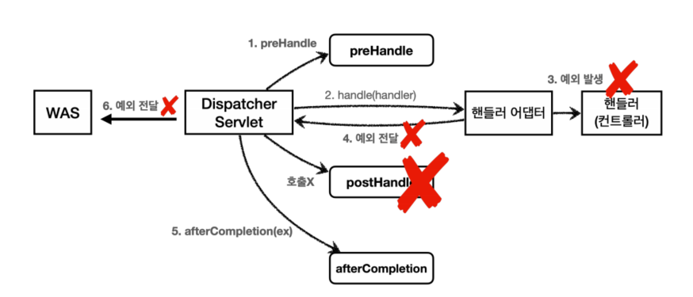
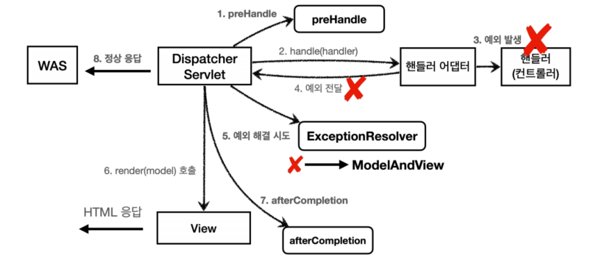

# ***API 예외 처리*** 

*API 예외 처리는 어떻게 해야할까?*

*API는 각 오류 상황에 맞는 오류 응답 스펙을 정하고, JSON으로 데이터를 내려주어야 한다.*

# ***API 예외 처리 - 스프링 부트 기본 오류 처리***

*API 예외 처리도 스프링 부트가 제공하는 기본 오류 방식을 사용할 수 있다.*

***BasicErrorController 코드***

```java
@RequestMapping(produces = MediaType.TEXT_HTML_VALUE)
public ModelAndView errorHtml(HttpServletRequest request, HttpServletResponse response) {}

@RequestMapping
public ResponseEntity<Map<String, Object>> error(HttpServletRequest request) {}
```

*/error 동일한 경로를 처리하는 errorHtml() , error() 두 메서드를 확인할 수 있다*

- *errorHtml() : produces = MediaType.TEXT_HTML_VALUE : 클라이언트 요청의 Accept 해더 값이
text/html 인 경우에는 errorHtml()을 호출해서 view를 제공한다*
- *error() : 그외 경우에 호출되고 ResponseEntity 로 HTTP Body에 JSON 데이터를 반환*

## ***Html 페이지 vs API 오류***

*BasicErrorController를 확장하면 JSON 메시지도 변경할 수 있다.* 

*그런데 API 오류는 조금 뒤에 설명할 @ExceptionHandler가 제공하는 기능을 사용하는 것이 더 나은 방법이므로 지금은 BasicErrorController를 확장해서 JSON 오류 메시지를 변경할 수 있다 정도로만 이해해두자*

*스프링 부트가 제공하는 BasicErrorController는 HTML 페이지를 제공하는 경우에는 매우 편리하다.*

*하지만 API 오류 처리는 다르다.* 

*API 마다 클라이언트가 원하는 응답 스펙이 다를 수 있다. 즉, 매우 세밀하고 복잡하다.* 

*따라서 스프링 부트가 제공하는 BasicErrorController 기능이 아닌 직접 오류 처리를 하는게 좋다.*

# ***API 예외 처리 - HandlerExceptionResolver 시작***

*예외가 발생해서 서블릿을 넘어 WAS까지 예외가 전달되면 HTTP 상태코드가 500으로 처리된다.*

*발생하는 예외에 따라서 400, 404 등등 다른 상태코드로 처리하고 싶다.
상태코드 말고도 오류 메시지, 형식등을 API마다 다르게 처리하고 싶다.*

## ***HandlerExceptionResolver***

*스프링 MVC는 컨트롤러(핸들러) 밖으로 예외가 던져진 경우 예외를 해결하고, 동작을 새로 정의할 수 있는 방법을 제공한다.*

*컨트롤러 밖으로 던져진 예외를 해결하고, 동작 방식을 변경하고 싶으면 HandlerExceptionResolver 를 사용하면 된다.*

***스프링 인터셉터가 추가된 구조에서의 ExceptionHandler 적용 before/after 동작*** 

***before***



***after***



 *ExceptionResolver로 예외를 해결해도 Spring interceptor postHandle()은 호출되지 않는다.*

***HandlerExceptionResolver - interface***

```java
public interface HandlerExceptionResolver {
 ModelAndView resolveException( HttpServletRequest request, HttpServletResponse response,
		 Object handler, Exception ex);
}
```

- *handler : 핸들러(컨트롤러) 정보*
- *Exception ex : 핸들러(컨트롤러)에서 발생한 발생한 예외*

***MyHandlerExceptionResolver***

```java
public class MyHandlerExceptionResolver implements HandlerExceptionResolver {
    @Override
    public ModelAndView resolveException(HttpServletRequest request,
           HttpServletResponse response, Object handler, Exception ex) {

       try{
           if(ex instanceof IllegalArgumentException){
              response.sendError(HttpServletResponse.SC_BAD_REQUEST, ex.getMessage());
              return new ModelAndView();
           }
       }
       catch (Exception e){
            
       }
       return null;
    }
} 
```

*IllegalArgumentException이 발생하면 response.sendError(400)를 호출해서 HTTP 상태
코드를 400으로 지정하고, 빈 ModelAndView를 반환한다*

### ***반환 값에 따른 동작 방식***

*HandlerExceptionResolver의 반환 값에 따른 DispatcherServlet의 동작 방식*

- *빈 ModelAndView: new ModelAndView()처럼 빈 ModelAndView 를 반환하면 뷰를 렌더링 하지 않고, 정상 흐름으로 서블릿이 리턴된다.*
- *ModelAndView 지정: ModelAndView에 View , Model 등의 정보를 지정해서 반환하면 뷰를 렌더링 한다.*
- *null: null 을 반환하면, 다음 ExceptionResolver 를 찾아서 실행한다. 만약 처리할 수 있는
ExceptionResolver가 없으면 예외 처리가 안되고, 기존에 발생한 예외를 서블릿 밖으로 던진다.*

### ***ExceptionResolver 활용***

1. ***예외 상태 코드 변환***
- *예외를 response.sendError(xxx) 호출로 변경해서 서블릿에서 상태 코드에 따른 오류를 처리하도
록 위임*
- *WAS는 서블릿 오류 페이지를 찾아서 내부 호출, 예를 들어서 스프링 부트가 기본으로 설정한 /error 가 호출됨 (BasicErrorController)*
1. ***뷰 템플릿 처리***
- *ModelAndView에 값을 채워서 예외에 따른 새로운 오류 화면 뷰 렌더링 해서 고객에게 제공*
1. ***API 응답 처리***
- *`response.getWriter().println("hello");`* *처럼 HTTP 응답 바디에 직접 데이터를 넣어주는
것도 가능하다. 여기에 JSON 으로 응답하면 API 응답 처리를 할 수 있다*

***WebMvcConfigurer를 통해 등록***

```java
@Configuration
public class WebConfig implements WebMvcConfigurer{

    @Override
    public void extendHandlerExceptionResolvers(List<HandlerExceptionResolver> resolvers) {
         resolvers.add(new MyHandlerExceptionResolver());
    }
}    
```

# ***API 예외 처리 - HandlerExceptionResolver 활용***

*ExceptionResolver를 사용하면 컨트롤러에서 예외가 발생해도 ExceptionResolver에서 예외를 처리해버린다.*

*따라서 예외가 발생해도 서블릿 컨테이너까지 예외가 전달되지 않고, 스프링 MVC에서 예외 처리는 끝이 난다.*

*결과적으로 WAS 입장에서는 정상 처리가 된 것이다. 이렇게 예외를 이곳에서 모두 처리할 수 있다는 것이 핵심이다.*

*서블릿 컨테이너까지 예외가 올라가면 복잡하고 지저분하게 추가 프로세스가 실행된다. 
반면에 ExceptionResolver를 사용하면 예외처리가 상당히 깔끔해진다.*

*스프링은 이런 ExceptionResolver를 제공한다.*

# ***API 예외 처리 - 스프링 제공 ExceptionResolver1***

***스프링 부트가 기본으로 제공하는 ExceptionResolver***

- *ExceptionHandlerExceptionResolver*
- *ResponseStatusExceptionResolver*
- *DefaultHandlerExceptionResolver*

***ExceptionHandlerExceptionResolver***

- *@ExceptionHandler을 처리한다. API 예외 처리는 대부분 이 기능으로 해결한다.*

***ResponseStatusExceptionResolver***

- *HTTP 상태 코드를 지정해준다.*
- *예) @ResponseStatus(value = HttpStatus.NOT_FOUND)*

***DefaultHandlerExceptionResolver***

- *스프링 내부 기본 예외를 처리한다.*

## ***ResponseStatusExceptionResolver***

*다음 두 가지 경우를 처리*

- *@ResponseStatus가 달려있는 예외*
- *ResponseStatusException 예외*

### ***@ResponseStatus***

```java
@ResponseStatus(code = HttpStatus.BAD_REQUEST, reason = "잘못된 요청 오류")
public class BadRequestException extends RuntimeException {
}
```

*BadRequestException 예외가 컨트롤러 밖으로 넘어가면 ResponseStatusExceptionResolver가 해당 애노테이션을 확인해서 오류 코드를 HttpStatus.BAD_REQUEST (400)으로 변경하고, 메시지도 담는다.*

*ResponseStatusExceptionResolver 코드를 확인해보면 결국 response.sendError(statusCode,
resolvedReason)를 호출하는 것을 확인할 수 있다.*

*→ WAS에서 다시 오류 페이지( /error )를 내부 요청*

***메시지 기능***

*reason을 MessageSource 에서 찾는 기능도 제공한다. reason = “error.bad”*

```java
@ResponseStatus(code = HttpStatus.BAD_REQUEST, reason = "error.bad")
public class BadRequestException extends RuntimeException {
}
```

*messages.properties*

```java
error.bad=잘못된 요청 오류입니다. 
```

### ***ResponseStatusException***

*@ResponseStatus는 개발자가 직접 변경할 수 없는 예외에는 적용할 수 없다.*

*내가 코드를 수정할 수 없는 라이브러리의 예외 코드 같은 곳에는 적용할 수 없다.*

*추가로 애노테이션을 사용하기 때문에 조건에 따라 동적으로 변경하는 것도 어렵다.*

*이때는 ResponseStatusException 예외를 사용하면 된다.*

```java
@GetMapping("/api/response-status-ex2")
public String responseStatusEx2() {
   throw new ResponseStatusException(HttpStatus.NOT_FOUND, "error.bad", new IllegalArgumentException());
}
```

*마찬가지로 ResponseStatusExceptionResolver가 ResponseStatusException 예외를 받아서 처리를 한다.* 

*WAS → /error 경로로 내부 호출이 다시 일어난다.*

# ***API 예외 처리 - 스프링 제공 ExceptionResolver2***

## ***DefaultHandlerExceptionResolver***

*스프링 내부에서 발생하는 스프링 예외를 해결*

*대표적으로 파라미터 바인딩 시점에 타입이 맞지 않으면 내부에서 TypeMismatchException이 발생하는데, 이 경우 예외가 발생했기 때문에 그냥 두면 서블릿 컨테이너까지 오류가 올라가고, 결과적으로 500 오류가 발생한다*

*그런데 파라미터 바인딩은 대부분 클라이언트가 HTTP 요청 정보를 잘못 호출해서 발생하는 문제이다.* 

*HTTP 에서는이런 경우 HTTP 상태 코드 400을 사용하도록 되어 있다.
DefaultHandlerExceptionResolver는 이것을 500 오류가 아니라 HTTP 상태 코드 400 오류로 변경한다.
스프링 내부 오류를 어떻게 처리할지 수 많은 내용이 정의되어 있다.*

***ResponseStatusExceptionResolver*** *처럼* *response.sendError()를 통해서 문제를 해결한다.*

# ***API 예외 처리 - @ExceptionHandler***

*스프링은 ExceptionHandlerExceptionResolver를 기본으로 제공하고, 기본으로 제공하는 ExceptionResolver 중에 우선순위도 가장 높다*

***ErrorResult***

```java
@Data
@AllArgsConstructor
public class ErrorResult {
	 private String code;
	 private String message;
}
```

- *예외 발생 API 응답 객체*

***RestController*** 

```java
@ResponseStatus(HttpStatus.BAD_REQUEST)
@ExceptionHandler(IllegalArgumentException.class)
public ErrorResult illegalExceptionHandler(IllegalArgumentException e){
    return new ErrorResult("BAD", e.getMessage());
}

@ExceptionHandler
public ResponseEntity<ErrorResult> userExceptionHandler(UserException e){
    ErrorResult errorResult = new ErrorResult("user-ex", e.getMessage());
    return new ResponseEntity(errorResult, HttpStatus.BAD_GATEWAY);
}

@ResponseStatus(HttpStatus.INTERNAL_SERVER_ERROR)
@ExceptionHandler
public ErrorResult exHandler(Exception e){
    return new ErrorResult("all ex", e.getMessage());
}
```

***@ExceptionHandler 예외 처리 방법***

*@ExceptionHandler 애노테이션을 선언하고, 해당 컨트롤러에서 처리하고 싶은 예외를 지정해주면 된다.*

*해당 컨트롤러에서 예외가 발생하면 이 메서드가 호출된다. 참고로 지정한 예외 또는 그 예외의 자식 클래스는 모두 잡을 수 있다.*

***우선순위***

*스프링의 우선순위는 항상 자세한 것이 우선권을 가진다.*

```java
@ExceptionHandler(부모예외.class)
public String 부모예외처리()(부모예외 e) {}

@ExceptionHandler(자식예외.class)
public String 자식예외처리()(자식예외 e) {}
```

- *자식 예외는 자식예외처리()가 처리* 
- *부모 예외는 부모예외처리()가 처리*

***다양한 예외***
*다음과 같이 다양한 예외를 한번에 처리할 수 있다.*

```java
@ExceptionHandler({AException.class, BException.class})
public String ex(Exception e) {
	  return "fail";
}
```

***예외 생략*** 

```java
@ExceptionHandler
public ResponseEntity<ErrorResult> userExHandle(UserException e) {}
```

- *@ExceptionHandler에 예외를 생략할 수 있다. 생략하면 메서드 파라미터의 예외가 지정된다.*

***파리미터와 응답***

- *@ExceptionHandler에는 마치 스프링의 컨트롤러의 파라미터 응답처럼 다양한 파라미터와 응답을 지정할 수 있다.*

# ***API 예외 처리 - @ControllerAdvice***

*@ExceptionHandler를 사용해서 예외를 깔끔하게 처리할 수 있게 되었지만, 정상 코드와 예외 처리 코드가 하나의 컨트롤러에 섞여 있다.*

*@ControllerAdvice 또는 @RestControllerAdvice를 사용하면 둘을 분리할 수 있다.*

*역할의 분리 (SRP)*

```java
@Slf4j
@RestControllerAdvice
public class ExControllerAdvice {

       @ResponseStatus(HttpStatus.BAD_REQUEST)
       @ExceptionHandler(IllegalArgumentException.class)
       public ErrorResult illegalExceptionHandler(IllegalArgumentException e){
           return new ErrorResult("BAD", e.getMessage());
       }
       
       @ExceptionHandler
       public ResponseEntity<ErrorResult> userExceptionHandler(UserException e){
           ErrorResult errorResult = new ErrorResult("user-ex", e.getMessage());
           return new ResponseEntity(errorResult, HttpStatus.BAD_GATEWAY);
       }
       
       @ResponseStatus(HttpStatus.INTERNAL_SERVER_ERROR)
       @ExceptionHandler
       public ErrorResult exHandler(Exception e){
           return new ErrorResult("all ex", e.getMessage());
       }
}
```

*@ControllerAdvice, @RestControllerAdvice는 대상으로 지정한 여러 컨트롤러에 @ExceptionHandler , @InitBinder 기능을 부여해주는 역할을 한다.*

*대상을 지정하지 않으면 모든 컨트롤러에 적용된다. (글로벌 적용)*

***대상 컨트롤러 지정 방법***

```java
@ControllerAdvice(annotations = RestController.class)
public class ExampleAdvice1 {}

@ControllerAdvice("org.example.controllers")
public class ExampleAdvice2 {}

@ControllerAdvice(assignableTypes = {ControllerInterface.class, AbstractController.class})
public class ExampleAdvice3 {}
```

***정리***

*@ExceptionHandler와 @ControllerAdvice를 조합하면 예외를 깔끔하게 해결할 수 있다.*

