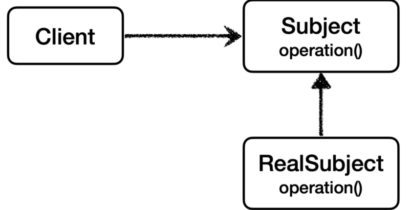
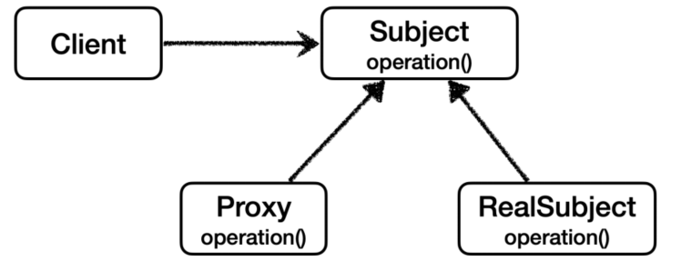
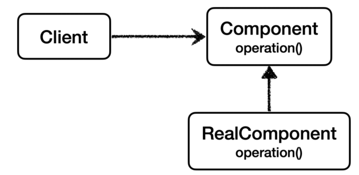
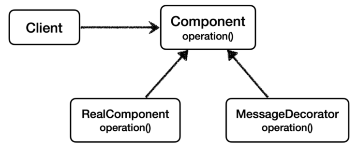
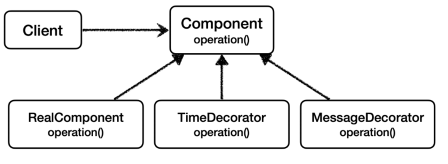
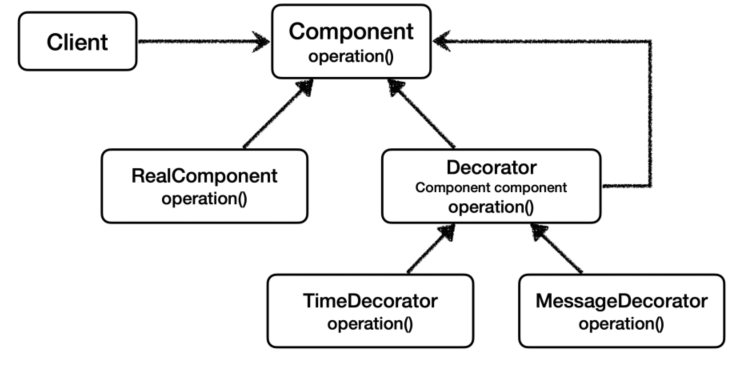

***GOF 디자인 패턴***

*GOF 디자인 패턴에서 이 둘을 의도(intent)에 따라서 프록시 패턴과 데코레이터 패턴으로 구분한다.*

- *프록시 패턴: 접근 제어가 목적*
- *데코레이터 패턴: 새로운 기능 추가가 목적*

*둘다 프록시를 사용하지만, 의도가 다르다는 점이 핵심이다.* 

# ***프록시 패턴 - 예제*** 

***Proxy Pattern 적용 before 의존 관계***



***Subject interface***

```java
public interface Subject {
    String operation();
}
```

***RealSubject implements Subject***

```java
@Slf4j
public class RealSubject implements Subject{
    @Override
    public String operation() {
        log.info("실제 객체 호출");
        sleep(1000);
        return "data";
    }
    private void sleep(int millis) {
        try {
            Thread.sleep(millis);
        }
        catch (InterruptedException e){
            log.info("sleep fail={}", e);
        }
    }
}
```

***ProxyPatternClient***

```java
public class ProxyPatternClient {
    private Subject subject;
    public ProxyPatternClient(Subject subject) {
        this.subject = subject;
    }
    public void execute(){
        subject.operation();
    }
}
```

***noProxyTest***

```java
@Test
void noProxyTest(){
    ProxyPatternClient client = new ProxyPatternClient(new RealSubject());
    client.execute();
    client.execute();
    client.execute();
}
```

- *client.execute()를 3번 호출*
- *데이터 조회에 1초가 소모되므로 총 3초의 시간이 걸린다.*

***Proxy Pattern 적용 after 의존 관계***



***CacheProxy***

```java
@Slf4j
public class CacheProxy implements Subject {
    private Subject target;
    private String cacheValue;
    public CacheProxy(Subject target) {
        this.target = target;
    }
    @Override
    public String operation() {
        log.info("프록시 호출");
        if(cacheValue == null){
            cacheValue = target.operation();
        }
        return cacheValue;
    }
}
```

- *Subject target: 클라이언트가 프록시를 호출하면 프록시가 최종적으로 실제 객체를 호출해야
한다.*

***cacheProxyTest***

```java
@Test
void cacheProxyTest(){
    CacheProxy cacheProxy = new CacheProxy(new RealSubject());
    ProxyPatternClient client = new ProxyPatternClient(cacheProxy);
    client.execute();
    client.execute();
    client.execute();
}
```

- *client → proxy → realSubject*
- *캐시 프록시를 도입하기 전에는 3초가 걸렸지만, 캐시 프록시 도입 이후에는 최초에 한번만 1초(Cache miss)가 걸리고 이후에는 거의 즉시 반환(Cache hit)한다.*

***정리***

*프록시 패턴의 핵심은 RealSubject 코드와 클라이언트 코드를 전혀 변경하지 않고, 프록시를 도입해서 접근 제어(캐싱)했다는 점이다.* 

또한 클라이언트의 코드 변경 없이 자유롭게 프록시를 넣고 뺄 수 있다.

*클라이언트 입장에서는 프록시 객체가 주입되었는지, 실제 객체가 주입되었는지 알지 못한다.*

# *데코레이터 패턴 - 예제*

***Decorator Pattern 적용 before 의존 관계***



***Component - interface***

```java
public interface Component {
    String operation();
}
```

***RealComponent - implements Component***

```java
@Slf4j
public class RealComponent implements Component{
    @Override
    public String operation() {
        log.info("RealComponent 실행");
        return "data";
    }
}
```

***DecoratorPatternClient***

```java
@Slf4j
public class DecoratorPatternClient {
    private Component component;
    public DecoratorPatternClient(Component component) {
        this.component = component;
    }
    public void execute(){
        String result = component.operation();
        log.info("result={}", result);
    }
}
```

***DecoratorPatternTest***

```java
@Test
void noDecorator(){
    DecoratorPatternClient client = new DecoratorPatternClient(new RealComponent());
    client.execute();
}
```

- *그냥 단순하게 클라이언트가 RealComponent execute() 실행*

***요구 사항  - 부가 기능 추가*** 

*프록시를 통해서 부가 기능을 추가하는 것을 데코레이터 패턴이라 한다.*

- *요청 값이나, 응답 값을 중간에 변형*
- *실행 시간을 측정해서 추가 로그를 남긴다*

*응답 값을 꾸며주는 데코레이터를 만들어보자*

***Decorator Pattern 적용 after 의존 관계***



*Client → MessageDecorator → RealComponent*

***MessageDecorator***

```java
@Slf4j
public class MessageDecorator implements Component {
    private Component target;
    public MessageDecorator(Component target) {
        this.target = target;
    }
    @Override
    public String operation() {
        log.info("MessageDecorator 실행");
        String result = target.operation();
        String decoResult =  "****" + result + "****";
        log.info("MessageDecorator 꾸미기 적용 전={}, 적용 후={}", result, decoResult);
        return decoResult;
    }
}
```

- *꾸미기 전: data* 
- *꾸미기 후: ****data*****

***decorator1()***

```java
@Test
void decorator1(){
    MessageDecorator decorator = new MessageDecorator(new RealComponent());
    DecoratorPatternClient client = new DecoratorPatternClient(decorator);
    client.execute();
}
```

- *실행 결과를 보면 MessageDecorator가 RealComponent를 호출하고 반환한 응답 메시지를 꾸며서 반환한 것을 확인할 수 있다*

***요구 사항  - 부가 기능 추가*** 

*기존 데코레이터에 실행 시간을 더해서 측정하는 기능까지 추가하자*



*Client → TimeDecorator → MessageDecorator → RealComponent*

***TimeDecorator***

```java
@Slf4j
public class TimeDecorator implements Component{
    private Component component;

    public TimeDecorator(Component component) {
        this.component = component;
    }

    @Override
    public String operation() {
        log.info("TimeDecorator 실행");
        long startTime = System.currentTimeMillis();
        String result = component.operation();
        long endTime = System.currentTimeMillis();
        log.info("TimeDecorator 종료 resultTime={}ms", endTime - startTime);
        return result;
    }
}

```

***decorator2()***

```java
@Test
void decorator2(){
    RealComponent realComponent = new RealComponent();
    MessageDecorator messageDecorator = new MessageDecorator(realComponent);
    TimeDecorator timeDecorator = new TimeDecorator(messageDecorator);
    DecoratorPatternClient client = new DecoratorPatternClient(timeDecorator);
    client.execute();
}
```

- *실행하면 TimeDecorator가 MessageDecorator를 실행하고 실행 시간을 측정해서 출력한 것을 확인할 수 있다.*

# ***프록시 패턴과 데코레이터 패턴 정리***

***GOF 데코레이터***



*이전 Decorator 코드를 보면 중복이 존재한다.*

*꾸며주는 Decorator들은 내부에 호출 대상인 Component를 가지고 있어야 한다.*

*그리고 항상 Component를 호출해야 한다.*

*이런 부분이 중복이다.*

*이런 중복을 제거하기 위해 Component를 속성으로 가지고 있는 Decorator라는 추상 클래스를 만드는 방법도 고민할 수 있다.*

*이렇게 하면 클래스 다이어그램에서 실제 컴포넌트인지, 데코레이터인지 명확하게 구분할 수 있다.*

*여기까지 고민한 것이 바로 GOF에서 설명하는 데코레이터 패턴의 기본 예제이다.*

***프록시 패턴 vs 데코레이터 패턴***

*사실 프록시 패턴과 데코레이터 패턴은 그 모양이 거의 같고, 상황에 따라 정말 똑같을 때도 있다. 
그러면 둘을 어떻게 구분하는 것일까?
디자인 패턴에서 중요한 것은 해당 패턴의 겉모양이 아니라 그 패턴을 만든 의도가 더 중요하다. 
따라서 의도에 따라 패턴을 구분한다.*

- *프록시 패턴의 의도: 다른 개체에 대한 접근을 제어하기 위해 대리자를 제공*
- *데코레이터 패턴의 의도: 객체에 추가 책임(기능)을 동적으로 추가하고, 기능 확장을 위한 유연한 대안 제공*

