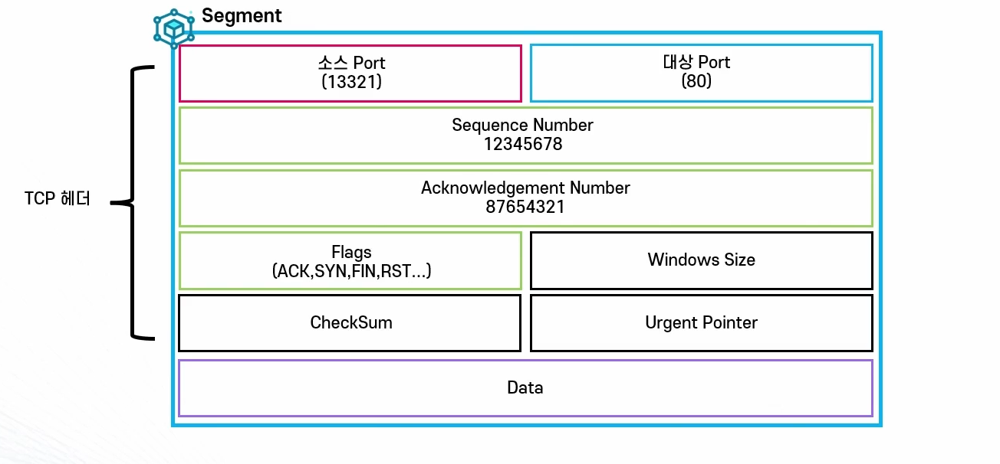
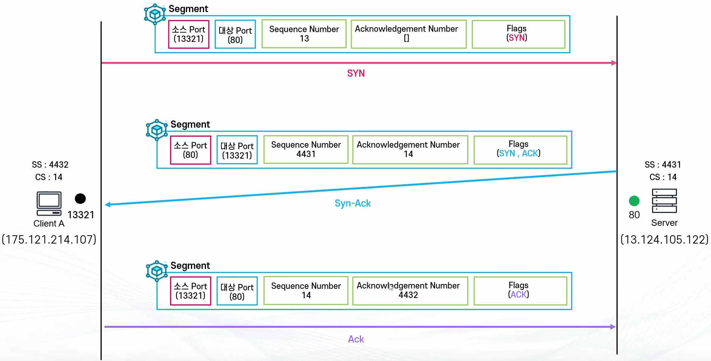
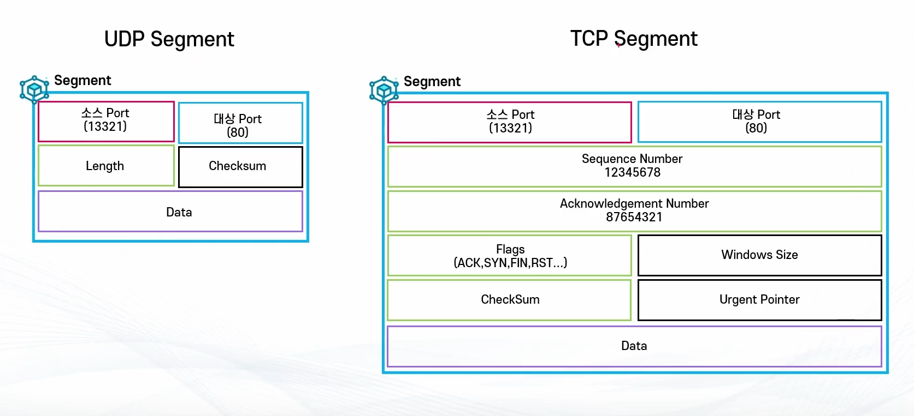

### Transport Layer 

- 통신 주체끼리 데이터 전달의 신뢰성을 확보하는 방법을 정의
- 주요 단위: 세그먼트(TCP), 데이터 그램(UDP)
- 주요 구성 요소
- TCP/UDP
- 주요 특징
- Network Layer로 성립된 통신 위에서 실질적인 활용을 위한 다양한 기능을 정의
- 패킷의 순서 보장, 에러 처리, 포트 기반 분할

### Transmission Control Protocol (TCP)

- byte stream message 
- 패킷의 전달 과정에서 순서를 보장하고 유실되지 않도록 보장할 수 있는 통신 규약
- 연결 지향 connection - oriented
- 지속적으로 채널을 수립하여 전달 여부를 확인하고 무결성을 확인
  - 지속적으로 무결성을 확보하는 과정에서 비교적 느리고 복잡한 과정 필요
- 주요 사용 사례
- 웹 페이지(HTTP/HTTPS)
  - 이메일
  - 파일 전송 
  - SSH

### Segment(세그먼트)

- TCP 데이터 전달 단위
- TCP 세그먼트의 주요 구성 
- Port(Source/Destination)
  - Sequence/Acknowledgement Number: 통신 주체끼리 데이터를 주고 받았는지 확인에 사용
  - Flags: Segment 목적 등을 정의(ACK, SYN, FIN)
  - Window Size: 세그먼트를 만든 주체가 얼마나 많은 데이터를 받을지 전달
  - Urgent Pointer: 세그먼트의 중요도를 설정(먼저 처리해야 하는 세그먼트 등)
  - 기타(checksum)

### TCP 세그먼트 

### Port

- IP 프로토콜에서 패킷을 올바른 프로세스로 라우팅 하기 위한 논리적 단위
- Well Known Port: 주로 서버에서 사용하는 애플리케이션 / 프로토콜 별로 미리 지정된 포트
- 예:
- 80: HTTP
    - 443: HTTPS
    - 22: SSH
    - 3306: MySQL
- Ephemeral Port: 클라이언트에서 사용하는 포트로 연결할 때 마다 임의로 지정

### TCP Handshake

- TCP Protocol에서 통신을 수립하고 서로를 인식하는 첫 과정
- 보통 3-way Handshake로 부르며 3가지 과정으로 구분 
- Syn(Synchronize): 첫 요청으로 사용할 첫 클라이언트 Sequence Number(CS)를 전달
  - Syn-Ack(Synchronize-Acknowlege): Syn에 대한 응답으로 CS + 1과 서버 Sequence Number(SS)를 전달
  - Ack(Acknowlege): 마지막 단계로 연결이 수립되었음을 알려주며 CS+1, SS+1 전달

### User Datagram Protocol(UDP)

- 빠르고 간단하게 데이터를 주고 받을 수 있는 방법을 정의
- Connectionless
- 연결 지향과는 달리 데이터의 무결성, 순서, 전달여부를 체크하지 않는다
  - 즉 패킷이 순서대로 오지 않거나, 중복되거나, 아예 전달되지 않을 수 있다.
- 빠르고 간단하다 
- 주요 사용 사례
- 스트리밍 
  - 보이스톡


