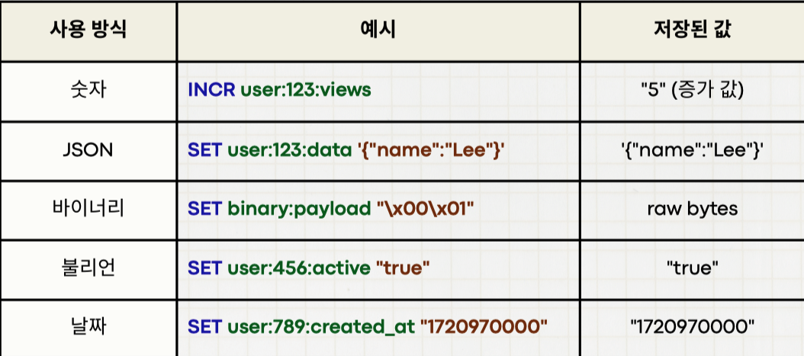
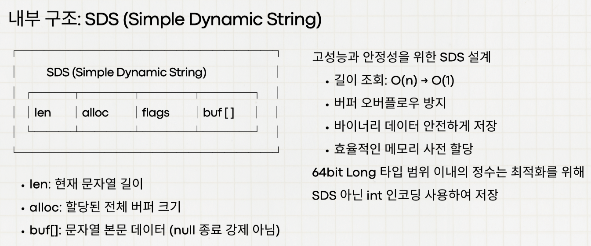
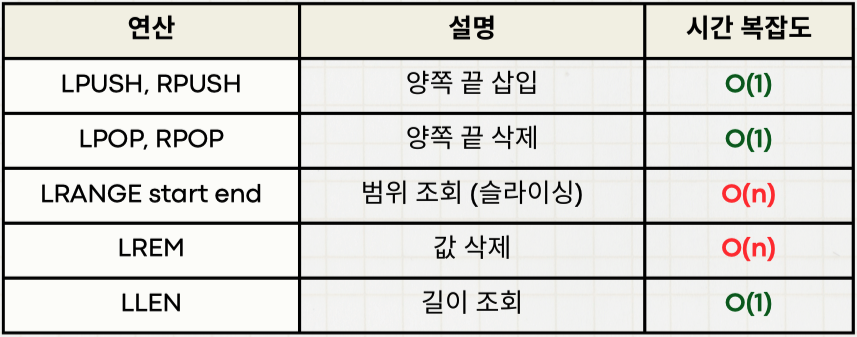
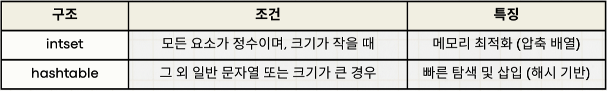
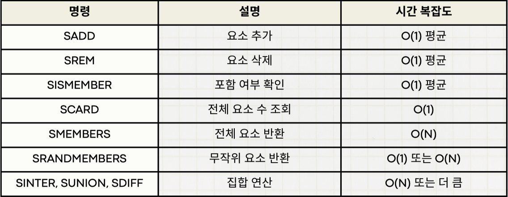
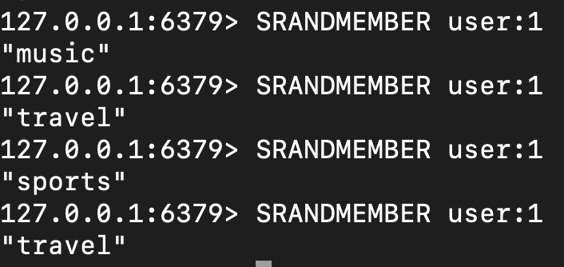
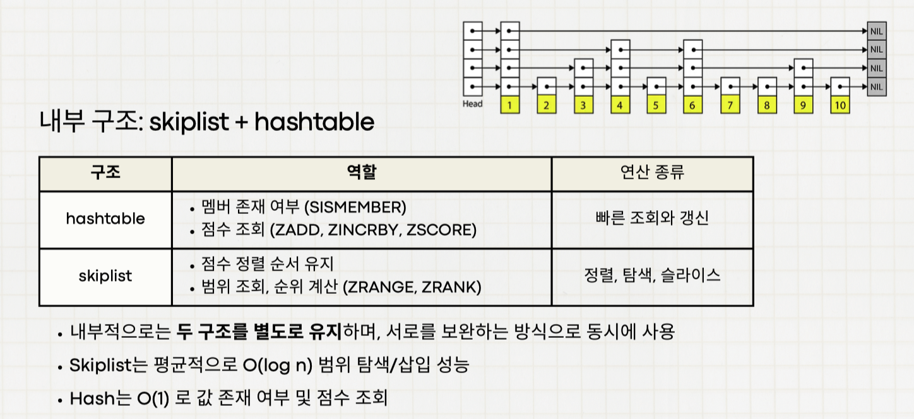
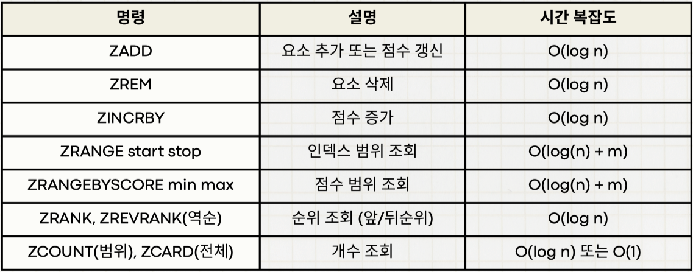
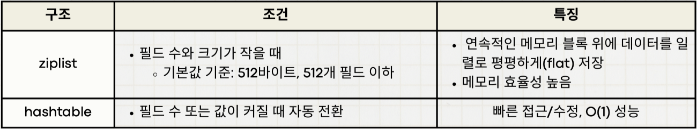
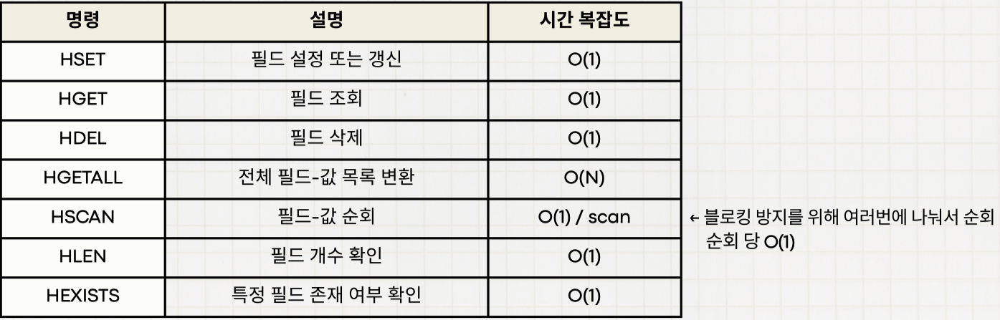

# String

### String: Redis에서 가장 기본이자 범용적인 타입

- 문자열은 Redis 기본 데이터 타입이며, 실질적으로 임의의 값을 저장하는 컨테이너
- 문자열, 숫자, JSON, 바이너리, 불리언 표현까지 모두 저장 가능
- 최대 512MB까지 저장 가능 (SDS 기반 문자열)
- Redis는 C언어로 구현되었으며, 문자열은 내부적으로 SDS(Simlple Dynamic String) 구조체로 저장됨

### 다양한 데이터 표현 예시

- Redis는 인터페이스 레벨에서 값을 해석하지 않는다 → 모두 문자열로 취급
- 명령어가 그 값을 숫자, 비트, JSON처럼 해석해서 활용할 수 있다





**64bit Long 타입 범위 이내의 정수는 최적화를 위해 SDS가 아닌 int 인코딩 사용하여 저장**

| 명령어 | 문법 | 설명 |
| --- | --- | --- |
| **INCR key** | 인자 1개 | **1씩 증가** |
| **INCRBY key increment** | 인자 2개 | **지정값만큼 증가** |
| **DECR key** | 인자 1개 | **1씩 감소** |
| **DECRBY key decrement** | 인자 2개 | **지정값만큼 감소** |

### 활용1: 사용자 로그인 횟수(정수형 카운터)

```bash
INCR user:123:login_count
```

### 활용2: 세션 정보 캐시(TTL 설정 포함)

```bash
SET session:abc123 '{"user_id":456, "expires_at":"2025.."}' EX 1800
```

- **KEY:** session:abc123
- **VALUE:** '{"user_id":456, "expires_at":"2025.."}'
- **TTL:** 1800초 

### 활용3: 게시글 제목 캐시(단순 문자열)

```bash
SET article:789:title "Redis란?"
```

### String 타입 활용 정리

단순한 값 저장 외에도 다양한 연산을 효율적으로 처리 가능

- 카운터: INCR, DECR, INCRBY, DECRBY 통해 정수 증가/감소 처리 
- TTL 설정: SET key value EX time 만료 시간 함께 지정
- 크기 제한 주의: 최대 512MB, 너무 크면 구조 분해 고려

---

# List

### List: 양방향 삽입/삭제가 가능한 순서형 컬렉션

- Redis List는 값들의 순서를 유지하는 선형 구조
- FIFO, LIFO 구조로 사용 가능
- 동일한 키에 여러 값을 순차적으로 저장
- 양쪽에서 삽입/삭제 가능 (LPUSH, RPUSH, LPOP, RPOP)

### 주요 연산 및 동작 방식



### 활용1: 작업 큐로 활용(왼쪽 삽입, 오른쪽 제거)

```bash
LPUSH task:queue "resize image #1"
LPUSH task:queue "resize image #2"
RPOP task:queue
```

- KEY: task:queue
- VALUE: resize image #2

### 활용2: 최근 본 항목 기록

```bash
RPUSH view:user:123 "item1"
RPUSH view:user:123 "item2"
RPUSH view:user:123 "item3"
...

LTRIM view:user:123 -2 -1 
```

- LTRIM -2 -1: 최신 2개만 유지

### 활용3: 블로킹 큐(작업 대기열 처리)

```bash
BLPOP task:queue 5
```

- 동작: 리스트에 데이터가 없으면 최대 5초 동안 대기(blocking)
- 데이터가 들어오는 즉시 pop하여 반환
- 프로듀서-컨슈머 패턴 구현

### List 타입 활용 정리

큐, 로그처럼 순서가 있는 데이터 처리에 적합하며 고정 길이 유지도 가능

- 작업 큐: LPUSH + BRPOP 조합으로 소비자 대기 큐 구성
- 최근 로그: LPUSH 후 LTRIM으로 최대 길이 유지
- 키 분할: 너무 큰 리스트는 키에 샤딩 값 붙여 분산 처리
- 양방향 처리: LPUSH, RPUSH, LPOP, RPOP 모두 O(1)

---

# Set

### Set: 중복 없는 집합형 자료 구조

- Redis Set은 중복을 허용하지 않는 문자열 집합
- 순서를 보장하지 않으며, 수학적 집합 개념과 동일
- 삽입, 삭제, 존재 여부 확인이 빠르고, 교집합/합집합/차집합 같은 집합 연산 명령어도 기본 제공

### 내부 구조: intset 또는 hashtable



### 주요 연산 및 동작 방식



### 활용1: 사용자 태그 등록 (중복 없는 관심사 저장)

```bash
SADD user:123:tags sports music travel
```

- KEY: user:123:tags
- VALUE: {sports, music, travel}
- 중복 없음, 순서 없음

### 활용2: 교집합 연산 - 공통 태그 구하기

```bash
SADD user:1 sports music travel
SADD user:2 sports travel movies

SINTER user:1 user:2
```

- 결과: sports, travel

### 활용3: 태그 목록 전체 조회

```bash
SMEMBERS user:1
```

- 결과: {sports travel movies}

### 활용4: 랜덤 샘플링 - 관심 주제 무작위 선택

```bash
SRANDMEMBER user:1
```



- 무작위 추출

### Set 타입 활용 정리

중복 없는 집합 표현과 집합 연산 기능을 활용해 간단한 필터링과 샘플링 가능

- 중복 제거: 자동으로 동일 값 제거
- 태그 필터링: 교집합(SINTER)으로 조건 필터 구현
- 랜덤 추출: SRANDMEMBER 랜덤 추천 구현
- 키 사이즈 주의: 전체 데이터 셋 조회 시, 너무 큰 Set은 SCARD +SSCAN 조합 활용
- **SCARD:** 집합(Set)에 포함된 멤버(member)의 수를 반환
  - **SSCAN:** 집합(Set)에 저장된 멤버들을 부분적으로 반복하여 조회(Iterative Scan)

**SSCAN KEY 커서(시작 위치) COUNT 개수**

- COUNT 개수로 힌트를 줄 수 있다.
- COUNT 지정값 보다 더 많이 가져올 수 있다.
- 다음 커서가 있다면 맨 처음에 응답으로 커서가 온다.

```bash
127.0.0.1:6379> SSCAN myset 0 COUNT 100
1) "1247"    # 다음 커서 (0이 아니면 더 있음)
2) 1) "data1"
   2) "data2"
   # ...

127.0.0.1:6379> SSCAN myset 1247 COUNT 100  
1) "0"       # 커서가 0 = 스캔 완료!
2) 1) "data_last"
   # ...
```

---

# Sorted Set(ZSet)

### ZSet: 점수 기반으로 정렬된 고유한 집합

- Sorted Set은 중복 없는 요소들에 대해 정렬 기준(score)을 함께 부여하는 자료구조
- 값은 고유하고, 정렬은 점수에 따라 자동 유지
- 내부적으로 순서를 갖는 집합, 즉 정렬된 우선순위 큐와 유사
- 점수를 기반으로 정렬, 범위 조회, 순위 검색이 가능



### 주요 연산 및 동작 방식



### example

```bash
ZADD leaderboard 100 "userA"
ZADD leaderboard 200 "userB"
ZADD leaderboard 150 "userC"
```

- KEY: leaderboard
- 정렬 기준: 점수(score) 오름차순
```bash
# 인덱스 범위 조회 조회
127.0.0.1:6379> ZRANGE leaderboard 0 -1
1) "userA"
2) "userC"
3) "userB"

# 개수 조회
127.0.0.1:6379> ZCOUNT leaderboard 0 300
(integer) 3

127.0.0.1:6379> ZCOUNT leaderboard 0 100
(integer) 1

127.0.0.1:6379> ZCARD leaderboard
(integer) 3

# 점수 범위 조회
127.0.0.1:6379> ZRANGEBYSCORE leaderboard 0 300
1) "userA"
2) "userC"
3) "userB"

# 특정 사용자 순위 조회
127.0.0.1:6379> ZRANK leaderboard userA
(integer) 0
127.0.0.1:6379> ZRANK leaderboard userB
(integer) 2
127.0.0.1:6379> ZRANK leaderboard userC
(integer) 1

# 상위 2명 조회(오름차순)
127.0.0.1:6379> ZRANGE leaderboard 0 1
1) "userA"
2) "userC"

# 상위 2명 조회(내림차순)
127.0.0.1:6379> ZREVRANGE leaderboard 0 1
1) "userB"
2) "userC"
```

### Sorted Set(ZSet) 타입 활용 정리

점수 기반 정렬된 집합으로 순위, 통계, 타임라인 등에 적합

- 랭킹 시스템: 점수를 기반으로 정렬(ZADD, ZRANGE)
- 최근순 정렬: timestamp를 score로 사용
- 데이터  제한: ZREMRANGEBYRANK, ZREMRANGEBYSCORE로 오래된 항목 정리
- 통계 집계: ZUNIONSTORE(합집합), ZINTERSTORE(교집합)로 집계 처리 가능
- ZUNIONSTORE(합집합): 여러 그룹별 랭킹 합산하여 전체 랭킹 집계, 타임라인 머지/정렬
  - ZINTERSTORE(교집합): 이벤트 이력(공동 참여, 공통 활동 등)추출

### **추가 정리**

```bash
# 점수랑 함께 조회하는 방법
127.0.0.1:6379> ZREVRANGE leaderboard 0 -1 WITHSCORES
1) "userD"
2) "1000"
3) "userB"
4) "200"
5) "userC"
6) "150"
7) "userA"
8) "100"

# 점수 추가
127.0.0.1:6379> ZINCRBY leaderboard 100 userD
"1100"

# 존재하지 않았던 member 또한 추가 가능
127.0.0.1:6379> ZINCRBY leaderboard 100 userE
"100"
```

---

# Hash

### Hash: 필드-값 쌍의 소형 컬렉션

- Redis의 Hash는 한 Key 안에 여러 개의 필드-값 쌍(field-value pair)을 저장하는 자료구조
- 일반적인 해시맵 구조와 유사하지만, Redis에서는 복수 필드를 하나의 키 아래에 묶는 용도로 사용
- JSON 유사한 구조, 사용자 정보, 설정값 캐싱에 적합
- 중첩(nested) 구조 저장 불가 
  - 내부적으로 field: string → value:string 구조

### 내부 구조: ziplist 또는 hashtable



### 주요 연산 및 동작 방식



### Practice 

```bash
HSET user:123 name Alice
HSET user:123 email alice@example.com
HSET user:123 age 30

KEY -> user:123
VALUE -> {
	 name: Alice
   email: alice@example.com
   age: 30  
}
```

```bash
# 필드 조회
127.0.0.1:6379> HGET user:123 email
"alice@example.com"

# 전체 필드 조회
127.0.0.1:6379> HGETALL user:123
1) "name"
2) "Alice"
3) "email"
4) "alice@example.com"
5) "age"
6) "30"

# 필드 삭제 및 존재 확인
127.0.0.1:6379> HEXISTS user:123 email
(integer) 1
127.0.0.1:6379> HDEL user:123 email
(integer) 1
127.0.0.1:6379> HEXISTS user:123 email
(integer) 0

#대량 데이터 순회
127.0.0.1:6379> HSCAN user:123 0
1) "0"
2) 1) "name"
   2) "Alice"
   3) "age"
   4) "30"
   5) "email"
   6) "alice@exmaple.com"
```

### Hash 타입 활용 정리

한 키에 여러 필드를 저장할 수 있어 객체 저장이나 설정 캐시에 적합

- 유저 세션/프로필 저장: HSET, HGET으로 필드별 접근
- 소형 객체 최적화: **ziplist** 인코딩으로 메모리 절약
- 필드 수 주의: 많아지면 **hashtable**로 전환되어 메모리 증가
- 대량 순회: HSCAN 활용해 점진적 순회 가능

---

