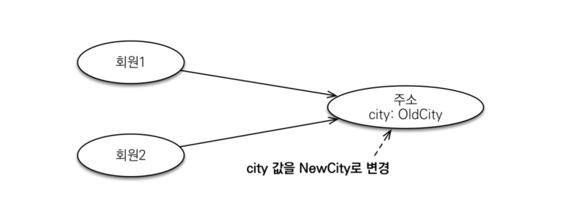
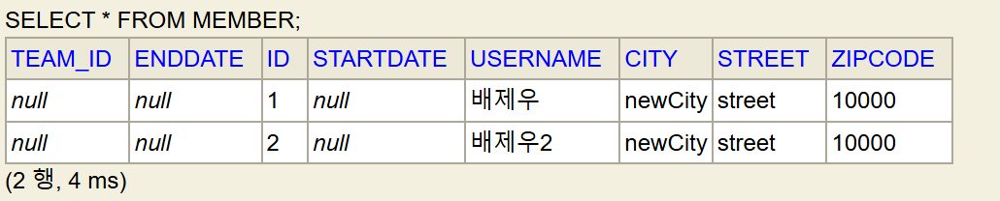
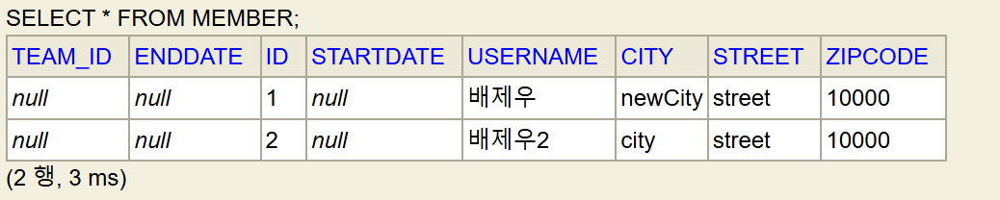
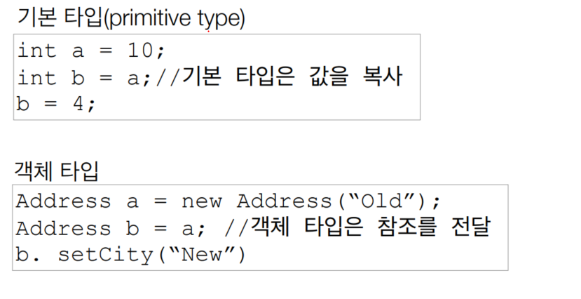
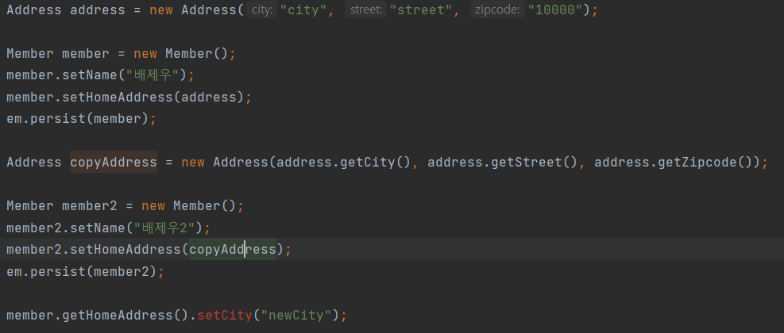

# ***값 타입과 불변 객체***

*값 타입은 복잡한 객체 세상을 조금이라도 단순화하려고 만든 개념이다.*

*따라서 값 타입은 단순하고 안전하게 다룰 수 있어야 한다.*

### *값 타입 공유 참조*

- *임베디드 타입 같은 값 타입을 여러 엔티티에서 공유하면 위험하다*
- *부작용(side effect) 발생*



- *값 타입의 실제 인스턴스인 값을 복사하는 행위는 위험하다*
- ***대신 값(인스턴스)를 복사해서 사용해야 한다.***

### ***값 타입 side effect 발생 예제***

```java
Address address = new Address("city", "street", "10000");

Member member = new Member();
member.setName("배제우");
member.setHomeAddress(address);
em.persist(member);

Member member2 = new Member();
member2.setName("배제우2");
member2.setHomeAddress(address);
em.persist(member2);

member.getHomeAddress().setCity("newCity");

tx.commit();
```

- *의도는 member(배제우) 객체만 도시 이름을 “newCity”로 변경*
- *update 쿼리가 2번 날아가고 member, member2 모두 도시 이름이 “newCity”로 바뀌었다.*
- *값 타입 공유로 인하여 side effect 발생*



### ***값(인스턴스)를 복사해서 사용하기***

```java
Address address = new Address("city", "street", "10000");

Member member = new Member();
member.setName("배제우");
member.setHomeAddress(address);
em.persist(member);

Address copyAddress = 
		new Address(address.getCity(), address.getStreet(), address.getZipcode());

Member member2 = new Member();
member2.setName("배제우2");
member2.setHomeAddress(copyAddress);
em.persist(member2);

member.getHomeAddress().setCity("newCity");
```



- *값을 복사해서 사용해서 side effect가 사라졌다.*

### ***객체 타입의 한계***



- *객체 타입은 참조 값을 직접 대입하는 것을 막을 방법이 없다.*
- *즉, 객체의 공유 참조는 피할 수 없다.*

### ***객체 타입 한계 극복 - 불변 객체***

- *객체 타입을 수정할 수 없게 만들면 부작용을 원천 차단할 수 있다.*
- ***값 타입은 불변 객체(immutable object)로 설계해야 한다***
- *생성 시점 이후 절대 값을 변경할 수 없는 객체*
- ***생성자로만 값을 설정하고 수정자(setter)를 만들지 않으면 된다.***
- *참고: Integer, String → 자바가 제공하는 대표적인 불변 객체*
- *no setter*

***Address → Setter 삭제***

```java
@Getter
@Embeddable
@NoArgsConstructor(access = AccessLevel.PUBLIC)
@AllArgsConstructor
public class Address {
    private String city;
    private String street;
    private String zipcode;
}
```



- *값 변경이 불가능하다.*
- *member 객체의 Address를 update 하려면* ***새로운*** ***immutable 객체의 생성이 필요하다.***

## ***불변이라는 작은 제약으로 부작용이라는 큰 재앙을 막을 수 있다***

