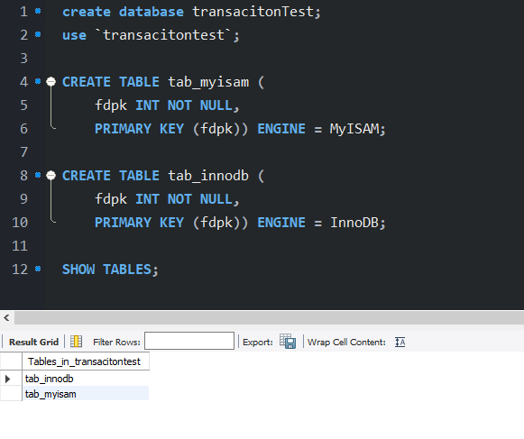
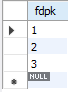
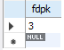
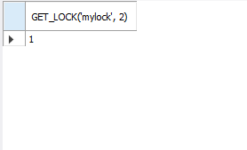
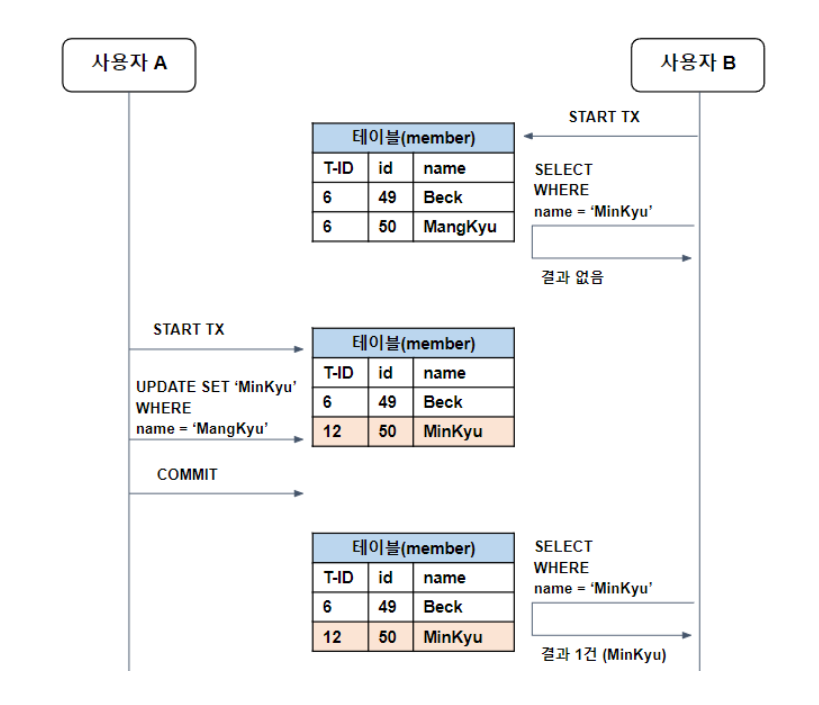
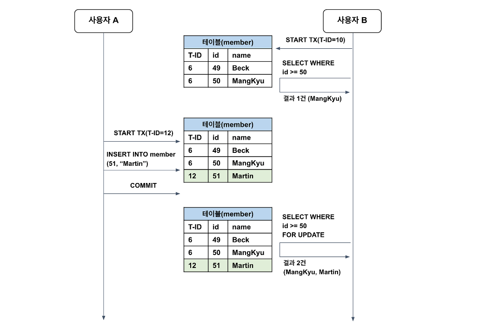

# *개요* 

*이번에는 MySQL의 동시성에 영향을 미치는 잠금과 트랜잭션, 트랜잭션의 격리 수준에 대해서 공부하자*

***트랜잭션?***

*트랜잭션은 작업의 완전성을 보장해 주는 것* 

*논리적인 작업을 모두 완벽하게 처리하지 처리하지 못할 경우에는 원 상태로 복구해서 작업의 일부만 적용되는 현상(Partial Update)이 발생하지 않게 만들어주는 기능이다.*

***잠금과 트랜잭션***

*잠금은 동시성을 제어하기 위한 기능* 

*트랜잭션은 데이터의 정합성을 보장하기 위한 기능* 

*하나의 회원 레코드를 여러 커넥션에서 동시에 변경하려고 하는데 잠금이 없다면 하나의 데이터를 여러 커넥션에서 동시에 변경할 수 있게 된다. → 예측 불가능한 상태* 

*잠금은 여러 커넥션에서 동시에 동일한 자원(레코드 / 테이블)을 요청할 경우 순서대로 한 시점에는 하나의 커넥션만 변경할 수 있게 해주는 역할을 한다.* 

*격리 수준은 하나의 트랜잭션 내에서 또는 여러 트랜잭션 간의 작업 내용을 어떻게 공유하고 차단할 것인지를 결정하는 레벨을 의미한다*

# *정리 목록* 

# *5.1 트랜잭션*

*트랜잭션을 지원하지 않는 MyISAM 스토리지 엔진과 지원하는 InnoDB 스토리지 엔진의 처리 방식 차이를 살펴보자.*

*또한 트랜잭션을 사용할 경우 주의할 사항도 함께 알아보자* 

## *5.1.1 MySQL 트랜잭션*

*트랜잭션은 꼭 여러 개의 변경 작업을 수행하는 쿼리가 조합됐을 때만 의미 있는 개념이 아니다.*

*트랜잭션은 하나의 논리적인 작업에 쿼리의 개수와 상관없이 전체 작업이 100% 적용되거나 아무것도 적용되지 않아야 함을 보장해 주는 것이다.  →* ***ALL or NOTHING***

*간단한 예제로 트랜잭션 관점에서 InnoDB 테이블과 MyISAM 테이블 차이를 살펴보자* 

## ***간단한 예제*** 

***테스트용 DATABASE, 테이블 생성 Query***



```sql
INSERT INTO tab_myisam VALUES(3);
INSERT INTO tab_innodb VALUES(3);
```

  - *테스트용 테이블에 각각 레코드 1건씩 저장*

***AUTO-COMMIT 활성화 & 쿼리 실행하기*** 

```sql
SET autocommit = on;

INSERT INTO tab_myisam (fdpk) VALUES (1), (2), (3);

INSERT INTO tab_innodb (fdpk) VALUES (1), (2), (3);
```

***result***

*Error Code: 1062. Duplicate entry '3' for key 'tab_myisam.PRIMARY'*

*Error Code: 1062. Duplicate entry '3' for key 'tab_innodb.PRIMARY'*

```sql
SELECT * FROM tab_myisam;
SELECT * FROM tab_innodb;
```

***tab_myisam*** 



***tab_innodb***



***결과 분석*** 

*두 INSERT 문장 모두 프라이머리 키 중복 오류로 쿼리가 실패했다.* 

*그런데 두 테이블 레코드를 조회해 보면 MyISAM 테이블에는 오류가 발생했음에도 ‘1’, ‘2’는 INSERT 된 상태로 남아 있는 것을 확인할 수 있다.* 

*즉, MyISAM 테이블에 INSERT 문장이 실행되면서 차례대로 ‘1’, ‘2’를 저장하고 그다음 ‘3’을 저장하려는 순간 중복 키 오류(Duplicate Key Error)가 발생한 것이다.*

*하지만 MyISAM 테이블에서 실행된 쿼리는 이미 INSERT된 ‘1’, ‘2’를 그대로 두고 쿼리 실행을 종료해 버린다.*

*MEMORY 스토리지 엔진 또한 동일하게 작동한다.*

*InnoDB는 쿼리 중 일부라도 오류가 발생하면 전체를 원 상태로 만든다는 트랜잭션의 원칙대로 실행하기 전 상태로 복구했다.*

*MyISAM 테이블에서 발생하는 이런 현상을* ***부분 업데이트(Partial Update)****로 표현한다.* 

*이러한 부분 업데이트 현상은 테이블 데이터 정합성을 맞추는데 상당히 어려운 문제를 만들어 낸다.*

## *5.1.2  주의사항*

*트랜잭션 또한 DBMS 커넥션과 동일하게 꼭 필요한 최소의 코드에만 적용하는 것이 좋다.*

***예시***

*사용자가 게시판에 게시물을 작성한 후 저장 버튼 클릭했을 때 서버에서 처리하는 내용* 

```sql
1) 처리 시작
-> 데이터베이스 커넥션 생성 
-> 트랜잭션 시작
2) 사용자의 로그인 여부 확인 
3) 사용자의 글쓰기 내용의 오류 여부 확인
4) 첨부로 업로드된 파일 확인 및 저장 
5) 사용자의 입력 내용을 DBMS에 저장 
6) 첨부 파일 정보를 DBMS에 저장
7) 저장된 내용 또는 기타 정보를 DBMS에서 조회
8) 게시물 등록에 대한 알림 메밀 전송 
9) 알림 메일 발송 이력을 DBMS에 저장 
-> 트랜잭션 종료(COMMIT)
-> 데이터베이스 커넥션 반납
10) 처리 완료 
```

*해당 처리 절차에서 DBMS 트랜잭션 처리에 좋지 않은 영향을 미치는 부분을 나눠서 살펴보자* 

***실제로 DBMS에 데이터를 저장하는 작업(트랜잭션)은 5번부터 시작된다는 것을 알 수 있다.***

*2번,3번,4번 절차가 아무리 빨리 처리된다고 하더라도 DBMS의 트랜잭션에 포함시킬 필요는 없다.*

*데이터베이스 커넥션 개수는 제한적이어서 각 단위 프로그램이 커넥션을 소유하는 시간이 길어질수록 사용 가능한 여유 커넥션의 개수는 줄어들 것이다.* 

***8번 작업 같이 메일 전송이나 FTP 파일 전송 작업 또는 네트워크를 통해 원격 서버와 통신하는 작업은 어떻게 해서든 DBMS 트랜잭션 내에서 제거하는 것이 좋다.*** 
*프로그램 실행되는 동안 메일 서버와 통신할 수 없는 상황이면 웹 서버뿐 아니라 DBMS 서버까지 위험해지는 상황이 발생할 것이다.*

***DBMS 작업이 4개가 있다.  5번, 6번, 7번, 9번***

*사용자가 입력한 정보를 저장하는 5번, 6번 작업은 하나의 트랜잭션으로 묶어야 한다.* 

*7번은 저장된 데이터의 단순 확인 및 조회이므로 트랜잭션에 포함될 필요는 없다.*

*알림 전송 저장 같은 9번은 비즈니스 목적이 아예 다른 성격의 작업이다. 
별도의 트랜잭션으로 분리하는 것이 좋다.*

***재설계***

```sql
1) 처리 시작
2) 사용자의 로그인 여부 확인
3) 사용자의 글쓰기 내용의 오류 발생 여부 확인
4) 첨부된 업로드된 파일 확인 및 저장
-> DB 커넥션 생성(커넥션 풀에서 가져오기)
-> 트랜잭션 시작
5) 사용자의 입력 DBMS에 저장 
6) 첨부 파일 정보 DBMS에 저장 
-> 트랜잭션 종료(COMMIT/ROLLBACK)
7) 저장된 내용 / 기타 정보 DBMS에서 조회
8) 게시글 등록에 대한 알림 메일 전송 
-> 트랜잭션 시작
9) 알림 메일 발송 이력을 DBMS에 저장 
-> 트랜잭션 종료(COMMIT/ROLLBACK)
-> DB 커넥션 종료(커넥션 풀에 반납)
10) 처리 완료 
```

***프로그램 내에서 실행되는 데이터베이스 커넥션의 범위와 트랜잭션 범위를 최소화하자!***

# *5.2 MySQL 엔진의 잠금*

*MySQL에서 사용되는 잠금은 크게 스토리지 엔진 레벨과 MySQL 엔진 레벨로 나눌 수 있다.* 

*MySQL 엔진 레벨에서의 잠금은 모든 스토리지 엔진에 영향이 간다.* 

*하지만 스토리지 엔진의 잠금은 해당 스토리지 엔진에만 영향이 간다.*

*MySQL 엔진에서는 테이블 데이터 동기화를 위한 테이블 락 말고도 테이블의 구조를 잠그는* ***메타데이터 락(Metadata Lock)*** *그리고 사용자의 필요에 맞게 사용할 수 있는* ***네임드 락(Named Lock)*** *기능도 제공한다.* 

# *5.2.1 글로벌 락*

***글로벌 락(Global Lock)****은* *`FLUSH TABLES WITH READ LOCK`* *명령으로 획득이 가능하다.* 

*MySQL에서 제공하는 잠금 가운데 가장 범위가 크다. (MySQL 서버 전체)*

*한 세션에서 글로벌 락을 획득하면 다른 세션에는 SELECT(조회)를 제외한 대부분의 DDL/DML 쿼리가 대기 상태로 남는다.*

 

*여러 데이터베이스에 존재하는 MyISAM, MEMORY 테이블에 대해* *`mysqldump`* *로 일관된 백업을 받아야 할 때 글로벌 락을 사용한다.*

***읽기 잠금 / 쓰기 잠금***

| **특성** | **읽기 잠금 (READ LOCK)** | **쓰기 잠금 (WRITE LOCK)** |
| --- | --- | --- |
| **허용 작업** | SELECT(읽기 작업)<br>데이터 변경이 없는 조회 작업 | 잠금을 획득한 클라이언트의 쓰기 작업만 허용 |
| **차단 작업** | INSERT, UPDATE, DELETE **(DML)**<br>CREATE, DROP, ALTER **(DDL)**<br>SELECT ... FOR UPDATE | 모든 읽기 작업 (SELECT 포함)<br>다른 모든 쓰기 작업 (DML, DDL) |
| **잠금 획득 가능 수** | 여러 클라이언트가 동시에 읽기 잠금을 획득 가능 | 단 하나의 클라이언트/트랜잭션만 쓰기 잠금 획득 가능 |
| **목적** | 데이터 변경을 막고 안정적인 읽기 작업 보장<br>데이터 백업 시 일관성 유지 | 데이터 변경 작업 보호<br>충돌 방지 및 데이터 일관성 보장 |
| **효과** | SELECT는 동시 실행 가능<br>쓰기 작업은 대기 상태로 전환 | 다른 모든 읽기/쓰기 작업이 대기 상태로 전환 |
| **사용 예시** | 데이터 백업<br>안정적인 데이터 조회 | 중요한 데이터 변경 작업 수행<br>경쟁 조건(race condition) 방지 |

*`FLUSH TABLES WITH READ LOCK`* ***주의점***

해당 명령은 MySQL 서버에 존재하는 모든 테이블을 닫고 잠금을 건다. 

*`FLUSH TABLES WITH READ LOCK`* *명령은 모든 테이블에 대하여 읽기 잠금을 걸기 전에 테이블을 플러시(디스크 I/O) 해야 하므로 데이터의 일관성을 위해 실행중인 모든 종류의 쿼리가 완료되어야 한다.* 

*즉, 특정 쿼리가 장시간 진행되고 있다면 장시간 대기한다.*

### ***백업 락*** 

*`FLUSH TABLES WITH READ LOCK`* *명령을 이용한 글로벌 락은 MySQL 서버의 모든 변경 작업을 멈춘다.* 

*하지만 MySQL 서버가 업그레이드 하면서 InnoDB 스토리지 엔진의 사용이 일반화됐다.*

*InnoDB 스토리지 엔진은 트랜잭션을 지원하기 때문에 일관된 데이터 상태를 위해 모든 데이터 변경 작업을 멈출 필요는 없다.*

*그래서 MySQL 8.0 부터는 백업 툴을 위해 더 가벼운 글로벌 락인 백업 락이 도입됐다.*

```sql
LOCK INSTANCE FOR BACKUP;
# 백업 실행 --> 
UNLOCK INSTANCE;
```

*백업 락은 테이블의 스키마, 사용자의 인증 관련 정보를 변경할 수 없게 된다.* 

*일반적인 테이블의 데이터 변경은 가능하다.* 

*일반적인 MySQL 서버의 구성은* ***소스 서버(Source server)****,* ***레플리카 서버(Replica Server)****로 구성되는데, 주로 백업은 레플리카 서버에서 실행된다. (소스 서버의 부하 때문에)*

*레플리카 서버에 백업 락을 걸어서 DDL 명령이 실행되면 복제를 중지하는 역할을 한다.*  

*즉, 백업을 완료하고 백업 락 반납 이후에 복제(DDL 명령을 레플리카 서버에 적용)를 한다*

*기존의 글로벌 락을 사용했다면 레플리카 서버에서 백업을 하다가 DDL 명령이 소스 서버에 적용되고 레플리카 서버에는 백업이 실패하게 된다.* 

# *5.2.2 테이블 락*

*테이블 락(Table Lock)은 개별 테이블 단위로 설정되는 잠금이다.*

*명시적, 묵시적으로 락을 획득할 수 있다.*

***명시적 테이블 락 획득, 반납***

```sql
LOCK TABLES table_name [READ | WRITE]

UNLOCK TABLES
```

*명시적인 테이블 락은 특별한 상황이 아니면 애플리케이션에서 사용할 필요가 거의 없다.*

***묵시적 락***

*MyISAM, MEMORY 스토리지 엔진은 테이블에 데이터를 변경하는 쿼리를 실행하면 MySQL 서버가 데이터가 변경되는 테이블에 잠금을 설정하고 데이터를 변경한 후, 즉시 잠금을 해제하는 형태로 사용된다.*

*InnoDB 스토리지 엔진 같은 경우 레코드 기반의 잠금을 제공하기 때문에 단순 데이터 변경 쿼리로 인해 묵시적인 테이블 락이 설정되지는 않는다. (DDL에서는 영향을 준다.)*

# *5.2.3 네임드 락* 

***네임드 락(Named Lock)****은* *`GET_LOCK`* *함수를 이용해 임의의 문자열에 대해 잠금을 설정할 수 있다.*

*네임드 락은 단순히 사용자가 지정한 문자열(String)에 대해 획득하고 반납하는 잠금이다.*

*자주 사용되지 않는다.*

***example***

*DB 서버 1대에 웹 서버 5대가 접속해서 서비스하는 상황에서 5대의 웹 서버가 어떤 정보를 동기화해야 하는 요건처럼 여러 클라이언트가 상호 동기화를 처리해야 할 때 네임드 락을 이용하면 쉽게 해결할 수 있다.*

```sql
`-- mylock 이라는 문자열에 대해 잠금을 획득 

-- 이미 잠금을 사용 중이라면 2초 동안 대기한다. (2초 이후에 자동 잠금 해제)
SELECT GET_LOCK('mylock', 2);

-- mylock 이라는 문자열에 대해 잠금이 설정돼 있는지 확인 
SELECT IS_FREE_LOCK('mylock');

-- mylock 이라는 문자열에 대해 획득했던 잠금을 반납(해제)한다.
SELECT RELEASE_LOCK('mylock');

-- 3개 함수 모두 정상적으로 락을 획득하거나 반납하면 1, 아니면 null/0 반납
```



*네임드 락의 경우 복잡한 조건으로 레코드를 한꺼번에 많이 변경할 때 사용한다.*

*MySQL 8.0 부터는 네임드 락을 중첩해서 사용할 수 있다.*

# *5.2.4 메타데이터 락*  

***메타데이터 락(Metadata Lock)****은 데이터베이스 객체(테이블, 뷰)의 이름이나 구조를 변경하는 경우에 획득하는 잠금이다.*

*메타데이터 락은 명시적으로 획득하거나 해제할 수 있는 것이 아니다.*

```sql
RENAME TABLE tab_a TO tab_b
```

*해당 쿼리처럼 테이블의 이름을 변경하는 경우 자동 획득한다.* 

***배치 프로그램 예시*** 

*배치 프로그램에서 별도의 임시 테이블(rank_new)에 서비스용 랭킹 데이터를 생성* 

*랭킹 배치가 완료되면 현재 서비스용 랭킹 테이블(rank)에 rank_backup으로 백업하고 
새로 만들어진 랭킹 테이블(rank_new)을 서비스용으로 대체하고자 하는 경우*

```sql
RENAME TABLE rank TO rank_backup, rank_new TO rank;
```

*하나의 RENAME TABLE 명령문에서 2개의 RENAME 작업을 한꺼번에 실행하면* *`Table not found rank`* *같은 상황을 발생시키지 않고 적용하는 것이 가능하다* 

*이는 원본과 사본 모두 한꺼번에 메타데이터 락을 설정하기 때문이다.*

*반면 아래 쿼리는* *`Table not found rank`* *오류를 발생시킨다.
→ 순간 실행되는 쿼리에 한해서* 

```sql
RENAME TABLE rank TO rank_backup;
RENAME TABLE rank_new TO rank;
```

# ***5.3 InnoDB 스토리지 엔진 잠금***

*InnoDB는 레코드 기반의 잠금 방식 때문에 MyISAM 보다 훨씬 뛰어난 동시성 처리를 제공할 수 있다.*

*이원화된 잠금 처리 탓에 InnoDB 스토리지 엔진에서 사용되는 잠금에 대한 정보는 MySQL 명령을 통해 접근하기가 상당히 까다롭다.*

*but, 최근 버전에서는 InnoDB의 트랜잭션, 잠금, 잠금 대기 트랜잭션 목록을 조회가 가능하다*

*MySQL 서버의* *`informnation_schema`* *데이터베이스에 존재하는* *`INNODB_TRX`* *,* *`INNODB_LOCKS`* *,* *`INNODB_LOCK_WAITS`* *테이블을 조인해서 조회하면 현재 어떤 트랜잭션이 어떤 잠금을 대기하고 있고 해당 잠금을 어느 트랜잭션이 가지고 있는지 확인할 수 있으며, 장시간 잠금을 가지는 클라이언트(커넥션)을 찾아서 종료시킬 수도 있다.*

# ***5.3.1 InnoDB 스토리지 엔진의 잠금***

*InnoDB는 레코드 기반의 잠금 기능을 제공한다.* 

*일반 사용 DBMS와는 다르게 레코드 락뿐 아니라 레코드와 레코드 사이의 간격을 잠그는 갭(GAP) 락이라는 것이 존재한다.* 


# ***5.3.1.1 레코드 락(Record Lock)***

*레코드 자체만을 잠그는 것을* ***레코드 락(Record Lock, Record only Lock)****이라고 한다.* 

*InnoDB 스토리지 엔진은 레코드 자체가 아니라 인덱스의 레코드를 잠근다.* 

*인덱스가 하나도 없는 테이블이라도 내부적으로 자동 생성된 클러스터 인덱스를 이용해 잠금을 설정한다.*

*레코드 자체를 잠그느냐, 인덱스를 잠그느냐는 상당히 크고 중요한 차이를 만들어 낸다.*

*→ 나중에 다시 예제로 정리* 

*보조 인덱스를 이용한 변경 작업은* ***넥스트 키 락(Next key Lock)*** *또는* ***갭 락(Gap Lock)****을 사용하지만*

*프라이머리 키 또는 유니크 인덱스에 대한 변경 작업에서는 레코드 자체에만 락을 건다.*

# ***5.3.1.2 갭 락(Gap Lock)***

*다른 DBMS에는 갭 락이 존재하지 않는다.* 

*갭 락은 레코드 자체가 아니라 레코드와 인접한 레코드 사이의 간격만을 잠그는 것을 의미한다.*

*갭 락의 역할은 레코드와 레코드 사이의 간격에 새로운 레코드 생성(INSERT)되는 것을 제어하는 것이다.*

*갭 락은 그 자체보다는 넥스트 키 락의 일부로 자주 사용된다.*

# 5.3.1.3 넥스트 키 락(Next key Lock)

***넥스크 키 락 = 갭 락 + 레코드 락*** 

[https://mangkyu.tistory.com/298](https://mangkyu.tistory.com/298)

# *5.4 MySQL 격리 수준*

| **격리 수준** | **DIRTY READ** | **NON-REPEATABLE READ** | **PHANTOM READ** |
| --- | --- | --- | --- |
| **READ UNCOMMITTED** | 발생 | 발생 | 발생 |
| **READ COMMITTED** | 발생하지 않음 | 발생 | 발생 |
| **REPEATABLE READ** | 발생하지 않음 | 발생하지 않음 | 발생하지 않음 *(InnoDB에서 방지됨)* |
| **SERIALIZABLE** | 발생하지 않음 | 발생하지 않음 | 발생하지 않음 |

### ***문제 정의***

  1. ***DIRTY READ****:*
- *커밋되지 않은 데이터를 다른 트랜잭션에서 읽는 현상.*
  1. ***NON-REPEATABLE READ****:*
- *같은 트랜잭션 내에서 동일한 쿼리를 실행했을 때 결과가 달라지는 현상. (다른 트랜잭션에서 데이터를 수정/삭제 + 커밋)*
  1. ***PHANTOM READ****:*
- *같은 트랜잭션 내에서 범위 쿼리를 실행했을 때 결과 집합의 레코드 수가 달라지는 현상. (다른 트랜잭션에서 데이터를 삽입)*

---

### *격리 레벨*

  - ***READ UNCOMMITTED****: 가장 낮은 격리 수준으로, 데이터 무결성을 보장하지 않음.*
  - ***READ COMMITTED****: 커밋된 데이터만 읽을 수 있어 Dirty Read는 방지하지만, Non-Repeatable Read와 Phantom Read는 방지하지 못함.*
  - ***REPEATABLE READ****: InnoDB에서는 Gap Lock을 통해 Phantom Read까지 방지하여* ***ANSI 표준보다 강력****한 격리 수준을 제공함. (예외는 있음)*
  - ***SERIALIZABLE****: 가장 높은 격리 수준으로, 모든 트랜잭션을 순차적으로 실행하는 것처럼 동작하며, 모든 문제를 방지.* ***동시성 저하*** *가능성이 높음.*

# *5.4.1* ***READ UNCOMMITTED***

*READ UNCOMMITTED는 커밋하지 않은 데이터 조차도 접근할 수 있는 격리 수준이다. 
READ UNCOMMITTED에서는 다른 트랜잭션의 작업이 커밋 또는 롤백되지 않아도 즉시 보이게 된다.*

*모든 데이터를 Buffer Pool 메모리에서 읽는다.* 

*사용하지 말자..*

# *5.4.2* ***READ COMMITTED***

*Phantom Read + Non-Repeatable Read(반복 읽기 불가능) 문제까지 발생*

***Non-Repeatable Read***



*READ COMMITTED 수준에서는 애초에 커밋된 데이터만 읽을 수 있기 때문에 트랜잭션 내에서 실행되는 SELECT와 트랜잭션 밖에서 실행되는 SELECT의 차이가 별로 없다.*

# *5.4.3* ***REPEATABLE READ (MySQL default)***

  - *잠금 없는 읽기 → MVCC언두 로그(append only)에서 자신의 트랜잭션 번호 보다 낮은 데이터만 읽음* 
  - *잠금 있는 읽기 → 버퍼 풀(메모리)에서 읽음*

| **특징** | **SELECT ... FOR UPDATE** | **SELECT ... FOR SHARE** |
| --- | --- | --- |
| **락 유형** | 넥스트 키 락 (레코드 락 + 갭 락) | 레코드 락만 적용 |
| **락 범위** | 조회된 레코드 및 해당 레코드 주변 갭 | 조회된 레코드만 |
| **동시성** | 다른 트랜잭션의 읽기/수정 모두 차단 | 다른 트랜잭션의 읽기 허용, 수정 차단 |
| **팬텀 리드 방지** | 가능 | 불가능 |
| **사용 목적** | 데이터 수정 작업을 준비하기 위해 사용 | 데이터 읽기 무결성을 보장하기 위해 사용 |

***REPEATABLE READ에서 유일한 PHANTOM READ(팬텀 리드)케이스***




 

***같은 트랜잭션 내에서의 SELECT VS 각각의 트랜잭션(또는 트랜잭션 없이) SELECT*** 

*같은 트랜잭션 내에서의 SELECT는 동일한 읽기를 보장하지만*

*동일한 트랜잭션이 아니거나 각각의 트랜잭션 또는 명시적 트랜잭션 시작 없이 SELECT 하면* 

*READ COMMITED LEVEL 처럼 동작한다.* 

# *5.4.4 SERIALIZABLE*

*SERIALIZABLE은 가장 엄격한 격리 수준으로, 이름 그대로 트랜잭션을 순차적으로 진행시킨다. SERIALIZABLE에서 여러 트랜잭션이 동일한 레코드에 동시 접근할 수 없으므로, 어떠한 데이터 부정합 문제도 발생하지 않는다.* 

*하지만 트랜잭션이 순차적으로 처리되어야 하므로 동시 처리 성능이 매우 떨어진다.*
*MySQL에서 SELECT FOR SHARE/UPDATE는 대상 레코드에 각각 읽기/쓰기 잠금을 거는 것이다*. 


*하지만 SERIALIZABLE 격리 수준에서는 순수한 SELECT 작업에서도 대상 레코드에 넥스트 키 락을 읽기 잠금(공유락, Shared Lock)으로 건다.* 

*따라서 한 트랜잭션에서 넥스트 키 락이 걸린 레코드를 다른 트랜잭션에서는 절대 추가/수정/삭제할 수 없다. SERIALIZABLE은 가장 안전하지만 가장 성능이 떨어지므로, 극단적으로 안전한 작업이 필요한 경우가 아니라면 사용해서는 안된다.*

[https://20240228.tistory.com/406](https://20240228.tistory.com/406)

[https://miintto.github.io/docs/mysql-select-for-update](https://miintto.github.io/docs/mysql-select-for-update)
