# *웹 서버 vs 웹 애플리케이션 서버*

*웹 서버(Web Server) & 웹 애플리케이션 서버(Web Application Server) 모두* 

*HTTP 기반으로 동작* 

  - *웹 서버: NGINX, APACHE*
  - *웹 애플리케이션 서버: Tomcat, Undertow*

*웹 서버와 웹 애플리케이션 서버의 큰 차이점은 웹 서버는 단순히 존재하는 View 파일을 서빙하는 역할만 하지만 웹 애플리케이션 서버 웹서버의 기능을 포함하고 클라이언트의 요청에 대해 동적으로 판단하여 특정 로직을 수행하거나 View 또한 동적으로 랜더링 할 수 있다.* 

*현대의 웹 애플리케이션 서버(WAS)는 조합해서 사용한다.* 

*→ Nginx + 스프링 부트(내장 Tomcat)*

*→ 효율적인 리소스 관리(정적 리소스 서빙이 많이 필요하면 Web 서버 스케일 아웃, 애플리케이션 부하가 심해지면 WAS 스케일 아웃)*

# *서블릿* 

```java
@WebServlet(name = "helloServlet", urlPatterns = "/hello") 
public class HelloServlet extends HttpServlet { 
		 @Override 
		 protected void service(HttpServletRequest request, HttpServletResponse response){ 
		 //애플리케이션 로직
		 } 
}
```

  - *HTTP 요청 정보를 편리하게 사용할 수 있는 HttpServletRequest*
  - *HTTP 응답 정보를 편리하게 제공할 수 있는 HttpServletResponse*
  - *개발자는 HTTP 스펙을 매우 편리하게 사용*

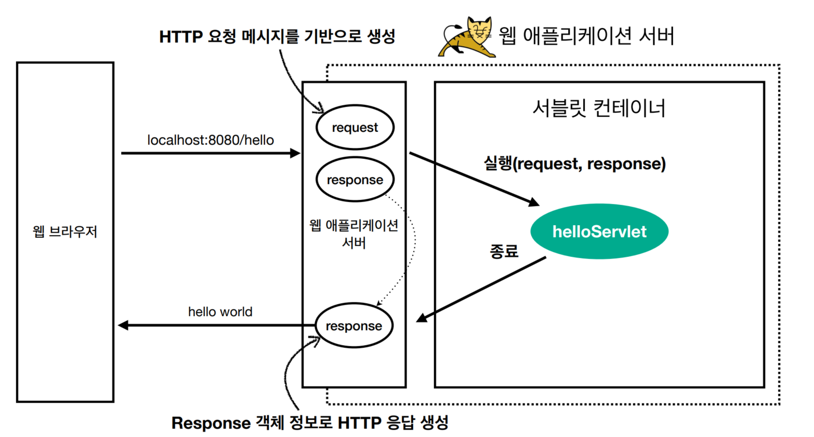

***요청 흐름*** 

*Client HTTP Request →* *WAS(Tomcat) → Servlet Filter* *→* *DispatcherServlet →  HandlerMapping → Spring Interceptor(preHandle) → HandlerAdapter → Controller(Spring MVC)* 

  - *빨간색: 서블릿 컨테이너(톰캣) 영역* 
  - *파란색: 스프링 컨테이너 관여 영역*

# ***스프링 부트 서블릿 환경 구성*** 

***@ServletComponentScan***

  - *스프링 부트가 지원하는 서블릿을 직접 등록해서 사용할 수 있도록 하는 애노테이션* 

```java
@ServletComponentScan 
@SpringBootApplication
public class ServletApplication {
		public static void main(String[] args) {
				SpringApplication.run(ServletApplication.class, args);
		}
}
```

***@WebServlet*** 

```java
@WebServlet(name = "helloServlet", urlPatterns = "/hello")
public class HelloServlet extends HttpServlet {
    @Override
    protected void service(HttpServletRequest request, HttpServletResponse response) throws ServletException, IOException {
        System.out.println("HelloServlet.service");
        System.out.println("request = " + request);
        System.out.println("response = " + response);

        String username = request.getParameter("username");
        System.out.println("username = " + username);

        response.setContentType("text/plain");
        response.setCharacterEncoding("utf-8");
        response.getWriter().write("hello " + username);

    }
}
```

  - ***@WebServlet(name = "helloServlet", urlPatterns = "/hello")***
- *서블릿 애노테이션*
    - *name: 서블릿 이름* 
    - *urlPatterns: URL 매핑*
  - ***HttpServletResponse***
- *WAS가 Content-Length 자동으로 생성*

***HTTP 메시지 로그로 확인하기 - application.properties*** 

```java
logging.level.org.apache.coyote.http11=trace
```

***스프링 부트가 내장 톰켓 서버를 올린다.***

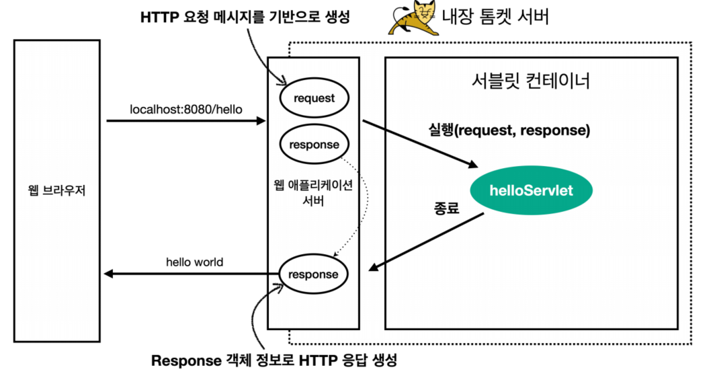

# ***HttpServletRequest*** 

*서블릿: 클라이언트의 HTTP 요청 메시지 개발자 대신 파싱 → HttpServletRequest 제공* 

### ***HttpServeltRequest 기능*** 

  - ***START LINE***
- *HTTP 메소드:* *`request.getMethod()`* 
    - *URL*
- *`request.getRequestURL()`* *→* *`http://localhost:8080/request-header`*
      - *`request.getRequestURI()`* *→* *`/request-header`*
    - *쿼리 스트링* 
- *`request.getQueryString()`*
    - *스키마, 프로토콜 (HTTP / HTTPS)*
- *`request.isSecure()`* *: HTTP → false / HTTPS → true*
  - ***헤더 조회  & 편의 조회*** 
- *`request.getHeaderNames()`* *: 전체 헤더 이름 조회* 
    - *`request.getHeader(String name)`* *: 헤더 이름으로 내용 조회* 

```java
request.getHeaderNames().asIterator().forEachRemaining(
      headerName -> System.out.println( headerName + "= " + request.getHeader(headerName)));  
```

    - *`request.getServerName()`* *: 서버 도메인 이름 → localhost, google.com*
    - *`request.getServerPort()`* *: 서버 포트* 
    - *`request.getLocales()`* *: Accept Languages* 
    - *`request.getLocale()`* *: 우선순위가 가장 높은 언어(Locales)*
    - *`reqeust.getCookies()`* *: 쿠키 조회* 
    - *`request.getContentType()`* *: 요청 본문(body)의 콘텐트 타입 → appication/json*
    - *`request.getContentLength()`* *: 요청 본문(body)의 길이*
    - *`request.getCharacterEncoding()`* *: 요청 본문(body)의 문자 인코딩 → UTF-8*
  - ***바디***
- *form 파라미터* 
    - *message body 직접 조회*
  - ***임시 저장소 Attribute***
- *HTTP 요청이 시작부터 끝날 때 까지 유지되는 임시 저장소* 
    - *`request.setAttribute(name, value)`* 
    - *`request.getAttribute(name)`*
    - *HttpServletRequest는 클라이언트의 요청 마다 생성되기 때문에 동시성 이슈 없이 사용이 가능하다.*
  - ***세션 관리 기능***
- *`request.getSession(create: true)`*

# ***HTTP 요청 데이터 - GET 쿼리 파라미터***

*ex) http://localhost:8080/request-param****?****username=hello&age=20*

  - *username = hello*
  - *age = 20*

***쿼리 파라미터 조회 메서드***

  - *단일 파라미터 조회*
- *`String username = request.getParameter("username");`* 
- *중복이면 getParameterValues() 첫 번째 값 반환*
  - *파라미터 이름 전체 조회*
- *`Enumeration<String> parameterNames = request.getParameterNames();`*
  - *파라미터 Map 조회*
- *`Map<String, String[]> parameterMap = request.getParameterMap();`*
  - *복수 파라미터 조회*
- *`String[] usernames = request.getParameterValues("username");`*

# ***HTTP 요청 데이터 - POST HTML Form***

***특징***

  - *content-type:* ***application/x-www-form-urlencoded***
- *쿼리 파라미터 형식과 같다 → 쿼리 파라미터 조회 메소드를 그대로 사용*
  - *메시지 바디에 쿼리 파리미터 형식으로 데이터를 전달.* 
- *username=hello&age=20*

# ***HTTP 요청 데이터 - API 메시지 바디 - 단순 텍스트***

*HTTP message body에 데이터를 직접 담아서 요청*

  - *HTTP API에서 주로 사용,* ***JSON****, XML, TEXT*
  - *POST, PUT, PATCH*
  - *HTTP 메시지 바디의 데이터를 InputStream을 사용해서 직접 읽을 수 있다*
- *`ServletInputStream inputStream = request.getInputStream();`*

```java
@WebServlet(name = "requestBodyStringServlet", urlPatterns = "/request-body-string")
public class RequestBodyStringServlet extends HttpServlet {
    @Override
    protected void service(HttpServletRequest request, HttpServletResponse response) throws ServletException, IOException {
        ServletInputStream inputStream = request.getInputStream();
        String messageBody = StreamUtils.copyToString(inputStream, StandardCharsets.UTF_8);
        System.out.println("messageBody = " + messageBody);
        response.getWriter().write("ok");
    }
}
```

  - *inputStream은 byte code 즉, 인코딩된 코드를 반환한다.* 
  - *byte 코드 → 디코딩(UTF_8 Charset) → 문자(String)*
- `String messageBody = StreamUtils.copyToString(inputStream, StandardCharsets.UTF_8);`

**문자 전송**

  - *content-type:* ***text/plain***

# ***HTTP 요청 데이터 - API 메시지 바디 - JSON***

***JSON 형식 전송***

  - *content-type:* ***application/json***
  - *message body: {"username": "hello", "age": 20}*

***JSON 형식 파싱***

```java
@Setter @Getter
public class HelloData {
    private String username;
    private int age;
}
```

***byte code → 디코딩 작업(StreamUtils)***

```java
 ServletInputStream inputStream = request.getInputStream();
 String messageBody = StreamUtils.copyToString(inputStream, StandardCharsets.UTF_8);
```

***String → 파싱(ObjectMapper)***

```java
private ObjectMapper objectMapper = new ObjectMapper();

HelloData helloData = objectMapper.readValue(messageBody, HelloData.class);
```

  - ***Jackson 라이브러리(Object Mapper)****: 스프링 부트 기본 제공 라이브러리*

***JSON 결과 파싱*** 

  - *JSON 결과를 파싱해서 사용할 수 있는 자바 객체로 변환하려면* ***Jackson, Gson*** *같은 JSON 변환 라이브러리를 추가해서 사용*

# ***HttpServletResponse***

***헤더 직접 설정*** 

```java
response.setHeader("Content-Type", "text/plain;charset=utf-8");
```

***Status - 상태 코드*** 

```java
response.setStatus(HttpServletResponse.SC_OK); //200
```

  - *HttpServletResponse 인터페이스에 - 상수로 존재* 

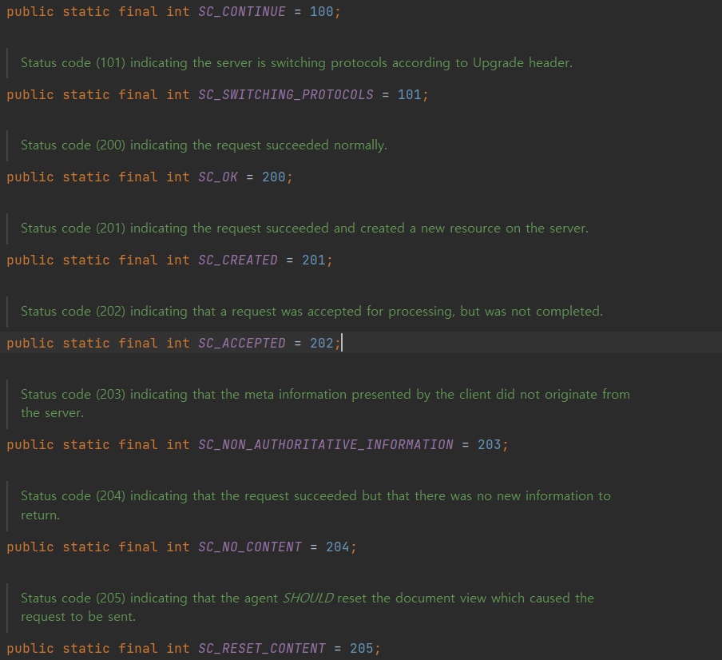

***Content 편의 메서드***

```java
response.setContentType("text/plain");
response.setCharacterEncoding("utf-8");
```

***쿠키 편의 메소드*** 

```java
Cookie cookie = new Cookie("myCookie", "good");
cookie.setMaxAge(600); 
response.addCookie(cookie);
```

***redirect 편의 메서드***

```java
response.sendRedirect("/basic/hello-form.html");
```

# ***HTTP 응답 데이터 - 단순 텍스트, HTML***

***HTTP 응답 메시지 종류***

  - 단순 텍스트 응답
- `writer.println("ok");`
  - HTML 응답
- **content-type: text/html**
  - HTTP API - MessageBody JSON 응답
```java
response.setContentType("application/json");
response.setCharacterEncoding("utf-8");

HelloData helloData = new HelloData();
helloData.setUsername("김영한");
helloData.setAge(30);

String result = objectMapper.writeValueAsString(helloData);

response.getWriter().write(result);
```

    - **content-type: application/json**
    - `String result = objectMapper.writeValueAsString(helloData);` 
- 객체 → JSON

# ***템플릿 엔진*** 

*서블릿 & 자바 코드만으로 HTML을 만들면 너무 불편하다.* 

*HTML 문서에 동적으로 변경해야 하는 부분만 자바 코드를 넣을 수 있다면?* 

*→ 템플릿 엔진* 

***템플릿 엔진 종류***

  - *JSP, Thymeleaf, Freemarker, Velocity*

# ***JSP***

***JSP 라이브러리 추가  build.gradle - 스프링 부트 3.0 이상*** 

```java
implementation 'org.apache.tomcat.embed:tomcat-embed-jasper'
implementation 'jakarta.servlet:jakarta.servlet-api'
implementation 'jakarta.servlet.jsp.jstl:jakarta.servlet.jsp.jstl-api' 
implementation 'org.glassfish.web:jakarta.servlet.jsp.jstl'
```

***회원 등록 폼 - JSP - main/webapp/jsp/members/new-form.jsp***

```java
<%@ page contentType="text/html;charset=UTF-8" language="java" %>
<html>
<head>
 <meta charset="UTF-8">
 <title>Title</title>
</head>
<body>
<form action="save" method="post">
     username: <input type="text" name="username"/>
     age: <input type="text" name="age"/>
     <button type="submit">전송</button>
</form>
</body>
</html>
```

  - **<%@ page contentType="text/html;charset=UTF-8" language="java" %>**
- *JSP 문서를 의미*
  - *실행 - http://localhost:8080/jsp/members/new-form.jsp*
- *현재 JSP 문서는 브라우저에서 직접 접근이 가능하다 쉽게 말해서 서블릿을 통해서 실행하는게 아닌 직접 접근이 가능하다는 뜻이다.* 
    - *하지만* ***WEB-INF*** *하위 디렉토리에 위치하는 JSP 파일은 서블릿을 통해서만 실행이 가능하다.* 
    - *보안이 필요한 JSP 파일은 WEB-INF 디렉토리를 WEBAPP 디렉토리 밑에 만들어서 넣자.*
- */webapp/WEB-INF/views/example.jsp*

***회원 저장 JSP - main/webapp/jsp/members/save.jsp***

```java
<%@ page import="spring.servlet.domain.member.MemberRepository" %>
<%@ page import="spring.servlet.domain.member.Member" %>
<%@ page contentType="text/html;charset=UTF-8" language="java" %>
<%
    MemberRepository memberRepository = MemberRepository.getInstance();

    String username = request.getParameter("username");
    int age = Integer.parseInt(request.getParameter("age"));

    Member member = new Member(username, age);
    memberRepository.save(member);
%>
<html>
<head>
    <title>Title</title>
</head>
<body>
성공
<ul>
    <li>id=<%=member.getId()%></li>
    <li>username=<%=member.getUsername()%></li>
    <li>age=<%=member.getAge()%></li>
</ul>
<a href="/index.html"></a>
</body>
</html>

```

*JSP는 자바 코드를 그대로 다 사용할 수 있다*

  - **<%@ page import="hello.servlet.domain.member.MemberRepository" %>**
- *자바의 import 문과 동일*
  - *<% %>*
- *자바 코드 입력 가능*
  - *<%= %>*
- *자바 코드 출력 가능*

# *서블릿과 JSP의 한계*

*JSP를 보면 비즈니스 로직(자바 코드)과 VIEW 로직(HTML)이 함께 있다.*

*JSP가 너무 많은 역할을 한다.  → 유지보수 지옥 (SRP, OCP 박살)*

###  ***MVC 패턴의 등장 - Mode View Controller***

***컨트롤러***

*HTTP 요청을 받아서 파라미터를 검증하고, 비즈니스 로직을 실행*

*뷰에 전달할 결과 데이터를 조회해서 모델에 담는다*

***모델***

*뷰에 출력할 데이터를 담아둔다*

*뷰가 필요한 데이터를 모두 모델에 담아서 전달해주는 덕분에 뷰는 비즈니스 로직이나 데이터 접근을 몰라도 되고, 화면을 렌더링 하는 일에 집중할 수 있다*

***뷰***

*모델에 담겨있는 데이터를 사용해서 화면을 그리는 일에 집중*

 *HTML을 생성하는 부분*

# ***MVC 패턴 - 적용***

*서블릿 → 컨트롤러* 

*JSP → 뷰*

*HttpServletRequest → 모델* 

***회원 등록 폼 - 컨트롤러***

```java
@WebServlet(name = "mvcMemberFormServlet", urlPatterns = "/servlet-mvc/members/new-form")
public class MvcMemberFormServlet extends HttpServlet {
    @Override
    protected void service(HttpServletRequest request, HttpServletResponse response) throws ServletException, IOException {
        String viewPath = "/WEB-INF/views/new-form.jsp";

        RequestDispatcher dispatcher = request.getRequestDispatcher(viewPath);
        dispatcher.forward(request, response); // 서블릿 -> JSP
    }
}
```

  - ***dispatcher.forward(HttpServletRequest req, HttpServletResponse res)*** 
- *다른 서블릿이나 JSP로 이동할 수 있는 기능, 서버 내부에서 다시 호출 발생* 
    - ***forward:*** *리다이렉트 개념이 아니다. → 클라이언트가 인지 X*

***회원 등록 폼 - 뷰 - main/webapp/WEB-INF/views/new-form.jsp***

```java
<%@ page contentType="text/html;charset=UTF-8" language="java" %>
<html>
<head>
 <meta charset="UTF-8">
 <title>Title</title>
</head>
<body>
<form action="save" method="post">
     username: <input type="text" name="username" />
     age: <input type="text" name="age" />
     <button type="submit">전송</button>
</form>
</body>
</html>

```

  - ***절대 경로 vs 상대 경로*** 
- `/` *로 시작하면 절대 경로* 
    - *절대 경로는 전체 경로를 넣어줘야 한다.* 
    - *상대 경로는 현재 클라이언트 요청 URL이 속한 계층 경로 + save 호출*
  - ***WEB -INF***
- *브라우저가 직접 접근 불가능한 경로* 
    - *항상 서블릿을 통해서 접근이 가능*

# ***MVC 패턴 - 한계***

***1. 각 URL 마다 서블릿 생성이 필요*** 

***2. 포워드 중복*** 

```java
RequestDispatcher dispatcher = request.getRequestDispatcher(viewPath);
dispatcher.forward(request, response);
```

***3. ViewPath에 중복***

```java
String viewPath = "/WEB-INF/views/new-form.jsp";
```

  - *prefix: /WEB-INF/views/*
  - *suffix: .jsp*

***4. 사용하지 않는 코드***

  - *HttpServletRequest request, HttpServletResponse response*
  - *HttpServletRequest , HttpServletResponse를 사용하는 코드는 테스트 케이스를 작성의 어려움*
- *mock 프레임워크를 통해서 서빙해야한다. ex) mockito*

***5. 컨트롤러 공통 처리가 어렵다.***

→ *프론트 컨트롤러 패턴(Front Controller) 패턴*

# ***FrontController 패턴***

***GoF(Gang of Four) 디자인 패턴****에는 포함되지 않는다.* 

*웹 애플리케이션에서 사용되는 아키텍처 패턴* 

***특징***

  - *프론트 컨트롤러 서블릿 하나로 클라이언트의 요청을 받음*
  - *프론트 컨트롤러가 요청에 맞는 컨트롤러를 찾아서 호출*
  - *공통 처리 가능*
  - *프론트 컨트롤러를 제외한 나머지 컨트롤러는 서블릿을 사용하지 않아도 됨*

***스프링 웹 MVC와 프론트 컨트롤러***

  - ***Spring Web MVC DispatcherServlet - FrontController***
- *모든 경로에 mapping → 입구가 하나* 
    - *DispatcherServlet 또한 하나의 Servlet 이다. → HttpServlet 상속*

# *Front Controller 도입 - V1*

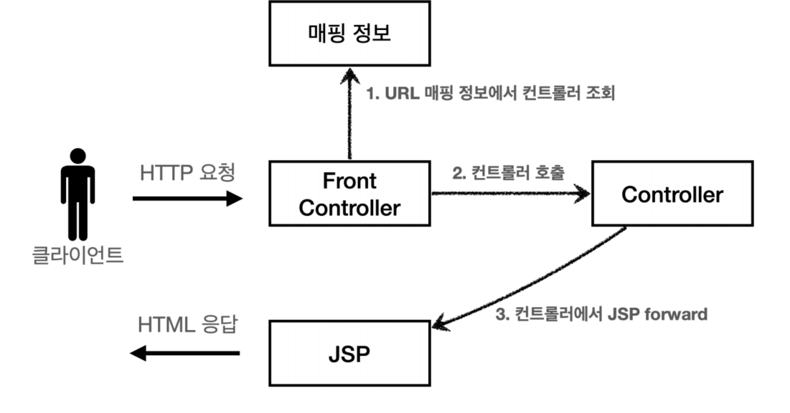

***ControllerV1 - <인터페이스>***

```java
public interface ControllerV1 {
    void process(HttpServletRequest request, HttpServletResponse response) throws ServletException, IOException;
}
```

  - *JSP 파트(섹션3) 서블릿들을 ControllerV1 인터페이스를 구현하도록 변경* 
  - *컨트롤러 로직(forward) 그대로* 

***MemberFormControllerV1 - ControllerV1 구현체*** 

```java
public class MemberFormControllerV1 implements ControllerV1 {
    @Override
    public void process(HttpServletRequest request, HttpServletResponse response) throws ServletException, IOException {
          String viewPath = "/WEB-INF/views/new-form.jsp";
          RequestDispatcher dispatcher = request.getRequestDispatcher(viewPath);
          dispatcher.forward(request, response); // 서블릿 -> JSP
    }
}
```

***FrontControllerServletV1 - <서블릿, FrontController>***

```java
@WebServlet(name = "frontControllerServletV1" , urlPatterns = "/front-controller/v1/*")
public class FrontControllerServletV1 extends HttpServlet {
    private Map<String, ControllerV1> controllerMap = new HashMap<>();
    public FrontControllerServletV1(){
        controllerMap.put("/front-controller/v1/members/new-form", new MemberFormControllerV1());
        controllerMap.put("/front-controller/v1/members/save" , new MemberSaveControllerV1());
        controllerMap.put("/front-controller/v1/members", new MemberListControllerV1());
    }
    @Override
    protected void service(HttpServletRequest request, HttpServletResponse response) throws ServletException, IOException {
        String requestURI = request.getRequestURI();
        ControllerV1 controller = controllerMap.get(requestURI);
        if(controller == null){
            response.setStatus(HttpServletResponse.SC_NOT_FOUND);
            return;
        }
        controller.process(request, response);
    }
}
```

  - ***controllerMap***
- *key: 매핑 URL*
    - *value: 호출될 컨트롤러*
  - ***service()***
- *requestURI를 조회해서 실제 호출할 컨트롤러를 controllerMap에서 찾는다.* 
    - *없으면 → 404 상태 코드 반환* 
    - *있으면 → 컨트롤러 호출 → forward*

# ***View 분리 - v2***

*모든 컨트롤러에서 뷰로 이동하는 부분에 중복이 있고, 깔끔하지 않다*

```java
String viewPath = "/WEB-INF/views/new-form.jsp";
RequestDispatcher dispatcher = request.getRequestDispatcher(viewPath);
dispatcher.forward(request, response);
```

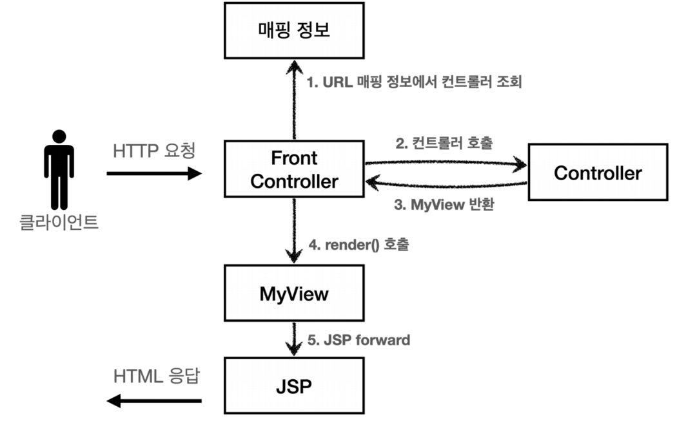

***MyView - Controller 반환 타입***

```java
public class MyView {
    private String viewPath;
    public MyView(String viewPath) {
        this.viewPath = viewPath;
    }
    public void render(HttpServletRequest request, HttpServletResponse response) throws ServletException, IOException {
        RequestDispatcher dispatcher = request.getRequestDispatcher(viewPath);
        dispatcher.forward(request, response);
    }
}    
```

***ControllerV2 - <인터페이스>***

```java
public interface ControllerV2 {
    MyView process(HttpServletRequest request, HttpServletResponse response) throws ServletException, IOException;
}
```

***MemberFormControllerV2 - ControllerV2 구현체*** 

```java
public class MemberFormControllerV2 implements ControllerV2 {
    @Override
    public MyView process(HttpServletRequest request, HttpServletResponse response) throws ServletException, IOException {
        return new MyView("/WEB-INF/views/new-form.jsp");
    }
}
```

  - *각 컨트롤러는 이제 dispatcher.forward()를 직접 생성해서 호출하지 않아도 된다*
  - *단순히 MyView 객체를 뷰이름만 넣어서 생성하고 반환하면 된다.* 

***FrontControllerServletV2 - <서블릿, FrontController>***

```java
@WebServlet(name = "frontControllerServletV2" , urlPatterns = "/front-controller/v2/*")
public class FrontControllerServletV2 extends HttpServlet {
    private Map<String, ControllerV2> controllerMap = new HashMap<>();
    public FrontControllerServletV2(){
        controllerMap.put("/front-controller/v2/members/new-form", new MemberFormControllerV2());
        controllerMap.put("/front-controller/v2/members/save" , new MemberSaveControllerV2());
        controllerMap.put("/front-controller/v2/members", new MemberListControllerV2());
    }
    @Override
    protected void service(HttpServletRequest request, HttpServletResponse response) throws ServletException, IOException {
        String requestURI = request.getRequestURI();

        ControllerV2 controller = controllerMap.get(requestURI);
        if(controller == null){
            response.setStatus(HttpServletResponse.SC_FOUND);
            return;
        }

        MyView view = controller.process(request, response);

        // JSP forward
        view.render(request, response);
    }
}
```

  - *FrontControllerV1과 다르게 controller에서 MyView를 받는다.*
  - *view.render()를 통해 forward 로직을 수행하고 JSP가 실행*

***정리***

  - *프론트 컨트롤러 도입으로 각각의 컨트롤러는 forward 로직 중복이 사라지고 단순히 MyView만 반환한다.*

# ***Model 추가 - v3***

***서블릿 종속성을 제거하자*** 

  - *요청 파라미터 정보는 자바의 Map으로 대신 넘기도록 하면 현재 구조에서 컨트롤러가 서블릿 기술에 의존하지 않을 수 있다.*
  - *request 객체를 Model로 사용하는 대신 Model 객체를 만들어서 반환하면 된다.* 

***뷰 이름 중복 제거***

  - *컨트롤러에서 지정하는 뷰 이름에 중복이 있다.* 
- *prefix: /WEB-INF/view/*
    - *suffix: .jsp*
  - *컨트롤러는 뷰 논리 이름을 반환하고 실제 물리 위치의 이름을 프론트 컨트롤러에서 처리하도록 단순화 하자* 
- */WEB-INF/views/new-form.jsp →  new-form*

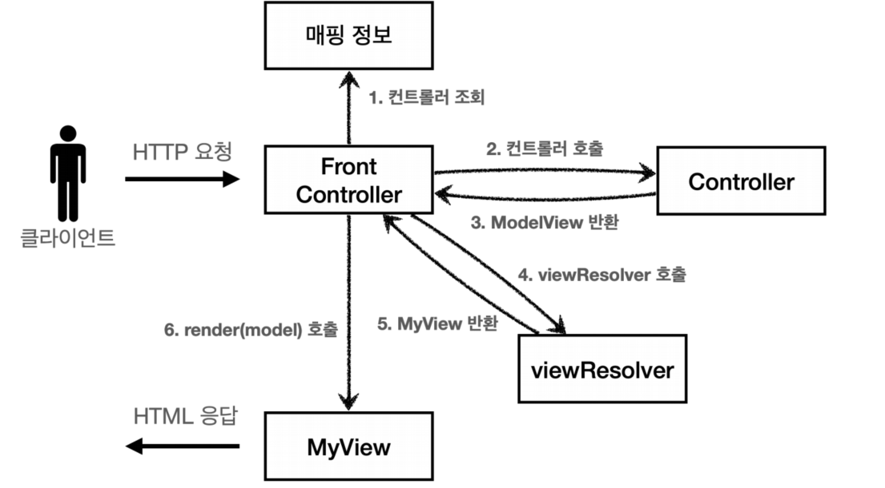

***ModelView***

```java
@Setter @Getter
public class ModelView {
    private String viewName;
    private Map<String, Object> model = new HashMap<>();
    public ModelView(String viewName) {
        this.viewName = viewName;
    }
}
```

  - *model은 단순하게 map이다.* 
  - *뷰에서 필요한 데이터를 key, value로 넣어주면 된다.* 

***ControllerV3 - <인터페이스>***

```java
public interface ControllerV3 {
    ModelView process(Map<String, String> paramMap);
}
```

  - *해당 컨트롤러는 서블릿 기술(HttpServletRequest)을 전혀 사용하지 않는다.*
- *→ 테스트 코드 작성시 테스트 하기 쉽다.* 
    - *서블릿 기술을 사용한다면 mock 객체가 필요하다.*

***MemberListControllerV3- ControllerV3 구현체*** 

```java
public class MemberListControllerV3 implements ControllerV3 {
    MemberRepository memberRepository = MemberRepository.getInstance();
    @Override
    public ModelView process(Map<String, String> paramMap) {
        List<Member> members = memberRepository.findAll();
        ModelView mv = new ModelView("members");
        mv.getModel().put("members", members);
        return mv;
    }
}
```

  - *ModelView 생성자로 뷰 논리 이름을 전달한다.* 
  - *ModelView.getModel() → map → map.put(String, Object) 데이터 추가* 
- *key: “members” value: List<Member>*

***MyView***

```java
public class MyView {
    private String viewPath;

    public MyView(String viewPath) {
        this.viewPath = viewPath;
    }
    public void render(HttpServletRequest request, HttpServletResponse response) throws ServletException, IOException {
        RequestDispatcher dispatcher = request.getRequestDispatcher(viewPath);
        dispatcher.forward(request, response);
    }
    public void render(Map<String, Object> model, HttpServletRequest request, HttpServletResponse response) throws IOException, ServletException{
        modelToRequestAttribute(model, request);

        RequestDispatcher dispatcher = request.getRequestDispatcher(viewPath);
          dispatcher.forward(request, response);
    }

    private static void modelToRequestAttribute(Map<String, Object> model, HttpServletRequest request) {
        model.entrySet().iterator()
                .forEachRemaining(o -> request.setAttribute(o.getKey(), o.getValue()));
    }
}
```

***FrontControllerServletV3 - <서블릿, FrontController>***

```java
@WebServlet(name = "frontControllerServletV3" , urlPatterns = "/front-controller/v3/*")
public class FrontControllerServletV3 extends HttpServlet {
    private Map<String, ControllerV3> controllerMap = new HashMap<>();
    public FrontControllerServletV3(){
        controllerMap.put("/front-controller/v3/members/new-form", new MemberFormControllerV3());
        controllerMap.put("/front-controller/v3/members/save" , new MemberSaveControllerV3());
        controllerMap.put("/front-controller/v3/members", new MemberListControllerV3());
    }
    @Override
    protected void service(HttpServletRequest request, HttpServletResponse response) throws ServletException, IOException {
        String requestURI = request.getRequestURI();

        ControllerV3 controller = controllerMap.get(requestURI);
        if(controller == null){
            response.setStatus(HttpServletResponse.SC_FOUND);
            return;
        }
        HashMap<String, String> paramMap = creteParamMap(request);

        ModelView mv = controller.process(paramMap);

        MyView view = viewResolver(mv);

        // JSP forward
        view.render(mv.getModel(), request, response);
    }

    private static MyView viewResolver(ModelView mv) {
        return new MyView("/WEB-INF/views/" + mv.getViewName() + ".jsp");
    }

    private static HashMap<String, String> creteParamMap(HttpServletRequest request) {
        HashMap<String, String> paramMap = new HashMap<>();
        request.getParameterNames().asIterator().
                forEachRemaining(paramName -> paramMap.put(paramName, request.getParameter(paramName)));
        return paramMap;
    }
}
```

  - **createParamMap()**
- *컨트롤러에 매개변수로 넘겨줄 map을 생성하고 해당 map에 파라미터를 넣는다.*
  - **뷰 리졸버(ViewResovler)**
-  *prefix(WEB-INF/views/) + 컨트롤러가 넣어준 뷰 논리 이름 + suffix(.jsp)*

# ***단순하고 실용적인 컨트롤러 - v4***

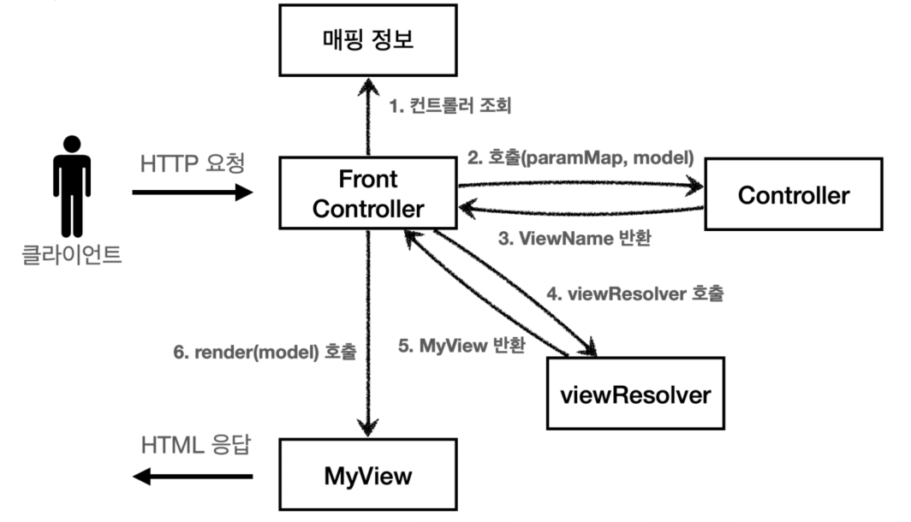

  - *V3 버전에서는 매번 ModelView를 개발자가 생성해서 넘겨야 했지만 V4에서는 ViewName만 반환한다.*

***ControllerV4 - <인터페이스>***

```java
public interface ControllerV4 {
    String process(Map<String , String> paramMap, Map<String, Object> model );
}
```

  - *ModelView를 반환하지 않는다.* 
  - *model 객체를 프론트 컨트롤러에서 생성해서 전달한다. 그냥 사용하고 결과로 뷰의 이름만 반환해주면 된다.* 

***MemberListControllerV4- ControllerV4 구현체*** 

```java
public class MemberListControllerV4 implements ControllerV4 {
    MemberRepository memberRepository = MemberRepository.getInstance();
    @Override
    public String process(Map<String, String> paramMap, Map<String, Object> model) {
        List<Member> members = memberRepository.findAll();
        model.put("members", members);
        return "members";
    }
}
```

  - *모델이 파라미터로 전달되기 때문에, 모델을 직접 생성하지 않아도 된다.*

***FrontControllerServletV4 - <서블릿, FrontController>***

```java
@WebServlet(name = "frontControllerServletV4" , urlPatterns = "/front-controller/v4/*")
public class FrontControllerServletV4 extends HttpServlet {
    private Map<String, ControllerV4> controllerMap = new HashMap<>();
    public FrontControllerServletV4(){
        controllerMap.put("/front-controller/v4/members/new-form", new MemberFormControllerV4());
        controllerMap.put("/front-controller/v4/members/save" , new MemberSaveControllerV4());
        controllerMap.put("/front-controller/v4/members", new MemberListControllerV4());
    }
    @Override
    protected void service(HttpServletRequest request, HttpServletResponse response) throws ServletException, IOException {
        String requestURI = request.getRequestURI();

        ControllerV4 controller = controllerMap.get(requestURI);
        if(controller == null){
            response.setStatus(HttpServletResponse.SC_FOUND);
            return;
        }
        HashMap<String, String> paramMap = creteParamMap(request);
        HashMap<String, Object> model = new HashMap<>();

        String viewName = controller.process(paramMap, model);

        MyView view = viewResolver(viewName);

        // JSP forward
        view.render(model, request, response);
    }
     private static MyView viewResolver(String viewName) {
        return new MyView("/WEB-INF/views/" + viewName + ".jsp");
     }

    private static HashMap<String, String> creteParamMap(HttpServletRequest request) {
        HashMap<String, String> paramMap = new HashMap<>();
        request.getParameterNames().asIterator().
                forEachRemaining(paramName -> paramMap.put(paramName, request.getParameter(paramName)));
        return paramMap;
    }
}
```

  - *단순히 모델을 프론트 컨트롤러에서 생성해서 파라미터로 넘겨주는 아이디어만 적용했는데 깔끔하다.*

# ***유연한 컨트롤러1,2 - v5***

*만약 어떤 개발자는 ControllerV3 방식으로 개발하고 싶고, 어떤 개발자는 ControllerV4 방식으로 개발하고 싶다면 어떻게 해야할까?*

*→ 어댑터 패턴을 적용한다.* 

[*https://20240228.tistory.com/354*](https://20240228.tistory.com/354)

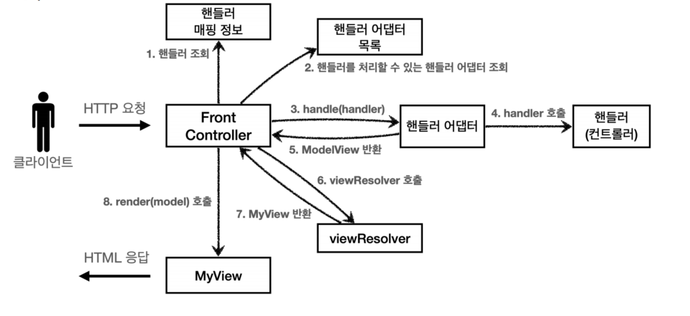

  - *핸들러 어댑터: 중간에 어댑터 역할을 하는 핸들러 어댑터를 추가 핸들러 어댑터 덕분에 다양한 종류의 컨트롤러를 호출할 수 있다.* 

***MyHandlerAdapter - <인터페이스>***

```java
public interface MyHandlerAdapter {
    boolean supports(Object handler);
    ModelView handle(HttpServletRequest request, HttpServletResponse response, Object handler) throws ServletException, IOException;
}
```

  - *boolean supports(Object handler)*
- *어댑터가 해당 컨트롤러를 처리할 수 있는지 판단하는 메소드*
  -  *ModelView handle(HttpServletRequest request, HttpServletResponse response, Object handler)*
- *어댑터는 실제 컨트롤러를 호출하고 그 결과로 ModeView 반환* 
    - *프론트 컨트롤러 → 어댑터 → 컨트롤러*

***ControllerV3HandlerAdapter - ControllerV3 지원하는 어댑터***

```java
public class ControllerV3HandlerAdapter implements MyHandlerAdapter {
    @Override
    public boolean supports(Object handler) {
        return (handler instanceof ControllerV3);
    }
    @Override
    public ModelView handle(HttpServletRequest request, HttpServletResponse response, Object handler) throws ServletException, IOException {
        ControllerV3 controller = (ControllerV3) handler;
        HashMap<String ,String> paramMap = new HashMap<>();
        createParamMap(request, paramMap);

        return controller.process(paramMap);
    }
    private static void createParamMap(HttpServletRequest request, HashMap<String, String> paramMap) {
        request.getParameterNames().asIterator()
                .forEachRemaining(paramName -> paramMap.put(paramName, request.getParameter(paramName)));
    }
}
```

  - *V3 형식에 맞게 컨트롤러를 호출한다.* 
  - *V3는 ModelView 반환* 

***ControllerV4HandlerAdapter - ControllerV4 지원하는 어댑터***

```java
public class ControllerV4HandlerAdapter implements MyHandlerAdapter {
    @Override
    public boolean supports(Object handler) {
        return (handler instanceof ControllerV4);
    }

    @Override
    public ModelView handle(HttpServletRequest request, HttpServletResponse response, Object handler) throws ServletException, IOException {
        ControllerV4 controller = (ControllerV4) handler;
        HashMap<String, String> paramMap = new HashMap<>();
        createParamMap(request, paramMap);

        HashMap<String, Object> model = new HashMap<>();
        String viewName = controller.process(paramMap, model);

        ModelView mv = new ModelView(viewName);
        mv.setModel(model);
        return mv;
    }
    private static void createParamMap(HttpServletRequest request, HashMap<String, String> paramMap) {
        request.getParameterNames().asIterator()
                .forEachRemaining(paramName -> paramMap.put(paramName, request.getParameter(paramName)));
    }
}
```

  - *V4 형식에 맞게 컨트롤러를 호출한다.* 
  - *V4 뷰 논리 이름만 반환, 파라미터로 model을 넘긴다.* 
  - *ModeView 생성해서 생성자 파라미터에 뷰 논리 이름을 넣고 모델 또한 set 한다.* 

***FrontControllerServletV5 - <서블릿, FrontController>***

```java
@WebServlet(name = "frontControllerServletV5", urlPatterns = "/front-controller/v5/*")
public class FrontControllerServletV5 extends HttpServlet {
    private final Map<String , Object> handlerMappingMap = new HashMap<>();
    private final List<MyHandlerAdapter> handlerAdapters = new ArrayList<>();

    public FrontControllerServletV5() {
        initHandlerMappingMap();
        initHandlerAdapters();
    }
    @Override
    protected void service(HttpServletRequest request, HttpServletResponse response) throws ServletException, IOException {

        Object handler = getHandler(request);
        if(handler == null){
            response.setStatus(HttpServletResponse.SC_NOT_FOUND);
            return;
        }

        MyHandlerAdapter adapter =  getHandlerAdapter(handler);

        ModelView mv = adapter.handle(request, response, handler);
        MyView myView = new MyView(viewResolver(mv));
        myView.render(mv.getModel(), request, response);
    }

    private static String viewResolver(ModelView mv) {
        return "/WEB-INF/views/" + mv.getViewName() + ".jsp";
    }

    private MyHandlerAdapter getHandlerAdapter(Object handler) {
        for (MyHandlerAdapter handlerAdapter : handlerAdapters) {
              if(handlerAdapter.supports(handler)){
                  return handlerAdapter;
              }
        }
        throw new IllegalArgumentException("handler adapter not found. handler=" + handler);
    }

    private Object getHandler(HttpServletRequest request) {
        String requestURI = request.getRequestURI();
        return handlerMappingMap.get(requestURI);
    }

    private void initHandlerAdapters() {
        handlerAdapters.add(new ControllerV3HandlerAdapter());
        handlerAdapters.add(new ControllerV4HandlerAdapter());
    }

    private void initHandlerMappingMap() {
        handlerMappingMap.put("/front-controller/v5/v3/members/new-form", new MemberFormControllerV3());
        handlerMappingMap.put("/front-controller/v5/v3/members/save" , new MemberSaveControllerV3());
        handlerMappingMap.put("/front-controller/v5/v3/members", new MemberListControllerV3());

        handlerMappingMap.put("/front-controller/v5/v4/members/new-form", new MemberFormControllerV4());
        handlerMappingMap.put("/front-controller/v5/v4/members/save" , new MemberSaveControllerV4());
        handlerMappingMap.put("/front-controller/v5/v4/members", new MemberListControllerV4());
    }
}
```

  - ***핸들러 매핑 정보***

```java
private final Map<String, Object> handlerMappingMap = new HashMap<>();
```

  - ***핸들러 매핑*** 

```java
Object handler = getHandler(request)

private Object getHandler(HttpServletRequest request) {
	 String requestURI = request.getRequestURI();
	 return handlerMappingMap.get(requestURI);
}
```

  - ***핸들러를 처리할 수 있는 어댑터 조회***

```java
MyHandlerAdapter adapter = getHandlerAdapter(handler)

for (MyHandlerAdapter adapter : handlerAdapters) {
		 if (adapter.supports(handler)) {
				 return adapter;
		 }
}
```

  - **어댑터 호출**

```java
ModelView mv = adapter.handle(request, response, handler);
```

# **정리**

*지금까지 v1 ~ v5로 점진적으로 프레임워크를 발전*

  - *v1: 프론트 컨트롤러를 도입*
  - *v2: View 분류*
  - *v3: Model 추가*
- *서블릿 종속성 제거*
    - *뷰 이름 중복 제거*
- *prefix, suffix*
  - *v4: 단순하고 실용적인 컨트롤러*
- *구현 입장에서 ModelView를 직접 생성해서 반환하지 않도록 편리한 인터페이스 제공*
  - *v5: 유연한 컨트롤러*
- *어댑터 도입*
    - *어댑터를 추가해서 프레임워크를 유연하고 확장성 있게 설계*
- *OCP, SRP*

*스프링 MVC는 거의 같은 구조를 가지고 있다.*

# ***스프링 MVC 구조 정리*** 

***Spring MVC***

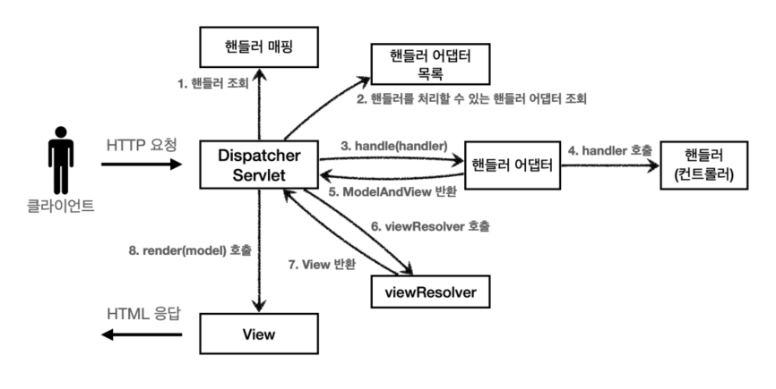

***DistpatcherServlet 흐름***

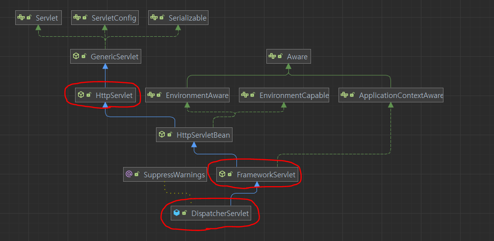

*HttpServlet service() 호출*

*FrameworkServlet service() 오버라이드* 

*FrameworkServlet.service()를 시작으로 여러 메서드가 호출 → DispatcherServlet.doDispatch()*

***DispatcherServlet.doDispatch()  뷰 랜더링 흐름 분석***

```java
// 1. handler(controller) 조회 
mappedHandler = getHandler(processedRequest);
if (mappedHandler == null) {
		noHandlerFound(processedRequest, response);
		return;
}

// 2. adapter 조회 
HandlerAdapter ha = getHandlerAdapter(mappedHandler.getHandler());

// 3. 핸들러 어댑터 실행 -> 4. 핸들러 어댑터에서 핸들러 실행 -> 5. ModelAndView 반환
mv = ha.handle(processedRequest, response, mappedHandler.getHandler());

// ***DispatcherServlet.doDispatch() -> DispatcherServlet.processingDispatchResult()***

// 6. 뷰 렌더링 호출 
render(mv, request, response);

// ***DispatcherServlet.processingDispatchResult() -> DispatcherServlet.render()***

// 7. 뷰 리졸버 뷰 찾기, View 반환 
view = resolveViewName(viewName, mv.getModelInternal(), locale, request);

// 8. 뷰 랜더링
view.render(mv.getModelInternal(), request, response);
```


***동작 순서 정리*** 

  1. *핸들러 조회: 핸들러 매핑을 통해 요청 URL에 매핑된 핸들러(컨트롤러)를 조회*
  1. *핸들러 어댑터 조회: 핸들러를 실행할 수 있는 핸들러 어댑터를 조회*
  1. *핸들러 어댑터 실행: 핸들러 어댑터를 실행*
  1. *핸들러 실행: 핸들러 어댑터가 실제 핸들러를 실행*
  1. *ModelAndView 반환: 핸들러 어댑터는 핸들러가 반환하는 정보를 ModelAndView로 변환해서 반환*
  1. *viewResolver 호출: 뷰 리졸버를 찾고 실행*
  1. *View 반환: 뷰 리졸버는 뷰의 논리 이름을 물리 이름으로 바꾸고, 렌더링 역할을 담당하는 뷰 객체를 반환*
  1. *뷰 렌더링: 뷰를 통해서 뷰를 렌더링*

***DispatcherServlet 확장*** 

*DispatcherServlet이 사용하는 핸들러 매핑(HandlerMapping), 핸들러 어댑터(HandlerAdapter), 뷰 리졸버(ViewResolver), 뷰(View) 모두 인터페이스 기반이다.* 

*클라이언트(DispatcherServlet)의 코드 변경 없이 인터페이스를 구현해서 제공하여 기능을 추가할 수 있다.* 

*이는 Spring MVC 구조가 OCP가 잘 지켜지고 있다고 볼 수 있다. 또한 각 인터페이스들은 역할과 책임이 명확하고 잘 분리되어 있다. 이는 SRP 관점에서도 좋은 아키텍처이다.* 

# ***핸들러 매핑과 핸들러 어댑터***

***과거 버전의 스프링 컨트롤러*** 

```java
public interface Controller {
		ModelAndView handleRequest(HttpServletRequest request, HttpServletResponse response) throws Exception;
}

@Component("/springmvc/old-controller")
public class OldController implements Controller {
    @Override
    public ModelAndView handleRequest(HttpServletRequest request, HttpServletResponse response) throws Exception {
        System.out.println("OldController.handleRequest");
        return new ModelAndView("new-form");
    }
}
```

  - `@Component("/springmvc/old-controller")` 
- *빈의 이름으로 URL 매핑*

*해당 인터페이스를 구현한 컨트롤러가 존재한다면?*

*스프링 DispatcherServlet은 어떻게 해당 컨트롤러를 실행할까?*

  - *HandlerMapping*
- *핸들러 매핑에서 해당 컨트롤러가 존재*
  - *HandlerAdapter*
- *핸들러 매핑을 통해서 찾은 컨트롤러를 실행할 수 있는 핸들러 어댑터가 존재*

## ***스프링 부트가 자동 등록하는 핸들러 매핑과 핸들러 어댑터***

***HandlerMapping***

```java
0 = RequestMappingHandlerMapping : 애노테이션 기반의 컨트롤러인 @RequestMapping
1 = BeanNameUrlHandlerMapping : 스프링 빈의 이름으로 핸들러
```

***HandlerAdapter***

```java
0 = RequestMappingHandlerAdapter : 애노테이션 기반의 컨트롤러인 @RequestMapping
1 = HttpRequestHandlerAdapter : HttpRequestHandler 처리
2 = SimpleControllerHandlerAdapter : Controller 인터페이스(애노테이션X, 과거에 사용) 처리
```

***OldController - Controller 인터페이스 구현체***

  - *HandlerMapping = BeanNameUrlHandlerMapping*
  - *HandlerAdapter = SimpleControllerHandlerAdapter*

***HttpRequestHandler***

```java
public interface HttpRequestHandler {
		void handleRequest(HttpServletRequest request, HttpServletResponse response) throws ServletException, IOException;
}

@Component("/springmvc/request-handler")
public class MyHttpRequestHandler implements HttpRequestHandler {
    @Override
    public void handleRequest(HttpServletRequest request, HttpServletResponse response) throws ServletException, IOException {
        System.out.println("MyHttpRequestHandler.handleRequest");
    }
}
```

  - *HandlerMapping = BeanNameUrlHandlerMapping*
  - *HandlerAdapter = HttpRequestHandlerAdapter*

***@RequestMapping - 가장 우선순위가 높다***

  - *HandlerMapping = RequestMappingHandlerMapping*
  - *HandlerAdapter = RequestMappingHandlerAdapter*

# ***뷰 리졸버***

 ***InternalResourceViewResolver - 뷰 리졸버 설정*** 

  - *application.properties/yaml에 등록한 spring.mvc.view.prefix , spring.mvc.view.suffix 설정 정
보를 사용해서 등록*
```java
spring.mvc.view.prefix=/WEB-INF/views/
spring.mvc.view.suffix=.jsp
```
  - *설정하지 않는다면 전체 경로를 주자*
- `return new ModelAndView("/WEB-INF/views/뷰 이름.jsp");`

***스프링 부트가 자동 등록하는 뷰 리졸버***

```java
1 = BeanNameViewResolver : 빈 이름으로 뷰를 찾아서 반환. (엑셀 파일 생성 기능에 사용)
2 = InternalResourceViewResolver : JSP를 처리할 수 있는 뷰를 반환 (forward)
```

  - *타임리프: ThymeleafViewResolver*

# ***스프링 MVC - 시작하기***

***@RequestMapping***

  - *RequestMappingHandlerMapping*
  - *RequestMappingHandlerAdapter*
  - *가장 우선순위가 높은 핸들러 매핑, 핸들러 어댑터 List에 첫 번째로 들어간다.*
```java
// DispatcherServlet

@Nullable
private List<HandlerMapping> handlerMappings;

@Nullable
private List<HandlerAdapter> handlerAdapters;
```

***스프링 부트 3.0 이상 vs 미만***

  - *스프링 부트 3.0 이상에서는 @Controller 애노테이션이 있어야지 스프링 컨트롤러로 인식* 
  - *스프링 부트 3.0 미만은 @RequestMapping 존재해도 컨트롤러로 인식* 

***요약*** 

  - *@RequestParam - 요청 파라미터를 받을 수 있다.*
- *QueryString*
    - *application/x-www-form-urlencoded: POST HTML Form*
  - *Model - 메소드 요청 매개변수로 받을 수 있다.* 
  - *여러가지 HttpMethod 제공* 
  - *@Controller + String → view 논리 이름 반환* 
  - *메소드 단위로 @RequestMapping 적용 가능* 
- *공통 경로는 클래스 레벨에 @RequestMapping 적용*

*이런 여러가지 컨트롤러의 메소드 파라미터를 어떻게 처리?*

*→* ***HandlerMethodArgumentResolver - 인터페이스*** 

**흐름**

***DispatcherServlet*** → ***HandlerMapping → HandlerAdapter → HandlerMethodArgumentResolver***

***→ Controller(Handler)***

### Welcome Page

  - *환경: SpringBoot + 배포 방식(Jar)*
  - */resources/static/index.html → 자동으로 Welcome 페이지* 

# ***로깅***

***개요***

  - *스프링 부트 라이브러리를 사용하면 스프링 부트 로깅 라이브러리가 함께 포함된다.*
- *spring-boot-starter-logging*

***스프링 부트 로깅 라이브러리*** 

  - *SLF4J, Logback*
  - *실무에서는 Logback 대부분 사용* 

***로그 라이브러리*** 

  - *Logback, Log4J, Log4J2 등등 많은 라이브러리 존재* 
  - *많은 로깅 라이브러리를 통합해서 인터페이스(SLF4J)로 제공* 

***로그 생성 방법 2가지***

```java
public class LogTestController {
		 private final Logger log = LoggerFactory.getLogger(getClass());
		 // 생략 ..
}

@Slf4j
public class LogTestController {
	   // 생략 ..
}  
```

  1. *LoggerFactory.getLogger(Class<?> clazz)* 
  1. *@Slf4j* 

***로그 레벨*** 

  - *LEVEL: TRACE > DEBUG > INFO > WARN > ERROR*

```java
@GetMapping("/log-test")
public String logTest(){
    String name = "spring";
    log.trace("trace log={}", name);
    log.debug("debug log={}", name);
    log.info("info log={}", name);
    log.warn("warn log={}", name);
    log.error("error log={}", name);
    return "ok";
}
```

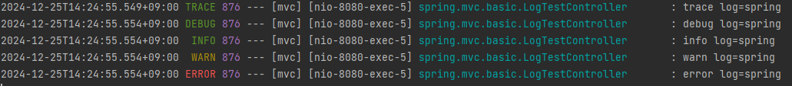

  - ***출력 포멧:*** *시간, 로그 레벨, 프로세스 ID, 스레드 명, 클래스명, 로그 메시지* 

***로그 레벨 설정 예시 - application.properties***

```java
logging.level.root=info

logging.level.spring.mvc=trace
```

  - *logging.level.root=info → 전체 로그 레벨 설정 default: info level*
  - *logging.level.spring.mvc=trace → spring.mvc 패키지 및 하위 패키지 로그 레벨 trace 설정* 

***로그 사용시 장점***

  - *쓰레드 정보, 클래스 이름 같은 부가 정보를 함께 볼 수 있고, 출력 모양을 조정할 수 있다*
  - *상황에 맞게 로그 레벨이 조정 가능하다.* 
  - *콘솔에만 출력하는 것이 아닌, 파일이나 네트워크 등 별도의 위치에 남길 수 있다.* 
  - *성능도 일반 System.out 보다 좋다*

# ***요청 매핑***

### *@RequestMapping*

***스프링 부트 3.0 이후***

  - *매핑: /hello-basic  → URL 요청: /hello-basic*
  - *매핑: /hello-basic/ → URL 요청: /hello-basic/*

***HTTP 메서드 매핑***

```java
@RequestMapping(value = "/mapping-get-v1", method = RequestMethod.GET)
public String mappingGetV1() {
		 return "ok";
}
```

 

***HTTP 405 상태코드(Method Not Allowed)를 반환***

  - *매핑된 HTTP 메소드가 아닌 HTTP 요청을 하면 405 반환* 

***HTTP 메서드 매핑 축약***

  - *@GetMapping*
  - *@PostMapping*
  - *@PutMapping*
  - *@DeleteMapping*
  - *@PatchMapping*

### ***PathVariable - 경로 변수*** 

***data ≠ userId***

```java
@GetMapping("/mapping/{userId}")
public String mappingPath(@PathVariable("userId") String data) {
		 return "ok";
}
```

  - *@PathVariable 이름: userId와 파라미터 data가 달라서 생략이 불가능하다* 

***생략 버전*** 

```java
@GetMapping("/mapping/{userId}")
public String mappingPath(@PathVariable("userId") String userId) {
		 return "ok";
}
```

***PathVariable 사용 - 다중***

```java
@GetMapping("/mapping/users/{userId}/orders/{orderId}")
public String mappingPath(@PathVariable String userId, @PathVariable Long orderId) {
		 return "ok";
}
```

### ***특정 파라미터 조건 매핑*** 

```java
@GetMapping(value = "/mapping-param", params = "mode=debug")
public String mappingParam() {
     log.info("mappingParam");
     return "ok";
}
```

  - *GET http://localhost:8080/mapping-param?mode=debug → 200 status*
  - *GET http://localhost:8080/mapping-param?mode=debugs → 400 status Bad Request*
- *UnsatisfiedServletRequestParameterException: Parameter conditions "mode=debug" not met for actual request parameters: mode={debugs}*

### ***특정 헤더 조건 매핑*** 

```java
@GetMapping(value = "/mapping-header", headers = "mode=debug")
public String mappingHeader(){
    return "ok";
}
```

  - *요청 파라미터와 똑같은 메커니즘이다.* 

***인텔리제이 HTTP Client 테스트*** 

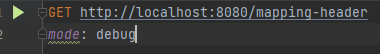

  - *200 status return body → ok*


  - *404 status NOT FOUND*
  - *Header 값 자체가 없다.* 

### ***미디어 타입 조건 매핑 - HTTP 요청 Content-Type, consume***

```java
@PostMapping(value = "/mapping-consume", consumes = "application/json")
public String mappingConsumes() {
	  return "ok";
}
```

  - *여러가지 표현식이 적용 가능하다.* 
- `consumes="application/*"` 
    - `consumes="!application/json"`

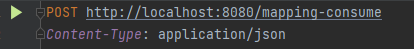

  - 200 status

***MediaType 상수 사용하기*** 

```java
@PostMapping(value = "/test", consumes = MediaType.APPLICATION_JSON_VALUE)
public String jsonConsumes(){
	  return "ok";
}
```

***Unsupported Media Type***

  - *HTTP 요청의 Content-Type 헤더를 기반으로 미디어 타입으로 매핑*
  - *맞지 않으면 HTTP 415 상태코드(Unsupported Media Type)을 반환*

### ***미디어 타입 조건 매핑 - HTTP 요청 Accept, produce***


***HTTP 요청에서 Accept 헤더는 클라이언트가 서버에 요청할 때 원하는 응답 데이터의 타입(Media Type)을 지정하는 데 사용***


```java
@PostMapping(value = "/mapping-produce", produces = "text/html")
public String mappingProduces() {
    return "ok";
}
```

  - *HTTP 요청의 Accept 헤더를 기반으로 미디어 타입으로 매핑*

***Not Acceptable***

  - *클라이언트가 원하는 응답 데이터 타입에 맞는 매핑이 없으면 HTTP 406 상태코드(Not Acceptable)을 반환한다.*

# ***HTTP 요청 - 기본, 헤더 조회***

### ***헤더 조회***

```java
@RequestMapping("/headers")
public String headers(HttpServletRequest request,
                      HttpServletResponse response,
                      HttpMethod httpMethod,
                      Locale locale,
                      @RequestHeader MultiValueMap<String , String> headerMap,
                      @RequestHeader("host") String host,
                      @CookieValue(value = "myCookie", required = false) String cookie){

    log.info("request={}", request);
    log.info("response={}", response);
    log.info("httpMethod={}", httpMethod);
    log.info("locale={}", locale);
    log.info("headerMap={}", headerMap);
    log.info("header host={}", host);
    log.info("myCookie={}", cookie);

    return "ok";
}
```

  - *HttpMethod : HTTP 메서드를 조회*
  - *Locale*
- ***Accept-Language****: ko-KR, en-US;q=0.8, ja;q=0.6*
    - *ko-KR이 가장 우선순위가 높다.* 
    - *Locale → ko-KR*
  - *@RequestHeader MultiValueMap<String, String> headerMap*
- *모든 HTTP 헤더를* ***MultiValueMap*** *형식으로 조회*
  - *@RequestHeader("host") String host*
- *특정 HTTP 헤더를 조회*
    - *속성*
- *필수 값 여부: required*
      - *기본 값 속성: defaultValue*
  - *@CookieValue(value = "myCookie", required = false) String cookie*
- *특정 쿠키를 조회*
    - *속성은 @RequestHeader와 동일*

# ***HTTP 요청 파라미터 - 쿼리 파라미터, HTML Form***

### ***요청 파라미터 조회*** 

```java
@Controller
public class RequestParamController {
    @RequestMapping("/request-param-v1")
    public void requestParamV1(HttpServletRequest request, HttpServletResponse response) throws IOException{
        String username = request.getParameter("username");
        int age = Integer.parseInt(request.getParameter("age"));
        log.info("username = {}, age= {}", username, age);
        response.getWriter().write("ok");
    }
```

  - *@Controller & 반환타입 void → VIEW 조회를 하지 않는다.* 
  - *HttpServletRequest  직접 가져오기* 

### ***HTTP 요청 파라미터 - @RequestParam***

```java
@RequestMapping("/request-param-v2")
public String requestParamV2(
		 @RequestParam("username") String username,
		 @RequestParam("age") int memberAge) {
		 
		 log.info("username={}, age={}", username, memberAge);
		 return "ok";
}
```

  - *@RequestParam : 파라미터 이름으로 바인딩*
  -  *@RequestParam("username") String username →  @RequestParam String username*
- *HTTP 파라미터 이름이 변수 이름과 같으면 생략 가능*
  - *String, Integer, int 같은 단순 값 타입이면 @RequestParam도 생략 가능하다.* 
- *생략하면 스프링 MVC는 내부에서 required=false를 적용*
    - *나는 과하다고 생각한다. → @RequestParam 까지는 있어야 한다고 생각*

### ***파라미터를 Map으로 조회하기 - requestParamMap***

```java
@ResponseBody
@RequestMapping("/request-param-map")
public String requestParamMap(@RequestParam Map<String, Object> paramMap){
        log.info("username = {}, age = {}", paramMap.get("username"), paramMap.get("age"));
        return "ok";
}
```

  - *파라미터를 Map, MultiValueMap으로 조회할 수 있다*

# ***HTTP 요청 파라미터 - @ModelAttribute***

***요청 파라미터를 바인딩 받을 객체***

```java
@Data
public class HelloData {
    private String username;
    private int age;
}
```

***@Data***

  - ***@Getter*** 
  - ***@Setter*** 
  - ***@ToString*** 
  - ***@EqualsAndHashCode*** 
  - ***@RequiredArgsConstructor***

```java
@ResponseBody
@RequestMapping("/model-attribute-v1")
public String modelAttributeV1(@ModelAttribute HelloData helloData){
    log.info("hello data = {}", helloData);
    log.info("username = {}, age = {}", helloData.getUsername(), helloData.getAge());
    return "ok";
}
```

  - *@ModelAttribute 또한 생략이 가능하다.*

***스프링MVC는 @ModelAttribute 동작 방식*** 

  1. *HelloData 객체를 생성*
  1. *요청 파라미터의 이름으로 HelloData 객체의 프로퍼티를 찾는다*
  1. *해당 프로퍼티의 setter를 호출해서 파라미터의 값을 입력(바인딩) 한다*

# ***HTTP 요청 메시지 - 단순 텍스트***

  - *요청 파라미터와 다르게, HTTP 메시지 바디를 통해 데이터가 직접 넘어오는 경우는 @RequestParam ,@ModelAttribute를 사용할 수 없다.*
  -  *HTML Form 형식으로 전달되는 경우는 요청 파라미터로 인정*

### *HttpServletRequest, HttpServletResponse*

```java
@PostMapping("/request-body-string-v1")
public void requestBodyString(HttpServletRequest request, HttpServletResponse response) throws IOException{
    ServletInputStream inputStream = request.getInputStream();
    String message = StreamUtils.copyToString(inputStream, StandardCharsets.UTF_8);
    response.getWriter().write("ok");
}
```

  1. *HttpServletRequest: getInputStream() → ServeletInputStream*
  1. *StreamUtils.copyToString(inputStream, StandardCharsets.UTF_8) → String*
- *인코딩된 바이트 코드를 UTF-8로 디코딩 작업*

### ***InputStream, Writer***

```java
@PostMapping("/request-body-string-v2")
public void requestBodyStringV2(InputStream inputStream, Writer responseWriter) throws IOException{
    String message = StreamUtils.copyToString(inputStream, StandardCharsets.UTF_8);
    responseWriter.write("ok");
}
```

  - *InputStream(Reader): HTTP 요청 메시지 바디의 내용을 직접 조회*
  - *OutputStream(Writer): HTTP 응답 메시지의 바디에 직접 결과 출력*

### ***HttpEntity - (RequestEntity, ResponseEntity)***

```java
`@PostMapping("/request-body-string-v3")
  public HttpEntity<String> requestBodyStringV3(HttpEntity<String> httpEntity) throws IOException{
      String message = httpEntity.getBody();
      log.info("message = {}", message);
      return new HttpEntity<>("ok");
  }
```

  - *HttpEntity는 요청 파라미터로 받을 수 있고 응답으로도 사용이 가능하다.*
  - *클라이언트 요청 메시지 바디를 getBody()를 통해 가져올 수 있다.* 

***RequestEntity***

  - *HttpEntity를 상속받은 클래스*
  - *HttpMethod, url 정보가 추가, 요청에서 사용*

***ResponseEntity***

  - *HttpEntity를 상속받은 클래스*
  - *HTTP 상태 코드 설정 가능, 응답에서 사용*

### *@RequestBody, @ResponseBody*

```java
@ResponseBody
@PostMapping("/request-body-string-v4")
public String requestBodyStringV4(@RequestBody String message){
    log.info("message = {}", message);
    return "ok";
}
```

***@RequestBody***

  - HTTP 메시지 바디 정보를 편리하게 조회할 수 있다. 
  - 요청 헤더 정보가 필요하면 HttpEntity, RequestEntity, @RequestHeader를 사용하자

***@ResponseBody***

  - *@ResponseBody를 사용하면 응답 결과를 HTTP 메시지 바디에 직접 담아서 전달할 수 있다*

***요청 파라미터 vs HTTP 메시지 바디***

  - *요청 파라미터를 조회하는 기능: @RequestParam , @ModelAttribute*
  - *HTTP 메시지 바디를 직접 조회하는 기능: @RequestBody*

# ***HTTP 요청 메시지 - JSON***

### ***ObjectMapper***

```java
private ObjectMapper objectMapper = new ObjectMapper();
```

  - *스프링 부트 기본 제공 ObjectMapper (Jackson 라이브러리)*

### ***HttpServletRequest, HttpServletResponse***

```java
@PostMapping("/request-body-json-v1")
public void requestBodyJsonV1(HttpServletRequest request, HttpServletResponse response) throws IOException{
    ServletInputStream inputStream = request.getInputStream();
    String messageBody = StreamUtils.copyToString(inputStream, StandardCharsets.UTF_8);

    log.info("messageBody = {}", messageBody);

    HelloData helloData = objectMapper.readValue(messageBody, HelloData.class);
    log.info("username = {}, age = {}", helloData.getUsername(), helloData.getAge());

    response.getWriter().write("ok");
}
```

### ***@RequestBody - String & ObjectMapper***

```java
@ResponseBody
@PostMapping("/request-body-json-v2")
public String requestBodyJsonV2(@RequestBody String messageBody) throws IOException{
    log.info("messageBody = {}", messageBody);
    HelloData helloData = objectMapper.readValue(messageBody, HelloData.class);
    log.info("username = {}, age = {}", helloData.getUsername(), helloData.getAge());
    return "ok";
}
```

### ***@RequestBody - Object***

```java
@ResponseBody
@PostMapping("/request-body-json-v3")
public String requestBodyJsonV3(@RequestBody HelloData helloData){
    log.info("username = {}, age = {}", helloData.getUsername(), helloData.getAge());
    return "ok";
}
```

  - *@RequestBody 생략이 불가능하다. 생략하면 자동으로 @ModeAttribute가 적용*

###  ***HttpEntity***

```java
@PostMapping("/request-body-json-v4")
public HttpEntity<String> requestBodyJsonV4(HttpEntity<HelloData> httpEntity){
    HelloData helloData = httpEntity.getBody();
    log.info("username = {}, age = {}", helloData.getUsername(), helloData.getAge());
    return new HttpEntity<>("ok");
}
```

### ***@ResponseBody***

```java
@ResponseBody
@PostMapping("/request-body-json-v5")
public HelloData requestBodyJsonV5(@RequestBody HelloData helloData){
    log.info("username = {}, age = {}", helloData.getUsername(), helloData.getAge());
    return helloData;
}
```

### ***주의***

*HTTP 요청시에 content-type 헤더가 application/json인지 꼭 확인해야 한다.* 

*→ 그래야 JSON을 처리할 수 있는 HTTP 메시지 컨버터가 실행된다.*

# ***HTTP 응답 - 정적 리소스, 뷰 템플릿***

### ***리소스 경로***

*src/main/resources 는 리소스를 보관하는 곳이고, 또 클래스패스의 시작 경로*

***정적 리소스 경로***

*src/main/resources/static*

***뷰 템플릿 경로***

*src/main/resources/templates*

### ***Thymeleaf 스프링 부트 설정***

***build.gradle***

```java
`implementation 'org.springframework.boot:spring-boot-starter-thymeleaf`
```

  - *스프링 부트가 자동으로 ThymeleafViewResolver와 필요한 스프링 빈들을 등록한다.* 

***application.properties***

```java
spring.thymeleaf.prefix=classpath:/templates/
spring.thymeleaf.suffix=.html
```

  - *default 설정이다.*

# *⭐HTTP 메시지 컨버터* 

### ***@ResponseBody 사용***

  - *HTTP의 BODY에 문자 내용을 직접 반환*
  - *viewResolver 대신에 HttpMessageConverter가 동작*
  - *기본 문자처리: StringHttpMessageConverter*
  - *기본 객체처리: MappingJackson2HttpMessageConverter*
  - *byte 처리 등등 기타 여러 HttpMessageConverter가 기본으로 등록되어 있음*

*클라이언트의 HTTP Accept 헤더와 서버의 컨트롤러 반환 타입 정보 둘을 조합해서* 

*HttpMessageConverter가 선택된다.*

### ***HttpMessageConverter - interface***

```java
public interface HttpMessageConverter<T> {
		boolean canRead(Class<?> clazz, @Nullable MediaType mediaType);
		
		boolean canWrite(Class<?> clazz, @Nullable MediaType mediaType);
		
		List<MediaType> getSupportedMediaTypes();
		
		T read(Class<? extends T> clazz, HttpInputMessage inputMessage) throws IOException, HttpMessageNotReadableException;
		
		void write(T t, @Nullable MediaType contentType, HttpOutputMessage outputMessage) throws IOException, HttpMessageNotWritableException;
}
```

***HTTP 메시지 컨버터는 HTTP 요청, HTTP 응답 둘 다 사용된다.***

  - *canRead() , canWrite() : 메시지 컨버터가 해당 클래스, 미디어타입을 지원하는지 체크*
  - *read() , write() : 메시지 컨버터를 통해서 메시지를 읽고 쓰는 기능*

***스프링 부트 기본 메시지 컨버터***

```java
0 = ByteArrayHttpMessageConverter
1 = StringHttpMessageConverter 
2 = MappingJackson2HttpMessageConverter
```

### ***ByteArrayHttpMessageConverter***

  - *byte[] 데이터를 처리*
  - *요청 예) @RequestBody byte[] data*
  - *응답 예) @ResponseBody return byte[] / 쓰기 / 미디어타입* ***application/octet-stream***

### ***StringHttpMessageConverter***

  - *String 문자로 데이터를 처리*
  - *클래스 타입: String*
  - *요청 예) @RequestBody String data*
  - *응답 예) @ResponseBody return "ok" 쓰기  /미디어타입* ***text/plain***

### ***MappingJackson2HttpMessageConverter***

  - *클래스 타입: 객체 또는 HashMap , 미디어타입* ***application/json 관련***
  - *요청 예) @RequestBody HelloData data*
  - *응답 예) @ResponseBody return helloData 쓰기 / 미디어타입* ***application/json 관련***

# ***요청 매핑 헨들러 어뎁터 구조***

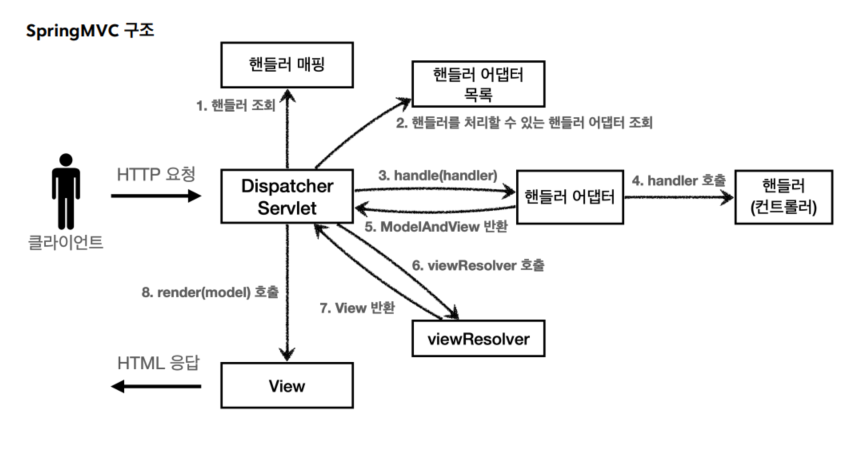

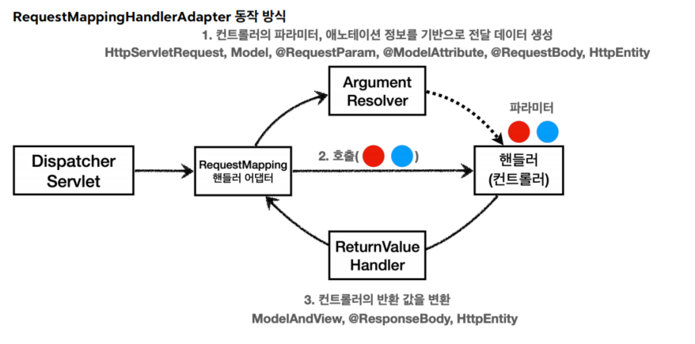

### ***ArgumentResolver***

*애노테이션 기반의 컨트롤러는 매우 다양한 파라미터를 사용할 수 있다.*

*이렇게 파라미터를 유연하게 처리할 수 있는 이유가 바로 ArgumentResolver 덕분이다.*

*애노테이션 기반 컨트롤러를 처리하는* ***RequestMappingHandlerAdapter****는 ArgumentResolver를 호출해서 컨트롤러(핸들러)가 필요로 하는 다양한 파라미터의 값(객체)을 생성한다.*

*그리고 파리미터의 값이 모두 준비되면 컨트롤러를 호출하면서 값을 넘겨준다.*

*스프링은 30개가 넘는 ArgumentResolver를 기본으로 제공한다*

*정확히는 HandlerMethodArgumentResolver인데 줄여서 ArgumentResolver라고 부른다.*

### ***HandlerMethodArgumentResolver - interface***

```java
public interface HandlerMethodArgumentResolver {
		boolean supportsParameter(MethodParameter parameter);
		
		@Nullable
		Object resolveArgument(MethodParameter parameter, @Nullable ModelAndViewContainer mavContainer,
			      NativeWebRequest webRequest, @Nullable WebDataBinderFactory binderFactory) throws Exception;
}
```

***동작 설명***

*ArgumentResolver의 supportParameter()를 호출해서 해당 파라미터를 지원하는지 체크하고, 지원하면 resolveArgument()를 호출해서 실제 객체를 생성한다. 생성된 객체는 핸들러 어뎁터가 컨트롤러 호출시 넘어간다.*

***ReturnValueHandler***

***HandlerMethodReturnValueHandler****를 줄여서 ReturnValueHandler 라 부른다*

*ArgumentResolver 와 비슷한데, 이것은 응답 값을 변환하고 처리한다.*

# ***HTTP 메시지 컨버터***

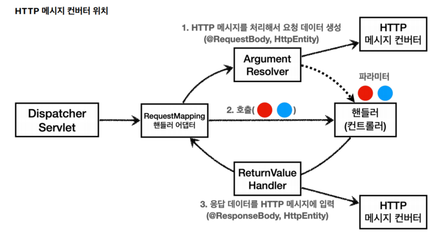

***요청을 예시***

  1. *@RequestBody가 필요한 컨트롤러에 요청이 온다.*
  1. *해당 파라미터 처리가 가능한 ArgumentResolver는 요청 파라미터 객체 생성을 위해 HTTP 메시지 컨버터를 사용한다.*
  1. *메시지 컨버터가 객체를 생성해서 반환한다.*
  1. *HandlerAdapter는 필요한 파라미터 객체가 모두 생성되면 핸들러를 호출한다.*

# ***확장***

*스프링은 다음을 모두 인터페이스로 제공한다. 따라서 필요하면 언제든지 기능을 확장할 수 있다*

  - *HandlerMethodArgumentResolver*
  - *HandlerMethodReturnValueHandler*
  - *HttpMessageConverter*

***WebMvcConfigurer 확장***

```java
@Bean
public WebMvcConfigurer webMvcConfigurer() {
		 return new WebMvcConfigurer() {
					 @Override
					 public void addArgumentResolvers(List<HandlerMethodArgumentResolver> resolvers) {
							 //...
					 }
					 @Override
					 public void extendMessageConverters(List<HttpMessageConverter<?>> converters) {
					 //...
					 }
		 };
}
```

# ***ObjectMapper***

*JSON 데이터를 Java 객체로 변환하거나 그 반대로 변환하는 데 사용*

*JSON ↔ Java 객체 간 직렬화 및 역직렬화*

*Spring Boot의 기본 Jackson 라이브러리에서 제공하며 REST API에서 JSON 데이터를 처리하는 데 자주 사용*

***주요 메소드***

  - *`readValue()`* *- JSON 데이터를 Java 객체로 변환*
  - *`writeValueAsString()`* *- Java 객체를 JSON 문자열로 변환*
  - *`writeValueAsBytes()`* *- Java 객체를 JSON 바이트 배열로 변환*

# ***ModelMapper***

*서로 다른 Java 객체 간의 변환에 사용*

*ex) DTO(Data Transfer Object)를 Entity로 변환하거나 그 반대의 작업을 수행할 때 사용*

*객체 간 매핑을 간단하고 자동화된 방식으로 수행*

*필드 이름이 유사하거나 규칙적으로 연결되어 있을 때 유용*

***특징***

  - *복잡한 매핑 규칙도 커스터마이징 가능*
  - *필드와 필드 간의 타입 변환도 지원*

# ***ObjectMapper vs ModelMapper***

| **특징** | **ObjectMapper** | **ModelMapper** |
| --- | --- | --- |
| **주요 목적** | JSON ↔ Java 객체 변환 | Java 객체 ↔ Java 객체 변환 |
| **주요 사용 시점** | REST API에서 JSON 데이터 처리 | DTO ↔ Entity 변환 |
| **의존성** | Jackson (Spring Boot 기본 포함) | 별도 라이브러리 추가 필요 |
| **유연성** | JSON 구조에 강하게 의존 | 필드 이름이 비슷할 때 매핑 간단 |
| **커스터마이징** | JsonSerializer/Deserializer 사용 가능 | 커스터마이징 매핑 규칙 정의 가능 |

```java
@PostMapping("/add")
public String addItemV2(@ModelAttribute("item") Item item) {
		 itemRepository.save(item);
		 return "basic/item";
}
```

***@ModelAttribute - 요청 파라미터 처리***

*@ModelAttribute는 Item 객체를 생성하고, 요청 파라미터의 값을 프로퍼티 접근법(setXxx)으로 입력해준다*

***@ModelAttribute - Model 추가***

*@ModelAttribute 는 중요한 한가지 기능이 더 있는데, 바로 모델(Model)에 @ModelAttribute로 지정한 객체를 자동으로 넣어준다*

***ModelAttribute 이름 생략***

```java
@PostMapping("/add")
public String addItemV3(@ModelAttribute Item item) {
		 itemRepository.save(item);
		 return "basic/item";
}
```

*@ModelAttribute 의 이름을 생략하면 모델에 저장될 때 클래스명을 사용한다.* 

*이때 클래스의 첫글자만 소문자로 변경해서 등록한다*

*Item → item*

***ModelAttribute 전체 생략***

```java
@PostMapping("/add")
public String addItemV4(Item item) {
		 itemRepository.save(item);
		 return "basic/item";
}
```

*@ModelAttribute 자체도 생략가능하다. 대상 객체는 모델에 자동 등록된다.* 

*나머지 사항은 기존과 동일*

# ***PRG Before***

***웹 브라우저의 새로 고침***

*→ 마지막에 서버에 전송한 데이터를 다시 전송한다.*

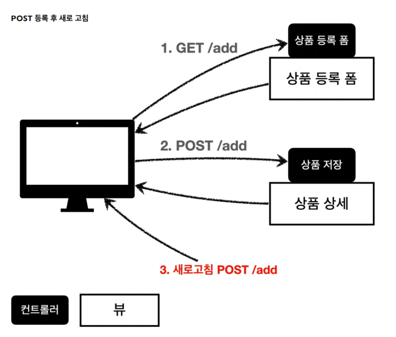

  1. *GET /add → 상품 등록 view return*
  1. *POST / add → 상품 저장 & 상품 상세 view return* 
  1. *새로고침 → POST /add* 

*마지막 요청이 POST /add 여서 ID만 다른 상품 데이터가 계속 쌓이게 된다.* 

# ***PRG After***

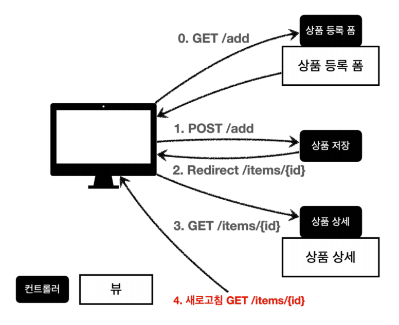

  1. *GET /add → 상품 등록 view return*
  1. *POST / add → 상품 저장 & redirect 상품 상세* 
  1. *GET /items{id} → 상품 상세 view return* 
  1. *새로고침 → GET /items{id}*

*마지막 새로 고침은 GET /items{id}로서 이제 새로 고침을 반복해도 데이터 저장 문제는 없다.*

*이런 문제 해결 방식을* ***PRG - Post/Redirect/Get****라 한다.*

# ***남은 문제점***

```java
@PostMapping("/add")
public String addItemV5(Item item) {
		 itemRepository.save(item);
		 return "redirect:/basic/items/" + item.getId();
}
```

*현재 redirect URL 변수를 보면 문자열을 직접 더해서 사용하고 있다.* 

*이런 방식은 URL 인코딩이 되지 않기 때문에 안전하지 않을 수 있다.* 
*특히,* *`item.getId()`**에 특수 문자나 공백 등이 포함되어 있는 경우, URL 형식이 깨지거나 보안 문제가 발생할 수 있다.*

***URL 인코딩***

특수 문자를 안전하게 표현하기 위해 사용하는 표준화된 방식 

ex) & 같은 문자는 URL에서 특정한 의미(쿼리 파라미터의 구분자)를 가지므로 URL에 그대로 사용하면 오류를 초래할 수 있다.

  - `&` → `%26` (인코딩 결과)

# ***RedirectAttributes***

```java
@PostMapping("/add")
public String addItemV6(Item item, RedirectAttributes redirectAttributes) {
		 Item savedItem = itemRepository.save(item);
		 redirectAttributes.addAttribute("itemId", savedItem.getId()); // PathVariable 
		 redirectAttributes.addAttribute("status", true); // Query String 추가 
		 return "redirect:/basic/items/{itemId}";
}
```

→ `http://localhost:8080/basic/items/3?status=true`

***RedirectAttributes 기능***

  - *URL 인코딩 기능*
  - *PathVariable 처리* 
  - *쿼리 파라미터(스트링) 처리*

