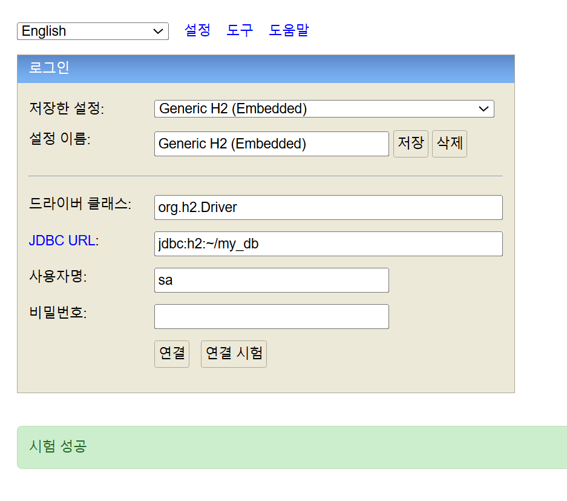
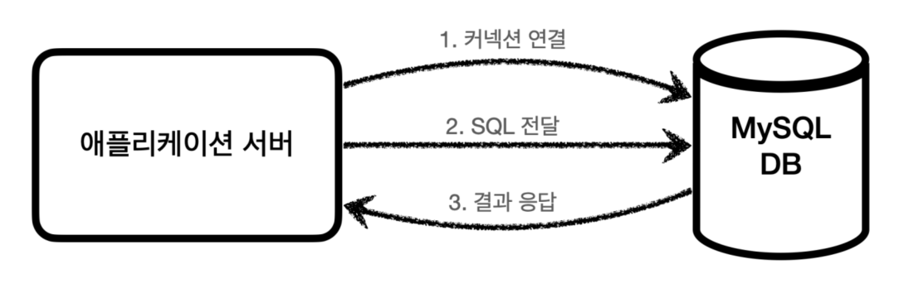
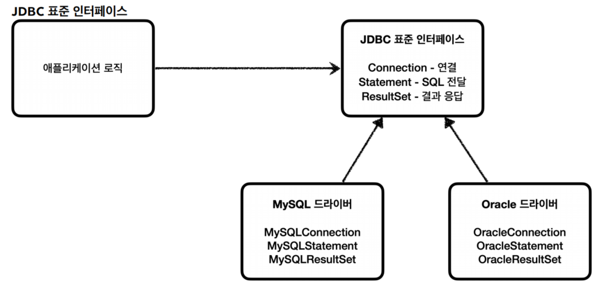
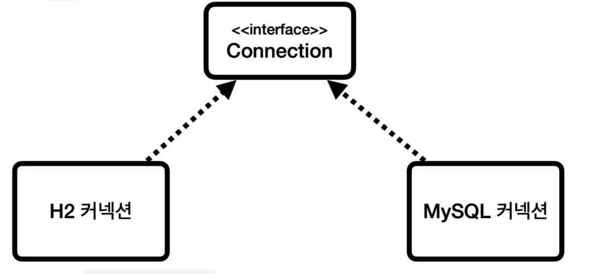
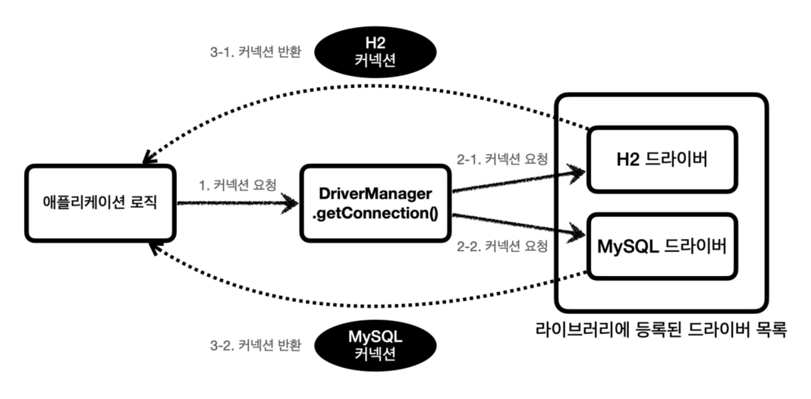

***dependency***

```groovy
dependencies {
	 implementation 'org.springframework.boot:spring-boot-starter-jdbc'
	 compileOnly 'org.projectlombok:lombok'
	 runtimeOnly 'com.h2database:h2'
	 annotationProcessor 'org.projectlombok:lombok'
	 testImplementation 'org.springframework.boot:spring-boot-starter-test'
	 
	 //테스트에서 lombok 사용
	 testCompileOnly 'org.projectlombok:lombok'
	 testAnnotationProcessor 'org.projectlombok:lombok'
}
```

# ***H2 데이터베이스 설정***

***윈도우 실행: h2 database 설치경로 → bin 폴더 이동*** 

- *./h2.bat*

***데이터베이스 생성 방법***

- *사용자명, 비밀번호 입력* 
- *jdbc:h2:~/db_name*
- *연결 시험: → 오류 발생* 
  - *연결을 직접 누른다*
- *db_name.mv.db 파일 생성 확인*
- 이후 접속 *jdbc:h2/tcp://localhost/~/db_name*

***참고: H2 데이터베이스가 정상 생성되지 않을 때***

- *H2 데이터베이스 재실행*
- *웹 브라우저가 자동 실행되면 주소창 앞 부분 localhost로 변경* 
- *jdbc:h2:~/db_name*
- 이후 접속 *jdbc:h2/tcp://localhost/~/db_name*

***연결 시험***



# ***JDBC 이해***



- *커넥션 연결: TCP/IP를 사용하여 커넥션 연결* 
- *3-way-handshake*
- *SQL 전달: 애플리케이션 서버는 DB가 이해할 수 있는 SQL을 연결된 커넥션을 통해 DB에 전달*
- *결과 응답: DB는 전달된 SQL을 수행하고 그 결과를 응답*

***문제는 각 DB마다 커넥션을 연결하는 방법, SQL 전달하는 방법, 결과를 응답 받는 방법이 모두 다르다.***

- *데이터베이스를 다른 종류의 데이터베이스로 변경하면 애플리케이션 서버에 개발된 데이터베이스 사용 코드도 함께 변경*
- *개발자가 각각의 데이터베이스마다 커넥션 연결, SQL 전달, 그리고 그 결과를 응답 받는 방법을 새로 학습*

*→ 이런 문제를 해결하기 위해 JDBC 등장*

# ***JDBC 표준 인터페이스***

***JDBC(Java Database Connectivity)는*** *자바에서 데이터베이스에 접속할 수 있도록 하는 자바 API*



***JDBC 제공 인터페이스*** 

- *java.sql.Connection* 
- *java.sql.Statement*
- *java.sql.ResultSet* 

***JDBC 드라이버?***

- *해당 JDBC 인터페이스를 각각의 DB에 맞도록 구현해서 라이브러리로 제공, 이것을 JDBC 드라이버라 한다. (MySQL 드라이버, Oracle 드라이버)*

***표준화의 한계***

- *각각의 데이터베이스마다 SQL, 데이터타입 등의 일부 사용법 다르다.*
- *ANSI SQL이라는 표준이 있기는 하지만 일반적인 부분만 공통화했기 때문에 한계가 있다.*
- *결국 데이터베이스를 변경하면 JDBC 코드는 변경하지 않아도 되지만 SQL은 해당 데이터베이스에 맞도록 변경해야한다.*
- *JPA(Java Persistence API)를 사용하면 각각의 데이터베이스마다 다른 SQL을 정의해야 하는 문제도 많은 부분 해결할 수 있다.*

# ***JDBC와 최신 데이터 접근 기술***

*JDBC 오래된 기술이고 사용하는 방법도 복잡하다.*

*최근에는 JDBC를 직접 사용하기 보다는 JDBC를 편리하게 사용하는 다양한 기술이 존재*

→ ***SQL Mapper, ORM*** 

***SQL Mapper(JdbcTemplate, MyBatis)***

- *장점: JDBC를 편리하게 사용하도록 도와준다.*
- *SQL 응답 결과를 객체로 편리하게 변환*
  - *JDBC의 반복 코드를 제거*
- *단점: 개발자가 SQL을 직접 작성*
- *이게 정말 단점일까?*

***ORM 기술(JPA, 하이버네이트, 이클립스링크)***

- ORM은 객체를 관계형 데이터베이스 테이블과 매핑해주는 기술
- *개발자는 반복적인 SQL을 직접 작성하지 않고, ORM 기술이 개발자 대신에 SQL을 동적으로 만들어 실행해준다*
- *각각의 데이터베이스마다 다른 SQL을 사용하는 문제도 중간에서 해결해준다*
- *JPA는 ORM 표준 인터페이스 구현체로 하이버네이트, 이클립스 링크 등이 있다.* 

# *JDBC DriverManager 연결 이해*

```java
Connection connection = DriverManager.getConnection(URL, USERNAME, PASSWORD);
```

- *throws SQLException*

***JDBC 커넥션 인터페이스와 구현***



- *JDBC는 java.sql.Connection 표준 커넥션 인터페이스를 정의*
- *H2 데이터베이스 드라이버는 JDBC Connection 인터페이스를 구현한 org.h2.jdbc.JdbcConnection 구현체를 제공*



*JDBC가 제공하는 DriverManager는 라이브러리에 등록된 DB 드라이버들을 관리하고, 커넥션을 획득하는 기능을 제공한다.*

1. *애플리케이션 로직에서 커넥션이 필요하면 DriverManager.getConnection()을 호출*
1. *DriverManager는 라이브러리에 등록된 드라이버 목록을 자동으로 인식, 해당 드라이버들에게 순서대로 url, name, password 정보를 넘겨서 커넥션을 획득할 수 있는지 확인*
1. *각각의 드라이버는 URL 정보를 체크해서 본인이 처리할 수 있는 요청인지 확인하고 처리할 수 있으면 DB에 커넥션을 요청하고 본인이 처리할 수 없으면 다음 드라이버에게 순서를 넘긴다.*
1. *이렇게 찾은 커넥션 구현체가 클라이언트(애플리케이션 서버)에 반환된다.*

# ***JDBC 개발 - 등록***

***member.sql***

```sql
drop table member if exists cascade;
create table member (
		 member_id varchar(10),
		 money integer not null default 0,
		 primary key (member_id)
);
```

***Member***

```java
@Data
@NoArgsConstructor
@AllArgsConstructor
public class Member {
    private String memberId;
    private int money;
}
```

***MemberRepositoryV0 - 회원 등록***

```java
@Slf4j
public class MemberRepositoryV0 {
		private static Connection getConnection() {
        return DBConnectionUtil.getConnection();
    }
    public Member save(Member member) throws SQLException{
        String sql = "insert into member(member_id, money) values (?, ?)";

        Connection con = null;
        PreparedStatement pstmt = null;

        try {
            con = getConnection();
            pstmt = con.prepareStatement(sql);
            pstmt.setString(1, member.getMemberId());
            pstmt.setInt(2, member.getMoney());
            int count = pstmt.executeUpdate(); 

            return member;
        }
        catch (SQLException e){
            log.error("db error", e.getMessage());
            throw e;
        }
        finally {
             close(con, pstmt, null);
        }
    }
    private void close(Connection con, Statement stmt, ResultSet rs) throws SQLException{
        if(rs != null){
            try {
                rs.close();
            }
            catch (SQLException e){
                log.error("db error", e);
            }
        }
        if(stmt != null){
            try {
                stmt.close();
            }
            catch (SQLException e){
                log.error("db error", e);
            }
        }
        if(con != null){
            try {
                con.close();
            }
            catch (SQLException e){
                log.error("db error", e);
            }
        }
    }
}
```

***커넥션 획득***

- *getConnection() DriverManager를 통해서 획득*

***save() 로직 정리*** 

- *sql: 데이터베이스에 전달한 insert SQL 정의*
- *pstmt = con.prepareStatement(sql)*
- *데이터베이스에 전달할 SQL과 파라미터로 전달할 데이터 준비*
- *pstmt.setString(1, member.getMemberId())* 
    - *pstmt.setInt(2, member.getMoney())*
-  *int count = pstmt.executeUpdate();* 
- *Statement를 통해 준비된 SQL을 커넥션을 통해 실제 데이터베이스에 전달*
  - *executeUpdate()은 int를 반환하는데 영향받은 DB row 수를 반환*

***PrepareStatement extends Statemet <interface>***

- *PreparedStatement는 Statement 의 자식 타입*
- *? 와일드 카드를 통한 파라미터 바인딩을 가능하게 해준다.*
- *파라미터 바인딩에서* ***SQL Injection 공격을 예방****한다.*
- *PrepareStatement가 아닌 Statement를 사용하고 파라미터 바인딩을 문자열 더하기를 통해서 하면 만약 공격자가 정상값이 아닌 추가 쿼리를 날렸을 때 그대로 subquery가 날라간다.*
- ***성능 최적화***
- *동일한 쿼리를 여러 번 실행할 때 쿼리를 매번 파싱하지 않고, 미리 컴파일된 쿼리를 재사용하므로 성능이 향상*

***close()***

- *close() 메소드를 보면 자원 획득 역순으로 정리를 하고있다.*
- *각 자원에 대해 try catch를 하는 이유는 자원 정리 예외 발생에 대한 격리를 위함이다.*

***데이터 변경(추가): INSERT, DELETE, UPDATE***

- *executeUpdate()*

***데이터 조회: SELECT*** 

- *executeQuery()*
- *ResultSet 반환 next()로 iterator 같이 사용 가능* 
  - *Select 쿼리 결과랑 같은 순서대로 반환*

