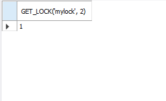

# *5.2 MySQL 엔진의 잠금*

*MySQL에서 사용되는 잠금은 크게 스토리지 엔진 레벨과 MySQL 엔진 레벨로 나눌 수 있다.* 

*MySQL 엔진 레벨에서의 잠금은 모든 스토리지 엔진에 영향이 간다.* 

*하지만 스토리지 엔진의 잠금은 해당 스토리지 엔진에만 영향이 간다.*

*MySQL 엔진에서는 테이블 데이터 동기화를 위한 테이블 락 말고도 테이블의 구조를 잠그는* ***메타데이터 락(Metadata Lock)*** *그리고 사용자의 필요에 맞게 사용할 수 있는* ***네임드 락(Named Lock)*** *기능도 제공한다.* 

# *5.2.1 글로벌 락*

***글로벌 락(Global Lock)****은* *`FLUSH TABLES WITH READ LOCK`* *명령으로 획득이 가능하다.* 

*MySQL에서 제공하는 잠금 가운데 가장 범위가 크다. (MySQL 서버 전체)*

*한 세션에서 글로벌 락을 획득하면 다른 세션에는 SELECT(조회)를 제외한 대부분의 DDL/DML 쿼리가 대기 상태로 남는다.*

 

*여러 데이터베이스에 존재하는 MyISAM, MEMORY 테이블에 대해* *`mysqldump`* *로 일관된 백업을 받아야 할 때 글로벌 락을 사용한다.*

***읽기 잠금 / 쓰기 잠금***

| **특성** | **읽기 잠금 (READ LOCK)** | **쓰기 잠금 (WRITE LOCK)** |
| --- | --- | --- |
| **허용 작업** | SELECT(읽기 작업)<br>데이터 변경이 없는 조회 작업 | 잠금을 획득한 클라이언트의 쓰기 작업만 허용 |
| **차단 작업** | INSERT, UPDATE, DELETE **(DML)**<br>CREATE, DROP, ALTER **(DDL)**<br>SELECT ... FOR UPDATE | 모든 읽기 작업 (SELECT 포함)<br>다른 모든 쓰기 작업 (DML, DDL) |
| **잠금 획득 가능 수** | 여러 클라이언트가 동시에 읽기 잠금을 획득 가능 | 단 하나의 클라이언트/트랜잭션만 쓰기 잠금 획득 가능 |
| **목적** | 데이터 변경을 막고 안정적인 읽기 작업 보장<br>데이터 백업 시 일관성 유지 | 데이터 변경 작업 보호<br>충돌 방지 및 데이터 일관성 보장 |
| **효과** | SELECT는 동시 실행 가능<br>쓰기 작업은 대기 상태로 전환 | 다른 모든 읽기/쓰기 작업이 대기 상태로 전환 |
| **사용 예시** | 데이터 백업<br>안정적인 데이터 조회 | 중요한 데이터 변경 작업 수행<br>경쟁 조건(race condition) 방지 |

*`FLUSH TABLES WITH READ LOCK`* ***주의점***

해당 명령은 MySQL 서버에 존재하는 모든 테이블을 닫고 잠금을 건다. 

*`FLUSH TABLES WITH READ LOCK`* *명령은 모든 테이블에 대하여 읽기 잠금을 걸기 전에 테이블을 플러시(디스크 I/O) 해야 하므로 데이터의 일관성을 위해 실행중인 모든 종류의 쿼리가 완료되어야 한다.* 

*즉, 특정 쿼리가 장시간 진행되고 있다면 장시간 대기한다.*

### ***백업 락*** 

*`FLUSH TABLES WITH READ LOCK`* *명령을 이용한 글로벌 락은 MySQL 서버의 모든 변경 작업을 멈춘다.* 

*하지만 MySQL 서버가 업그레이드 하면서 InnoDB 스토리지 엔진의 사용이 일반화됐다.*

*InnoDB 스토리지 엔진은 트랜잭션을 지원하기 때문에 일관된 데이터 상태를 위해 모든 데이터 변경 작업을 멈출 필요는 없다.*

*그래서 MySQL 8.0 부터는 백업 툴을 위해 더 가벼운 글로벌 락인 백업 락이 도입됐다.*

```sql
LOCK INSTANCE FOR BACKUP;
# 백업 실행 --> 
UNLOCK INSTANCE;
```

*백업 락은 테이블의 스키마, 사용자의 인증 관련 정보를 변경할 수 없게 된다.* 

*일반적인 테이블의 데이터 변경은 가능하다.* 

*일반적인 MySQL 서버의 구성은* ***소스 서버(Source server)****,* ***레플리카 서버(Replica Server)****로 구성되는데, 주로 백업은 레플리카 서버에서 실행된다. (소스 서버의 부하 때문에)*

*레플리카 서버에 백업 락을 걸어서 DDL 명령이 실행되면 복제를 중지하는 역할을 한다.*  

*즉, 백업을 완료하고 백업 락 반납 이후에 복제(DDL 명령을 레플리카 서버에 적용)를 한다*

*기존의 글로벌 락을 사용했다면 레플리카 서버에서 백업을 하다가 DDL 명령이 소스 서버에 적용되고 레플리카 서버에는 백업이 실패하게 된다.* 

# *5.2.2 테이블 락*

*테이블 락(Table Lock)은 개별 테이블 단위로 설정되는 잠금이다.*

*명시적, 묵시적으로 락을 획득할 수 있다.*

***명시적 테이블 락 획득, 반납***

```sql
LOCK TABLES table_name [READ | WRITE]

UNLOCK TABLES
```

*명시적인 테이블 락은 특별한 상황이 아니면 애플리케이션에서 사용할 필요가 거의 없다.*

***묵시적 락***

*MyISAM, MEMORY 스토리지 엔진은 테이블에 데이터를 변경하는 쿼리를 실행하면 MySQL 서버가 데이터가 변경되는 테이블에 잠금을 설정하고 데이터를 변경한 후, 즉시 잠금을 해제하는 형태로 사용된다.*

*InnoDB 스토리지 엔진 같은 경우 레코드 기반의 잠금을 제공하기 때문에 단순 데이터 변경 쿼리로 인해 묵시적인 테이블 락이 설정되지는 않는다. (DDL에서는 영향을 준다.)*

# *5.2.3 네임드 락* 

***네임드 락(Named Lock)****은* *`GET_LOCK`* *함수를 이용해 임의의 문자열에 대해 잠금을 설정할 수 있다.*

*네임드 락은 단순히 사용자가 지정한 문자열(String)에 대해 획득하고 반납하는 잠금이다.*

*자주 사용되지 않는다.*

***example***

*DB 서버 1대에 웹 서버 5대가 접속해서 서비스하는 상황에서 5대의 웹 서버가 어떤 정보를 동기화해야 하는 요건처럼 여러 클라이언트가 상호 동기화를 처리해야 할 때 네임드 락을 이용하면 쉽게 해결할 수 있다.*

```sql
`-- mylock 이라는 문자열에 대해 잠금을 획득 

-- 이미 잠금을 사용 중이라면 2초 동안 대기한다. (2초 이후에 자동 잠금 해제)
SELECT GET_LOCK('mylock', 2);

-- mylock 이라는 문자열에 대해 잠금이 설정돼 있는지 확인 
SELECT IS_FREE_LOCK('mylock');

-- mylock 이라는 문자열에 대해 획득했던 잠금을 반납(해제)한다.
SELECT RELEASE_LOCK('mylock');

-- 3개 함수 모두 정상적으로 락을 획득하거나 반납하면 1, 아니면 null/0 반납
```



*네임드 락의 경우 복잡한 조건으로 레코드를 한꺼번에 많이 변경할 때 사용한다.*

*MySQL 8.0 부터는 네임드 락을 중첩해서 사용할 수 있다.*

# *5.2.4 메타데이터 락*  

***메타데이터 락(Metadata Lock)****은 데이터베이스 객체(테이블, 뷰)의 이름이나 구조를 변경하는 경우에 획득하는 잠금이다.*

*메타데이터 락은 명시적으로 획득하거나 해제할 수 있는 것이 아니다.*

```sql
RENAME TABLE tab_a TO tab_b
```

*해당 쿼리처럼 테이블의 이름을 변경하는 경우 자동 획득한다.* 

***배치 프로그램 예시*** 

*배치 프로그램에서 별도의 임시 테이블(rank_new)에 서비스용 랭킹 데이터를 생성* 

*랭킹 배치가 완료되면 현재 서비스용 랭킹 테이블(rank)에 rank_backup으로 백업하고 
새로 만들어진 랭킹 테이블(rank_new)을 서비스용으로 대체하고자 하는 경우*

```sql
RENAME TABLE rank TO rank_backup, rank_new TO rank;
```

*하나의 RENAME TABLE 명령문에서 2개의 RENAME 작업을 한꺼번에 실행하면* *`Table not found rank`* *같은 상황을 발생시키지 않고 적용하는 것이 가능하다* 

*이는 원본과 사본 모두 한꺼번에 메타데이터 락을 설정하기 때문이다.*

*반면 아래 쿼리는* *`Table not found rank`* *오류를 발생시킨다.
→ 순간 실행되는 쿼리에 한해서* 

```sql
RENAME TABLE rank TO rank_backup;
RENAME TABLE rank_new TO rank;
```
