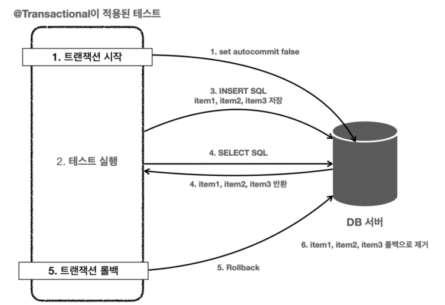

***@SpringBootTest***

- *@SpringBootTest는 @SpringBootApplication를 찾아서 설정으로 사용한다.*

***테스트 원칙*** 

- *테스트는 다른 테스트와 격리해야 한다.*
- *테스트는 반복해서 실행할 수 있어야 한다.*

# ***테스트 - 데이터베이스 분리***

*로컬에서 사용하는 애플리케이션 서버와 테스트에서 같은 데이터베이스를 사용하고 있으니 테스트에서 문제가 발생한다.*

*이런 문제를 해결하려면 테스트를 다른 환경과 철저하게 분리해야 한다.*

*가장 간단한 방법은 테스트 전용 데이터베이스를 별도로 운영하는 것*

- *jdbc:h2:tcp://localhost/~/test* 
- *local에서 접근하는 서버 전용 데이터베이스*
- *jdbc:h2:tcp://localhost/~/testcase* 
- *test 케이스에서 사용하는 전용 데이터베이스*

***main - application.properties***

```java
spring.profiles.active=local
spring.datasource.url=jdbc:h2:tcp://localhost/~/test
spring.datasource.username=sa
```

***test - application.properties***

```java
spring.profiles.active=test
spring.datasource.url=jdbc:h2:tcp://localhost/~/testcase
spring.datasource.username=sa
```

# ***테스트 - 데이터 롤백, 트랜잭션*** 

***트랜잭션과 롤백 전략***

- *테스트가 끝나고 나서 트랜잭션을 강제로 롤백해버리면 데이터가 깔끔하게 제거된다*
- *테스트를 하면서 데이터를 이미 저장했는데, 중간에 테스트가 실패해서 롤백을 호출하지 못해도 괜찮다 트랜잭션을 커밋하지 않았기 때문에 데이터베이스에 해당 데이터가 반영되지 않는다.*
- *트랜잭션을 활용하면 테스트가 끝나고 나서 데이터를 깔끔하게 원래 상태로 되돌릴 수 있다.*

***테스트 격리*** 

```java
트래잭션 시작 
테스트 A
트랜잭션 롤백 

트랜잭션 시작 
테스트 B
트랜잭션 롤백 
```

- *테스트는 각각의 테스트 실행 전 후로 동작하는 @BeforeEach , @AfterEach라는 편리한 기능을 제공*

***테스트에 직접 트랜잭션 추가***

```java
@SpringBootTest
class ItemRepositoryTest {
		 @Autowired
		 ItemRepository itemRepository;

		 @Autowired
		 PlatformTransactionManager transactionManager;
		 TransactionStatus status;
		 
		 @BeforeEach
		 void beforeEach() {
				 //트랜잭션 시작
				 status = transactionManager.getTransaction(new DefaultTransactionDefinition());
		 }
		 @AfterEach
		 void afterEach() {
				 //트랜잭션 롤백
				 transactionManager.rollback(status);
		 }
		 //...
}
```

- *스프링 부트는 자동으로 트랜잭션 매니저(PlatformTransactionManager 구현체)를 스프링 빈으로 등록한다.*
- *@BeforeEach에서는 트랜잭션을 실행*
- *@AfterEach에서는 트랜잭션을 롤백한다.*
- *이 방식은 너무 불편한다. → @Transactional 사용하자*

# ***테스트 - @Transactional***

```java
@Transactional
@SpringBootTest
class ItemRepositoryTest {}
```

- *여러번 반복해서 실행해도 테스트가 성공하는 것을 확인할 수 있다.*

***@Transactional 원리***

- *스프링이 제공하는 @Transactional 애노테이션은 로직이 성공적으로 수행되면 커밋하도록 동작한다*
- *그런데* ***@Transactional 애노테이션을 테스트에서 사용하면 아주 특별하게 동작한다.***
- *@Transactional 이 테스트에 있으면 스프링은 테스트를 트랜잭션 안에서 실행하고, 테스트가 끝나면 트랜잭션을 자동으로 롤백시켜 버린다*



- *테스트에 @Transactional 애노테이션이 테스트 메서드나 클래스에 있으면 먼저 트랜잭션을 시작*
- *테스트 로직을 실행한다. 테스트가 끝날 때 까지 모든 로직은 트랜잭션 안에서 수행된다.*
- *트랜잭션은 기본적으로 전파되기 때문에, 리포지토리에서 사용하는 JdbcTemplate도 같은 트랜잭션을 사용한다.*
- ***트랜잭션 전파 기본 옵션은 기존 트랜잭션에 참여***
- *테스트 로직 동작, 검증*  
- *@Transactional이 테스트에 있으면 테스트가 끝날때 트랜잭션을 강제로 롤백*

***테스트 @Transactional 정리***

- *테스트가 끝난 후 개발자가 직접 데이터를 삭제하지 않아도 되는 편리함을 제공*
- *테스트 실행 중에 데이터를 등록하고 중간에 테스트가 강제로 종료되어도 걱정이 없다.*
- *트랜잭션을 시작하고 커밋하지 않고 커넥션이 종료되기 때문에 데이터는 자동으로 롤백된다.*
- *트랜잭션 범위 안에서 테스트를 진행하기 때문에 동시에 다른 테스트가 진행되어도 서로 영향을 주지 않는다.*

***강제로 커밋하기 - @Commit*** 

- *@Transactional을 테스트에서 사용하면 테스트가 끝나면 바로 롤백되기 때문에 테스트 과정에서 저장한 모든 데이터가 사라진다.*
- *하지만 데이터베이스에 데이터가 실제로 잘 보관되었는지 최종 결과를 눈으로 확인하고 싶은 케이스가 있다.*
- *이럴 때는 다음과 같이 @Commit을 클래스 또는 메서드에 붙이면 테스트 종료후 롤백
대신 커밋이 호출된다*

```java
@Commit
@Transactional
@SpringBootTest
class ItemRepositoryTest {}
```

- 또는 ***@Rollback(value = false)*** *방식을 사용해도 커밋된다.*

# ***테스트 - 임베디드 모드 DB***

*테스트 케이스를 실행하기 위해서 별도의 데이터베이스를 설치하고, 운영하는 것은 상당히 번잡한 작업이다.*

***임베디드 모드??***

*H2 데이터베이스는 자바로 개발되어 있고, JVM안에서 메모리 모드로 동작하는 특별한 기능을 제공한다.*

*애플리케이션을 실행할 때 H2 데이터베이스도 해당 JVM 메모리에 포함해서 함께 실행할 수 있다.*

*DB를 애플리케이션에 내장해서 함께 실행한다고 해서 임베디드 모드(Embedded mode)라 한다.*

*애플리케이션이 종료되면 임베디드 모드로 동작하는 H2 데이터베이스도 함께 종료되고, 데이터도 모두 사라진다.*

### ***임베디드 모드 직접 사용***

```java
@Slf4j
@SpringBootApplication
public class ItemServiceApplication {
		public static void main(String[] args) {
				SpringApplication.run(ItemServiceApplication.class, args);
		}

		@Bean
		@Profile("test")
		public DataSource dataSource(){
			 log.info("메모리 데이터베이스 초기화");
			 DriverManagerDataSource dataSource = new DriverManagerDataSource();
			 dataSource.setDriverClassName("org.h2.Driver");
			 dataSource.setUrl("jdbc:h2:mem:db;DB_CLOSE_DELAY=-1");
			 dataSource.setUsername("sa");
			 dataSource.setPassword("");
			 return dataSource;
		}
}
```

- *@Profile("test")*
- *프로필이 test 인 경우에만 데이터소스를 스프링 빈으로 등록*
- *dataSource()*
- *jdbc:h2:mem:db* 
- *데이터소스를 만들때 이렇게만 적으면 임베디드 모드로 동작하는 H2 데이터베이스를 사용할 수 있다.*
  - *DB_CLOSE_DELAY=-1*
- *임베디드 모드에서는 데이터베이스 커넥션 연결이 모두 끊어지면 데이터베이스
도 종료되는데, 그것을 방지하는 설정이다.*

***스프링 부트 - 기본 SQL 스크립트를 사용해서 데이터베이스를 초기화하는 기능***

- *메모리 DB는 애플리케이션이 종료될 때 함께 사라지기 때문에, 애플리케이션 실행 시점에 데이터베이스 테이블도 새로 만들어주어야 한다.*
- *직접 DDL을 호출해도 되지만 너무 불편하다.*
- *스프링 부트는 SQL 스크립트를 실행해서 애플리케이션 로딩 시점에 데이터베이스를 초기화하는 기능을 제공한다.*

***src/test/resources/schema.sql***

```sql
drop table if exists item CASCADE;
create table item
(
	 id bigint generated by default as identity,
	 item_name varchar(10),
	 price integer,
	 quantity integer,
	 primary key (id)
);
```

- *위치와 파일 이름을 주의하자*

# ***테스트 - 스프링 부트와 임베디드 모드***

*스프링 부트는 데이터베이스에 대한 별다른 설정이 없으면 임베디드 데이터베이스를 사용한다.*

***test - application.properties***

```yaml
spring.profiles.active=test
logging.level.org.springframework.jdbc=debug
```

- *데이터베이스에 접근하는 설정 정보가 존재하지 않는다.*
- *이렇게 별다른 정보가 없으면 스프링 부트는 임베디드 모드로 접근하는 데이터소스(DataSource)를 만들어서 제공한다.*
```java
DriverManagerDataSource dataSource = new DriverManagerDataSource();
dataSource.setDriverClassName("org.h2.Driver");
dataSource.setUrl("jdbc:h2:mem:db;DB_CLOSE_DELAY=-1");
dataSource.setUsername("sa");
dataSource.setPassword("");
```

  - *이런 느낌의 데이터소스를 내부에서 만들어서 제공한다.*

***임베디드 모드 데이터베이스 이름***

*로그를 보면 jdbc:h2:mem 뒤에 임의의 데이터베이스 이름이 들어가 있다.*

*→ url=jdbc:h2:mem:d8fb3a29-caf7-4b37-9b6c-b0eed9985454*

*혹시라도 여러 데이터소스가 사용될 때 같은 데이터베이스를 사용하면서 발생하는 충돌을 방지하기 위해 스프링 부트가 임의의 이름을 부여한 것이다.*

*임베디드 데이터베이스 이름을 스프링 부트가 기본으로 제공하는 jdbc:h2:mem:testdb로 고정하고 싶으면 application.properties 에 다음 설정을 추가하면 된다.*

```java
spring.datasource.generate-unique-name=false
```

***스프링 부트 3.0 이상 로깅 변경 사항*** 

*트랜잭션 관련 로그가 보이지 않는다면 설정 추가를 하자* 

***application.properties***

```java
logging.level.org.springframework.test.context.transaction=trace
```

