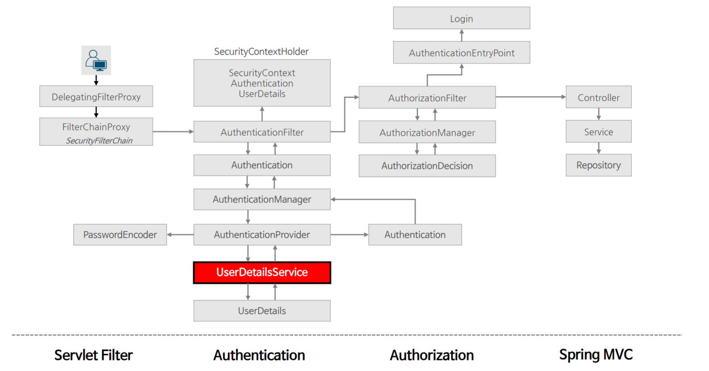
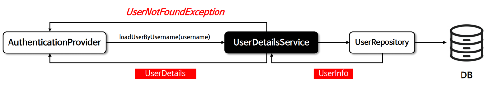
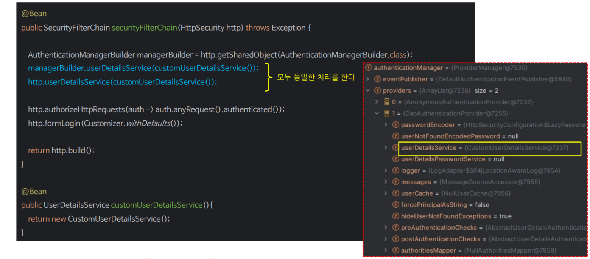
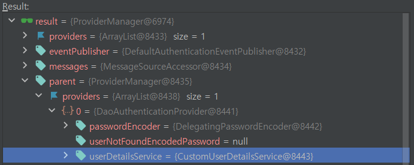
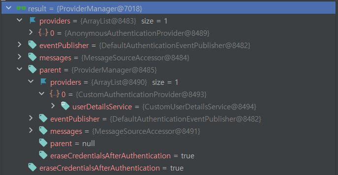

# **시큐리티 인증 / 인가 흐름도**



# **UserDetailsService**

- `UserDetailsService`의 주요 기능은 사용자와 관련된 상세 데이터를 로드하는 것이며 사용자의 신원, 권한, 자격 증명 등과 같은 정보를 포함할 수 있다 
- 이 인터페이스를 사용하는 클래스는 주로 `AuthenticationManager`이며 사용자가 시스템에 존재하는지 여부와 사용자 데이터를 검색하고 인증 과정을 수행한다 


- 사용자의 이름을 통해 사용자 데이터를 검색하고, 해당 데이터를 `UsersDetails`객체로 반환한다

# **UserDetailsService 흐름도**



# **UserDetailsService 사용 방법**



위 코드는 `HttpSecurity` 객체를 통해서 `UserDetailsService` 를 주입하는 2가지 방식을 보여준다

`UserDetailsService`를 하나의 빈으로 사용하면 굳이 

`HttpSecurity`객체를 통해 설정하지 않아도 자동으로 `AuthenticationProvider`에게 주입된다

하지만 `AuthenticationProvider` 를 커스터 마이징 한다고 하면 `AuthenticationProvider`에 직접 주입해서 사용한다 

# **CustomUserDetailsService 적용** 

**CustomUserDetailsService**

```java
public class CustomUserDetailsService implements UserDetailsService {
    @Override
    public UserDetails loadUserByUsername(String username) throws UsernameNotFoundException {
        return User.withUsername("user").password("{noop}1111").roles("USER").build();
    }
}
```

**SecurityConfig**

```java
@EnableWebSecurity
@Configuration
@Slf4j
public class SecurityConfig {
    @Bean
    public SecurityFilterChain securityFilterChain(HttpSecurity http, AuthenticationConfiguration configuration) throws Exception{
        http
            .authorizeHttpRequests(auth -> auth
                        .anyRequest().authenticated());
        http
            .formLogin(Customizer.withDefaults());

        return  http.build();
    }
    @Bean
    public UserDetailsService userDetailsService(){
        return new CustomUserDetailsService();
    }
}
```



빈으로 등록한 `CustomUserDetailsService`가 `DaoAuthenticationProvider`에 주입되어 있는 걸 확인할 수 있다. 

# **CustomAuthenticationProvider 적용** 

**SecurityConfig, CustomUserDetailsService 그대로 재사용** 

**CustomAuthenticationProvider**

```java
@Component
@RequiredArgsConstructor
public class CustomAuthenticationProvider implements AuthenticationProvider {
    private final UserDetailsService userDetailsService;
    @Override
    public Authentication authenticate(Authentication authentication) throws AuthenticationException {
        String username = authentication.getName();

        // 사용자 정보 조회
        UserDetails userDetails = userDetailsService.loadUserByUsername(username);

        // 비밀번호 검증 생략

        return new UsernamePasswordAuthenticationToken(
                userDetails.getUsername(), null, userDetails.getAuthorities());
    }
    @Override
    public boolean supports(Class<?> authentication) {
        return authentication.isAssignableFrom(UsernamePasswordAuthenticationToken.class);
    }
}
```



이전 `AuthenticationProvider`에서 알아봤던 동작 원리 그대로 

1개의 `CustomAuthenticationProvider`를 빈으로 등록하면 `DaoAuthenticationProvider`를 대체한다 

또한 스프링 DI를 통해서 커스터 마이징 한 `UserDetailsService`인 `CustomUserDetailsService`가 필드에 있는 걸 확인할 수 있었다

