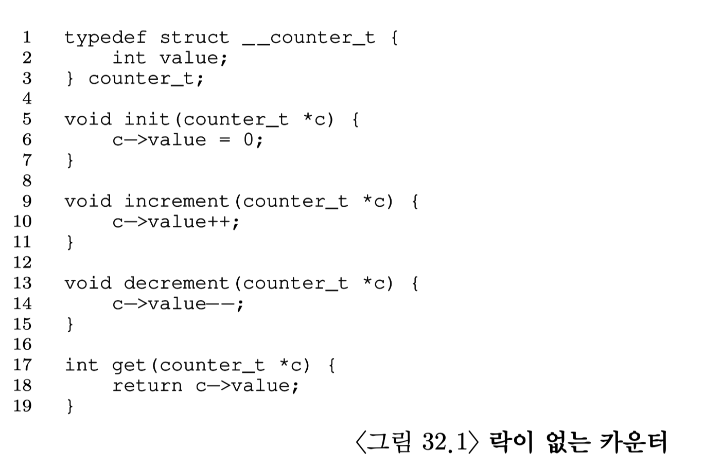
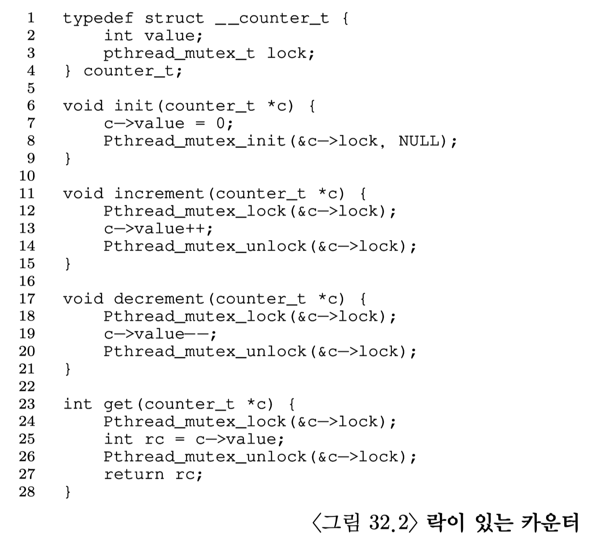
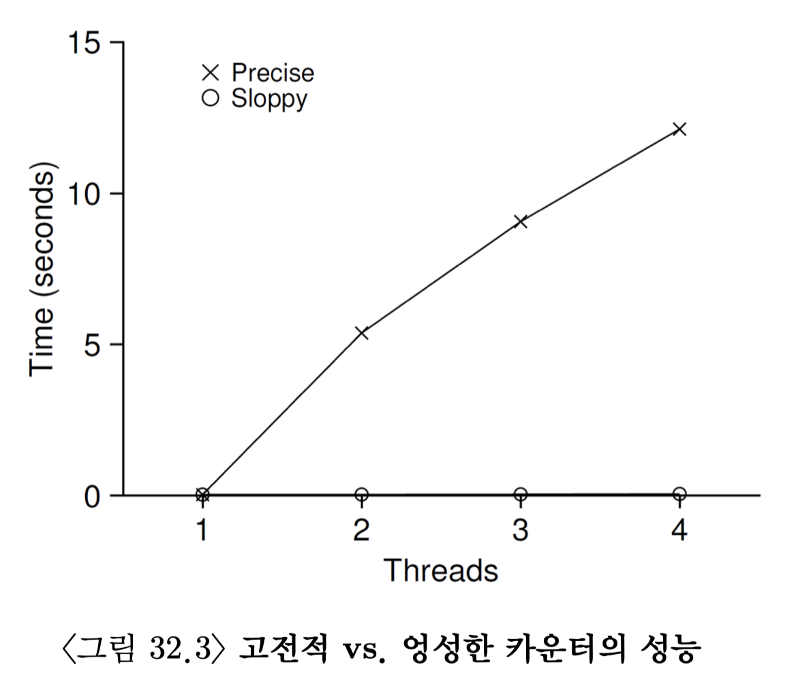
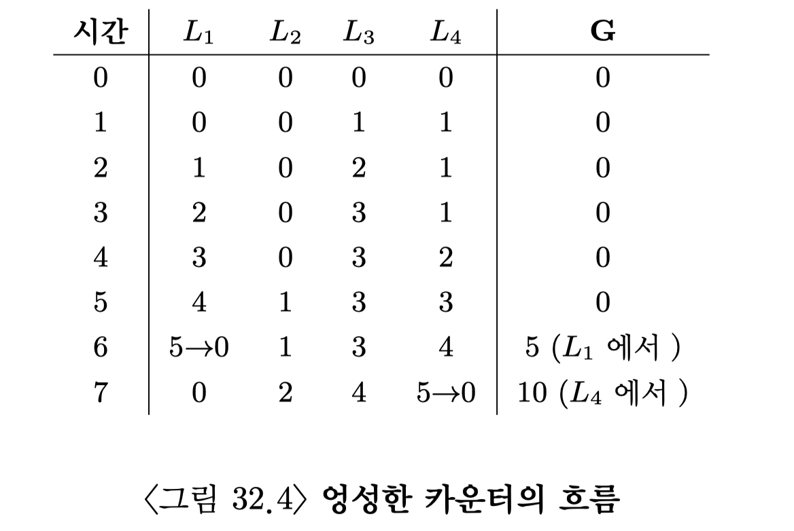
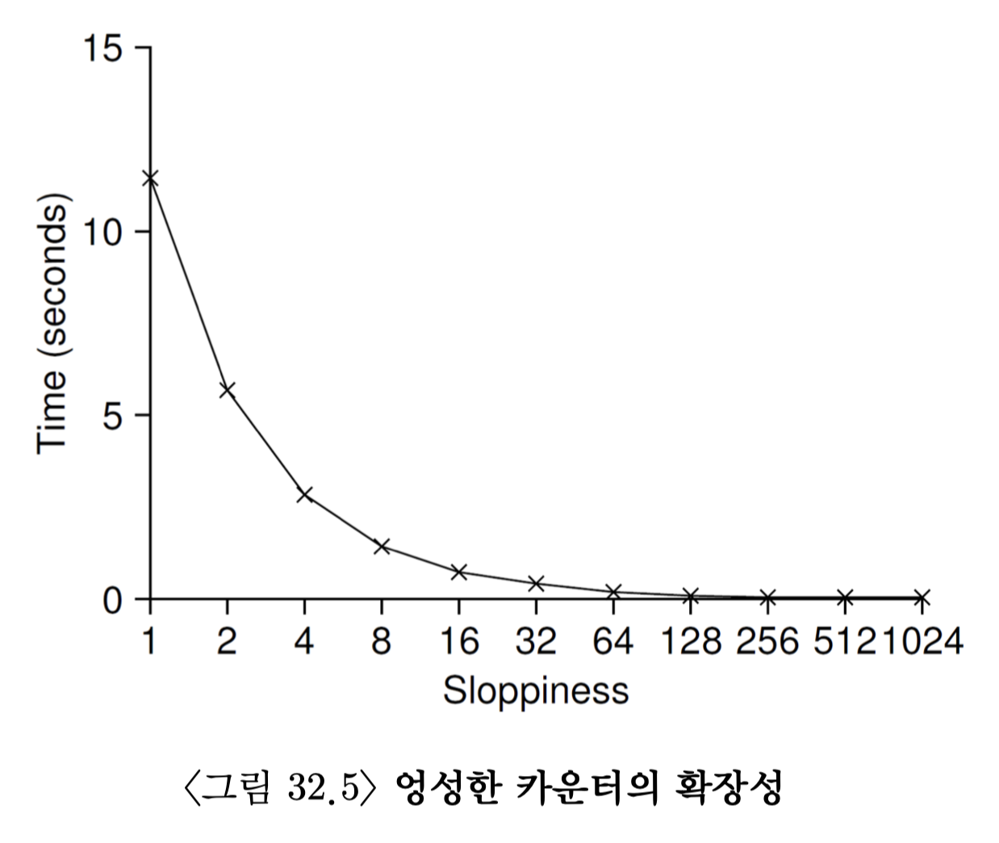
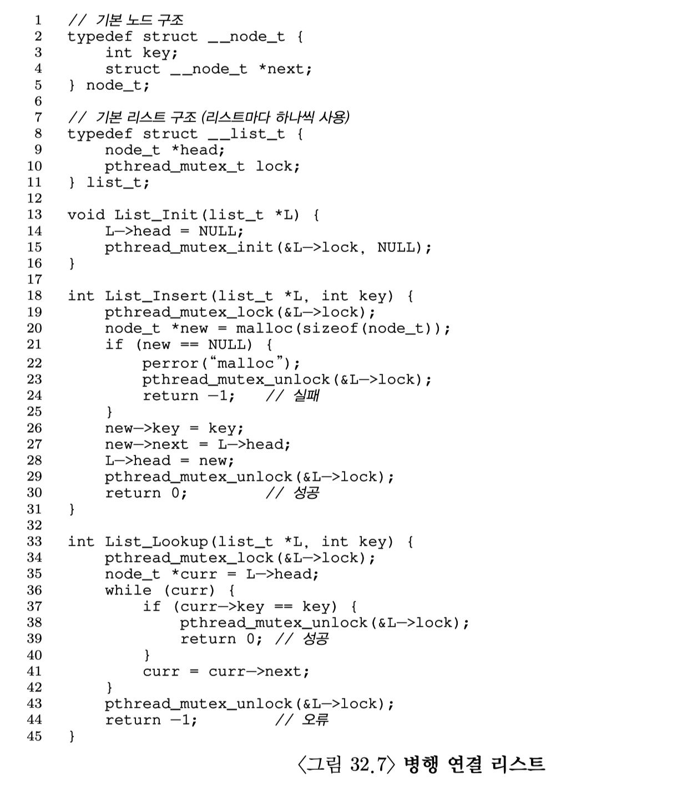
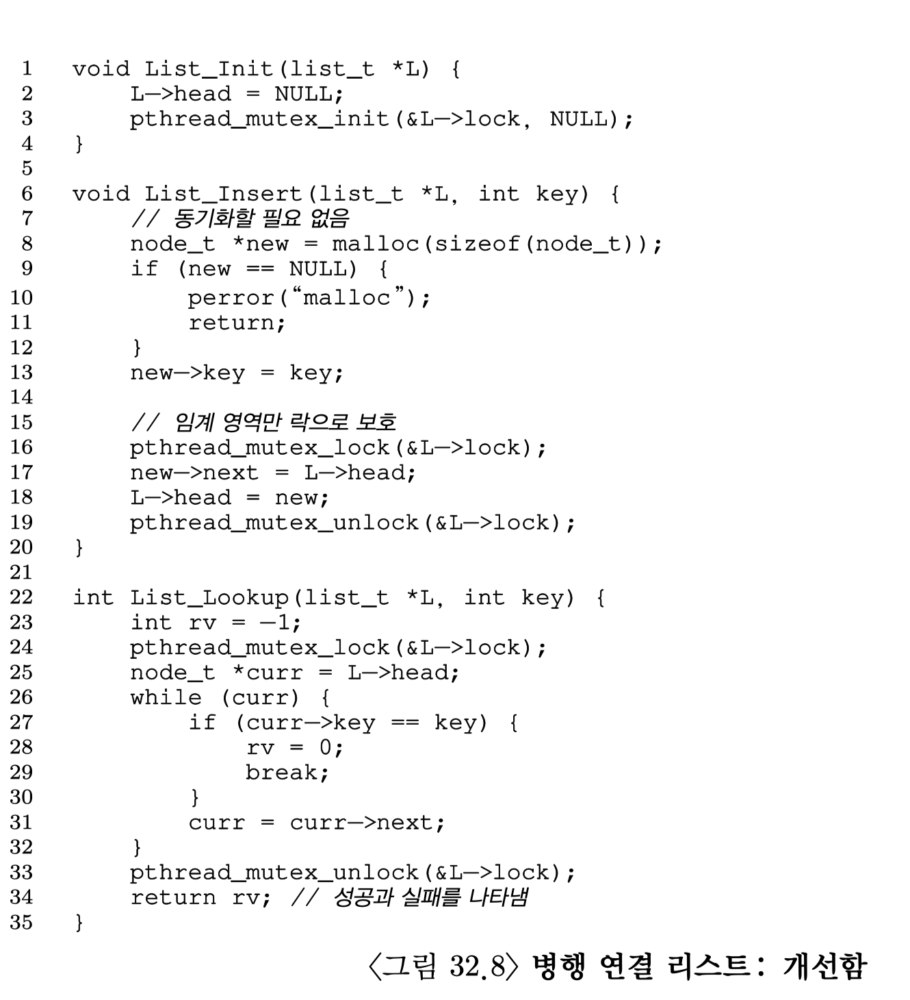
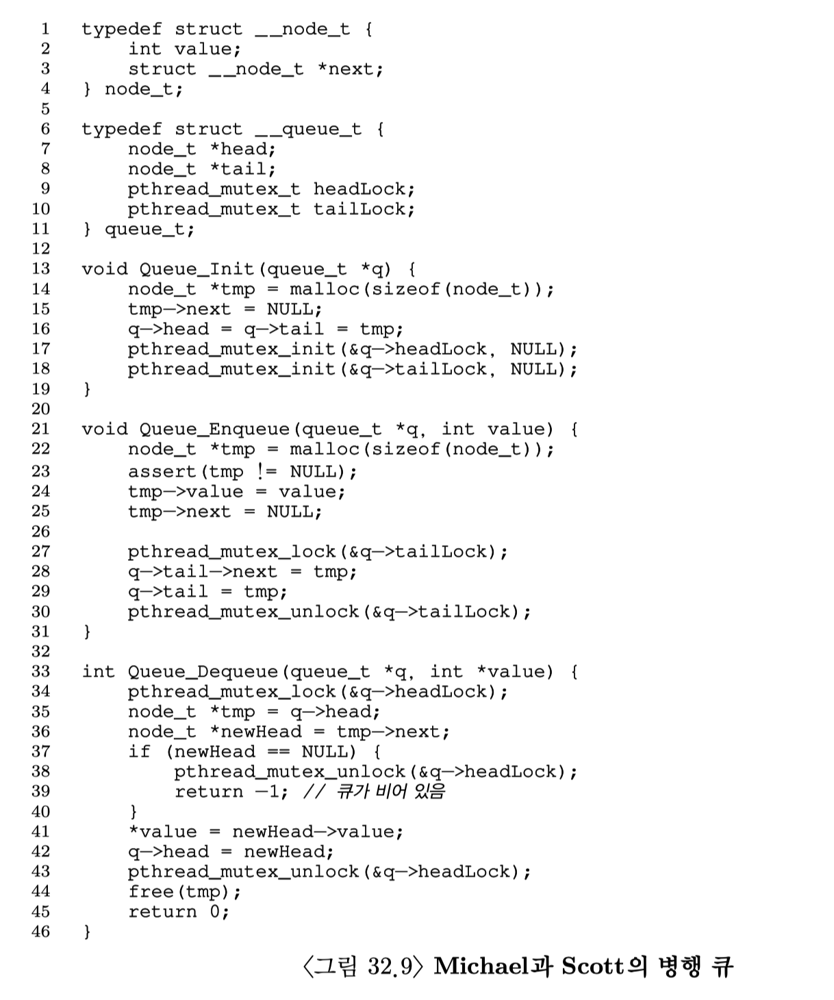

# 32장 개요 

자료 구조에 락을 추가하여 쓰레드가 사용할 수 있도록 만들면 그 구조는 **쓰레드 사용에 안전(thread safe)**하다고 할 수 있다.

---

# 32.1 병행 카운터

그림 32.1은 병행이 불가능한 카운터이다.

### 간단하지만 확장성이 없음

그림 32.2는 value를 조작하는 루틴(value++, value—)을 호출할 때 락을 추가하였고, 호출문이 리턴될 때 락이 해제되도록하였다.

이제 제대로 동작하는 병행 자료 구조를 갖게 되었다. 하지만 성능이 문제다.

그림 32.3은 그림 32.2에서 만든 병행 카운터를 테스트하였다.

x축은 쓰레드 개수를 의미한다. (1 ~ 4) y축은 걸린 시간이다. 

카운터는 총 백만 번 증가시켰을 때 총 걸린 시간을 나타내었다.

CPU 개수는 4개

단일 쓰레드로는 0.03초가 걸렸다. → 백만번 갱신

두 개의 쓰레드로는 약 5초 이상이 걸렸다. → 이백만번 갱신

이상적으로는 하나의 쓰레드가 하나의 CPU에서 작업을 끝내는 것처럼 멀티프로세서에서 실행되는 쓰레드들도 빠르게 작업을 처리하고 싶을 것이다.

이와 같이 동작하는 것을 **완벽한 확장성(perfect scaling)**이라 부른다.

더 많은 작업을 처리하더라도 각 작업이 병렬적으로 처리되어 완료 시간이 늘어나지 않는다는 것을 말한다.

### 확장성 있는 카운팅

CPU 코어마다 존재하는 하나의 물리적인 지역 카운터와 하나의 전역카운터로 구성

어떤 기기가 4개의 CPU를 갖고 있다면 그 시스템은 네 개의 지역 카운터와 하나의 전역 카운터를 갖고있다.

이 카운터들 외에 지역 카운터를 위한 락들과 전역 카운터를 위한 락이 존재한다.

쓰레드는 지역 카운터를 증가시킨다. 이 지역 카운터는 지역 락에 의해 보호된다.

각 CPU는 저마다 지역 카운터를 갖고 있기 때문에 CPU들에 분산되어 있는 쓰레드들은 지역 카운터를 경쟁 없이 갱신할 수 있다. → 카운터 갱신에 확정성이 존재한다.

쓰레드가 카운터의 값을 읽을 수 있기 때문에 전역 카운터를 최신으로 갱신해야 한다.

최신 값으로 갱신하기 위해서 지역 카운터의 값은 주기적으로 전역 카운터로 전달되는데, 이때 전역 락을 사용하여

지역 카운터의 값을 전역 카운터의 값에 더하고, 그 지역 카운터의 값은 0으로 초기화한다.

지역에서 전역으로 값을 전달하는 빈도는 정해 놓은 S값에 의해 결정된다.

S의 값이 작을수록 확장성 없는 카운터처럼 동작하며, 커질수록 전역 카운터의 값은 실제 값과 차이가 있게 된다.

정확한 카운터 값을 얻기 위해 모든 지역 락과 전역 락을 획득한 후 계산을 하면 되지만, 오히려 시스템은 복잡해지고 확장성이 없게 된다. 

그림 32.4는 한계치 S를 5로 설정하고 4개의 CPU에 각각의 지역 카운터(L1, L2, L3, L4)를 갱신하는 쓰레드들이 있다. 전역 카운터의 값(G)도 같이 나타내었는데, 만약 지역 카운터가 한계치에 도달하면 지역 값은 전역 카운터에 반영되고 지역 카운터의 값은 초기화된다.

그림 32.3을 보면 sloppy라고 적힌 아래 선이 S값을 1024로 했을 때 엉성한 카운터(지역 카운터 + 전역 카운터)의 성능이다. 네 개의 프로세서에서 카운터의 값을 4백만 번 갱신하는데 걸린 시간이 하나의 프로세서에서 백만 번 갱신하는 시간에 비해 차이가 그리 크지 않다. → 확장성

그림 32.5는 4개의 CPU에서 4개의 쓰레드가 각각 백만 번 카운터의 값을 증가하는 경우에 

S의 설정이 얼마나 중요한지를 보여준다.

S의 값이 낮다면 성능이 낮은 대신에 전역 카운터의 값이 매우 정확해진다.

S의 값이 크다면 성능은 탁월하겠지만 전역 카운터의 값은 최악의 경우 CPU 개수 * (S-1) 만큼 뒤처지게 된다.

엉성한 카운터는 정확도와 성능의 균형을 조절할 수 있다.

---

# 32.2 병행 연결 리스트

그림 32.7을 보면 락을 획득하고 malloc()을 호출한다. 어떤 문제점이 있을까?

List_Insert() 함수는 다음 순서로 실행된다.

1. 전체 리스트 락을 획득
1. 노드 할당 (malloc)
1. 노드 삽입
1. 락 해제

문제는 malloc()이 실패할 경우 락을 해제하지 않고 리턴하는 버그가 발생할 수 있다는 것이다. 

매우 드문 경우지만, 이런 예외 처리 누락이 실제 커널 버그 중 40%에 이르는 중요한 이슈이다.

malloc()이 실패할 경우 락을 해제하지 않고 리턴하는 버그 해결 방법은 메모리 할당은 malloc()은 락 없이 수행하고 락은 연결 리스트를 갱신(수정)하는 짧은 구간에서만 사용하는 것이다.

그림 32.8을 보면 락 범위를 최소화하여 메모리 할당 부분은 락 없이 수행한다.

락 범위 최소화를 통해 락을 해제하지 않는 버그와 병행성 모두 개선했다.

또한 List_Lookup() 함수 또한 개선했는데

while 문 안에 break를 삽입하여 검색에 성공하면 바로 빠져나오게 하였다.

이렇게 하면 검색 성공이나 실패의 경우 모두 동일한 리턴 코드를 실행한다.

코드에서 락을 획득하고 해제하는 문장 수를 줄일 수 있고, 버그 발생 여지가 줄어 든다.

### 확장성 있는 연결 리스트

병행이 가능한 즉, thread-safe 한 연결 리스트를 구현했지만 확장성이 좋지 않다.

병행성을 개선하는 방법 중 하나로 **hand-over-hand locking(lock coupling)**기법이 있다.

전체 리스트에 하나의 락이 있는 것이 아니라 개별 노드마다 락을 추가하는 것이다.

리스트를 순회할 때 다음 노드의 락을 먼저 획득하고 지금 노드의 락을 해제하도록 한다.

개념적으로는, 병행성이 높아지기 때문에 괜찮은 것처럼 보이지만 실제로는 간단한 락 방법(락을 하나 두는)에 비해 속도 개선을 기대하기 쉽지 않다. 각 노드에 락을 획득하고 해제하는 오버헤드가 매우 크기 때문이다.

---

# 32.3 병행 큐

그림 32.9를 보면 두 개의 락이 존재한다. 

하나는 큐의 헤드에, 다른 하나는 테일에 사용된다.

즉, 이 두 개의 락의 목적은 큐에 삽입과 추출 연산에 병행성을 부여하는 것이다.

일반적으로 삽입 연산이 테일 락을 접근하고 추출 연산이 헤드 락만을 다룬다.

큐는 멀티 쓰레드 프로그램에서 자주 사용된다.

하지만 그림 32.9의 병행 큐는 프로그램에서 사용할 수가 없다.

큐를 소비하는 쓰레드(consumer)는 큐가 비었거나, 큐에 데이터를 넣는 쓰레드(producer)는 큐가 가득 찬 경우, 대기하도록 하는 기능이 필요하다.

이런 큐를 유한 큐(bounded queue)라고 하고 다음 장에서 컨디션 변수(condition variable)과 함께 배운다.

---

# 32.4 병행 해시 테이블

병행 해시 테이블은 병행 리스트를 사용하여 구현하여 잘 동작한다.

전체 자료 구조에 하나의 락을 사용하는 것이 아니라 해시 버켓(리스트)마다 락을 사용하기 때문에 성능이 좋다.

→ 병행성이 좋다.

---

