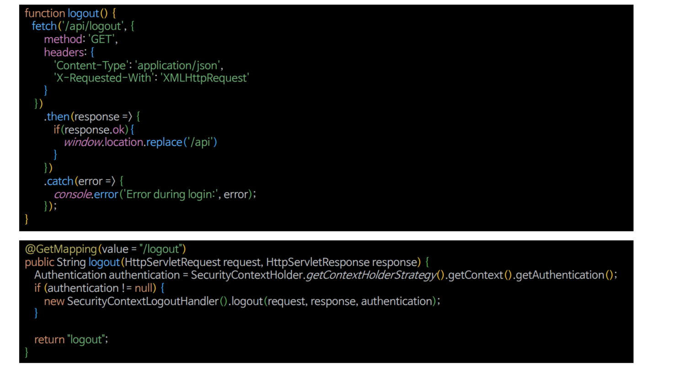

# ***로그아웃 구현***



# ***구현***

```java
@GetMapping("/logout")
public String logout(HttpServletRequest request, HttpServletResponse response){
    Authentication authentication = SecurityContextHolder.getContextHolderStrategy().getContext().getAuthentication();
    if(authentication != null){
        new SecurityContextLogoutHandler().logout(request, response, authentication);
    }
    return "logout";
}
```

