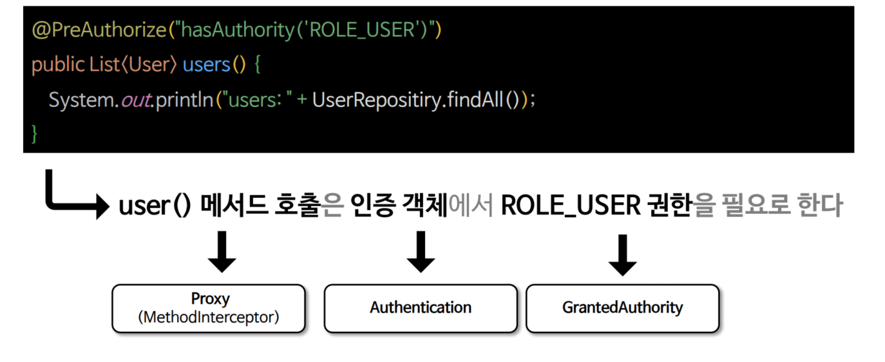
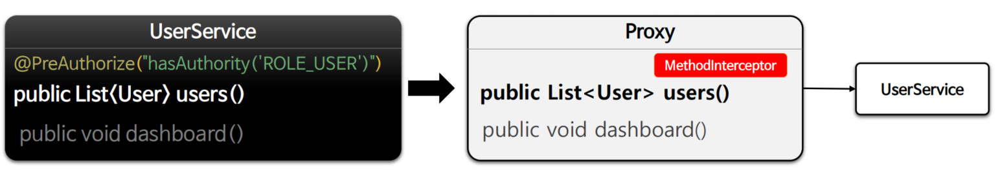
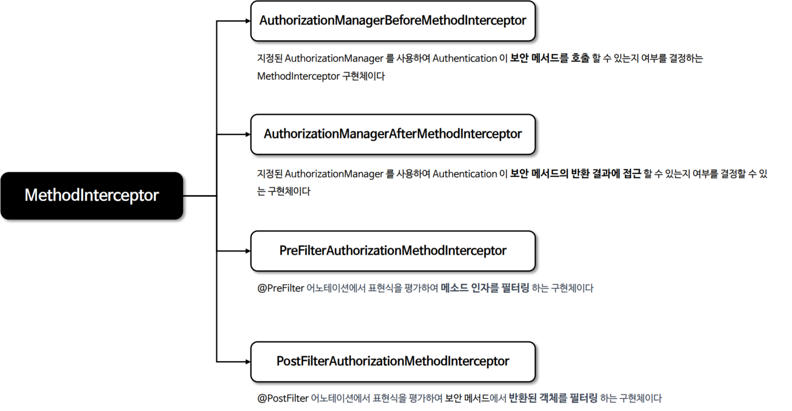
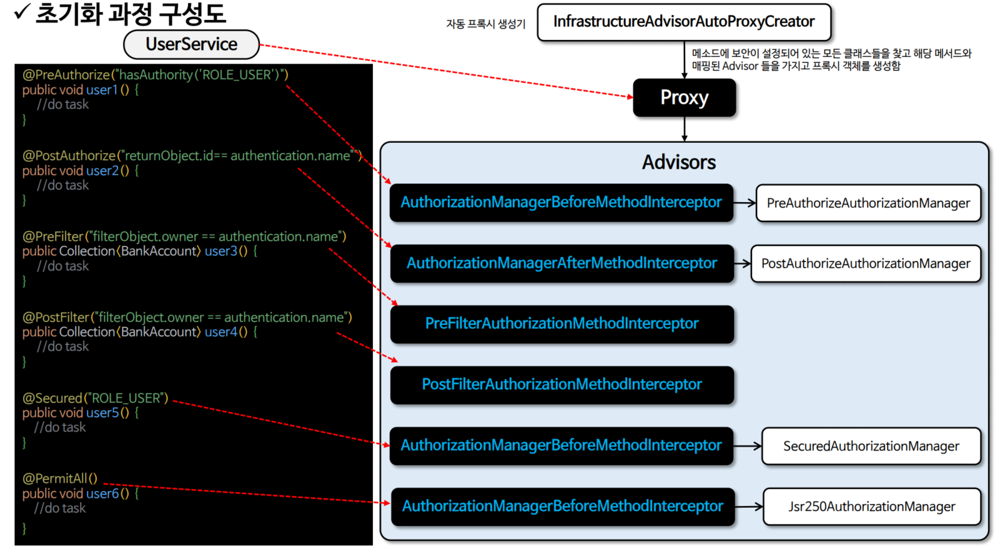
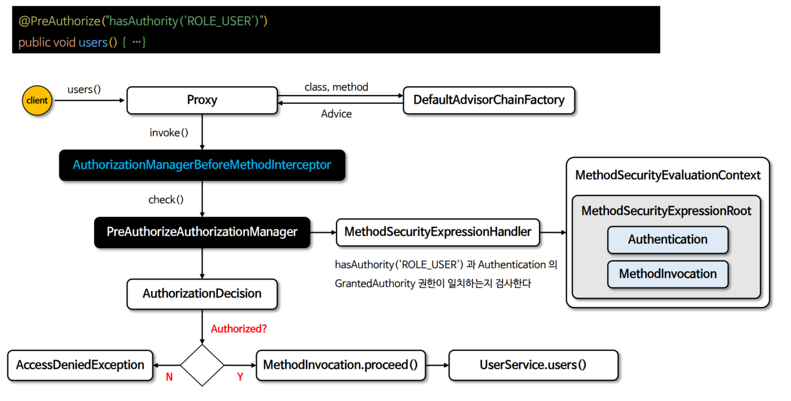
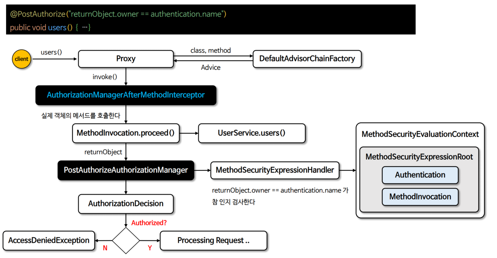

# **개요**

- 스프링 시큐리티는 메서드 기반의 인증된 사용자 및 특정권한을 가진 사용자의 자원접근 허용여부를 결정하는 인가 관리자 클래스들을 제공한다
- `PreAuthorizeAuthorizationManager`, `PostAuthorizeAuthorizationManager`, `Jsr250AuthorizationManager`, `SecuredAuthorizationManager`가 있다
- 메서드 기반 권한 부여는 내부적으로 AOP 방식에 의해 초기화 설정이 이루어지며 메서드의 호출을 `MethodInterceptor`가 가로 채어 처리하고 있다

# **메소드 인가 처리**



# **메서드 권한 부여 초기화 과정**



1. 스프링은 초기화 시 생성되는 전체 빈을 검사하면서 빈이 가진 메소드 중에서 보안이 설정된 메소드가 있는지 탐색한다
1. 보안이 설정된 메소드가 있다면 스프링은 그 빈의 프록시 객체를 자동으로 생성한다 (기본적으로 **CGLIB** 방식으로 생성한다)
- 스프링 AOP는 JDK 동적 프록시 기술과 바이트 코드를 조작하는 CGLIB 라이브러리 2가지를 사용한다 인터페이스 기반이면 JDK 동적 프록시 클래스만 존재한다면 CGLIB 통해 상속해서 프록시 객체를 생성
1. 보안이 설정된 메소드에는 인가처리 기능을 하는 `Advice`를 등록한다
1. 스프링은 빈 참조시 실제 빈이 아닌 프록시 빈 객체를 참조하도록 처리한다
1. 초기화 과정이 종료된다
1. 사용자는 프록시 객체를 통해 메소드를 호출하게 되고 프록시 객체는 `Advice`가 등록된 메서드가 있다면 호출하여 작동 시킨다
1. `Advice`는 메소드 진입 전 인가 처리를 하게 되고 인가 처리가 승인되면 실제 객체의 메소드를 호출하게 되고 인가 처리가 거부되면 예외가 발생하고 메소드 진입이 실패한다

# **메소드 인터셉터 구조**



# **초기화 과정 구성도**



- `@PreAuthorize`, `@Secured`, `@PermitAll` 모두 `AuthorizationManagerBeforeMethodInterceptor`에서 처리한다 하지만 내부에서 처리하는 `AuthorizationManager`는 다르다 

# **@PreAuthorize 처리 구조 이해**



1. 클라이언트가 UserService: Proxy users() 메소드를 호출 
1. UserService Proxy는 `DefaultAdvisorChainFactory`에 class, method 정보를 넘기고 해당하는 `Advice`를 받는다.
1. Proxy invoke() → Advice : `AuthorizationManagerBeforeMethodInterceptor` 
1. `AuthorizationManagerBeforeMethodInterceptor` check() → `PreAuthorizeAuthorizationManager` 
1. `PreAuthorizeAuthorizationManager` 권한 검사를 하고 `AuthorizationDecision` 반환 
1. `AuthorizationDecision(true)` → MethodInvocation.proceed() → UserService.users()
`AuthorizationDecision(false)` → AccessDeniedException 

# **@PostAuthorize 처리 구조 이해**



# **실습** 

 **SecurityConfig**

```java
@EnableWebSecurity
@EnableMethodSecurity(securedEnabled = true, jsr250Enabled = true)
@Configuration
public class SecurityConfig {
    @Bean
    public SecurityFilterChain securityFilterChain(HttpSecurity http, HandlerMappingIntrospector introspector) throws Exception{
        http
                .authorizeHttpRequests(authorize -> authorize
                        .anyRequest().authenticated())
                .formLogin(Customizer.withDefaults())
                .csrf(AbstractHttpConfigurer::disable);
        return http.build();
    }
    @Bean
    public UserDetailsService userDetailsService(){
        UserDetails user = User.withUsername("user").password("{noop}1111").roles("USER").build();
        UserDetails db = User.withUsername("db").password("{noop}1111").authorities("ROLE_DB").build();
        UserDetails admin = User.withUsername("admin").password("{noop}1111").roles("ADMIN","SECURE").build();
        return  new InMemoryUserDetailsManager(user, db, admin);
    }
}
```

**IndexController**

```java
@RestController
@RequiredArgsConstructor
public class IndexController {
    private final DataService dataService;
    @GetMapping("/")
    public String index(){
        return "index";
    }
    @GetMapping("/user")
    public String user(){
        return dataService.getUser();
    }
    @GetMapping("/owner")
    public Account owner(String name){
        return dataService.getOwner(name);
    }
    @GetMapping("/display")
    public String display(){
        return dataService.display();
    }
}
```

**DataService**

```java
@Service
public class DataService {
    @PreAuthorize("hasAuthority('ROLE_USER')")
    public String getUser() {
        return "user";
    }
    @PostAuthorize("returnObject.owner == authentication.name")
    public Account getOwner(String name) {
        return new Account(name, false);
    }
    public String display() {
        return "display";
    }
}
```

