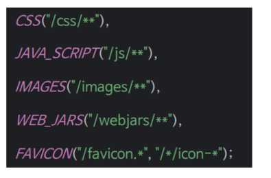

# **개요** 

- 스프링 시큐리티는 `RequestMather` 인스턴스를 등록하여 무시해야 할 요청을 지정할 수 있다 
- 주로 정적 자원(이미지, CSS, JavaScript 파일 등)에 대한 요청이나 특정 엔드포인트가 보안 필터를 거치지 않도록 설정할 때 사용된다 

# 사용 방법

```java
@Bean
public WebSecurityCustomizer webSecurityCustomizer() {
		 return (webSecurity) -> {
				 webSecurity.ignoring().requestMatchers(PathRequest.toStaticResources().atCommonLocations());
		 };
}
```

- `StaticResourceLocation` 


# **Ignoring 보다 permitAll 권장**

```java
http.authorizeHttpRequests(auth -> auth
	 .requestMatchers("/css/**", "/images/**", "/js/**", "/webjars/**", "/favicon.*", "/*/icon-*").permitAll()
	 .requestMatchers(PathRequest.toStaticResources().atCommonLocations()).permitAll()
	 .anyRequest().authenticated());
```

- 이전에는 모든 요청마다 세션을 확인해야 해서 성능 저하가 있었지만 스프링 시큐리티 6 부터는 권한 부여 규칙에서 필요한 경우를 제외하고는 세션을 확인하지 않는다.
- 성능 문제가 해결되었기 때문에 모든 요청에 대해서 `permitAll` 을 사용할 것을 권장하며 정적 자원에 대한 요청일지라도 안전한 헤더를 작성할 수 있어 더 안전하다

