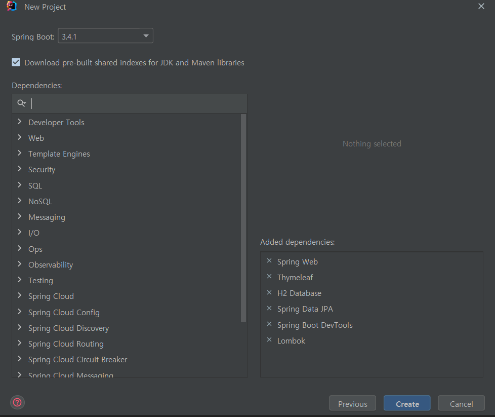

# *프로젝트 생성, 설정*

***Dependency***



***build.gradle***

```groovy
dependencies {
    implementation 'org.springframework.boot:spring-boot-starter-thymeleaf'
    developmentOnly 'org.springframework.boot:spring-boot-devtools'

    implementation 'org.springframework.boot:spring-boot-starter-web'

    implementation 'org.springframework.boot:spring-boot-starter-data-jpa'
    runtimeOnly 'com.h2database:h2'

    testImplementation 'org.springframework.boot:spring-boot-starter-test'
    testRuntimeOnly 'org.junit.platform:junit-platform-launcher'

    annotationProcessor 'org.projectlombok:lombok'
    compileOnly 'org.projectlombok:lombok'
    testImplementation 'org.projectlombok:lombok'
}
```

***application.yaml***

```yaml
spring:
  datasource:
    url: jdbc:h2:tcp://localhost/~/jpashop
    username: sa
    password:
    [REDACTED] org.h2.Driver
  jpa:
    hibernate:
	    ddl-auto: create
    properties:
        hibernate:
          # show_sql: true
          format_sql: true
logging.level:
  org.hibernate.SQL: debug
  org.hibernate.orm.jdbc.bind: trace 
```

- *org.hibernate.SQL: logger를 통해 하이버네이트 실행 SQL*
- *show_sql : 옵션은 System.out 에 하이버네이트 실행 SQL*

***쿼리 파라미터 로그 남기기 - 스프링 부트 3.0 build.gradle***

```groovy
implementation 'com.github.gavlyukovskiy:p6spy-spring-boot-starter:1.9.0'
```

- [https://github.com/gavlyukovskiy/spring-boot-data-source-decorator](https://github.com/gavlyukovskiy/spring-boot-data-source-decorator)
- ***상세한 설정 + 다른 외부 라이브러리***

# *간단한 동작 확인*

```java
@Entity
@Getter @Setter
@NoArgsConstructor(access = AccessLevel.PUBLIC)
public class Member {
    @Id @GeneratedValue(strategy = GenerationType.IDENTITY)
    private Long id;
    private String username;
}

@Repository
public class MemberRepository {
    @PersistenceContext
    private EntityManager em;
    public Long save(Member member){
        em.persist(member);
        return member.getId();
    }
    public Member find(Long id){
        return em.find(Member.class, id);
    }
}

@SpringBootTest
class MemberRepositoryTest {

    @Autowired MemberRepository memberRepository;
    @Test
    @Transactional
    @Commit
    public void test(){
        // given
        Member member = new Member();
        member.setUsername("memberA");

        // when
        Long saveId = memberRepository.save(member);

        // then
        Member findMember = memberRepository.find(saveId);
        assertThat(findMember.getUsername()).isEqualTo(member.getUsername());
        assertThat(findMember).isEqualTo(member);
    }
}
```

