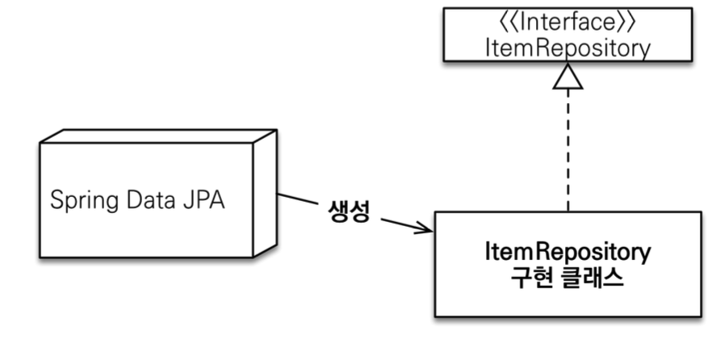
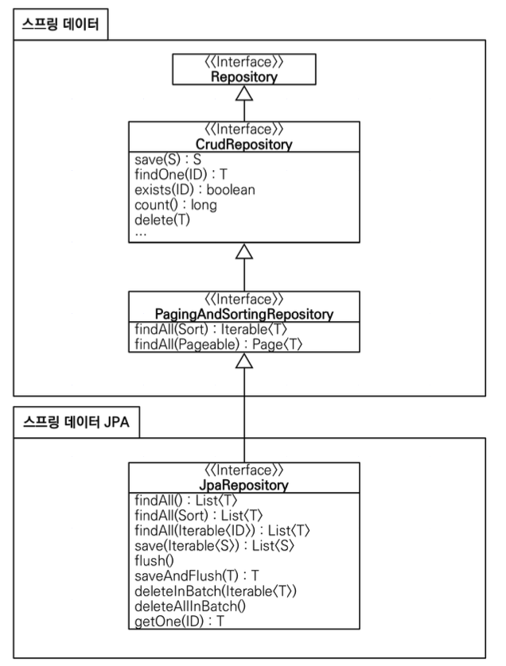

# ***순수*** *JPA* ***기반 리포지토리 만들기***

***MemberJpaRepository***

```java
@Repository
@RequiredArgsConstructor
public class MemberJpaRepository {

    private final EntityManager em;

    public Member save(Member member) {
        em.persist(member);
        return member;
    }

    public Member find(Long id){
        return em.find(Member.class, id);
    }

    public void delete(Member member) {
        em.remove(member);
    }

    public List<Member> findAll() {
        return em.createQuery("select m from Member m", Member.class)
                .getResultList();
    }

    public Optional<Member> findById(Long id) {
        Member member = em.find(Member.class, id);
        return Optional.ofNullable(member);
    }
    public long count(){
        return em.createQuery("select count(m) from Member m", Long.class)
                .getSingleResult();
    }
}
```

***TeamJpaRepository***

```java
@Repository
@RequiredArgsConstructor
public class TeamRepository {

    private final EntityManager em;

    public Team save(Team team) {
        em.persist(team);
        return team;
    }
    public void delete(Team team) {
        em.remove(team);
    }

    public List<Team> findAll() {
        return em.createQuery("select t from Team t", Team.class)
                .getResultList();
    }

    public Optional<Team> findById(Long id) {
        return Optional.ofNullable(em.find(Team.class, id));
    }

    public long count(){
        return em.createQuery("select count(t) from Team t", Long.class)
                .getSingleResult();
    }
}
```

***기본 CRUD***

- *저장*
- *변경 → 변경감지 사용*
- *merge: 모두 null로 대체하기 때문에 위험하다.*
- *삭제*
- *전체 조회* 
- *단건 조회 (Optional)* 
- *카운트* 

# ***공통 인터페이스 설정***

***스프링 부트 사용시 생략 가능한 설정*** 

```java
@Configuration
@EnableJpaRepositories(basePackages = "jpabook.jpashop.repository")
public class AppConfig {}
```

- *스프링 부트 사용시 @SpringBootApplication 위치를 지정(해당 패키지와 하위 패키지 인식)*
- *만약 위치가 달라지면 @EnableJpaRepositories 필요하다* 
- *`org.springframework.data.repository.Repository`* *를 구현(상속받는)한 클래스는 스캔 대상*

***스프링 부트 JPA가 구현 클래스를 대신 생성*** 



- *`org.springframework.data.repository.Repository`* *를 구현(상속받는)한 클래스는 스캔 대상*
- *스프링 데이터 JPA가 프록시 객체를 생성해서 스프링 컨테이너에 자동 주입한다.*
  - *MemberRepository가 인터페이스가 동작하는 이유*
```java
public interface MemberRepository extends JpaRepository<Member, Long> {}
```

```java
@SpringBootTest
@Transactional
class MemberRepositoryTest {
    @Autowired
    private MemberRepository memberRepository;

    @Test
    void proxy(){
        System.out.println(AopUtils.isAopProxy(memberRepository));
        System.out.println("memberRepository = " + memberRepository.getClass());
    }
```

    - *true 출력* 
    - *memberRepository = class jdk.proxy3.$Proxy129*
  - *인터페이스 기반 프록시 → JDK 동적 프록시를 적용한다.*
- ***@Repository 애노테이션 생략 가능*** 
- *컴포넌트 스캔을 스프링 데이터 JPA가 자동으로 처리한다.*
  - *JPA 예외를 스프링의 추상화된 예외인 DataAccessException으로 변환하는 과정도 자동으로 처리*

# *공통 인터페이스 분석* 


***JpaRepository - 공통 기능 인터페이스*** 

- *공통 CRUD 제공* 
- *제네릭: <엔티티 타입, 식별자 타입> 설정* 



***제네릭 타입***

- *T: 엔티티*
- *ID: 엔티티의 식별자 타입* 
- *S: 엔티티와 그 자식 타입* 

***주요 메소드*** 

- *save(S): 새로운 엔티티는 저장(persist) 이미 식별자가 존재하는 엔티티는 병합(merge)*
- *delete(T): 엔티티 하나를 삭제 → em.remove(T) 호출* 
- *findById(ID): 엔티티 하나를 조회 → em.find() 호출* 
- *Optional<T> 반환*
- *getOne(ID): 엔티티를 프록시로 조회한다. →em.getReference() 호출*
- *findAll(…): 모든 엔티티를 조회한다.*
- *정렬(sort),페이징(Pageable) 조건을 파라미터로 제공할 수 있다.*

