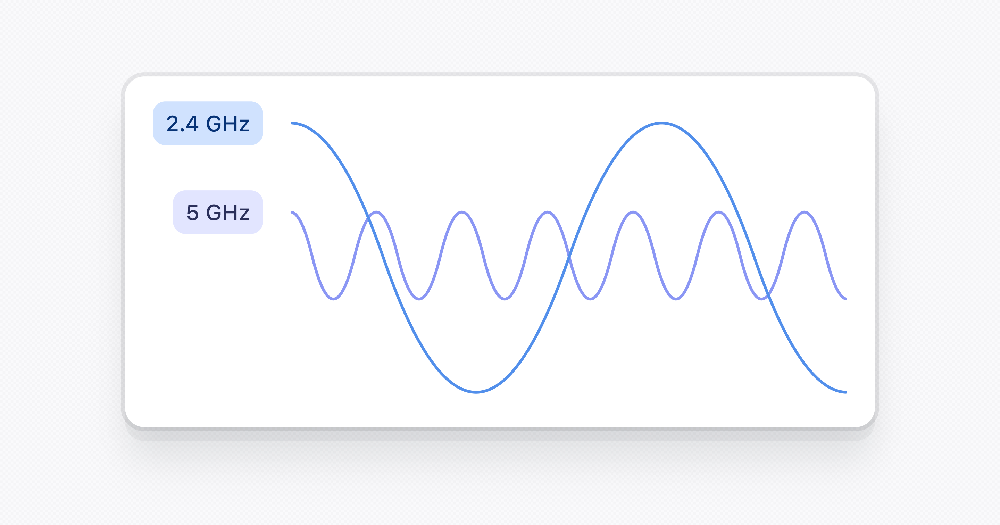
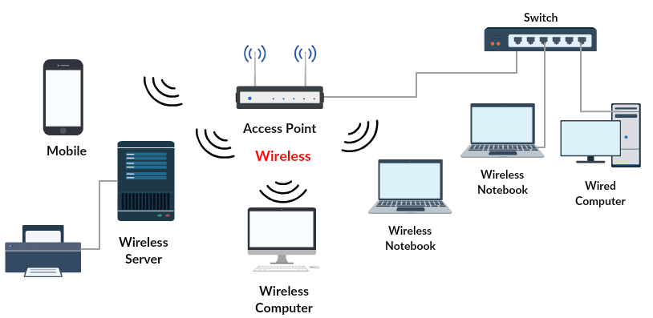
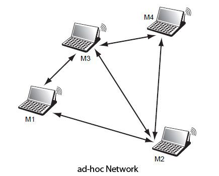
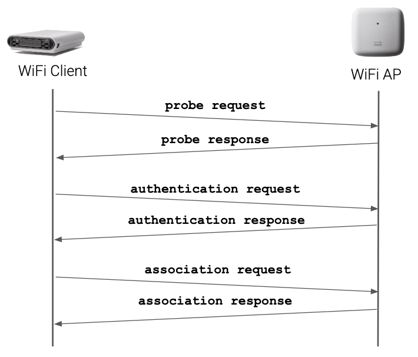

무선 랜은 케이블 없이 데이터를 전송할 수 있는 역할을 한다.

전자기파를 이용해서 데이터를 주고받는 방법에 대해 알아보자.

**키워드**

- 무선 랜
- 전자기파
- 무선 엑세스 포인트
- 비콘
- SSID
- 인프라스트럭쳐 방식
- 애드혹 방식
- 무선 랜 규격

**목표**

- 무선 랜의 개념에 대해 이해
- 무선 랜의 구성 및 통신 방법에 대해 이해
- 무선 랜의 규격에 대해 이해

---

## 내용정리 

요즘에는 랜 케이블을 컴퓨터와 연결하여 사용하는 경우는 흔하지 않는다.

**무선 랜(Wireless Local Area Network)은 유선 랜과 달리 케이블 없이 통신하는 네트워크**이다.

**무선 랜은 무선 엑세스 포인트를 통해 인터넷에 연결된다. 무선 엑세스 포인트(Wireless Access Point)는 유선 랜과 무선랜을 연결해주는 장치이다. 그리고 여기에 연결된 노트북, 태블릿 등을 클라이언트(Client)**라고 한다.

무선 엑세스 포인트를 ‘무선 공유기’라고 부르기도 한다.

무선 랜은 주로 가정, 사무실, 학교 등 작은 범위의 공간에서 사용되며 모바일 기기나 노트북 등의 이동성이 높은 기기에서도 쉽게 사용할 수 있는 장점이 있다.

**그렇다면 무선 엑세스 포인트를 통해 어떻게 통신이 가능할까?** 

무선 랜은 전자기파(electromagnetic wave)를 사용하여 데이터를 전송한다.

무선 랜은 일반적으로 2.4GHz 또는 5GHz 무선 주파수 대역을 사용하여 통신한다.

**파장 관점** 

저주파(2.4GHz)일수록 파장이 길고, 고주파(5Ghz)일수록 파장이 짧다. 파장이 길수록 멀리 전달되고 파장이 짧을수록 전파가 전파가 멀리 가지 않는다.

그렇기 때문에 무선 랜에서 2.4GHz가 5GHz보다 넓은 범위에서 인터넷을 사용할 수 있는 환경을 지원한다.

**대역폭 관점**

**2.4GHz**: 대역폭이 좁아 최대 속도가 낮음. 이론적으로 최대 450~600Mbps까지 지원하지만, 실제 환경에서는 간섭(전자레인지, 블루투스 등) 때문에 속도가 더 낮아진다.

**5GHz**: 대역폭이 넓어 더 많은 데이터를 한 번에 전송할 수 있다. 이론적으로 최대 1300Mbps(1Gbps 이상)까지 지원하며, 실제로도 2.4GHz보다 훨씬 빠른 속도를 경험할 수 있다.

---

무선 랜을 구성하는 방식에는 인프라스트럭처와 애드혹 2가지가 있다.

**인프라스트럭처(Infrastructure)방식은 무선 랜 네트워크에 연결된 모든 장치가 무선 엑세스 포인트에 연결되는 방식이다.** 즉, 모든 장치가 무선 엑세스 포인트와 통신하며 무선 엑세스 포인트(공유기)가 장치들 간의 통신을 중재한다. 이 방식은 대부분의 집과 사무실에서 사용되며 안정적이고 안전한 무선 네트워크 환경을 제공한다.

**애드혹(Ad-hoc)방식은 무선 엑세스 포인트 없이 장치 간에 직접 통신을 한다.** 이 방식은 다음 그림과 같이 컴퓨터들끼리 서로 연결되어 정보를 교환하고 통신할 수 있다. 따라서 애드혹 네트워크는 보통 작은 범위 내에서 사용되는 경우가 많다.

**Ad-hoc vs Infrastructure** 

| **방식** | **AP(공유기) 필요 여부** | **기기 연결 구조** | **예시** | **ad-hoc 여부** |
| --- | --- | --- | --- | --- |
| Infrastructure | 필요 | AP 중심 연결 | 일반 가정/회사 Wi-Fi | X |
| Ad-hoc | 불필요 | 기기 간 직접 연결 | 노트북-노트북 직접 연결 | O |
| Wi-Fi 핫스팟 | 불필요(기기 자체 AP) | AP 중심 연결 | 스마트폰 핫스팟 | X (infrastructure) |
| 블루투스 테더링 | 불필요 | 기기 간 직접 연결 | 스마트폰-노트북 블루투스 연결 | O |

규격은 제품, 시스템, 서비스 등에 대한 요구 사항과 기술적인 세부 사항을 정의한 문서이다.

예를 들어 무선 랜 기술은 IEEE에서 제정한 규격에 따라 동작하는데 데이터 전송 속도, 주파수 대역, 보안 기능, 전송 거리 등의 세부 사항이 정의되어 있다.

무선 랜은 IEEE에서 제정한 802.11 시리즈 규격에 따라 작동된다.

| **규격** | **대역** | **최대 전송 속도** | **장점** | **단점** |
| --- | --- | --- | --- | --- |
| 802.11b | 2.4GHz | 11 Mbps | 저렴, 호환성 높음 | 속도 느림, 간섭 많음 |
| 802.11a | 5GHz | 54 Mbps | 간섭 적음, 속도 빠름 | 범위 좁음, 벽 통과 약함 |
| 802.11g | 2.4GHz | 54 Mbps | b와 호환, 속도 개선 | 간섭 많음, 속도 제한 |
| 802.11n (Wi-Fi 4) | 2.4GHz, 5GHz | 600 Mbps | 속도·범위 개선, MIMO 지원 | 간섭 영향, 구형 장치와의 호환성 문제 가능 |
| 802.11ac (Wi-Fi 5) | 5GHz | 1~3.5 Gbps | 매우 빠른 속도, MU-MIMO, 넓은 채널폭 | 5GHz만 지원, 범위 좁음 |
| 802.11ax (Wi-Fi 6) | 2.4GHz, 5GHz | 9.6 Gbps | 속도·효율·동시접속 대폭 개선, OFDMA | 고가, 구형 장치와 호환성 문제 가능 |
| 802.11be (Wi-Fi 7) | 2.4GHz, 5GHz, 6GHz | 46 Gbps | 초고속, 초저지연, 6GHz 추가 | 최신 장치 필요, 높은 비용 |

무선 엑세스 포인트나 여기에 연결되는 클라이언트는 하나의 규격만 지원하는 것은 아니다.

기술이 발전할수록 규격도 바뀌기 때문에 장치(무선 엑세스 포인트, 노트북, 태블릿 등)도 그 규격을 따라야 한다.

또한 무선 엑세스 포인트와 클라이언트에서 모두 제공해야 통신할 수 있다.

무선 엑세스 포인트와 클라이언트 통신에는 SSID를 이용합니다. **SSID(Service Set Identifier, 서비스 세트 식별자)는 하나의 무선 랜을 다른 무선 랜과 구분해주는 식별자로,** 특정 무선 랜에 접속하려는 무선 엑세스 포인트나 클라이언트는 반드시 동일한 SSID를 사용해야 한다.

무선 엑세스 포인트는 일반적으로 미리 정해진 SSID를 가지고 있다. 클라이언트는 이 SSID를 검색하여 해당 네트워크에 연결할 수 있다. 

  1. 무선 엑세스 포인트는 **주기적으로 클라이언트에게 브로드캐스트로 비콘 메시지를 보낸다. 비콘(Beacon)이란 가까운 범위 안에 있는 주변 기기에 정보를 전달하는 무선 통신**이다. 이 메시지 때문에 클라이언트는 주변에 있는 무선 랜 네트워크의 SSID를 검색할 수 있다.
  1. 이 신호를 받은 클라이언트는 자신의 SSID와 같은지 무선 엑세스 포인트에 문의한다.
  1. 같은 SSID의 무선 엑세스 포인트가 응답을 한다.
  1. 설정된 인증 방식이 올바른지 확인한 후에 
  1. 클라이언트는 무선 엑세스 포인트에 연결을 요청하고
  1. 무선 엑세스 포인트로부터 승인을 받는다. 그럼 통신이 가능한 생태가 된다.

**SSID = 와이파이 이름**

wifi client는 먼저 무선 엑세스 포인트의 브로드 캐스트(비콘 메시지)를 받는다. 해당 메시지에는 SSID 정보 및 무선 랜 규격이 들어있다.

probe request/response: 같은 SSID인지 문의/응답 

authentication request/response: 인증 요청/응답

association request/response: 연결 요청/승인

무선 엑세스 포인트를 여러 대 두면 채널 간섭이 발생할 수 있다.

무선 랜은 여러 기기가 동시에 접속할 수 있도록 주파수 대역을 분리하는데, 분리된 주파수 대역을 채널이라고 부른다. 같은 규격이면 채널 간섭이 발생한다. 하지만 서로 다른 규격의 경우 주파수가 달라서 간섭이 발생하지 않는다.

---

## 복습하기 

1. 간섭
1. 전기장, 자기장
1. 클라이언트
1. 2.4GHz, 5GHz
1. infrastructure, Ad-hoc
1. 802.11 시리즈
1. 13개의 채널, 5MHz

무선 랜(Wireless Access Newtork): 무선 랜은 유선 랜과 달리 케이블 없이 무선으로 통신하는 네트워크

무선 엑세스 포인트(Wireless Access Point): 무선 엑세스 포인트는 무선 랜을 구성하는 장치 중 하나로, 유선 랜과 무선 랜을 연결해주는 장치

인프라스트럭처(Infrastructure): 무선 랜을 사용하여 네트워크에 연결된 모든 장치가 무선 엑세스 포인트에 연결되는 방식

애드혹(Ad-hoc): 무선 엑세스 포인트 없이 장치 간에 직접 통신을 한다.

SSID(Servie Set Identifier, 서비스 세트 식별자): 하나의 무선 랜을 다른 무선 랜과 연결해주는 식별자

비콘 메시지(Beacon Message): 무선 엑세스 포인트가 자신의 존재를 알리는 메시지(SSID 및 규격을 브로드캐스트로 알려준다)

