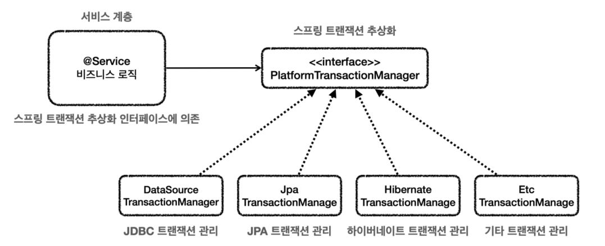
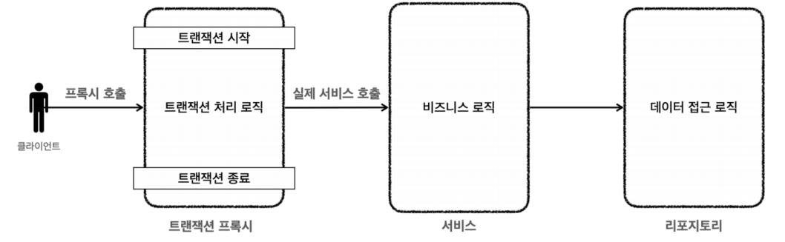
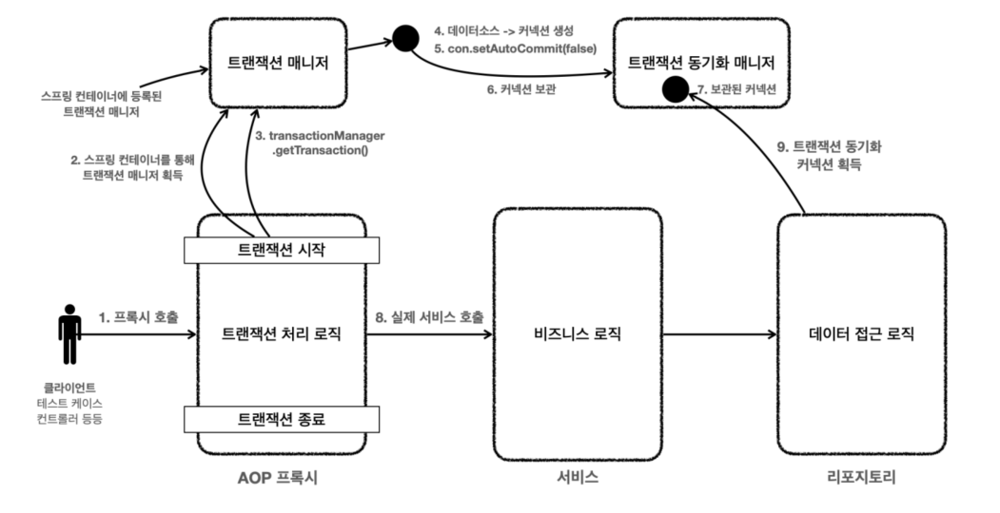

# ***스프링 트랜잭션 소개***

### ***1. 스프링 트랜잭션 추상화***

*각각의 데이터 접근 기술들은 트랜잭션을 처리하는 방식에 차이가 있다.*

***JDBC 트랜잭션:*** *setAutoCommit(false) → 트랜잭션 시작* 

***JPA 트랜잭션****: begin() → 트랜잭션 시작* 

*스프링은* ***PlatformTransactionManager****라는 인터페이스를 통해 트랜잭션을 추상화*



- *스프링은 트랜잭션을 추상화해서 제공할 뿐만 아니라, 실무에서 사용하는 데이터 접근 기술에 대한 트랜잭션 매니저의 구현체도 제공한다.*
- *스프링 부트는 어떤 데이터 접근 기술을 사용하는지 자동으로 인식해서(AutoConfiguration) 적절한 트랜잭션 매니저(+ DataSource)를 선택해서 스프링 빈으로 등록한다.*

### ***2. 스프링 트랜잭션 사용 방식***

***선언적 트랜잭션 관리 vs 프로그래밍 방식 트랜잭션 관리***

- *선언적 트랜잭션 관리* 
- *@Transactional*
  - *이름 그대로 로직에 트랜잭션을 적용하겠다 라고 어딘가에 선언하기만 하면 트랜잭션이 적용되는 방식*
- *프로그래밍 방식의 트랜잭션 관리*
- *트랜잭션 매니저, 트랜잭션 템플릿 등을 사용해서 직접 트랜잭션 관련 코드를 작성하는 방식*

*프로그래밍 방식의 트랜잭션 관리는 핵심 비즈니스 로직과 트랜잭션이라는 기술 코드가 강하게 결합된다.*  

*반면에 선언적 트랜잭션 관리는 Spring AOP 기술을 사용하기 때문에 비즈니스 로직과 분리되고 훨씬 간편하고 실용적이기 때문에 실무에서는 대부분 선언적 트랜잭션 관리를 사용한다.*

### *3. 선언적 트랜잭션과 AOP*



*그림에서는 트랜잭션 프록시라고 표현하지만 정확히는 클라이언트가 프록시를 호출하고 순서에 따라 어드바이스들을 호출한다. 
어드바이스 중에 하나가 트랜잭션 어드바이스이고 순서에 따라 모든 어드바이스 호출이 끝나면 실제 서비스를 호출하게 된다.* 

***프록시 도입 후 전체 과정***



# *프로젝트 설정* 

***build.gradle dependency***

```groovy
dependencies {
			implementation 'org.springframework.boot:spring-boot-starter-data-jpa'
			compileOnly 'org.projectlombok:lombok'
			runtimeOnly 'com.h2database:h2'
			annotationProcessor 'org.projectlombok:lombok'
			testImplementation 'org.springframework.boot:spring-boot-starter-test'
			
			//테스트에서 lombok 사용
			testCompileOnly 'org.projectlombok:lombok'
			testAnnotationProcessor 'org.projectlombok:lombok'
}
```

- *lombok, spring data jpa, h2 database, boot test*

# ***트랜잭션 적용 확인***

***AopUtils.isAopProxy()***

- *파라미터로 넘기는 객체 프록시 적용 여부 확인*

***TransactionSynchronizationManager.isActualTransactionActive()***

- *현재 쓰레드 트랜잭션 적용 여부 확인*

***application.properties***

```groovy
logging.level.org.springframework.transaction.interceptor=TRACE
```

- *트랜잭션 프록시가 호출하는 트랜잭션의 시작과 종료를 명확하게 로그로 확인할 수 있다.*

# ***트랜잭션 적용 위치***

*스프링에서 우선순위는* ***항상 더 구체적이고 자세한 것이 높은 우선순위를 가진다****.*

*예를 들어서 메소드와 클래스에 애노테이션을 붙일 수 있다면 더 구체적인 메소드가 더 높은 우선순위를 가진다.*

***스프링 @Transactional 두 가지 규칙*** 

- *우선순위 규칙*
- *클래스에 적용하면 메소드는 자동 적용*

```java
@Slf4j
@SpringBootTest
public class TxLevelTest {
    @Autowired LevelService levelService;
    @Test
    void orderTest(){
        levelService.write();
        levelService.read();
    }
    @TestConfiguration
    static class TestConfig{
        @Bean
        LevelService levelService(){
            return new LevelService();
        }
    }
    @Slf4j
    @Transactional(readOnly = true)
    static class LevelService{
        @Transactional(readOnly = false)
        public void write(){
            log.info("call write");
            printTxInfo();
        }
        public void read(){
            log.info("call read");
            printTxInfo();
        }
        private void printTxInfo(){
            boolean txActive = TransactionSynchronizationManager.isSynchronizationActive();
            log.info("tx active={}", txActive);
            boolean readOnly = TransactionSynchronizationManager.isCurrentTransactionReadOnly();
            log.info("tx readonly={}", readOnly);
        }
    }
}
```

- ***TransactionSynchronizationManager.isSynchronizationActive()***
- *트랜잭션 동기화 메커니즘의 활성화 여부를 확인*
- ***TransactionSynchronizationManager.isCurrentTransactionReadOnly()***
- *현재 활성화된 트랜잭션이 읽기 모드인지 확인*
- ***TransactionSynchronizationManager.isActualTransactionActive()***
- *현재 쓰레드 물리적 트랜잭션 활성화 여부를 확인*
-  *@Transactional(readOnly = false)*
- *default: false*

***Test Result***

```java
call write
tx active=true
tx readonly=false

call read
tx active=true
tx readonly=false
```

# ***트랜잭션 AOP 주의 사항 - 프록시 내부 호출1***

***내부 호출 → self invocation***

```java
@Slf4j
@SpringBootTest
public class InternalCallV1Test {

    @Autowired CallService callService;
    @Test
    void printProxy(){
        log.info("callService class={}", callService.getClass());
    }

    @Test
    void internalCall(){
        callService.internal();
    }

    @Test
    void externalCall(){
        callService.external();
    }

    @TestConfiguration
    static class TestConfig{
        @Bean
        CallService callService(){
            return new CallService();
        }
    }
    @Slf4j
    static class CallService{
        public void external(){
            log.info("call external");
            printTxInfo();
            internal();
        }

        @Transactional
        public void internal(){
            log.info("call internal");
            printTxInfo();
        }

        private void printTxInfo(){
           boolean txActive = TransactionSynchronizationManager.isSynchronizationActive();
           log.info("tx active={}", txActive);
           boolean readOnly = TransactionSynchronizationManager.isCurrentTransactionReadOnly();
           log.info("tx readonly={}", readOnly);
       }
    }
}
```

***printProxy() result***

```java
callService class=class spring.transaction.apply.InternalCallV1Test$CallService$$SpringCGLIB$$0

```

- *CallService is Proxy* 

***internalCall() result***

```java
call internal
tx active=true
tx readonly=false

```

- *정상적으로 트랜잭션 적용* 

***흐름 정리*** 

***요청:*** *클라이언트 → Proxy: internal() → 트랜잭션 Advice (시작) →  CallService: internal()* 

***응답:*** *CallService: internal() → 트랜잭션 Advice (종료) → Proxy: internal() → 클라이언트*

***externalCall() result***

```java
call external
tx active=false
tx readonly=false
call internal
tx active=false
tx readonly=false
```

- *external() 내부에서 internal()을 호출했지만 트랜잭션은 적용되지 않았다.*

***흐름 정리*** 

***요청:*** *클라이언트 → Proxy: externalCall() → CallService: externalCall() → CallService: internal()*

***응답:***  *CallService: internal() → CallService: externalCall() → Proxy: externalCall() → 클라이언트* 

***흐름 부가 설명*** 

*externalCall()은 Transaction Advice 호출 대상이 아니다.
그래서 바로 RealSubject인 CallService externalCall()을 호출하고 externalCall() 내부에서 호출하는 internalCall()은 this.internalCall()이다.* 

*그래서 트랜잭션이 적용되지 않고 CallService의 internalCall()을 호출하게 된다.*

***프록시 방식의 AOP 한계***

*@Transactional를 사용하는 트랜잭션 AOP는 프록시를 사용한다*

*프록시를 사용하면 메소드 내부 호출에 프록시를 적용할 수 없다.*

# ***트랜잭션 AOP 주의 사항 - 프록시 내부 호출2***

*메소드 내부 호출 때문에 트랜잭션 프록시가 적용되지 않는 문제를 해결하기 위해 internal() 메서드를 별도의 클래스로 분리하자.*

 *proxy self invocation 문제를 해결하는 여러가지 방법이 있지만* ***실무에서는 별도의 클래스를 분리하는 방식****으로 자주 해결한다.*

```java
@Slf4j
@SpringBootTest
public class InternalCallV2Test {

    @Autowired CallService callService;
    
    @Test
    void printProxy(){
        log.info("callService class={}", callService.getClass());
    }
    @Test
    void externalCallV2(){
        callService.external();
    }

    @TestConfiguration
    static class TestConfig{
        @Bean
        CallService callService(){
            return new CallService(internalService());
        }
        @Bean
        InternalService internalService(){
            return new InternalService();
        }
    }
    
    @Slf4j
    @RequiredArgsConstructor
    static class CallService{
        private final InternalService internalService;
        public void external(){
            log.info("call external");
            printTxInfo();
            internalService.internal();
        }
        private void printTxInfo(){
           boolean txActive = TransactionSynchronizationManager.isSynchronizationActive();
           log.info("tx active={}", txActive);
           boolean readOnly = TransactionSynchronizationManager.isCurrentTransactionReadOnly();
           log.info("tx readonly={}", readOnly);
       }
    }
    
    static class InternalService{
        @Transactional
        public void internal(){
           log.info("call internal");
           printTxInfo();
        }
        private void printTxInfo(){
           boolean txActive = TransactionSynchronizationManager.isSynchronizationActive();
           log.info("tx active={}", txActive);
           boolean readOnly = TransactionSynchronizationManager.isCurrentTransactionReadOnly();
           log.info("tx readonly={}", readOnly);
       }
    }
}
```

***externalCallV2 result***

```java
call external
tx active=false
tx readonly=false

call internal
tx active=true
tx readonly=false
```

- *이제 internal part는 트랜잭션이 정상적으로 적용된다.*

***흐름 분석, 응답은 생략*** 

- *클라이언트: CallService external 호출* 
- *CallService: InternalService.internal 호출*
- *Proxy(InternalService): internal Transaction Advice 호출* 
- *Transaction Advice: 트랜잭션 시작, RealSubject(InternalService) internal 호출* 
- *RealSubject(InternalService): this.printTxInfo() 호출*
- *RealSubject(InternalService): 트랜잭션 활성화 로그 출력* 

***접근제어자(Access Modifier)에 따른 트랜잭션 적용 여부***

- *Spring Boot 3.0 미만: public only*
- *Spring Boot 3.0 이상: public, default, protected*

# *트랜잭션 AOP 주의 사항 - 초기화 시점*

*스프링 초기화 시점에는 트랜잭션 AOP가 적용되지 않을 수 있다.*

***스프링 AOP 초기화를 포함한 전체 라이프 사이클*** 

*스프링 컨테이너 생성 → 스프링 빈 생성 → 의존관계 주입 → PostProceesor before 메소드 →* 

*초기화 콜백 →  PostProceesor after 메소드 → 사용 → 소멸전 콜백 → 스프링 종료* 

*스프링 AOP는 postProcessAfterInitialization 메소드를 구현*

*즉, 초기화 콜백(@PostConstruct) 메소드에서는 @Transactional을 함께 사용하면 트랜잭션이 적용되지 않는다.* 

```java
@SpringBootTest
public class InitTxTest {
    @Autowired Hello hello;
    
    @Test
    void go(){
    }

    @TestConfiguration
    static class InitTxTestConfig{
        @Bean
        public Hello hello(){
            return new Hello();
        }
    }

    @Slf4j
    static class Hello{
        @PostConstruct
        @Transactional
        public void initV1(){
            boolean isActive = TransactionSynchronizationManager.isActualTransactionActive();
            log.info("Hello init @PostConstruct tx active={}", isActive);
        }
        @EventListener(ApplicationReadyEvent.class)
        @Transactional
        public void initV2(){
            boolean isActive = TransactionSynchronizationManager.isActualTransactionActive();
            log.info("Hello init ApplicationReady tx active={}", isActive);
        }
    }
}
```

***@PostConstruct + @Transactional result***

```java
Hello init @PostConstruct tx active=false
```

***@EventListener(ApplicationReadyEvent.class) + @Transactional result***

```java
 Hello init ApplicationReady tx active=true
```

# ***트랜잭션 옵션 소개***

***value, transactionManager***

- *트랜잭션을 사용하려면 스프링 빈에 등록된 어떤 트랜잭션 매니저를 사용할지 알아야 한다.*
- *@Transactional도 트랜잭션 어드바이스가 사용할 트랜잭션 매니저를 지정해주어야 한다.*
- *사용할 트랜잭션 매니저를 지정할 때 value, transactionManager 둘 중 하나에 트랜잭션 매니저의 스프링 빈의 이름을 적어주면 된다.*
- *값을 생략하면 기본으로 등록된 트랜잭션 매니저를 사용하기 때문에 거의 생략한다.*
- *만약 트랜잭션 매니저가 둘 이상이라면 트랜잭션 매니저의 이름을 지정해서 구분하면 된다.*

```java
@Configuration
public class TransactionConfig {
    @Bean(name = "jpaTxManager")
    public PlatformTransactionManager jpaTransactionManager(EntityManagerFactory emf) {
        return new JpaTransactionManager(emf);
    }
    @Bean(name = "jdbcTxManager")
    public PlatformTransactionManager jdbcTransactionManager(DataSource dataSource) {
        return new DataSourceTransactionManager(dataSource);
    }
}

public class TxService {
		 @Transactional("jpaTxManager")
		 public void member() {...}
		 
		 @Transactional(value = "jdbcTxManager")
		 public void order() {...}
}
```

- *애노테이션 속성이 value 하나인 경우 생략하고 값을 바로 넣을 수 있다.*

***rollbackFor***

- ***예외 발생시 스프링 트랜잭션의 기본 정책*** 
- *Unchecked Exception(RuntimeException, Error): RollBack*
  - *Checked Exception(Exception): Commit*
- ***rollbackFor: 기본 정책에 추가로 어떤 예외가 발생했을 때 롤백할 지 지정할 수 있다.***
```java
@Transactional(rollbackFor = Exception.class)
```

  - *해당 케이스 같은 경우 예외가 발생하면 무조건 RollBack*
- ***rollbackForClassName***
- *예외 이름을 문자로 넣는다.*
- ***noRollbackFor***
- ***rollbackFor 반대 개념***

***propagation***

- *트랜잭션 전파에 대한 옵션*

***isolation***

- *트랜잭션 격리 수준을 지정할 수 있다.*
- *기본 값은 데이터베이스에서 설정한 트랜잭션 격리 수준을 사용하는 DEFAULT*
- *직접 격리 수준을 지정하는 경우는 드물다.*
- *DEFAULT : 데이터베이스에서 설정한 격리 수준을 따른다.*
- *MySQL → REPEATABLE_READ DEFAULT*
  - *READ_UNCOMMITTED* 
  - *READ_COMMITTED* 
  - *REPEATABLE_READ* 
  - *SERIALIZABLE*

***timeout***

- *트랜잭션 수행 시간에 대한 타임아웃을 초 단위로 지정한다.*
- *기본 값은 트랜잭션 시스템의 타임아웃을 사용한다.*
- *데이터베이스 락(네임드 락, 베타 락, 공유 락)획득을 하지 못하여 트랜잭션이 무한정 대기하면 애플리케이션 서버 성능에도 좋지 않고 UX 측면에서도 좋지 않다.*

***readOnly***

- *트랜잭션은 기본적으로 읽기 쓰기가 모두 가능한 트랜잭션이 생성된다.*
- *default: readOnly = false*
- *readOnly=true 옵션을 사용하면 읽기 전용 트랜잭션이 생성된다*
- *readOnly 옵션을 사용하면 읽기에서 다양한 성능 최적화가 발생할 수 있다.*
- ***프레임워크*** 
- *JdbcTemplate은 읽기 전용 트랜잭션 안에서 변경 기능을 실행하면 예외를 던진다*
    - *JPA(하이버네이트)는 읽기 전용 트랜잭션의 경우 커밋 시점에 플러시를 호출하지 않는다. 추가로 변경이 필요 없으니 변경 감지를 위한 스냅샷 객체도 생성하지 않는다.*
  - ***JDBC 드라이버***
- *읽기 전용 트랜잭션에서 변경 쿼리가 발생하면 예외를 던진다.*
    - *읽기, 쓰기(Master, Slave) DB를 구분해서 요청, 읽기 전용인 경우 슬레이브 데이터베이스 커넥션 획득*
  - ***데이터베이스*** 
- *데이터베이스에 따라 읽기 전용 트랜잭션의 경우 읽기만 하면 되므로, 내부에서 성능 최적화가 발생*

# ***예외와 트랜잭션 커밋, 롤백 - 기본***

*트랜잭션 커밋, 롤백에 대해서 테스트로 이해해 보자* 

***트랜잭션 로그 확인 - application.properties***

```yaml
logging.level.org.springframework.transaction.interceptor=TRACE
logging.level.org.springframework.jdbc.datasource.DataSourceTransactionManager=DEBUG

#JPA log
logging.level.org.springframework.orm.jpa.JpaTransactionManager=DEBUG
logging.level.org.hibernate.resource.transaction=DEBUG
```

***Test & Reulst***

```java
@SpringBootTest
public class RollbackTest {
    @Autowired RollbackService service;
    @Test
    void runtimeException(){
        assertThatThrownBy(() -> service.runtimeException())
                .isInstanceOf(RuntimeException.class);
    }
    @Test
    void checkedException(){
        assertThatThrownBy(()-> service.checkedException())
                .isInstanceOf(MyException.class);
    }
    @Test
    void rollbackFor(){
        assertThatThrownBy(()-> service.rollbackFor())
                .isInstanceOf(MyException.class);
    }
    @TestConfiguration
    static class RollbackTestConfig{
        @Bean
        RollbackService rollbackService(){
            return new RollbackService();
        }
    }
    @Slf4j
    static class RollbackService{

        // 런타임 예외 발생: 롤백
        @Transactional
        public void runtimeException(){
            log.info("call runtimeException");
            throw new RuntimeException();
        }

        // 체크 예외 발생: 커밋
        @Transactional
        public void checkedException() throws MyException{
            log.info("call checkedException");
            throw new MyException();
        }

        // 체크 예외 rollbackFor 지정: 롤백
        @Transactional(rollbackFor = MyException.class)
        public void rollbackFor() throws MyException{
            log.info("call rollbackFor");
            throw new MyException();
        }

    }
    static class MyException extends Exception{
    }
}
```

