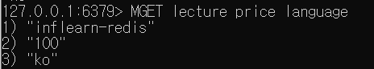
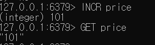
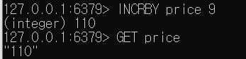
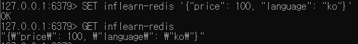

# *Strings*

*문자열, 숫자, serialized object(JSON string) 등 저장*

## ***Strings명령어***

***[SET] Strings 저장***

```shell
SET lecture inflearn-redis
```

- ***key: lecture, value: inflearn-redis***

***[GET] Strings 조회***

```shell
GET lecture
```

- ***return: inflearn-redis***

***[MSET] n개의 Strings 저장***

```shell
MSET price 100 language ko
```

- ***key: price, value: 100***
- ***key: language, value: ko***

***[MGET] n개의 Strings 조회***

```shell
MGET lecture price language
```



***[INCR] 주어진 키의 값을 1 증가*** 

```shell
INCR price
```

- ***키가 존재하지 않으면***  *Redis는 해당 키를 0으로 초기화한 후 증가*
- ***키가 존재하고 정수값인 경우:*** *값을 1 증가*
- ***키가 숫자가 아닌 경우:*** *오류를 반환*



***[INCRBY]*** *특정 키의 값을* ***주어진 정수만큼 증가****시키는 명령어*

```shell
INCRBY price 9
```

- ***키가 존재하고 정수값인 경우****: 지정된* *`increment`* *값만큼 증가*
- ***키가 존재하지 않는 경우****: 키를 0으로 초기화한 후* *`increment`* *값만큼 증가*
- ***키가 숫자가 아닌 경우****: 오류가 반환*



***[SET] JSON Strings 형태 저장***

```shell
SET inflearn-redis '{"price": 100, "language": "ko"}'
```



***Redis naming Convention***

```shell
 SET inflearn-redis:ko:price 200
```

