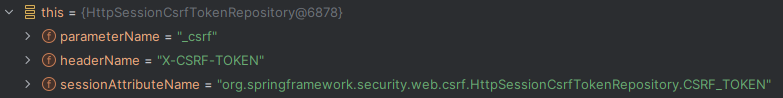
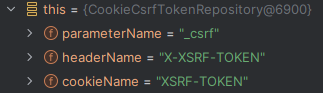
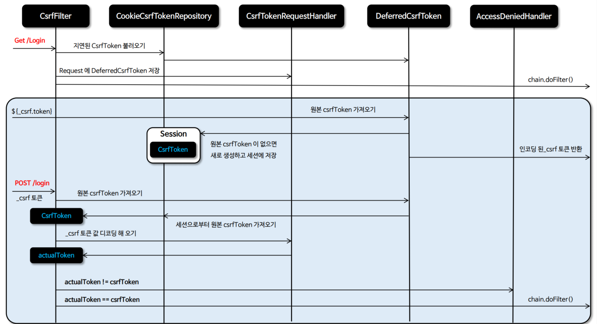

# **CSRF 토큰 유지 - ­CsrfTokenRepository**

- `CsrfToken`은 `CsrfTokenRepository` 를 사용하여 영속화하며 `HttpSessionCsrfTokenRepository` 와 `CookieCsrfTokenRepository` 를 지원한다 
- 두 군데 중 원하는 위치에 토큰을 저장하도록 설정을 통해 지원할 수 있다 

# **세션에 토큰 저장 - HttpSessionCsrfTokenRepository**

```java
@Bean
SecurityFilterChain defaultSecurityFilterChain(HttpSecurity http) throws Exception {
		 HttpSessionCsrfTokenRepository repository = new HttpSessionCsrfTokenRepository();
		 http.csrf(csrf -> csrf.csrfTokenRepository(repository));
		 return http.build();
}
```

- 기본적으로 토큰을 세션에 저장하기 위해 `HttpSessionCsrfTokenRepository` 를 사용한다 
- `HttpSessionCsrfTokenRepository` 는 기본적으로 HTTP 요청 헤더인 `X-CSRF-TOKEN` 또는 요청 매개변수인 `_csrf`에서 토큰을 읽는다 
- `_csrf`: `Query String`, `Content-Type: application/x-www-form-urlencoded`



# **쿠키에 토큰 저장 - CookieCsrfTokenRepository**

```java
@Bean
SecurityFilterChain defaultSecurityFilterChain(HttpSecurity http) throws Exception {
		CookieCsrfTokenRepository repository = new CookieCsrfTokenRepository();
		// 1번 방식 
		http.csrf(csrf -> csrf.csrfTokenRepository(repository));
		// 2번 방식 
		http.csrf(csrf -> csrf.csrfTokenRepository(CookieCsrfTokenRepository.withHttpOnlyFalse()));
		return http.build();
}
```

- JavaScript 기반 애플리케이션을 지원하기 위해 `CsrfToken`을 쿠키에 유지할 수 있으며 구현체로 `CookieCsrfTokenRepository`를 사용할 수 있다
- `CookieCsrfTokenRepository`는 기본적으로 `XSRF-TOKEN`명을 가진 쿠키에 작성하고 HTTP 요청 헤더인 `X-XSRF-TOKEN` 또는 요청 매개변수인 `_csrf`에서 읽는다



- JavaScript 에서 쿠키를 읽을 수 있도록 `HttpOnly`를 명시적으로 false로 설정할 수 있다
- JavaScript로 직접 쿠키를 읽을 필요가 없는 경우 보안을 개선하기 위해 `HttpOnly`를 생략하는 것이 좋다

# **CSRF 토큰 처리­ CsrfTokenRequestHandler**

- `CsrfToken` 은 `CsrfTokenRequestHandler` 를 사용하여 토큰을 생성 및 응답하고 HTTP 헤더 또는 요청 매개변수로부터 토큰의 유효성을 검증하도록 한다 
- `XorCsrfTokenRequestAttributeHandler`와 `CsrfTokenRequestAttributeHandler`를 제공하며 사용자 정의 핸들러를 구현할 수 있다 

```java
@Bean
SecurityFilterChain defaultSecurityFilterChain(HttpSecurity http) throws Exception {
		 XorCsrfTokenRequestAttributeHandler csrfTokenHandler = new XorCsrfTokenRequestAttributeHandler();
		 http.csrf(csrf -> csrf.csrfTokenRequestHandler(csrfTokenHandler));
		 return http.build();
}

```

- `_csrf` 및 `CsrfToken.class.getName()` 명으로 `HttpServletRequest` 속성에 `CsrfToken`을 저장하며 `HttpServletRequest` 으로부터 `CsrfToken`을 꺼내어 참조할 수 있다
- 토큰 값을 요청 헤더 `기본적으로 X-CSRF-TOKEN 또는 X-XSRF-TOKEN 중 하나` 또는 요청 매개변수 `_csrf` 중 하나로부터 토큰의 유효성 비교 및 검증을 해결한다
- 클라이언트의 매 요청마다 `CSRF 토큰 값(UUID)`에 난수를 인코딩하여 변경한 `CsrfToken` 이 반환 되도록 보장한다. 세션에 저장된 원본 토큰 값은 그대로 유지한다
- 헤더 값 또는 요청 매개변수로 전달된 인코딩 된 토큰은 원본 토큰을 얻기 위해 디코딩되며, 그런 다음 세션 혹은 쿠키에 저장된 영구적인 `CsrfToken`과 비교된다

# **CSRF 토큰 지연 로딩**

- 기본적으로 Spring Security 는 `CsrfToken`을 필요할 때까지 로딩을 지연시키는 전략을 사용한다. 그러므로 `CsrfToken`은 `HttpSession`에 저장되어 있기 때문에 매 요청마다
세션으로부터 `CsrfToken` 을 로드할 필요가 없어져 성능을 향상시킬 수 있다
- `CsrfToken` 은 POST 와 같은 안전하지 않은 HTTP 메서드를 사용하여 요청이 발생할 때와 CSRF 토큰을 응답에 렌더링하는 모든 요청에서 필요하기 때문에 그 외 요청에는 지연로딩
하는 것이 권장된다

```java
@Bean
SecurityFilterChain defaultSecurityFilterChain(HttpSecurity http) throws Exception {
	 XorCsrfTokenRequestAttributeHandler handler = new XorCsrfTokenRequestAttributeHandler();
	 handler.setCsrfRequestAttributeName(null); // 지연된 토큰을 사용하지 않고 CsrfToken 을 모든 요청마다 로드한다
	 http.csrf(csrf -> csrf
			 .csrfTokenRequestHandler(handler));
	 return http.build();
}
```

# **CorsFilter 분석하기** 

```java
@Override
protected void doFilterInternal(HttpServletRequest request, HttpServletResponse response, FilterChain filterChain)
		throws ServletException, IOException {
		DeferredCsrfToken deferredCsrfToken = [REDACTED], response);
		request.setAttribute(DeferredCsrfToken.class.getName(), deferredCsrfToken);
		this.requestHandler.handle(request, response, deferredCsrfToken:[REDACTED];
		if (!this.requireCsrfProtectionMatcher.matches(request)) {
			if (this.logger.isTraceEnabled()) {
				this.logger.trace("Did not protect against CSRF since request did not match "
						+ this.requireCsrfProtectionMatcher);
			}
			filterChain.doFilter(request, response);
			return;
		}
		CsrfToken csrfToken = [REDACTED];
		String actualToken = [REDACTED], csrfToken);
		if (!equalsConstantTime(csrfToken.getToken(), actualToken)) {
			boolean missingToken = [REDACTED];
			this.logger
				.debug(LogMessage.of(() -> "Invalid CSRF token found for " + UrlUtils.buildFullRequestUrl(request)));
			AccessDeniedException exception = (!missingToken) ? new InvalidCsrfTokenException(csrfToken, actualToken)
					: new MissingCsrfTokenException(actualToken);
			this.accessDeniedHandler.handle(request, response, exception);
			return;
		}
		filterChain.doFilter(request, response);
}
```

**1.** 

```java
DeferredCsrfToken deferredCsrfToken = [REDACTED], response);
request.setAttribute(DeferredCsrfToken.class.getName(), deferredCsrfToken);
this.requestHandler.handle(request, response, deferredCsrfToken:[REDACTED];
```

- 성능 향상을 위해서 세션으로부터 CSRF 토큰을 가져오는 행위를 초기화 지연과 여러 `Supplier`를 통해서 감싼다. 

**2.**

```java
if(!this.requireCsrfProtectionMatcher.matches(request)) {
		if (this.logger.isTraceEnabled()) {
			this.logger.trace("Did not protect against CSRF since request did not match "
					+ this.requireCsrfProtectionMatcher);
		}
		filterChain.doFilter(request, response);
		return;
}
```

- `!this.requireCsrfProtectionMatcher.matches(request)` 
- 해당 조건은 요청 HTTP 메소드를 파악하고 `GET, OPTIONS, HEAD, TRACE` 에 해당하면 true가 되어서 CSRF 토큰 검증 작업 없이 바로 다음 필터로 넘어간다.
  - `requireCsrfProtectionMatcher` : `CsrfFilter` 내부 클래스로 존재한다. `DefaultRequiresCsrfMatcher` implements `RequestMatcher`

**3.**

```java
CsrfToken csrfToken = [REDACTED];
String actualToken = [REDACTED], csrfToken);
if (!equalsConstantTime(csrfToken.getToken(), actualToken)) {
	boolean missingToken = [REDACTED];
	this.logger
		.debug(LogMessage.of(() -> "Invalid CSRF token found for " + UrlUtils.buildFullRequestUrl(request)));
	AccessDeniedException exception = (!missingToken) ? new InvalidCsrfTokenException(csrfToken, actualToken)
			: new MissingCsrfTokenException(actualToken);
	this.accessDeniedHandler.handle(request, response, exception);
	return;
}
filterChain.doFilter(request, response);
```

- CSRF 토큰 검증 로직을 시작한다 
- `CsrfToken csrfToken = [REDACTED];` 
- `Supplier`를 통해서 초기화가 지연되고 있던 CSRF 토큰 로딩 작업이 `Supplier.get()`을 통해서 실행된다
- `String actualToken = [REDACTED], csrfToken);` 
- 요청 헤더 또는 HTTP 매개변수에서 CSRF 토큰을 가져온다
- `if (!equalsConstantTime(csrfToken.getToken(), actualToken))`
- 세션 OR 쿠키에 저장된 CSRF 토큰과 클라이언트가 보낸 CSRF 토큰을 비교한다 
  - 이때 인코딩 작업이 필요하면 인코딩 작업을 한다 
  - 만약 해당 조건의 결과 true면 다음 필터로 넘어가지 않고 `accessDeniedHandler`가 처리를 한다 
  - 만약 해당 조건의 결과가 false면 CSRF 토큰 검증을 통과한 것이고 다음 필터로 넘어간다

# **CsrfFilter 흐름도** 



