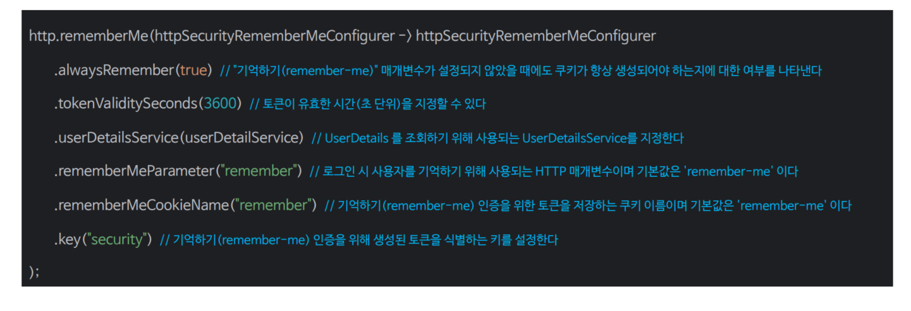
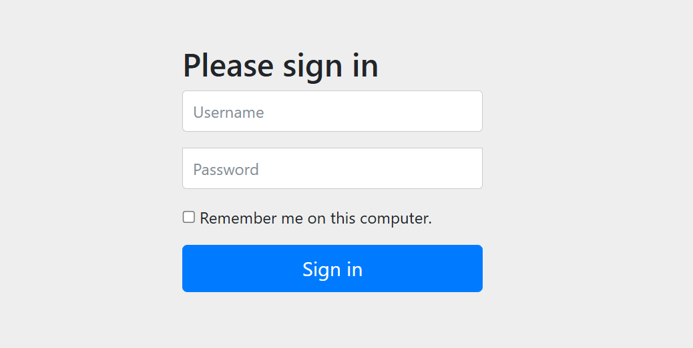
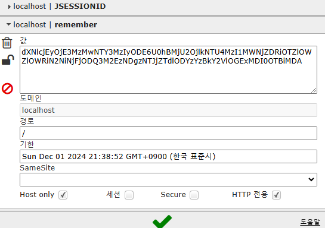

# **RememberMe 인증** 

- 사용자가 웹 사이트나 애플리케이션에 로그인할 때 자동으로 인증 정보를 기억하는 기능이다 
- `UsernamePasswordAuthenticationFilter` 와 함께 사용되며, `AbstractAuthenticationProcessingFilter` 슈퍼 클래스에서 훅을 통해 구현된다 
- 인증 성공 시 `RememberMeServices.loginSuccess()`를 통해 RememberMe 토큰을 생성하고 쿠키로 전달한다 
  - 인증 실패 시 `RememberMeServices.loginFail()`를 통해 쿠키를 지운다 
  - `LogoutFilter`와 연계해서 로그아웃 시 쿠키를 지운다

# **RememberMe 토큰** 

- 기본적으로 암호화된 토큰으로 생성되어 브라우저에 쿠키를 보내고, 향후 세션에서 이 쿠키를 감지하여 자동 로그인이 이루어지는 방식으로 달성된다 
- `base64(username + ":" + expirationTime + ":" + algorithmName + ":" + algorithmHex(username + ":" + expirationTime + ":" + password + ”:” + key))`
- username: UserDetailsService로 식별 가능한 사용자 이름 
  - password: [REDACTED] UserDetails에 일치하는 비밀번호 
  - expirationTime: remember-me 토큰이 만료되는 날짜와 시간, 밀리초로 표현 
  - key: remember-me 토큰의 수정을 방지하기 위한 개인 키 
  - algorithmName: remember-me 토큰 서명을 생성하고 검증하는 데 사용되는 알고리즘(SHA-256 알고리즘)

# **RememberMeServices 구현체** 

- `TokenBasedRememberMeServices` - 쿠키 기반 토큰의 보안을 위해 해싱을 사용 
- 메모리 방식
- `PersistentTokenBasedRememberMeServcies` - 생성된 토큰을 저장하기 위해 DB나 다른 영구 저장 매체를 사용한다 
- 두 구현 모두 사용자의 정보를 검색하기 위한 `UserDetailsService`가 필요하다 

# **rememberMe() API**

- `RememberMeConfigurer` 설정 클래스를 통해 여러 API들을 설정할 수 있다. 
- 내부적으로 `RememberMeAuthenticationFilter`가 생성되어 자동 인증 처리를 담당하게 된다 



```java
@EnableWebSecurity
@Configuration
public class SecurityConfig {
    @Bean
    public SecurityFilterChain securityFilterChain(HttpSecurity http) throws Exception{
        http
                .authorizeHttpRequests(auth -> auth
                        .requestMatchers("/").permitAll()
                        .anyRequest().authenticated()
                )
                .formLogin(Customizer.withDefaults())
                .rememberMe(auth -> auth
                        // .alwaysRemember(true)
                        .tokenValiditySeconds(3600) // 1시간
                        .userDetailsService(userDetailsService())
                        .rememberMeParameter("remember")
                        .rememberMeCookieName("remember")
                        .key("security")
                );
        return  http.build();
    }
    @Bean
    public UserDetailsService userDetailsService(){
        UserDetails user = User.withUsername("user12")
                .password("{noop}1111")
                .roles("USER").build();
        return new InMemoryUserDetailsManager(user);
    }
}
```



**alwaysRemeber(): default false**

remember me 체크박스 체크 여부에 상관 없이 항상 쿠키에 remember me 토큰이 저장된다 


**rememberMeParameter: default “remember-me”**

 “remember”로 설정해서 “remember”로 나온다.



remember me 체크박스를 체크하고 로그인 하였다. 

현재 쿠키를 보면 `JSESSIONID (세션 ID)`와 `remember`쿠키가 보인다 

쿠키 이름은 default: “remember-me”이지만 “remember”로 설정했다.

또한 기한을 보면 2024년 9시 38분까지인데 내가 로그인 한 시각이 8시 38분이어서 

1시간 이후 만료되도록 설정했기 때문에 그렇다. 

세션 쿠키를 삭제해도 remember me 쿠키가 존재하면 별도의 로그인 과정 없이 

다시 로그인 된다. (세션 ID가 새로 생긴다.)

세션 쿠키, remember me 쿠키를 모두 삭제하면 인증을 요구한다 .

