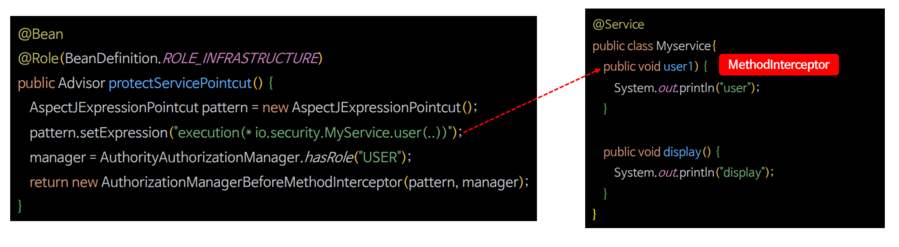
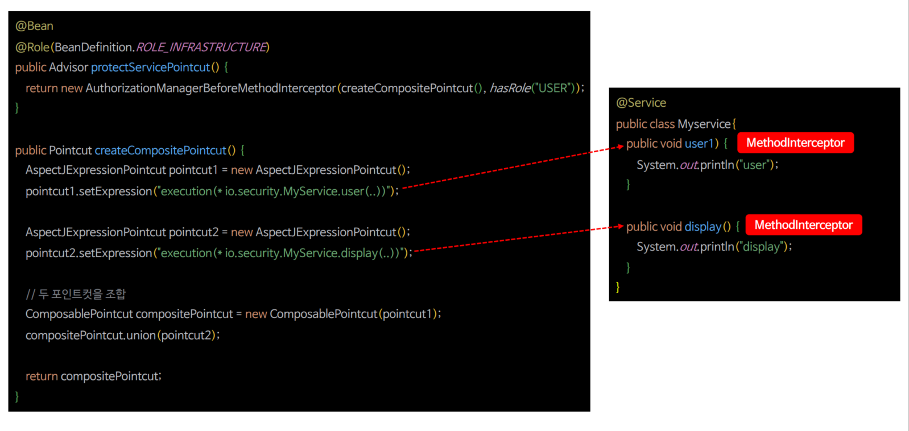

# **개요** 

- 메서드 보안은 `AOP`를 기반으로 구축되었기 때문에 어노테이션이 아닌 패턴 형태로 권한 규칙을 선언할 수 있으며 이는 요청 수준의 인가와 유사한 방식이다
- 자체 어드바이저(Advisor)를 발행하거나 포인트컷(PointCut)을 사용하여 AOP 표현식을 애플리케이션의 인가 규칙에 맞게 매칭할 수 있으며 이를 통해 어노테이션을 사용하지 않고도 메소드 수준에서 보안 정책을 구현할 수 있다

# **빈 정의하기 ­ 단일 포인터컷**



- `MethodInterceptor`에 `PointCut, AuthorizationManager`를 넘긴다.

# **빈 정의하기 ­ 다중 포인터컷**



- 표현식을 `execution(* io.security.`*`Service.`*`(..))` 설정하면 모든 메서드에 AOP 인터셉터가 등록된다

```java
@EnableWebSecurity
@EnableMethodSecurity(prePostEnabled = false)
@Configuration
public class SecurityConfig {
    @Bean
    @Role(BeanDefinition.ROLE_INFRASTRUCTURE)
    public Advisor pointCutAdvisor(){
        AspectJExpressionPointcut pointcut = new AspectJExpressionPointcut();
        pointcut.setExpression("execution(* spring.security.DataService.getUser(..))");
        AuthorityAuthorizationManager<MethodInvocation> manager = AuthorityAuthorizationManager.hasRole("USER");
        return new AuthorizationManagerBeforeMethodInterceptor(pointcut, manager);
    }
    @Bean
    @Role(BeanDefinition.ROLE_INFRASTRUCTURE)
    public Advisor pointCutAdvisor2(){
        AspectJExpressionPointcut pointcut1 = new AspectJExpressionPointcut();
        pointcut1.setExpression("execution(* spring.security.DataService.getUser(..))");

        AspectJExpressionPointcut pointcut2 = new AspectJExpressionPointcut();
        pointcut2.setExpression("execution(* spring.security.DataService.getOwner(..))");

        ComposablePointcut composablePointcut = new ComposablePointcut((Pointcut) pointcut1);
        composablePointcut.union((Pointcut) pointcut2);

        AuthorityAuthorizationManager<MethodInvocation> manager = AuthorityAuthorizationManager.hasRole("USER");
        return new AuthorizationManagerBeforeMethodInterceptor(composablePointcut, manager);
    }

    @Bean
    public SecurityFilterChain securityFilterChain(HttpSecurity http) throws Exception{
        http
                .authorizeHttpRequests(authorize -> authorize
                        .anyRequest().authenticated())
                .formLogin(Customizer.withDefaults())
                .csrf(AbstractHttpConfigurer::disable);
        return http.build();
    }
    @Bean
    public UserDetailsService userDetailsService(){
        UserDetails user = User.withUsername("user").password("{noop}1111").roles("USER").build();
        UserDetails db = User.withUsername("db").password("{noop}1111").authorities("ROLE_DB").build();
        UserDetails admin = User.withUsername("admin").password("{noop}1111").roles("ADMIN","SECURE").build();
        return  new InMemoryUserDetailsManager(user, db, admin);
    }
}
```

