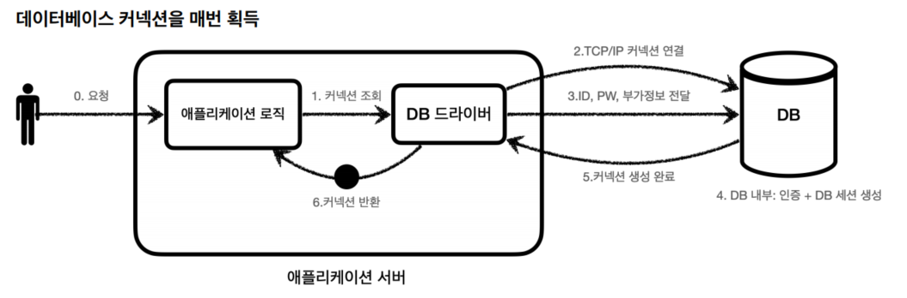
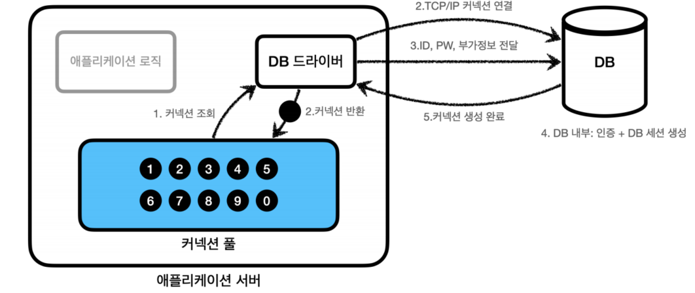
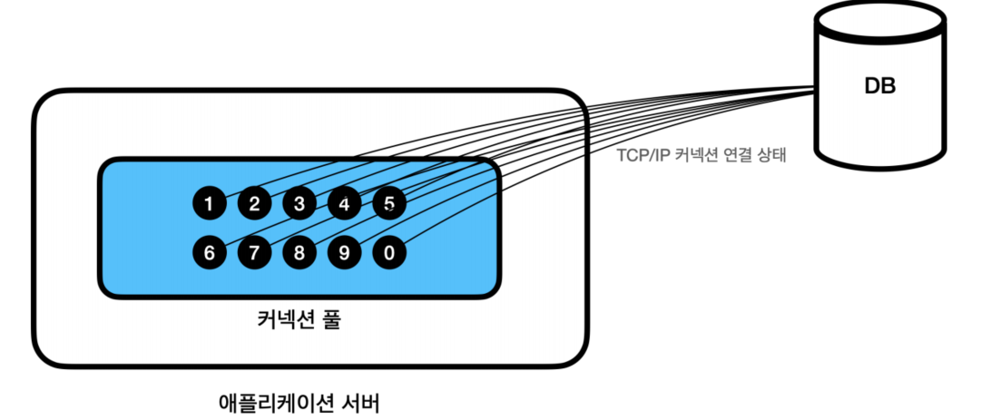
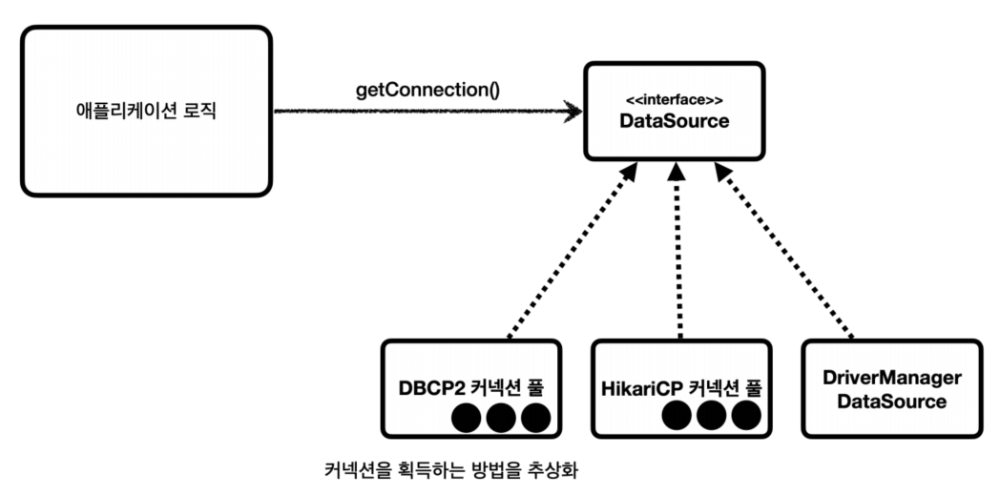

# ***커넥션 풀 이해***



***커넥션 풀 없이 데이터베이스 커넥션 획득 과정*** 

- *애플리케이션 로직 DB 드라이버를 통해 커넥션 조회*
- *DriverManager.getConnection(URL, USERNAME, PASSWORD)*
- *DB 드라이버는 DB와 TCP/IP 커넥션 연결*
- *3 way handshake 같은 네트워크 동작 발생*
- *DB 드라이버는 TPP/IP 커넥션 통해서 ID/PW 기타 부가정보를 DB에 전달* 
- *DB는 ID,PW를 통해 내부 인증을 완료하고, 내부에 DB 세션을 생성*
- *DB 커넥션 생성이 완료되었다는 응답을 보낸다.*
- *DB 드라이버는 커넥션 객체를 생성해서 클라이언트: DriverManager.getConnection() 호출 스레드에게 반환*

***커넥션 풀 없이 데이터베이스 커넥션 획득 과정의 문제점*** 

- *DB, 애플리케이션 서버에서도 매번 TCP/IP 커넥션을 새로 생성하기 위한 리소스 매번 사용* 

***커넥션 풀?***

- *커넥션을 미리 생성하고 재사용하는 방식이 커넥션 풀이다.*
- *스프링 애플리케이션 서버에서 스레드를 미리 생성하고 재사용하는 방식과 똑같다.*

***커넥션 풀 초기화***



- *애플리케이션을 시작하는 시점에 커넥션 풀은 설정해둔 커넥션 개수만큼 커넥션을 미리 확보해서 풀에 보관한다*
- *커넥션 개수는 서비스 특징, 서버 스펙에 따라 다르지만 default: 10*

***커넥션 풀의 연결 상태***



- *커넥션 풀에 들어있는 커넥션은 TCP/IP로 DB와 커넥션이 연결되어 있는 상태이기 때문에 언제든지 SQL을 DB에 전달할 수 있다.*

***커넥션 풀 정리***

- *커넥션 풀 숫자는 서비스의 특징과 애플리케이션 서버 스펙, DB 서버 스펙에 따라 다르다 → 성능 테스트를 통해서 최적의값을 정해야 한다.*
- *MySQL 유료 에디션에서는 스레드 풀 기능을 제공하는데 스레드 풀 도입이 무조건 성능 개선을 의미하지는 않는다는 내용이 있다. 너무 많은 스레드의 개수는 너무 많은 컨텍스트 스위칭을 발생시키고 CPU 친화도가 낮아진다. 즉, 언제나 성능 테스트를 통해서 맞춰야 한다.*
- *커넥션 풀의 최대 커넥션 수를 제한할 수 있다.*
- *커넥션 수를 제한하지 않으면 DB에 무한정 연결이 생성되는 것을 막아주어서 DB를 보호하는 효과도 있다.*
  - *트랜잭션을 시작하고 종료하지 않으면 MySQL은 MVCC를 언두 로그를 통해서 제공하는데 언두 로그에 데이터가 무한정 쌓이게된다.*
- *커넥션 풀 오픈소스* 
-  *commons-dbcp2 , tomcat-jdbc pool ,* ***HikariCP(스프링 부트 2.0부터 default)***

# *DataSource 이해* 

***여러가지 커넥션 획득 방법과 문제점*** 

*커넥션을 획득하는 방법은 다양하다.*

*→ DBCP2  조회, HikariCP 조회, DriverManger를 통한 신규 커넥션 생성 등등…*

*만약 애플레이션 로직이 DriverManger를 통해 신규 커넥션을 획득하다가, 커넥션 풀을 사용하는 방법으로 변경하면 어떻게 해야할까?*

*→ 애플리케이션 코드가 변경된다. 즉, 커넥션을 획득하는 클라이언트 코드가 변경된다.* 

***커넥션을 획득하는 방법을 추상화***



- *javax.sql.DataSource 인터페이스를 제공 (커넥션 획득하는 방법 추상화)*

***DataSource 핵심 기능만 축약***

```java
public interface DataSource {
		 Connection getConnection() throws SQLException;
}
```

- *커넥션 풀 implements DataSource*
- *DriverManager: DriverManagerDataSource implments DataSource*  
- *항상 새로운 커넥션 획득*

# *DataSource 예제1 - DriverManager*

***DriverManager 사용 커넥션 획득***

```java
@Test
void driverManager() throws SQLException {
    Connection con1 = DriverManager.getConnection(URL, USERNAME, PASSWORD);
    Connection con2 = DriverManager.getConnection(URL, USERNAME, PASSWORD);
    assertThat(con1).isNotSameAs(con2);
}
```

***DataSourceDriverManager 사용 커넥션 획득*** 

```java
@Test
void dataSourceDriverManager() throws SQLException{
    DataSource datasource = new DriverManagerDataSource(URL, USERNAME, PASSWORD);
    useDataSource(datasource);
}
 private void useDataSource(DataSource dataSource) throws SQLException{
    Connection con1 = dataSource.getConnection();
    Connection con2 = dataSource.getConnection();
}
```

*2방식 모두 커넥션을 획득할 때마다 신규 TCP/IP 통신을 한다.*

*하지만 큰 차이점이 있다.*

*DriverManger 방식은 커넥션을 획득할 때마다 설정 정보(URL, USERNAME, PASSWORD)를 넘긴다.*

*하지만 DriverManagerDataSource 방식은 처음 DataSource 객체를 생성할 때 설정 정보를 넘기고 이후에 커넥션 획득할 때는 단순히 getConnection()을 호출해서 얻어온다.*

*즉, 설정과 사용이 분리되어 있다.*

# *DataSource 예제2 - Connection Pool*

 ***HikariDataSource 사용 커넥션 획득***

```java
@Test
void dataSourceConnectionPool() throws SQLException, InterruptedException{
    HikariDataSource dataSource = new HikariDataSource();
    dataSource.setJdbcUrl(URL);
    dataSource.setUsername(USERNAME);
    dataSource.setPassword(PASSWORD);
    dataSource.setMaximumPoolSize(10);
    dataSource.setPoolName("OceanWorld");

    useDataSource(dataSource);
    Thread.sleep(1000); 

private void useDataSource(DataSource dataSource) throws SQLException{
    Connection con1 = dataSource.getConnection();
    Connection con2 = dataSource.getConnection();
}
```

- ***HikariCP 커넥션 풀을 사용***

***커넥션 생성 작업***

*커넥션 풀에서 커넥션을 생성하는 작업은 애플리케이션의 실행 속도에 영향을 주지 않기 위해 별도의 쓰레드에서 비동기적으로 동작한다.*

*그래서 테스트가 먼저 종료될 가능성이 존재한다. 그래서 커넥션 생성 작업 스레드의 작업 완료를 기다리기 위해 Thread.sleep이 필요하다.*

*테스트를 위해서 Future를 통한 블로킹 비동기 방식이나 CompletableFuture를 통한 논블로킹 비동기 방식을 적용해도 괜찮을듯하다*

***커넥션 획득*** 

*커넥션 풀에 사용 가능한 커넥션 풀이 없을 때는 블로킹 방식으로 동작한다.*

*즉, 다른 스레드가 커넥션 반납 전까지는 커넥션이 필요한 스레드는 대기 상태이다.*

*UX와 애플리케이션의 안정성을 위해서 커넥션 획득 타임아웃을 걸어야 한다.*

*→ ex: setConnectionTimeout(1000)* 

- ***HikariCP 커넥션 풀***

# ***DataSource 적용***

```java
@RequiredArgsConstructor
public class MemberRepositoryV1 {
		 private final DataSource dataSource;
		 
		 // CRUD 생략 ..		 
		 
		 private void close(Connection con, Statement stmt, ResultSet rs) {
			  JdbcUtils.closeResultSet(rs);
			  JdbcUtils.closeStatement(stmt);
			  JdbcUtils.closeConnection(con);
     }
		 
		 private Connection getConnection() throws SQLException {
				 return dataSource.getConnection();
	   }
}		 
```

- *resource 정리 → JdbcUtils.closeXXX*
- *Connection 획득 → DataSource.getConnnection() is not static*
- *이제 DataSource를 주입받아서 사용해서 커넥션 획득 방식이 바뀌어도 클라이언트 코드 즉,*
*getConnnection() 메소드가 변경되지 않고, 외부 설정 코드만 바뀐다.*
  - *DI + OCP*

