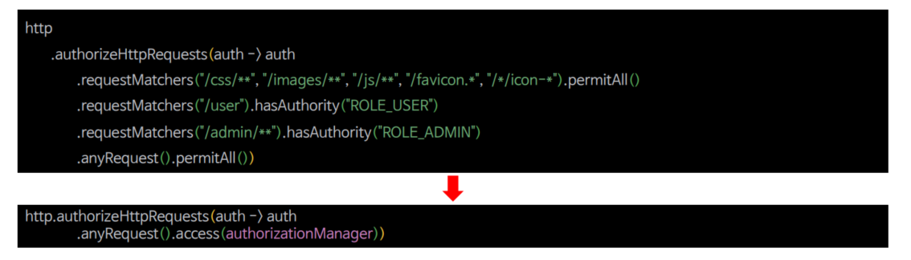

# ***개요***

- *회원, 권한, 자원 관리 기능을 스프링 시큐리티와 연동하여 구현하는 방법을 학습*
- *설정 클래스에서 권한 규칙 코드 모두 제거하고 프로그래밍에 의한 동적 권한으로 전환*

***회원 관리 시스템 구현***

- *회원 관리: ­ 회원 리스트, 회원 상세정보, 권한 부여*
- *권한 관리: ­ 권한 리스트, 권한 생성, 수정, 삭제*
- *자원 관리: ­ 자원 리스트, 자원 생성, 삭제, 수정, 권한 매핑*

# ***엔티티 관계도***

# ***테이블 관계도***

# *패키지*

# 
***실습 예제 화면***


