## **✅** 연속 메모리 할당의 두 가지 문제점

- 외부 단편화 
- 물리 메모리보다 큰 프로세스 실행 불가 

## **✅ 가상 메모리 기법**

- 실행하고자 하는 프로그램을 일부만 메모리에 적재하여 실제 물리 메모리 크기보다 더 큰 프로세스를 실행할 수 있게 하는 기술 
- 페이징, 세그멘테이션 

## **✅ 페이징**

- 외부 단편화가 발생했던 근본적인 문제는? 
- 각기 다른 크기의 프로세가 메모리에 연속적으로 할당되었기 때문이다. 
- 프로세스를 일정 크기로 자르고, 이를 메모리에 불연속적으로 할당할 수 있으면 어떨까?

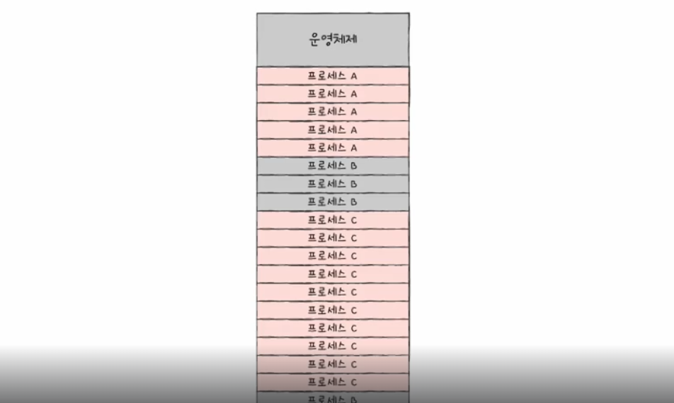

### 페이징(paging)

- 프로세스의 논리 주소 공간을 **페이지(page)**라는 일정 단위로 자르고, 
- 메모리의 물리 공간을 **프레임(frame)**이라는 페이지와 동일한 단위로 자른 뒤 
- 페이지를 프레임에 할당하는 가상 메모리 관리 기법 

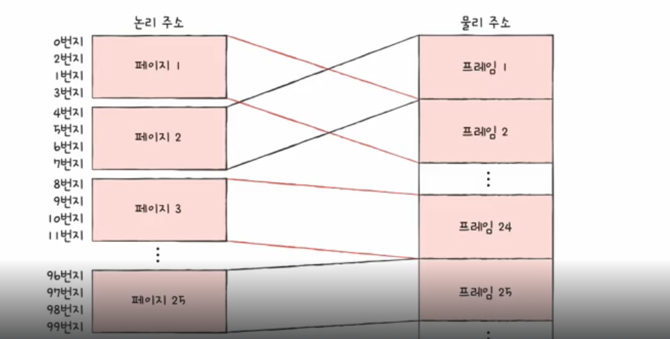

### 페이징에서의 스와핑 

- 프로세스 단위의 스왑 인, 스왑 아웃이 아닌 페이지 단위의 **스왑 인(페이지 인), 스왑 아웃(페이지 아웃)**
- 메모리에 적재될 필요가 없는 페이지들을 보조기억장치로 스왑 아웃(페이지 아웃)
- 실행에 필요한 페이지들을 메모리로 스왑 인(페이지 인)

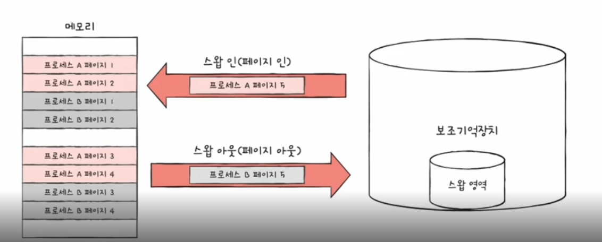

- 프로세스를 실행하기 위해 모든 페이지가 적재될 필요 없다
- 달리 말해 물리 메모리보다 큰 프로세스도 실행될 수 있다 

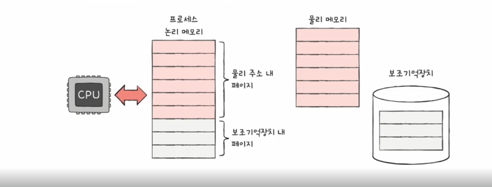

### CPU 입장에서 페이징 

- 프로세스를 이루는 페이지가 어느 프레임에 적재되어 있는지 CPU가 일일이 알기란 어렵다 
- 프로세스가 메모리에 불연속적으로 배치되어 있다면 CPU 입장에서 이를 순차적으로 실행할 수가 없다. 
- CPU 입장에서는 다음에 실행할 명령어 위치를 찾기가 어려워졌다. 

## **✅**  페이지 테이블 

- 물리 주소에 불연속적으로 배치되더라도
- 논리 주소에는 연속적으로 배치되도록 하는 방법 
- 페이지 번호와 프레임 번호를 짝지어 주는 일종의 이정표 

**프로세스마다 페이지 테이블이 존재** 

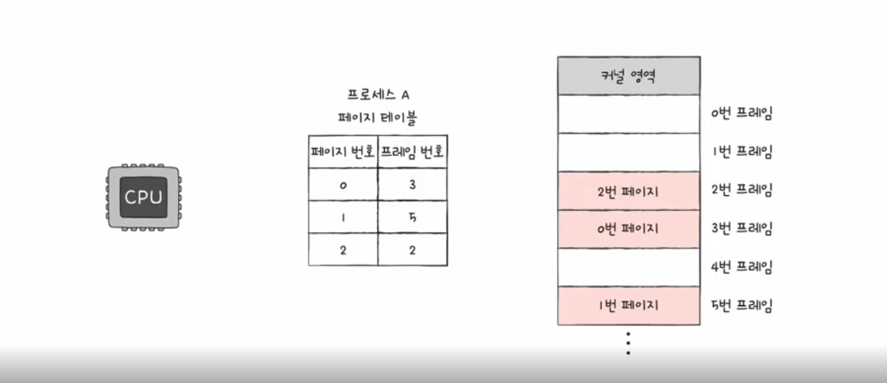

- 물리적으로는 분산되어 저장되어 있더라도 CPU 입장에서 바라본 논리 주소는 연속적으로 보인다 
- CPU는 그저 논리 주소를 순차적으로 실행하면 될 뿐

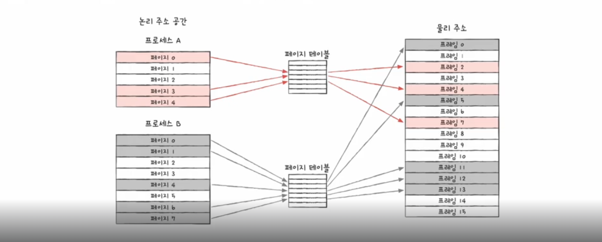

## **✅**  내부 단편화

- 페이지 크기가 10KB, 프로세스 크기 108KB
- 2KB: 내부 단편화 
- 하나의 페이지 크기보다 작은 크기로 발생 

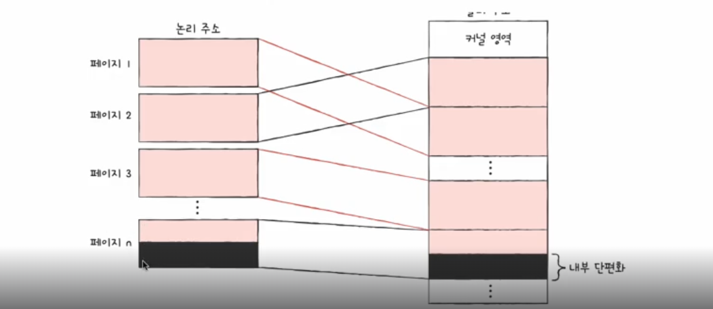

**하지만 내부 단편화의 크기는 외부 단편화와 비교했을 때 매우 작다.** 

## **✅** PTBR (Page Table Base Register)

- 프로세스마다 페이지 테이블이 존재 
- 각 페이지 테이블은 CPU 내의 **프로세스 테이블 베이스 레지스터(PTBR)**가 가리킨다.
- 이런 각 프로세스들의 페이지 테이블 정보들은 각 프로세스의 PCB에 기록된다. 

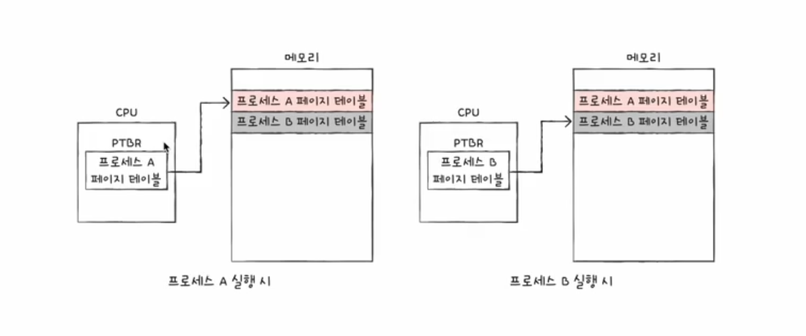

- 페이지 테이블이 메모리에 있으면? **메모리 접근 시간 두 배로** 
- 페이지 테이블 참조 1번, 페이지 탐조하기 위해 1번 

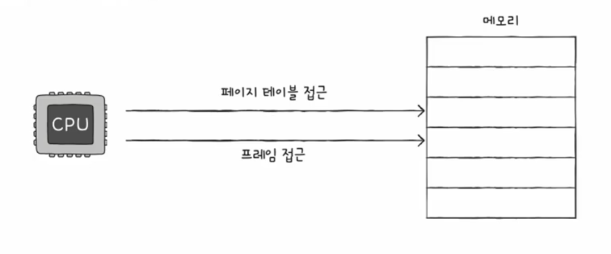

## **✅  TLB (Translation Lookaside Buffer)**

- TLB: CPU 곁에 페이지 테이블의 캐시 메모리 
- 일반적으로 **MMU(Memory Management Unit)** 내에
- 페이지 테이블의 일부를 가져와 저장 
- 참조 지역성에 근거해 최근에 사용된 페이지 위주로 가져와 저장

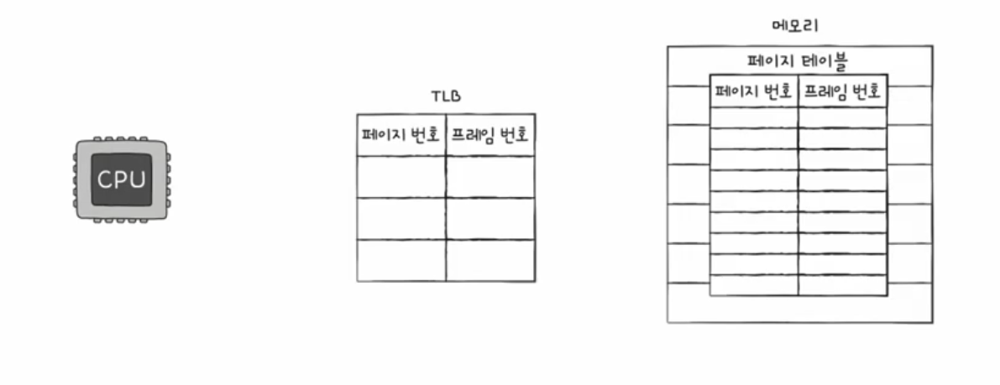

- CPU가 접근하려는 논리 주소가 TLB에 있다면? TLB 히트 
- 메모리 접근 한 번
- CPU가 접근하려는 논리 주소가 TLB에 없다면? TLB 미스 
- 메모리 접근 두 번

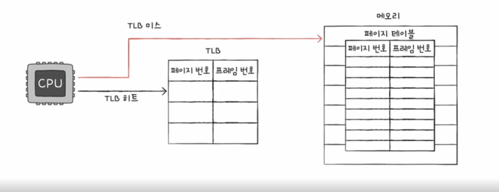

## **✅**  페이징에서의 주소 변환 

- 특정 주소에 접근하고자 한다면 어떤 정보가 필요할까? 
- 어떤 페이지/프레임에 접근하고 싶은지
  - 접근하려는 주소가 그 페이지 혹은 프레임으로부터 얼마나 떨어져 있는지

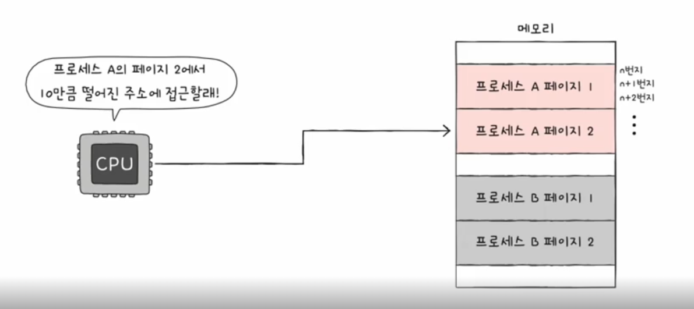

### 페이징 시스템에서의 논리 주소 

- 페이지 번호(page number)와 변위(offset)

### 페이징에서의 주소 변환 

- <페이지 번호, 변위>로 이루어진 논리 주소는 
- 페이지 테이블틀 통해 
- <프레임 번호, 변위>로 변환된다 
- 페이징에서 주소 변환은 **MMU (Memory Management Unit)** 가 담당

### 주소 변환 흐름 

1. **CPU**가 논리 주소(가상 주소)를 생성
ex) `페이지 번호 + 오프셋`
1. **MMU**가 TLB를 먼저 조회
- Hit: 바로 물리 주소로 변환
  - Miss: 메모리에서 페이지 테이블을 조회
1. **페이지 테이블**을 통해 해당 페이지 번호가 매핑된 **프레임 번호**를 찾음
1. **프레임 번호 + 오프셋** → 최종 **물리 주소** 계산

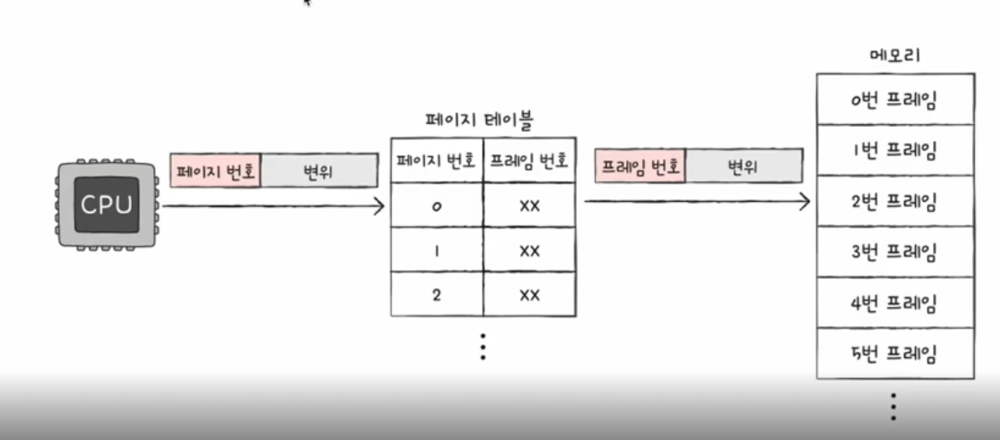

- 논리주소<페이지 번호, 변위>가 <5, 2>인 곳에 접근?

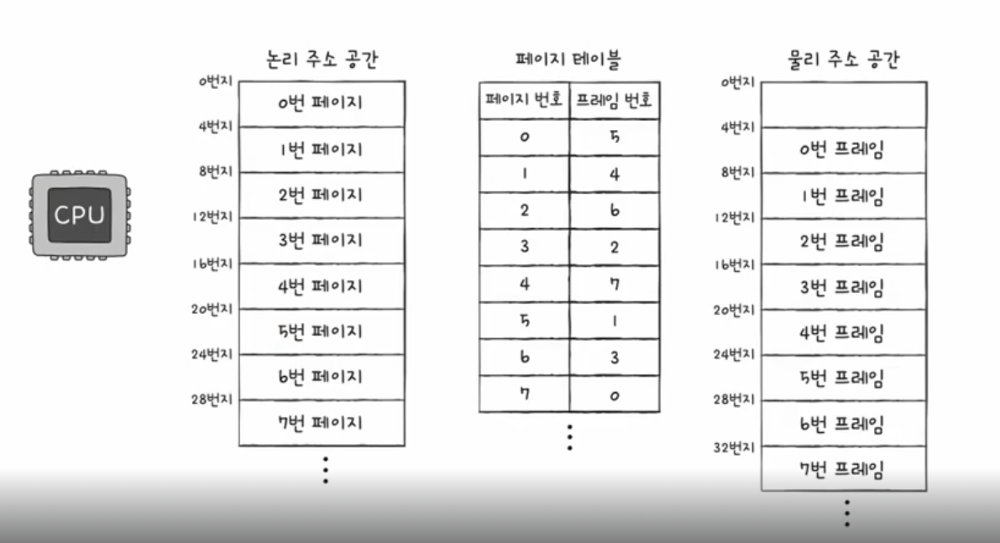

A: 페이지 번호: 5 → 프레임 번호: 1  1번 프레임 엔트리: 8번지 변위: 2 최종 접근 물리 주소: 8 + 2 = 10번지 

## **✅**  페이지 테이블 엔트리

- 페이지 테이블의 각각의 행: 페이지 테이블 엔트리(PTE)
- 현재까지 설명한 PTE: 페이지 번호, 프레임 번호 
  - 이외에 담기는 정보?

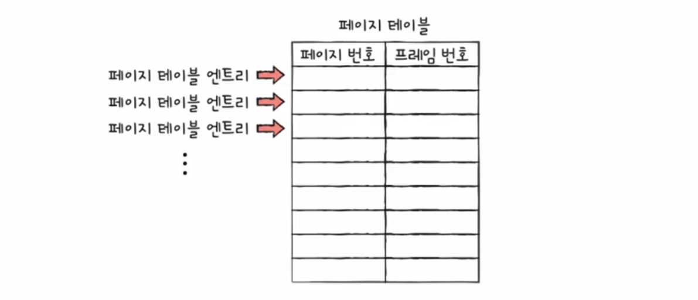

### 유효 비트 

- 현재 해당 페이지에 접근 가능한지 여부 (valid, invalid) 

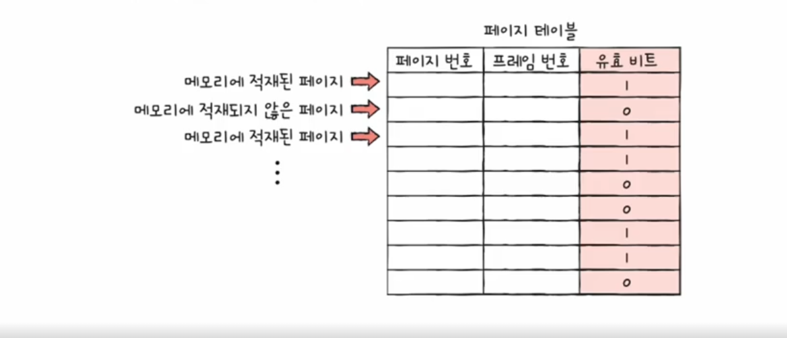

### 유효 비트가 0인 페이지에 접근하려고 하면?

- **페이지 폴트(page fault)라는 인터럽트 발생** 
1. CPU는 기존의 작업 내역을 백업 
  1. 페이지 폴트 처리 루틴(인터럽트 서비스 루틴) 실행 
  1. 페이지 처리 루틴은 페이지를 메모리로 가져온 뒤(페이지 인/스왑 인) 유효 비트를 1로 변경 
  1. 페이지 폴트로 처리했다면 이제 CPU는 해당 페이지에 접근할 수 있게 된다.

### 보호 비트 

- 페이지 보호 기능을 위해 존재하는 비트 
- 페이지에 접근할 권한을 제한하여 페이지를 보호하는 비트 

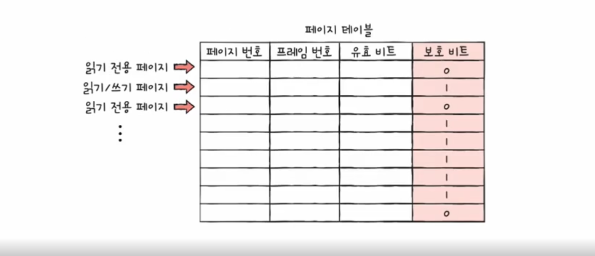

### 참조 비트

- CPU가 이 페이지에 접근한 적이 있는지 여부 

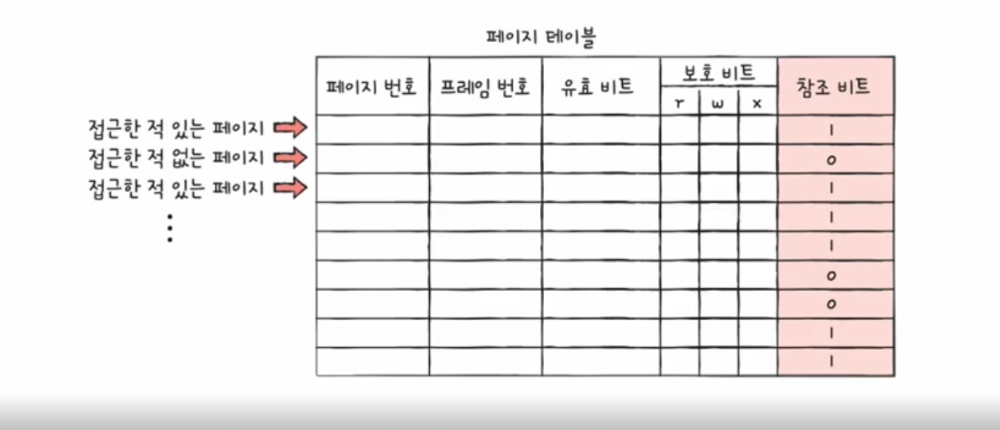

### 수정 비트 (더티 비트 = dirty bit)

- CPU가 이 페이지에 데이터를 쓴 적이 있는지 여부 

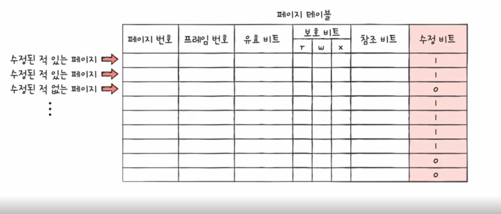

- 수정 비트의 존재 이유? 
- 수정된 페이지는 스왑 아웃될 때 보조기억장치에도 쓰기 작업을 거쳐야 한다. 
- 수정되지 않은 페이지는 스왑 아웃될 때 작업 X (디스크에 있는 내용이 이미 최신본)

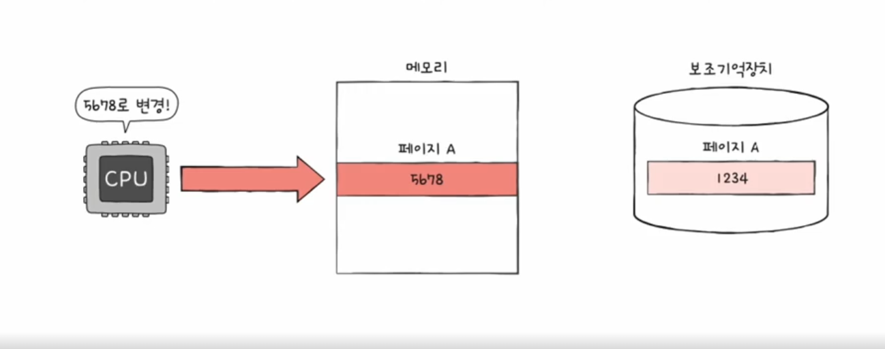

