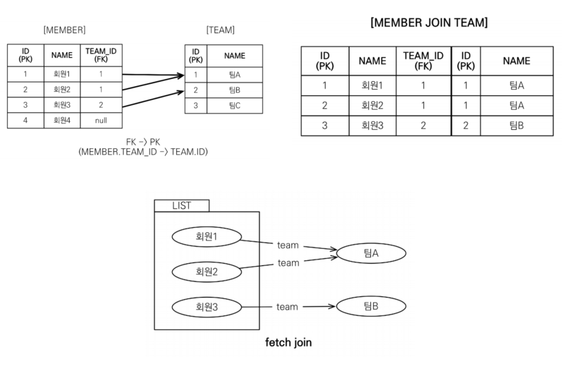

### *엔티티 페치 조인 예제* 

***설정이 (EAGER)즉시 로딩 + JPQL: 조인 X조회***
*Member 관련 프로젝션만 조회 했는데도 연관관계가 있는 Team까지 조인해서 조회*

*→ 만약 필요한 데이터가 Member only 였다면 불필요한 데이터 로딩이다.*

***설정이 (LAZY)지연 로딩 + JPQL: 조인 x 조회***
*Member 관련 프로젝션만 조회하면 Member에 대해서만 조회하고
만약 Member.getTeam()을 하면 -> 그때 Team에 대한 조회가 날아간다.*

***실무에서 기본을 (LAZY)지연 로딩으로 설정하는 이유***
*Member에 대한 조회만 원할 때 그냥 JPQL 조인 x를 사용하고*

*Member + Team에 대한 조회가 필요할 때 명시적 조인을 사용하든, fetch 조인을 통해서 가져오면 된다.*

*즉, 불필요한 데이터 로딩을 막을 수 있고 원하는 프로젝션을 쿼리에 따라 가져올 수 있다.*

