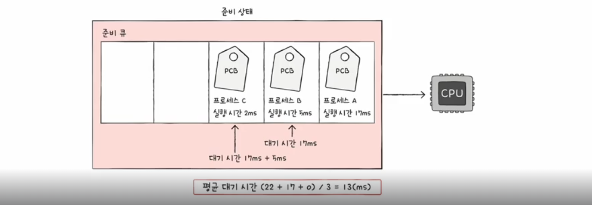
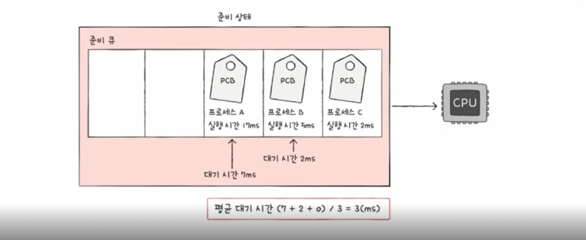
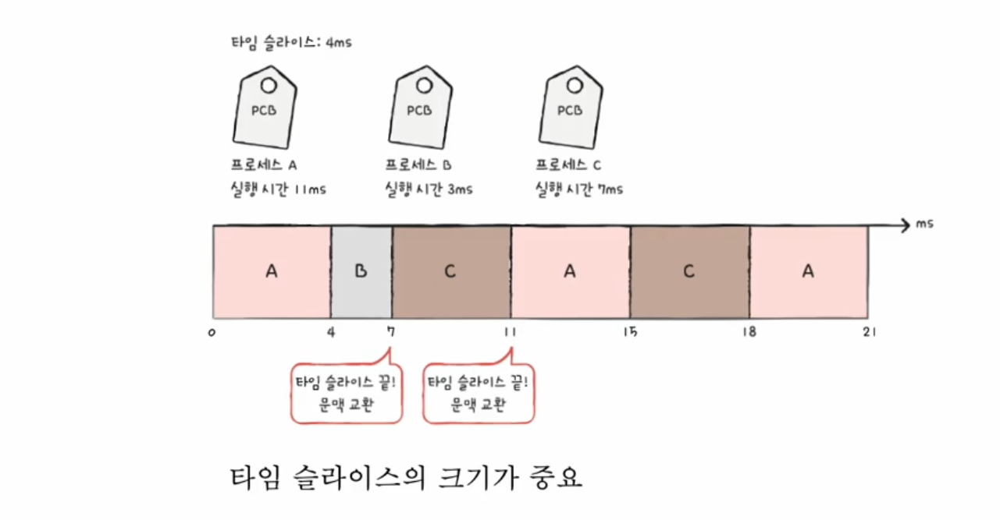
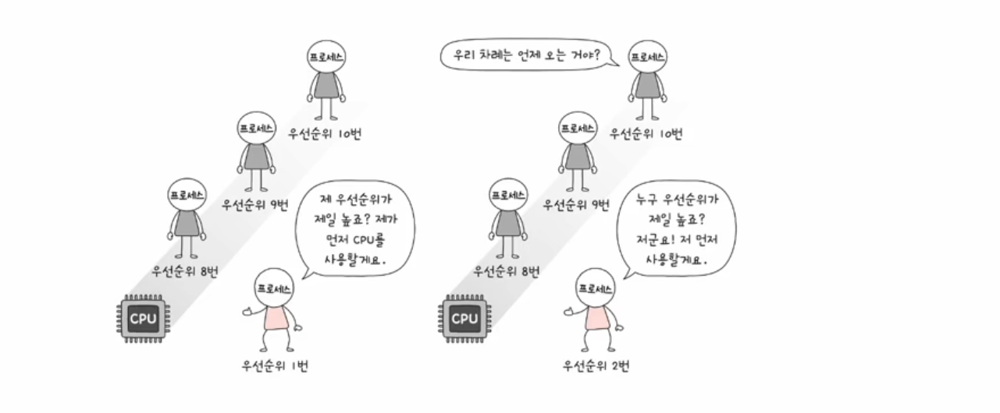
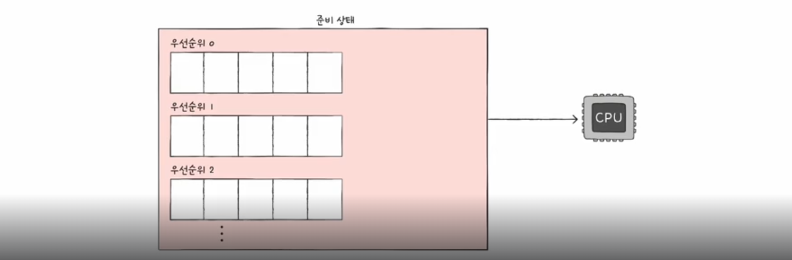
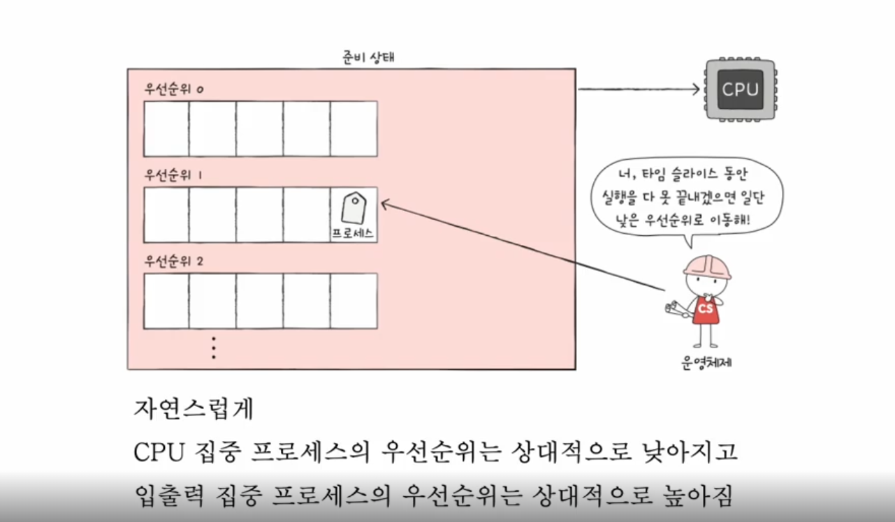

### 📌 **Convoy Effect (호위 효과)란?**

- **한 개의 느린 작업(또는 큰 작업)이 전체 시스템의 성능을 저하시킬 때 발생하는 현상**
- 느린 작업이 자원을 독점하면서, 뒤따르는 작은 작업(빠르게 처리될 수 있는 작업)까지 지연됨
- 마치 **느린 배(선박)가 앞장서고 나머지 배들이 그 속도에 맞춰 따라가는 것처럼 전체 속도가 느려지는 효과**

### 선입 선처리 스케줄링 

- FCFS(First Come First Served) 스케줄링
- 단순히 준비 큐에 삽입된 순서대로 처리하는 비선점 스케줄링 
- 먼저 CPU를 요청한 프로세스부터 CPU 할당 
- 단점: 프로세스들이 기다리는 시간이 매우 길어질 수 있다. (호위 효과)

### 최단 작업 우선 스케줄링 

- SJF(Shortest Job First) 스케줄링 
- 호위 효과를 방지
- CPU 사용이 긴 프로세스는 나중에 실행, CPU 사용 시간이 짧은 프로세스는 먼저 실행 
- CPU 사용 시간이 가장 짧은 프로세스부터 처리하는 스케줄링 방식 
- 비선점형 방식 

### 라운드 로빈 스케줄링 

- RR(Round Robin) 스케줄링 
- 선입 선처리 스케줄링 + 타임 슬라이스(time slice)
- 타임 슬라이스: 각 프로세스가 CPU를 사용할 수 있는 정해진 시간 
- 정해진 타임 슬라이스만큼의 시간 동안 돌아가며 CPU를 이용하는 선점형 스케줄링 
- 큐에 삽입된 프로세스들은 순서대로 CPU를 이용하되 정해진 시간만큼만 사용 
  - 정해진 시간을 모두 사용하였음에도 아직 프로세스가 완료되지 않았다면 다시 큐의 맨 뒤에 삽입(선점, 문맥교환)
- 타임 슬라이스의 크기가 중요 
- 너무 작으면 문맥 교환이 자주 발생 → 오버헤드 
  - 너무 크면 선입 선처리 스케줄링과 같이 호위 효과가 발생

### 최소 잔여 시간 우선 스케줄링 

- SRT (Shortest Remaining Time) 스케줄링 
- 최단 작업 우선 스케줄링 + 라운드 로빈 스케줄링 
- 최단 작업 우선 스케줄링: 작업 시간이 짧은 프로세스부터 처리하는 비선점형 스케줄링 알고리즘 
- 라운드 로빈 스케줄링: 정해진 타임 슬라이스만큼 돌아가며 사용하는 선점형 스케줄링 알고리즘 
- 정해진 시간만큼 CPU를 이용하되, 다음으로 CPU를 사용할 프로세스로는 남은 작업 시간이 가장 적은 프로세스 선택 

### 우선순위 스케줄링 

- 프로세스들에게 우선순위를 부여하고, 우선순위가 높은 프로세스부터 실행 
- 우선순위가 같은 프로세스들은 선입 선처리로 스케줄링 
- 최단 작업 우선 스케줄링(SJF), 최소 잔여 시간 스케줄링(SRT)은 모두 우선순위 스케줄링에 포함
- 우선순의 스케줄링의 근본적인 문제점, 기아(starvation) 현상 
- 우선순위가 높은 프로레스만 주구장창 실행 
- 우선순위가 낮은 프로세스는 (준비 큐에 먼저 삽입되었음에도 불구하고)실행 연기 

### 우선순위 스케줄링 방지 기법: 에이징(aging)

- 오랫동안 대기한 프로세스의 우선순위를 점차 높이는 방식 
- 대기 중인 프로세스의 우선순위를 마치 나이 먹듯 점차 증가시키는 방법 
- 우선순위가 낮아도 언젠가는 우선순위가 높아진다

### 다단계 큐 스케줄링 

- Multilevel queue 스케줄링 
- 우선순위 스케줄링의 발전된 형태 
- 우선순위별로 준비 큐를 여러 개 사용하는 스케줄링 방식 
- 우선순위가 가장 높은 큐에 있는 프로세스를 먼저 처리 
  - 우선순위가 가장 높은 큐가 비어 있으면 그 다음 우선순위 큐에 있는 프로세스 처리

### 다단계 피드백 큐 스케줄링 

- Multilevel feedback queue 스케줄링 
- 다단계 큐 스케줄링의 발전된 형태 
- 큐 간의 이동이 가능한 다단계 큐 스케줄링 
- 다단계 큐 스케줄링은 기본적으로 큐 간의 이동 불가 
- 우선순위 낮은 프로세스는 계속해서 실행 연기 우려 → 기아 현상 발생 가능

### 🔥 **MLFQ의 핵심 원리**

✅ **1. 처음에는 높은 우선순위 큐에서 실행**

- 새롭게 도착한 프로세스는 가장 높은 우선순위 큐에 배정
- 타임 슬라이스(time slice, CPU 점유 시간) 동안 실행

✅ **2. 타임 슬라이스를 초과하면 낮은 우선순위 큐로 이동**

- **CPU 집중 프로세스**(연산 위주, 입출력 적음) → **낮은 우선순위 큐**로 내려감
- **입출력 집중 프로세스**(I/O 작업 많음) → **높은 우선순위 유지** (빠르게 실행됨)

✅ **3. Aging(에이징) 적용하여 기아(starvation) 방지**

- 낮은 우선순위 큐에서 **오랫동안 실행되지 않은 프로세스의 우선순위를 점진적으로 상승**시킴

✅ **4. 우선순위가 높은 프로세스가 먼저 실행됨**

- 높은 우선순위 큐가 비어 있을 때만 낮은 우선순위 큐의 작업 실행

---

### ⚡ **왜 다단계 피드백 큐를 사용할까?**

📌 **장점**

- 입출력 중심 프로세스 → 빠르게 처리 (대기 시간 단축 ✅)
- CPU 중심 프로세스 → 나중에 실행 (효율적 자원 배분 ✅)
- Aging 적용 → 기아 현상 방지 (공정성 확보 ✅)
- 동적 조정 가능 → 프로세스의 실행 패턴에 따라 우선순위 변화 (유연성 ✅)

📌 **단점**

- 큐의 개수 및 타임 슬라이스 조정을 잘못하면 비효율 발생
- 스케줄링 로직이 복잡함

