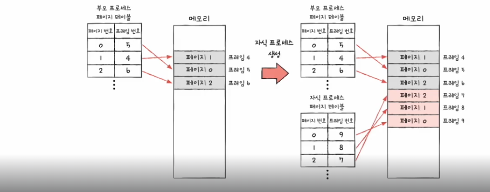
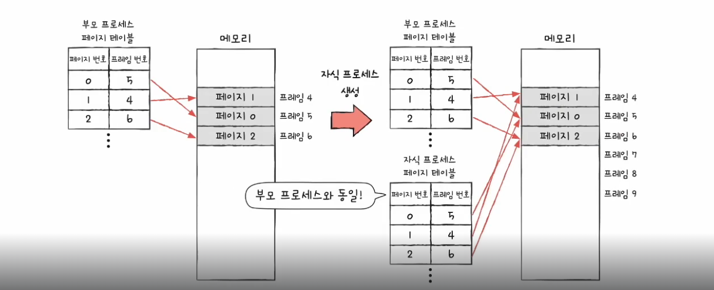
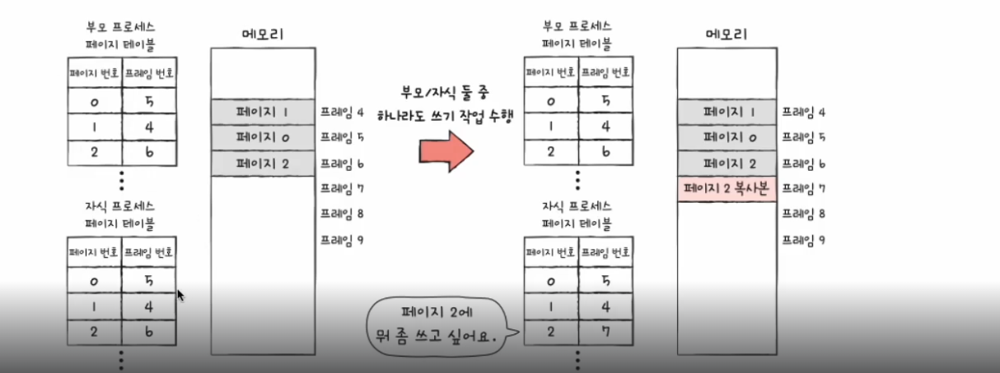
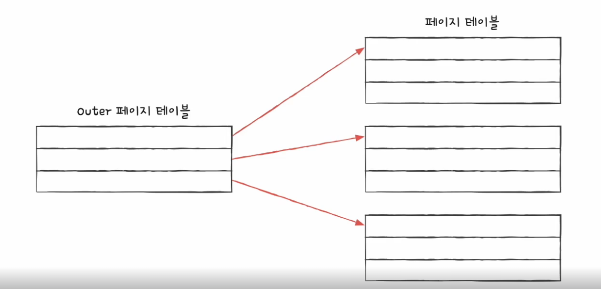
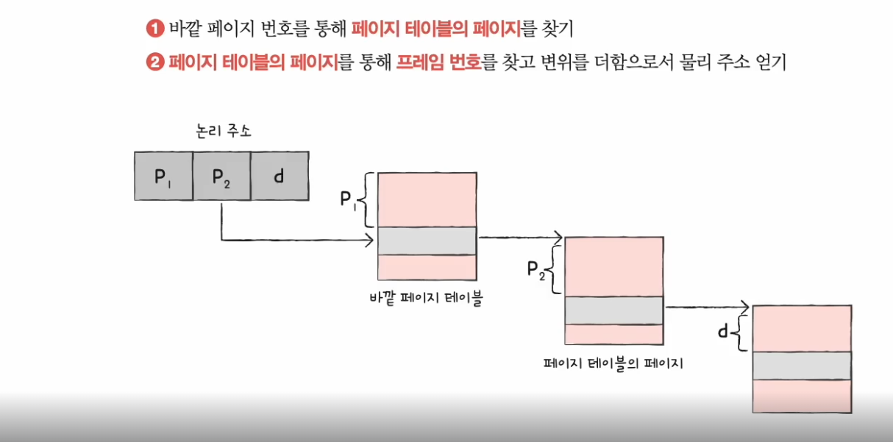

## **✅** 이론적인 fork()

프로세스는 기본적으로 자원을 공유하지 않는다. 

→ 부모 프로세스가 적재된 별도의 공간에 자식 프로세스가 통째로 복제되어 적재 

→ (프로세스 생성 시간 지연, 메모리 낭비) 

## **✅ 쓰기 시 복사** 

부모 프로세스와 동일한 자식 프로세스가 복제되어 생성되면 자식 프로세스는 부모 프로세스와 동일한 프레임을 가리킴(쓰기 작업이 없다면 이 상태 유지) 

부모 프로세스/자식 프로세스 둘 중 하나가 페이지에 쓰기 작업 수행 시 해당 페이지는 별도의 공간으로 복제 

(프로세스 생성 시간 절약, 메모리 절약) 

## **✅**  계층적 페이징 

- 프로세스 테이블의 크기는 생각보다 작지 않다 
- 프로세스를 이루는 모든 페이지 테이블 엔트리(행)를 메모리(커널 영역)에 두는 것은 큰 낭비 
- 프로세스를 이루는 모든 페이지 테이블 엔트리를 항상 메모리에 유지하지 않을 방법 

### 페이지 테이블을 페이징하여 여러 단계의 페이지를 두는 방식 

페이지 테이블을 여러 페이지로 쪼개고 이 페이지를 가리키는 페이지 테이블(Outer 페이지 테이블)을 두는 방식 

**모든 페이지 테이블을 항상 메모리에 필요가 없어짐**

- CPU와 가장 가까이 위치한 페이지 테이블(Outer 페이지 테이블)은 항상 메모리에 유지 

### 계층적 페이징을 이용하는 환경에서의 논리 주소 

현재 그림은 계층적 페이징은 2단계지만 더 많은 계층이 존재할 수 있다.

하지만 너무 많은 단계가 존재하면 페이지 폴트가 발생했을 때 보조기억장치의 접근 횟수가 많아져 성능에 좋지 않다.

