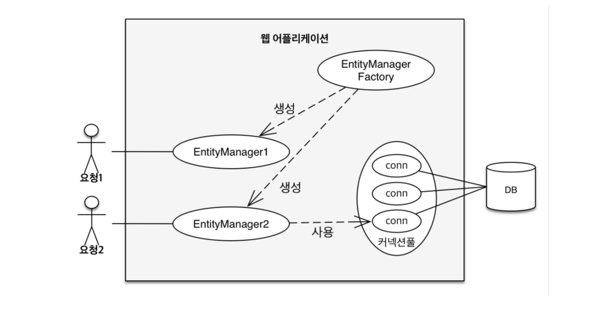
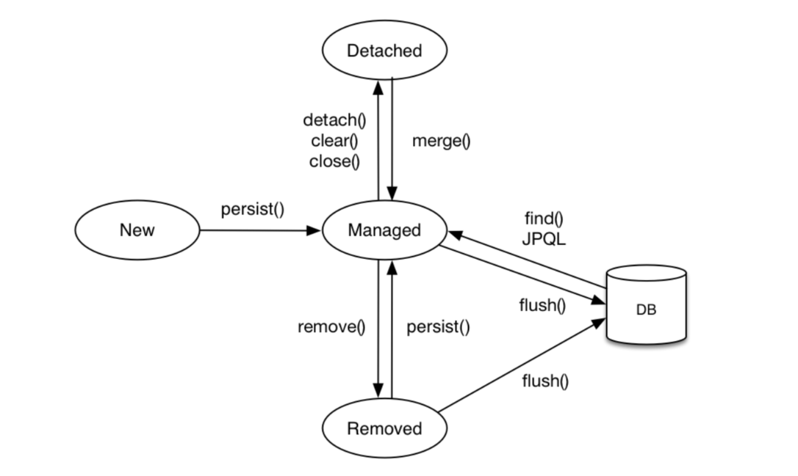
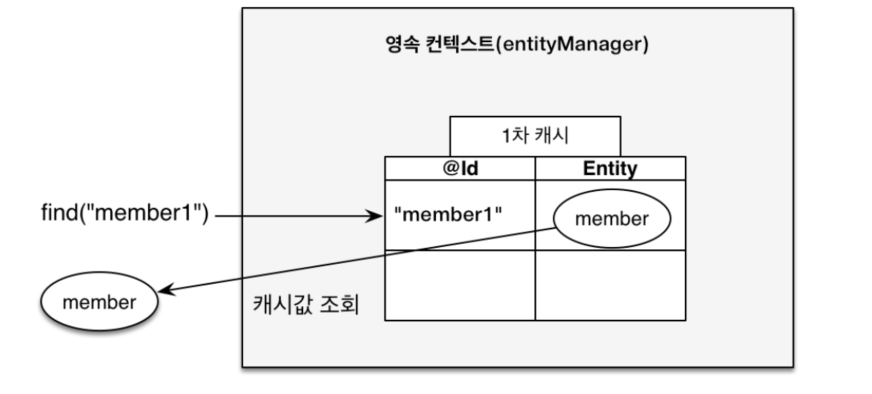
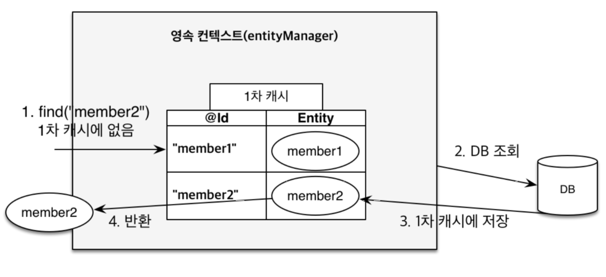
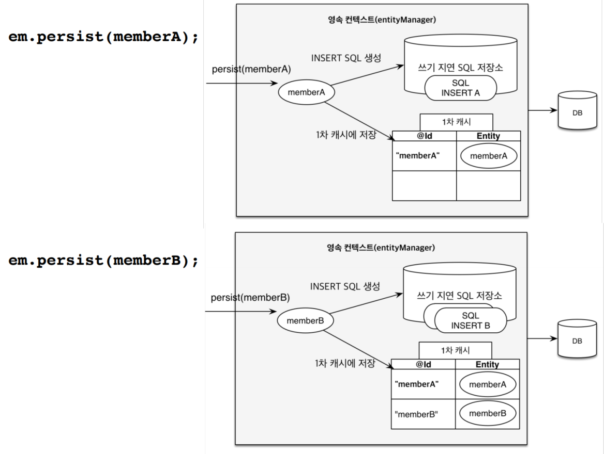
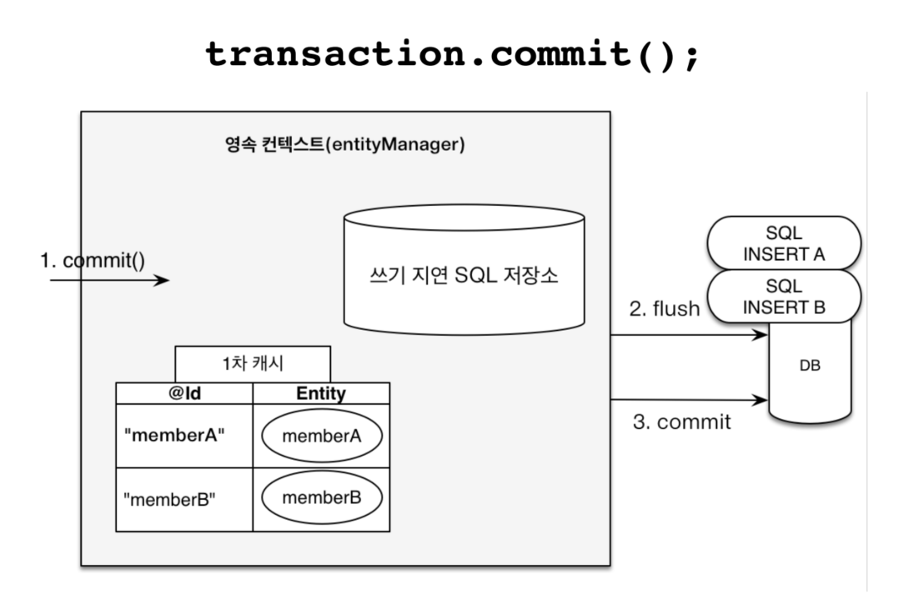
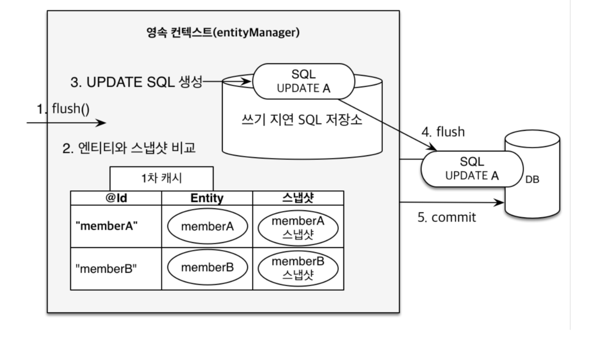

***JPA에서 가장 중요한 2가지***

- *객체와 관계형 데이터베이스 매핑하기 (Object Relational Mapping)*
- *영속성 컨텍스트*

# *영속성 컨텍스트* 

***엔티티 매니저 팩토리, 엔티티 매니저***



***영속성 컨텍스트***

- *엔티티를 영구 저장하는 환경?*
- *엔티티 매니저를 통해서 영속성 컨텍스트에 접근한다.*

# *엔티티 생명주기* 

- ***비영속 (new/transient)***
- *영속성 컨텍스트와 전혀 관계가 없는 새로운 상태*
- ***영속 (managed)***
- *영속성 컨텍스트에 관리되는 상태*
- ***준영속 (detached)***
- *영속성 컨텍스트에 저장되었다가 분리된 상태*
- ***삭제 (removed)***
- *삭제된 상태*



***비영속 상태 (NEW)***

```java
Member member = new Member();
member.setId(10L);
member.setName("10");
```

- *객체를 단지 생성한 상태*

***영속 상태(managed)***

```java
Member member = new Member();
member.setId(10L);
member.setName("10");

em.persist(member);
```

- *객체를 생성하고 영속성 컨텍스트에 저장*

# ***영속성 컨텍스트의 동작 원리와 이점*** 

- *1차 캐시*
- *동일성(identity) 보장*
- *트랜잭션을 지원하는 쓰기 지연(transactional write-behind)*
- *변경 감지(Dirty Checking)*
- *지연 로딩(Lazy Loading)*

## ***엔티티 조회, 1차 캐시*** 

***1차 캐시에서 조회***

```java
Member member = new Member();
member.setId("member1");
member.setUsername("회원1");

//1차 캐시에 저장
em.persist(member);

//1차 캐시에서 조회
Member findMember = em.find(Member.class, "member1");
```



- *1차 캐시에 “member1”를 key로 가지는 엔티티가 존재하기 때문에 데이터베이스에서 조회하지 않고 1차 캐시에서 조회한다.*

***데이터베이스에서 조회***

```java
Member findMember2 = em.find(Member.class, "member2");
```



- *“member2”를 가지는 엔티티는 1차 캐시에 존재하지 않기 때문에 DB에서 조회를 하고 1차 캐시에 저장을 한다.*

***JPA 1차 캐시는 애플리케이션 전반에서 큰 성능 향상을 기대할 수 없다.***

*왜냐하면 영속성 컨텍스트는 보통 각 요청 쓰레드의 트랜잭션 단위로 생성, 삭제되는데 
전체 쓰레드가 공유하는 컨텍스트가 아니기 때문이다.* 

*참고로 전체 쓰레드가 공유하는 캐시는 2차 캐시라고 한다.*

*즉, 1차 캐시의 주된 목적은 같은 트랜잭션 내에서 중복된 엔티티 조회 방지와 일관성 유지(Repeatable Read)이다.*

## ***영속 엔티티의 동일성 보장*** 

```java
Member find1 = em.find(Member.class, 1L);
Member find2 = em.find(Member.class, 1L);
System.out.println(find1 == find2);
```

- *출력: true*

*처음 em.find를 하면 데이터베이스에서 조회를 하고 1차 캐시에 저장한다.*

*두 번째 em.find를 하면 동일한 key로 조회하기 때문에 1차 캐시에 저장된 Member를 반환한다.*

*이때 find1 == find2 같은 객체이다.*

*이런 메커니즘 때문에 REPEATABLE_READ 등급의 트랜잭션 격리 수준을 데이터베이스가 아닌 애플리케이션 레벨에서 제공한다.*

## *트랜잭션을 지원하는 쓰기 지연(transactional write-behind)*

***쓰기 지연***

```java
EntityManager em = emf.createEntityManager();
EntityTransaction transaction = em.getTransaction();

//엔티티 매니저는 데이터 변경시 트랜잭션을 시작해야 한다.
transaction.begin(); 

em.persist(memberA);
em.persist(memberB);
//여기까지 INSERT SQL을 데이터베이스에 보내지 않는다.

// 커밋하는 순간 데이터베이스에 INSERT SQL을 보낸다.
transaction.commit(); // [트랜잭션] 커밋
```



- *em.persist(엔티티): 1차 캐시에 저장, 쓰기 지연 SQL 저장소에 저장*



***동작 흐름 정리***

*트랜잭션 커밋 tx.commit()*

*flush() → 쓰기 지연 SQL 저장소에 저장된 INSERT 쿼리 DB로 날아간다.*

*실제 DB 트랜잭션 커밋* 

***호출 시점 테스트***

```java
try {
    Member member1 = new Member(150L, "A");
    Member member2 = new Member(160L, "B");
    em.persist(member1);
    em.persist(member2);

    System.out.println("==============================");

    tx.commit();
}

// 출력 
==============================
Hibernate: 
    /* insert for
        hellojpa.domain.Member */insert 
    into
        Member (name, id) 
    values
        (?, ?)
Hibernate: 
    /* insert for
        hellojpa.domain.Member */insert 
    into
        Member (name, id) 
    values
        (?, ?)
```

- *2번의 INSERT 쿼리가 === 이후에 날라간다. 즉, 쓰기 지연이 동작*

***쓰기 지연 장점 정리***

- ***네트워크 요청 감소***
- *개별적으로 실행되는 여러 쓰기 작업이 트랜잭션 내에서 지연되었다가 커밋 시점에 하나의 배치 요청으로 처리되므로 네트워크 오버헤드를 줄일 수 있다.*
- ***데이터베이스 성능 최적화***
- *데이터베이스가 배치로 작업을 처리할 때, 트랜잭션당 I/O 작업이 줄어들고, 여러 개의 쿼리를 병합하여 효율적으로 실행할 수 있다.*
- ***쓰기 작업 병합***
- *동일한 키에 여러 번 쓰기 작업이 발생할 경우, 최신 상태만 저장하므로 중복 작업이 제거*

## ***엔티티 수정, 변경 감지(Dirty Checking)***

```java
Member member = em.find(Member.class, 150L);
member.setName("배제우150");
tx.commit();


Hibernate: 
    select
        m1_0.id,
        m1_0.name 
    from
        Member m1_0 
    where
        m1_0.id=?
Hibernate: 
    /* update
        for hellojpa.domain.Member */update Member 
    set
        name=? 
    where
        id=?
```

- *단지 em.find()를 통해서 엔티티를 조회하고 setter를 통해서 변경만 했는데 update 쿼리가 날라간다. 별도의 persist(), update() 호출이 없다!!*

***변경 감지 메커니즘***



- *flush() 시점에 1차 캐시와 스냅샷을 비교한다.*
- *스냅샷의 생성 시점은 1차 캐시에 최초 저장 시점과 동일하다.*
- *스냅샷의 엔티티와 1차 캐시의 엔티티를 비교한다.* 
- *만약 비교해서 다르면 UPDATE SQL을 쓰기 지연 저장소에 넣는다.*
- *최종적으로 DB에 UPDATE 쿼리가 날아간다.*

## ***엔티티 삭제*** 

```java
// 삭제 대상 엔티티 조회 
Member member160 = em.find(Member.class, 160L);

// 엔티티 삭제
em.remove(member160);

--------------------------------------------------------------------------------------

Hibernate: 
    select
        m1_0.id,
        m1_0.name 
    from
        Member m1_0 
    where
        m1_0.id=?
Hibernate: 
    /* delete for hellojpa.domain.Member */delete 
    from
        Member 
    where
        id=?
```

# *플러시* 

*영속성 컨텍스트의 변경내용을 데이터베이스에 반영* 

***플러시 발생***

- *변경 감지*
- *수정된 엔티티 쓰기 지연 SQL 저장소에 등록* 
- *쓰기 지연 SQL 저장소의 쿼리를 데이터베이스에 전송(등록, 수정, 삭제 쿼리)*

***영속성 컨텍스트를 플러시하는 방법***

- *em.flush() - 직접 호출*
- *트랜잭션 커밋 - 플러시 자동 호출* 
- *JPQL 쿼리 실행 - 플러시 자동 호출* 

```java
try {
    Member member = new Member(200L, "member200");
    em.persist(member);
    em.flush();
    System.out.println("=============================");
    tx.commit();
}

-------------------------------------------------------------------------------------

Hibernate: 
    /* insert for
        hellojpa.domain.Member */insert 
    into
        Member (name, id) 
    values
        (?, ?)
=============================
```

- *커밋 이전에 flush()를 호출 하였다.* 
- *flush() 작업은 쓰기 지연 SQL 저장소(Hibernate의 ActionQueue)에 누적된 SQL을 데이터베이스로 전송*
- *즉, 영속성 컨텍스트(1차 캐시)와 데이터베이스의 상태를 동기화하려는 작업*

### ***JPQL 쿼리 실행시 플러시가 자동으로 호출되는 이유***

```java
em.persist(memberA);
em.persist(memberB);
em.persist(memberC);

// 중간에 JPQL 실행
query = em.createQuery("select m from Member m", Member.class);
List<Member> members= query.getResultList();
```

*JPA는 애플리케이션에서 같은 트랜잭션의 REPEATABLE_READ를 보장한다고 했었다.*

*만약 예시로 나온 JPQL이 플러시를 호출하지 않는다면 memberA, memberB, memberC 엔티티는 조회에서 누락된다.*

*이런 메커니즘 때문에 항상 JPQL은 플러시 호출을 하여 쓰기 지연 SQL 저장소에 누적된 SQL을 데이터베이스로 전송하고 이후에 동작한다.*

### *플러시 모드 옵션*

- *FlushModeType.AUTO*
- *커밋이나 쿼리를 실행할 때 플러시 (기본값)*
- *FlushModeType.COMMIT*
- *커밋할 때만 플러시*

### ***플러시 주의사항***

- *플러시는 영속성 컨텍스트를 비우지 않음*
- *플러시는 영속성 컨텍스트의 변경내용을 데이터베이스에 동기화하는 작업이다.*
- *트랜잭션이라는 작업 단위가 중요하다 → 커밋 직전에만 동기화 하면된다.*

# *준영속 상태*

- *영속 -> 준영속*
- *영속 상태의 엔티티가 영속성 컨텍스트에서 분리(detached)*
- *영속성 컨텍스트가 제공하는 기능을 사용 못함*

***만드는 방법***

- *em.detach(entity)*
- *특정 엔티티만 준영속 상태로 전환*
- *em.clear()*
- *영속성 컨텍스트를 완전히 초기화*
- *em.close()*
- *영속성 컨텍스트를 종료*

```java
try {
    Member member = em.find(Member.class, 150L);
    member.setName("배제우");
    em.detach(member);
    tx.commit();
}
----------------------------------------------------------------------------------------
Hibernate: 
    select
        m1_0.id,
        m1_0.name 
    from
        Member m1_0 
    where
        m1_0.id=?
```

- *em.detach()로 인해서 변경 감지가 동작하지 않는다.*
- *그래서 SELECT 쿼리만 날아간다. (Update 쿼리가 없다.)*

```java
try {
    Member member1 = em.find(Member.class, 150L);
    member1.setName("배제우");

    em.clear();
    Member member2 = em.find(Member.class, 150L);
    tx.commit();
}

-------------------------------------------------------------------------------------
Hibernate: 
    select
        m1_0.id,
        m1_0.name 
    from
        Member m1_0 
    where
        m1_0.id=?
Hibernate: 
    select
        m1_0.id,
        m1_0.name 
    from
        Member m1_0 
    where
        m1_0.id=?
```

- *em.clear()로 영속성 컨텍스트를 완전히 초기화해서 1차 캐시에서 조회하지 못하고 다시 SELECT 쿼리가 날아간다.*

